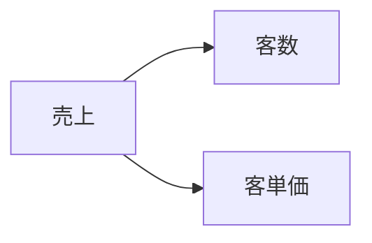

# 執筆ルール（STYLE）

このリポジトリの文章は、次のルールで書きます。寄稿するときも同じルールに従ってください。

## 1. 読者

- 飲食店の経営に関わるのが初めての人
- 現場経験はあるが、数字での経営管理を学びたい人
- 飲食店向けのシステムやサービスを企画・設計する人

**専門用語は初出時に必ず説明します。** 説明なしに使ってよいのは、一般的な日本語として定着している語（売上、客、料理など）だけです。

## 2. 文体

- ですます調で書く（「〜です」「〜します」）。
- 1文を短くする。読点でつなぎすぎない。
- 断定できることは断定する。判断が分かれることは「〜と考えられます」と書く。
- 冗長な前置き（「今回は」「まず始めに」の連続）を避ける。

## 3. 構造

各章は次の順で構成します。

```
# 第N章 タイトル

（導入: この章で何を扱うか。2〜4文）

## N.1 ...
## N.2 ...
...

## N.x よくある誤解        ← 表形式
## N.y この章の要点        ← 箇条書き3〜5項目
## N.z 自店で確認すること  ← チェックリスト
## N.w 演習                ← 2〜3問（解答付き）
## 出典と確度
```

## 4. 数値と出典

これがこのリポジトリで最も重要なルールです。

1. **数値には出典・公表年・取得日を付ける。**
   - 例: 出典: 東京商工リサーチ「〜」（2026年11月10日公表）、https://... （取得日 2026-11-14）
2. **出典を確認できない数値は載せない。** 載せる場合は「一般知識（未検証）」と明示する。
3. **取得できなかったものは「未取得」と書く。** 推測で埋めない。
4. **数値例は「説明用の仮置き」と明示する。** 実在の店舗の実績と誤解されないようにする。
5. **集計条件を書く。** 対象、期間、基準（負債1,000万円以上など）を添える。

### 確度の表記

| 表記 | 意味 |
| --- | --- |
| 確定 | 一次資料または公的機関の資料で直接確認した |
| 高 | 一次資料で確認した |
| 中 | 間接的な資料、または単一の資料 |
| 一般知識（未検証） | 業界一般の知見。特定の数値の根拠にはしない |
| 未取得 | 取得を試みて失敗した。数値は示さない |

## 5. 表と図

- **比較・分類・定義の一覧は表にする。** 長い文章で並べない。
- **流れ・構造・因果は Mermaid 図にする。** GitHub でそのまま描画されます。



- 図には必ず説明文を付ける。図だけを置かない。

## 6. 計算

- 計算式はコードブロックで示す。

```
損益分岐点売上 = 固定費 ÷（1 − 変動費率）
```

- **必ず数値例を付ける。** 式だけで終わらせない。
- 数値例は検算できる形にする（途中の値も書く）。
- 丸めは明示する（「小数第1位を四捨五入」など）。

## 7. 法規・制度

- 根拠となる法令名を書く。
- 施行日を書く。**確認できていない施行日は「未確定」と書く。**
- 「〜とされています」ではなく、可能なら一次資料の表現を引用する。
- **法的助言ではないことを明記する。**

## 8. リンクとファイル名

- ファイル名は英小文字とハイフン（例: `03-kyaku-tanka-kaiten.md`）。
- 内部リンクは相対パス（例: `[第1章](01-shokugyo-no-zentai.md)`）。
- 章末に前後の章へのリンクを1行で置く。形式は次に統一する。

```
前後の章: [第1章: 飲食店経営とはどんな商売か](01-shokugyo-no-zentai.md) ／ [第3章: 客数・客単価・回転率・席稼働率](03-kyaku-tanka-kaiten.md)
```

- 最初の章と最後の章では、片側を「目次」にする。

```
前後の章: [目次](../README.md) ／ [第2章: 収益構造と原価管理](02-shueki-kouzou-genka.md)
```

## 9. 禁止事項

- 出典のない断定。
- 引用の捏造。
- 取得できなかった統計を、一般論で埋めること。
- 特定の店舗・企業を誹謗する記述。
- 実在の個人情報。
- 他者の著作物の無断転載（引用の範囲を超えるもの）。
