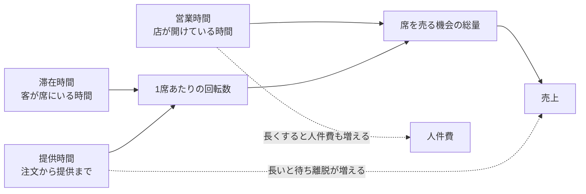
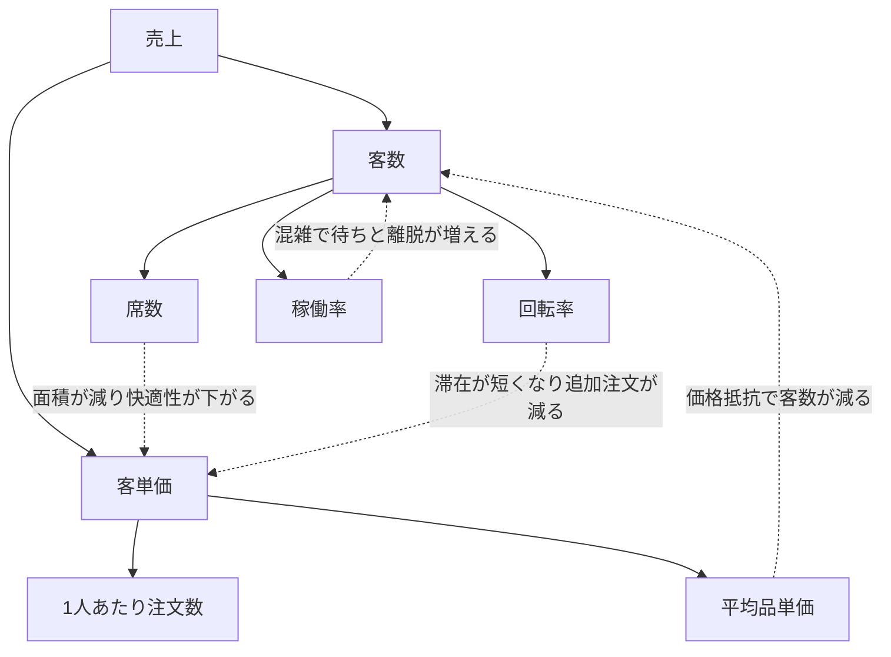
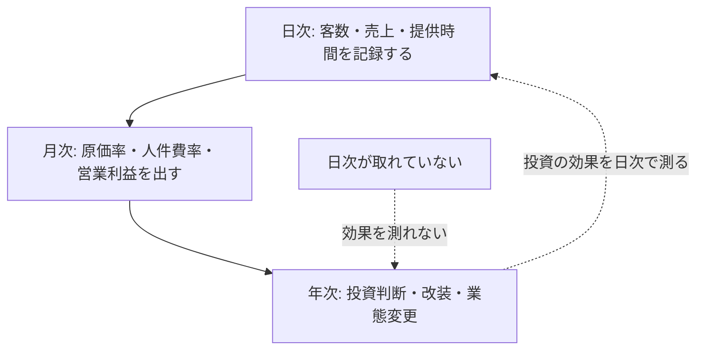

# 第1章 飲食店経営の構造

## 1.1 この章で扱うこと

飲食店経営を「勘と根性の世界」ではなく、数字で説明できる仕組みとして捉え直します。前半では、飲食店が何を売っているのか（席と時間）、売上がどのように分解できるのかを扱います。後半では、売れたお金がどこへ流れるのか、なぜこの商売が倒れやすいと言われるのか、判断をどの時間軸で分けるのかを説明します。用語はすべて初出時に説明します。

## 1.2 学習目標

- 飲食店が売っているものを「料理・席・時間」の3つに分けて説明できる。
- 売上を `席数 × 回転率 × 客単価` に分解し、数値を代入して1日・1か月の売上を計算できる。
- 席数・回転率・客単価・稼働率のあいだにあるトレードオフを、具体例を挙げて説明できる。
- 粗利で固定費を回収する構造を、金額と率の両方で示せる。
- 日次・月次・年次の3つの時間軸で、それぞれ何を判断するかを書き出せる。

## 1.3 飲食店は「席と時間」を売る商売

### 1.3.1 売っているものは3つに分かれる

飲食店は料理を売っているように見えます。しかし、客が代金を払っている対象を分解すると、3つに分かれます。

| 売っているもの | 実体 | 制約 |
| --- | --- | --- |
| 料理 | 仕入れた食材を調理したもの | 食材は傷む。作り置きできない |
| 席 | 客が座る場所と、そこに居られる時間 | 店の面積で上限が決まる |
| 時間 | 調理・提供・会計にかかる時間 | 1日の営業時間で上限が決まる |

この3つのうち、**席と時間は在庫として保存できません**。今日の12時の空席を、明日に繰り越すことはできません。売り逃した分は永久に消えます。しかも売り逃しは記録に残らないので、気づかないまま同じ損失を繰り返します。これが飲食店経営の最大の特徴です。

> **要点**: 飲食店の売上は「今日、何人が、いくら使って、何分席を占有したか」でほぼ決まります。この4つを測れない店は、改善のしようがありません。

### 1.3.2 席を数えるときの区分

「席数」と一口に言っても、性格の違う席が混在しています。数えるときは区分を分けて記録します。

| 席の種類 | 特徴 | 売上への効き方 |
| --- | --- | --- |
| カウンター | 1人客に向く。回転が速い | 回転率を稼ぎやすい。客単価は上がりにくい |
| テーブル | 2〜4人客の中心。滞在が長い | 客単価は上がるが、1人あたり面積が大きい |
| 座敷・個室 | 団体・宴席向け。滞在が最も長い | 客単価は高い。平日の埋まりが課題 |
| 屋外席（テラスなど） | 天候に左右される | 変動が大きい。下記の注意が必要 |

**屋外席には注意が必要です。** 屋外に席を出す場合、その場所が営業許可の対象範囲に入っているか、消防の収容人員に算入されるかを、保健所と消防署に確認する必要があります。確認が終わるまで、屋外席を「客席」として席数に数えないでください（→ [第10章: 営業許可と法規](10-kyoka-hourei.md)）。

また、**実際に座れる席数**と**図面上の席数**は違います。荷物置き場になっている席、通路として使っている席、厨房への動線を塞ぐ席は、実質的に使えません。席数は「実際に客を通せた数」で数えます。

### 1.3.3 売り逃しは記録に残らない

飲食店の数字には、性格の違う2種類があります。

| 種類 | 例 | 記録 |
| --- | --- | --- |
| 起きたこと | 売上、客数、注文数、提供時間 | レジ・伝票・POS に残る |
| 起きなかったこと | 満席で断った客、待ちきれず帰った客、品切れで頼めなかった料理 | ふつうは残らない |

経営改善で見落とされやすいのは後者です。「今日は満席で忙しかった」という記憶は残っても、「何組を断ったか」は残りません。**断った組数を1日1行メモする**だけでも、機会損失の大きさが見えるようになります（→ [第8章: 客数・客単価・回転率・席稼働率](08-kyaku-tanka-kaiten.md)）。

## 1.4 時間を3種類に分けて考える

### 1.4.1 営業時間・滞在時間・提供時間

「時間」と一口に言っても、誰の時間かで3種類に分かれます。この3つを混ぜると、打ち手を間違えます。

| 時間の種類 | 誰の時間か | 売上への効き方 |
| --- | --- | --- |
| 営業時間 | 店が開けている時間 | 長いほど席を売る機会が増える。ただし人件費も増える |
| 滞在時間 | 客が席にいる時間 | 長いほど注文の機会は増えるが、回転は落ちる |
| 提供時間 | 注文から料理が出るまで | 長いと回転が落ち、待ちでの離脱も増える |

3つの関係は、次のように整理できます。



上の図は、営業時間が「機会の総量」を決め、滞在時間と提供時間が「1席あたり何回転できるか」を決めることを示しています。点線は副作用です。

### 1.4.2 3つの時間を使った数値例

**数値例（説明用の仮置き）**: 席数20席、営業時間7.5時間（昼3時間＋夜4.5時間）、客数80人/日、平均滞在時間60分とします。

```
供給できる席時間（1日）= 20席 × 7.5時間 = 150席時間
使われた席時間（1日）  = 80人 × 1.0時間 = 80席時間
席稼働率             = 80 ÷ 150 = 0.533... → 53.3%
回転率               = 80人 ÷ 20席 = 4.0回転
```

**席稼働率**とは、営業時間のうち席が埋まっていた割合です。**回転率**とは、1つの席が1日に何人使ったか（人数ベース）です。この2つは、平均滞在時間を挟んで変換できます。

```
回転率 = 席稼働率 × 営業時間 ÷ 平均滞在時間
       = 0.533 × 7.5時間 ÷ 1.0時間
       = 4.0回転
```

検算すると一致します。つまり「稼働率が53.3%で滞在60分」という状態と「1日に4回転」という状態は、同じことを別の角度から見たものです（関係式の導出は[第8章](08-kyaku-tanka-kaiten.md)で扱います）。

## 1.5 売上の分解式

### 1.5.1 基本の式

売上は次のように分解できます。この式が、以降のすべての章の土台になります。

```
売上（1日）= 客数 × 客単価
```

さらに客数を分解すると、

```
客数（1日）= 席数 × 回転率
```

客単価も分解できます。

```
客単価 = 1人あたり注文数 × 平均品単価
```

つまり全体では、次の形になります。

```
売上（1日）= 席数 × 回転率 × 客単価
```

| 用語 | 意味 | 単位の例 |
| --- | --- | --- |
| 席数 | 客が座れる席の数 | 20席 |
| 回転率 | 1つの席が1日に何人使ったか（人数ベース） | 3.0回転 |
| 稼働率 | 営業時間のうち、席が埋まっていた割合 | 60% |
| 客単価 | 1人の客が1回の来店で使う金額 | 1,200円 |
| 平均品単価 | 注文1品あたりの平均金額 | 700円 |

**計算例（説明用の仮置き）**: 20席、回転率3.0回転、客単価1,200円の店なら、

```
20席 × 3.0回転 = 60人/日
60人 × 1,200円 = 72,000円/日
```

月25日営業なら 72,000円 × 25日 = 1,800,000円/月 です。

### 1.5.2 客数を「組数」で数える場合

客数を人数で数えるか、組数（1回の来店のまとまり）で数えるかで、式の形が変わります。2人で来た客を「1組」と数えるか「2人」と数えるか、という違いです。

| 数え方 | 式 | 使う場面 |
| --- | --- | --- |
| 人数ベース | 売上 = 席数 × 回転率（人） × 客単価（1人あたり） | 席の使われ方を見るとき |
| 組数ベース | 売上 = 席数 × 回転率（組） × 1組あたり売上 | 卓の稼働と客層を見るとき |

どちらでも構いませんが、**同じ店の中で混ぜない**ことが重要です。人数で数えた回転率と、組数で数えた回転率を同じ表に並べると、意味のない比較になります。本書では、断りがない限り**人数ベース**で統一します。

### 1.5.3 稼働率を掛けてはいけない理由

改善の対象を漏れなく挙げるため、次の形で書かれることもあります。

```
売上（1日）= 席数 × 回転率 × 稼働率 × 客単価
```

ただし、この4つをそのまま掛けて計算してはいけません。回転率と稼働率は、同じ「席の使われ方」を別の角度から見た値です。両方を掛けると二重計上になります。

- **見取り図として使う**: 改善の候補を4つに分けて漏れを防ぐ。
- **計算には使わない**: 実際の計算は `席数 × 回転率 × 客単価` で行う。

たとえば1.4.2の例で4つを掛けると、20席 × 4.0回転 × 0.533 × 900円 = 38,376円/日となり、正しい72,000円/日（80人 × 900円）の約半分になります。**式の形を覚えることより、二重計上しないことを覚えてください。**

### 1.5.4 この式の使い方

この式の意味は「**4つのどれかを上げれば売上が増える**」ということです。改善の打ち手を探すときは、次の順に確認します。

1. **席数**: 増やせる余地があるか（面積、許可、動線）。
2. **回転率**: 提供時間と滞在時間を短くできるか（オペレーション、席の形）。
3. **客単価**: 注文数を増やせるか、単価の高い商品に誘導できるか（メニュー、提案）。
4. **稼働率**: 空いている時間帯を埋められるか（集客、時間帯別の施策）。

ただし4つは互いに影響し合います。次節で扱います。

## 1.6 4つの数字は互いに影響し合う

### 1.6.1 分解と副作用

4つの数字は独立ではありません。1つを動かすと、別の数字が動きます。



上の図は、売上を4つの項に分解し、片方を上げたときに別の項へ及ぶ影響を点線で示したものです。実線が分解、点線が副作用を表します。

### 1.6.2 代表的なトレードオフ

| 動かす項 | 上げたときに起きやすいこと | 結果 |
| --- | --- | --- |
| 席数を増やす | 1席あたりの面積が減る。通路・厨房が狭くなる | 快適性と提供速度が下がる |
| 回転率を上げる | 滞在時間が短くなり、追加注文の機会が減る | 客単価が下がる |
| 稼働率を上げる | 待ち行列が出て、待ちきれない客が離脱する | 機会損失が増える |
| 客単価を上げる | 価格抵抗が出る。量を減らせば満足度が下がる | 客数が減る |

### 1.6.3 「すべてを上げる施策」は存在しない

4つを同時に大きく上げる施策は存在しないと考えたほうが安全です。実際の経営では「どれを上げ、どれを犠牲にするか」を選ぶことになります。この選択が業態の選択でもあります（業態別の構造は[第2章: 損益計算書の読み方](02-soneki-keisansho.md)で扱います）。

**トレードオフを数字で確かめる例（説明用の仮置き）**: 席数を20席から24席に増やしたとします。面積が同じなら1席あたりが狭くなり、提供時間が伸びます。仮に回転率が4.0回転から3.4回転に落ちたとすると、

```
変更前: 20席 × 4.0回転 = 80人/日
変更後: 24席 × 3.4回転 = 81.6人/日 → 82人/日
```

客数はほとんど増えません。席を4つ増やすための内装費と、窮屈になったことで下がる客単価を考えると、この変更は割に合わない可能性があります。**席数を増やす判断は、回転率への影響を織り込んでから行います。**

## 1.7 お金の流れ：粗利で固定費を回収する

### 1.7.1 引かれる順番

売上が入っても、全部が手元に残るわけではありません。順番に引かれていきます。

```
売上高
 − 材料費（食材・飲料の仕入れ）
 = 粗利（あらり）
 − 人件費
 − 家賃・共益費
 − 水道光熱費
 − その他（消耗品、広告、システム、リース、保険など）
 = 営業利益
```

| 用語 | 意味 | なぜ重要か |
| --- | --- | --- |
| 材料費 | 提供した料理の食材原価 | 売上に比例して増える（変動費） |
| 粗利 | 売上 − 材料費 | 人件費や家賃を払う原資 |
| 変動費 | 売上に比例して増える費用 | 材料費が代表 |
| 固定費 | 売上が0でも発生する費用 | 家賃、正社員人件費、リース料、システム月額 |
| 営業利益 | すべての費用を引いた残り | 店が健全かどうかの結論 |

この章では**流れの形**だけを押さえます。損益計算書の段階構造と各段階の意味は[第2章](02-soneki-keisansho.md)、材料費の中身は[第3章](03-zairyo-hi-genka.md)、人件費は[第4章](04-jinken-hi-seisansei.md)、固定費の内訳と立地は[第5章: 固定費と立地](05-koteihi-ricchi.md)で扱います。

### 1.7.2 粗利は率で、固定費は額で見る

ここで押さえるべき点は2つです。

1. **粗利は「売上の何%か」で管理します。** 材料費率（原価率）が30%なら粗利率は70%です。売上1,000,000円なら粗利700,000円になります。
2. **固定費は売上が減っても減りません。** 家賃は客が来なくても発生します。だから「売上が落ちた月」は利益が急に消えます。

### 1.7.3 感応度の数値例

**計算例（説明用の仮置き）**: 月商1,000,000円、原価率30%、固定費600,000円の店なら、粗利は700,000円、営業利益は100,000円です。

```
粗利     = 1,000,000円 × (1 − 0.30) = 700,000円
営業利益 = 700,000円 − 600,000円 = 100,000円
```

原価率が35%に上がると、

```
粗利     = 1,000,000円 × (1 − 0.35) = 650,000円
営業利益 = 650,000円 − 600,000円 = 50,000円
```

**原価率5ポイントの悪化で、利益は半分になります。** これが固定費の重い商売の感応度です。同じことは売上の減少でも起こります。売上が1割落ちて900,000円になると、粗利は630,000円、営業利益は30,000円です（原価率30%が維持された場合）。

| 変化 | 売上 | 粗利 | 固定費 | 営業利益 |
| --- | --- | --- | --- | --- |
| 基準 | 1,000,000円 | 700,000円 | 600,000円 | 100,000円 |
| 原価率が35%に | 1,000,000円 | 650,000円 | 600,000円 | 50,000円 |
| 売上が1割減 | 900,000円 | 630,000円 | 600,000円 | 30,000円 |

この表は、**利益が小さい店ほど、小さな変化で消える**ことを示しています。利益率が10%の店は、売上1割減で利益がほぼ消えます（100,000円 → 30,000円）。だから飲食店は「売上の変動に弱い」と言われます。

## 1.8 飲食店が倒れやすいと言われる理由

### 1.8.1 倒産統計と、その読み方

飲食店の倒産は増えています。東京商工リサーチの集計（負債1,000万円以上）では、**2026年10月の飲食業倒産は98件**で10月として1997年以降最多、**2026年1〜10月の累計は870件**（前年同期比＋4.5%）、**2025年通年は1,002件**で30年間で最多でした。原因別では販売不振が77件（78.5%）を占めています（出典は本章末）。

ただし、この数字の読み方には注意が必要です。**倒産件数の増加は「倒産確率の上昇」を意味しません。** 分母の企業数、負債1,000万円以上という集計基準、休廃業・解散が倒産に計上されない点を無視すると誤読します。また「飲食店は3年で7割が廃業する」という言い方がよくされますが、**本資料では出典を確認できていないため数値として採用しません**。

集計条件を必ずセットで読んでください。

| 読むときの確認点 | この統計での条件 | 外すと起きる誤読 |
| --- | --- | --- |
| 対象 | 負債1,000万円以上 | 小規模店の廃業は含まれない |
| 含まれないもの | 休廃業・解散 | 静かに店を閉じた分が見えない |
| 分母 | 企業数（母数） | 件数の増減を確率の増減と読み違える |
| 原因分類 | 販売不振が77件（78.5%） | 「需要を取れないこと」が主因だと分かる |

### 1.8.2 構造的な理由

倒産統計とは別に、構造的に厳しい理由は数字に依存せず説明できます。

| 構造 | 内容 | 帰結 |
| --- | --- | --- |
| 固定費が重い | 家賃・人件費・設備リースが先に発生する | 客数が少し落ちるだけで赤字になる |
| 在庫を保存できない | 食材は傷む。売れ残りは廃棄 | 需要予測の誤りが直接損失になる |
| 席数が面積で固定される | 短期に供給を増やせない | 混雑しても売上は頭打ち |
| 参入が容易 | 資金と資格のハードルが比較的低い | 競合が増えやすく、価格競争に陥りやすい |
| 人手が流動的 | アルバイト依存。教育コストが高い | 品質が人によってばらつく |
| 現金商売でキャッシュが見えにくい | 売上と入金のタイミングがずれにくい一方、支払いは集中する | 黒字でも資金ショートしうる |

### 1.8.3 現金が見えにくいという落とし穴

上の表の最後の項目は誤解されやすい点です。飲食店は現金払いが多く「現金が手元にある」状態になりやすいのですが、その現金は**仕入れ代金・人件費・税金の支払いに充てるべきお金**です。これを売上と混同すると、黒字なのに支払えない状態になります。

| 手元の現金の性格 | 例 | 使ってよいか |
| --- | --- | --- |
| すでに他人のもの | 預り消費税、源泉所得税、社会保険料 | 使えない |
| 近いうちに出ていく | 仕入れ代金、翌月の人件費、家賃 | 使えない |
| 自分のもの | 利益として残った分 | 使える（ただし運転資金を残す） |

この区別は、黒字倒産を防ぐための基本です（→ [第7章: キャッシュフロー](07-cashflow.md)）。

### 1.8.4 撤退の判断が遅れる

さらに、撤退の判断が遅れやすいという性質があります。内装や厨房機器に投じた初期投資は、店を閉じると回収できません。そのため「もう少し続ければ戻るかもしれない」と営業を続け、損失が広がるケースがあります。これは**埋没費用（サンクコスト：すでに支払って戻らない費用）に引きずられる**典型的な失敗です（一般知識（未検証））。

判断は「これまでいくら使ったか」ではなく「**この先いくら得られるか**」で行います。

```
撤退の判断 = この先の期待利益（この先の売上 − この先の支出）< 0 かどうか
```

ただし、撤退には解約違約金、原状回復義務、従業員への通知期間といった個別の条件が伴います。実際の判断では、契約書を確認したうえで金額を置く必要があります。

## 1.9 経営の3つの時間軸

### 1.9.1 日次・月次・年次

飲食店の判断は、時間軸が違う3つの層に分かれます。混ぜると判断を誤ります。

| 時間軸 | 期間 | 主な判断 | 指標 |
| --- | --- | --- | --- |
| 日次 | 今日〜今週 | 仕込み量、シフト、売り切れ対応 | 客数、売上、提供時間 |
| 月次 | 1か月 | メニュー改定、シフト組み、仕入れ先 | 原価率、人件費率、営業利益 |
| 年次・投資 | 数か月〜数年 | 改装、業態変更、システム導入、出店 | 投資回収、損益分岐点、キャッシュフロー |

**DX**（デジタルトランスフォーメーション：業務をシステムで置き換え、記録と判断の精度を上げること）は3層目に属します。日次オペレーションの数字が取れていない状態で年次の投資判断をすると、効果を測れません。

### 1.9.2 順序を逆にすると失敗する

順序は決まっています。**まず日次の数字を取れるようにし、次に月次で構造を把握し、そのうえで年次の投資を判断します。** 逆順に進めると、効果の測定できないシステムを買うことになります。



上の図は、3層が循環していることを示しています。年次の投資は、日次と月次の数字で効果を確認して初めて意味を持ちます。点線が逆向きの依存です。

| 順序 | 起きること |
| --- | --- |
| 日次 → 月次 → 年次 | 投資の効果を数字で確認できる |
| 年次 → 月次 → 日次 | 高いシステムを入れたが、効果を誰も説明できない |

## 1.10 ケースの店では

連続ケース「食堂つきかげ」（[第22章: 総合ケース](22-case.md)）は、20席（カウンター6、テーブル14）、昼11:30〜14:30の3時間と夜17:30〜22:00の4.5時間を営業し、客単価は昼900円・夜3,500円の二毛作の店です。開業月（4月）の売上は1,800,000円、客数2,000人、客単価900円です。**以下の計算はケースの設計値にもとづくもので、実在の店舗の実績ではありません。**

まず、売上の分解式を当てはめます。ケースは年間300日営業として設計されているため（[第22章](22-case.md)）、月25日で計算します。

```
1日の客数 = 2,000人 ÷ 25日 = 80人
1日の売上 = 80人 × 900円 = 72,000円
回転率     = 80人 ÷ 20席 = 4.0回転
```

**この店は開業月から1日4回転で回っている計算になります。** 20席で1日80人ですから、平均滞在時間を60分とすると（ケースのKPIと同じ前提です）、供給できる席時間は 20席 × 7.5時間 = 150席時間、使われた席時間は 80人 × 1.0時間 = 80席時間、席稼働率は53.3%です。空席が半分近くある時間帯がある、という読み方ができます。

同じ計算を11月（売上3,000,000円、客数2,050人、客単価1,463円）で行うと、1日の客数は82人、1日の売上は約120,000円（82人 × 1,463円 = 119,966円）になります。**客数は4月から2.5%しか増えていないのに、売上は67%増えています。** 差の大半は客単価（900円 → 1,463円）で説明できます。この店の成長は「席を回す速さ」ではなく「夜の客単価と構成」で起きている、と読めます。

| 項目 | 4月（開業月） | 11月 | 伸び |
| --- | --- | --- | --- |
| 月商 | 1,800,000円 | 3,000,000円 | ＋66.7% |
| 客数 | 2,000人 | 2,050人 | ＋2.5% |
| 客単価 | 900円 | 1,463円 | ＋62.6% |
| 1日客数（月25日） | 80人 | 82人 | ＋2.5% |

（伸び率は小数第2位を四捨五入。1,463 ÷ 900 = 1.6256 → ＋62.6%、3,000,000 ÷ 1,800,000 = 1.667 → ＋66.7%）

## 1.11 よくある誤解

| 誤解 | 実際 |
| --- | --- |
| 「満席にすれば儲かる」 | 満席でも回転が悪ければ売上は伸びない。満席で待ち行列が出ると客は離れる。最適点は満席ではない |
| 「売上が増えれば利益も増える」 | 原価率・人件費率が同時に上がれば利益は増えない。売上と利益は別物 |
| 「原価率を下げれば儲かる」 | 原価率を下げすぎると品質が落ち、客数と客単価が下がる。原価率は単独で最適化できない |
| 「人件費は削るほど良い」 | 人が減ると提供が遅れ、回転と満足度が落ちる。人件費率は売上に対する比率で見る |
| 「流行っている店は儲かっている」 | 客数が多いことと利益が出ることは別。家賃と人件費次第で赤字の繁盛店は成立する |
| 「席数を増やせば売上が増える」 | 面積が同じなら1席あたりが狭くなり、快適性と提供速度が落ちる。客単価と回転が下がることがある |
| 「よい料理を作れば売れる」 | 味は必要条件だが十分条件ではない。席数・時間・価格・導線・認知のどれかが欠けると売上にならない |
| 「稼働率と回転率を両方上げれば売上が2倍になる」 | この2つは同じ現象の別表現。掛けると二重計上になる |

## 1.12 この章の要点

- 飲食店は**席と時間**を売る商売です。在庫は保存できず、売り逃しは戻りません。
- 売上は **席数 × 回転率 × 客単価** に分解できます。稼働率は回転率と表裏なので、計算では二重に掛けません。
- 4つの数字は**トレードオフ**の関係にあります。同時にすべてを上げる施策はありません。
- 粗利で固定費を回収する構造です。固定費が重いので、小さな売上減・原価率悪化で利益が消えます。
- 判断は日次・月次・年次に分けます。DXは年次の投資判断であり、日次の計測が前提です。

## 1.13 自店で確認すること

- [ ] 実際に座れる席数を数え、カウンター・テーブル・座敷・屋外を別々に記録している
- [ ] 屋外に席を出す場合、営業許可の範囲と消防の収容人員への算入を保健所・消防署に確認した
- [ ] 直近1か月の売上・客数・客単価を、レジのデータから出せる
- [ ] 1日の延べ使用席時間（客数 × 平均滞在時間）を、時間帯別に測った平均滞在時間から出せる
- [ ] 満席で断った組数・待ちきれず帰った組数を、日次で記録している
- [ ] 売上に比例して増える費用と、売上が0でも発生する費用を分けて一覧にしている
- [ ] 粗利額（円）を月次で出している（原価率だけで終わっていない）
- [ ] 日次・月次・年次の判断を、それぞれ何の数字で行っているか書き出せる

## 1.14 章末問題

### 問1 売上の分解（計算）

24席の店が、回転率2.5回転、客単価1,400円で、月25日営業しています。1日の売上と月の売上を求めてください。

**解答**

```
1日の客数 = 24席 × 2.5回転 = 60人
1日の売上 = 60人 × 1,400円 = 84,000円
月の売上   = 84,000円 × 25日 = 2,100,000円
```

1日の売上は84,000円、月の売上は2,100,000円です。

### 問2 稼働率から回転率を求める（計算）

営業時間6時間（360分）、平均滞在時間60分、席稼働率45%、20席、客単価1,000円の店があります。回転率、1日の客数、1日の売上、1日の供給席時間と使用席時間を求めてください。

**解答**

```
回転率   = 席稼働率 × 営業時間 ÷ 平均滞在時間
         = 0.45 × 360分 ÷ 60分
         = 2.7回転
1日の客数 = 20席 × 2.7回転 = 54人
1日の売上 = 54人 × 1,000円 = 54,000円

供給席時間 = 20席 × 6時間 = 120席時間
使用席時間 = 54人 × 1.0時間 = 54席時間
検算: 54 ÷ 120 = 0.45（＝45%。席稼働率と一致する）
```

回転率は2.7回転、1日の客数は54人、1日の売上は54,000円です。稼働率と回転率は、平均滞在時間を挟んで変換できます。

### 問3 3つの時間軸（記述）

「新しいPOSレジを導入したい」という相談を受けました。この判断をどの時間軸で行うべきか、また判断の前に確認しておくべき数字を2つ挙げてください。

**解答**

POSレジの導入は、改装やシステム投資と同じ**年次・投資の時間軸**の判断です。投資額に対する回収（投資回収）と、導入後に効果を測る指標を決めてから実行します。

判断の前に確認する数字は、第一に**日次の数字が現在取れているか**です。客数・売上・提供時間が日次で記録できていないなら、導入後の効果を比較できません。第二に、**いま手作業で何に時間を使っているか**（締め作業の所要時間、集計にかかる時間など）です。削減できる時間が分からないと、投資額の妥当性を判断できません。

順序は「日次 → 月次 → 年次」です。日次が取れていない段階での投資は、効果の測定できない買い物になります（1.9.2）。

## 参考文献・出典

- 本章の計算式（売上の分解、粗利、トレードオフの考え方）は会計・経営分析の標準的な定義にもとづく**一般知識（未検証）**です。数式としての正しさは本章の章末問題と[第2章](02-soneki-keisansho.md)の例題により確認できます。
- 本章の数値例はすべて**説明用の仮置き**であり、実在の店舗の実績ではありません。1.10 の数値は連続ケース「食堂つきかげ」の**設計値**です。
- 1.8.1 の倒産件数は東京商工リサーチ「10月の『飲食業』倒産 10月では最多の98件」（2026年11月10日公表、負債1,000万円以上）による。出典: https://www.tsr-net.co.jp/data/detail/1203428_1527.html （取得日 2026-11-14）。負債総額と2024年通年の数値は同記事に記載がなく、本資料では扱いません。
- 1.8.1 の「3年で7割が廃業」は出典を確認できていないため、**未取得**として数値を採用していません。
- 1.8.4 の埋没費用に関する記述は経営学の一般的な知見であり、**一般知識（未検証）**です。自店の撤退判断に適用する場合は、個別の契約条件（解約違約金、原状回復義務など）を確認する必要があります。
- 業界固有の数値（原価率や人件費率の目安など）は本章では提示していません。[第2章](02-soneki-keisansho.md)と[第3章](03-zairyo-hi-genka.md)で、確度を明示して扱います。
- 1.3.2 の屋外席に関する記述は、営業許可と消防の確認が必要という一般的な留意点を示すものです。個別の条件は保健所・消防署に確認してください。**本資料は法的助言ではありません。**

前後の章: [目次](../README.md) ／ [第2章: 損益計算書の読み方](02-soneki-keisansho.md)
