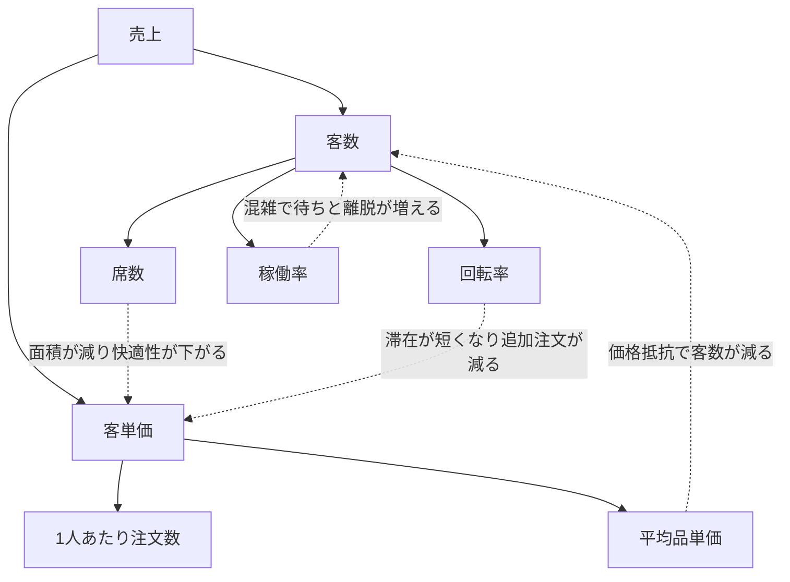

# 第1章 飲食店経営とはどんな商売か

**この章で扱うこと**: 飲食店経営を「勘と根性の世界」ではなく、数字で説明できる仕組みとして捉え直します。売上が何から成り立っているのか、売れたお金がどこへ流れるのか、なぜこの商売が倒れやすいと言われるのかを順に説明します。用語はすべて初出時に説明します。

## 1.1 一言でいうと「席と時間を売る商売」

飲食店は料理を売っているように見えます。しかし実際に売っているものは、3つに分けられます。

| 売っているもの | 実体 | 制約 |
| --- | --- | --- |
| 料理 | 仕入れた食材を調理したもの | 食材は傷む。作り置きできない |
| 席 | 客が座る場所と、そこに居られる時間 | 店の面積で上限が決まる |
| 時間 | 調理・提供・会計にかかる時間 | 1日の営業時間で上限が決まる |

このうち**席と時間は在庫として保存できません**。今日の12時の空席を、明日に繰り越すことはできません。売り逃した分は永久に消えます。しかも売り逃しは記録に残らないので、気づかないまま同じ損失を繰り返します。これが飲食店経営の最大の特徴です。

時間は、誰の時間かで3種類に分けて考えると整理できます。

| 時間の種類 | 誰の時間か | 売上への効き方 |
| --- | --- | --- |
| 営業時間 | 店が開けている時間 | 長いほど席を売る機会が増える。ただし人件費も増える |
| 滞在時間 | 客が席にいる時間 | 長いほど注文の機会は増えるが、回転は落ちる |
| 提供時間 | 注文から料理が出るまで | 長いと回転が落ち、待ちでの離脱も増える |

> **要点**: 飲食店の売上は「今日、何人が、いくら使って、何分席を占有したか」でほぼ決まります。この4つを測れない店は、改善のしようがありません。

## 1.2 売上の分解式

売上は次のように分解できます。この式が、以降のすべての章の土台になります。

```
売上（1日）= 客数 × 客単価
```

さらに客数を分解すると、

```
客数（1日）= 席数 × 回転率
```

客単価も分解できます。

```
客単価 = 1人あたり注文数 × 平均品単価
```

つまり全体では、次の形になります。

```
売上（1日）= 席数 × 回転率 × 客単価
```

| 用語 | 意味 | 単位の例 |
| --- | --- | --- |
| 席数 | 客が座れる席の数 | 20席 |
| 回転率 | 1つの席が1日に何人使ったか（人数ベース） | 3.0回転 |
| 稼働率 | 営業時間のうち、席が埋まっていた割合 | 60% |
| 客単価 | 1人の客が1回の来店で使う金額 | 1,200円 |

**計算例（説明用の仮置き）**: 20席、回転率3.0回転、客単価1,200円の店なら、

```
20席 × 3.0回転 = 60人/日
60人 × 1,200円 = 72,000円/日
```

月25日営業なら 72,000円 × 25日 = 1,800,000円/月 です。

### 4つを並べた式の使い方

改善の対象を漏れなく挙げるため、次の形で書かれることもあります。

```
売上（1日）= 席数 × 回転率 × 稼働率 × 客単価
```

ただし、この4つをそのまま掛けて計算してはいけません。回転率と稼働率は、同じ「席の使われ方」を別の角度から見た値です。両方を掛けると二重計上になります（関係は[第3章](03-kyaku-tanka-kaiten.md) 3.3で式を示します）。

- **見取り図として使う**: 改善の候補を4つに分けて漏れを防ぐ。
- **計算には使わない**: 実際の計算は `席数 × 回転率 × 客単価` で行う。

この式の意味は「**4つのどれかを上げれば売上が増える**」ということです。ただし4つは互いに影響し合います（次の1.3で扱います）。

## 1.3 4つの数字は互いに影響し合う

4つの数字は独立ではありません。1つを動かすと、別の数字が動きます。



上の図は、売上を4つの項に分解し、片方を上げたときに別の項へ及ぶ影響を点線で示したものです。実線が分解、点線が副作用を表します。

代表的なトレードオフを整理します。

| 動かす項 | 上げたときに起きやすいこと | 結果 |
| --- | --- | --- |
| 席数を増やす | 1席あたりの面積が減る。通路・厨房が狭くなる | 快適性と提供速度が下がる |
| 回転率を上げる | 滞在時間が短くなり、追加注文の機会が減る | 客単価が下がる |
| 稼働率を上げる | 待ち行列が出て、待ちきれない客が離脱する | 機会損失が増える |
| 客単価を上げる | 価格抵抗が出る。量を減らせば満足度が下がる | 客数が減る |

したがって、**4つを同時に大きく上げる施策は存在しない**と考えたほうが安全です。実際の経営では「どれを上げ、どれを犠牲にするか」を選ぶことになります。この選択が業態の選択でもあります（[第2章](02-shueki-kouzou-genka.md) 2.7）。

## 1.4 お金の流れ：粗利で固定費を回収する

売上が入っても、全部が手元に残るわけではありません。順番に引かれていきます。

```
売上高
 − 材料費（食材・飲料の仕入れ）
 = 粗利（あらり）
 − 人件費
 − 家賃・共益費
 − 水道光熱費
 − その他（消耗品、広告、システム、リース、保険など）
 = 営業利益
```

| 用語 | 意味 | なぜ重要か |
| --- | --- | --- |
| 材料費 | 提供した料理の食材原価 | 売上に比例して増える（変動費） |
| 粗利 | 売上 − 材料費 | 人件費や家賃を払う原資 |
| 変動費 | 売上に比例して増える費用 | 材料費が代表 |
| 固定費 | 売上が0でも発生する費用 | 家賃、正社員人件費、リース料、システム月額 |
| 営業利益 | すべての費用を引いた残り | 店が健全かどうかの結論 |

ここで押さえるべき点は2つです。

1. **粗利は「売上の何%か」で管理します。** 材料費率（原価率）が30%なら粗利率は70%です。売上1,000,000円なら粗利700,000円になります。
2. **固定費は売上が減っても減りません。** 家賃は客が来なくても発生します。だから「売上が落ちた月」は利益が急に消えます。

**計算例（説明用の仮置き）**: 月商1,000,000円、原価率30%、固定費600,000円の店なら、粗利は700,000円、営業利益は100,000円です。原価率が35%に上がると粗利は650,000円になり、営業利益は50,000円まで減ります。**原価率5ポイントの悪化で、利益は半分になります。** これが固定費の重い商売の感応度です。

## 1.5 飲食店が倒れやすいと言われる理由

飲食店の倒産は増えています。東京商工リサーチの集計（負債1,000万円以上）では、**2026年10月の飲食業倒産は98件**で10月として1997年以降最多、**2026年1〜10月の累計は870件**（前年同期比＋4.5%）、**2025年通年は1,002件**で30年間で最多でした。原因別では販売不振が77件（78.5%）を占めています（出典は本章末）。

ただし、この数字の読み方には注意が必要です。**倒産件数の増加は「倒産確率の上昇」を意味しません**。分母の企業数、負債1,000万円以上という集計基準、休廃業・解散が倒産に計上されない点を無視すると誤読します。また「飲食店は3年で7割が廃業する」という言い方がよくされますが、**本資料では出典を確認できていないため数値として採用しません**。

倒産統計とは別に、構造的に厳しい理由は数字に依存せず説明できます。

| 構造 | 内容 | 帰結 |
| --- | --- | --- |
| 固定費が重い | 家賃・人件費・設備リースが先に発生する | 客数が少し落ちるだけで赤字になる |
| 在庫を保存できない | 食材は傷む。売れ残りは廃棄 | 需要予測の誤りが直接損失になる |
| 席数が面積で固定される | 短期に供給を増やせない | 混雑しても売上は頭打ち |
| 参入が容易 | 資金と資格のハードルが比較的低い | 競合が増えやすく、価格競争に陥りやすい |
| 人手が流動的 | アルバイト依存。教育コストが高い | 品質が人によってばらつく |
| 現金商売でキャッシュが見えにくい | 売上と入金のタイミングがずれにくい一方、支払いは集中する | 黒字でも資金ショートしうる（[第4章](04-soneki-bunkiten-cashflow.md)） |

最後の項目は誤解されやすい点です。飲食店は現金払いが多く「現金が手元にある」状態になりやすいのですが、その現金は**仕入れ代金・人件費・税金の支払いに充てるべきお金**です。これを売上と混同すると、黒字なのに支払えない状態になります。

さらに、撤退の判断が遅れやすいという性質があります。内装や厨房機器に投じた初期投資は、店を閉じると回収できません。そのため「もう少し続ければ戻るかもしれない」と営業を続け、損失が広がるケースがあります。これは**埋没費用（サンクコスト：すでに支払って戻らない費用）に引きずられる**典型的な失敗です（一般知識（未検証））。判断は「これまでいくら使ったか」ではなく「この先いくら得られるか」で行います。

## 1.6 経営の3つの時間軸

飲食店の判断は、時間軸が違う3つの層に分かれます。混ぜると判断を誤ります。

| 時間軸 | 期間 | 主な判断 | 指標 |
| --- | --- | --- | --- |
| 日次 | 今日〜今週 | 仕込み量、シフト、売り切れ対応 | 客数、売上、提供時間 |
| 月次 | 1か月 | メニュー改定、シフト組み、仕入れ先 | 原価率、人件費率、営業利益 |
| 年次・投資 | 数か月〜数年 | 改装、業態変更、システム導入、出店 | 投資回収、損益分岐点、キャッシュフロー |

DX（デジタルトランスフォーメーション：業務をシステムで置き換え、記録と判断の精度を上げること）は3層目に属します。日次オペレーションの数字が取れていない状態で年次の投資判断をすると、効果を測れません。

順序は決まっています。**まず日次の数字を取れるようにし、次に月次で構造を把握し、そのうえで年次の投資を判断します。** 逆順に進めると、効果の測定できないシステムを買うことになります。

## 1.7 よくある誤解

| 誤解 | 実際 |
| --- | --- |
| 「満席にすれば儲かる」 | 満席でも回転が悪ければ売上は伸びない。満席で待ち行列が出ると客は離れる。最適点は満席ではない |
| 「売上が増えれば利益も増える」 | 原価率・人件費率が同時に上がれば利益は増えない。売上と利益は別物 |
| 「原価率を下げれば儲かる」 | 原価率を下げすぎると品質が落ち、客数と客単価が下がる。原価率は単独で最適化できない |
| 「人件費は削るほど良い」 | 人が減ると提供が遅れ、回転と満足度が落ちる。人件費率は売上に対する比率で見る |
| 「流行っている店は儲かっている」 | 客数が多いことと利益が出ることは別。家賃と人件費次第で赤字の繁盛店は成立する |
| 「席数を増やせば売上が増える」 | 面積が同じなら1席あたりが狭くなり、快適性と提供速度が落ちる。客単価と回転が下がることがある |
| 「よい料理を作れば売れる」 | 味は必要条件だが十分条件ではない。席数・時間・価格・導線・認知のどれかが欠けると売上にならない |

## 1.8 この章の要点

- 飲食店は**席と時間**を売る商売です。在庫は保存できず、売り逃しは戻りません。
- 売上は **席数 × 回転率 × 客単価** に分解できます。稼働率は回転率と表裏なので、計算では二重に掛けません。
- 4つの数字は**トレードオフ**の関係にあります。同時にすべてを上げる施策はありません。
- 粗利で固定費を回収する構造です。固定費が重いので、客数の変動に弱くなります。
- 判断は日次・月次・年次に分けます。DXは年次の投資判断であり、日次の計測が前提です。

## 1.9 自店で確認すること

- [ ] 実際に座れる席数を数え、カウンター・テーブル・テラス（屋外）を別々に記録している
- [ ] 直近1か月の売上・客数・客単価を、レジのデータから出せる
- [ ] 1日の延べ使用席時間（客数 × 平均滞在時間）を出せる
- [ ] 平均滞在時間を、時間帯別に測ったことがある
- [ ] 売上に比例して増える費用と、売上が0でも発生する費用を分けて一覧にしている
- [ ] 粗利額（円）を月次で出している（原価率だけで終わっていない）
- [ ] 日次・月次・年次の判断を、それぞれ何の数字で行っているか書き出せる
- [ ] 手元の現金のうち、支払いに充てる分を区別している

## 1.10 演習

### 問1 売上の分解

24席の店が、回転率2.5回転、客単価1,400円で、月25日営業しています。1日の売上と月の売上を求めてください。

**解答**

```
1日の客数 = 24席 × 2.5回転 = 60人
1日の売上 = 60人 × 1,400円 = 84,000円
月の売上   = 84,000円 × 25日 = 2,100,000円
```

1日の売上は84,000円、月の売上は2,100,000円です。

### 問2 稼働率から回転率を求める

営業時間6時間（360分）、平均滞在時間60分、席稼働率45%、20席、客単価1,000円の店があります。回転率、1日の客数、1日の売上を求めてください。

**解答**

```
回転率 = 席稼働率 × 営業時間 ÷ 平均滞在時間
       = 0.45 × 360分 ÷ 60分
       = 2.7回転
1日の客数 = 20席 × 2.7回転 = 54人
1日の売上 = 54人 × 1,000円 = 54,000円
```

回転率は2.7回転、1日の客数は54人、1日の売上は54,000円です。稼働率と回転率は、平均滞在時間を挟んで変換できます（[第3章](03-kyaku-tanka-kaiten.md) 3.3）。

### 問3 原価率の感応度

月商2,000,000円、原価率32%、固定費1,200,000円の店があります。営業利益を求めてください。次に、原価率が28%に改善した場合の営業利益を求めてください。

**解答**

```
【現状】
粗利     = 2,000,000円 ×（1 − 0.32）= 1,360,000円
営業利益 = 1,360,000円 − 1,200,000円 = 160,000円

【原価率28%のとき】
材料費   = 2,000,000円 × 0.28 = 560,000円
粗利     = 2,000,000円 − 560,000円 = 1,440,000円
営業利益 = 1,440,000円 − 1,200,000円 = 240,000円
```

営業利益は160,000円から240,000円へ、80,000円増えます。売上を増やさずに利益が5割増えた計算です。ただし原価率の改善が品質低下につながれば、翌月以降の客数が減ります（[第2章](02-shueki-kouzou-genka.md) 2.2）。数値の改善だけで判断しないでください。

## 出典と確度

- 本章の計算式（売上の分解、粗利、トレードオフの考え方）は会計・経営分析の標準的な定義にもとづく**一般知識（未検証）**。数式としての正しさは第2章・第4章で例題により確認する。
- 本章の数値例はすべて**説明用の仮置き**であり、実在の店舗の実績ではありません。
- 1.5 の倒産件数は東京商工リサーチ「10月の『飲食業』倒産 10月では最多の98件」（2026年11月10日公表、負債1,000万円以上）による。出典: https://www.tsr-net.co.jp/data/detail/1203428_1527.html （取得日 2026-11-14）。負債総額と2024年通年の数値は同記事に記載がなく、本資料では扱わない。
- 1.5 の「3年で7割が廃業」は出典を確認できていないため、**未取得**として数値を採用していない。
- 1.5 の埋没費用に関する記述は経営学の一般的な知見であり、**一般知識（未検証）**。自店の撤退判断に適用する場合は、個別の契約条件（解約違約金、原状回復義務など）を確認する必要がある。
- 業界固有の数値（原価率の目安など）は本章では提示していない。第2章で確度を明示して扱う。

前後の章: [第2章 収益構造と原価管理](02-shueki-kouzou-genka.md)
