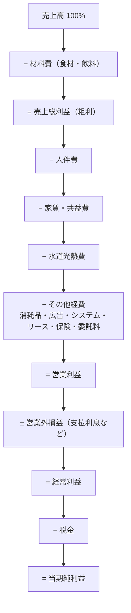

# 第2章 収益構造と原価管理

第1章で「粗利で固定費を回収する」と説明しました。この章では、売上から何がどれだけ引かれるのか、その**構造と管理方法**を扱います。あわせて、材料費・人件費・家賃という3つの大きな費用を、どう測り、どう動かすかを説明します。

先に断っておきます。**この章では「飲食店の原価率の平均は◯%」という断定的な数値を提示しません。** 理由は2つあります。第一に、業態（居酒屋・カフェ・ラーメン・高級和食）で構造が全く違い、単一の平均値に意味がないこと。第二に、公的な業種別統計（中小企業実態基本調査など）を本資料の作成時点で取得できなかったことです（取得を試みた結果は本章末に記録しています）。根拠のない数値を「目安」として置くと、それが一人歩きして誤った目標設定に使われるためです。

代わりに、**自分の店の数字を自分で作る方法**を中心に書きます。

## 2.1 損益計算書の並び順

飲食店の損益は、次の順に並びます。この順番を覚えると、どこを改善すべきかが見えます。



上の図は、売上高から順に費用を引いていく段階構造を示しています。上の段ほど「売上に近い」費用で、下の段ほど「経営判断に近い」利益です。

| 段階 | 何を表すか | 悪化したときに見る場所 |
| --- | --- | --- |
| 売上高 | 需要を取れた量 | 客数、客単価、回転率（[第3章](03-kyaku-tanka-kaiten.md)） |
| 粗利 | 料理で稼いだ力 | 原価率、メニュー構成、ロス |
| 営業利益 | 店としての収益力 | 固定費の重さ、人件費率 |
| 当期純利益 | 最終的な手残り | 支払利息、税金、特別損失 |

**重要な原則**: 上位の段階で悪化したとき、下位の数字をいじっても解決しません。原価率が悪いのに広告費を削っても、原価率は改善しません。**悪化している段階を特定してから、その段階の要因を触ります。**

なお、営業利益と経常利益は似ていますが別物です。営業利益は本業の儲け、経常利益はそれに利息などの営業外の損益を足したものです。借入の多い店では、営業利益が黒字でも経常利益が赤字になることがあります。

## 2.2 材料費と原価率

### 定義

```
原価率（%）= 材料費 ÷ 売上高 × 100
```

飲食店でいう「材料費」は、提供した料理に使った食材・飲料の原価です。仕入れた金額ではなく、**使った金額**である点に注意します（仕入れたが使っていない分は在庫です）。

> **落とし穴**: 仕入れ額で原価率を計算すると、在庫が増えた月に原価率が実態より高く出ます。月末の棚卸しをして、`材料費 = 期首在庫 + 仕入 − 期末在庫` で求めるのが正確です。

### 歩留まりという考え方

**歩留まり**とは、仕入れた食材のうち実際に使えた割合です。野菜の芯や皮、魚の骨、肉の脂身など、使えない部分は必ず出ます。

```
歩留まり（%）= 使えた重量 ÷ 仕入れ重量 × 100
実質単価 = 仕入れ単価 ÷ 歩留まり
```

**計算例（説明用の仮置き）**: 1kgあたり1,000円の食材で、使えるのが700g（歩留まり70%）なら、

```
実質単価 = 1,000円 ÷ 0.70 = 1,428.57... → 約1,429円/kg
```

見かけの仕入れ単価は1,000円でも、実際に皿に載る部分の単価は約1,429円です。**歩留まりの悪い食材は、仕入れ単価が安くても高くつきます。** 原価計算を仕入れ単価で行うと、この差を見落とします。

### 原価率が業態で違う理由

原価率は「料理にどれだけ手をかけるか」ではなく、**価格に占める原材料の割合**で決まります。

| 業態の性格 | 原価率の傾向 | 理由 |
| --- | --- | --- |
| 素材の品質で勝負する業態（寿司、ステーキ、高級和食） | 高くなりやすい | 高価な食材を使う。価格に占める食材費が大きい |
| 加工・手間で付加価値を作る業態（ラーメン、カレー、惣菜） | 中程度 | 食材は比較的安価。手間が価値になる |
| 空間・サービスで勝負する業態（カフェ、バー、居酒屋） | 低くなりやすい | 飲料やサイドメニューの原価率が低く、全体を下げる |

したがって、**他業態の原価率と比べても意味がありません**。比べるべきは、同じ業態の競合と、自店の過去実績です。

### 原価率が動く4つの要因

原価率は、次の4つで動きます。改善するときは、どれを動かすのかを明確にします。

| 要因 | 内容 | 打ち手 | 副作用 |
| --- | --- | --- | --- |
| 仕入れ価格 | 食材の単価 | 仕入れ先の見直し、季節品の活用、契約 | 品質低下、供給不安定 |
| 歩留まり | 仕入れた食材のうち使える割合 | 調理技術、仕込み方法の改善、部位の使い切り | 手間が増える |
| ロス | 廃棄・売れ残り | 仕込み量の精度向上、メニュー絞り込み | 品切れリスク |
| メニュー構成 | 原価率の違う商品の売れ方 | メニュー設計、売り方の誘導 | 客の満足度、価格抵抗 |

**原価率を下げる最も安全な方法は「ロス削減」と「メニュー構成の改善」**です。仕入れ価格の切り下げは品質に直結し、歩留まり改善は技術に依存します。ロスとメニュー構成は、品質を落とさずに動かせます。

### 原価率を下げすぎると何が起きるか

原価率を下げる方法は、材料を減らす、安い材料に変える、値段を上げる、のいずれかです。どれも**客から見た価値**を下げる方向に働きます。原価率だけを見て最適化すると、次の連鎖が起きます。

```
原価率低下 → 満足度低下 → リピート減 → 客数減 → 売上減
→ 人件費率・家賃比率が悪化 → 利益減
```

**原価率は単独で最適化できない指標**です。必ず粗利額（円）と客数・客単価をセットで見ます。

## 2.3 レシピ原価で商品ごとの粗利を見る

店全体の原価率だけでなく、**商品1つずつの粗利**を見ると、メニュー改定の判断ができます。これをレシピ原価（1品あたりの材料費を積み上げること）と呼びます。

```
1品あたり粗利（円）= 売価 − 材料費
1品あたり原価率（%）= 材料費 ÷ 売価 × 100
```

**計算例（説明用の仮置き）**: 2つのメニューを比べます。

| 項目 | メニューA（サラダ） | メニューB（ステーキ） |
| --- | --- | --- |
| 売価 | 800円 | 1,200円 |
| 材料費 | 240円 | 540円 |
| 粗利 | 560円 | 660円 |
| 原価率 | 30.0% | 45.0% |
| 調理・提供の手間（分） | 5分 | 12分 |

売価が高いのはB、原価率が良いのはA、粗利額が大きいのもBです。ここまでは「Bを売ったほうが得」に見えます。

しかし席と時間を売っている店では、粗利を**時間あたり**で見る必要があります。

```
時間あたり粗利 = 1品あたり粗利 ÷ 調理・提供の手間
```

- メニューA: 560円 ÷ 5分 = **112円/分**
- メニューB: 660円 ÷ 12分 = **55円/分**

Aのほうが、時間あたりでは約2倍稼いでいます。混雑する時間帯にBばかり出ると、厨房と席が詰まって売上機会を失います。逆に空いている時間帯は、Bを売ったほうが客単価も粗利額も上がります。

| 時間帯 | 優先する判断 |
| --- | --- |
| 混雑時（席が埋まっている） | 時間あたり粗利が高い商品を推す |
| 席に余裕がある時間帯 | 粗利額が大きい商品を推す |

**メニュー構成は、原価率でも粗利額でもなく、時間あたり粗利で見るのが実態に合います。** この考え方は[第3章](03-kyaku-tanka-kaiten.md) 3.4の席時間あたり売上と同じ発想です。

## 2.4 人件費率と人時売上

### 定義

```
人件費率（%）= 人件費 ÷ 売上高 × 100
```

人件費には、給与、社会保険料の事業主負担、賞与、法定福利費、募集・教育費を含めるかで値が変わります。**どこまで含めるかを決めて、固定する**のが原則です。

### 人件費率の構造的な弱点

人件費率は「売上に対する比率」なので、**売上が下がると自動的に悪化します**。人員を減らしていなくても、です。逆に売上が急に伸びると、シフトを増やす前は人件費率が良く見えます。つまり人件費率は、**人員の適正さではなく、売上の水準を映す鏡**になっていることがあります。

そこで使うのが**人時売上**（労働1時間あたりの売上）です。

```
人時売上（円/時間）= 売上高 ÷ 総労働時間
```

**計算例**: 月商3,000,000円、総労働時間600時間なら、人時売上は 3,000,000 ÷ 600 = **5,000円/時間**。

この指標は売上の水準に左右されにくく、**「1時間の人件費に見合う売上を上げているか」**を直接見られます。時給1,200円で社会保険料を含めた実質コストが1,500円/時間なら、人時売上が1,500円を下回ると、その時間は赤字です。

### 目標から逆算する

人件費率の目標が決まっていれば、必要な人時売上を逆算できます。

```
必要人時売上 = 人件費の実質時間単価 ÷ 目標人件費率
```

**計算例（説明用の仮置き）**: 実質時間単価1,500円、目標人件費率20%なら、

```
必要人時売上 = 1,500円 ÷ 0.20 = 7,500円/時間
```

目標を達成するには、労働1時間あたり7,500円の売上が必要です。この数字をシフト作成の前に置いておくと、「人を増やしてよい時間帯か」を判断できます。

| 指標 | 見えるもの | 弱点 |
| --- | --- | --- |
| 人件費率 | 売上に対する人件費の重さ | 売上水準に左右される |
| 人時売上 | 労働時間あたりの生産性 | 時間帯・曜日で大きく振れる |
| 1人あたり売上 | 従業員1人の生産性 | 短時間勤務者が多いと実態を反映しない |

**3つを併用します。** 人件費率が悪化したとき、人時売上が維持されていれば原因は売上減、人時売上も悪化していれば原因はシフトかオペレーションです。

## 2.5 家賃比率

```
家賃比率（%）=（家賃 + 共益費）÷ 売上高 × 100
```

家賃は固定費の代表です。売上が落ちても減りません。したがって**家賃比率は、売上が落ちたときに真っ先に悪化する指標**です。

立地を選ぶ段階では、この比率の上限を決めておくと判断がぶれません。上限は売上計画から逆算できます。

```
許容できる家賃 = 想定月商 × 目標家賃比率
```

**計算例（説明用の仮置き）**: 想定月商3,000,000円、目標家賃比率10%なら、許容できる家賃は300,000円です。月商が2,500,000円に下がれば、同じ家賃で比率は12%に上がります。

ただし上限の水準は業態・商圏・客単価で変わるため、本資料では一律の数値を示しません。**自店の損益分岐点（[第4章](04-soneki-bunkiten-cashflow.md)）から逆算する**のが確実です。

### 物件を自社で保有する場合・転貸する場合

店舗の物件には、大きく2つの持ち方があります。賃借する場合と、自社で保有する場合です。さらに、自社で保有しながら一部を他社に貸す（転貸する）場合もあります。

自社で保有する場合、家賃は「他者への支払い」としては発生しません。しかし**機会費用**（その選択をしたために失った別の利益）として扱う必要があります。

```
機会費用としての家賃 = その物件を他社に貸した場合に得られる賃料
```

これを損益計算に入れないと、「家賃を払っていないから黒字」という見かけの数字になります。その数字では、物件を他用途に使う判断や、転貸する判断と比較できません。

| 持ち方 | 会計上の扱い | 経営判断上の扱い |
| --- | --- | --- |
| 賃借 | 支払家賃を費用に計上 | そのまま家賃比率で見る |
| 自社保有（自店で使用） | 家賃は計上しない。減価償却費は計上 | 機会費用を置いて比較する |
| 自社保有（一部を転貸） | 受取賃料を収入に計上 | 店舗の損益と賃貸の損益を分けて見る |

会計上は家賃を計上しないとしても、**経営判断用には機会費用を置いて比較する**のが安全です。なお、機会費用を損益計算書に載せるかどうかは会計・税務の扱いが別問題になります（一般知識（未検証）。税務・会計の扱いは顧問税理士に確認が必要です）。

## 2.6 FL比率

```
FL比率（%）=（材料費 + 人件費）÷ 売上高 × 100
```

飲食店の体質を1つの数字で見る指標として、業界でよく使われます。FはFood（材料費）、LはLabor（人件費）の頭文字です。

**計算例（説明用の仮置き）**: 材料費率30%、人件費率25%なら、FL比率は55%です。

定義は単純ですが、**3つの限界**があります。

1. **家賃・水道光熱費・減価償却・支払利息・税金を含まない。** FL比率が良くても、家賃が高ければ営業利益は出ません。
2. **売上の水準を無視する。** 売上が小さい店は人件費率が高く出ます。
3. **削れば下がるが、売上も下がる。** 品質を落とせば翌月の売上が落ち、FL比率は元に戻ります。

したがってFL比率は「**体質の入口**」として使います。悪ければ材料費率と人件費率に分解し、さらに売上（客数・客単価）と突き合わせます。損益分岐点と組み合わせた見方は[第4章](04-soneki-bunkiten-cashflow.md)で扱います。

## 2.7 業態別の構造の違い

同じ「飲食店」でも、収益構造は業態で大きく変わります。これは**どの数字を優先して見るか**が変わるという意味です。

| 業態の型 | 売上の作り方 | 効きやすい指標 | 弱いところ |
| --- | --- | --- | --- |
| 高回転・低単価（ラーメン、立ち食い、カフェ） | 回転率で稼ぐ | 提供時間、回転率、席稼働率 | 客単価が低いので、回転が落ちると即赤字 |
| 低回転・高単価（コース料理、記念日需要） | 客単価で稼ぐ | 客単価、予約数、リピート率 | 席が長時間埋まる。平日の稼働が課題 |
| アルコール中心（居酒屋、バー） | 客単価と滞在で稼ぐ | 客単価、飲料比率、人時売上 | 長時間滞在で回転が低い。人件費が重い |
| テイクアウト中心（弁当、惣菜） | 席を持たずに売る | 原価率、製造効率、客単価 | 席がないので単価を上げにくい |

**席数が面積で厳しく制限される小型店**では、高回転・低単価型か、低回転・高単価型のどちらかに寄せる判断が要ります。中途半端に両方を狙うと、どちらの指標も中途半端になります。この判断は業態の選択と直結します。

また、厨房の広さも制約になります。席数を増やすと厨房と通路が狭くなり、提供時間が伸びます。提供時間が伸びれば回転率が下がるので、**席数を増やしても売上が増えない**ことがあります（[第1章](01-shokugyo-no-zentai.md) 1.3）。

## 2.8 統計で見る業界の現状

本資料の作成時に取得できた一次資料は2つです。

### 倒産動向（東京商工リサーチ）

| 項目 | 値 |
| --- | --- |
| 2026年10月 飲食業倒産 | 98件（前年同月比＋1.0%）。10月として1997年以降最多 |
| 2026年1〜10月累計 | 870件（前年同期比＋4.5%） |
| 2025年通年 | 1,002件（30年間で最多） |
| 原因別（2026年10月） | 販売不振77件（78.5%）、事業上の失敗9件、既往のシワ寄せ6件 |

出典: 東京商工リサーチ「10月の『飲食業』倒産 10月では最多の98件」（2026年11月10日公表、負債1,000万円以上）、https://www.tsr-net.co.jp/data/detail/1203428_1527.html （取得日 2026-11-14）

**読み方の注意**: この集計は負債1,000万円以上が対象で、休廃業・解散は含みません。件数の増減を「倒産確率」として読むことはできません。原因の8割が販売不振である点は、**需要を取れないことが主因**であることを示しています。

### 食品ロス（農林水産省・環境省）

| 項目 | 値（2024年度推計） |
| --- | --- |
| 食品ロス全体 | 461万トン |
| 事業系 | 237万トン |
| うち外食 | 70万トン（事業系の約29.5%） |
| 目標 | 2030年度までに2000年度比60%削減 |

出典: 農林水産省「事業系食品ロス量（2024年度推計値）を公表」（令和8年6月30日）、https://www.maff.go.jp/j/press/shokuhin/recycle/260630.html 、環境省食品ロスポータルサイト https://www.env.go.jp/recycle/foodloss/index.html （取得日 2026-11-14）

外食の食品ロス70万トンは、**廃棄した食材の仕入れ額がそのまま損失になる**ことを意味します。原価率の改善は、売上を増やさずに利益を増やせる数少ない手段です（[第4章](04-soneki-bunkiten-cashflow.md) 4.5、[第9章](09-shiire-zaiko-loss.md)）。

### 取得できなかった統計

以下は本資料の作成時に取得を試みて**失敗した**項目です。推測値は載せません。

| 項目 | 状況 |
| --- | --- |
| 業種別の原価率・人件費率・営業利益率（中小企業実態基本調査） | 中小企業庁ドメインが HTTP 403 で取得不可 |
| 開業率・廃業率・企業数（経済センサス、中小企業白書） | 数値が Excel / PDF 表章で本文抽出不可 |
| キャッシュレス決済比率（経済産業省） | ドメインが 403、集計値の掲載ページに到達できず |

必要な場合の代替経路は、e-Stat の統計表（Excel）の直接取得、政府統計 API、国立国会図書館 WARP のアーカイブです。

## 2.9 自店の数字を作る手順

統計がなくても、自店の構造は測れます。手順は7段階です。

1. **1か月分の売上と費用を集める**（レジ、通帳、請求書）
2. **費用を変動費と固定費に分ける**（[第4章](04-soneki-bunkiten-cashflow.md) 4.1の基準）
3. **材料費を棚卸しで正確に出す**（期首在庫＋仕入−期末在庫）
4. **主要メニューのレシピ原価を出す**（売価、材料費、手間の3つ）
5. **人件費を総労働時間で割って人時売上を出す**
6. **損益分岐点を計算し、安全余裕率を見る**（[第4章](04-soneki-bunkiten-cashflow.md)）
7. **3か月続けて、同じ手順で出す**（1か月だけでは季節変動と区別できない）

この7段階は、特別なシステムがなくても表計算でできます。**最初からシステムを入れない**のが原則です。測る項目が固まっていない段階でシステムを選ぶと、要らない機能を買うことになります。

## 2.10 よくある誤解

| 誤解 | 実際 |
| --- | --- |
| 原価率は低いほど良い | 低すぎると量・品質・価格のどれかで客が離れる。粗利額と客数で見る |
| 他店の原価率と比べれば良い | 業態が違えば比較にならない。同業態・同規模・同商圏で比べる |
| 人件費率が悪い＝人が多い | 売上が落ちただけのことがある。人時売上で切り分ける |
| 家賃は安いほど良い | 安い立地で客数が取れなければ、比率は悪化する。比率で見る |
| FL比率が良ければ経営は健全 | 家賃・水道光熱費・借入返済を含まない。営業利益とキャッシュで確認する |
| 仕入れ単価が安い食材は得 | 歩留まりを掛けた実質単価で見る。芯や皮の多い食材は高くつく |
| 粗利額が大きいメニューを推せば良い | 手間のかかる商品は席と厨房を占有する。時間あたり粗利で見る |
| 人件費率を下げれば利益が増える | 人が減ると提供が遅れ、回転と客単価が下がる。売上とセットで見る |

## 2.11 この章の要点

- 損益は「売上 → 粗利 → 営業利益 → 経常利益 → 純利益」の順に積み上がります。悪化した段階を特定してから手を打ちます。
- 原価率は業態で構造が違うため、**他業態や単一の平均値と比べても意味がありません**。比べるのは同業態と自店の過去実績です。
- 原価率は仕入れ価格・歩留まり・ロス・メニュー構成の4つで動きます。安全に動かせるのは**ロスとメニュー構成**です。
- 人件費率は売上水準に左右されます。**人時売上**と併用して、原因が売上減かシフトかを切り分けます。
- メニューの良し悪しは粗利額だけでなく**時間あたり粗利**で見ます。席と時間を売る商売だからです。

## 2.12 自店で確認すること

- [ ] 月末に棚卸しをして、`期首在庫 + 仕入 − 期末在庫` で材料費を出している
- [ ] 人件費に何を含めるかを決めて、毎月同じ定義で出している
- [ ] 総労働時間を、月次で集計できている
- [ ] 主要メニュー10品のレシピ原価（売価・材料費・手間）を書き出せる
- [ ] 歩留まりの悪い食材を把握し、実質単価で比較している
- [ ] 廃棄ログ（何を、いつ、いくら捨てたか）を取っている
- [ ] 家賃比率を月次で出し、上限の目安を持っている
- [ ] 物件を自社で保有している場合、機会費用をいくらと置くかを決めている

## 2.13 演習

### 問1 歩留まりと実質単価

1kgあたり1,200円の魚を仕入れ、使えるのが600g（歩留まり60%）でした。実質単価を求めてください。また、歩留まりが75%に改善した場合の実質単価も求めてください。

**解答**

```
【現状】
実質単価 = 1,200円 ÷ 0.60 = 2,000円/kg

【歩留まり75%のとき】
実質単価 = 1,200円 ÷ 0.75 = 1,600円/kg
```

実質単価は2,000円から1,600円へ、400円下がります。仕入れ単価は変わっていないのに、**原価は20%下がった**計算です。歩留まりの改善は、仕入れ交渉と同じ効果を持ちます。

### 問2 人時売上と必要人時売上

月商2,400,000円、総労働時間500時間の店があります。人時売上を求めてください。また、実質時間単価が1,400円、目標人件費率22%のとき、必要人時売上を求め、現状と比べてください。

**解答**

```
【現状の人時売上】
2,400,000円 ÷ 500時間 = 4,800円/時間

【必要人時売上】
1,400円 ÷ 0.22 = 6,363.63... → 約6,364円/時間

【差】
6,364円 − 4,800円 = 1,564円/時間 不足
```

現状の人時売上は4,800円/時間で、目標人件費率を満たすには約6,364円/時間が必要です。1時間あたり約1,564円足りません。打ち手は、売上を増やすか、労働時間を減らすか、単価の高い時間帯に人を寄せるかです。**人を減らす前に、どの時間帯が不足しているかを時間帯別に見ます。**

### 問3 時間あたり粗利で比較する

| 項目 | メニューX | メニューY |
| --- | --- | --- |
| 売価 | 900円 | 1,500円 |
| 材料費 | 270円 | 750円 |
| 手間（分） | 4分 | 10分 |

粗利額と時間あたり粗利を求め、混雑時と席に余裕がある時間帯で、どちらを推すべきか答えてください。

**解答**

```
【メニューX】
粗利 = 900円 − 270円 = 630円
原価率 = 270円 ÷ 900円 = 30.0%
時間あたり粗利 = 630円 ÷ 4分 = 157.5円/分

【メニューY】
粗利 = 1,500円 − 750円 = 750円
原価率 = 750円 ÷ 1,500円 = 50.0%
時間あたり粗利 = 750円 ÷ 10分 = 75円/分
```

粗利額はYが120円多いですが、時間あたり粗利はXが約2.1倍です。**混雑時はX、席に余裕がある時間帯はY** を推すのが合理的です。混雑時にYが集中すると、厨房が詰まって提供が遅れ、回転率と満足度の両方が落ちます。

## 出典と確度

- 損益計算書の構造、原価率、歩留まり、人件費率、人時売上、家賃比率、FL比率、レシピ原価の定義は管理会計・飲食店実務の標準的な定義にもとづく**一般知識（未検証）**。
- 本章の数値例はすべて**説明用の仮置き**であり、実在の店舗の実績ではありません。計算は本文中に式と途中の値を示しており、電卓で検算できます。
- 2.8 の倒産動向と食品ロスは一次資料で確認済み（**確信度 高**）。出典と取得日を付記した。
- 業種別の原価率・人件費率の**平均値は提示していない**。取得を試みて失敗した事実を2.8に記録した。一般に語られる目安値（例: 原価率30%前後）は出典を特定できないため、本資料では数値として採用しない。
- 物件を自社で保有する場合の機会費用の扱いは会計・税務の専門判断が必要で、本資料では考え方のみ示す。**一般知識（未検証）**。
- 業種別統計（中小企業実態基本調査）、開業率・廃業率、キャッシュレス決済比率は**未取得**。推測値は載せていない。

前後の章: [第1章 飲食店経営とはどんな商売か](01-shokugyo-no-zentai.md) ／ [第3章 客数・客単価・回転率・席稼働率](03-kyaku-tanka-kaiten.md)
