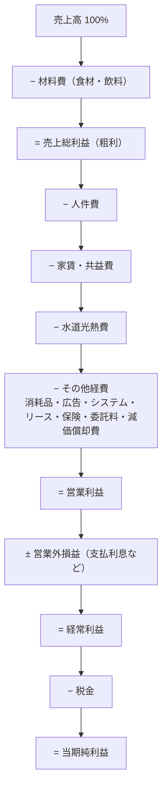
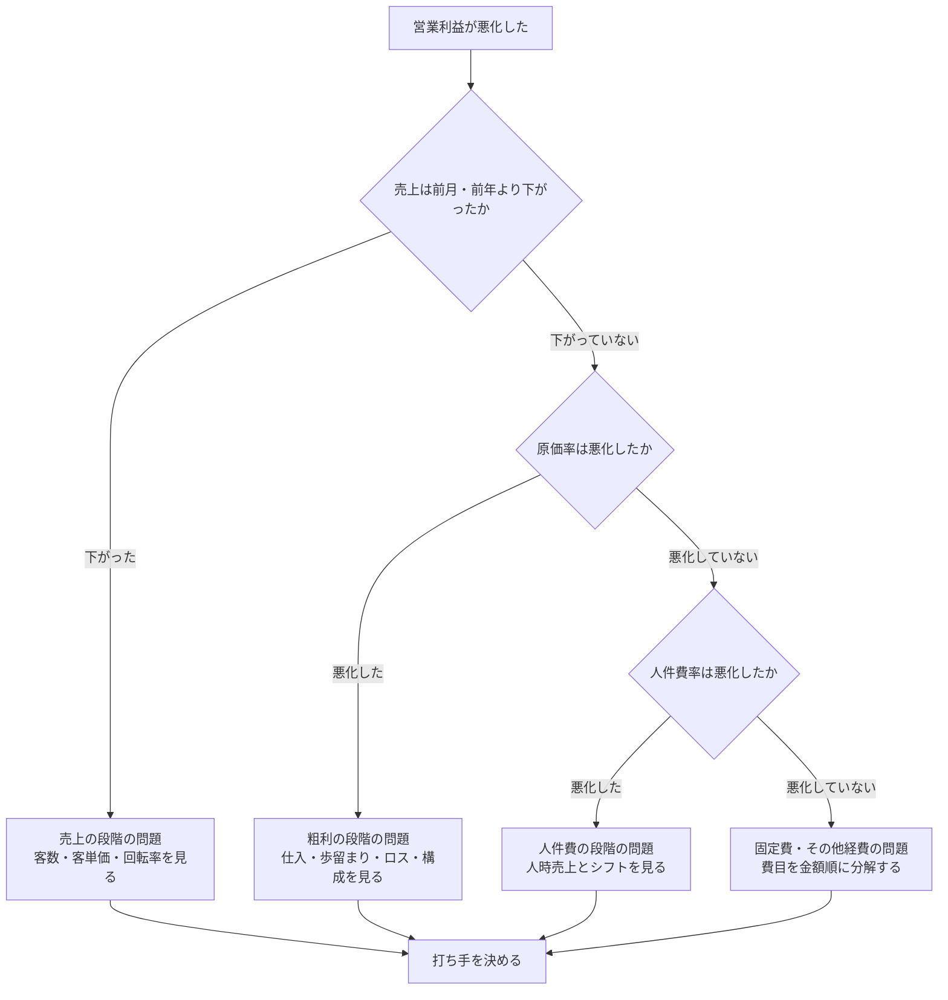

# 第2章 損益計算書の読み方

## 2.1 この章で扱うこと

[第1章](01-kouzou.md)で「粗利で固定費を回収する」と説明しました。この章では、その流れを**損益計算書**という1枚の表として読み取れるようにします。売上から順に費用を引いていく段階構造と、各段階が何を意味するかを扱います。あわせて、数字が悪化したときに**どの段階を見て、どこから手を打つか**という読み方の手順を示します。材料費・人件費・固定費の中身は、それぞれ[第3章](03-zairyo-hi-genka.md)・[第4章](04-jinken-hi-seisansei.md)・[第5章](05-koteihi-ricchi.md)で扱います。

先に断っておきます。**この章では「飲食店の原価率の平均は◯%」という断定的な数値を提示しません。** 理由は2つあります。第一に、業態（居酒屋・カフェ・ラーメン・高級和食）で構造が全く違い、単一の平均値に意味がないこと。第二に、公的な業種別統計（中小企業実態基本調査など）を本資料の作成時点で取得できなかったことです（取得を試みた結果は本章末に記録しています）。根拠のない数値を「目安」として置くと、それが一人歩きして誤った目標設定に使われるためです。代わりに、**自分の店の数字を自分で作る方法**を中心に書きます。

## 2.2 学習目標

- 損益計算書の段階（売上高・粗利・営業利益・経常利益・当期純利益）を、順番に説明できる。
- 自店の1か月の数字から、損益計算書を1枚作れる。
- 各段階を売上比（%）で表し、前月・前年と比較できる。
- 数字が悪化したとき、悪化している段階を特定し、その段階の要因に手を打つ順序を説明できる。
- FL比率の意味と限界を理解し、単独で経営の健全性を判断しないと説明できる。

## 2.3 損益計算書とは何か

### 2.3.1 定義

**損益計算書**（そんえきけいさんしょ、英: Profit and Loss Statement、P/L）とは、**一定期間**（1か月、1年）の売上と費用を並べ、利益がいくら残ったかを示す表です。飲食店では「月次で1枚作る」のが実務の基本になります。

会計の表は3種類あり、それぞれ見ているものが違います。

| 表 | 見ているもの | 飲食店での使い方 |
| --- | --- | --- |
| 損益計算書（P/L） | 一定期間の儲け | 月次で利益を確認する |
| 貸借対照表（B/S） | ある時点の財産と借金 | 借入残高、設備、保証金を確認する |
| キャッシュフロー計算書（C/S） | 一定期間の現金の出入り | 資金繰りを確認する |

**この3つは連動していますが、一致しません。** 利益が出ていても現金が増えるとは限らず（売掛金、在庫、返済）、現金が増えても利益が出ているとは限りません（借入）。飲食店は現金商売なので売掛金は少ないものの、**在庫・設備投資・借入返済**で差が出ます。この差は[第7章: キャッシュフロー](07-cashflow.md)で扱います。

### 2.3.2 税込か税抜かを統一する

損益計算書を読む前に、決めておくことが1つあります。**売上と費用を、消費税込みで記録するか、税抜きで記録するか**です。

| 記録の方法 | 売上の扱い | 注意点 |
| --- | --- | --- |
| 税抜きで記録する | 消費税を除いた金額 | 消費税は預り金として別に管理する |
| 税込みで記録する | 客が払った全額 | 消費税分が売上に混ざる |

本書の数値例は、断りがない限り**税抜き**で統一します。理由は、原価率や人件費率を出すときに消費税が混ざると、率が実態とずれるためです（消費税10%の売上に、消費税込みの材料費を当てると、原価率が実際より低く出ます）。

どちらの経理を採るかは、税務上の扱いとあわせて決める必要があります。**本書は税務的助言ではありません。** 実際の処理は税理士に確認してください（→ [第18章: 会計・税務・決済](18-kaikei-zeimu.md)）。

## 2.4 段階構造

### 2.4.1 並び順

飲食店の損益は、次の順に並びます。この順番を覚えると、どこを改善すべきかが見えます。



上の図は、売上高から順に費用を引いていく段階構造を示しています。上の段ほど「売上に近い」費用で、下の段ほど「経営判断に近い」利益です。

### 2.4.2 各段階の意味

| 段階 | 何を表すか | 悪化したときに見る場所 |
| --- | --- | --- |
| 売上高 | 需要を取れた量 | 客数、客単価、回転率（[第8章](08-kyaku-tanka-kaiten.md)） |
| 粗利（売上総利益） | 料理で稼いだ力 | 原価率、メニュー構成、ロス（[第3章](03-zairyo-hi-genka.md)） |
| 営業利益 | 店としての収益力 | 固定費の重さ、人件費率（[第4章](04-jinken-hi-seisansei.md)、[第5章](05-koteihi-ricchi.md)） |
| 経常利益 | 借入を含めた通常の儲け | 支払利息、借入残高 |
| 当期純利益 | 最終的な手残り | 支払利息、税金、特別損失 |

**重要な原則**: 上位の段階で悪化したとき、下位の数字をいじっても解決しません。原価率が悪いのに広告費を削っても、原価率は改善しません。**悪化している段階を特定してから、その段階の要因を触ります。**

## 2.5 各段階を詳しく見る

### 2.5.1 売上高

**売上高**は、その期間に客から受け取った代金の合計（税抜き）です。「売上」とも書きます。飲食店では、店内飲食・テイクアウト・デリバリー・販売手数料の扱いが混ざりやすいので、**区分ごとに分けて記録する**のが望ましいです。

| 売上の区分 | 例 | 記録の注意 |
| --- | --- | --- |
| 店内飲食 | 飲食した代金 | 客数と客単価を出せるようにする |
| テイクアウト | 弁当・惣菜 | 席を使わないので回転率に含めない |
| デリバリー | 配達経由の注文 | 手数料が別途引かれることがある |

デリバリーは、売上として計上した金額から手数料が引かれるため、**実質の手取りは売上より小さくなります**。手数料を「その他経費」に置くか、売上から相殺するかは、実態が分かる形で統一します。

### 2.5.2 材料費と売上原価

損益計算書の「売上原価」は、飲食店ではほぼ**材料費**です（食材・飲料の仕入れのうち、提供した分）。

```
材料費 = 期首在庫 + 当期仕入 − 期末在庫
```

**仕入れた金額ではなく、使った金額**である点が重要です。仕入れたが使っていない分は在庫として資産に残ります。この計算と棚卸しの実務は[第3章](03-zairyo-hi-genka.md)で詳しく扱います。

### 2.5.3 粗利（売上総利益）

```
粗利 = 売上高 − 材料費
粗利率（%）= 粗利 ÷ 売上高 × 100 = 100 − 原価率
```

粗利は、**人件費・家賃・水道光熱費・その他経費を払う原資**です。飲食店の費用のうち、売上に連動するのは材料費が中心なので、粗利は「売上が増えたときに、いくら使えるようになるか」を表します。

**粗利を率だけで見ないでください。** 原価率が同じ30%でも、売上1,000,000円の店の粗利は700,000円、売上3,000,000円の店の粗利は2,100,000円です。固定費は売上に関係なく発生するので、**判断には粗利額（円）が必要**です。

### 2.5.4 販売費及び一般管理費

**販売費及び一般管理費**（販管費、はんかんひ）とは、売上原価以外の費用の合計です。飲食店では次の費目が入ります。

| 費目 | 内容 | 変動費か固定費か | 詳しく扱う章 |
| --- | --- | --- | --- |
| 人件費 | 給与、社保の事業主負担、賞与 | 混在（正社員は固定、アルバイトは準変動） | [第4章](04-jinken-hi-seisansei.md) |
| 家賃・共益費 | 店舗の賃料 | 固定 | [第5章](05-koteihi-ricchi.md) |
| 水道光熱費 | 電気・ガス・水道 | ほぼ固定（基本料金があるため） | [第5章](05-koteihi-ricchi.md) |
| 消耗品費 | 洗剤、割り箸、容器 | 一部変動 | [第5章](05-koteihi-ricchi.md) |
| 広告・販促費 | 掲載料、チラシ、SNS広告 | 固定＋成果連動 | [第15章: 集客とマーケティング](15-shukyaku.md) |
| システム費 | POSレジ、予約、会計ソフトの月額 | 固定 | [第19章: KPIとデータ分析](19-kpi.md) |
| リース料・保険料 | 厨房機器、火災保険 | 固定 | [第5章](05-koteihi-ricchi.md) |
| 減価償却費 | 設備の取得額を耐用年数で按分した費用 | 固定（現金は出ない） | [第7章](07-cashflow.md) |
| 委託料 | 清掃、警備、配送、税理士 | 固定 | [第5章](05-koteihi-ricchi.md) |

**減価償却費**は初心者がつまずく費目です。厨房機器を400万円で買ったとき、その400万円を買った月の費用にすると、その月だけ巨額の赤字になります。そこで、使える期間（耐用年数）で分割して費用にします。この分割分が減価償却費です。

```
減価償却費（定額法・簡略化）= 取得額 ÷ 耐用年数
```

**数値例（説明用の仮置き）**: 厨房機器400万円、耐用年数10年なら、年間40万円、月あたり約33,333円です。**現金は買ったときに出ていますが、費用は10年に分けて計上されます。** このずれが、利益と現金が一致しない理由の1つです。

なお、耐用年数と償却方法は税務上の定めによります。実際の計算は税理士に確認してください（**本資料は税務的助言ではありません**）。

### 2.5.5 営業利益

```
営業利益 = 粗利 − 販管費
```

**営業利益**は、本業（店の営業）で稼いだ利益です。飲食店の健全性を判断する中心の数字になります。融資の審査や、店舗の良し悪しの比較でも、まずこの段階が見られます。

### 2.5.6 営業外損益と経常利益

**営業外損益**とは、本業以外の損益です。飲食店では**支払利息**が中心です。ほかに、受取利息、雑収入（駐車場の貸出、自販機の手数料など）が入ることがあります。

```
経常利益 = 営業利益 + 営業外収益 − 営業外費用
```

営業利益と経常利益は似ていますが別物です。営業利益は本業の儲け、経常利益はそれに利息などの営業外の損益を足したものです。**借入の多い店では、営業利益が黒字でも経常利益が赤字になることがあります。**

**数値例（説明用の仮置き）**: 営業利益150,000円、支払利息30,000円なら、経常利益は120,000円です。借入残高が大きく利息が200,000円なら、営業利益150,000円でも経常利益は△50,000円になります。

この構造は、開業直後の店で重要です。初期投資を借入で賄うと、**返済が始まる前に利息だけが先に発生します**。開業月から数か月は、営業利益が小さく利息が重い期間になります。

### 2.5.7 税引前当期純利益と当期純利益

**特別利益・特別損失**（店舗の売却損益、災害損失など）を経常利益に加減したものが**税引前当期純利益**です。そこから税金を引いたものが**当期純利益**になります。

| 段階 | 計算 | 何が分かるか |
| --- | --- | --- |
| 税引前当期純利益 | 経常利益 ± 特別損益 | 税を払う前の最終的な儲け |
| 当期純利益 | 税引前当期純利益 − 税金 | 手元に残る儲け |

**税金は「利益が出たら必ず発生する」ものとして扱ってください。** 当期純利益を「使えるお金」と考えると、納税のタイミングで資金が足りなくなります。消費税・所得税・住民税・事業税の納付時期は、[第18章](18-kaikei-zeimu.md)で扱います。

## 2.6 率で見る（構成比）

### 2.6.1 売上比の計算

損益計算書は金額のままでも読めますが、**売上を100%とした比率**に直すと、規模の違う月・店と比較できます。

```
売上比（%）= 各段階の金額 ÷ 売上高 × 100
```

**計算例（説明用の仮置き）**: 月商3,000,000円の店の損益計算書を作ります。

| 段階 | 金額 | 売上比 |
| --- | --- | --- |
| 売上高 | 3,000,000円 | 100.0% |
| 材料費 | 900,000円 | 30.0% |
| 粗利 | 2,100,000円 | 70.0% |
| 人件費 | 850,000円 | 28.3% |
| 家賃・共益費 | 270,000円 | 9.0% |
| 水道光熱費 | 100,000円 | 3.3% |
| その他経費 | 730,000円 | 24.3% |
| 販管費 合計 | 1,950,000円 | 65.0% |
| 営業利益 | 150,000円 | 5.0% |
| 支払利息 | 30,000円 | 1.0% |
| 経常利益 | 120,000円 | 4.0% |
| 法人税等（概算） | 40,000円 | 1.3% |
| 当期純利益 | 80,000円 | 2.7% |

（売上比は小数第2位を四捨五入。850,000 ÷ 3,000,000 = 28.33% → 28.3%。端数の関係で合計が100.0%にならない箇所があります）

検算します。

```
粗利     = 3,000,000 − 900,000 = 2,100,000円
販管費   = 850,000 + 270,000 + 100,000 + 730,000 = 1,950,000円
営業利益 = 2,100,000 − 1,950,000 = 150,000円
経常利益 = 150,000 − 30,000 = 120,000円
当期純利益 = 120,000 − 40,000 = 80,000円
```

### 2.6.2 率で見ると「どこが重いか」が見える

上の表を率だけで並べ替えると、この店の構造が見えます。

| 費目 | 売上比 | 読み方 |
| --- | --- | --- |
| 材料費 | 30.0% | 商品そのものの原価 |
| 人件費 | 28.3% | 材料費とほぼ同じ重さ |
| 家賃 | 9.0% | 小さいが、売上が落ちると最初に悪化する |
| その他経費 | 24.3% | 中身の分解が必要（下記） |

**「その他経費」が24.3%と大きい点に注意してください。** 10項目以上が混ざっているため、合計だけ見ても改善できません。**費目を分解して、金額の大きい順に並べる**のが最初の作業です。この分解をしないまま「経費削減」を叫ぶと、効果の小さい費目（例: 消耗品を1割削って数千円）に時間を使います。

## 2.7 悪化したときにどこを見るか

### 2.7.1 手順

数字が悪化したときの読み方には順序があります。**下位から削るのではなく、上位から特定します。**



上の図は、営業利益の悪化を原因の段階まで降りていく手順です。各分岐で「悪化していない」を確認してから次へ進むため、**関係のない費目を触らずに済みます**。

### 2.7.2 段階別の原因と打ち手

| 悪化した段階 | よくある原因 | 最初に見る数字 | 打ち手の例 |
| --- | --- | --- | --- |
| 売上高 | 客数減、客単価減、営業日減 | 客数、客単価、日別売上 | 集客、メニュー、営業時間の見直し |
| 粗利 | 仕入価格の上昇、歩留まり悪化、ロス増、構成の変化 | 原価率、ロス率、レシピ原価 | 仕入先の見直し、仕込み量、メニュー構成 |
| 人件費 | シフトの過剰、時給上昇、売上減による率の悪化 | 人件費率、人時売上、総労働時間 | シフトの組み直し、作業の効率化 |
| 固定費 | 家賃改定、水道光熱費の単価上昇、リース追加 | 費目別の金額と契約条件 | 契約の見直し、設備の使い方 |
| その他経費 | 広告費の増加、システムの重複契約、消耗品の管理不足 | 費目別の前月比 | 契約の棚卸し、発注ルール |

### 2.7.3 率の変化の感応度

率で管理していると、**小さな率の変化が利益にどれだけ効くか**を計算できます。

```
営業利益の変化額 = 売上高 × その費目の率の変化（ポイント）÷ 100
```

**計算例（説明用の仮置き）**: 売上3,000,000円、営業利益150,000円（営業利益率5.0%）の店で、材料費率が30.0%から35.0%に悪化した場合、

```
材料費の増加 = 3,000,000円 × 5.0% ÷ 100 = 150,000円
営業利益     = 150,000円 − 150,000円 = 0円
```

**営業利益率5%の店は、どの費目でも5ポイント悪化すると利益がゼロになります。** これは偶然ではなく、算術的な当然です。売上比で5ポイント＝売上の5%＝営業利益額だからです。

```
営業利益率 = p（%）の店では、任意の費目の率が p ポイント悪化すると営業利益はゼロになる
```

| 営業利益率 | 利益が消えるまでの悪化幅 | 体感 |
| --- | --- | --- |
| 10% | 10ポイント | 多少の悪化では消えない |
| 5% | 5ポイント | 材料費率の5ポイント悪化で消える |
| 2% | 2ポイント | 1つの判断ミスで消える |

この関係を覚えておくと、「営業利益率が低い店は、改善の優先順位を1つ間違えると赤字になる」という感覚が持てます。

## 2.8 FL比率

### 2.8.1 定義

```
FL比率（%）=（材料費 + 人件費）÷ 売上高 × 100
```

飲食店の体質を1つの数字で見る指標として、業界でよく使われます。FはFood（材料費）、LはLabor（人件費）の頭文字です。損益計算書の上から2番目と3番目の費目をまとめた、**売上に占める「動かしやすい費用」の割合**だと考えると理解しやすくなります。

**計算例（説明用の仮置き）**: 材料費率30.0%、人件費率28.3%なら、FL比率は58.3%です。売上3,000,000円なら、材料費と人件費で1,749,000円を使っている計算になります（3,000,000 × 0.583 = 1,749,000）。

### 2.8.2 3つの限界

定義は単純ですが、**3つの限界**があります。

1. **家賃・水道光熱費・減価償却費・支払利息・税金を含まない。** FL比率が良くても、家賃が高ければ営業利益は出ません。上の例では、FL比率58.3%に家賃9.0%とその他24.3%が加わり、営業利益は5.0%になります。
2. **売上の水準を無視する。** 売上が小さい店は人件費率が高く出ます。同じスタッフ構成でも、売上が半分になれば人件費率は2倍近くになります。
3. **削れば下がるが、売上も下がる。** 品質を落とせば翌月の売上が落ち、FL比率は元に戻ります。

### 2.8.3 使い方

FL比率は「**体質の入口**」として使います。悪ければ材料費率と人件費率に分解し、さらに売上（客数・客単価）と突き合わせます。

| 使う場面 | 使い方 |
| --- | --- |
| 月次の定点観測 | 前月・前年同月との比較で、悪化の兆候を早く見る |
| 業態変更の検討 | 業態ごとに構造が違うため、同じ土俵では比べない |
| 融資・補助金の資料 | 面談で説明する入口の数字として使う |
| 判断の根拠にはしない | 営業利益とキャッシュで最終確認する |

材料費率の内訳は[第3章](03-zairyo-hi-genka.md)、人件費率の内訳は[第4章](04-jinken-hi-seisansei.md)で扱います。損益分岐点と組み合わせた見方は[第6章: 損益分岐点](06-soneki-bunkiten.md)で扱います。

## 2.9 業態別の構造の違い

同じ「飲食店」でも、損益計算書の形は業態で大きく変わります。これは**どの数字を優先して見るか**が変わるという意味です。

| 業態の型 | 売上の作り方 | 効きやすい指標 | 弱いところ |
| --- | --- | --- | --- |
| 高回転・低単価（ラーメン、立ち食い、カフェ） | 回転率で稼ぐ | 提供時間、回転率、席稼働率 | 客単価が低いので、回転が落ちると即赤字 |
| 低回転・高単価（コース料理、記念日需要） | 客単価で稼ぐ | 客単価、予約数、リピート率 | 席が長時間埋まる。平日の稼働が課題 |
| アルコール中心（居酒屋、バー） | 客単価と滞在で稼ぐ | 客単価、飲料比率、人時売上 | 長時間滞在で回転が低い。人件費が重い |
| テイクアウト中心（弁当、惣菜） | 席を持たずに売る | 原価率、製造効率、客単価 | 席がないので単価を上げにくい |

**原価率の傾向も業態で違います。** これは「料理にどれだけ手をかけるか」ではなく、**価格に占める原材料の割合**で決まります。

| 業態の性格 | 原価率の傾向 | 理由 |
| --- | --- | --- |
| 素材の品質で勝負する業態（寿司、ステーキ、高級和食） | 高くなりやすい | 高価な食材を使う。価格に占める食材費が大きい |
| 加工・手間で付加価値を作る業態（ラーメン、カレー、惣菜） | 中程度 | 食材は比較的安価。手間が価値になる |
| 空間・サービスで勝負する業態（カフェ、バー、居酒屋） | 低くなりやすい | 飲料やサイドメニューの原価率が低く、全体を下げる |

したがって、**他業態の原価率と比べても意味がありません**。比べるべきは、同じ業態の競合と、自店の過去実績です。原価率そのものの構造は[第3章](03-zairyo-hi-genka.md)で扱います。

**席数が面積で厳しく制限される小型店**では、高回転・低単価型か、低回転・高単価型のどちらかに寄せる判断が要ります。中途半端に両方を狙うと、どちらの指標も中途半端になります。この判断は業態の選択と直結します（→ [第9章: 開業の準備](09-kaigyo-junbi.md)）。

また、厨房の広さも制約になります。席数を増やすと厨房と通路が狭くなり、提供時間が伸びます。提供時間が伸びれば回転率が下がるので、**席数を増やしても売上が増えない**ことがあります（[第1章](01-kouzou.md) 1.6）。

## 2.10 業界統計と、本書が平均値を出さない理由

### 2.10.1 平均値を出さない理由

冒頭で述べた方針を、ここで具体的に確認します。**業態別の原価率・人件費率の平均値を、本書は提示しません。** 理由は3つです。

| 理由 | 内容 |
| --- | --- |
| 業態差が大きすぎる | 寿司と喫茶では構造が違い、平均しても意味がない |
| 集計条件が見えない | 「飲食業」の定義、規模、地域、調査年が違えば比較できない |
| 目標値として一人歩きする | 根拠のない「目安30%」が、品質を落とす目標になる |

代わりに使うべきは、**自店の過去実績**と**同業態・同規模・同商圏の比較**です。同業態の比較でも、集計条件（調査年、対象、負債規模、地域）を必ず確認してください。

### 2.10.2 取得できなかった統計

以下は本資料の作成時に取得を試みて**失敗した**項目です。推測値は載せません。

| 項目 | 状況 |
| --- | --- |
| 業種別の原価率・人件費率・営業利益率（中小企業実態基本調査） | 中小企業庁ドメインが HTTP 403 で取得不可 |
| 開業率・廃業率・企業数（経済センサス、中小企業白書） | 数値が Excel / PDF 表章で本文抽出不可 |
| キャッシュレス決済比率（経済産業省） | ドメインが 403、集計値の掲載ページに到達できず |

必要な場合の代替経路は、e-Stat の統計表（Excel）の直接取得、政府統計 API、国立国会図書館 WARP のアーカイブです。

### 2.10.3 他の章で扱う統計

本資料が一次資料で確認できた統計は、性格に応じて別の章に置いています。

| 統計 | 内容 | 掲載章 |
| --- | --- | --- |
| 飲食業の倒産動向 | 2026年10月98件、2026年1〜10月累計870件など（東京商工リサーチ） | [第1章](01-kouzou.md) 1.8 |
| 食品ロス | 2024年度推計、外食70万トンなど（農林水産省・環境省） | [第3章](03-zairyo-hi-genka.md) |

**同じ統計を複数の章に重複して載せません。** 数値の出典と取得日は、初出の章にまとめて記載します。

## 2.11 自店の損益計算書を作る手順

統計がなくても、自店の構造は測れます。手順は6段階です。

1. **1か月分の売上と費用を集める**（レジ、通帳、請求書、納品書）
2. **費目を損益計算書の段階に振り分ける**（材料費／人件費／家賃／水道光熱費／その他）
3. **材料費を棚卸しで正確に出す**（期首在庫＋仕入−期末在庫。→ [第3章](03-zairyo-hi-genka.md)）
4. **人件費に含める範囲を決めて固定する**（給与・社会保険料の事業主負担・賞与など。募集・教育費は分けて管理する。→ [第4章](04-jinken-hi-seisansei.md)）
5. **売上比に直して、前月・前年同月と並べる**
6. **3か月続けて、同じ手順で出す**（1か月だけでは季節変動と区別できない）

この6段階は、特別なシステムがなくても表計算でできます。**最初からシステムを入れない**のが原則です。測る項目が固まっていない段階でシステムを選ぶと、要らない機能を買うことになります。

| 手順 | よくある失敗 | 防ぎ方 |
| --- | --- | --- |
| 費用の収集 | 現金で払った分が抜ける | 現金出納を毎日記録する |
| 費目の振り分け | 同じ費目を2か所に入れる | 振り分け表を1枚作って固定する |
| 材料費 | 仕入額をそのまま使う | 月末に棚卸しをする |
| 人件費 | 含める範囲が月ごとに変わる | 定義を文書にして毎月同じにする |
| 比較 | 1か月だけで判断する | 最低3か月、できれば前年同月と比べる |

## 2.12 ケースの店では

連続ケース「食堂つきかげ」（[第22章: 総合ケース](22-case.md)）の数字で、損益計算書の上の段を作ります。**ケースの数字は設計値であり、実在の店舗の実績ではありません。** ケースの人件費は**スタッフ人件費**で、オーナー報酬は含みません。固定費の内訳は[第5章](05-koteihi-ricchi.md)で扱います。第5章・[第6章](06-soneki-bunkiten.md)の損益分岐点では、**減価償却費とオーナー報酬を固定費に含めない**立場を取っています（含めた場合の数字も第6章に併記されています）。ここでは粗利と人件費までを確認します。

開業月（4月）は、売上1,800,000円、材料費率32%、人件費率38%です。

```
材料費 = 1,800,000円 × 0.32 = 576,000円
粗利   = 1,800,000円 − 576,000円 = 1,224,000円（粗利率 68.0%）
人件費 = 1,800,000円 × 0.38 = 684,000円
粗利 − 人件費 = 1,224,000円 − 684,000円 = 540,000円
FL比率 = 32% + 38% = 70.0%
```

11月は、売上3,000,000円、材料費率30%、人件費率30%です。

```
材料費 = 3,000,000円 × 0.30 = 900,000円
粗利   = 3,000,000円 − 900,000円 = 2,100,000円（粗利率 70.0%）
人件費 = 3,000,000円 × 0.30 = 900,000円
粗利 − 人件費 = 2,100,000円 − 900,000円 = 1,200,000円
FL比率 = 30% + 30% = 60.0%
```

| 段階 | 4月（開業月） | 11月 | 差 |
| --- | --- | --- | --- |
| 売上高 | 1,800,000円（100.0%） | 3,000,000円（100.0%） | ＋1,200,000円 |
| 材料費 | 576,000円（32.0%） | 900,000円（30.0%） | ＋2ポイント改善 |
| 粗利 | 1,224,000円（68.0%） | 2,100,000円（70.0%） | ＋876,000円 |
| 人件費 | 684,000円（38.0%） | 900,000円（30.0%） | ＋8ポイント改善 |
| 粗利 − 人件費 | 540,000円（30.0%） | 1,200,000円（40.0%） | ＋660,000円 |
| FL比率 | 70.0% | 60.0% | △10ポイント改善 |

この表から読み取れることを整理します。

第一に、**売上の伸び（＋66.7%）がそのまま利益の伸びになっています**。粗利は1.7倍、粗利から人件費を引いた残りは2.2倍です。固定費を除いた段階で、この店は売上の増加を効率よく利益に変えています。

第二に、**開業月のFL比率70.0%は重い状態**です。7割を材料費と人件費で使っています。ここに家賃・水道光熱費・その他経費が加わるため、余裕はほとんど残りません。営業利益の判定は固定費を置いてから行うため、本章では扱いません（固定費は[第5章](05-koteihi-ricchi.md)、ケース全体の1年間の損益は[第22章](22-case.md)で扱います）。

第三に、11月のFL比率60.0%でも、まだ余裕があるとは言えません。家賃・水道光熱費・その他経費が売上の何%になるかを足して初めて、営業利益が出るかどうかが分かります。[第5章](05-koteihi-ricchi.md)で固定費を置いた時点で、この表に営業利益の行が加わります。

第四に、12か月を合計すると、材料費率30.5%、スタッフ人件費率32.1%、**FL比率62.6%**になります（19,606,000 ÷ 31,300,000 = 62.64%。[第22章](22-case.md)の年間KPIと同じ値です）。月ごとのFL比率は60.0〜70.0%の幅で振れますが、年間では60%台に収まっています。**月次の率で一喜一憂せず、年間の水準で判断する**のが基本です。

## 2.13 よくある誤解

| 誤解 | 実際 |
| --- | --- |
| 損益計算書は会計士のためのもの | 経営者が毎月見るための表です。費目を6つに分ければ自分で作れます |
| 売上が増えれば利益も増える | 率が同時に悪化すれば利益は減ります。段階ごとに確認します |
| 粗利率が高い店は儲かる | 粗利額（円）で見ます。売上が小さければ粗利率が高くても固定費を回収できません |
| 経常利益と営業利益は同じ | 借入の多い店では差が大きく出ます。利息を払えるかは別の判断です |
| 減価償却費は「損」ではないから無視してよい | 現金は出ませんが、設備の消耗を表す費用です。投資判断では回収で見ます（[第7章](07-cashflow.md)） |
| FL比率が良ければ経営は健全 | 家賃・水道光熱費・借入返済を含みません。営業利益とキャッシュで確認します |
| 他店の損益計算書と比べれば良い | 業態・規模・集計条件が違えば比較になりません。同条件で比べます |
| 悪化したら経費を削るのが基本 | 悪化した段階を特定しないと、効かない費目を削って終わります |

## 2.14 この章の要点

- 損益計算書は「売上 → 粗利 → 営業利益 → 経常利益 → 当期純利益」の順に積み上がります。**悪化した段階を特定してから**手を打ちます。
- 損益計算書・貸借対照表・キャッシュフロー計算書は連動しますが一致しません。利益と現金は別に確認します。
- 率で見ると構造が分かり、**営業利益率p%の店は、どの費目でもpポイントの悪化で利益がゼロ**になります。
- 原価率・人件費率の業態別平均値は、根拠を確認できないため本書では提示しません。比べるのは同業態と自店の過去実績です。
- FL比率は体質の入口です。家賃・水道光熱費・利息を含まないため、単独では健全性を判断できません。

## 2.15 自店で確認すること

- [ ] 直近1か月の損益計算書を、1枚の表で作れている
- [ ] 売上と費用を税抜き（または税込み）のどちらで記録するか決め、統一している
- [ ] 費目の振り分け表を作り、毎月同じ分類で集計している
- [ ] 粗利額（円）を月次で出している（粗利率だけで終わっていない）
- [ ] 「その他経費」を金額の大きい順に並べ、上位5費目を言える
- [ ] 減価償却費を、取得額と耐用年数から概算で説明できる
- [ ] 営業利益率を計算し、何ポイントの悪化で利益がゼロになるかを把握している
- [ ] 3か月分を並べ、悪化している段階を特定できている

## 2.16 章末問題

### 問1 損益計算書を完成させる（計算）

次の数字から、粗利、販管費合計、営業利益、経常利益、当期純利益を求めてください。売上高はすべて税抜きです。

| 項目 | 金額 |
| --- | --- |
| 売上高 | 2,400,000円 |
| 材料費 | 720,000円 |
| 人件費 | 660,000円 |
| 家賃・共益費 | 216,000円 |
| 水道光熱費 | 84,000円 |
| その他経費 | 600,000円 |
| 支払利息 | 24,000円 |
| 法人税等（概算） | 30,000円 |

**解答**

```
粗利     = 2,400,000 − 720,000 = 1,680,000円（粗利率 70.0%）
販管費   = 660,000 + 216,000 + 84,000 + 600,000 = 1,560,000円
営業利益 = 1,680,000 − 1,560,000 = 120,000円（営業利益率 5.0%）
経常利益 = 120,000 − 24,000 = 96,000円
当期純利益 = 96,000 − 30,000 = 66,000円
```

売上比は、材料費30.0%、人件費27.5%、家賃9.0%、水道光熱費3.5%、その他25.0%、販管費65.0%、営業利益5.0%です。

### 問2 利益が消える悪化幅（計算）

問1の店（売上2,400,000円、営業利益120,000円）で、次の2つの変化が起きた場合、それぞれ営業利益がいくらになるか求めてください。

1. 材料費率が5ポイント悪化した（30.0% → 35.0%）
2. 人件費が50,000円増えた

**解答**

```
【1. 材料費率35.0%のとき】
材料費   = 2,400,000 × 0.35 = 840,000円
粗利     = 2,400,000 − 840,000 = 1,560,000円
営業利益 = 1,560,000 − 1,560,000 = 0円

【2. 人件費が50,000円増えたとき】
販管費   = 1,560,000 + 50,000 = 1,610,000円
営業利益 = 1,680,000 − 1,610,000 = 70,000円
```

1では営業利益がゼロになります。2では70,000円が残ります。人件費の増加50,000円は売上比2.08ポイント（50,000 ÷ 2,400,000 = 2.08%）に相当し、営業利益率5.0%を超えていないため、利益は消えません。**率の変化で考えると、影響の大きさを比較できます。**

### 問3 悪化の段階を特定する（計算＋記述）

前月と今月を比べました。売上は前月と同じ3,000,000円、材料費率も同じ30.0%、その他経費も同じ金額でした。人件費率は28.0%から29.5%に悪化しています。営業利益は200,000円から40,000円に減りました。人件費の悪化だけで説明できるか計算し、説明できない分をどう探すかを述べてください。

**解答**

```
【人件費の悪化額】
前月の人件費 = 3,000,000 × 0.280 = 840,000円
今月の人件費 = 3,000,000 × 0.295 = 885,000円
悪化額       = 885,000 − 840,000 = 45,000円

【営業利益の減少額】
200,000 − 40,000 = 160,000円

【説明できない分】
160,000 − 45,000 = 115,000円
```

人件費の悪化45,000円では、営業利益の減少160,000円の3割弱しか説明できません。**残りの115,000円は、人件費以外の段階で発生しています。**

探し方は、段階ごとに前月との差額を金額で取ることです。売上・材料費・その他経費は同じなので、残る候補は家賃・共益費、水道光熱費、支払利息、特別損失、そして税金以外の段階です。たとえば家賃の改定、水道光熱費の単価上昇、借入の増加による支払利息の増加が考えられます。**率の比較だけで止めると、この115,000円を見落とします。**

なお「率が同じ」は「中身が同じ」を意味しません。材料費率が30.0%で同じでも、客数が減って客単価が上がった月は、翌月以降の見通しが変わります。金額の差額と内訳の両方を確認します（2.7.1の手順）。

## 参考文献・出典

- 損益計算書の段階構造、粗利、販管費、営業利益、経常利益、当期純利益、FL比率、減価償却費の定義は、企業会計・管理会計の標準的な定義にもとづく**一般知識（未検証）**です。本章の例題により、算術としての整合は確認できます。
- 本章の数値例はすべて**説明用の仮置き**であり、実在の店舗の実績ではありません。計算は本文中に式と途中の値を示しており、電卓で検算できます。2.12 の数値は連続ケース「食堂つきかげ」の**設計値**です。
- 2.10.1 の理由づけ（業態差、集計条件、目標値の一人歩き）は本書の編集方針であり、**一般知識（未検証）**の判断です。
- 2.10.2 の未取得項目は、本資料の作成時に取得を試みて失敗した事実の記録です。**未取得**として扱い、推測値は載せていません。
- 飲食業の倒産動向（東京商工リサーチ、2026年11月10日公表、負債1,000万円以上、https://www.tsr-net.co.jp/data/detail/1203428_1527.html 、取得日 2026-11-14）は[第1章](01-kouzou.md) 1.8に、食品ロス統計（農林水産省・環境省、取得日 2026-11-14）は[第3章](03-zairyo-hi-genka.md)に掲載しています。本章では重複を避けて参照のみとします。
- 耐用年数・償却方法・消費税の経理処理は税務上の定めによります。本章は考え方のみを示すもので、**税務的助言ではありません**。個別の処理は税理士に確認してください。

前後の章: [第1章: 飲食店経営の構造](01-kouzou.md) ／ [第3章: 材料費と原価率](03-zairyo-hi-genka.md)
