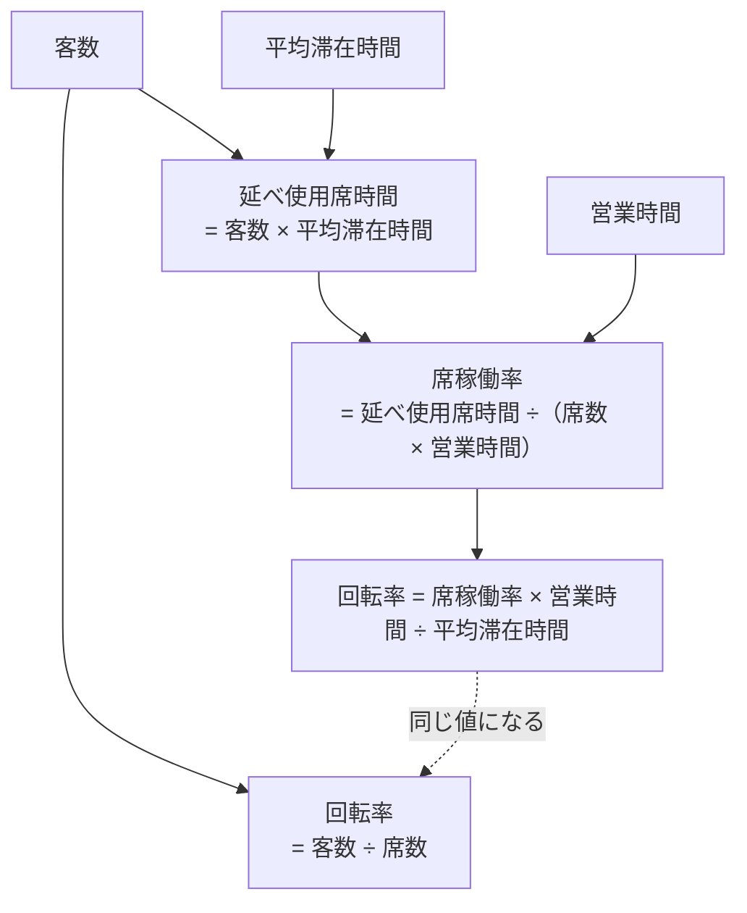

# 第3章 客数・客単価・回転率・席稼働率

第1章で「売上 = 席数 × 回転率 × 客単価」と分解しました。この章では、右辺の各項を**実際にどう測り、どう動かすか**を扱います。ここが飲食店経営の中心です。数字の定義を正確に押さえないと、「回転率を上げたのに売上が増えない」という状態から抜け出せません。

## 3.1 4つの数字の関係を先に整理する

| 数字 | 定義 | 測り方 | 上げ方の例 | 上げたときの副作用 |
| --- | --- | --- | --- | --- |
| 席数 | 座れる席の数 | 実地で数える | 増席、テラス席、カウンター化 | 1席あたり面積が減り、快適性が下がる |
| 回転率 | 1席が1日に何回使われたか | 客数 ÷ 席数 | 提供を速くする、片付けを速くする、メニューを絞る | 滞在時間が短くなり、追加注文が減る |
| 稼働率 | 営業時間のうち席が埋まっていた割合 | 延べ使用席時間 ÷（席数 × 営業時間） | 集客、予約、時間帯の平準化 | 混雑で待ちが発生し、離脱が増える |
| 客単価 | 1人1回あたりの支払額 | 売上 ÷ 客数 | セット化、サイドメニュー、飲料 | 価格抵抗で客数が減る |

この4つは独立ではありません。たとえば回転率を上げるために提供を速くすると、客の滞在時間が短くなり、デザートや追加ドリンクの注文機会が減って客単価が下がります。**片方を上げたら、別が下がっていないかを必ず確認します。**

測定の単位は、次のように揃えておきます。ここが揃っていないと、後の計算が合いません。

| 単位 | 決めること | 例 |
| --- | --- | --- |
| 客数 | 人数で数えるか、組数で数えるか | 人数（1組2人なら2人） |
| 席数 | 椅子の数か、テーブルの収容人数か | 椅子の数（20席） |
| 時間 | 分で記録するか、時間で記録するか | 分で記録し、集計時に時間へ換算 |

**人数と組数の混在は、回転率の計算を壊します。** 同じ「回転率3.0回転」でも、人数基準と組数基準では意味が変わります。**本資料では人数基準で統一します。**

```
1組あたり平均人数 = 客数（人） ÷ 来店組数（組）
人数基準の回転率 = 客数（人） ÷ 席数
組数基準の回転率 = 組数（組） ÷ 席数
```

**計算例（説明用の仮置き）**: 20席の店に1日60組・120人が来た場合、1組あたり平均人数は2.0人です。人数基準の回転率は 120 ÷ 20 = 6.0回転、組数基準なら 60 ÷ 20 = 3.0回転になります。**どちらで測ったかを書かずに「回転率3.0」と報告すると、売上計画が倍ずれます。** 組数基準で記録している場合は、上の換算式で人数に直してから使いください。

## 3.2 回転率の正しい測り方

回転率は「1日の客数（人）÷ 席数」です。組数で測る場合は「組回転率」と呼び、人数基準とは別の指標として扱います。

```
回転率 = 1日の客数 ÷ 席数
```

**計算例（説明用の仮置き）**: 20席の店に1日60人来るなら、回転率は 60 ÷ 20 = **3.0回転**です。

ただし、実際には席は常に満席ではありません。理論上の上限は滞在時間で決まります。

```
理論上の最大回転率 = 営業時間 ÷ 平均滞在時間
```

**計算例（ランチ・説明用の仮置き）**: 営業時間 11:30〜14:00（2.5時間 = 150分）、平均滞在時間 40分の場合、

```
150分 ÷ 40分 = 3.75回転（理論上限）
```

実際には、開店直後と閉店前は席が埋まりません。実際の回転率が2.8回転なら、理論上限に対する効率は 2.8 ÷ 3.75 = 約75.7% です。

この「理論上限に対する効率」を見ると、伸びしろが分かります。効率が90%を超えていれば、回転率をこれ以上上げるには滞在時間そのものを短くするしかありません。効率が60%台なら、まず稼働率（空席を埋めること）が課題です。

> **注意**: 「回転率が高い = 良い店」ではありません。回転率が高いのに客単価が低い店より、回転率が低くても客単価が高い店のほうが儲かる場合があります。比較するときは必ず**席あたり売上**または**席時間あたり売上**で見ます（3.4）。

## 3.3 席稼働率の定義と回転率との関係

稼働率は、席が「使われていた時間」の割合です。

```
延べ使用席時間 = 客数 × 平均滞在時間
席稼働率 = 延べ使用席時間 ÷（席数 × 営業時間）
```

**計算例（説明用の仮置き）**: 20席、営業5時間（300分）、客数60人、平均滞在時間40分の店なら、

```
延べ使用席時間 = 60人 × 40分 = 2,400席分
最大の延べ使用席時間 = 20席 × 300分 = 6,000席分
席稼働率 = 2,400 ÷ 6,000 = 0.40 → 40%
```

回転率は 60人 ÷ 20席 = 3.0回転でした。稼働率（%）で表すなら、平均滞在時間を使って次のようにも書けます。

```
席稼働率 = 回転率 × 平均滞在時間 ÷ 営業時間
```

上の例なら 3.0 × 40分 ÷ 300分 = 40% で、先の計算と一致します。この式を変形すると、

```
回転率 = 席稼働率 × 営業時間 ÷ 平均滞在時間
```

**ここが重要**: 稼働率と回転率は、平均滞在時間を挟んで表裏の関係にあります。だから「回転率を上げる」と「稼働率を上げる」は別のことを指します。片方が決まれば、もう片方は自動的に決まります。



上の図は、客数・平均滞在時間・営業時間から回転率と稼働率が出て、両者が同じ状態を別の角度から表していることを示しています。どちらか一方を測れば、もう一方は計算で求まります。

| 目的 | 意味 | 打ち手 |
| --- | --- | --- |
| 回転率を上げる | 同じ席を何度も使う | 滞在時間を短くする（提供・会計・片付けの速度） |
| 稼働率を上げる | 空いている時間を埋める | 客数を増やす、時間帯を平準化する、予約を取る |

昼のピークが満席で夜がガラガラなら、回転率はもう限界で、稼働率に伸びしろがあります。逆に終日6割しか埋まらないなら、回転率より集客が課題です。**どちらが課題かは、時間帯別に分けて測らないと分かりません。**

時間帯別に測るには、15分ごとに「使用中の席数」を記録するだけで十分です。1日分の表があれば、時間帯別の稼働率が計算できます（一般知識（未検証）。記録方法は店の規模に合わせて選んでください）。

## 3.4 席あたり売上と「席時間あたり売上」

店の生産性を1つの数字で見るなら、席あたり売上が便利です。

```
席あたり売上 = 売上 ÷ 席数
```

しかし、これでは「長時間居座る店」と「短時間で回す店」を公平に比べられません。そこで**席時間あたり売上**（1席が1時間使われたときに生む売上）を使います。

```
席時間あたり売上 = 売上 ÷ 延べ使用席時間
```

**計算例（説明用の仮置き）**: 2つの店を比べます。

| 項目 | 店A（カフェ） | 店B（居酒屋） |
| --- | --- | --- |
| 席数 | 20席 | 20席 |
| 客単価 | 900円 | 3,600円 |
| 平均滞在時間 | 30分 | 120分 |
| 1日の客数 | 80人 | 30人 |
| 売上 | 72,000円 | 108,000円 |

店Bのほうが売上は高い。しかし席時間あたりで見ると、

```
【店A】延べ使用席時間 = 80人 × 0.5時間 = 40席時間
       72,000円 ÷ 40席時間 = 1,800円/席時間
【店B】延べ使用席時間 = 30人 × 2時間 = 60席時間
       108,000円 ÷ 60席時間 = 1,800円/席時間
```

**同じ**です。店Bは単価が高いぶん席を長く占有しているので、生産性は店Aと変わりません。

この視点が実務で効くのは、次の判断です。

- 客単価を上げる値上げをしたとき、滞在時間も伸びていないか（伸びていれば席時間あたりでは改善していない）
- 提供を速くして回転を上げたとき、客単価が下がりすぎていないか
- テイクアウトや物販を足すとき、席を占有しないぶん本当に効くのか
- 席数の違う店舗や、改装前後を比べるとき、何を基準にするか

**席時間あたり売上は、店の形が変わっても比較できる数少ない指標**です。改装や増席の効果を測るときの基準になります。

## 3.5 客数の分解：新規とリピート

客数は、新規客とリピート客に分けられます。

```
客数 = 新規客数 + リピート客数
リピート客数 = 既存客数 × 来店頻度
```

| 指標 | 意味 | 測り方 |
| --- | --- | --- |
| 新規客数 | 初回来店した人数 | 初回判定（会員登録、クーポン、聞き取り） |
| リピート率 | 来た客がもう一度来る割合 | 一定期間内の再訪者 ÷ 初回客 |
| 来店頻度 | 1人が一定期間に来る回数 | 会員データ、ポイント履歴 |
| 顧客単価（LTV） | 1人が生涯で使う金額 | 客単価 × 来店頻度 × 継続期間 |

**LTV**（Life Time Value：顧客生涯価値）は、1人の客が付き合ってくれる間に使う金額の合計です。

```
LTV = 客単価 × 来店頻度（月） × 継続期間（月）
```

**計算例（説明用の仮置き）**: 客単価1,200円、月2回来店、24か月継続なら、

```
LTV = 1,200円 × 2回 × 24か月 = 57,600円
```

新規客の獲得にはコスト（広告、割引）がかかります。リピート客の獲得コストはほぼゼロです。したがって、**客数が伸びない原因が「新規が来ない」のか「リピートしない」のかで、打ち手はまったく変わります**。

```
新規獲得の許容コストの目安 = LTV × 粗利率
```

上の例で粗利率65%なら、57,600円 × 0.65 = 37,440円が粗利ベースのLTVです。1人あたりの獲得コストがこれを上回る広告は、理論上は回収できません。ただし継続期間は見込み値なので、**短めに見積もって判断します**。ここを分けずに「集客しよう」とすると、広告費だけが消えます。

## 3.6 待ち行列と機会損失

満席で待ち行列が出ている状態は、一見良い状態に見えます。しかし実際には損失が発生しています。

```
機会損失 = 離脱した客数 × 客単価
離脱率 = 離脱した組数 ÷ 来店しようとした組数
```

**計算例（説明用の仮置き）**: 満席の時間帯に20組が待ち、そのうち5組が離脱しました。1組平均2人、客単価2,000円なら、

```
離脱率 = 5組 ÷ 20組 = 25%
機会損失 = 5組 × 2人 × 2,000円 = 20,000円/日
```

月25日で同じ状態が続けば、単純計算で500,000円/月の機会損失になります。ただし離脱した客が別の日に来ることもあるため、これは**上限の目安**です。それでも「満席なのに売上が伸びない」原因を探すとき、最初に見る数字です。

対策は3つに分かれます。

| 対策の型 | 具体策 | 副作用 |
| --- | --- | --- |
| 待たせない | 提供を速くする、席を増やす、オペレーションを分ける | 投資と人件費が増える。提供を急ぐと品質が落ちる |
| 待てるようにする | 順番待ちのデジタル化、待合スペース、席で待てる導線 | 待ち時間の体感は下がるが、回転は上がらない |
| 待ちを売上に変える | 待ち時間にサイドメニュー、物販、テイクアウト | 導線と説明の設計が必要 |

離脱率を測るには、順番待ちの記録（受付票、呼び出し回数、案内した組数）が必要です。**記録がないと、この損失は永久に見えません。**

## 3.7 席が面積で決まる店の打ち手

席数は店の面積で上限が決まります。借りている面積を変えられない場合、席数を増やすには1席あたりを狭くするしかありません。そこで、席数以外の項を動かす発想が必要になります。

| 打ち手 | 動かす項 | 前提になる確認 |
| --- | --- | --- |
| カウンター化・可動席にする | 席数（実質的な収容力） | 椅子とテーブルの配置、動線、消防の避難経路 |
| 営業時間をずらす・延ばす | 席時間の総量（席数 × 営業時間） | 人件費、近隣への配慮、深夜の需要 |
| 予約・時間帯の平準化 | 稼働率 | 予約管理の仕組み、席の回転との整合 |
| テイクアウト・物販を足す | 席を占有しない売上 | 厨房の処理能力、容器原価、提供導線 |
| 席を共有する空間を設ける | 席数（共用部の活用） | 下記のとおり、法令と運用の確認が前提 |

### 屋外・共用の席空間を数えるときの注意

テラス席や共用部の席など、店内以外の空間を客席として使える場合があります。ただし、**その空間を客席として売上計画に数えてよいかは、法令と運用の両方の確認が必要**です。

- 飲食店の営業許可は、提供する場所の範囲と結びついています。屋外で提供する場合は、許可の範囲に含まれるかを保健所に確認します（[第5章](05-kyoka-to-hourei.md)）。
- 消防の収容人員や避難経路の算定に、屋外席がどう扱われるかを消防署に確認します。
- 天候で稼働が振れるため、年間の稼働率で見積もります。晴天時の席数をそのまま年間の席数として扱うと、売上計画が過大になります。

**確認が取れるまでは、その空間を「補助席」として扱い、売上計画の本体に織り込まない**のが安全です。席数が確定していない状態で回転率や客単価の計画を立てても、根拠がありません。

これは法的助言ではありません。個別の物件・業態については、保健所・消防署・顧問の専門家に確認してください（一般知識（未検証））。

### 複数の店舗が席空間を共有する場合

複数の店舗が同じ空間（共用の席、テラス、フードコートのような場所）を共有する場合、**席の取り合い**が起きます。

片方の店が混んで客を溢れさせると、もう片方の客が座れなくなります。店舗ごとに最適化すると、全体では非効率になる典型例です。

| 店舗別に見ると | 空間全体で見ると |
| --- | --- |
| 自店の売上を最大化するために、空いた席を埋める | 他の店の客が座れず、空間全体の売上が伸びない |
| 自店の混雑を吸収できて良い | 客の体験が店によって分断される |

対策は、**席を店舗の持ち物ではなく、空間（ゾーン）の持ち物として管理する**ことです。どの店の客がどこに座るかを決めるルール、混雑時の案内の順序、会計の扱いを先に決めておきます。この設計は、複数店舗を運営する場合や、共用部を持つ物件に入る場合に必ず必要になります。

## 3.8 よくある誤解

| 誤解 | 実際 |
| --- | --- |
| 回転率が高い店は儲かる | 席時間あたり売上で見ないと比較できない。高回転・低単価は低生産のことがある |
| 稼働率100%が理想 | 100%は常に待ち行列＝離脱が起きている状態。適正な稼働率は離脱率との兼ね合いで決まる |
| 客数が増えれば売上が増える | 客単価が同時に下がれば売上は増えない。粗利で見る必要がある |
| 平均滞在時間は固定 | メニュー、提供速度、会計方法、席の居心地で変わる。設計で動かせる変数 |
| 回転率と稼働率は別々に上げられる | 平均滞在時間を挟んで表裏の関係。片方を上げれば、もう片方の値も動く |
| 満席なら損失はない | 待ち行列からの離脱は損失。記録がないと見えない |
| 席数を増やせば客数が増える | 1席あたりが狭くなり、快適性と提供速度が落ちる。席時間あたりで確認する |

## 3.9 この章の要点

- 客数は **席数 × 回転率**、売上は **客数 × 客単価** です。回転率は人数基準か組数基準かを統一して測ります。
- 回転率の理論上限は **営業時間 ÷ 平均滞在時間** で決まります。実績との比（効率）で伸びしろが分かります。
- 稼働率と回転率は **平均滞在時間を挟んで表裏**の関係です。両方を上げるのではなく、どちらが課題かを見極めます。
- 店舗間・改装前後の比較には **席時間あたり売上** を使います。客単価と滞在時間の違いを吸収できるためです。
- 満席時の **離脱率** を測らないと、機会損失は見えません。記録が対策の前提です。

## 3.10 自店で確認すること

- [ ] 客数を人数で数えているか、組数で数えているかを決め、全資料で統一している
- [ ] 時間帯別（最低でも昼・夜）の客数と売上を出せる
- [ ] 平均滞在時間を、時間帯別に測っている
- [ ] 理論上の最大回転率と実績回転率の比（効率）を計算したことがある
- [ ] 延べ使用席時間（客数 × 平均滞在時間）を出せる
- [ ] 新規客とリピート客を分けて集計している
- [ ] 順番待ちの組数と、案内できた組数を記録している
- [ ] 店内以外の席（テラス・共用部）を、客席として数えてよいか確認済みか

## 3.11 演習

### 問1 理論上限と実績効率

営業時間5時間（300分）、平均滞在時間50分、実績の回転率4.2回転の店があります。理論上の最大回転率と、実績効率を求めてください。また、課題は回転率と稼働率のどちらと考えられるか答えてください。

**解答**

```
理論上の最大回転率 = 300分 ÷ 50分 = 6.0回転
実績効率 = 4.2回転 ÷ 6.0回転 = 0.70 → 70%
```

実績効率は70%です。理論上限まで3割の余裕がありますが、この余裕は「開店直後と閉店前の空席」と「滞在中の席」のどちらから来ているかを分けて確認します。効率70%は低めなので、まず**稼働率（空席を埋めること）**が課題と考えられます。効率が90%を超えているなら、次は滞在時間の短縮が課題になります。

### 問2 席時間あたり売上の比較

| 項目 | 店C | 店D |
| --- | --- | --- |
| 席数 | 16席 | 30席 |
| 客単価 | 1,100円 | 2,800円 |
| 平均滞在時間 | 45分 | 90分 |
| 1日の客数 | 70人 | 45人 |

それぞれの売上と席時間あたり売上を求め、どちらが生産性の高い店か答えてください。

**解答**

```
【店C】
売上 = 70人 × 1,100円 = 77,000円
延べ使用席時間 = 70人 × 0.75時間 = 52.5席時間
席時間あたり売上 = 77,000円 ÷ 52.5席時間 = 1,466.67円 → 約1,467円

【店D】
売上 = 45人 × 2,800円 = 126,000円
延べ使用席時間 = 45人 × 1.5時間 = 67.5席時間
席時間あたり売上 = 126,000円 ÷ 67.5席時間 = 1,866.67円 → 約1,867円
```

売上は店Dが1.6倍以上ですが、席時間あたり売上でも店Dが約1,867円で店Cの約1,467円を上回ります。店Dは客単価が高いぶん、滞在時間の長さを吸収して余りある生産性を持っています。ただし店Dは席数が多いので、**席あたり売上**（126,000 ÷ 30 = 4,200円）と店C（77,000 ÷ 16 = 4,812.5円）では順位が逆になります。何を比べたいかで指標を選ぶ必要があります。

### 問3 LTVと許容獲得コスト

客単価1,500円、月1.5回来店、継続期間30か月、粗利率65%の店があります。LTVと、粗利ベースのLTVを求めてください。1人あたりの新規獲得コストが5,000円の広告は、この前提で回収できるか答えてください。

**解答**

```
LTV = 1,500円 × 1.5回/月 × 30か月 = 67,500円
粗利ベースのLTV = 67,500円 × 0.65 = 43,875円
```

粗利ベースのLTVは43,875円なので、獲得コスト5,000円は理論上は回収できます。ただしこれは**30か月継続する**という見込みが前提です。継続期間が12か月に短くなると、粗利ベースのLTVは 1,500 × 1.5 × 12 × 0.65 = 17,550円まで下がります。**獲得コストの判断は、継続期間を短めに見積もって行います。**

## 出典と確度

- 本章の定義式（回転率、稼働率、席時間あたり売上、離脱率、LTV）は経営分析の標準的な定義にもとづく**一般知識（未検証）**。数値例は本資料が計算のために置いたものであり、実在の店舗の実績ではない。
- 3.3 の稼働率と回転率の関係（`席稼働率 = 回転率 × 平均滞在時間 ÷ 営業時間`）は、上の定義式から導ける関係です。本文中に数値例を示し、両方の計算が一致することを確認しています。
- 3.4 の計算は本文中に式と途中の値を示しており、電卓で検算できます。
- 3.7 の屋外席・共用部の扱いは**一般知識（未検証）**。営業許可の範囲、消防の収容人員の算定は、物件と業態ごとに保健所・消防署へ確認が必要です。本資料は法的助言ではありません。
- 業界平均値は本章では提示していない（[第2章](02-shueki-kouzou-genka.md)で出典付きの値を扱う）。

前後の章: [第2章 収益構造と原価管理](02-shueki-kouzou-genka.md) ／ [第4章 損益分岐点とキャッシュフロー](04-soneki-bunkiten-cashflow.md)
