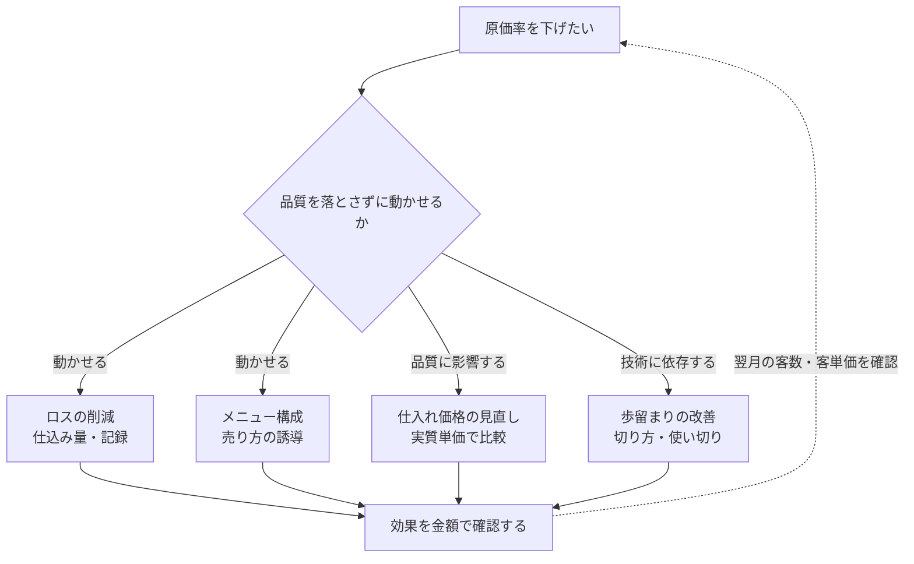

# 第3章 材料費と原価率

## 3.1 この章で扱うこと

[第2章](02-soneki-keisansho.md)で、損益計算書の2段目に「材料費」があることを確認しました。この章では、その材料費を**自分の店で正確に作る方法**を扱います。仕入れた金額と使った金額の違い、棚卸し、歩留まり、ロス、レシピ原価という5つの論点を順に説明します。最後に、原価率が動く要因を整理し、どの要因から動かすべきかを判断できるようにします。ロスの4類型とメニュー設計は[第17章: 食品ロスとメニュー設計](17-loss-menu.md)、仕入れ先の選び方と在庫管理は[第16章: 仕入れと在庫管理](16-shiire-zaiko.md)で扱います。

## 3.2 学習目標

- 材料費が「使った金額」であることを、棚卸しの式で計算できる。
- 歩留まりから実質単価を求め、仕入れ単価の安さだけで食材を選ばないと説明できる。
- 主要メニューのレシピ原価を、歩留まりと調味料を含めて積み上げられる。
- 原価率が動く4つの要因（仕入れ価格・歩留まり・ロス・メニュー構成）を挙げ、動かす順序を判断できる。
- 原価率を単独の目標にしない理由を、客数・客単価との関係で説明できる。

## 3.3 材料費とは何か

### 3.3.1 使った金額であって、仕入れた金額ではない

**材料費**（食材原価、フードコスト）とは、その期間に**提供した料理に使った**食材・飲料の原価です。仕入れた金額ではありません。

| 金額 | 意味 | 損益計算書での扱い |
| --- | --- | --- |
| 仕入額 | 業者に支払った金額 | 使った分だけが材料費になる |
| 期末在庫 | 使わずに残っている分 | 資産として翌月に繰り越す |
| 材料費 | 使った分 | 費用として計上する |

この区別をしないと、**在庫が増えた月に原価率が実態より高く出ます**。反対に、在庫を取り崩した月は低く出ます。どちらも実態ではありません。正確に出す式は3.5で示します。

### 3.3.2 材料費に含めるもの・含めないもの

材料費の範囲は、店によって判断が分かれます。**決めて、毎月同じ定義で出す**ことが重要です。

| 費目 | 材料費に含めるか | 理由 |
| --- | --- | --- |
| 食材（肉・魚・野菜・米） | 含める | 料理の本体 |
| 調味料（醤油・塩・油・スパイス） | 含める（推奨） | 1品あたりは小さいが合計すると無視できない |
| 飲料（酒・ソフトドリンク） | 含める | 提供する商品そのもの |
| テイクアウト容器・袋 | 含める（推奨） | 容器がないと売れない。原価の一部 |
| 仕込みに使う氷・水 | 含めないことが多い | 金額が小さく、計測が難しい |
| まかない（従業員食） | 含めるか、人件費に移すかを決める | 福利厚生として扱う考え方もある |
| 器具・洗剤 | 含めない（消耗品費） | 食材ではない |

**容器を材料費に入れ忘れると、原価率が実際より低く出ます。** テイクアウト比率が高い店では、この差が無視できません（[第11章: 食品表示とアレルギー](11-hyouji-allergy.md)で容器の表示義務も扱います）。

## 3.4 原価率の定義と計算

### 3.4.1 式

```
原価率（%）= 材料費 ÷ 売上高 × 100
粗利率（%）= 100 − 原価率
```

**原価率**（げんかりつ）は、売上のうち材料費に消えた割合です。飲食店では「FL比率」のFに当たります（[第2章](02-soneki-keisansho.md) 2.8）。

### 3.4.2 数値例

**計算例（説明用の仮置き）**: 月の売上3,000,000円、材料費900,000円なら、

```
原価率 = 900,000 ÷ 3,000,000 × 100 = 30.0%
粗利率 = 100 − 30.0 = 70.0%
粗利額 = 3,000,000 − 900,000 = 2,100,000円
```

### 3.4.3 率だけでなく金額で見る

原価率30.0%は同じでも、売上規模が違えば粗利額は変わります。

| 売上高 | 原価率 | 材料費 | 粗利額 |
| --- | --- | --- | --- |
| 1,000,000円 | 30.0% | 300,000円 | 700,000円 |
| 2,000,000円 | 30.0% | 600,000円 | 1,400,000円 |
| 3,000,000円 | 30.0% | 900,000円 | 2,100,000円 |

固定費は売上に関係なく発生するので、**粗利額で固定費を回収できるか**を確認します。原価率の改善を語るときも、必ず金額に戻します。

```
原価率が1ポイント改善したときの利益増 = 売上高 × 1 ÷ 100
```

**数値例（説明用の仮置き）**: 売上3,000,000円なら、1ポイントは30,000円です。30.0%から29.0%に改善すれば、材料費以外の条件が同じ場合、利益が30,000円増えます。

## 3.5 棚卸しと材料費の計算

### 3.5.1 式

正確な材料費は、在庫を数えないと出ません。在庫を数えて金額を確定する作業を**棚卸し**（たなおろし）と呼びます。

```
材料費 = 期首在庫 + 当期仕入 − 期末在庫
```

| 用語 | 意味 |
| --- | --- |
| 期首在庫 | 期間の始めに残っていた食材の金額 |
| 当期仕入 | 期間中に仕入れた金額 |
| 期末在庫 | 期間の終わりに残っていた食材の金額 |

### 3.5.2 数値例：棚卸しを省くと何ポイントずれるか

**数値例（説明用の仮置き）**: 期首在庫120,000円、当期仕入1,050,000円、期末在庫150,000円、売上3,000,000円とします。

```
材料費 = 120,000 + 1,050,000 − 150,000 = 1,020,000円
原価率 = 1,020,000 ÷ 3,000,000 × 100 = 34.0%
```

棚卸しを省き、仕入額をそのまま材料費とすると、

```
原価率 = 1,050,000 ÷ 3,000,000 × 100 = 35.0%
```

**1ポイント（30,000円）の差**が出ます。しかもこの差は月ごとに上下します。在庫が積み上がった月は原価率が高く、取り崩した月は低く出るためです。**どちらも実態ではありません。**

さらに悪い例として、期末在庫を数え忘れた場合を考えます。

```
材料費 = 120,000 + 1,050,000 − 0 = 1,170,000円
原価率 = 1,170,000 ÷ 3,000,000 × 100 = 39.0%
```

本来34.0%の月が39.0%に見えます。この数字を見て「原価が急に悪化した」と判断すると、関係のない対策（仕入先の変更など）に走ります。**棚卸しは面倒な作業ではなく、判断の前提です。**

### 3.5.3 棚卸しのやり方

| 手順 | 内容 | 記録すること |
| --- | --- | --- |
| 1. 範囲を決める | 冷蔵庫、冷凍庫、乾物棚、飲料庫を漏れなく | 数えた場所の一覧 |
| 2. 数える | 重量または個数で数える | 品名、数量、単位 |
| 3. 金額にする | 数量 × 単価 | 使った単価の根拠（最終仕入単価など） |
| 4. 合計する | 場所別・区分別に合計 | 期末在庫額 |
| 5. 記録して残す | 写真と一覧を保存する | 翌月の期首在庫になる |

**数える頻度**は、月末に1回が基本です。在庫の回転が速い店や、原価率の振れが大きい店では、週1回にすると原因が特定しやすくなります。

**棚卸しでよくある誤り**を整理します。

| 誤り | 起きること | 防ぎ方 |
| --- | --- | --- |
| 高額品だけ数える | 調味料・乾物の残が抜ける | 品目リストを作って全品数える |
| 単価を毎回変える | 月ごとに評価が変わり比較できない | 評価方法を決めて固定する |
| 開封済みを数えない | 期末在庫が過小になる | 開封済みも残量で数える |
| 棚卸しの日を月末に固定しない | 期間がずれて比較できない | 月末最終営業日と決める |
| 記録を残さない | 翌月の期首在庫にできない | 一覧と写真を保存する |

なお、在庫の金額評価には税務上の方法（最終仕入原価法など）があります。**評価方法の選択は税務上の判断を含むため、本書では方法を示しません。** 税理士に確認してください（**本資料は税務的助言ではありません**）。

## 3.6 仕入れ価格はどう動くか

### 3.6.1 相場と季節

食材の価格は季節で動きます。**同じメニューを年中同じ価格で出すと、原価率が季節で振れます。**

| 価格が動く要因 | 例 | 影響 |
| --- | --- | --- |
| 旬 | 野菜・魚の季節変動 | 旬は安く品質も良い。外れると高い |
| 天候 | 長雨、台風、冷夏 | 不作で単価が跳ね上がる |
| 相場 | 輸入品の為替、燃油 | 輸入食材・冷凍品がまとめて上がる |
| 需給 | 行事、連休、給料日 | 需要が集中する時期は仕入も高い |

### 3.6.2 対策は3つ

1. **季節メニューを入れ替える**（旬の安い食材を中心にする）
2. **通年メニューの価格を見直す機会を決める**（年2回など、時期を決めておく）
3. **代替食材を決めておく**（品切れ・高騰時の切り替え先を、あらかじめ2つ用意する）

### 3.6.3 単価の比較は「実質単価」で行う

仕入れ単価の安さだけで業者を選ぶと、失敗します。同じ「1kgいくら」でも、使える部分の割合が違うからです。この比較は3.7の**実質単価**で行います。

| 比較の軸 | 見るもの | 見落とすと |
| --- | --- | --- |
| 単価 | 1kgあたりの金額 | 歩留まりの差で逆転する |
| 品質 | 鮮度、等級、産地 | ロスと評判低下で戻ってくる |
| 納品精度 | 時間、数量の正確さ | 欠品と作り直しが発生する |
| 支払条件 | 締め日、手数料 | 資金繰りに効く |

仕入れ先の選び方と発注の実務は[第16章](16-shiire-zaiko.md)で扱います。

## 3.7 歩留まりと実質単価

### 3.7.1 定義

**歩留まり**（ぶどまり）とは、仕入れた食材のうち実際に使えた割合です。野菜の芯や皮、魚の骨、肉の脂身など、使えない部分は必ず出ます。

```
歩留まり（%）= 使えた重量 ÷ 仕入れ重量 × 100
実質単価 = 仕入れ単価 ÷ 歩留まり
```

**実質単価**とは、実際に皿に載る部分の1単位あたりの原価です。

### 3.7.2 数値例

**計算例（説明用の仮置き）**: 1kgあたり1,000円の食材で、使えるのが700g（歩留まり70%）なら、

```
実質単価 = 1,000円 ÷ 0.70 = 1,428.57... → 約1,429円/kg
```

見かけの仕入れ単価は1,000円でも、実際に皿に載る部分の単価は約1,429円です。**歩留まりの悪い食材は、仕入れ単価が安くても高くつきます。**

### 3.7.3 歩留まりが改善すると原価はどれだけ下がるか

**計算例（説明用の仮置き）**: 1kgあたり1,200円の魚を仕入れ、使えるのが600g（歩留まり60%）でした。歩留まりが75%に改善した場合を比べます。

```
【現状】
実質単価 = 1,200円 ÷ 0.60 = 2,000円/kg

【歩留まり75%のとき】
実質単価 = 1,200円 ÷ 0.75 = 1,600円/kg
```

実質単価は2,000円から1,600円へ、400円下がります。**仕入れ単価は1円も変わっていないのに、原価は20%下がりました**（1,600 ÷ 2,000 = 0.80）。歩留まりの改善は、仕入れ交渉と同じ効果を持ちます。

| 歩留まり | 実質単価（1,200円/kgの魚） | 現状比 |
| --- | --- | --- |
| 60% | 2,000円/kg | 100% |
| 70% | 1,714円/kg | 85.7% |
| 75% | 1,600円/kg | 80.0% |
| 80% | 1,500円/kg | 75.0% |

（小数第1位を四捨五入。1,200 ÷ 0.70 = 1,714.28… → 1,714円）

### 3.7.4 歩留まりを上げる方法と副作用

| 方法 | 内容 | 副作用 |
| --- | --- | --- |
| 調理技術の向上 | 切り方、皮のむき方、骨の外し方 | 習得に時間がかかる。属人化しやすい |
| 仕込み方法の改善 | 部位ごとに使い道を決める | 仕込みの手間が増える |
| 部位の使い切り | 骨は出汁、皮は焼き物、端材は賄い | メニューが増え、仕込みが複雑になる |
| 仕入れ形態の変更 | 下処理済みを買う | 単価は上がるが、手間とロスは減る |

**歩留まりは「技術」だけでなく「仕入れ形態の選択」でも動きます。** 下処理済みの食材は単価が高いですが、実質単価で比べると割安なことがあります。**必ず実質単価に直して比較してください。**

## 3.8 ロス

### 3.8.1 ロス率

**ロス**とは、仕入れた食材のうち、提供できずに捨てた分です。

```
ロス率（%）= 廃棄額 ÷ 仕入額 × 100
```

### 3.8.2 数値例：ロス削減は利益にどう効くか

**計算例（説明用の仮置き）**: 月の売上1,600,000円、仕入額480,000円、廃棄額19,000円とします。

```
ロス率 = 19,000 ÷ 480,000 × 100 = 3.958... → 4.0%
```

廃棄を半分にすれば、材料費が9,500円下がります。

```
削減額 = 19,000円 × 0.5 = 9,500円
```

この9,500円は、売上比では0.6%です（9,500 ÷ 1,600,000 × 100 = 0.594%）。**利益率が0.6ポイント改善するのと同じ効果**があります。売上を0.6%増やすには客数か客単価を上げる必要があり、外部要因に左右されます。ロス削減は自店だけで完結します。

| 打ち手 | 必要な変化 | 確実性 |
| --- | --- | --- |
| ロスを半分にする | 廃棄の記録と仕込み量の調整 | 高い（自店だけで完結する） |
| 売上を0.6%増やす | 集客・単価・回転のいずれかの改善 | 低い（外部要因が入る） |

ロス率が高い店ほど、この効果は大きくなります。ロス率8%の店が半分にすれば1.2ポイント、ロス率4%の店なら0.6ポイントです。**まず自店のロス率を測ってください。**

### 3.8.3 ロスと品切れのトレードオフ

**ロス削減は、売上を増やさずに利益を増やせる数少ない手段**です。ただし、ロスを減らすために仕込みを減らしすぎると品切れが起き、機会損失になります。**ロス率と売り切れ率はトレードオフ**の関係にあります。**売り切れ率**とは、用意した数に対して提供できずに終わった割合のことです。

廃棄と品切れのどちらが損かは、金額で比較できます。

```
廃棄の損失   = 廃棄数量 × 材料費単価
品切れの損失 = 販売できなかった数量 × 粗利額
```

**数値例（説明用の仮置き）**: 10個を廃棄する場合、材料費単価100円なら損失は 10 × 100 = **1,000円**です。同じ食材で作る800円の料理（粗利600円）を10個売れなかった場合、損失は 10 × 600 = **6,000円**です。差は 6,000 ÷ 1,000 = **6倍**になります。

| 状態 | 損失の計算 | 金額（10個の場合） |
| --- | --- | --- |
| 廃棄した | 10個 × 材料費100円 | 1,000円 |
| 品切れした | 10個 × 粗利600円 | 6,000円 |

品切れの損失は「粗利」で計算するため、**廃棄の損失より大きく出ます**。これが「多少のロスを許容して品切れを避ける」判断の根拠です。ただし、毎日大量に廃棄が出るなら話は別で、それは発注精度の問題です。**1日単位の小さな迷いと、毎月続く構造的な過剰発注は、分けて扱います。**

### 3.8.4 ロスの分類は第17章で

ロスは原因が違えば対策も違います。発生場所による4類型（仕込みロス、売れ残りロス、食べ残しロス、返品・期限切れロス）と、その対策・メニュー設計は[第17章](17-loss-menu.md)で扱います。本章では「ロスは原価率を動かす要因の1つ」として、金額への効き方だけを押さえてください。

## 3.9 レシピ原価

### 3.9.1 式

店全体の原価率だけでなく、**商品1つずつの原価**を積み上げると、メニュー改定の判断ができます。この計算値を**レシピ原価**と呼びます。

```
レシピ原価 = Σ（使用食材の重量 ÷ 歩留まり × 単価）+ 調味料 + 容器（テイクアウトの場合）
1品あたり原価率（%）= レシピ原価 ÷ 売価 × 100
1品あたり粗利（円）= 売価 − レシピ原価
```

### 3.9.2 数値例：1皿を積み上げる

**数値例（説明用の仮置き）**: 1皿に食材Xを120g、食材Yを40g使うとします。Xは1kg 1,200円・歩留まり75%、Yは1kg 2,000円・歩留まり90%、調味料15円、売価800円です。

```
Xの1g単価 = 1,200 ÷ (1,000 × 0.75) = 1,200 ÷ 750 = 1.6円
Xの使用分 = 1.6円 × 120g = 192円

Yの1g単価 = 2,000 ÷ (1,000 × 0.90) = 2,000 ÷ 900 = 2.22円
Yの使用分 = 2.22円 × 40g = 88.9円 → 89円（小数第1位を四捨五入）

レシピ原価 = 192 + 89 + 15 = 296円
原価率     = 296 ÷ 800 × 100 = 37.0%
粗利       = 800 − 296 = 504円
```

**この1皿の原価率は37.0%で、店全体の原価率（例: 30.0%）より高い**ことが分かります。店全体の平均だけを見ていると、こうした「1品ごとの偏り」は見えません。

### 3.9.3 レシピ原価と棚卸し原価は一致しない

レシピ原価の積み上げと、棚卸しから計算した材料費は、**一致しないことがあります**。原因は次のとおりです。

| 差の原因 | 内容 | 差の方向 |
| --- | --- | --- |
| 盛り付けロス | 盛り付けで落ちる、切り落とす | 実績が大きい |
| 提供時の取りこぼし | 作り直し、提供ミス | 実績が大きい |
| 記録の漏れ | 賄い、試作、社員の食事 | 実績が大きい |
| 棚卸しの誤り | 数え漏れ、単価の誤り | どちらにも振れる |
| レシピの未更新 | 現場が分量を変えている | どちらにも振れる |

差が大きい場合（目安として売上比2ポイント以上。**これは本書の運用上の目安であり、業界標準ではありません**）は、レシピと現場の実態がずれていると考え、どちらの数字が実態に近いかを確認します。

### 3.9.4 レシピ原価を作る順序

1. **売れ筋10品を選ぶ**（売上上位、または注文回数の上位）
2. **各品の材料を、重量で書き出す**（「適量」を数字にする）
3. **各材料の仕入れ単価と歩留まりを調べる**
4. **1品あたりの材料費を計算する**（調味料・容器も入れる）
5. **売価と並べて、原価率と粗利額を出す**
6. **四半期ごとに見直す**（仕入れ価格とレシピが変わるため）

「適量」「少々」を数字にするところが最も時間がかかります。**最初から全品をやらず、売れ筋10品から始めてください。**

## 3.10 原価率が動く4つの要因

### 3.10.1 一覧

原価率は、次の4つで動きます。改善するときは、どれを動かすのかを明確にします。

| 要因 | 内容 | 打ち手 | 副作用 |
| --- | --- | --- | --- |
| 仕入れ価格 | 食材の単価 | 仕入れ先の見直し、季節品の活用、契約 | 品質低下、供給不安定 |
| 歩留まり | 仕入れた食材のうち使える割合 | 調理技術、仕込み方法の改善、部位の使い切り | 手間が増える |
| ロス | 廃棄・売れ残り | 仕込み量の精度向上、メニュー絞り込み | 品切れリスク |
| メニュー構成 | 原価率の違う商品の売れ方 | メニュー設計、売り方の誘導 | 客の満足度、価格抵抗 |

### 3.10.2 どれから動かすか

**原価率を下げる最も安全な方法は「ロス削減」と「メニュー構成の改善」**です。仕入れ価格の切り下げは品質に直結し、歩留まり改善は技術に依存します。ロスとメニュー構成は、品質を落とさずに動かせます。



上の図は、原価率を下げる打ち手を「品質への影響」で分ける判断の流れです。点線は、効果の確認が次の判断につながることを示しています。

| 順序 | 打ち手 | 理由 |
| --- | --- | --- |
| 1 | ロスの記録を取る | 何をどれだけ捨てているか分からないと対策できない |
| 2 | メニュー構成を見る | 売れ方の偏りは、品質を変えずに動かせる |
| 3 | 実質単価で仕入れを見直す | 単価の比較は歩留まり込みで行う |
| 4 | 歩留まりの改善 | 手間と技術が必要。最後に着手する |

## 3.11 原価率を下げすぎると何が起きるか

原価率を下げる方法は、材料を減らす、安い材料に変える、値段を上げる、のいずれかです。どれも**客から見た価値**を下げる方向に働きます。原価率だけを見て最適化すると、次の連鎖が起きます。

```
原価率低下 → 満足度低下 → リピート減 → 客数減 → 売上減
→ 人件費率・家賃比率が悪化 → 利益減
```

**原価率は単独で最適化できない指標**です。必ず粗利額（円）と客数・客単価をセットで見ます。

| 下げ方 | 短期的な効果 | 中期的なリスク |
| --- | --- | --- |
| 量を減らす | 原価率が下がる | 満足度・リピートが下がる |
| 安い食材に変える | 原価率が下がる | 味・品質の評判が下がる |
| 値段を上げる | 原価率が下がる | 客数が減る |
| メニューを絞る | ロスと仕込みが減る | 選択肢が減る（ただし影響は小さい） |

**この表の上3つと下1つは性質が違います。** 上3つは客から見た価値を直接下げますが、メニューを絞ることは価値を下げずに原価を下げられます（ただし選べる楽しみは減ります）。

## 3.12 業態で原価率が違う理由

原価率の水準は業態で大きく違います。業態別の傾向と「他業態と比べても意味がない理由」は[第2章](02-soneki-keisansho.md) 2.9で扱いました。ここでは**比較の原則**だけ補足します。

| 比較の対象 | 意味があるか | 理由 |
| --- | --- | --- |
| 自店の過去実績（前月・前年同月） | ある | 同じ条件で比べられる |
| 同業態・同規模・同商圏の競合 | ある（条件を確認して） | 構造が近い |
| 異なる業態の店 | ない | 価格に占める食材の割合が違う |
| 業界の単一平均値 | ない | 業態差が平均に埋もれる |

## 3.13 食品ロスの統計

農林水産省・環境省の推計（2024年度）では、食品ロス全体は461万トン、うち事業系が237万トン、**外食が70万トン**です（事業系の約29.5%）。2030年度までに2000年度比60%削減という目標が置かれています。

| 項目 | 値（2024年度推計） |
| --- | --- |
| 食品ロス全体 | 461万トン |
| 事業系 | 237万トン |
| うち外食 | 70万トン（事業系の約29.5%） |
| 目標 | 2030年度までに2000年度比60%削減 |

出典: 農林水産省「事業系食品ロス量（2024年度推計値）を公表」（令和8年6月30日）、https://www.maff.go.jp/j/press/shokuhin/recycle/260630.html 、環境省食品ロスポータルサイト https://www.env.go.jp/recycle/foodloss/index.html （取得日 2026-11-14）

**読み方の注意**: この統計は**日本全体の推計**であり、個店のロス率の目標値ではありません。全国の外食のロス量が分かっても、自店の廃棄額は分かりません。外食の食品ロス70万トンは、**廃棄した食材の仕入れ額がそのまま損失になる**ことを意味します。**自店の数値は、自店で測るしかありません。**

また、飲食店の食べ残し率（食べ残し量÷提供量）の公的統計は**取得できませんでした**。自店の食べ残しは、目視調査で測るのが確実です（例: 1週間、下膳時の残量を5段階で記録する）。

## 3.14 ケースの店では

連続ケース「食堂つきかげ」（[第22章: 総合ケース](22-case.md)）の材料費を計算します。**ケースの数字は設計値であり、実在の店舗の実績ではありません。**

ケースの設計値では、材料費率は開業月（4月）が32%、11月が30%です。金額に直します。

```
【4月】材料費 = 1,800,000円 × 0.32 = 576,000円
      粗利   = 1,800,000円 − 576,000円 = 1,224,000円

【11月】材料費 = 3,000,000円 × 0.30 = 900,000円
       粗利   = 3,000,000円 − 900,000円 = 2,100,000円
```

12か月分を合計すると、年間売上31,300,000円、年間材料費9,556,000円、**年間原価率30.5%**になります（小数第2位を四捨五入）。

| 月 | 売上（円） | 材料費率 | 材料費（円） |
| --- | --- | --- | --- |
| 4月 | 1,800,000 | 32% | 576,000 |
| 5月 | 2,200,000 | 31% | 682,000 |
| 6月 | 2,400,000 | 31% | 744,000 |
| 7月 | 2,600,000 | 30% | 780,000 |
| 8月 | 2,700,000 | 30% | 810,000 |
| 9月 | 2,500,000 | 30% | 750,000 |
| 10月 | 2,800,000 | 30% | 840,000 |
| 11月 | 3,000,000 | 30% | 900,000 |
| 12月 | 3,400,000 | 31% | 1,054,000 |
| 1月 | 2,600,000 | 31% | 806,000 |
| 2月 | 2,400,000 | 31% | 744,000 |
| 3月 | 2,900,000 | 30% | 870,000 |
| 年間 | 31,300,000 | 30.5% | 9,556,000 |

この表から読み取れることを整理します。

第一に、**原価率は開業月の32%から30%まで下がり、その後は30〜31%で安定しています**。安定していることは、仕込み量と仕入れが読めるようになったという意味です。逆に言えば、**12月・1月・2月に31%へ戻っている**点は、季節要因（仕入れ価格の上昇、年末年始の特別メニュー）か、ロスの増加かを切り分ける必要があります。

第二に、**もし年間を通じて32%のままだったら、材料費は10,016,000円になっていました**（31,300,000 × 0.32）。実績9,556,000円との差は**460,000円**です。原価率2ポイントの改善が、年間46万円の利益改善に相当します（材料費以外の条件が変わらない場合）。

第三に、**レシピ原価はケースに設定がありません**。メニュー別の売価とレシピが決まっていないため、本章の計算で示した方法（3.9）を、自店の売れ筋10品で実施してください。ケースの店では、昼の定食と夜の居酒屋メニューで原価率が大きく違うと考えられるため、店全体の30%という数字だけでは、どのメニューが重いかを判断できません。

## 3.15 よくある誤解

| 誤解 | 実際 |
| --- | --- |
| 原価率は低いほど良い | 低すぎると量・品質・価格のどれかで客が離れます。粗利額と客数で見ます |
| 仕入れ額で原価率を出せば十分 | 在庫の増減で月ごとに振れます。棚卸しが必要です |
| 他店の原価率と比べれば良い | 業態が違えば比較になりません。同業態・同規模・同商圏で比べます |
| 仕入れ単価が安い食材は得 | 歩留まりを掛けた実質単価で見ます。芯や皮の多い食材は高くつきます |
| ロスは少ないほど良い | 減らしすぎると品切れが増えます。品切れの損失は粗利で計算するため大きくなります |
| レシピ原価と帳簿の材料費は同じになるはず | 盛り付けロス・提供ミス・賄いで差が出ます。差の原因を確認します |
| 原価率を下げれば必ず利益が増える | 客数・客単価が下がれば利益は増えません。金額に戻して確認します |
| 棚卸しは面倒だから仕入れ額で十分 | 在庫の増減を無視すると原価率が月ごとに振れ、判断を誤ります |

## 3.16 この章の要点

- 材料費は**使った金額**です。`期首在庫 + 当期仕入 − 期末在庫` で出します。棚卸しをしないと原価率が月ごとに振れます。
- 仕入れ単価の比較は**実質単価**（仕入れ単価 ÷ 歩留まり）で行います。歩留まりの改善は仕入れ交渉と同じ効果を持ちます。
- 原価率が1ポイント改善すると、利益は「売上の1%」増えます。**必ず金額に戻して**確認します。
- 原価率は**仕入れ価格・歩留まり・ロス・メニュー構成**の4つで動きます。品質を落とさずに動かせるのはロスとメニュー構成です。
- 原価率は単独で最適化できません。**粗利額・客数・客単価とセット**で見ます。

## 3.17 自店で確認すること

- [ ] 月末に棚卸しをして、`期首在庫 + 仕入 − 期末在庫` で材料費を出している
- [ ] 材料費に含める範囲（調味料・容器・賄い）を決めて、毎月同じ定義で出している
- [ ] 在庫の金額評価の方法を決め、税理士に確認している
- [ ] 主要メニュー10品のレシピ原価（売価・材料費・手間）を書き出せる
- [ ] 歩留まりの悪い食材を把握し、実質単価で比較している
- [ ] 廃棄ログ（何を、いつ、いくら捨てたか）を取っている
- [ ] 品切れの回数と、そのときに失った粗利を記録している
- [ ] レシピ原価の合計と棚卸しから出した材料費の差を、月次で確認している

## 3.18 章末問題

### 問1 材料費と原価率、棚卸しの影響（計算）

期首在庫80,000円、当期仕入620,000円、期末在庫100,000円、売上1,800,000円でした。

1. 材料費と原価率を計算してください。
2. 棚卸しを省いて仕入額をそのまま材料費とした場合の原価率と、差を計算してください。
3. 期末在庫を数え忘れて100,000円を計上しなかった場合、材料費と原価率はどうなるか計算してください。

**解答**

1. 材料費 = 80,000 + 620,000 − 100,000 = **600,000円**。原価率 = 600,000 ÷ 1,800,000 × 100 = **33.3%**（小数第2位を四捨五入）。
2. 620,000 ÷ 1,800,000 × 100 = **34.4%**。差は 34.4 − 33.3 = **1.1ポイント**、金額では 620,000 − 600,000 = 20,000円です。
3. 材料費 = 80,000 + 620,000 − 0 = **700,000円**。原価率 = 700,000 ÷ 1,800,000 × 100 = **38.9%**。実際より5.6ポイント高く出ます（38.9 − 33.3 = 5.6）。在庫を数え忘れると、原価率はこのように大きく振れます。

### 問2 歩留まりとレシピ原価（計算）

1皿に食材Zを180g使います。Zは1kg 1,500円、歩留まり80%、調味料は20円、販売価格は900円です。

1. レシピ原価と原価率を計算してください。
2. 歩留まりが70%に落ちた場合のレシピ原価と原価率を計算してください。
3. 歩留まりが落ちた分を吸収するには、価格をいくらにすれば元の原価率（1の値）に戻るか計算してください。

**解答**

1. 1g単価 = 1,500 ÷ (1,000 × 0.80) = 1,500 ÷ 800 = 1.875円。食材費 = 1.875 × 180 = 337.5円。レシピ原価 = 337.5 + 20 = **357.5円**。原価率 = 357.5 ÷ 900 × 100 = **39.7%**（小数第2位を四捨五入）。
2. 1g単価 = 1,500 ÷ 700 = 2.143円。食材費 = 2.143 × 180 = 385.7円。レシピ原価 = 385.7 + 20 = **405.7円**。原価率 = 405.7 ÷ 900 × 100 = **45.1%**。
3. 価格 = 405.7 ÷ 0.397 = 1,021.9円 → **1,022円以上**（1円未満を切り上げ）。ただし1,022円にすると客数への影響が出ます。値上げ以外の選択肢（歩留まりの改善、ロスの少ない切り方、調味料の見直し）も同時に検討します。

（計算は途中で小数第3位を四捨五入して表示しています。最終値は円未満を四捨五入しています。）

### 問3 ロスと品切れの比較（記述）

「廃棄が毎日10個出ているので、仕込みを全部半分に減らしたい」という相談を受けました。この判断を金額で検討する手順を述べてください。

**解答**

まず**廃棄の損失を金額で計算**します。10個 × 材料費単価で求めます。材料費単価が100円なら1日1,000円、月25日で25,000円です。

次に**品切れの損失を金額で計算**します。仕込みを半分にすると、売れていた分の一部が売れなくなります。売れ残りが10個出ているなら、需要は仕込み数より少ないので、半分にしても売り切れる可能性があります。しかし**需要にはばらつきがある**ため、多い日には品切れが出ます。品切れ1個あたりの損失は材料費ではなく**粗利**です（800円の料理で粗利600円なら、品切れ1個＝600円の損失）。

比較します。廃棄1個の損失は100円、品切れ1個の損失は600円です。**品切れが廃棄の6倍の損失**になります（3.8.3）。したがって「仕込みを半分にする」判断は、品切れが発生する確率が高いなら割に合いません。

打ち手としては、仕込み量を半分ではなく**段階的に減らす**（例: 8割）、**日別・曜日別・天候別に需要を見る**、**売り切れ前提のメニュー設計にする**（[第17章](17-loss-menu.md)）の3つを組み合わせます。判断の前に、1週間分の廃棄数と品切れ数を、日付・曜日・天候とあわせて記録してください。

## 参考文献・出典

- 材料費の計算（期首在庫 + 仕入 − 期末在庫）、原価率、歩留まり、実質単価、ロス率、レシピ原価、メニュー評価の考え方は、飲食店実務・管理会計の標準的な手法にもとづく**一般知識（未検証）**です。
- 本章の数値例はすべて**説明用の仮置き**であり、実在の店舗の実績ではありません。3.14 の数値は連続ケース「食堂つきかげ」の**設計値**です。
- 3.13 の食品ロス統計は一次資料で確認済み（**確信度 高**）。出典: 農林水産省「事業系食品ロス量（2024年度推計値）を公表」（令和8年6月30日）、https://www.maff.go.jp/j/press/shokuhin/recycle/260630.html 、環境省食品ロスポータルサイト https://www.env.go.jp/recycle/foodloss/index.html （取得日 2026-11-14）
- 飲食店の食べ残し率は公的統計を**取得できなかった**ため、本資料では数値を示していません。
- 歩留まりの標準値、業態別のロス率や原価率の平均値は、本章では提示していません。**裏付けが取れていない数値を提示しない**方針によります。平均値を出さない理由は[第2章](02-soneki-keisansho.md) 2.10に記載しています。
- 在庫の金額評価（最終仕入原価法など）と容器・賄いの経理処理は税務上の定めによります。本章は考え方のみを示すもので、**税務的助言ではありません**。個別の処理は税理士に確認してください。
- 3.9.3 の「売上比2ポイント以上」は本書の運用上の目安であり、業界標準ではありません。

前後の章: [第2章: 損益計算書の読み方](02-soneki-keisansho.md) ／ [第4章: 人件費と生産性](04-jinken-hi-seisansei.md)
