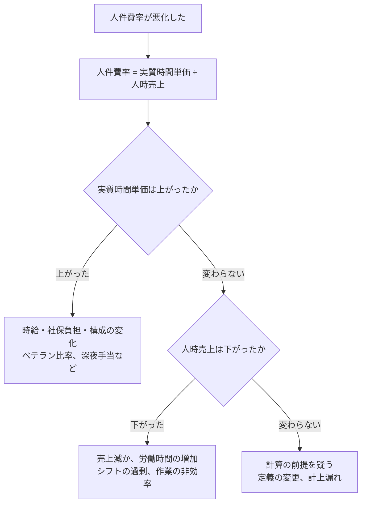
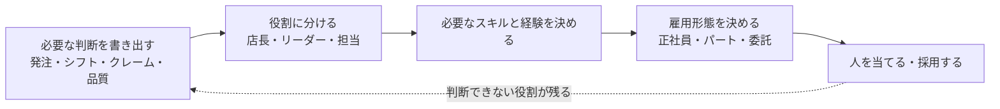
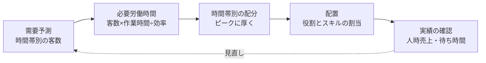

# 第4章 人件費と生産性

## 4.1 この章で扱うこと

[第2章](02-soneki-keisansho.md)で、損益計算書の3段目に「人件費」があることを確認しました。この章では、人件費を**売上との関係で測る方法**を扱います。人件費率と人時売上という2つの指標、雇用形態による固定費・変動費の混合、需要から逆算するシフト設計、採用と離職のコスト、教育と標準化を順に説明します。労働法の細部（割増率、変形労働時間制の要件など）は[第13章: 労働法と労務管理](13-roudou-hou.md)で扱います。

飲食店は**人で品質が決まる商売**です。同じメニュー、同じ価格でも、作る人と接する人で客の満足は変わります。人が足りない、育たない、辞めるという状態は、売上と利益に直接効いてきます。この章では、人の問題を「根性」ではなく**設計**として扱います。

> **本章の位置づけ**: 労働法の細部は、本資料の作成時に公的一次資料を取得できなかった項目があります。法律に依存する記述は「一般知識（未検証）」と明示し、断定を避けます。実際の運用は労働基準監督署・社会保険労務士に確認してください。**本資料は法的助言ではありません。**

## 4.2 学習目標

- 人件費に何を含めるかを決め、毎月同じ定義で人件費率を出せる。
- 人時売上を計算し、人件費率と組み合わせて「原因が売上減かシフトか」を切り分けられる。
- 目標人件費率から必要人時売上を逆算し、シフト作成の判断に使える。
- 予測客数から必要労働時間を計算し、時間帯別に配分できる。
- 採用コストと離職コストを金額で見積もり、定着への投資と比べられる。

## 4.3 人件費とは何か

### 4.3.1 含める範囲を決めて固定する

**人件費**は、単に「給与」ではありません。どこまで含めるかで金額が変わるため、**範囲を決めて固定する**のが原則です。

| 費目 | 含めるか | 補足 |
| --- | --- | --- |
| 給与・時給 | 含める | 支払った総額（税・社保の本人負担分を含む） |
| 社会保険料の事業主負担 | 含める（推奨） | 会社が負担する分。実質コストの一部 |
| 賞与・手当 | 含める | 皆勤手当、役職手当、深夜手当など |
| 法定福利費 | 含める | 雇用保険・労災の事業主負担など |
| 募集・採用費 | 分けて管理する（推奨） | 人件費率に混ぜると振れが大きい |
| 教育・研修費 | 分けて管理する（推奨） | 同上 |
| 福利厚生（賄い・制服） | 決めて固定する | 人件費か消耗品費か、店で決める |
| 業務委託料 | 含めない（委託費） | 指揮命令の範囲に注意（4.7.1） |

**社会保険料の事業主負担を含めるかどうかで、人件費率は数ポイント変わります。** 時給1,200円のスタッフでも、事業主負担を加えた実質コストはそれを上回ります。この実質コストを**実質時間単価**と呼びます。

```
実質時間単価（円/時間）=（給与 + 社会保険料の事業主負担など）÷ 総労働時間
```

**数値例（説明用の仮置き）**: 時給1,200円で、社会保険料などの事業主負担が労働1時間あたり300円相当なら、実質時間単価は1,500円/時間です。

### 4.3.2 総労働時間を測る

人件費を時間で割るには、**総労働時間**が必要です。ここでいう総労働時間は、**営業中の時間だけではありません**。

| 時間の種類 | 例 | 記録しているか |
| --- | --- | --- |
| 営業中の労働 | 調理、提供、接客、会計 | している店が多い |
| 開店前の準備 | 仕込み、清掃、ミーティング | 抜けやすい |
| 閉店後の作業 | 片付け、翌日の仕込み、締め | 抜けやすい |
| 発注・事務 | 仕入れ発注、シフト作成、売上集計 | 抜けやすい |

**準備と後片付けを労働時間に入れないと、人時売上が実際より高く出ます。** 「準備だから」と扱う運用は、労務上も問題になります（4.12）。

## 4.4 人件費率

### 4.4.1 式と数値例

```
人件費率（%）= 人件費 ÷ 売上高 × 100
```

**計算例（説明用の仮置き）**: 月商3,000,000円、人件費900,000円なら、人件費率は30.0%です。人件費率が30%ということは、売上の3割が人に消えているという意味です。

### 4.4.2 人件費率の構造的な弱点

人件費率は「売上に対する比率」なので、**売上が下がると自動的に悪化します**。人員を減らしていなくても、です。逆に売上が急に伸びると、シフトを増やす前は人件費率が良く見えます。

| 状況 | 人件費（円） | 売上（円） | 人件費率 | 人員は適正か |
| --- | --- | --- | --- | --- |
| 基準 | 900,000 | 3,000,000 | 30.0% | 判断できない |
| 売上が2割減 | 900,000 | 2,400,000 | 37.5% | 同じ人員なのに悪化して見える |
| 売上が2割増 | 900,000 | 3,600,000 | 25.0% | 同じ人員なのに改善して見える |

**つまり人件費率は、人員の適正さではなく、売上の水準を映す鏡**になっていることがあります。そこで使うのが**人時売上**です。

## 4.5 人時売上

### 4.5.1 定義

```
人時売上（円/時間）= 売上高 ÷ 総労働時間
```

**人時売上**（じんじうりあげ）は、労働1時間あたりの売上です。「1時間の人件費に見合う売上を上げているか」を直接見られます。

### 4.5.2 数値例

**計算例**: 月商3,000,000円、総労働時間600時間なら、人時売上は 3,000,000 ÷ 600 = **5,000円/時間**です。実質時間単価が1,500円/時間なら、1時間あたり1,500円のコストで5,000円を売っている計算になります。

### 4.5.3 人件費率と人時売上の関係式

この2つの指標は、独立ではありません。次の関係があります。

```
人件費率 = 実質時間単価 ÷ 人時売上
```

導き方は単純です。

```
人件費     = 総労働時間 × 実質時間単価
売上       = 総労働時間 × 人時売上
人件費率   = 人件費 ÷ 売上 = 実質時間単価 ÷ 人時売上
```

**検算**: 実質時間単価1,500円/時間、人時売上5,000円/時間なら、1,500 ÷ 5,000 = 0.30 → 30.0%です。人件費900,000円 ÷ 売上3,000,000円 = 30.0%と一致します。

**この式が実務で役立つ理由**は、人件費率が悪化したときに原因が2つに絞れることです。



上の図は、人件費率の悪化を2つの項に分解して原因を探す手順です。

| 状態 | 実質時間単価 | 人時売上 | 判断 |
| --- | --- | --- | --- |
| 人件費率は横ばい | 上昇 | 上昇 | 時給を上げても生産性が上がっている。許容できる |
| 人件費率が悪化 | 上昇 | 横ばい | 時給・構成の見直しが必要 |
| 人件費率が悪化 | 横ばい | 下落 | シフトか売上の問題。人員配置を疑う |
| 人件費率は改善 | 横ばい | 上昇 | 生産性が上がっている。負荷を確認する |

**4行目が重要です。** 人時売上が上がり続けている状態は、良いことばかりではありません。スタッフが休む暇なく働いている可能性があります（4.8.5）。

### 4.5.4 人時売上と客単価・作業時間の関係

人時売上は、客単価と「1人あたりの作業時間」でも分解できます。

```
人時売上 = 客単価 ÷ 1人あたり作業時間（時間）
```

**検算**: 客単価1,200円、1人あたり作業時間10分（= 1/6時間）なら、1,200 ÷ (1/6) = **7,200円/時間**です。別の方法で確かめます。1日60人なら売上は72,000円、総労働時間は 60人 × 10分 = 600分 = 10時間、72,000 ÷ 10 = 7,200円/時間。一致します。

**この式から、人時売上を上げる方法は2つしかないことが分かります。**

| 方法 | 具体例 | 注意 |
| --- | --- | --- |
| 客単価を上げる | メニュー構成、追加注文、価格改定 | 客数への影響を確認する |
| 1人あたり作業時間を短くする | 仕込み、提供手順、設備、メニュー絞り込み | 品質と満足度への影響を確認する |

「とにかく忙しくする」では人時売上は上がりません。**客単価が同じなら、作業時間を短くするしかない**のです。

## 4.6 必要人時売上を目標から逆算する

人件費率の目標が決まっていれば、必要な人時売上を逆算できます。

```
必要人時売上 = 実質時間単価 ÷ 目標人件費率
```

**計算例（説明用の仮置き）**: 実質時間単価1,500円、目標人件費率20%なら、

```
必要人時売上 = 1,500円 ÷ 0.20 = 7,500円/時間
```

目標を達成するには、労働1時間あたり7,500円の売上が必要です。この数字をシフト作成の前に置いておくと、「人を増やしてよい時間帯か」を判断できます。

| 目標人件費率 | 実質時間単価1,200円 | 1,500円 | 1,800円 |
| --- | --- | --- | --- |
| 25% | 4,800円/時間 | 6,000円/時間 | 7,200円/時間 |
| 30% | 4,000円/時間 | 5,000円/時間 | 6,000円/時間 |
| 35% | 3,429円/時間 | 4,286円/時間 | 5,143円/時間 |

（小数第1位を四捨五入。1,200 ÷ 0.35 = 3,428.57… → 3,429円）

**実質時間単価が高い店ほど、必要な人時売上も高くなります。** 時給の高いスタッフを配置する時間帯は、その分の売上が必要です。これは「時給の高い人は使わない」という話ではなく、**高い時給に見合う売上を作れる時間帯に配置する**という設計の話です。

## 4.7 雇用形態と固定費・変動費の混合

### 4.7.1 雇用形態の一覧

飲食店の働き方は、雇用形態で大きく分かれます。

| 形態 | 役割 | 長所 | 短所 |
| --- | --- | --- | --- |
| 正社員 | 店舗の責任、シフト編成、仕入れ、教育 | 責任と継続性がある | 人件費が高い（固定費） |
| 契約社員・準社員 | 特定の役割を継続的に担う | 正社員より柔軟 | 責任範囲が曖昧になりやすい |
| パート・アルバイト | 調理補助、ホール、洗い場 | 需要に応じて調整できる（変動費的） | 教育コストがかかる。流動性が高い |
| 業務委託 | 専門業務（製菓、寿司など） | 固定費を抑えられる | 指揮命令の範囲に注意が必要（偽装請負のリスク） |
| 外国人材 | 人手不足の補完 | 戦力になる | 在留資格、言語、文化の調整が必要 |

**用語の説明**: **固定費**は、売上がゼロでも発生する費用です（正社員の給与、家賃、リース料）。**変動費**は、売上に比例して発生する費用です（食材費、アルバイトの人件費）。**偽装請負**は、請負の契約形式をとりながら、実際には発注者が作業者へ指揮命令している状態を指し、労働者派遣法などの問題になります。

### 4.7.2 構成と損益分岐点

**飲食店の人的コストの特徴**は、正社員（固定費）とアルバイト（変動費）の混合比率で、損益分岐点が変わることです。

| 構成 | 損益分岐点 | 起きやすい問題 |
| --- | --- | --- |
| 正社員中心 | 高い（固定費が重い） | 売上が落ちると利益が急に消える |
| アルバイト中心 | 低い（売上に連動） | 品質のばらつき、教育の属人化、急な欠勤 |
| 混成（役割で分ける） | 中間 | 役割の境界が曖昧だと責任が消える |

損益分岐点の計算そのものは[第6章: 損益分岐点](06-soneki-bunkiten.md)で扱います。ここでは**構成によって売上変動への耐性が変わる**ことだけ押さえてください。

**どの構成が正しいかは、業態と立地で変わります。** ランチ中心の回転型と、夜の接客型では、必要な人数とスキルが違います。

### 4.7.3 役割から人を当てる順序

**人の配置は、単価の高い人を減らす話ではありません。** 時給の安い人だけを集めると、教育と品質のコストが別の形で発生します。**「誰が何を判断できるか」を先に決め、その役割に人を当てる**順序で考えます。



上の図は、役割を先に決めてから雇用形態を選ぶ順序です。逆順（人を先に集めてから役割を決める）にすると、責任の空白が生まれます。

## 4.8 シフト設計

### 4.8.1 シフトは「需要」から逆算する

シフトは、店の都合ではなく**客数の予測**から組みます。



図の説明: シフトは需要予測から始まり、必要労働時間を計算し、時間帯に配分し、役割に人を当てます。組んだ後は実績で確認し、次の予測に戻します。**「前月のシフトをそのまま使う」をやめる**のが出発点です。

### 4.8.2 必要労働時間を計算する

```
必要労働時間 = 予測客数 × 1人あたりの作業時間 ÷ 効率
```

**計算例（説明用の仮置き）**: 予測客数60人、1人あたりの作業時間（調理・提供・洗い場・接客の合計）が10分、効率80%なら、

```
60人 × 10分 = 600分 = 10時間
10時間 ÷ 0.8 = 12.5時間
```

この12.5時間を、時間帯別の客数に応じて配分します。

**もう1つの計算例（説明用の仮置き）**: 予測客数90人、1人あたり8分、効率75%なら、

```
90人 × 8分 = 720分 = 12時間
12時間 ÷ 0.75 = 16時間
```

**「効率」は作業の詰まり具合で決まります。** この値を実測するには、ピーク時の提供時間と待ち時間を記録します。効率を高く見積もりすぎると、シフトが足りずに提供が遅れます。

### 4.8.3 時間帯へ配分する

計算した総時間を、時間帯別の客数に応じて配分します。ピーク時に集中させ、アイドルタイムは減らします。

| 時間帯 | 予測客数 | 配分の考え方 | 必要な人数の例 |
| --- | --- | --- | --- |
| 11:30〜12:00 | 10人 | 仕込みの完了と開店準備 | 2人 |
| 12:00〜13:00 | 35人 | ピーク。提供と洗い場を厚く | 5人 |
| 13:00〜14:00 | 15人 | 片付けと翌日の仕込み | 2人 |

### 4.8.4 ボトルネックを先に特定する

**「効率」は作業の詰まり具合で決まります。** 調理場が1人しか入れないレイアウトなら、人数を増やしても効率は上がりません。**ボトルネック（律速となる工程）を先に特定**します。

| ボトルネックの例 | 症状 | 打ち手 |
| --- | --- | --- |
| コンロの口数 | 炒め物が集中すると詰まる | メニュー構成の変更、下ごしらえの前倒し |
| 洗い場 | 食器が回らず、提供が止まる | 食器の予備、洗浄機、ワゴンの位置 |
| ホールの動線 | 通路が狭く、運搬が詰まる | 配置の変更、配膳台の追加 |
| 会計 | 退店時に列ができる | キャッシュレス、伝票の持ち方 |

**人が足りないと感じたとき、まずボトルネックを確認してください。** ボトルネックでない工程に人を足しても、提供時間は短くなりません。

### 4.8.5 人時売上でシフトを評価する

人時売上は、シフトの評価にも使います。ただし**人時売上が高い＝良い、ではありません。**

| 状態 | 人時売上 | 判断 |
| --- | --- | --- |
| 高すぎる | 作業が詰まっている可能性 | 客の満足度・従業員の負荷を確認する。増員の余地がある |
| 適正 | 過去の水準と同程度 | 現状維持。負荷と品質を確認する |
| 低すぎる | 人が余っている可能性 | シフトの見直し、作業の効率化 |

**数値例（説明用の仮置き）**: 1日の売上120,000円、総労働時間40時間なら、人時売上は3,000円/時間です。3,000円を良いと見るか悪いと見るかは、業態と立地によります。**自店の過去の水準と比べる**のが基本で、他店の数値をそのまま目標にしません。

高すぎる状態は、従業員が休む暇なく働いている状態で、**離職とミスにつながります**。離職コストは4.10で扱います。

## 4.9 採用コスト

### 4.9.1 採用は構造的に難しい

| 課題 | 内容 | 打ち手 |
| --- | --- | --- |
| 応募が集まらない | 労働条件、業務の認知、競合との競争 | 募集文の改善、写真、職場見学、紹介 |
| 条件が合わない | 勤務時間、休日、時給 | 短時間勤務、曜日固定、シフトの柔軟化 |
| 早期離職 | ミスマッチ、人間関係、負荷 | 採用前の職場見学、初期研修、メンター |
| 採用コストが高い | 媒体費、面接の時間 | 紹介制度、リファラル採用、定着への投資 |

**リファラル採用**は、在籍するスタッフからの紹介で採用する方法です。相互理解があるぶんミスマッチが起きにくい一方、紹介した側とされた側の関係が職場に持ち込まれます。

### 4.9.2 採用コストの計算

**採用コストは「1人を採用するのにかかった費用」で測ります**。媒体費、面接工数、研修期間の教育コストを含めます。

```
採用コスト（1人あたり）= 直接費（媒体・紹介料）+ 面接工数 × 時給 + 研修期間の教育費
```

**計算例（説明用の仮置き）**: 求人媒体費3万円、面接3回（担当者の時給2,000円 × 1時間 × 3回 = 6,000円）、研修2週間（時給1,200円 × 80時間 = 9万6,000円）とすると、

```
30,000 + 6,000 + 96,000 = 132,000円
```

1人の採用に**約13万円**かかった計算です。この人が3か月で辞めれば、この金額に再採用の費用が上乗せされます。

### 4.9.3 募集で伝えること

**応募が来ない原因の多くは、条件ではなく情報不足**です。何をする仕事か、どの時間帯か、誰と働くかが伝わらないと、応募者は判断できません。

| 伝える項目 | 具体例 | 効果 |
| --- | --- | --- |
| 業務の内容 | ホール、調理補助、洗い場の別 | ミスマッチを減らす |
| 時間帯と曜日 | ランチのみ、週2日から、曜日固定可 | 応募のハードルを下げる |
| 職場の様子 | 写真、動画、スタッフの紹介 | 想像できるようにする |
| 教育の仕組み | 初日の流れ、研修の期間 | 未経験者の不安を下げる |
| 評価の基準 | 時給アップの条件 | 納得感につなげる |

**条件を良くする前に、伝え方を直す**方が費用がかかりません。

## 4.10 離職コストと定着

### 4.10.1 離職コストの計算

離職には見えにくいコストがかかります。

```
離職コスト = 採用コスト + 教育コスト + 戦力化までの生産性低下 + 既存スタッフの負荷増
```

**計算例（説明用の仮置き）**: 採用費5万円、研修2週間（時給1,200円 × 80時間 = 9.6万円）、戦力化までの生産性低下を月5万円とすると、

```
5万円 + 9.6万円 + 5万円 = 19.6万円 → 約20万円
```

1人の離職で**約20万円**のコストが発生します。10人が年間で離職すれば200万円です。これは、時給を10円上げるより大きな金額になることがあります。

**離職コストは、見積もらないと見えません。** 給与明細には出てこないため、削減の対象として認識されにくいのです。**「辞めた人の数 × 1人あたりのコスト」を年1回計算する**だけでも、投資の判断が変わります。

| 項目 | 金額（仮置き） | 給与明細に出るか |
| --- | --- | --- |
| 採用費 | 50,000円 | 出ない |
| 研修の教育費 | 96,000円 | 一部出る（研修時間の給与） |
| 戦力化までの生産性低下 | 50,000円 | 出ない |
| 合計 | 196,000円 | — |

### 4.10.2 定着の打ち手

| 打ち手 | 内容 | 効果 |
| --- | --- | --- |
| 採用前のすり合わせ | 職場見学、業務内容の説明 | ミスマッチを減らす |
| 初期研修 | 初日に何を教えるかを決める | 早期離職を防ぐ |
| シフトの希望反映 | 希望休、曜日固定 | 生活との両立 |
| 評価の透明化 | 時給アップの基準を明示 | 納得感 |
| 人間関係 | 相談できる相手、定期的な面談 | 離職の最大要因に対処 |
| キャリアパス | 役職、専門性、独立支援 | 長期就業の動機 |

**離職理由は「人間関係」と「労働条件」が多い**とされますが、本資料では統計を取得できていないため数値は示しません。自店の退職者への聞き取り（exit interview）が最も確実な情報源です。**退職の聞き取りは、辞める直前ではなく、辞めた後に行う**方が本音が出ます（一般知識（未検証））。

### 4.10.3 定着を数字で見る

| 指標 | 計算 | 使い方 |
| --- | --- | --- |
| 定着率（3か月） | 3か月後も在籍する人数 ÷ 入店した人数 | 採用と初期研修の効果を見る |
| 平均勤続月数 | 総勤続月数 ÷ 在籍人数 | 長期的な安定を見る |
| 欠勤率 | 欠勤日数 ÷ 予定出勤日数 | 負荷や体調の変化を察知する |
| 離職コスト（年間） | 離職者数 × 1人あたりのコスト | 投資判断の材料にする |

**指標は、比べる相手を決めてから使います。** 他店との比較より、自店の半年前との比較の方が判断しやすいです。

## 4.11 教育と標準化

### 4.11.1 標準化の対象

飲食店の品質は「誰が作っても同じ味」に近づけられるかで決まります。

| 標準化の対象 | 方法 | 効果 |
| --- | --- | --- |
| レシピ | 分量のグラム指定、写真、手順書 | 味のばらつきが減る。教育が速くなる |
| 調理手順 | 手順書、動画、チェックリスト | 属人化を防ぐ。引き継ぎが楽になる |
| 接客 | マニュアル、ロールプレイ | サービスの質が揃う |
| 衛生 | チェックリスト、記録（[第12章: 衛生管理とHACCP](12-eisei-haccp.md)） | 事故を防ぐ。証跡が残る |
| 締め作業 | チェックリスト、ダブルチェック | ミスと不正を防ぐ |

**レシピの標準化は、材料費の管理とも直結します。** 分量が人によって変わると、レシピ原価と実際の材料費がずれます（[第3章](03-zairyo-hi-genka.md) 3.9.3）。

**標準化の目的は「人を機械にする」ことではありません。** 標準化によって、判断に迷う時間を減らし、教育を速くし、属人化を防ぎます。

### 4.11.2 教育の順序

1. **見せる**（デモンストレーション）
2. **やらせる**（実践、隣で見る）
3. **確認する**（できているかをチェック）
4. **任せる**（一人でできるようにする）
5. **振り返る**（定期的なフィードバック）

**初日の教育が離職を左右します**（一般知識（未検証））。初日に何を教え、誰が面倒を見るかを決めておくことが、結果的に定着率を上げます。

| 時点 | 教えること | 担当 |
| --- | --- | --- |
| 初日・午前 | 店のルール、身だしなみ、手洗い、避難経路、休憩の取り方 | 店長または教育係 |
| 初日・午後 | 担当する業務の1つ目（例: 洗い場、ご案内） | 教育係と2人で |
| 1週間目 | 担当業務の追加、メニューの説明、アレルギーの扱い | 教育係 |
| 1か月目 | 一人で任せる範囲の確認、困ったときの相談先 | 店長 |
| 3か月目 | 評価のフィードバック、次の目標 | 店長 |

**「初日に全部教える」は失敗します。** 情報量が多すぎると、何も残りません。**初日は「安全」と「帰り道」だけ確実に**し、業務は1つずつ足します。

### 4.11.3 標準化の限界と例外の判断

| 標準化で解決できること | 標準化では解決できないこと |
| --- | --- |
| 手順のばらつき | 判断が必要な場面（クレーム、アレルギー、体調不良） |
| 教育の効率 | 意欲や働きがい |
| 引き継ぎのしやすさ | 人間関係 |
| 品質の下限の安定 | 品質の上限（料理人の工夫） |

**例外の判断基準を決める**のが、標準化とセットの作業です。誰が、どこまでを判断してよいかを書いておくと、現場が止まりません。

| 場面 | 判断する人 | 判断の範囲 |
| --- | --- | --- |
| アレルギーの申告 | ホール担当 | 原材料の確認と、厨房への伝達。提供可否は厨房 |
| 料理の作り直し | ホール責任者 | 1品の作り直し |
| 提供の遅れの説明 | ホール担当 | お詫びと所要時間の案内 |
| クレームの対応 | 店長 | 返金・割引の判断 |
| 体調不良の申告 | 本人と店長 | 就業の可否 |

アレルギーの扱いは、事故になれば営業に直結します。判断の流れは[第11章: 食品表示とアレルギー](11-hyouji-allergy.md)で扱います。

## 4.12 労働時間の管理

飲食店で起きやすい論点を整理します。**いずれも法律の解釈を含むため、実務では社会保険労務士に確認してください。** 本章は論点の整理にとどめ、制度の要件は[第13章](13-roudou-hou.md)で扱います。

| 論点 | 内容 | 注意点 |
| --- | --- | --- |
| 労働時間の把握 | 始業・終業の記録 | 記録がないと、残業代の未払いを主張されうる |
| 時間外労働の割増 | 法定時間を超えた分の割増賃金 | 割増率は法令で定まる。**具体的な率は一次資料で確認していない** |
| 深夜労働 | 深夜帯の割増 | 深夜帯の定義も法令による |
| 休日労働 | 法定休日の労働 | 休日の設定と割増の扱いを確認 |
| 変形労働時間制 | 繁忙期と閑散期で労働時間を平準化する制度 | 要件を満たさないと無効。導入は慎重に |
| 年少者の保護 | 18歳未満の労働時間・深夜業の制限 | 高校生のアルバイトで問題になりやすい |
| 有期契約の更新 | 契約期間、更新のルール | 反復更新で無期転換の対象になりうる |

**記録の重要性**: 労働時間の記録がない店は、トラブル時に立証できません。タイムカードや勤怠システムの導入は、労務リスクの低減として費用対効果が高い投資です。

**記録すべき項目**は、少なくとも始業・終業の時刻、休憩の開始と終了、その日の担当です。休憩を取ったかどうかは、後から争いになりやすい項目です。**休憩の時刻まで記録する**運用にしておくと、説明が容易になります。

| 起きやすい問題 | 原因 | 防ぎ方 |
| --- | --- | --- |
| サービス残業 | 記録を取っていない、上がり時間を自己申告にしている | 打刻の徹底、退勤の声かけ |
| 休憩が取れない | ピークと休憩時間が重なっている | 休憩を時間帯で固定し、交代要員を配置 |
| 早出・仕込みの未計上 | 「準備だから」と扱っている | 準備も労働時間として記録する |
| 年少者の深夜勤務 | シフト編成の見落とし | シフト表に年齢の制約を表示する |

**シフトを組む段階で、法令の制約を入れておく**のが有効です。組んでから直すと、現場の負担になります。

## 4.13 ケースの店では

連続ケース「食堂つきかげ」（[第22章: 総合ケース](22-case.md)）の人件費を計算します。**ケースの数字は設計値であり、実在の店舗の実績ではありません。** スタッフはオーナー1人、正社員1人、アルバイト4人です。ケースの人件費は**スタッフ人件費**で、オーナー報酬は含みません（4.3.1の「含める範囲」を、スタッフ分に限定した定義です）。

人件費率は、開業月（4月）が38%、11月が30%です。金額に直します。

```
【4月】人件費 = 1,800,000円 × 0.38 = 684,000円
【11月】人件費 = 3,000,000円 × 0.30 = 900,000円
```

12か月分を合計すると、年間人件費10,050,000円、**年間人件費率32.1%**になります（小数第2位を四捨五入）。

人時売上を出すには総労働時間が必要です。ケースでは、**実質時間単価を1,500円/時間と置いて総労働時間を逆算**しています（[第22章](22-case.md)）。年間は 10,050,000 ÷ 1,500 = **6,700時間**です。月ごとの時間も同じ単価で求められます。

```
【4月】
総労働時間   = 684,000 ÷ 1,500 = 456時間
人時売上     = 1,800,000 ÷ 456 = 3,947円/時間
人件費率     = 1,500 ÷ 3,947 = 38.0%（ケースの設計値と一致）

【11月】
総労働時間   = 900,000 ÷ 1,500 = 600時間
人時売上     = 3,000,000 ÷ 600 = 5,000円/時間
人件費率     = 1,500 ÷ 5,000 = 30.0%（ケースの設計値と一致）

【年間】
総労働時間   = 10,050,000 ÷ 1,500 = 6,700時間
人時売上     = 31,300,000 ÷ 6,700 = 4,672円/時間
人件費率     = 1,500 ÷ 4,672 = 32.1%（ケースの設計値と一致）
```

（各値は小数第1位を四捨五入。4月は 1,800,000 ÷ 456 = 3,947.36… → 3,947円、年間は 31,300,000 ÷ 6,700 = 4,671.6… → 4,672円）

4.5.3の関係式が、ケースの数字でも成立することが確認できます。読み取れることを整理します。

第一に、**人件費率が38%から30%に改善したのは、実質時間単価が1,500円で一定のまま、人時売上が3,947円から5,000円へ上がったから**です。人時売上の上昇率は26.7%です（5,000 ÷ 3,947 = 1.2668）。人件費率はその逆数として下がっています。**時給を変えずに生産性だけが上がった**期間だと読めます。

第二に、**開業月の水準は、目標に対して不足しています**。実質時間単価1,500円で目標人件費率を30%と置くと、必要人時売上は

```
必要人時売上 = 1,500円 ÷ 0.30 = 5,000円/時間
```

4月の実際は3,947円/時間なので、**1時間あたり1,053円足りません**（5,000 − 3,947 = 1,053）。11月は5,000円/時間で、ちょうど目標に到達しています。

第三に、**総労働時間の増減で、同じ人件費率の中身が変わります**。仮に11月の総労働時間が600時間ではなく700時間だったなら、人時売上は4,286円/時間、実質時間単価は1,286円/時間となり、人件費率は30.0%のままでも中身は「人を増やして単価を下げた」状態です。**人件費率が同じでも、中身は変わります。** 実測の総労働時間でこの表を作り直すことが、この章の最初の作業になります。

| 項目 | 4月 | 11月 | 年間 |
| --- | --- | --- | --- |
| 売上 | 1,800,000円 | 3,000,000円 | 31,300,000円 |
| 人件費（スタッフ分） | 684,000円（38.0%） | 900,000円（30.0%） | 10,050,000円（32.1%） |
| 総労働時間 | 456時間 | 600時間 | 6,700時間 |
| 人時売上 | 3,947円/時間 | 5,000円/時間 | 4,672円/時間 |
| 実質時間単価 | 1,500円/時間 | 1,500円/時間 | 1,500円/時間 |

ケースでは実質時間単価を1,500円/時間に固定しているため、**人件費率の変化はすべて人時売上の変化で説明できます**。実際の店では時給改定や構成の変化で単価も動くため、4.5.3の図で2つの項を分けて確認します。

## 4.14 よくある誤解

| 誤解 | 実際 |
| --- | --- |
| 人件費は削るほど利益が出る | 提供が遅れ、回転と満足度が落ちます。人時売上と離職コストで見ます |
| 人件費率が悪い＝人が多い | 売上が落ちただけのことがあります。人時売上で切り分けます |
| アルバイトは安い | 教育コストと離職コストを含めると、正社員より高くつくことがあります |
| 人時売上が高いほど良い | 高すぎる状態は負荷過大です。離職とミスにつながります |
| マニュアルを作れば誰でも同じ品質になる | マニュアルは判断の土台です。例外対応の基準が別に要ります |
| 残業代はサービス残業で良い | 未払い賃金のリスクがあります。記録がないと立証できません |
| 離職は本人の問題 | 採用、教育、シフト、人間関係の設計で変えられます |
| シフトは前月を踏襲すれば足りる | 客数と人員の構成は変わります。需要から組み直します |
| 人が足りないのは時給が安いから | 情報不足・教育不足・シフトの硬さも原因です。条件だけでは解決しません |

## 4.15 この章の要点

- 人件費は**含める範囲を決めて固定**します。社会保険料の事業主負担まで含めた**実質時間単価**で見ます。
- 人件費率は売上水準に左右されます。**人時売上**と併用し、`人件費率 = 実質時間単価 ÷ 人時売上` で原因を切り分けます。
- 人時売上を上げる方法は、**客単価を上げる**か**1人あたり作業時間を短くする**かの2つだけです。
- シフトは**需要予測から逆算**します。必要労働時間を計算し、時間帯に配分し、ボトルネックを先に特定します。
- 採用と離職には**見えないコスト**があります。年1回計算して、定着への投資判断に使います。

## 4.16 自店で確認すること

- [ ] 人件費に含める費目（社保の事業主負担、賞与、福利厚生）を決め、毎月同じ定義で出している
- [ ] 人件費率と人時売上を、月次で並べて出している
- [ ] 目標人件費率から必要人時売上を逆算し、シフト作成の前に置いている
- [ ] 時間帯別の予測客数から必要労働時間を計算し、ボトルネック（コンロ、洗い場、動線、会計）を特定している
- [ ] 初日に教えることを決め、担当者を指名している
- [ ] 採用コストと離職コストを計算し、定着の打ち手と比べている
- [ ] 始業・終業・休憩の時刻を記録し、準備・後片付け・事務を含めた総労働時間を月次で集計している
- [ ] 年少者の労働時間・深夜業などの法令上の制約を、社会保険労務士に確認してシフトに反映している

## 4.17 章末問題

### 問1 人時売上と必要人時売上（計算）

月商2,400,000円、総労働時間500時間の店があります。

1. 人時売上を求めてください。
2. 実質時間単価が1,400円、目標人件費率22%のとき、必要人時売上を求め、現状との差を計算してください。
3. 現状の人件費率を求めてください。

**解答**

```
【1. 現状の人時売上】
2,400,000 ÷ 500 = 4,800円/時間

【2. 必要人時売上】
1,400 ÷ 0.22 = 6,363.63... → 約6,364円/時間
差 = 6,364 − 4,800 = 1,564円/時間 不足

【3. 現状の人件費率】
人件費 = 500時間 × 1,400円 = 700,000円
人件費率 = 700,000 ÷ 2,400,000 × 100 = 29.2%
検算: 1,400 ÷ 4,800 = 0.2916... → 29.2%（関係式と一致）
```

現状の人件費率は29.2%で、目標22%には届いていません。打ち手は、売上を増やすか、労働時間を減らすか、単価の高い時間帯に人を寄せるかです。**人を減らす前に、どの時間帯が不足しているかを時間帯別に見ます。**

### 問2 必要労働時間とシフト配分（計算）

予測客数が90人、1人あたりの作業時間が8分、効率が75%の日は、必要労働時間は何時間ですか。また、そのうち6割を4時間のピーク帯に置く場合、ピーク帯には何人配置しますか（1人あたり4時間勤務とします）。

**解答**

```
90人 × 8分 = 720分 = 12時間
12時間 ÷ 0.75 = 16時間

ピーク帯に置く時間 = 16時間 × 0.6 = 9.6時間
配置できる人数     = 9.6時間 ÷ 4時間 = 2.4人 → 3人（不足が出ないように切り上げ）
```

必要労働時間は**16時間**、ピーク帯には**3人**の配置が必要です。ただし、実際に配置できる人数は厨房とホールの物理的な制約（コンロの口数、席数、通路の広さ）で上限が決まります。計算した人数が物理的な上限を超える場合は、**メニューを絞る、提供方法を変える、客数を制限する**といった別の判断が必要です（4.8.4）。

### 問3 時給を上げるべきか（記述）

「時給を10円上げても人が集まらないので、さらに上げるしかない」という相談を受けました。この判断を検討するために、他にどんな情報を見ますか。

**解答**

まず、**応募が来ないのか、応募は来るが採用に至らないのか、採用しても辞めるのか**を分けます。原因によって打ち手が違います。

応募が来ない場合は、募集文の情報量（業務内容、時間帯、職場の様子、教育の仕組み）を確認します（4.9.3）。条件が合わない場合は、シフトの柔軟性（短時間、曜日固定）を見直します。早期離職がある場合は、初日の教育（4.11.2）と人間関係を確認します。

加えて、**採用コスト（4.9.2）と離職コスト（4.10.1）を計算**し、時給を上げる費用と定着に投資する費用を比べます。時給を10円上げた場合の年間の追加費用は、対象人数 × 労働時間 × 10円で計算できます。この金額で離職を何人防げるかを考えると、どちらが効くかが見えます。

**時給は手段の1つで、原因の特定が先**です。

## 参考文献・出典

- 人的構造、採用、教育、シフト設計、離職コスト、人時売上の考え方は、飲食店実務・人材マネジメントの一般論にもとづく**一般知識（未検証）**です。
- 4.5.3 の `人件費率 = 実質時間単価 ÷ 人時売上`、4.5.4 の `人時売上 = 客単価 ÷ 1人あたり作業時間` は、定義から導ける関係式です。本文中に導出と検算を示しています。
- 4.12 の労働法に関する記述は、制度の存在と論点を示すものであり、**具体的な割増率・要件は一次資料で確認していない**ため示していません。実務では社会保険労務士・労働基準監督署に確認してください。制度の詳細は[第13章](13-roudou-hou.md)で扱います。**本資料は法的助言ではありません。**
- 離職率、採用コスト、離職理由の統計は**取得できなかった**ため、数値を示していません。
- 本章の数値例はすべて**説明用の仮置き**であり、実在の店舗の実績ではありません。4.13 の売上・人件費率は連続ケース「食堂つきかげ」の**設計値**、総労働時間6,700時間（年間）と実質時間単価1,500円/時間は同ケースの設定（[第22章](22-case.md)）にもとづきます。
- 業態別の人件費率の平均値は、根拠を確認できないため提示していません。平均値を出さない理由は[第2章](02-soneki-keisansho.md) 2.10に記載しています。
- 社会保険の適用範囲、割増賃金の率、変形労働時間制の要件、無期転換の条件は法令によります。**本資料は法的助言ではありません。** 個別の判断は社会保険労務士に確認してください。

前後の章: [第3章: 材料費と原価率](03-zairyo-hi-genka.md) ／ [第5章: 固定費と立地](05-koteihi-ricchi.md)
