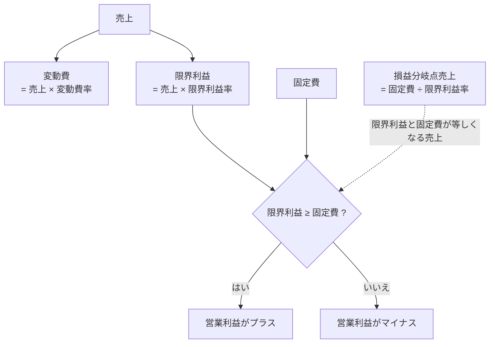

# 第4章 損益分岐点とキャッシュフロー

第1章で「粗利で固定費を回収する」と説明しました。この章では、**どこまで売れば赤字にならないか**（損益分岐点）と、**黒字でも資金が尽きる仕組み**（キャッシュフロー）を扱います。この2つは別の概念です。混同すると、利益が出ているのに支払えない、という状態に陥ります。あわせて、開業や改装の投資をどう判断するかも扱います。

## 4.1 費用を「変動費」と「固定費」に分ける

損益分岐点を出すには、まず費用を2種類に分けます。

| 種類 | 定義 | 飲食店での例 |
| --- | --- | --- |
| 変動費 | 売上に比例して増減する費用 | 食材費、飲料費、テイクアウト容器、決済手数料（売上比例部分） |
| 固定費 | 売上が0でも発生する費用 | 家賃、共益費、正社員給与、社保、リース料、システム月額、保険、広告の定額部分 |

判断に迷う費用は「**売上が0になったとき、この支払いは発生するか**」で分けます。発生するなら固定費です。

アルバイト人件費は、シフトを売上に合わせて組めば変動費的、固定シフトなら固定費的です。実務では「準固定費」として扱うことが多く、**どちらに置くかを決めて、その前提を明記する**のが正しいやり方です。置き方で損益分岐点の値が変わるためです。

| 費目 | 変動費として扱う条件 | 固定費として扱う条件 |
| --- | --- | --- |
| アルバイト人件費 | 売上に応じてシフトを組む | 固定シフトで最低人数を確保する |
| 水道光熱費 | ほとんど該当しない | 基本料金があるため通常は固定費 |
| 決済手数料 | 売上比例部分 | 端末の月額利用料は固定費 |
| 広告費 | 成果連動の手数料 | 月額の掲載料・固定枠 |

## 4.2 限界利益（粗利）と変動費率

```
限界利益 = 売上 − 変動費
限界利益率 = 限界利益 ÷ 売上
変動費率 = 変動費 ÷ 売上
限界利益率 = 1 − 変動費率
```

**限界利益**とは、売上が1円増えたときに手元に残る金額のことです。「限界」は「追加で1単位売ったときの」という意味で、足りないという意味ではありません。

第1章の「粗利」とほぼ同じですが、厳密には粗利は売上−売上原価、限界利益は売上−変動費です。本資料では食材費を変動費の中心とみなし、**限界利益 ≒ 粗利** として扱います。

**計算例（説明用の仮置き）**: 変動費率が30%なら、限界利益率は70%です。売上が1,000円増えると、限界利益は700円増えます。この700円が固定費の回収に充てられます。

## 4.3 損益分岐点売上の計算

損益分岐点売上は「限界利益が固定費と等しくなる売上」です。

```
損益分岐点売上 = 固定費 ÷ 限界利益率
              = 固定費 ÷（1 − 変動費率）
```



上の図は、売上が変動費と限界利益に分かれ、限界利益が固定費を上回るかどうかで利益と損失が分かれることを示しています。損益分岐点は、この分かれ目になる売上です。

**計算例（説明用の仮置き）**: ある店の月の数字を次のように置きます。

| 項目 | 金額 |
| --- | --- |
| 食材費率（変動費率） | 30% |
| 家賃 | 200,000円 |
| 人件費（固定部分） | 300,000円 |
| 水道光熱費 | 50,000円 |
| その他固定費 | 50,000円 |
| 固定費合計 | 600,000円 |

```
損益分岐点売上 = 600,000円 ÷（1 − 0.30）
              = 600,000円 ÷ 0.70
              = 857,142.85... → 857,143円/月
```

つまり**月85.7万円を売れば赤字にならない**。1日25日営業なら、1日あたり約34,286円です。

さらに客単価1,200円なら、必要な客数は、

```
857,143円 ÷ 1,200円 ≒ 714人/月 ≒ 29人/日
```

**この「1日29人」が、経営の目標になる最小ライン**です。ここを下回ると赤字、上回った分が利益です。

### 変動費率が動くと分岐点はどう動くか

損益分岐点は、変動費率の変化に敏感です。固定費600,000円のまま、変動費率だけを動かすと次のようになります。

| 変動費率 | 限界利益率 | 損益分岐点売上 | 30%との差 |
| --- | --- | --- | --- |
| 25% | 75% | 800,000円 | −57,143円 |
| 30% | 70% | 857,143円 | 基準 |
| 35% | 65% | 923,077円 | ＋65,934円 |

変動費率が5ポイント悪化するだけで、必要な売上が約6.6万円増えます。原価率の管理が損益分岐点に直結するのは、このためです（[第2章](02-shueki-kouzou-genka.md) 2.2）。

## 4.4 安全余裕率と目標利益

### 安全余裕率

実際の売上が損益分岐点からどれだけ離れているかを見る指標です。

```
安全余裕率 =（実際の売上 − 損益分岐点売上）÷ 実際の売上
```

上の例で実際の売上が1,000,000円なら、

```
（1,000,000円 − 857,143円）÷ 1,000,000円 ≒ 14.3%
```

売上が15%落ちると赤字に転落します。飲食店は客数が天候や季節で2〜3割振れることがあるため、安全余裕率が10%台はかなり危険な水準です。

| 安全余裕率 | 状態の目安 |
| --- | --- |
| 30%以上 | 売上が多少落ちても赤字になりにくい |
| 15〜30% | 注意して見る水準。変動要因を把握しておく |
| 15%未満 | 危険な水準。売上の変動で赤字に転落しうる |

この区分は本資料が説明のために置いた目安であり、**一般知識（未検証）**です。自店の売上の振れ幅（過去12か月の最大と最小の差）と照らして判断してください。

### 目標利益から必要な売上を逆算する

損益分岐点の式は、目標とする利益から必要な売上を出すのにも使えます。

```
目標利益を出す売上 =（固定費 + 目標利益）÷ 限界利益率
```

**計算例（説明用の仮置き）**: 固定費600,000円、限界利益率70%、目標利益100,000円なら、

```
（600,000円 + 100,000円）÷ 0.70 = 1,000,000円/月
```

月100万円の売上が、月10万円の利益を出すラインです。客単価1,200円なら約833人/月、1日約34人です。**「損益分岐点」と「目標利益のライン」を並べて置くと、日々の判断が具体的になります。**

## 4.5 損益分岐点を下げる4つの方法

式から明らかなように、下げる方法は4つしかありません。

| 方法 | 具体策 | 副作用 |
| --- | --- | --- |
| 固定費を下げる | 家賃交渉、シフトの柔軟化、リース見直し | 立地・サービス水準が下がる |
| 変動費率を下げる | 仕入れ先の見直し、ロス削減、メニュー構成変更 | 品質低下で客数・単価が下がる |
| 客単価を上げる | セット化、追加注文、価格改定 | 客数が減る |
| 客数を増やす | 集客、リピート施策 | コストと時間がかかる |

**損益分岐点は固定費÷限界利益率なので、分子（固定費）を下げるのが最も効きます。** 前節の例で比べます。

```
変動費率を30%→25%に下げる: 600,000円 ÷ 0.75 = 800,000円（−57,143円）
固定費を60,000円下げる:     540,000円 ÷ 0.70 = 771,429円（−85,714円）
```

どちらも同じ「6万円規模の改善」ですが、固定費の削減のほうが損益分岐点を大きく下げます。固定費は分母の掛け算が効かないため、直接効きます。

ただし**固定費削減は持続可能な範囲で行う必要があります**。人を減らしすぎると提供が遅れて回転と満足度が落ち、家賃を下げるために立地を落とすと客数が減ります。損益分岐点の計算は「どこまで削れるか」ではなく「**どの削減が売上に影響しないか**」を考えるために使います。

## 4.6 キャッシュフロー：黒字倒産はなぜ起きるか

利益と現金は別物です。次の4つがずれの原因になります。

| ずれの原因 | 内容 | 飲食店での例 |
| --- | --- | --- |
| 入金と売上の時期 | 売上は計上時、入金は後日 | クレジットカード決済の入金が翌月 |
| 支払いと費用の時期 | 費用は計上時、支払いは後日 | 食材の掛け仕入れで翌月払い |
| 在庫の増減 | 仕入れたが売れていない | 食材を大量発注して在庫が残る |
| 減価償却 | 費用だが現金は出ていない | 厨房設備の減価償却 |

**計算例（説明用の仮置き）**: 月商3,000,000円の店で、売上の60%がクレジットカード決済、カードの入金が翌月末だとします。

```
カード売上 = 3,000,000円 × 0.60 = 1,800,000円
現金・QR決済などの即時入金 = 3,000,000円 − 1,800,000円 = 1,200,000円
```

1,800,000円は翌月末まで入ってきません。その間に仕入れ代金・人件費・家賃の支払いが来ます。**損益上は黒字でも、手元現金が尽きる**のが黒字倒産です。

**黒字倒産の典型例**: 売上が伸びて食材を大量に仕入れ、設備もリースで増やした。損益上は黒字だが、支払日が入金日より早く、手元現金が尽きる。これは飲食店で実際に起こります。売上が伸びている時期ほど、在庫と仕入れが増えて現金が減るため、注意が必要です。

## 4.7 運転資金と支払サイト

### 最低限押さえるべき3つの数字

| 指標 | 計算 | 見方 |
| --- | --- | --- |
| 運転資金 | 月の固定費 + 仕入れの支払い − 入金 | 最低でも1〜2か月分は確保したい（一般知識（未検証）） |
| 当座資産 | 現金 + 預金 + 売掛金 | 支払いにすぐ充てられる資産 |
| 支払サイト | 仕入れ先への支払までの日数 | 短いほど資金繰りが厳しい |

**計算例（説明用の仮置き）**: 仕入れの支払サイトが30日、月の仕入れ支払額が700,000円、カード入金が翌月末なら、**最低でも700,000円程度は手元に置いておく**必要があります。カード入金の遅れが重なると、その分だけ上乗せが必要です。

```
必要運転資金の目安 = 支払サイトの間に出ていく現金 + 入金遅れの分
```

「1〜2か月分」という水準は実務でよく言われる値ですが、**一次資料で確認していません**。支払サイトと入金サイトの実際の差から、自店で計算してください。

### キャッシュフロー計算の基本形

```
営業キャッシュフロー = 税引前利益 + 減価償却費 − 運転資本の増加
```

**運転資本**とは、仕入れや在庫など、事業を回すために寝ているお金のことです。減価償却費は費用ですが現金の支出ではないため、足し戻します。この点を忘れると、設備投資した年に「現金が足りない」理由を説明できません。

在庫が増えると運転資本が増え、その分だけ現金が減ります。**黒字なのに現金が減る**のは、たいていこの項目です。

## 4.8 開業資金と投資回収

開業時には、初期投資（内装、厨房機器、什器、POS、保証金）が発生します。この回収期間を**投資回収期間**と呼びます。

```
投資回収期間（年）= 初期投資額 ÷ 年間の営業キャッシュフロー
```

**計算例（説明用の仮置き）**: 初期投資12,000,000円、年間営業キャッシュフロー3,000,000円なら、

```
12,000,000円 ÷ 3,000,000円 = 4年
```

回収期間は4年です。飲食店の設備は減価償却で5〜10年程度が多いため、回収期間が償却期間を超えると、設備が古くなる前に元が取れない計算になります。

投資判断では、次の3つを必ず並べます。

1. 初期投資額
2. 年間のキャッシュフロー増加額（売上増ではなく**キャッシュ**の増加）
3. 回収期間

DX（デジタルトランスフォーメーション：業務をシステムで置き換えること）投資も同じです。たとえばシステム導入で提供時間が短縮され回転が上がっても、その効果が**現金として回収できるか**を見ます。「便利になった」は投資判断の根拠になりません。

| 投資の種類 | 効果が出るまで | 判断で見落としやすい点 |
| --- | --- | --- |
| 厨房機器の更新 | すぐ | 故障時の損失と比較する。止まったときの売上減も効果に含める |
| 内装・改装 | 数か月 | 改装中の売上減を初期投資に足す |
| システム導入 | 数か月 | 月額費用と、入力・運用の手間を人件費として数える |
| 席数の増加 | すぐ | 1席あたりの快適性低下による客単価下落を織り込む |

## 4.9 物件の持ち方と投資判断

店舗の物件は、賃借する場合と自社で保有する場合があります。持ち方によって、損益分岐点と投資判断の作り方が変わります。

| 項目 | 賃借する場合 | 自社で保有する場合 |
| --- | --- | --- |
| 家賃 | 固定費として発生する | 家賃は発生しない。減価償却費は発生する |
| 損益分岐点 | 家賃を含めて計算する | 機会費用を置いて計算する（[第2章](02-shueki-kouzou-genka.md) 2.5） |
| 改装費 | 退去時の原状回復義務がある | 長期の投資回収が可能 |
| 撤退の判断 | 賃貸借契約の条件に縛られる | 物件の転用・転貸という選択肢がある |

自社で保有している場合、**機会費用を置かずに「家賃ゼロで黒字」と判断すると、物件を他用途に使う判断と比較できません**。一方で、物件を長く使えることは、短期の売上減を許容できるという意味も持ちます。ただし、それは「損益分岐点を無視してよい」という意味ではありません。

判断は二段構えにします。

1. **店舗単体の損益分岐点を押さえる**（その店が自立できるか）
2. **物件全体・複数店舗の合計で見る**（全体として成り立つか）

複数の店舗を持つ場合や、1つの物件に複数の店舗が入る場合は、この二段構えが必須です。店舗単体では黒字でも、全体では共食いで利益が増えないことがあります。逆に、店舗単体では赤字でも、集客の入口として全体に貢献している場合もあります。

| 見方 | 何が分かるか | 見落とすこと |
| --- | --- | --- |
| 店舗単体の損益 | その店が自立しているか | 店舗間の送客・共食い |
| 物件全体の合計 | 全体で成り立つか | どの店が足を引っ張っているか |

**投資判断の順序**: 店舗の仕様（面積、席数、設備）と初期投資額が確定していない段階では、投資回収期間を計算しても意味がありません。仕様と設備が決まってから計算します。逆に、仕様が固まる前に「回収できそうか」を大まかに見たい場合は、**席数と客単価の上限から売上の上限を出し、固定費で割る**という荒い計算にとどめます。

## 4.10 よくある誤解

| 誤解 | 実際 |
| --- | --- |
| 損益分岐点を超えれば安心 | 超えた分が利益だが、安全余裕率が10%台なら売上変動で即赤字 |
| 利益が出ていれば資金は足りる | 入金と支払いの時期がずれると黒字倒産する |
| 減価償却は現金が出ていく費用 | 費用だが現金支出ではない。キャッシュフロー計算では足し戻す |
| 売上を増やせばキャッシュも増える | 売掛金や在庫が増えると、売上が増えても現金は減ることがある |
| 固定費は削るほど良い | 削減が売上に影響しないかを先に確かめる。人と立地は売上に直結する |
| 損益分岐点は1回計算すればよい | 家賃改定・人件費の上昇・メニュー改定で動く。年1回は再計算する |
| 回収期間が短い投資ほど安全 | 回収期間だけでなく、投資しなかった場合の損失（故障・機会損失）と比べる |
| 物件を自社で保有していれば家賃ゼロで有利 | 機会費用を無視すると、他用途に使う判断と比較できない |

## 4.11 この章の要点

- 損益分岐点売上は **固定費 ÷（1 − 変動費率）** です。費用を変動費と固定費に分けることが前提になります。
- 損益分岐点は**固定費の削減に最も敏感**に反応します。ただし売上に影響しない削減かを先に確かめます。
- **安全余裕率**で、売上がどれだけ落ちると赤字になるかが分かります。10%台は危険な水準です。
- 利益と現金は別物です。**入金と支払いの時期のずれ**、在庫の増加、減価償却が原因で黒字倒産が起きます。
- 投資判断は **初期投資額・キャッシュフロー増加額・回収期間** の3点セットで行います。売上の増加は根拠になりません。

## 4.12 自店で確認すること

- [ ] すべての費目を、変動費と固定費に分けた一覧を持っている
- [ ] アルバイト人件費をどちらに置いたか、その前提を書いている
- [ ] 損益分岐点売上と、日商・必要客数に換算した値を出せる
- [ ] 安全余裕率を計算し、過去12か月の売上の振れ幅と比べている
- [ ] 目標利益から必要な売上を逆算した計画を持っている
- [ ] 売上のうち、カード・QR決済など入金が遅れる比率を把握している
- [ ] 仕入れの支払サイトと、カードの入金日を日付で把握している
- [ ] 手元に置くべき運転資金の額を、支払サイトから計算している

## 4.13 演習

### 問1 損益分岐点と安全余裕率

変動費率32%、固定費580,000円、客単価1,300円、月25日営業の店があります。損益分岐点売上、日商、必要な1日の客数を求めてください。実際の月商が1,000,000円のとき、安全余裕率も求めてください。

**解答**

```
【損益分岐点売上】
580,000円 ÷（1 − 0.32）= 580,000円 ÷ 0.68
                       = 852,941.17... → 852,941円/月

【日商】
852,941円 ÷ 25日 = 34,117.64... → 約34,118円/日

【必要な1日の客数】
852,941円 ÷ 1,300円 = 656.1人/月
656.1人 ÷ 25日 = 26.2人/日 → 27人/日（切り上げ）

【安全余裕率】
（1,000,000円 − 852,941円）÷ 1,000,000円 = 0.1470... → 14.7%
```

1日26人では 26 × 1,300 × 25 = 845,000円で、損益分岐点に届きません。**27人が最小ライン**です。安全余裕率14.7%は危険な水準で、売上が15%落ちると赤字になります。

### 問2 目標利益から売上を逆算する

問1と同じ条件（変動費率32%、固定費580,000円）で、月150,000円の利益を出したい場合の売上を求めてください。

**解答**

```
（580,000円 + 150,000円）÷ 0.68
= 730,000円 ÷ 0.68
= 1,073,529.41... → 1,073,529円/月
```

月約1,073,529円が必要です。問1の損益分岐点852,941円との差は約220,588円。利益150,000円に対して売上の差が220,588円になるのは、増えた売上のうち32%が変動費に消えるためです（220,588 × 0.68 ≒ 150,000）。

### 問3 投資回収期間

初期投資9,000,000円、年間営業キャッシュフロー2,500,000円の投資があります。回収期間を求めてください。減価償却期間が6年の場合、回収できると言えるか答えてください。

**解答**

```
9,000,000円 ÷ 2,500,000円 = 3.6年
```

回収期間は3.6年で、減価償却期間6年より短いため、**償却が終わる前に投資を回収できる計算**です。ただし年間キャッシュフロー2,500,000円が毎年続くという前提が必要です。売上が下がって年間1,800,000円になると回収期間は5年（9,000,000 ÷ 1,800,000）に伸び、償却期間に近づきます。**楽観値と悲観値の両方で計算する**のが実務的です。

## 出典と確度

- 損益分岐点、限界利益、変動費率、安全余裕率、運転資本、投資回収期間の定義は管理会計の標準的な定義にもとづく**一般知識（未検証）**。
- 4.3、4.4、4.5、4.8、4.13 の計算は本文中に式と途中の値を示しており、電卓で検算できます。数値は**説明用の仮置き**であり、実在の店舗の実績ではありません。
- 4.4 の安全余裕率の区分（30%以上、15〜30%、15%未満）は本資料が説明のために置いた目安であり、**一般知識（未検証）**。出典は特定していません。
- 「運転資金は1〜2か月分」は実務慣行として語られる値であり、**一次資料で確認していない**。自店の支払サイトから個別に算出すべき値である。
- 4.9 の物件の持ち方による扱いの違いは考え方のみを示す。会計・税務の処理は顧問税理士に確認が必要です。本資料は法的・税務的助言ではありません。

前後の章: [第3章 客数・客単価・回転率・席稼働率](03-kyaku-tanka-kaiten.md) ／ [第5章 営業許可と法規](05-kyoka-to-hourei.md)
