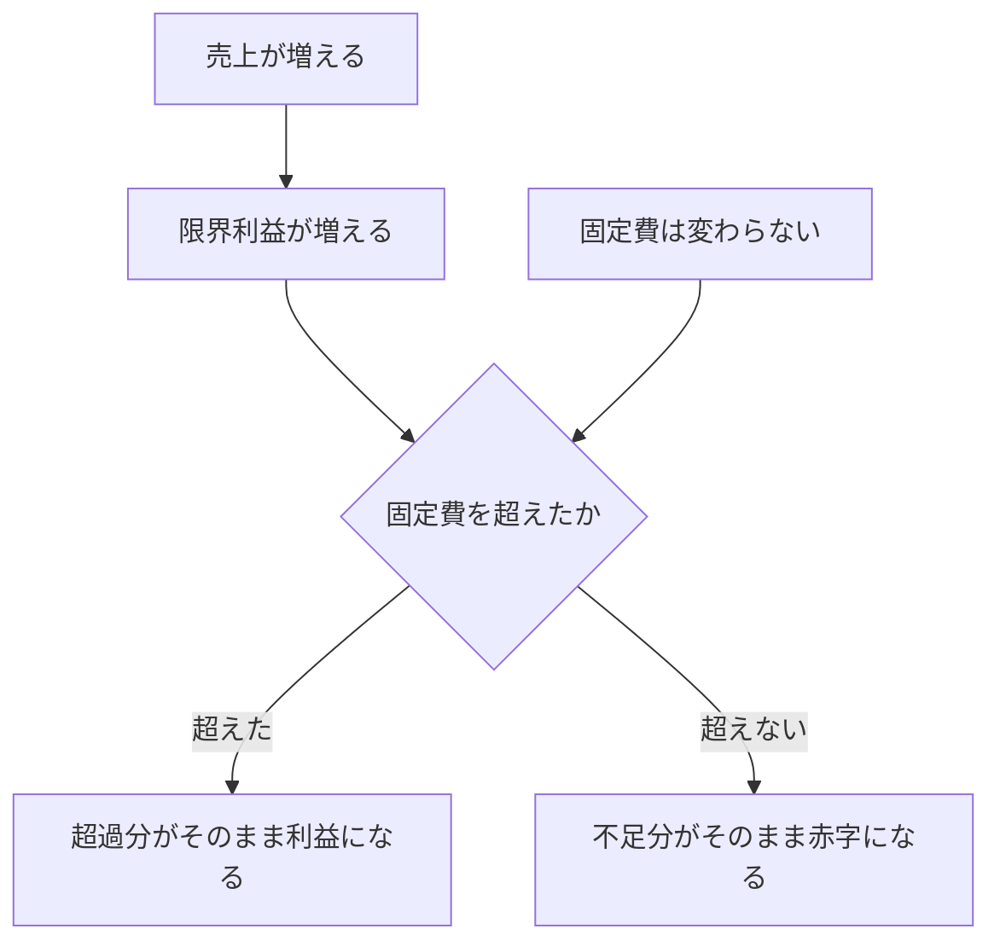
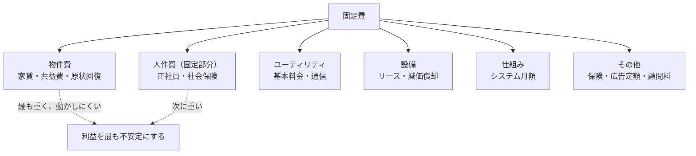
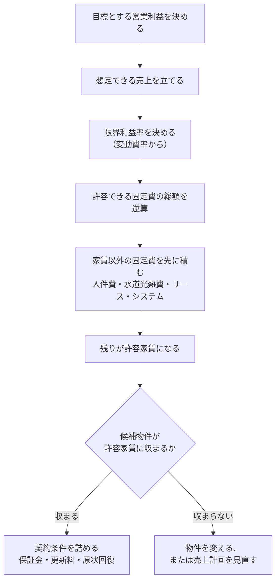

# 第5章 固定費と立地

## 5.1 この章で扱うこと

売上が落ちても減らない費用を**固定費**と呼びます。飲食店では家賃・共益費・水道光熱費の基本料金・設備のリース料・正社員給与などがこれにあたり、利益を最も不安定にする原因になります。この章では、固定費を費目ごとに分解し、それぞれが「いつ・どれだけ・どんな条件で動くか」を整理します。あわせて、固定費の大半を占めることが多い**立地（物件）**の選び方と、自社物件・オーナーの時間に潜む**機会費用**の考え方を扱います。

この章の目的は「安い物件を探すこと」ではありません。**自分の店が耐えられる固定費の総額を先に決め、その範囲に収まる物件と契約を選ぶこと**です。そのために、家賃の妥当性を他人の目安ではなく、自店の損益分岐点から逆算する方法を身につけます。

## 5.2 学習目標

- 自店の費用を、固定費・変動費・準固定費の3つに分類して一覧にできる。
- 家賃・共益費・保証金・更新料・原状回復費を、月あたりのコストに換算して比較できる。
- 目標利益と限界利益率から、**許容できる家賃の上限**を逆算できる。
- 設備を購入する場合とリースする場合を、固定費・現金支出・総支払額の3点で比較できる。
- 立地の候補を、客数上限・客単価・賃料の関係で評価し、採否を説明できる。

## 5.3 固定費とは何か

### 定義

**固定費**とは、売上の増減にかかわらず発生する費用です。判断に迷う費目は、次の1問で分けます。

```
売上が0になった月に、この支払いは発生するか
  → 発生する … 固定費
  → 発生しない … 変動費
```

「売上が0」という極端な前提を置くのは、**契約で決まっている支払い**と**使った分だけ払う支払い**を確実に切り分けるためです。

| 種類 | 定義 | 飲食店での例 | 売上が半分になったとき |
| --- | --- | --- | --- |
| 変動費 | 売上にほぼ比例して増減する | 食材費、飲料費、持ち帰り容器、決済手数料の従量部分 | ほぼ半分になる |
| 準固定費 | 段階的にしか減らない | アルバイト人件費（最低シフトを確保する場合）、水道光熱費 | 半分にはならず、7〜9割残る |
| 固定費 | 売上に関係なく発生する | 家賃、共益費、正社員給与、リース料、システム月額、保険、減価償却費 | 変わらない |

**準固定費**という区分を置くのは、実務では「まったく減らない」と「比例して減る」の間に大量の費目があるためです。アルバイト人件費は、シフトを売上に合わせて組めば変動費に近づき、最低人数を固定すれば固定費に近づきます。**どちらに置いたかを決めて、その前提を書く**のが正しい扱いです。置き方で損益分岐点の値が変わるからです（[第6章](06-soneki-bunkiten.md) 6.3）。

### 固定費が利益を不安定にする理由

固定費は、売上の増減を利益の増減に**拡大して**伝えます。この性質を**レバレッジ**（てこの作用）と呼びます。



上の図は、固定費が一定のまま限界利益だけが動くため、損益分岐点を境に利益と損失が急に切り替わることを示しています。固定費が大きい店ほど、この切り替わりが急になります。

**計算例（説明用の仮置き）**: 同じ売上1,000,000円・限界利益率70%の店を2つ用意し、固定費だけを変えます。

| 項目 | 店A（固定費が軽い） | 店B（固定費が重い） |
| --- | --- | --- |
| 売上 | 1,000,000円 | 1,000,000円 |
| 限界利益（70%） | 700,000円 | 700,000円 |
| 固定費 | 500,000円 | 680,000円 |
| 営業利益 | 200,000円 | 20,000円 |
| 売上が10%減ったときの営業利益 | 130,000円 | −50,000円 |

売上が同じ10%減っても、店Aは黒字を保ち、店Bは赤字に転落します。**固定費の差は、売上変動時の安全性の差**になります。

## 5.4 固定費を6つの塊に分解する

固定費は、性質の違う6つの塊に分けると扱いやすくなります。塊ごとに「動かせる時期」「撤退時に残るか」が違うためです。

| 塊 | 代表的な費目 | 契約の単位 | 動かせる時期 | 撤退後に残るか |
| --- | --- | --- | --- | --- |
| 物件費 | 家賃、共益費、保証金、更新料、原状回復費 | 賃貸借契約（多くは2年） | 更新時、解約予告後の退去時 | 保証金は返還される。原状回復費は退去時に発生 |
| 人件費（固定部分） | 正社員給与、社会保険料の事業主負担、オーナー報酬 | 雇用契約 | 採用・退職のタイミング | 退職金・未払分 |
| ユーティリティ | 電気・ガス・水道の基本料金、通信回線 | 供給契約 | 契約変更時（アンペア変更など） | 精算のみ |
| 設備 | リース料、減価償却費、保守契約料 | リース契約、保守契約 | 契約期間の満了時（途中解約は違約金） | リースは残債、購入は簿価のみ |
| 仕組み | システム月額、POS、予約・決済端末の月額 | 月額契約 | 多くは1〜3か月前の解約通知 | 解約金の有無を確認 |
| その他 | 保険、組合費、広告の定額枠、税理士顧問料 | 年額・月額契約 | 更新時 | 解約の通知漏れに注意 |



上の図は固定費を6つの塊に分け、そのうち物件費と人件費（固定部分）が利益の不安定さに最も効くことを示しています。この2つで固定費の大半を占めることが多いため、**この章では物件費を、[第4章](04-jinken-hi-seisansei.md)では人件費を扱います**。

## 5.5 家賃と共益費

### 5.5.1 家賃には何が含まれるか

「家賃」と一口に言っても、契約書には複数の項目が並びます。月々の負担と、入退去時の一時負担を分けて把握します。

| 項目 | 内容 | 支払う時期 | 月あたりコストへの換算 |
| --- | --- | --- | --- |
| 賃料 | 物件を借りる対価 | 毎月 | そのまま |
| 共益費・管理費 | 共用部の清掃、電気、管理の費用 | 毎月 | そのまま |
| 礼金 | 貸主への一時金。返還されない | 契約時 | 契約期間で割る |
| 敷金・保証金 | 退去時に返還される担保。原状回復費や未払賃料から差し引かれることがある | 契約時 | 資金負担として別枠で見る |
| 更新料 | 契約更新時に払う一時金 | 更新時 | 契約期間で割る |
| フリーレント | 一定期間の賃料が免除される特約 | 契約時 | 初月負担を軽くするが、総額は要確認 |
| 原状回復費 | 退去時に店内を元の状態へ戻す費用 | 退去時 | 契約期間で割って積む |
| 消費税 | 賃料・共益費にかかる | 毎月 | 課税事業者か免税事業かで扱いが変わる |

**重要な区別**: 保証金は返ってくるお金、礼金と原状回復費は返ってこないお金です。**保証金が大きいことは「月々の負担が軽い」ことを意味しません。** 手元資金を長期間拘束するという別の負担になります。

> **落とし穴**: 「保証金6か月」という条件だけを見て「相場より安い」と判断すると誤ります。保証金は退去時に返還される前提ですが、原状回復費や未払賃料が差し引かれます。**実際に戻ってくる額は契約書の条項で決まります。**

### 5.5.2 家賃比率の計算

```
家賃比率（%）=（賃料 + 共益費）÷ 売上高 × 100
```

**計算例（説明用の仮置き）**: 賃料500,000円、共益費30,000円、月商3,000,000円の店なら、

```
家賃比率 = (500,000円 + 30,000円) ÷ 3,000,000円 × 100
        = 530,000円 ÷ 3,000,000円 × 100
        = 17.67... → 17.7%
```

家賃は固定費なので、**売上が落ちたときに比率だけが自動的に悪化します**。同じ530,000円でも、月商が2,400,000円になれば比率は22.1%です。分母が減るだけで、負担は1円も増えていないのに数字が悪くなります。

| 月商 | 家賃＋共益費 | 家賃比率 |
| --- | --- | --- |
| 3,400,000円 | 530,000円 | 15.6% |
| 3,000,000円 | 530,000円 | 17.7% |
| 2,600,000円 | 530,000円 | 20.4% |
| 2,400,000円 | 530,000円 | 22.1% |
| 2,000,000円 | 530,000円 | 26.5% |

この表は、**家賃比率が「家賃の高さ」ではなく「売上に対する重さ」を測る指標**であることを示しています。だから家賃比率を下げる方法は、家賃を下げることと売上を上げることの2つがあり、後者のほうが効く場合が多いのです。

### 5.5.3 「家賃は売上の◯%が目安」を使わない理由

家賃比率の目安として「10%」「15%」といった数値を語る例があります。**本資料では、この種の一律の目安を提示しません。** 理由は3つあります。

1. **出典を特定できない。** 業界団体・公的機関が公表した一次資料として確認できていません（未取得）。出典のない数値を「目安」として置くと、それが一人歩きして誤った物件判断に使われます。
2. **業態で構造が違う。** 高回転・低単価の業態と、低回転・高単価の業態では、同じ売上でも粗利の出方が違います。家賃に充てられる額は粗利額で決まるため、売上比率だけで比較できません。
3. **売上計画の確からしさを無視する。** 目安を満たすかどうかは、その売上計画が実現するかどうかに依存します。計画が過大なら、比率は良く見えて実際は破綻します。

代わりに使うのが、次の**逆算**です。目安を外から借りるのではなく、自店の構造から上限を導きます。

### 5.5.4 損益分岐点から許容家賃を逆算する

家賃の上限は、**家賃以外の数字をすべて先に決めてから**求めます。順序が大事です。

```
限界利益 = 想定月商 × 限界利益率
許容家賃 + 共益費 = 限界利益 − 目標営業利益 − 家賃以外の固定費
```

「家賃以外の固定費」には、人件費の固定部分、水道光熱費、リース料、システム月額、保険などが入ります。

**計算例（説明用の仮置き）**: 次の前提を置きます。

| 項目 | 金額・率 |
| --- | --- |
| 想定月商 | 3,000,000円 |
| 変動費率 | 32%（限界利益率68%） |
| 目標営業利益 | 300,000円 |
| 人件費（固定部分） | 900,000円 |
| 家賃以外の固定費（水道光熱費・リース・システム等） | 190,000円 |

```
限界利益 = 3,000,000円 × 0.68 = 2,040,000円
許容できる（賃料 + 共益費）= 2,040,000円 − 300,000円 − 900,000円 − 190,000円
                        = 650,000円
```

**この店が許容できる賃料＋共益費は月650,000円**です。提示された物件が530,000円なら、120,000円の余裕があります。

逆に、月商が2,400,000円しか立たなかった場合を計算します。

```
限界利益 = 2,400,000円 × 0.68 = 1,632,000円
営業利益 = 1,632,000円 − 900,000円 − 190,000円 − 530,000円 = 12,000円
```

**わずか2割の売上不足で、利益は売上の0.5%まで消えます。** 月商がさらに50,000円少ない2,350,000円なら、営業利益は 1,598,000円 − 1,620,000円 = **−22,000円**で赤字です。この計算を物件契約の前にやっておくと、「この家賃で大丈夫か」を感覚ではなく数字で判断できます。

```
許容家賃の3つの出し方
  (1) 目標営業利益から逆算する …… 上の式
  (2) 損益分岐点から逆算する   …… 損益分岐点売上 = (家賃 + 家賃以外の固定費) ÷ 限界利益率
                                  これを変形して 家賃 = 損益分岐点売上 × 限界利益率 − 家賃以外の固定費
  (3) 安全余裕率から逆算する   …… 損益分岐点売上 ≤ 想定月商 × (1 − 目標安全余裕率)
```

(2) と (3) は同じことを別の角度から見ています。**損益分岐点を「許容できる上限」として使う**のが実務的です。安全余裕率の考え方は[第6章](06-soneki-bunkiten.md) 6.7で扱います。

### 5.5.5 保証金が資金繰りに与える影響

保証金は返還されるお金ですが、**退去するまで手元から出たまま**です。この間、その資金は他の用途に使えません。

```
保証金の拘束月数 = 保証金 ÷ 月商
```

**計算例（説明用の仮置き）**: 保証金300万円、月商3,000,000円なら、拘束月数は1.0か月分です。月商の1か月分が、開業から退去まで寝ていることになります。

| 保証金の条件 | 金額 | 月商に対する月数 | 開業時に必要な自己資金への影響 |
| --- | --- | --- | --- |
| 3か月 | 1,500,000円 | 0.5か月 | 小さい |
| 6か月 | 3,000,000円 | 1.0か月 | 中程度 |
| 10か月 | 5,000,000円 | 1.7か月 | 大きい。運転資金を圧迫する |

保証金が大きい物件は、**開業時の資金調達額を増やし、返済負担を増やします**。家賃の安さだけで比べると、この負担を見落とします（[第7章](07-cashflow.md) 7.7）。

## 5.6 水道光熱費

### 固定費と変動費が混ざっている費目

電気・ガス・水道の料金は、**基本料金（固定）＋従量料金（変動）**の二部構成です。したがって費目全体としては「準固定費」に分類するのが実態に合います。

| 費目 | 固定部分 | 変動部分 | 変動部分を動かすもの |
| --- | --- | --- | --- |
| 電気 | 基本料金（契約アンペア・契約電力による） | 使用量（kWh）単価 | 厨房機器の稼働、空調、照明 |
| ガス | 基本料金（契約流量による） | 使用量（m³）単価 | 調理、給湯 |
| 水道 | 基本料金（口径による） | 使用量（m³）単価 | 調理、洗浄、客の使用 |
| 下水道 | 基本料金 | 使用量または水道使用量に連動 | 上に同じ |
| 通信 | 回線の月額 | 従量部分（通話など） | ほぼ固定 |

**契約アンペア・契約流量・口径は、開業前に決まります。** 厨房機器の総電力が契約を超えるとブレーカーが落ちるため、余裕を持った契約になります。この余裕は、使わなくても基本料金として毎月発生します。

```
水道光熱費の固定費部分 = 基本料金の合計
水道光熱費の変動費部分 = 従量料金の合計
固定費率 = 基本料金の合計 ÷ 水道光熱費の合計
```

**計算例（説明用の仮置き）**: 月の水道光熱費が90,000円、うち基本料金の合計が25,000円なら、固定費率は27.8%です。残り65,000円は売上に連動します。

売上が20%落ちた場合、変動部分が20%減ると仮定すると、

```
削減額 = 65,000円 × 0.20 = 13,000円
新しい水道光熱費 = 90,000円 − 13,000円 = 77,000円
```

**売上が20%落ちても、水道光熱費は14%しか減りません。** この差が、売上減少時に利益が急に消える理由の一部です。

> **注意**: 水道光熱費を「売上比例だから変動費」と分類すると、損益分岐点が実際より低く出ます。**必ず基本料金と従量料金に分けて確認してください。** 分けられない場合は、固定費として扱う（安全側に倒す）のが無難です。

## 5.7 設備投資：購入・リース・中古

厨房機器・什器・POSなどの設備は、初期投資の大きな部分を占めます。同じ設備でも、**買うか借りるか**で固定費の形が変わります。

### 3つの方式の比較

| 方式 | 初期の現金支出 | 毎月の負担 | 会計上の扱い | 中途の変更 |
| --- | --- | --- | --- | --- |
| 購入（新品） | 全額 | 減価償却費（費用だが現金は出ない） | 資産に計上し、期間配分 | 売却・下取りができる |
| リース | 頭金なし、または少額 | リース料（費用かつ現金支出） | リース料を期間の費用に計上 | 途中解約は違約金。原則できない |
| 購入（中古） | 全額（安い） | 減価償却費（耐用年数が短い） | 資産に計上 | 故障リスクが高い |
| レンタル・サブスク | なし | 月額（短期） | 費用に計上 | 解約しやすい |

**リース料の構造**は、次のように分解できます。

```
リース料の総額 = 設備の価格 + 金利相当分 + 手数料
月額リース料 = リース料の総額 ÷ リース期間（月数）
```

### 購入とリースの比較（数値例）

**計算例（説明用の仮置き）**: 厨房機器3,000,000円（税抜）を、購入する場合とリースする場合で比べます。減価償却の耐用年数は8年（定額法）、リース期間は5年（60か月）、月額リース料は54,000円とします。

| 項目 | 購入 | リース（5年） |
| --- | --- | --- |
| 初期の現金支出 | 3,000,000円 | 0円 |
| 毎月の負担 | 減価償却費 31,250円（現金支出なし） | リース料 54,000円（現金支出あり） |
| 5年間の総支払額 | 3,000,000円 | 3,240,000円 |
| 5年後の資産 | 簿価1,125,000円（残存） | なし（返却） |
| 8年間の総支払額 | 3,000,000円 | 5,184,000円（更新した場合） |
| 故障時の修理費 | 自己負担 | 契約により含まれる場合がある |
| 固定費への影響（月） | +31,250円 | +54,000円 |

```
【購入】
減価償却費（月）= 3,000,000円 ÷ 8年 ÷ 12か月 = 31,250円

【リース】
総支払額 = 54,000円 × 60か月 = 3,240,000円
設備価格との差 = 3,240,000円 − 3,000,000円 = 240,000円（金利・手数料相当）
```

この例では、**リースのほうが5年間で240,000円高く、毎月の固定費も22,750円重くなります**。その代わり、開業時の現金支出が3,000,000円減ります。開業時に現金が足りない場合は、リースが有効な選択です。逆に資金に余裕があれば、購入したほうが総額は安くなります。

| 判断の軸 | 購入が有利になる条件 | リースが有利になる条件 |
| --- | --- | --- |
| 資金 | 初期投資の自己資金・借入枠がある | 開業時の現金が足りない |
| 期間 | 8年以上使う予定 | 5年程度で入れ替える予定 |
| 技術 | 仕様が固まっていて長く使える | 機器の更新が速い業種 |
| 税務 | 減価償却で費用化する | リース料を全額費用化したい |
| 故障 | 修理費を負担できる | 保守込みの契約でリスクを移したい |

**会計・税務の処理は事業形態と契約内容で変わります。** 本章は判断の考え方のみを示すものであり、個別の処理は顧問税理士に確認してください（一般知識（未検証））。

## 5.8 原状回復義務

### 定義

**原状回復義務**とは、借りた物件を退去するときに、借りたときの状態に戻して返す義務です。「原状回復」の範囲は、**賃貸借契約書の条項（特約）**で決まります。

| 用語 | 意味 |
| --- | --- |
| 原状回復 | 借りたときの状態に戻すこと。通常の使用による劣化（経年変化・通常損耗）は貸主負担とされる考え方が広がっている |
| 居抜き物件 | 前の店の内装・設備が残った状態で借りる物件。造作の扱いを契約で確認する必要がある |
| スケルトン物件 | 内装がすべて撤去された状態で借りる物件。自分で内装を作る |
| 造作・造作譲渡 | 借主が施した内装・設備。退去時に撤去するか、次の借主に引き継ぐか |
| 除却費 | 造作を撤去して処分する費用 |

**この章で扱うのは「いくらかかるか」ではなく「いつ・いくら出ていくか」です。** 原状回復費は退去時に一括で発生するため、営業中は見えません。しかし確実に発生する**将来の固定費**です。

### 退去費用を投資に織り込む

```
月あたりの原状回復コスト = 見積額 ÷ 契約期間（月数）
```

**計算例（説明用の仮置き）**: 内装600万円の店で、退去時の原状回復費の見積りが800,000円、契約期間5年（60か月）なら、

```
月あたりの原状回復コスト = 800,000円 ÷ 60か月 = 13,333.33... → 約13,333円/月
```

年間では約160,000円です。これは毎月の損益計算書には出てきませんが、**退去時に必ず出ていく現金**です。投資回収の計算に入れておかないと、退去のときに初めて資金が足りないことに気づきます。

| 契約条件 | 確認すること | 見落とすと起きること |
| --- | --- | --- |
| 原状回復の範囲 | どこまで戻すのか（スケルトンか、居抜きか） | 退去時に想定外の請求 |
| 造作の扱い | 撤去義務があるか、残置できるか | 撤去費の全額負担 |
| 保証金の充当 | 原状回復費が保証金から引かれるか | 手元に戻る額が減る |
| 解約の予告 | 何か月前までに通知するか | 予告漏れで賃料が余分に発生 |
| 違約金 | 中途解約時の違約金の有無と額 | 撤退判断が遅れる |
| 修繕義務 | どこまでが貸主負担か | 設備故障の費用負担でもめる |
| 更新料 | 更新時にいくらかかるか | 2年ごとの一時金を見落とす |
| 用途の制限 | 飲食店営業が許可されているか | 許可が下りず開業できない |

> **撤退判断への影響**: 原状回復費と違約金は、**退去するときに初めて確定する費用**です。この額が大きいと「辞めたくても辞められない」状態になります。契約前に、退去時の総額を試算しておいてください。埋没費用に引きずられないための準備です（[第1章](01-kouzou.md)）。

## 5.9 機会費用

### 定義

**機会費用**（きかいひよう）とは、ある選択をしたために**あきらめた別の選択から得られたはずの利益**のことです。会計帳簿には載りませんが、経営判断には必要です。

飲食店で機会費用が問題になるのは、次の3つの場面です。

| 場面 | 会計上の扱い | 機会費用として置くべき額 |
| --- | --- | --- |
| 自社物件で店を営む | 家賃は計上しない。減価償却費は計上 | その物件を他社に貸した場合の賃料 |
| オーナーが店に立つ | オーナー報酬を計上するかは任意 | 同じ時間を働いて得られる賃金、または外注した場合の委託費 |
| 自己資金を店に入れる | 元入金として扱う | その資金を別の運用に回した場合の利回り |

### 自社物件の罠

**計算例（説明用の仮置き）**: 自社物件で店を営む2つの見方を作ります。その物件を他社に貸せば月450,000円の賃料が得られるとします。

| 項目 | 会計上の見方 | 経営判断上の見方 |
| --- | --- | --- |
| 売上 | 3,000,000円 | 3,000,000円 |
| 変動費（32%） | 960,000円 | 960,000円 |
| 限界利益 | 2,040,000円 | 2,040,000円 |
| 人件費 | 900,000円 | 900,000円 |
| その他固定費（家賃以外） | 670,000円 | 670,000円 |
| 家賃 | 0円 | 0円 |
| 機会費用（貸した場合の賃料） | 計上しない | 450,000円 |
| 営業利益 | 470,000円 | 20,000円 |

会計上は470,000円の黒字です。しかし機会費用を置くと20,000円しか残りません。**この状態では「店をやめて物件を貸す」ほうが有利**です。会計上の数字だけを見ていると、その比較ができません。

| 持ち方 | 会計上の扱い | 経営判断上の扱い |
| --- | --- | --- |
| 賃借 | 支払家賃を費用に計上 | そのまま家賃比率で見る |
| 自社保有（自店で使用） | 家賃は計上しない。減価償却費は計上 | 機会費用を置いて比較する |
| 自社保有（一部を他社に貸す） | 受取賃料を収入に計上 | 店舗の損益と賃貸の損益を分けて見る |

**会計上は家賃を計上しないとしても、経営判断用には機会費用を置いて比較する**のが安全です。なお、機会費用を損益計算書に載せるかどうかは会計・税務の別問題です（一般知識（未検証）。処理は顧問税理士に確認してください）。

### オーナーの時間の機会費用

オーナーが店に立つ時間は、無償のように見えます。しかし、その時間を別のことに使えば得られた成果があります。

```
オーナー時間の機会費用（月）= 市場での労働収入（月） × 店に立つ時間の割合
```

**計算例（説明用の仮置き）**: オーナーが他社で働けば月350,000円の収入があり、店には週5日・1日10時間を費やしているとします。この時間の機会費用を月350,000円と置くと、**「オーナー報酬0円で黒字」の店は、実質350,000円の赤字**かもしれません。

これは「オーナーは給料をもらうべきだ」という話ではありません。**店がオーナーの時間を正当化できるだけの利益を出しているか**を測るための置き方です。

## 5.10 立地の選び方

### 立地が決める3つの数字

立地は、店の数字の上限を決めます。具体的には次の3つです。

| 立地が決めるもの | 内容 | 動かせる範囲 |
| --- | --- | --- |
| 客数の上限 | 商圏の人口、通行量、導線から来店可能な人数が決まる | 集客努力で一部は動くが、上限は動かない |
| 客単価の上限 | 周辺の客層が許容する価格帯が決まる | 業態とメニューで調整できるが、商圏の制約を受ける |
| 営業できる時間 | 周辺の需要の時間帯、近隣の環境、建物の条件で決まる | 契約と許認可の範囲内 |

**この3つは、家賃を払って買っているもの**です。家賃の安い物件は、たいていこの3つのどれかが小さい物件です。だから「家賃が安い＝有利」とは限りません。

### 立地の評価軸

| 評価軸 | 見るもの | 測り方 | 注意点 |
| --- | --- | --- | --- |
| 商圏 | 徒歩・車で来る範囲の人口と属性 | 国勢調査などの公的統計、自治体の資料 | 範囲の取り方で数字が変わる。恣意的に広げない |
| 通行量 | 店の前を通る人・車の数 | 平日・休日、時間帯別に現地で数える | 1日だけの観察では天候・季節で偏る |
| 導線 | 駅・駐車場・住宅から店までの道筋 | 現地を歩く | 「近い」と「通りやすい」は違う |
| 競合 | 同業態・類似価格帯の店の数と状況 | 現地調査、地図 | 競合が多い＝需要がある場合もある |
| 物件条件 | 面積、形状、厨房の可否、給排水、電力、排気、席の配置 | 内見、図面 | 図面と現況が違うことがある |
| 賃料条件 | 賃料、共益費、保証金、更新料、原状回復 | 契約書、見積書 | 月額だけで比べない |
| 視認性 | 看板の大きさ、道路からの見え方 | 現地 | 看板は規制がある場合がある |
| 将来性 | 再開発、区画整理、大型店の出退店 | 自治体の計画公表資料 | 確認できない場合は「不明」として扱う |

### 3物件の比較（数値例）

**計算例（説明用の仮置き）**: 3つの候補を、損益分岐点と許容家賃の考え方で比べます。限界利益率は68%、家賃以外の固定費は月1,090,000円とします。

| 項目 | 物件A（駅前商店街） | 物件B（幹線道路沿い） | 物件C（路地裏） |
| --- | --- | --- | --- |
| 面積 | 30㎡ | 45㎡ | 25㎡ |
| 席数 | 20席 | 30席 | 16席 |
| 賃料＋共益費 | 530,000円 | 480,000円 | 280,000円 |
| 想定月商 | 3,000,000円 | 3,600,000円 | 1,500,000円 |
| 想定月末の限界利益 | 2,040,000円 | 2,448,000円 | 1,020,000円 |
| 営業利益 | 420,000円 | 878,000円 | −350,000円 |
| 家賃比率 | 17.7% | 13.3% | 18.7% |
| 損益分岐点売上 | 2,382,353円 | 2,308,824円 | 2,014,706円 |
| 安全余裕率 | 20.6% | 35.9% | −34.3% |

```
【物件A】
限界利益 = 3,000,000円 × 0.68 = 2,040,000円
営業利益 = 2,040,000円 − 1,090,000円 − 530,000円 = 420,000円
損益分岐点売上 = (1,090,000円 + 530,000円) ÷ 0.68 = 1,620,000円 ÷ 0.68
              = 2,382,352.94... → 2,382,353円
安全余裕率 = (3,000,000円 − 2,382,353円) ÷ 3,000,000円 = 20.6%

【物件B】
限界利益 = 3,600,000円 × 0.68 = 2,448,000円
営業利益 = 2,448,000円 − 1,090,000円 − 480,000円 = 878,000円
損益分岐点売上 = 1,570,000円 ÷ 0.68 = 2,308,823.53... → 2,308,824円
安全余裕率 = (3,600,000円 − 2,308,824円) ÷ 3,600,000円 = 35.9%

【物件C】
限界利益 = 1,500,000円 × 0.68 = 1,020,000円
営業利益 = 1,020,000円 − 1,090,000円 − 280,000円 = −350,000円
損益分岐点売上 = 1,370,000円 ÷ 0.68 = 2,014,705.88... → 2,014,706円
安全余裕率 = (1,500,000円 − 2,014,706円) ÷ 1,500,000円 = −34.3%
```

この例が示すのは、**家賃が一番安い物件Cが一番危ない**という結果です。家賃は安いのに、家賃以外の固定費（人件費・水道光熱費・リースなど）は物件を変えてもあまり減りません。**売上が固定費の総額に届かない立地は、家賃が0円でも赤字**です。

| 誤った比較 | 正しい比較 |
| --- | --- |
| 賃料だけで比べる | 賃料＋共益費＋保証金の拘束＋原状回復費で比べる |
| 家賃比率だけで比べる | 想定月商の根拠を確かめ、損益分岐点と安全余裕率で比べる |
| 面積あたりの賃料で比べる | 席数あたり・席時間あたりの売上上限で比べる（[第8章](08-kyaku-tanka-kaiten.md)） |
| 「人の流れが多い」で決める | 通行量のうち何割が自分の客層かを確かめる |

### 家賃の安さで選ぶと起きること

安い立地を選ぶと、家賃比率は一時的に良くなります。しかし次の連鎖が起きやすくなります。

```
家賃が安い → 客数が取れない → 売上が固定費に届かない
→ 人件費・水道光熱費の比率が悪化 → 営業利益がマイナス
→ 「家賃が安いから大丈夫」で判断を誤る
```

**家賃は固定費の一部にすぎません。** 固定費全体の総額と、その総額を賄える売上見込みをセットで見る必要があります。

## 5.11 固定費の総額を先に決める

固定費の検討は、次の順序で行います。逆順に進めると、物件ありきの計画になります。



上の図は、固定費の総額を先に決め、家賃を最後に決める順序を示しています。この順序を守ると、物件に引きずられた計画になりません。

```
許容固定費の総額 = 想定売上 × 限界利益率 − 目標営業利益
許容家賃 = 許容固定費の総額 − 家賃以外の固定費
```

**計算例（説明用の仮置き）**: 想定売上3,000,000円、限界利益率68%、目標営業利益300,000円なら、許容固定費の総額は1,740,000円です。家賃以外の固定費が1,090,000円なら、許容家賃（賃料＋共益費）は650,000円になります。

| 手順 | 計算 | 結果 |
| --- | --- | --- |
| 1. 許容固定費の総額 | 3,000,000円 × 0.68 − 300,000円 | 1,740,000円 |
| 2. 人件費（固定部分） | 与件 | 900,000円 |
| 3. 水道光熱費 | 与件 | 90,000円 |
| 4. リース・システム・保険等 | 与件 | 100,000円 |
| 5. 許容家賃（賃料＋共益費） | 1,740,000円 − 900,000円 − 90,000円 − 100,000円 | 650,000円 |

**この順序で決めた家賃は、根拠を説明できます。** 「相場がいくらだったから」ではなく「自店の構造からこの額まで払える」と言えることが、契約交渉でも撤退判断でも効きます。

## 5.12 ケースの店では

連続ケース「食堂つきかげ」（[第22章: 総合ケース](22-case.md)）の設定は [OUTLINE.md](../OUTLINE.md) の3章にあります。以下は**ケースの設計値**にもとづく計算であり、実在の店舗の実績ではありません。ケースには賃料の月額が直接書かれていないため、初期投資の保証金300万円と「保証金6か月」という条件から、**月額賃料を500,000円として扱います**（300万円 ÷ 6か月）。共益費・水道光熱費・リース料・システム等はケースに定めがないため、説明用の仮置きを置きます。

| 固定費の費目 | 月額 | 出所 |
| --- | --- | --- |
| 賃料 | 500,000円 | ケースの設計値（保証金300万円 ÷ 6か月）から逆算 |
| 共益費 | 30,000円 | 説明用の仮置き（ケースに定めなし） |
| 水道光熱費 | 90,000円 | 説明用の仮置き（ケースに定めなし） |
| 設備リース | 60,000円 | 説明用の仮置き（ケースに定めなし） |
| システム・保険・広告（定額） | 40,000円 | 説明用の仮置き（ケースに定めなし） |
| 人件費（固定部分） | 900,000円 | ケースの月次表（11月 売上3,000,000円 × 人件費率30%） |
| **合計** | **1,620,000円** | |

この人件費900,000円は**スタッフ人件費**で、オーナー報酬は含みません（[第4章](04-jinken-hi-seisansei.md) 4.13と同じ定義です）。**減価償却費**（月125,000円相当）は現金支出を伴わないため、この表には入れず[第7章](07-cashflow.md) 7.13で扱います。オーナー報酬を固定費として計上する場合は、その分だけ固定費と損益分岐点が上がります。オーナーの時間をどう評価するかは、5.9の機会費用の考え方で扱います。

11月の売上3,000,000円に対して、家賃比率は 500,000円 ÷ 3,000,000円 = **16.7%**、共益費を含めると **17.7%** です。固定費の合計は1,620,000円で、変動費率を32%（材料費率30%＋決済手数料等2%）と置くと、損益分岐点売上は 1,620,000円 ÷ 0.68 = **2,382,353円**、安全余裕率は **20.6%** になります。計算の詳細は[第6章](06-soneki-bunkiten.md) 6.12で扱います。

このケースで注目すべきは、**家賃の500,000円が固定費全体の3割強を占めている**点です。残りの7割は、物件を変えても動かない人件費・水道光熱費・リース料です。したがって「もっと家賃の安い物件に移る」だけでは固定費はほとんど下がらず、**立地を落として客数が減る分だけ悪化する**可能性があります。許容家賃を逆算すると、11月の売上3,000,000円・目標営業利益300,000円の条件では、賃料＋共益費で650,000円まで払える計算です。現在の530,000円には120,000円の余裕があり、この余裕が売上変動に対する緩衝になっています。

## 5.13 よくある誤解

| 誤解 | 実際 |
| --- | --- |
| 固定費は「毎月同じ額」だから管理しなくてよい | 更新料・原状回復費・保険料・税など、年単位・契約単位で発生する固定費を見落としやすい |
| 家賃は安いほど良い | 安い立地で客数が取れなければ固定費全体を回収できない。損益分岐点で比べる |
| 家賃は売上の◯%が適正 | 出典を特定できない。業態・粗利構造・売上計画の確からしさで変わる。自店の損益分岐点から逆算する |
| 保証金は返ってくるから負担にならない | 退去まで拘束される。開業時の資金調達額を増やし、返済負担を増やす |
| リースは「買わずに済む」から得 | 総支払額は購入より高く、月々の固定費も重くなる。現金支出の時期を買っている |
| 水道光熱費は売上に比例する変動費 | 基本料金は固定費。売上が落ちても基本料金は残る |
| 自社物件なら家賃ゼロで有利 | 機会費用を置かないと、物件を他用途に使う判断と比較できない |
| 原状回復費は退去時に考えればよい | 契約時に決まる将来の固定費。投資回収の計算に入れておかないと退去時に資金が足りない |

## 5.14 この章の要点

- 固定費は「売上が0でも発生する費用」です。準固定費（アルバイト人件費・水道光熱費）は、どちらに置いたかを明記して扱います。
- 固定費は売上の増減を利益の増減に拡大します。**固定費が重い店ほど、同じ売上減少で大きく赤字になります**。
- 家賃の適正水準は、外部の目安ではなく **限界利益 − 目標営業利益 − 家賃以外の固定費** で逆算します。出典を特定できない「売上の◯%」は使いません。
- 設備は購入とリースで、総支払額・月々の固定費・初期の現金支出が変わります。**何を犠牲にして何を得るか**を明確にします。
- 原状回復費・更新料・保証金は、月々の損益に出ない固定費です。契約前に退去時の総額を試算します。

## 5.15 自店で確認すること

- [ ] すべての費目を固定費・変動費・準固定費に分類し、分類の前提を書いている
- [ ] 水道光熱費を基本料金と従量料金に分けて把握している
- [ ] 賃料・共益費・更新料・原状回復費を、月あたりに換算した総額で把握している
- [ ] 保証金が手元資金を何か月分拘束するかを計算している
- [ ] 想定月商と限界利益率から、許容できる賃料の上限を逆算したことがある
- [ ] 主要設備について、購入とリースの総支払額を比較したことがある
- [ ] 退去時の原状回復費・違約金の見積りを、契約書で確認している
- [ ] 自社物件・オーナーの時間について、機会費用をいくらと置くかを決めている

## 5.16 章末問題

### 問1 許容家賃の逆算

想定月商4,000,000円、変動費率30%（限界利益率70%）、目標営業利益400,000円、人件費の固定部分1,200,000円、水道光熱費・リース・システム等の固定費300,000円の店があります。許容できる賃料＋共益費を求めてください。提示された物件が賃料550,000円・共益費40,000円のとき、この物件は予算内か答えてください。

**解答**

```
【許容固定費の総額】
4,000,000円 × 0.70 = 2,800,000円（限界利益）
2,800,000円 − 400,000円（目標営業利益）= 2,400,000円

【許容できる賃料＋共益費】
2,400,000円 − 1,200,000円 − 300,000円 = 900,000円

【物件の賃料＋共益費】
550,000円 + 40,000円 = 590,000円

【余裕】
900,000円 − 590,000円 = 310,000円
```

許容額は900,000円で、物件は590,000円ですから**予算内**で、310,000円の余裕があります。この余裕は、売上が落ちたときの緩衝になります。たとえば売上が2割落ちて3,200,000円になると、限界利益は2,240,000円、営業利益は 2,240,000円 − 1,200,000円 − 300,000円 − 590,000円 = 150,000円です。まだ黒字を保てます。

### 問2 購入とリースの比較

厨房機器2,400,000円（税抜）を、購入する場合とリースする場合で比べます。購入は耐用年数6年・定額法、リースは5年（60か月）・月額46,000円とします。次の3点を求めてください。

1. 購入した場合の月あたり減価償却費
2. リースの総支払額と、設備価格との差
3. 月々の固定費はどちらがいくら重いか

**解答**

```
【1. 購入の場合の減価償却費（月）】
2,400,000円 ÷ 6年 ÷ 12か月 = 33,333.33... → 約33,333円/月

【2. リースの総支払額】
46,000円 × 60か月 = 2,760,000円
設備価格との差 = 2,760,000円 − 2,400,000円 = 360,000円（金利・手数料相当）

【3. 月々の固定費の差】
リース 46,000円 − 減価償却費 33,333円 = 12,667円
→ リースのほうが月12,667円重い
```

リースは5年間で360,000円高く、月々の固定費も12,667円重くなります。一方で、開業時の現金支出は2,400,000円減ります。**資金の余裕と総支払額のどちらを優先するか**が判断の分かれ目です。なお減価償却費は費用ですが現金の支出ではないため、キャッシュフローの計算では足し戻します（[第7章](07-cashflow.md) 7.9）。

### 問3 機会費用を含めた比較

自社物件で店を営んでいます。売上3,200,000円、変動費率32%、人件費900,000円、家賃以外の固定費240,000円、家賃は計上していません。この物件を他社に貸せば月400,000円の賃料が得られます。会計上の営業利益と、機会費用を含めた営業利益を求め、どちらの見方で判断すべきか答えてください。

**解答**

```
【会計上の営業利益】
限界利益 = 3,200,000円 × 0.68 = 2,176,000円
営業利益 = 2,176,000円 − 900,000円 − 240,000円 = 1,036,000円

【機会費用を含めた営業利益】
1,036,000円 − 400,000円 = 636,000円
```

会計上は1,036,000円の黒字、機会費用を含めると636,000円です。**経営判断には機会費用を含めた後者の値を使います。** ただし後者がマイナスなら「貸したほうが得」という判断になります。今回の例では636,000円が残るため、店を続けるほうが有利です。会計上の数字だけで「家賃ゼロで儲かっている」と結論づけると、この比較ができません。

## 参考文献・出典

- 固定費・変動費・準固定費、限界利益率、損益分岐点、機会費用、投資回収の定義は、管理会計・経営分析の標準的な定義にもとづく**一般知識（未検証）**。
- 本章の数値例は、**ケースの設計値**（連続ケース「食堂つきかげ」の設定）または**説明用の仮置き**です。実在の店舗の実績ではありません。計算は本文中に式と途中の値を示しており、電卓で検算できます。
- **家賃の「一般的な目安%」は提示していません。** 業界団体・公的機関の一次資料として確認できなかったためです（未取得）。代わりに、自店の損益分岐点から逆算する方法を5.5.4に示しました。
- 賃貸借契約における原状回復の範囲、敷金・保証金の扱いは、契約書の条項と、原状回復に関する一般的な考え方で決まります。国土交通省が原状回復に関するガイドラインを公表していることは広く知られていますが、**本資料では同ガイドラインの一次資料を取得できていません（未取得）**。条文・数値の引用は行いません。個別の契約については、貸主・不動産業者・顧問の専門家に確認してください。本資料は法的助言ではありません。
- リース取引の会計処理（ファイナンス・リースとオペレーティング・リースの区分、少額リースの重要性の基準など）は、企業会計基準および税務上の取扱いで定められています。**本資料では一次資料を取得できていません（未取得）**。判断の考え方のみを示します。個別の処理は顧問税理士に確認してください。
- 減価償却の耐用年数は、資産の種類・構造・用途ごとに法令で定められています。本章に示した年数（8年・6年・5年・10年）は**説明用の仮置き**であり、実際の耐用年数ではありません。適用する年数は顧問税理士に確認してください。
- 商圏人口は、国勢調査などの公的統計で確認できます。本章では具体的な統計値を提示していません。立地評価に使う場合は、取得した統計の**調査年・集計範囲・取得日**を必ず記録してください。
- 前後の章へのリンクは次行のとおりです。

前後の章: [第4章: 人件費と生産性](04-jinken-hi-seisansei.md) ／ [第6章: 損益分岐点](06-soneki-bunkiten.md)
