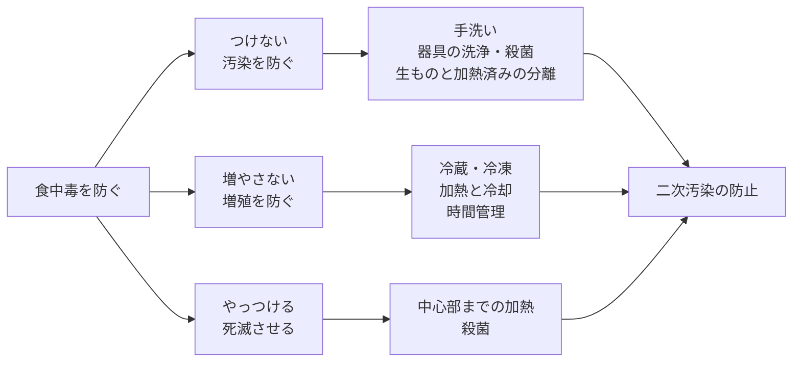
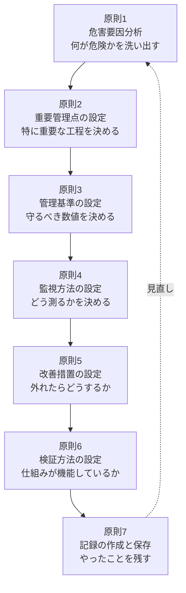

# 第6章 衛生管理とHACCP

**この章で扱うこと**: 食中毒が起きたときに何が失われるかから始め、原因別の対策、HACCP の考え方と制度化、日々の運用までを扱います。あわせて、温度管理の基本と、提供形態が増えるときに難しくなる点を整理します。

飲食店にとって、衛生管理は「気をつける」ものではなく**仕組みで担保する**ものです。食中毒が1件起きれば、営業停止、客離れ、風評の発生が重なります。この章では、衛生管理の考え方と、制度化された HACCP の実務を扱います。

> **本章の限界**: HACCP の施行日について、本資料は同一ページ内の記述の矛盾を確認し、**確定していません**（→ 6.4）。病原体名、温度帯の数値、7原則の例示は**一般知識（未検証）**で、法令上の基準として示すものではありません。本資料は法的助言ではありません。

## 6.1 食中毒が起きると何が起きるか

食中毒は「運が悪かった」では済みません。発生すると次の連鎖が起きます。

| 影響 | 内容 |
| --- | --- |
| 健康被害 | 客・従業員の被害。重症化のリスク |
| 行政処分 | 営業停止命令、施設の改善指導 |
| 信用の喪失 | 報道、口コミ、SNS での拡散。回復に時間がかかる |
| 金銭的損失 | 治療費、賠償、休業中の売上減、廃棄、改装費 |
| 刑事責任 | 重大な過失がある場合、業務上過失致死傷等が問題になりうる |

**衛生管理の投資対効果は、事故が起きてからでは測れません**。事故を防いだ状態が「平常」なので、効果が見えにくい。だからこそ、記録として残すことに意味があります（後述）。

### 発生してしまったときの初動

起きてからの対応も、衛生管理の一部です。**初動が遅れると、被害が広がり、説明ができなくなります。**

| 順序 | やること | 理由 |
| --- | --- | --- |
| 1 | 提供を止める | 同じ原因の被害を増やさない |
| 2 | 保健所に連絡する | 調査と指導の起点になる |
| 3 | 食べた人・食べた物・時間を記録する | 原因の特定に使う。記憶は薄れる |
| 4 | 従業員の健康状態を確認する | 調理者が原因のことがある |
| 5 | 残った食品・原材料を保管する | 廃棄すると調査ができない |
| 6 | 同じ食材の提供履歴をたどる | 回収の範囲を決める |

**「様子を見る」が最も危険**です。症状の重さは自分では判断できません。連絡の判断に迷う段階で、保健所に相談します。

## 6.2 食中毒の主な原因

原因は大きく4つに分かれます。**それぞれ対策が違います。**

| 原因 | 例 | 主な対策 |
| --- | --- | --- |
| 細菌 | カンピロバクター、サルモネラ、腸管出血性大腸菌、黄色ブドウ球菌、ウェルシュ菌、セレウス菌など | 加熱、温度管理、交差汚染の防止、迅速な冷却 |
| ウイルス | ノロウイルスなど | 手洗い、健康管理、加熱、二次汚染の防止 |
| 寄生虫 | アニサキスなど | 十分な冷凍・加熱、鮮度管理、目視確認 |
| 自然毒・化学物質 | フグ、毒キノコ、洗剤の残留など | 知識、仕入れ先の確認、保管の分離 |

（病原体の名称は**一般知識（未検証）**。感染症法・食品衛生法上の位置づけは一次資料で確認していません。）

**原因ごとに対策が違う**点が重要です。加熱は細菌とウイルスに効きますが、加熱しても壊れない毒（自然毒）には効きません。洗剤の残留は、すすぐことで防ぎます。**「加熱していれば安全」は、原因の一部にしか当たりません。**

| 原因 | 効く対策 | 効かない対策 |
| --- | --- | --- |
| 細菌 | 中心部までの加熱、10℃以下の保管、迅速な冷却 | 表面だけの加熱、常温での放置 |
| ウイルス | 手洗い、加熱、次亜塩素酸ナトリウムでの消毒 | アルコールだけでの消毒（効果が限られる） |
| 寄生虫 | 冷凍、加熱、目視での除去 | 醤油・酢・わさびへの浸漬 |
| 自然毒 | 知識、仕入れ先の選定、除去 | 加熱（毒によっては壊れない） |

### 二次汚染という考え方

**二次汚染**とは、汚染された食品や器具から、別の食品へ病原体が移ることを指します。加熱した料理でも、まな板、包丁、手、布巾、容器を経由して再び汚染されます。

**「加熱したから安全」が崩れるのは、たいてい二次汚染です。** 生肉を切ったまな板で、加熱済みの料理を切る。生ものを触った手で、盛り付けをする。この経路を断つには、**器具と手の使い分け**と、**作業の順序**（汚染区域から清潔区域へ一方向に流す）が必要です。

### 3つの基本原則

原因が何であっても、対策は3つに集約されます。

1. **つけない**（汚染を防ぐ）: 手洗い、器具の洗浄・殺菌、生ものと加熱済みの分離、使い分け
2. **増やさない**（増殖を防ぐ）: 温度管理（冷蔵・冷凍・加熱）、時間管理、迅速な冷却
3. **やっつける**（死滅させる）: 中心部までの加熱、殺菌

図の説明: 3つの原則は、どれか1つではなく3つを同時に運用します。**つけない**対策だけでは増殖を止められず、**やっつける**対策だけでは二次汚染を防げません。3つが揃って初めて、工程全体が安全になります。

この3つは、**家庭の調理と飲食店の調理で同じ**です。違うのは「規模」と「証拠を残す必要があるか」です。

## 6.3 HACCPとは何か

### 定義

HACCP（ハサップ）は、食品等事業者が**自ら**危害要因（ハザード）を把握し、原材料の入荷から製品の出荷までの全工程で、危害を除去・低減するために**特に重要な工程**を管理し、安全性を確保する手法です。

出典: 厚生労働省「HACCP（ハサップ）」 https://www.mhlw.go.jp/stf/seisakunitsuite/bunya/kenkou_iryou/shokuhin/haccp/index.html （取得日 2026-11-14）

**用語の説明**: **ハザード（危害要因）**は、食品に含まれる、または混入する可能性のある、健康を損なう原因のことです。生物学的（細菌・ウイルス）、化学的（洗剤・農薬）、物理的（金属片・ガラス）の3つに分けます。**CCP（重要管理点）**は、危害を防ぐために特に管理が必要な工程です。

**従来の方法との違い**は、抜き取り検査（作った後で検査する）から、工程管理（作る途中で管理する）への転換です。問題が起きてから見つけるのではなく、**問題が起きる前に止める**仕組みです。

| 観点 | 従来の考え方 | HACCP の考え方 |
| --- | --- | --- |
| 確認する時点 | 作った後（抜き取り検査） | 作る途中（工程の管理） |
| 見つかる問題 | 出荷後に判明することもある | 基準から外れた時点で分かる |
| 記録の役割 | 検査結果の保管 | 管理が行われた証拠 |
| 責任の所在 | 検査に合格すれば良い | 工程を設計した事業者にある |

### 7つの原則（考え方）

| 原則 | 内容 | 飲食店での例 |
| --- | --- | --- |
| 1. 危害要因分析 | 何が危険かを洗い出す | 生肉の加熱不足、野菜の洗浄不足 |
| 2. 重要管理点（CCP）の設定 | 特に重要な工程を決める | 加熱工程の温度と時間 |
| 3. 管理基準の設定 | 守るべき数値を決める | 中心温度75℃以上で1分以上（※一例） |
| 4. 監視方法の設定 | 守られているか測る | 温度計で記録する |
| 5. 改善措置の設定 | 外れたらどうするか | 再加熱する、提供しない |
| 6. 検証方法の設定 | 仕組みが機能しているか確認する | 記録の点検、定期的な振り返り |
| 7. 記録の作成と保存 | やったことを残す | 温度記録表、チェックリスト |

（※ 3 の具体的な温度・時間は**一例**であり、法令上の基準として提示するものではありません。実際の基準は保健所の指導・業種別手引書で確認してください。）

図の説明: 7原則は、1から7へ順に進み、最後に1へ戻ります。**原則7の記録は終点ではなく、見直しの入口**です。記録を見て「基準が緩すぎた」「監視の頻度が足りない」と判断したら、原則1から設計し直します。一度作って終わりの手順書ではありません。

**小規模な飲食店では、7原則をすべて文書化するのではなく、考え方を取り入れた簡略版で運用します**（→ 6.4）。重要なのは、用語を揃えることより、**工程のどこが危険で、それをどう管理しているかを説明できること**です。

## 6.4 制度化と義務

### 制度の概要（一次資料で確認）

厚生労働省のページには、次のように記載されています。

> 令和3年6月1日から、原則として、すべての食品等事業者の皆様にHACCPに沿った衛生管理に取り組んでいただくことになりました。

出典: 厚生労働省「HACCP（ハサップ）」 https://www.mhlw.go.jp/stf/seisakunitsuite/bunya/kenkou_iryou/shokuhin/haccp/index.html （取得日 2026-11-14）

**対象外**となる事業者も定められています。

- 農業及び水産業における食品の採取業は対象外
- 食品・添加物の輸入業、貯蔵・運搬のみの営業（冷凍冷蔵倉庫業を除く）、常温で長期間保存しても劣化のおそれがない包装食品の販売業、器具・容器包装の輸入・販売業は、**一般的な衛生管理のみ**（HACCPに沿った衛生管理は不要）
- 学校・病院等の営業ではない集団給食施設も対象だが、1回の提供食数が20食程度未満の施設は対応不要

**飲食店は、この対象外の一覧に入っていません。** 規模の大小にかかわらず、HACCP に沿った衛生管理に取り組む対象です（小規模事業者向けの簡略化された方法があります → 後述）。

### 事業者が行う4つのこと（一次資料で確認）

1. 衛生管理計画を作成し、従業員に周知徹底する
2. 必要に応じて手順書を作成する
3. 衛生管理の実施状況を記録し、保存する
4. 衛生管理計画・手順書の効果を定期的に（及び工程変更時に）検証し、必要に応じて見直す

出典: 同上（取得日 2026-11-14）

**4番目が落とされやすい**点です。計画を作り、記録をつけるところまでは進みます。しかし「計画自体が妥当か」を定期的に見直す運用は、意識しないと残りません。**メニューの変更、仕入れ先の変更、設備の入れ替え**は、工程が変わる合図です。このときに見直します。

### 施行日についての注意（重要）

**本資料の作成時点で、施行日の記述に矛盾を確認しました。** 取得した厚生労働省のページには「令和3年6月1日から」と記載される一方、同じページ内に「総合衛生管理製造過程承認制度は**令和2年6月1日**をもって廃止」という記述もあります。施行期日を定める政令の本文を取得できなかったため、**本資料では施行日を確定していません**。

**この矛盾は、本資料では解消していません。** どちらか一方を採る根拠を、一次資料で確認できていないためです。実務上は「HACCPに沿った衛生管理は制度化されており、営業者は対応が必要」という結論は変わりません。**正確な施行日と経過措置の適用範囲は、保健所または厚生労働省の該当ページで確認してください。**

### 小規模事業者の扱い

厚生労働省のページでは、小規模な営業者等向けの資料と、業種別の手引書が案内されています。飲食店のような小規模事業者には、**HACCPの考え方を取り入れた、負担の少ない衛生管理**が示されています（詳細は業種別手引書を参照）。フルスペックの HACCP（7原則の文書化）をそのまま求めるものではありません。

| 区分 | 求める内容の目安 |
| --- | --- |
| 大規模事業者 | 7原則に沿った HACCP の計画と記録（高度な管理） |
| 小規模事業者（飲食店など） | 「一般衛生管理」に加えて、重要な工程の管理（加熱・冷却・保管温度など）を、実行できる範囲で記録する |

**手引書は業種ごとに用意されています。** 飲食店向けの手引書を使えば、ゼロから計画を作る必要はありません。自店のメニューと工程に合わせて、必要な項目を選びます。

## 6.5 実務：何から始めるか

### ステップ1: 衛生管理計画を作る

計画には、少なくとも次を書きます。

| 項目 | 内容 | 例 |
| --- | --- | --- |
| 一般衛生管理 | 日常的に行う衛生管理 | 従業員の健康管理、施設の清掃、器具の洗浄 |
| 重要管理 | 特に気をつける工程 | 加熱、冷却、保管温度 |
| 管理基準 | 守るべき数値 | 冷蔵庫の温度、加熱の中心温度 |
| 監視方法 | どう測るか | 温度計、目視、チェックリスト |
| 改善措置 | 外れたらどうするか | 再加熱、廃棄、提供中止 |
| 記録方法 | どこに残すか | 紙、タブレット、アプリ |

**一般衛生管理**と**重要管理**の違いは、最初に押さえます。一般衛生管理は、毎日すべての工程で行う土台（清掃、手洗い、健康管理、害虫防除）です。重要管理は、その中でも**外れると危害に直結する工程**（加熱、冷却、保管）に絞ります。

**「重要管理」を増やしすぎない**のがコツです。管理点を10個作ると、どれも守られなくなります。飲食店では、加熱・冷却・保管温度の3つに絞れることが多いです。

### ステップ2: 記録する

**記録は「やった証拠」であり「振り返りの材料」**です。記録がないと、次のことができません。

- 異常がいつ起きたかを特定する
- 保健所の確認に答える
- 改善の効果を測る

記録は紙でも構いませんが、**続けられる形式**を選びます。凝った記録様式は続きません。厚生労働省は「HACCP衛生管理記録アプリ」も公開しています。

| 記録の対象 | 頻度の例 | 記録する内容 |
| --- | --- | --- |
| 冷蔵庫・冷凍庫の温度 | 始業時と終業時 | 庫内温度、測定者 |
| 加熱の中心温度 | 提供の都度、またはロットごと | 温度、時間、料理名 |
| 冷却の経過 | 仕込みの都度 | 開始時刻、終了時刻、温度 |
| 従業員の健康状態 | 毎日 | 症状の有無、検便の結果 |
| 清掃・消毒 | 毎日、週次、月次 | 実施した場所と時刻 |

**「測った」ではなく「記録した」が証拠**になります。測っただけでは、いつ異常が起きたか分かりません。

### ステップ3: 振り返る

計画は作って終わりではありません。定期的に（月1回など）次を確認します。

- 記録は実際につけられているか
- 基準を外れた記録はないか。あった場合、改善措置は取られたか
- メニューや仕入れ先が変わった工程はないか

**空欄の多い記録は、管理が機能していない合図**です。記録を減らすか、様式を簡単にする見直しをします。記録を増やして埋めさせるのは、逆効果になります。

### ステップ4: 従業員に周知する

**衛生管理は、現場の人がやらなければ機能しません。** 計画を作っただけでは、事故は防げません。朝礼での共有、掲示、研修、チェックリストの運用が必要です。

**周知は「知らせる」で終わらせません。** 実際にできるかどうかを、現場で確かめます。新しい手順を入れたら、最初の1週間は誰かが横について、手順どおりにできているかを見ます。

| 場面 | 周知の方法 |
| --- | --- |
| 採用時 | 衛生管理計画の説明、手洗いの実演 |
| 毎日の始業 | 朝礼での共有、健康状態の確認 |
| メニュー変更時 | 変更した工程の説明、記録様式の更新 |
| 事故・ヒヤリハットの後 | 事例の共有、手順の見直し |

## 6.6 温度管理の基本

飲食店の衛生管理で最も重要なのが温度です。

| 温度帯 | 状態 | 注意 |
| --- | --- | --- |
| 冷凍（おおむね−18℃以下） | 長期保存 | 解凍は冷蔵庫で。常温解凍は避ける |
| 冷蔵（おおむね10℃以下） | 短期保存 | 詰め込みすぎない。庫内温度を測る |
| 常温 | 細菌が増えやすい | 長時間置かない |
| 加熱 | 中心部まで加熱 | 温度計で確認する |
| 冷却 | 急速に冷ます | 常温で放置しない |

**「危険温度帯」**（細菌が活発に増える温度帯）に食品を置く時間を短くすることが、実務の中心です。

**冷蔵庫の温度は「測る」のではなく「記録する」**のが重要です。測っただけでは、いつ異常が起きたか分かりません。

### 温度管理で見落としやすい点

| 見落とし | 何が起きるか | 対策 |
| --- | --- | --- |
| 庫内の詰め込みすぎ | 冷気が回らず、中心部の温度が上がる | 7割程度に収める。棚を分ける |
| 扉の開閉が多い | 庫内温度が上下する | 出し入れをまとめる。扉の前に物を置かない |
| 温度計の位置 | 扉付近は温度が高い | 庫内の中央付近に置く |
| 中心温度を測らない | 表面だけ加熱して中心が生 | 中心に刺して測る。測定点を決める |
| 冷却を常温で行う | 危険温度帯の通過に時間がかかる | 小分けにする。冷水・保冷剤を使う |
| 解凍を常温で行う | 外側だけが温まり、細菌が増える | 冷蔵庫で解凍する。流水を使う |

**中心温度計**は、加熱の管理に使う器具です。先端を食品の中心に刺して測ります。測る位置が浅いと、表面の温度を測ることになり、過大な評価になります。**料理ごとに測る位置を決めて、同じ位置で測る**ことで、記録の比較ができます。

**温度の記録に意味が出るのは、基準と比べたとき**です。測った数値を並べるだけでは、異常かどうかが分かりません。管理基準（例: 10℃以下）を決め、外れたら改善措置を取る、という形で記録を使います。

## 6.7 提供形態が増えるときに難しくなること

衛生管理の難易度は、**店の形態で変わります**。同じメニューでも、店内で出し切る店と、屋外・持ち帰り・配達を併用する店では、管理する工程が違います。

| 形態 | 衛生上の課題 | 対策の方向 |
| --- | --- | --- |
| 屋外・テラス席での提供 | 気温・湿度・虫・ほこりの影響 | 提供までの時間短縮、覆い、温度管理、虫対策 |
| 持ち帰り | 容器詰めの工程が増える。持ち帰り後の温度は管理できない | 詰める時の温度、容器の密閉、食べ方の案内 |
| 配達 | 配達中の温度と時間 | 保冷・保温の資材、配達時間の上限、受取時刻の管理 |
| 複数の調理場所 | 厨房と提供場所が離れる | 運搬中の温度と時間の管理 |
| 厨房が狭い | 作業動線が交差しやすい | 調理台の分離、器具の使い分け、清掃の頻度 |
| 席が少なく回転が速い | 提供が速い＝加熱後すぐ出す | 加熱後の放置時間を短くできる（利点でもある） |

**屋外提供で特に注意するのは、温度管理と異物混入**です。屋外は虫・ほこり・風の影響を受けます。提供容器にフタをする、提供までの時間を決める、風で飛ばない什器を使う、といった物理的な対策が要ります。

**持ち帰りでは、店の外の管理ができません。** 受け渡し時点の温度と、食べるまでの時間の案内が、できることの限界です。「早めにお召し上がりください」の一言では足りない場合、保冷剤の同梱や、持ち帰りを想定したメニューの見直しを検討します。

**提供形態を増やすときは、衛生管理の計画も同時に広げます。** 屋外席を出しても計画が屋内のままだと、屋外の工程が管理されません。**新しい提供方法を始める前に、計画と記録様式を更新**します。

また、**屋外席での提供が「飲食店営業許可」の範囲に含まれるか**は、保健所の確認が必要です（→ [第5章](05-kyoka-to-hourei.md) 5.7）。許可の範囲外の場所で調理・提供すると、無許可営業とみなされる可能性があります。**この確認は、衛生管理の設計より先に行う必要があります。**

## 6.8 よくある誤解

| 誤解 | 実際 |
| --- | --- |
| HACCPは大企業のための制度 | 小規模事業者向けの簡略化された取り組みが示されている |
| 計画を作れば事故は防げる | 計画は土台。現場の実行と記録と振り返りが要る |
| 記録は保健所に見せるため | 記録は自店の異常を早期に見つけるためのもの |
| 冷蔵庫に入れれば安全 | 詰め込みすぎると温度が上がる。庫内温度を測る必要がある |
| 加熱すればすべて安全 | 加熱後の二次汚染（器具、手、容器）で再汚染される |
| 記録は多ければ多いほど良い | 続かない記録は機能しない。項目を絞って実行する |
| 手洗いはアルコールで代用できる | 汚れの除去には流水と石けんが要る。ウイルスには効果が限られる |
| 異物混入は工場の問題 | 厨房でも起きる。器具の破損、包装の混入、髪・手袋の破れ |
| 持ち帰りは店の外だから管理外 | 詰める時点の温度と時間は店の管理。案内も店の責任 |

## 6.9 この章の要点

- 食中毒の影響は健康被害だけではありません。**行政処分・信用・金銭・刑事責任**が連鎖します。初動の順序を決めておきます。
- 対策は**つけない・増やさない・やっつける**の3つです。原因（細菌・ウイルス・寄生虫・自然毒）によって、効く対策が違います。
- **二次汚染**が「加熱したから安全」を崩します。器具と手の使い分け、作業の順序で断ちます。
- HACCP は**工程管理**の考え方です。7原則は1→7で終わらず、記録から見直しへ戻ります。
- 飲食店は HACCP の対象です。小規模事業者向けの簡略化された方法があります。**施行日の記述には矛盾があり、本資料では確定していません**。
- 温度は「測る」ではなく「**記録する**」ものです。管理基準と改善措置をセットで決めます。

## 6.10 自店で確認すること

- [ ] 提供メニューと工程を書き出し、ハザード（細菌・ウイルス・寄生虫・異物）を洗い出した
- [ ] 重要管理の工程を3つ以内に絞り、管理基準（温度・時間）を決めた
- [ ] 冷蔵庫・冷凍庫の庫内温度と加熱の中心温度を、決めた位置と頻度で記録している
- [ ] 冷却の方法と時間の目安を決め、常温放置をやめた
- [ ] 基準を外れたときの改善措置を、スタッフが説明できる
- [ ] 業種別手引書を入手し、自店の計画と突き合わせた
- [ ] 屋外・持ち帰り・配達を始める場合、計画と記録様式を先に更新した
- [ ] 食中毒が疑われる場合の初動（提供停止・保健所連絡・記録）を全員が知っている

## 6.11 演習

### 問1

「加熱しているから安全です」と説明するスタッフがいます。この説明が不十分である理由を、二次汚染という言葉を使って説明してください。

**解答**: 加熱によって死滅するのは、加熱の時点で食品にいた病原体です。加熱の後に、生ものを切ったまな板、包丁、手、布巾、容器を経由して病原体が付着すれば、料理は再び汚染されます。これが二次汚染です。したがって「加熱したかどうか」だけでなく、「加熱後に汚染源に触れていないか」を管理する必要があります。対策は、器具と手の使い分け（色分け・専用化）、作業の順序（汚染区域から清潔区域へ一方向）、加熱済み食品の保管場所の分離です。

### 問2

小規模な飲食店で、HACCP に沿った衛生管理を始めます。管理する工程を絞るとしたら、どこに絞りますか。理由も説明してください。

**解答**: 加熱・冷却・保管温度の3つに絞るのが実務的です。理由は、この3つが外れると危害に直結し、かつ毎日測って記録できるからです。加熱は中心温度、冷却は常温放置を避けることと所要時間、保管は冷蔵庫の庫内温度が管理点になります。清掃・手洗い・健康管理・害虫防除は、毎日すべての工程で行う一般衛生管理として別に位置づけます。管理点を増やしすぎると記録が続かず、かえって機能しなくなるため、**絞って実行する**ことを優先します。

### 問3

冷蔵庫の温度記録が、1か月分のうち半分が空欄でした。この状態をどう評価し、どう直しますか。

**解答**: 評価としては、管理が機能していない状態です。記録の空欄は、測っていないか、測ったが書いていないかのどちらかで、どちらも異常の早期発見ができません。保健所の確認にも答えられません。直し方は、記録を増やすのではなく、**減らして続く形にする**ことです。測る回数（始業・終業の2回）と測る場所を決め、1行で書ける様式にします。誰がいつ書くかを決め、休みの日の代行者も決めます。加えて、なぜ空欄になったかを聞き取り、手が届かない位置に記録用紙があった、温度計が1台しかなかった、といった物理的な原因を除きます。1か月後に空欄の率を数え、改善したかを確認します。

## 出典と確度

- 6.4 の制度概要、対象外の範囲、事業者が行う4つのこと、「令和3年6月1日」の記述は、厚生労働省「HACCP（ハサップ）」 https://www.mhlw.go.jp/stf/seisakunitsuite/bunya/kenkou_iryou/shokuhin/haccp/index.html （取得日 2026-11-14）で確認済み（**確信度 高**、ただし施行日の記述には同一ページ内で矛盾があり、政令本文を取得できなかったため**施行日は確定していない**）。
- 6.3 の HACCP の定義、7原則の名称は同ページで確認済み。7原則の「飲食店での例」は説明のための一般例であり、法令上の基準ではない。
- 6.2 の病原体名、6.6 の温度帯の数値、6.3 の7原則の例示は**一般知識（未検証）**。法令上の基準として提示するものではない。
- 6.2 の「効く対策／効かない対策」、6.5 の記録の頻度、6.6 の「見落としやすい点」、6.7 の形態別の課題は、実務の一般論にもとづく**一般知識（未検証）**。
- 6.5 の実務手順は、厚生労働省が示す4つの実施事項に対応させたもので、具体的な様式は業種別手引書に従う必要がある。
- 本資料は法的助言ではありません。

---

前後の章: [第5章 営業許可と法規](05-kyoka-to-hourei.md) ／ [第7章 人と労務](07-hito-to-roudou.md)
