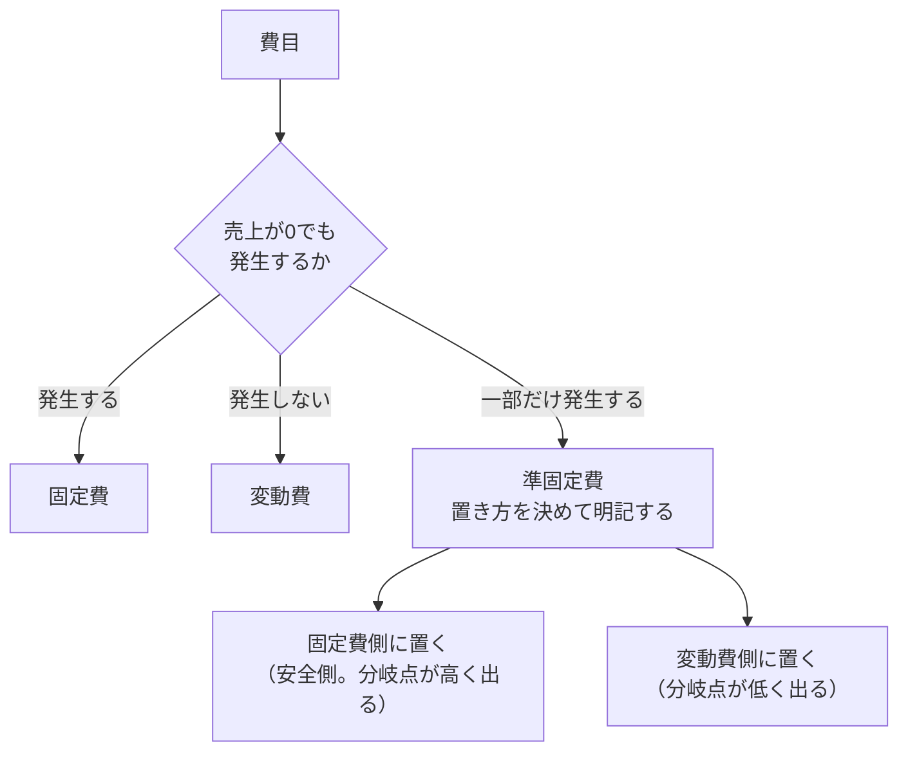
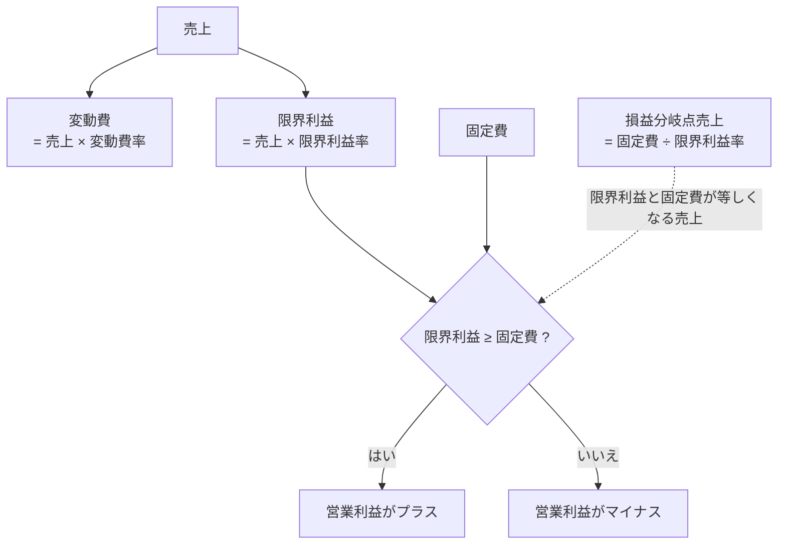

# 第6章 損益分岐点

## 6.1 この章で扱うこと

**損益分岐点**（そんえきぶんきてん）とは、利益がちょうど0円になる売上高のことです。この売上を下回れば赤字、上回れば利益が出ます。飲食店のように固定費が重い商売では、この1本のラインを把握しているかどうかが、日々の判断の精度を大きく変えます。

この章では、損益分岐点の計算方法、1日あたりの売上と必要客数への換算、安全余裕率、そして**どの変数がどれだけ効くか**を見る感応度分析を扱います。利益と現金のずれ（黒字倒産）は[第7章](07-cashflow.md)で扱うため、この章では扱いません。**利益が出ているかどうか**と**現金が足りるかどうか**は別の問題です。

## 6.2 学習目標

- 自店の費用を変動費と固定費に分け、その前提を説明できる。
- 損益分岐点売上を計算し、1日あたりの売上と必要客数に換算できる。
- 安全余裕率を計算し、売上がどれだけ落ちると赤字になるかを言える。
- 目標利益から必要な売上を逆算できる。
- 売上・変動費率・固定費・客単価を動かしたときの影響を、感応度分析で比較できる。

## 6.3 費用を変動費と固定費に分ける

損益分岐点の計算は、**すべての費用を2種類に分けること**から始まります。分け方が違えば、損益分岐点の値も変わります。だから「どう分けたか」を必ず記録します。

| 種類 | 定義 | 飲食店での例 |
| --- | --- | --- |
| 変動費 | 売上に比例して増減する費用 | 食材費、飲料費、持ち帰り容器、決済手数料の従量部分 |
| 固定費 | 売上が0でも発生する費用 | 家賃、共益費、正社員給与、社会保険料の事業主負担、リース料、システム月額、保険、広告の定額部分 |

判断に迷う費目は、**「売上が0になった月に、この支払いは発生するか」**で分けます。発生するなら固定費です。



上の図は、費目の分類手順と、判断に迷う費目の扱いを示しています。準固定費をどちらに置いても計算はできますが、**前提を書かないと後から検算できません**。

### 準固定費の扱い

| 費目 | 変動費として扱う条件 | 固定費として扱う条件 |
| --- | --- | --- |
| アルバイト人件費 | 売上に応じてシフトを組む | 固定シフトで最低人数を確保する |
| 水道光熱費 | ほとんど該当しない | 基本料金があるため通常は固定費 |
| 決済手数料 | 売上比例部分 | 端末の月額利用料は固定費 |
| 広告費 | 成果連動の手数料 | 月額の掲載料・固定枠 |
| 消耗品費 | 客数に比例する部分 | 定額の備品購入 |

**本資料では、判断に迷う費目は固定費側に置くことを推奨します。** 固定費側に置くと損益分岐点が高く出るため、安全側の判断になるからです。低く出して「うちは余裕がある」と誤解するより安全です。

> **減価償却費の扱い**: 設備を購入した場合の**減価償却費**は、売上に関係なく発生する固定費です。ただし現金の支出を伴いません。本資料では、**損益分岐点の計算では減価償却費を固定費に含めず**、[第7章](07-cashflow.md) 7.9で現金の計算とあわせて扱います。含めると、その分だけ損益分岐点は上がります。どちらで計算したかを必ず明記してください。

## 6.4 限界利益と限界利益率

### 定義

```
限界利益 = 売上 − 変動費
限界利益率 = 限界利益 ÷ 売上
変動費率 = 変動費 ÷ 売上
限界利益率 = 1 − 変動費率
```

**限界利益**（げんかいりえき）とは、売上が1円増えたときに手元に残る金額です。「限界」は「追加で1単位売ったときの」という意味で、足りないという意味ではありません。英語の marginal の訳語です。

限界利益は、**固定費の回収に充てられるお金**です。売上そのものではなく、限界利益が固定費を超えた分だけが利益になります。

| 用語 | 計算 | 意味 |
| --- | --- | --- |
| 売上 | — | 客が支払った総額 |
| 変動費 | 売上 × 変動費率 | 売れた分だけ発生した費用 |
| 限界利益 | 売上 − 変動費 | 固定費の回収に充てられる額 |
| 固定費 | — | 売上に関係なく発生する費用 |
| 営業利益 | 限界利益 − 固定費 | 最終的に残った額 |

### 粗利との違い

[第1章](01-kouzou.md)で扱った**粗利**は「売上 − 売上原価」、**限界利益**は「売上 − 変動費」です。飲食店では食材費が変動費の中心なので、実務上はほぼ同じ値になります。本資料では、食材費を変動費の中心とみなし、**限界利益 ≒ 粗利**として扱います。

ただし、次の費目を含めるかどうかで値が変わります。**どちらで計算したかを明記してください。**

| 費目 | 粗利に入るか | 限界利益に入るか | 注意 |
| --- | --- | --- | --- |
| 食材費・飲料費 | 入る | 入る | 棚卸しで「使った分」を出す（[第3章](03-zairyo-hi-genka.md)） |
| 持ち帰り容器 | 入ることが多い | 入る | 売上に比例するため変動費 |
| 決済手数料 | 入らないことが多い | 入る（従量部分） | 売上に比例するため変動費 |
| アルバイト人件費 | 入らない | 置き方による | 準固定費。前提を明記 |

**計算例（説明用の仮置き）**: 変動費率が32%なら、限界利益率は68%です。売上が100,000円増えると、限界利益は68,000円増えます。この68,000円が固定費の回収に充てられ、固定費を超えた分が利益になります。

## 6.5 損益分岐点売上の計算

### 式

損益分岐点売上は「限界利益が固定費とちょうど等しくなる売上」です。営業利益が0円になる点とも言えます。

```
損益分岐点売上 = 固定費 ÷ 限界利益率
              = 固定費 ÷（1 − 変動費率）
```



上の図は、売上が変動費と限界利益に分かれ、限界利益が固定費を上回るかどうかで利益と損失が分かれることを示しています。損益分岐点は、その分かれ目になる売上です。

### 数値例

**計算例（説明用の仮置き）**: ある店の月の数字を次のように置きます。

| 項目 | 金額 |
| --- | --- |
| 食材費率（変動費率） | 30% |
| 家賃 | 200,000円 |
| 人件費（固定部分） | 300,000円 |
| 水道光熱費 | 50,000円 |
| その他固定費 | 50,000円 |
| 固定費合計 | 600,000円 |

```
損益分岐点売上 = 600,000円 ÷（1 − 0.30）
              = 600,000円 ÷ 0.70
              = 857,142.85... → 857,143円/月
```

**月857,143円を売れば赤字にならない**という意味です。この店の実際の月商が1,000,000円なら、営業利益は 1,000,000円 × 0.70 − 600,000円 = **100,000円**です。

| 月商 | 限界利益（70%） | 固定費 | 営業利益 |
| --- | --- | --- | --- |
| 600,000円 | 420,000円 | 600,000円 | −180,000円 |
| 800,000円 | 560,000円 | 600,000円 | −40,000円 |
| 857,143円 | 600,000円 | 600,000円 | 0円 |
| 1,000,000円 | 700,000円 | 600,000円 | 100,000円 |
| 1,200,000円 | 840,000円 | 600,000円 | 240,000円 |

この表は、損益分岐点を超えた後は**売上の増加がそのまま利益の増加になる**ことを示しています（限界利益率の分だけ）。逆に下回ると、売上の減少がそのまま損失の増加になります。

## 6.6 損益分岐点を日商と客数に換算する

月の金額のままでは、日々の営業で使えません。**1日あたりの売上**と**必要な客数**に換算します。

```
損益分岐点の日商 = 損益分岐点売上 ÷ 営業日数
損益分岐点の必要客数（月）= 損益分岐点売上 ÷ 客単価
損益分岐点の必要客数（日）= 損益分岐点の必要客数（月）÷ 営業日数
```

**計算例（説明用の仮置き）**: 6.5の例（損益分岐点857,143円/月）、月25日営業、客単価1,200円なら、

```
日商 = 857,143円 ÷ 25日 = 34,285.72... → 34,286円/日
必要客数（月）= 857,143円 ÷ 1,200円 = 714.28... → 715人/月
必要客数（日）= 715人 ÷ 25日 = 28.6人/日 → 29人/日
```

### 切り上げ・切り捨ての作法

**必要客数は必ず切り上げます。** 28.6人を28人にすると、28人 × 1,200円 × 25日 = 840,000円で損益分岐点に届きません。

| 四捨五入の仕方 | 計算 | 結果 | 判定 |
| --- | --- | --- | --- |
| 切り捨て（28人/日） | 28 × 1,200 × 25 = 840,000円 | 損益分岐点857,143円に届かない | 誤り |
| 切り上げ（29人/日） | 29 × 1,200 × 25 = 870,000円 | 上回る | 正しい |

**日商も切り上げます。** 34,285円で計算すると月857,125円となり、損益分岐点857,143円に18円足りません。18円を惜しんで判断を誤るより、切り上げて安全側に倒します。

```
必要客数の切り上げ = 損益分岐点売上 ÷ 客単価 ÷ 営業日数（小数点以下を切り上げ）
```

> **注意**: この「必要客数」は**平均客単価で割った値**です。昼と夜で客単価が大きく違う店では、昼だけ・夜だけで見ると必要な人数は変わります。時間帯別の内訳は[第8章](08-kyaku-tanka-kaiten.md) 8.11で扱います。

## 6.7 安全余裕率

### 定義

**安全余裕率**（あんぜんよゆうりつ）は、実際の売上が損益分岐点からどれだけ離れているかを示す指標です。

```
安全余裕率 =（実際の売上 − 損益分岐点売上）÷ 実際の売上
```

6.5の例（損益分岐点857,143円、実際の月商1,000,000円）で計算します。

```
安全余裕率 =（1,000,000円 − 857,143円）÷ 1,000,000円
          = 142,857円 ÷ 1,000,000円
          = 0.1428... → 14.3%
```

**売上が14.3%落ちると赤字に転落する**という意味です。

### 安全余裕率の意味

| 安全余裕率 | 状態の目安 | 何を見るべきか |
| --- | --- | --- |
| 30%以上 | 売上が多少落ちても赤字になりにくい | 伸ばす余地。投資の判断に進める |
| 15〜30% | 注意して見る水準 | 売上の振れ幅（過去12か月の最大と最小の差）を確認する |
| 15%未満 | 危険な水準 | 固定費の見直し、客数の安定化を優先する |

この3区分は、本資料が説明のために置いた目安であり、**一般知識（未検証）**です。出典は特定していません。**自店の売上の振れ幅と照らして判断してください。**

飲食店の売上は、天候・季節・近隣の工事・競合の出退店で振れます。過去12か月の月商の最大と最小を並べ、その差が何%かを出しておくと、安全余裕率が足りているかどうかを判断できます。

```
売上の振れ幅 =（最大月商 − 最小月商）÷ 平均月商
```

**計算例（説明用の仮置き）**: 過去12か月の最大月商3,400,000円、最小月商2,400,000円、平均2,900,000円なら、振れ幅は (3,400,000 − 2,400,000) ÷ 2,900,000 = **34.5%**です。安全余裕率が14.3%しかない店では、この振れ幅を吸収できません。**最小月商でも損益分岐点を上回るかどうか**を確認します。

## 6.8 目標利益から売上を逆算する

損益分岐点の式は、目標とする利益から必要な売上を出すのにも使えます。

```
目標利益を出す売上 =（固定費 + 目標利益）÷ 限界利益率
```

**計算例（説明用の仮置き）**: 固定費600,000円、限界利益率70%、目標営業利益100,000円なら、

```
（600,000円 + 100,000円）÷ 0.70 = 700,000円 ÷ 0.70 = 1,000,000円/月
```

月1,000,000円の売上が、月100,000円の利益を出すラインです。同じ条件で目標利益を200,000円にすると、

```
（600,000円 + 200,000円）÷ 0.70 = 800,000円 ÷ 0.70 = 1,142,857.14... → 1,142,858円/月
```

目標利益が2倍になっても、必要な売上は1.14倍にしかなりません。**限界利益率70%の店では、売上の増加分の7割が利益になる**からです。この構造を理解すると、「あといくら売れば目標に届くか」を正確に言えます。

| 目標営業利益 | 必要な月商 | 損益分岐点との差 |
| --- | --- | --- |
| 0円 | 857,143円 | 0円 |
| 100,000円 | 1,000,000円 | 142,857円 |
| 200,000円 | 1,142,858円 | 285,715円 |
| 300,000円 | 1,285,715円 | 428,572円 |

**損益分岐点と目標利益のラインを並べて置くと、日々の判断が具体的になります。** 「今日は損益分岐点の上か下か」ではなく「今日は目標ラインのどこにいるか」で見られるようになります。

## 6.9 感応度分析

### 6.9.1 損益分岐点が動く4つの変数

損益分岐点の式には、動かせる変数が4つあります。

```
損益分岐点売上 = 固定費 ÷（1 − 変動費率）
```

| 変数 | 増やすと損益分岐点は | 下げると損益分岐点は | 動かしやすさ |
| --- | --- | --- | --- |
| 固定費 | 上がる | 下がる | 契約・採用のタイミングでしか動かない |
| 変動費率 | 上がる | 下がる | 仕入れ・ロス・メニュー構成で動く |
| 客単価 | 変わらない（必要客数が減る） | 変わらない（必要客数が増える） | メニュー・価格で動く |
| 客数 | 変わらない（売上が動く） | 変わらない | 集客・リピートで動く |

**ここが誤解されやすい点です。** 客単価と客数は「売上を作る手段」であり、**損益分岐点売上そのものを動かしません**。変わるのは、その売上を達成するのに必要な客数です。

```
損益分岐点の必要客数 = 固定費 ÷ 限界利益率 ÷ 客単価
```

### 6.9.2 一斉に動かして比べる（数値例）

**計算例（説明用の仮置き）**: 次の店を基準にします。

| 項目 | 基準値 |
| --- | --- |
| 月商 | 3,000,000円 |
| 変動費率 | 32%（限界利益率68%） |
| 固定費 | 1,620,000円 |
| 営業利益 | 420,000円 |

```
営業利益 = 3,000,000円 × 0.68 − 1,620,000円
        = 2,040,000円 − 1,620,000円
        = 420,000円
```

各変数を**同じ10%だけ**動かしたときの営業利益を比べます。

| 動かす変数 | 変化 | 新しい営業利益 | 変化額 | 変化率 |
| --- | --- | --- | --- | --- |
| 基準 | — | 420,000円 | — | — |
| 売上が10%減 | 3,000,000円 → 2,700,000円 | 216,000円 | −204,000円 | −48.6% |
| 固定費が10%増 | 1,620,000円 → 1,782,000円 | 258,000円 | −162,000円 | −38.6% |
| 変動費率が10%増（相対） | 32% → 35.2% | 324,000円 | −96,000円 | −22.9% |

```
【売上10%減】
2,700,000円 × 0.68 − 1,620,000円 = 1,836,000円 − 1,620,000円 = 216,000円

【固定費10%増】
3,000,000円 × 0.68 − 1,782,000円 = 2,040,000円 − 1,782,000円 = 258,000円

【変動費率35.2%】
3,000,000円 × (1 − 0.352) − 1,620,000円 = 1,944,000円 − 1,620,000円 = 324,000円
```

**同じ10%の変化でも、営業利益への効き方は2倍以上違います。** この店では売上の変動が最も効きます。つまり、**客数を安定させることが最優先**であり、固定費の削減は次善の策です。

これは店の構造によって変わります。固定費が軽い店（例: 固定費800,000円）では、売上変動の影響は相対的に小さくなります。**自店の数字で同じ計算をしてみてください。**

### 6.9.3 損益分岐点そのものがどう動くか

同じ店で、損益分岐点の変化を見ます。

| 条件 | 損益分岐点売上 | 基準との差 |
| --- | --- | --- |
| 基準（固定費1,620,000円、変動費率32%） | 2,382,353円 | — |
| 変動費率34%（＋2ポイント） | 2,454,545円 | ＋72,192円 |
| 変動費率35.2%（＋10%相対） | 2,500,000円 | ＋117,647円 |
| 固定費1,782,000円（＋10%） | 2,620,588円 | ＋238,235円 |

```
【変動費率34%】
1,620,000円 ÷ (1 − 0.34) = 1,620,000円 ÷ 0.66 = 2,454,545.45... → 2,454,545円

【固定費＋10%】
1,782,000円 ÷ 0.68 = 2,620,588.23... → 2,620,588円

【差】
2,620,588円 − 2,382,353円 = 238,235円
```

**固定費が10%増えると、必要な売上が約24万円増えます。** これは月商3,000,000円の8%に相当します。固定費の増加は、それだけ売上を要求するという意味です。

### 6.9.4 変動費率と固定費、同じ金額ならどちらが効くか

「月3万円の改善」を、変動費率の改善で行うか、固定費の削減で行うかを比べます。月商3,000,000円の店では、**変動費率1ポイント = 30,000円**です。

| 改善の方法 | 損益分岐点売上 | 基準との差 |
| --- | --- | --- |
| 基準 | 2,382,353円 | — |
| 変動費率を1ポイント下げる（32%→31%） | 2,347,826円 | −34,527円 |
| 固定費を30,000円下げる | 2,338,235円 | −44,118円 |

```
【変動費率31%】
1,620,000円 ÷ 0.69 = 2,347,826.09... → 2,347,826円

【固定費1,590,000円】
1,590,000円 ÷ 0.68 = 2,338,235.29... → 2,338,235円
```

**同じ3万円の改善でも、固定費削減のほうが損益分岐点を約1万円多く下げます。** 固定費は分子から直接引かれるのに対し、変動費率は分母に効くため、効果が薄まるからです。ただし後述のとおり、固定費の削減は売上に影響しやすいという副作用があります。

## 6.10 損益分岐点を下げる4つの方法

式から明らかなように、下げる方法は4つしかありません。

| 方法 | 具体策 | 効き方 | 副作用 |
| --- | --- | --- | --- |
| 固定費を下げる | 家賃交渉、シフトの柔軟化、リース見直し | 大きい（分子が直接減る） | 立地・サービス水準が下がる |
| 変動費率を下げる | 仕入れ先の見直し、ロス削減、メニュー構成変更 | 中程度 | 品質低下で客数・単価が下がる |
| 客単価を上げる | セット化、追加注文、価格改定 | 必要客数が減る（分岐点売上は不変） | 客数が減る |
| 客数を増やす | 集客、リピート施策 | 分岐点からの余裕が増える（分岐点売上は不変） | コストと時間がかかる |

**損益分岐点そのものを下げるのは、上の2つ（固定費・変動費率）だけです。** 客単価と客数は、損益分岐点に対して「余裕を作る」操作であり、「ラインを下げる」操作ではありません。この区別を意識すると、施策の目的が明確になります。

**固定費削減は持続可能な範囲で行う必要があります。** 人を減らしすぎると提供が遅れて回転と満足度が落ち、家賃を下げるために立地を落とすと客数が減ります。損益分岐点の計算は「どこまで削れるか」ではなく、**「どの削減が売上に影響しないか」**を考えるために使います。

## 6.11 損益分岐点が動く要因と再計算の時期

損益分岐点は1回計算すれば終わりではありません。次の出来事で動きます。

| 出来事 | 動く変数 | 再計算の必要性 |
| --- | --- | --- |
| 家賃の改定・更新 | 固定費 | 更新の3か月前 |
| 社会保険料率の改定 | 固定費 | 年度の切れ目 |
| 最低賃金の引上げ | 固定費（人件費） | 改定の公表後 |
| メニュー改定・価格改定 | 変動費率、客単価 | 改定の直後 |
| 設備の追加・更新 | 固定費（リース・減価償却） | 契約時 |
| シフト体制の変更 | 固定費（準固定費） | 変更の直後 |
| 仕入れ先の変更 | 変動費率 | 変更の直後 |
| 業態の変更・改装 | すべて | 計画段階 |

**少なくとも年1回、できれば四半期ごとに再計算します。** 損益分岐点が古いまま運用されている店は、判断の基準が実態とずれています。

## 6.12 ケースの店では

連続ケース「食堂つきかげ」（[第22章: 総合ケース](22-case.md)）の設定は [OUTLINE.md](../OUTLINE.md) の3章にあります。以下は**ケースの設計値**にもとづく計算であり、実在の店舗の実績ではありません。計算には11月（月商3,000,000円、客数2,050人、客単価1,463円、材料費率30%、人件費率30%）を使います。

固定費は[第5章](05-koteihi-ricchi.md) 5.12の表を使います。賃料500,000円は保証金300万円÷6か月から逆算し、共益費・水道光熱費・リース料・システム等はケースに定めがないため説明用の仮置きです。

| 項目 | 金額・率 | 出所 |
| --- | --- | --- |
| 月商 | 3,000,000円 | ケースの月次表（11月） |
| 材料費率 | 30% | ケースの月次表 |
| 決済手数料・容器等の変動費 | 2% | 説明用の仮置き |
| 変動費率 | 32% | 上2つの合計 |
| 賃料 | 500,000円 | ケースの設計値から逆算 |
| 共益費 | 30,000円 | 説明用の仮置き |
| 水道光熱費 | 90,000円 | 説明用の仮置き |
| 設備リース | 60,000円 | 説明用の仮置き |
| システム・保険・広告 | 40,000円 | 説明用の仮置き |
| 人件費 | 900,000円 | ケースの月次表（3,000,000円 × 30%） |
| 固定費合計 | 1,620,000円 | |

この固定費には、次の2つが**含まれていません**。どちらも固定費の性格を持ちますが、ここでは除いています。

| 除いている項目 | 理由 | 含めた場合 |
| --- | --- | --- |
| 減価償却費（月125,000円相当） | 現金支出を伴わない。[第7章](07-cashflow.md) 7.13で扱う | 損益分岐点は 1,745,000円 ÷ 0.68 = 2,566,176円に上がる |
| オーナー報酬 | ケースの設計値がスタッフ人件費のみのため（[第4章](04-jinken-hi-seisansei.md) 4.13） | 計上した額だけ固定費と損益分岐点が上がる |

```
【損益分岐点売上】
1,620,000円 ÷（1 − 0.32）= 1,620,000円 ÷ 0.68
                        = 2,382,352.94... → 2,382,353円/月

【日商（月25日営業と仮定）】
2,382,353円 ÷ 25日 = 95,294.12... → 95,295円/日

【必要客数】
月: 2,382,353円 ÷ 1,463円 = 1,628.40... → 1,629人/月
日: 1,629人 ÷ 25日 = 65.16人/日 → 66人/日

【安全余裕率】
（3,000,000円 − 2,382,353円）÷ 3,000,000円 = 617,647円 ÷ 3,000,000円
= 0.2058... → 20.6%

【営業利益】
3,000,000円 × 0.68 − 1,620,000円 = 2,040,000円 − 1,620,000円 = 420,000円
```

ケースの店の損益分岐点は**月2,382,353円**、11月の実績3,000,000円に対して安全余裕率は**20.6%**です。1日あたりでは**約95,295円**、**66人**が最小ラインになります。月25日営業は、ケースの年間300日営業という設計値から置いています。

なお、この営業利益420,000円は**減価償却費を引く前の額**です。ケースの初期投資1,500万円のうち内装・厨房機器・什器・開業費1,200万円を償却すると、年間1,500,000円（月125,000円）の減価償却費が発生します。これを引くと11月の営業利益は 420,000円 − 125,000円 = **295,000円**です（償却年数の設定は[第7章](07-cashflow.md) 7.10を参照）。

年間の月商で見ると、最小は4月の1,800,000円です。4月の変動費率は32%（材料費率32%＋仮置き2%）、人件費率38%なので固定費は 500,000円 + 30,000円 + 90,000円 + 60,000円 + 40,000円 + 1,800,000円 × 0.38 = 1,404,000円、損益分岐点は 1,404,000円 ÷ 0.68 = **2,064,706円**となります。

```
【4月】
人件費 = 1,800,000円 × 0.38 = 684,000円
固定費 = 500,000円 + 30,000円 + 90,000円 + 60,000円 + 40,000円 + 684,000円 = 1,404,000円
損益分岐点売上 = 1,404,000円 ÷ 0.68 = 2,064,705.88... → 2,064,706円
営業利益 = 1,800,000円 × 0.68 − 1,404,000円 = 1,224,000円 − 1,404,000円 = −180,000円
```

**開業月の4月は、損益分岐点を264,706円下回り、18万円の赤字**です。これは設計値から機械的に出る結果であり、開業月に赤字が出ること自体は珍しくありません。重要なのは、**4月の損益分岐点2,064,706円と11月の2,382,353円で、必要な売上が31.8万円違う**という点です。固定費のうち人件費が売上に連動して動くため、損益分岐点も月ごとに動きます。**損益分岐点は1つの固定した値ではなく、月ごとに再計算するもの**だと分かります。

## 6.13 よくある誤解

| 誤解 | 実際 |
| --- | --- |
| 損益分岐点を超えれば安心 | 超えた分が利益だが、安全余裕率が10%台なら売上変動で即赤字 |
| 損益分岐点は1回計算すればよい | 家賃改定・人件費上昇・メニュー改定で動く。年1回は再計算する |
| 客単価を上げれば損益分岐点が下がる | 損益分岐点売上は変わらない。減るのは必要客数 |
| 客数を増やせば損益分岐点が下がる | 同上。分岐点は変わらず、余裕が増える |
| 固定費を削るほど安全になる | 削減が売上に影響しないかを先に確かめる。人と立地は売上に直結する |
| 変動費率を1ポイント下げるのと固定費を3万円削るのは同じ | 損益分岐点への効き方は固定費削減のほうが大きい |
| 必要客数は四捨五入でよい | 切り捨てると損益分岐点に届かない。必ず切り上げる |
| 限界利益と粗利は同じ | ほぼ同じ値になるが定義が違う。何を含めたかを明記する |

## 6.14 この章の要点

- 損益分岐点売上は **固定費 ÷（1 − 変動費率）** です。費用を変動費と固定費に分けることが前提になります。
- 月の金額を **日商と必要客数** に換算すると、日々の判断に使えます。必要客数は必ず切り上げます。
- **安全余裕率**で、売上がどれだけ落ちると赤字になるかが分かります。過去12か月の売上の振れ幅と比べて判断します。
- 損益分岐点そのものを下げるのは**固定費と変動費率**の2つです。客単価と客数は必要客数を動かし、分岐点は変えません。
- 同じ金額の改善なら**固定費削減のほうが損益分岐点を大きく下げます**。ただし売上への影響を先に確かめます。

## 6.15 自店で確認すること

- [ ] すべての費目を変動費と固定費に分けた一覧を持っている
- [ ] アルバイト人件費をどちらに置いたか、その前提を書いている
- [ ] 損益分岐点売上を計算し、日商に換算している
- [ ] 客単価で割って、必要な1日の客数を出している（切り上げている）
- [ ] 安全余裕率を計算し、過去12か月の売上の振れ幅と比べている
- [ ] 目標営業利益から必要な売上を逆算した計画を持っている
- [ ] 4つの変数（売上・変動費率・固定費・客単価）の感応度を、自店の数字で計算したことがある
- [ ] 損益分岐点を最後に計算した日付を記録し、年1回は見直している

## 6.16 章末問題

### 問1 損益分岐点の計算と換算

変動費率35%、固定費1,400,000円、客単価1,250円、月24日営業の店があります。次の4つを求めてください。

1. 損益分岐点売上（月）
2. 損益分岐点の日商
3. 損益分岐点の必要客数（1日あたり）
4. 実際の月商が3,000,000円のときの安全余裕率

**解答**

```
【1. 損益分岐点売上】
1,400,000円 ÷（1 − 0.35）= 1,400,000円 ÷ 0.65
                        = 2,153,846.15... → 2,153,846円/月

【2. 日商】
2,153,846円 ÷ 24日 = 89,743.58... → 89,744円/日

【3. 必要客数（1日）】
月: 2,153,846円 ÷ 1,250円 = 1,723.07... → 1,724人/月
日: 1,724人 ÷ 24日 = 71.83... → 72人/日

【4. 安全余裕率】
（3,000,000円 − 2,153,846円）÷ 3,000,000円 = 846,154円 ÷ 3,000,000円
= 0.2820... → 28.2%
```

検算します。71人/日では 71 × 1,250円 × 24日 = 2,130,000円で損益分岐点に届きません。72人/日なら 72 × 1,250円 × 24日 = 2,160,000円で上回ります。**72人が最小ライン**です。安全余裕率28.2%は「15〜30%」の区分に入る水準で、売上が3割近く落ちると赤字になります。

### 問2 変動費率の改善と固定費削減の比較

月商3,000,000円、変動費率35%、固定費1,400,000円の店があります。次の3つを求めてください。

1. 現状の営業利益
2. 変動費率を2ポイント改善（33%）したときの損益分岐点売上
3. 固定費を60,000円削減したときの損益分岐点売上

**解答**

```
【1. 現状の営業利益】
3,000,000円 × 0.65 − 1,400,000円 = 1,950,000円 − 1,400,000円 = 550,000円

【2. 変動費率33%の損益分岐点】
1,400,000円 ÷ 0.67 = 2,089,552.23... → 2,089,552円

【3. 固定費1,340,000円の損益分岐点】
1,340,000円 ÷ 0.65 = 2,061,538.46... → 2,061,538円
```

月商3,000,000円の店では、変動費率2ポイントは60,000円に相当します。同じ60,000円の改善ですが、**損益分岐点は変動費率の改善で64,294円、固定費削減で92,308円下がります**（基準2,153,846円との差）。固定費削減のほうが効きます。

ただし、この2つは営業利益では同じ60,000円の改善です。**違いが出るのは「売上が下がったとき」**です。固定費を削った店は、売上が落ちても損益分岐点が低いため、赤字になりにくくなります。

### 問3 客単価と損益分岐点の関係

「客単価を10%上げれば損益分岐点が下がる」という主張は正しいか。誤りである場合、何が変わるのかを、具体的な数値で説明してください。前提は、月商3,000,000円、客数2,500人、客単価1,200円、変動費率32%、固定費1,620,000円とします。

**解答**

**誤りです。** 客単価を上げても損益分岐点売上は変わりません。変わるのは**必要な客数**です。

```
【現状の損益分岐点売上】
1,620,000円 ÷ 0.68 = 2,382,352.94... → 2,382,353円

【現状の必要客数】
2,382,353円 ÷ 1,200円 = 1,985.29... → 1,986人/月

【客単価を10%上げた場合（1,320円）】
損益分岐点売上: 1,620,000円 ÷ 0.68 = 2,382,353円（変わらない）
必要客数: 2,382,353円 ÷ 1,320円 = 1,804.81... → 1,805人/月

【必要客数の差】
1,986人 − 1,805人 = 181人/月 減
```

客単価が10%上がれば、必要な客数は181人/月減ります。つまり**同じ損益分岐点を、少ない客数で超えられる**ようになります。損益分岐点売上という「金額のライン」は動かず、「何人来れば届くか」という人数の条件が緩むのです。

ただし注意が必要です。客単価を上げる方法（量を減らす、安い材料に変える、値段を上げる）は、**変動費率を上げたり客数を減らしたり**します。セット化で材料費が増えれば変動費率が上がり、損益分岐点売上は**上がります**。客単価だけを見て判断せず、変動費率と客数の変化をセットで確認してください。

## 参考文献・出典

- 損益分岐点、限界利益、変動費率、安全余裕率、感応度分析の定義は、管理会計の標準的な定義にもとづく**一般知識（未検証）**。
- 本章の数値例は、**ケースの設計値**（連続ケース「食堂つきかげ」の設定。11月の月次表と[第5章](05-koteihi-ricchi.md) 5.12の固定費表）または**説明用の仮置き**です。実在の店舗の実績ではありません。計算は本文中に式と途中の値を示しており、電卓で検算できます。
- 6.7 の安全余裕率の区分（30%以上、15〜30%、15%未満）は、本資料が説明のために置いた目安であり、**一般知識（未検証）**。出典は特定していません。
- 6.8 の「目標利益から売上を逆算する」式は、損益分岐点の式の変形です。本文中に数値例を示しています。
- ケースの**月25日営業**という前提は、年間300日営業というケースの設計値（[第22章](22-case.md)）にもとづきます。月の営業日数が変われば、日商と1日あたりの必要客数も変わります。
- 決済手数料・持ち帰り容器などの変動費2%は、**説明用の仮置き**です。実際の料率は契約により異なるため、自店の契約条件で置き換えてください。
- 業界平均の損益分岐点や安全余裕率は提示していません。業態・規模・地域で構造が異なり、単一の平均値に意味がないためです。**自店の数字で計算してください。**

前後の章: [第5章: 固定費と立地](05-koteihi-ricchi.md) ／ [第7章: キャッシュフロー](07-cashflow.md)
