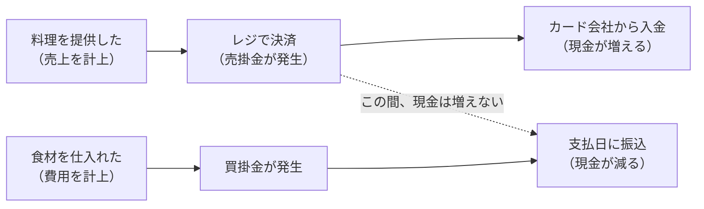
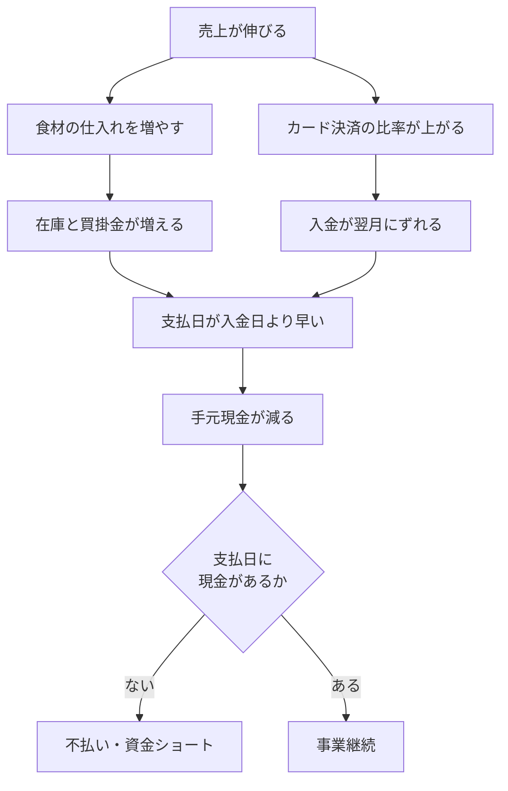

# 第7章 キャッシュフロー

## 7.1 この章で扱うこと

[第6章](06-soneki-bunkiten.md)では「利益が出ているか」を扱いました。この章では「**現金が足りるか**」を扱います。この2つは別の問題です。損益計算書の上では黒字なのに、支払日に現金が足りずに倒れる状態を**黒字倒産**（くろじとうさん）と呼びます。

飲食店は現金商売に見えますが、カード決済の入金遅れ、仕入れの掛け払い、家賃・人件費・税金の支払時期が重なるため、現金の出入りは利益と一致しません。この章では、ずれの正体を分解し、運転資金の必要額を出し、資金繰り表を作り、投資を回収できるかを判断する方法を扱います。

## 7.2 学習目標

- 利益と現金がずれる4つの原因を、自店の費目に当てはめて説明できる。
- 入金サイトと支払サイトを日付で把握し、資金繰り表を作れる。
- 手元に置くべき運転資金の額を、売上と支払条件から計算できる。
- 営業キャッシュフローを、利益から逆算して出せる（減価償却費の足し戻しを含む）。
- 投資回収期間を計算し、減価償却期間や悲観シナリオと比べて判断できる。

## 7.3 利益と現金はなぜずれるのか

**利益**は「一定期間の儲け」を、**現金**は「いま手元にあるお金」を表します。会計では、**モノやサービスの動きがあった時点**で売上と費用を記録します（発生主義）。現金の動きは、その後になります。



上の図は、売上の計上から入金まで、仕入れの計上から支払いまでの時間差を示しています。**この2つの時間差の組み合わせが、手元現金の余裕を決めます。**

飲食店で特に注意すべきは、次の非対称です。

| 方向 | 飲食店での実態 | 現金への影響 |
| --- | --- | --- |
| 入金 | カード・QR決済は翌月入金が多い。現金は即時 | 売上の一部が遅れて入る |
| 支払い（仕入れ） | 掛け仕入れで翌月払いが多い | 支払いも遅れる（有利に働く） |
| 支払い（家賃・人件費） | 当月または翌月の決まった日に出ていく | 遅れない（不利に働く） |
| 支払い（税金・社会保険） | 年数回、まとまった額 | 遅れるが額が大きい |

**仕入れの掛け払いは、資金繰り上は有利に働きます。** 食材を仕入れてから支払うまで猶予があるためです。問題は、家賃・人件費・税金という**猶予のない支払い**が、カード入金の遅れと重なることにあります。

## 7.4 ずれの4つの原因

| ずれの原因 | 内容 | 飲食店での例 |
| --- | --- | --- |
| 入金と売上の時期 | 売上は計上時、入金は後日 | クレジットカード決済の入金が翌月 |
| 支払いと費用の時期 | 費用は計上時、支払いは後日 | 食材の掛け仕入れで翌月払い |
| 在庫の増減 | 仕入れたが売れていない | 食材を大量発注して在庫が残る |
| 減価償却 | 費用だが現金は出ていない | 厨房設備の減価償却 |

**計算例（説明用の仮置き）**: 月商3,000,000円の店で、売上の60%がクレジットカード決済、カードの入金が翌月末だとします。

```
カード売上 = 3,000,000円 × 0.60 = 1,800,000円
現金・QR決済などの即時入金 = 3,000,000円 − 1,800,000円 = 1,200,000円
```

1,800,000円は翌月末まで入ってきません。その間に仕入れ代金・人件費・家賃の支払いが来ます。**損益上は黒字でも、手元現金が尽きる**のが黒字倒産です。

### 在庫と運転資本

**運転資本**（うんてんしほん）とは、事業を回すために寝ているお金のことです。

```
運転資本 = 売掛金 + 在庫 − 買掛金
```

売掛金（まだ入金されていない売上）と在庫が増えると、運転資本が増え、その分だけ現金が減ります。買掛金（まだ払っていない仕入れ）が増えると、運転資本が減り、現金が増えます。

**在庫が増えると現金が減る**という点は、直感に反します。「食材をたくさん仕入れた」ことは、損益計算書にはほぼ影響しません（使った分だけが費用になるため）。しかし現金は確実に出ていきます。**黒字なのに現金が減る**ときは、たいていこの項目です。

## 7.5 黒字倒産のメカニズム

黒字倒産は、次の順序で起きます。



上の図は、売上が伸びている時期ほど在庫と売掛金が増え、現金が減りやすいことを示しています。**「売上を増やせば現金も増える」は成り立たない**場合があります。

**黒字倒産が起きやすい条件**を整理します。

| 条件 | なぜ危険か |
| --- | --- |
| カード・QR決済の比率が高い | 入金が翌月にずれる。比率が上がるほど運転資金が増える |
| 仕入れが現金・前払い中心 | 支払いの猶予がない |
| 家賃・人件費の比率が高い | 猶予のない固定費の支払いが毎月来る |
| 急成長している | 在庫・売掛金・人件費が先行して増える |
| 手元資金が少ない | 予期しない支払いで即座に破綻する |
| 借入の返済が重なっている | 元本返済は費用にならないが現金は出ていく |

**最後の項目は特に見落とされます。** 借入の**元本返済**は費用ではありません（損益計算書に載りません）。しかし現金は確実に出ていきます。利益が出ていても返済で現金が尽きることがあります（7.11）。

### 飲食店の倒産動向

東京商工リサーチの集計（負債1,000万円以上）では、**2026年10月の飲食業倒産は98件**で10月として1997年以降最多、**2026年1〜10月の累計は870件**（前年同期比＋4.5%）、**2025年通年は1,002件**で30年間で最多でした。原因別では販売不振が77件（78.5%）を占めています。

出典: 東京商工リサーチ「10月の『飲食業』倒産 10月では最多の98件」（2026年11月10日公表、負債1,000万円以上）、https://www.tsr-net.co.jp/data/detail/1203428_1527.html （取得日 2026-11-14）

**読み方の注意**: この統計は原因別に「販売不振」「事業上の失敗」などを分類したものであり、**黒字倒産を直接示すものではありません**。また、負債1,000万円以上が対象で、休廃業・解散は含みません。件数の増減を「倒産確率」として読むことはできません。本章で黒字倒産を扱うのは、統計の裏付けがあるからではなく、**現金と利益が別物であるという構造上の理由**からです。

## 7.6 入金サイトと支払サイト

資金繰りを設計するには、**いつ入って、いつ出ていくか**を日付で把握します。これを**サイト**（＝日数の猶予）と呼びます。

| 相手先 | 締め日 | 支払・入金日 | サイト | 現金への影響 |
| --- | --- | --- | --- | --- |
| 現金・即時決済 | なし | 当日 | 0日 | 即入金 |
| クレジットカード | 月末 | 翌月末 | 約30〜60日 | 遅れて入金。手数料が引かれる |
| QRコード決済 | 月末 | 翌月〜翌々月 | 約30〜60日 | 遅れて入金 |
| 食材の仕入れ先 | 月末 | 翌月末 | 約30日 | 遅れて支払い（有利） |
| 家賃 | — | 当月の決まった日（前払いが多い） | 0日〜前払い | 猶予なし |
| アルバイト・パート | 月末 | 翌月の決まった日 | 約25日 | ほぼ猶予なし |
| 正社員給与・社会保険 | 月末 | 翌月、社会保険は翌々月 | 約25〜60日 | ほぼ猶予なし |
| リース料・システム月額 | 月末 | 翌月 | 約30日 | 遅れて支払い |
| 消費税・所得税 | 事業年度末 | 翌年（中間納付あり） | 数か月〜1年 | 額が大きい。別枠で積む |

**サイトの差を1つの数字で見る**のが、次の式です。

```
キャッシュ・コンバージョン・サイクル = 売掛金の回収日数 + 在庫の保有日数 − 買掛金の支払日数
```

この値が大きいほど、現金が寝ている期間が長くなります。飲食店では在庫の保有日数が短い（数日）ため、主に**売掛金の回収日数（カード入金の遅れ）**と**買掛金の支払日数（仕入れの猶予）**の差で決まります。

**計算例（説明用の仮置き）**: カード入金が翌月末（回収日数30日）、在庫保有日数5日、仕入れの支払が翌月末（支払日数30日）なら、

```
キャッシュ・コンバージョン・サイクル = 30日 + 5日 − 30日 = 5日
```

5日分の現金が常に寝ている計算です。月商3,000,000円なら、3,000,000円 ÷ 30日 × 5日 = **500,000円**が常時必要な資金になります。ただしこれは平均値であり、**支払日と入金日が特定の日に集中する場合は、その日に向けてより多くの現金が必要**になります。

## 7.7 運転資金

### 3つの数字

| 指標 | 計算 | 見方 |
| --- | --- | --- |
| 運転資金 | 月の固定費 + 仕入れの支払い − 入金 | 最低でも1〜2か月分は確保したい（一般知識（未検証）） |
| 当座資産 | 現金 + 預金 + 売掛金 | 支払いにすぐ充てられる資産 |
| 支払サイト | 仕入れ先への支払までの日数 | 短いほど資金繰りが厳しい |

### 必要額の求め方

```
必要運転資金の目安 = 入金待ちの売掛金 − 買掛金（支払いの猶予）+ 固定費の当月支払い分
```

**計算例（説明用の仮置き）**: 月商3,600,000円、カード比率65%（翌月末入金）、食材の支払は翌月末（材料費率30%）、固定費850,000円を当月払いとします。

```
入金待ちの売掛金 = 3,600,000円 × 0.65 = 2,340,000円
買掛金（仕入れの猶予）= 材料費 1,080,000円
固定費の当月支払い分 = 850,000円

必要運転資金 = 2,340,000円 − 1,080,000円 + 850,000円
             = 2,110,000円
```

**月商の約0.59か月分**です。「1〜2か月分」という実務でよく言われる水準は、この計算に予備費を上乗せしたものと考えると整合します。ただし「1〜2か月分」という水準は**一次資料で確認していません**（未取得）。**自店の支払サイトと入金サイトの実際の差から計算してください。**

| 状況 | 必要運転資金 | 理由 |
| --- | --- | --- |
| 現金商売のみ、仕入れは掛け | 小さい | 入金遅れがない |
| カード比率50%、仕入れ掛け | 中程度 | 売掛金の半分が翌月 |
| カード比率80%、仕入れは現金 | 大きい | 入金遅れが大きく、支払い猶予がない |
| 上に加えて急成長 | 非常に大きい | 在庫・人件費が先行して増える |

### 予備費の置き方

計算した必要額に、**予備費**を上乗せします。冷蔵庫の故障、急な修繕、売上の急落など、予定外の支出は必ず起きます。

```
手元に置く資金 = 必要運転資金 + 予備費
予備費の目安 = 月の固定費 × 1〜2か月分（一般知識（未検証））
```

**計算例（説明用の仮置き）**: 必要運転資金2,110,000円、月の固定費850,000円（人件費を除く現金固定費）なら、予備費を1か月分として、

```
手元に置く資金 = 2,110,000円 + 850,000円 = 2,960,000円
```

## 7.8 資金繰り表

**資金繰り表**（しきんぐりひょう）は、月ごとの現金の入りと出を並べた表です。損益計算書が「儲かったか」を示すのに対し、資金繰り表は「**現金が足りるか**」を示します。

### 作り方の手順

1. **月初の現金残高を書く**（通帳の残高）
2. **入金を書く**（現金売上、カード入金（前月分）、その他）
3. **支払いを書く**（仕入れ、人件費、家賃、水道光熱費、リース、借入返済、税金）
4. **差引を出す**（入金 − 支払い）
5. **月末の残高を出す**（月初 + 差引）
6. **翌月の月初に繰り越す**

### 表の形

| 項目 | 4月 | 5月 | 6月 | … |
| --- | --- | --- | --- | --- |
| 月初残高 | | | | |
| 現金売上（即時入金） | | | | |
| カード・QR入金（前月分） | | | | |
| 入金合計 | | | | |
| 仕入れの支払い（前月分） | | | | |
| 人件費 | | | | |
| 家賃・共益費 | | | | |
| 水道光熱費 | | | | |
| リース料・システム | | | | |
| 借入返済（元本＋利息） | | | | |
| 税金・社会保険 | | | | |
| 支払い合計 | | | | |
| 差引（入金 − 支払い） | | | | |
| 月末残高 | | | | |

**減価償却費は資金繰り表に入りません。** 現金が出ていないためです。この点が、損益計算書との最大の違いです。

### 見るべきポイント

| 見る場所 | 何が分かるか | 対応 |
| --- | --- | --- |
| 月末残高の最小値 | 最も資金が苦しい月 | その月に向けて資金を用意する |
| 差引がマイナスの連続 | 構造的に現金が減っている | 固定費・入金サイトの見直し |
| 税金の支払月 | 大きな山 | 毎月積み立てて分ける |
| 借入返済の月 | 元本返済は費用でないが出ていく | 返済額を固定費として計画に入れる |

## 7.9 営業キャッシュフローの計算

### 基本形（間接法）

```
営業キャッシュフロー = 税引前利益 + 減価償却費 − 運転資本の増加
```

**減価償却費**は費用ですが現金の支出ではないため、**足し戻します**。この点を忘れると、設備投資した年に「現金が足りない」理由を説明できません。

**運転資本の増加**は、売掛金と在庫が増え、買掛金が減った分です。増えると現金が減ります。

### 直接法との関係

売上と支払いを直接並べる方法を**直接法**と呼びます。資金繰り表は直接法の一種です。間接法と直接法は、同じ結果になるはずです。

```
【直接法】
現金の入金合計 − 現金の支払い合計

【間接法】
利益 + 減価償却費 − 売掛金の増加 − 在庫の増加 + 買掛金の増加
```

**両方が一致しない場合は、どちらかに計算誤りがあります。** 一致を確認することが、資金繰り表の検算になります。

### 営業キャッシュフローと営業利益の違い

| 指標 | 意味 | 使う場面 |
| --- | --- | --- |
| 営業利益 | 儲かったか（会計上の利益） | 構造の良し悪しを見る |
| 営業キャッシュフロー | 現金が増えたか | 返済・投資・支払いの原資を見る |
| フリーキャッシュフロー | 営業CF − 投資CF | 借入返済や次の投資に回せる額 |

**借入の返済は、営業キャッシュフローから行われます。** 営業利益ではなく現金で返すためです。だから返済計画は、利益ではなく営業キャッシュフローを基準に立てます。

## 7.10 投資回収

### 回収期間

開業時には、初期投資（内装、厨房機器、什器、保証金など）が発生します。この回収にかかる年数を**投資回収期間**（とうしかいしゅうきかん）と呼びます。

```
投資回収期間（年）= 初期投資額 ÷ 年間の営業キャッシュフロー
```

**計算例（説明用の仮置き）**: 初期投資12,000,000円、年間営業キャッシュフロー3,000,000円なら、

```
12,000,000円 ÷ 3,000,000円 = 4年
```

### 減価償却期間との比較

飲食店の設備は、減価償却の期間が5〜10年程度のものが多いとされます。**回収期間が償却期間を超えると、設備が古くなる前に元が取れない**計算になります。ただし、設備は償却後も使えるため、単純に「元が取れない」と断じることはできません。

| 比較 | 何が分かるか | 注意 |
| --- | --- | --- |
| 回収期間 vs 減価償却期間 | 償却が終わる前に現金を回収できるか | 償却後も使える設備は、回収期間が長くても成立する |
| 回収期間 vs 契約期間 | 賃貸の契約期間内に回収できるか | 更新料・原状回復費も投資に含める |
| 回収期間 vs 借入期間 | 返済が終わる前に回収できるか | 返済と回収のタイミングを合わせる |
| 回収期間（楽観）vs（悲観） | 売上が下振れしたときの余裕 | 楽観値だけで判断しない |

### 回収期間の限界

回収期間は計算が簡単で現場で使いやすい指標ですが、次の限界があります。

1. **回収後の利益を無視する。** 4年で回収できる投資Aと5年で回収できる投資Bがあっても、Bのほうが10年使えて利益が大きい場合があります。
2. **時間価値を考慮しない。** 今の100万円と5年後の100万円を同じ額として扱います。
3. **途中のキャッシュフローの変化を扱えない。** 売上が年々伸びる場合や落ちる場合を、平均値でしか表せません。

したがって、回収期間は**「投資を検討する入口の指標」**として使い、最終判断では悲観シナリオと、投資しなかった場合の損失（故障で止まったときの売上減など）を並べます。

### 投資判断で必ず並べる3点

1. **初期投資額**（付随費用・改装中の売上減・原状回復費を含む）
2. **年間のキャッシュフロー増加額**（売上増ではなく**キャッシュ**の増加）
3. **回収期間**

| 投資の種類 | 効果が出るまで | 判断で見落としやすい点 |
| --- | --- | --- |
| 厨房機器の更新 | すぐ | 故障時の損失と比較する。止まったときの売上減も効果に含める |
| 内装・改装 | 数か月 | 改装中の売上減を初期投資に足す |
| システム導入 | 数か月 | 月額費用と、入力・運用の手間を人件費として数える |
| 席数の増加 | すぐ | 1席あたりの快適性低下による客単価下落を織り込む |

## 7.11 借入と返済

### 元本返済は費用ではない

借入の返済額は、**元本**と**利息**に分かれます。利息は費用（営業外費用）ですが、**元本の返済は費用ではありません**。しかし現金は出ていきます。

```
返済額 = 元本の返済 + 利息
損益計算書に載るのは利息のみ
資金繰り表には返済額の全額が載る
```

**ここが黒字倒産の典型パターンです。** 営業利益が出ていても、元本返済で現金が尽きることがあります。

### 元利均等返済の計算

毎月の返済額が一定になる方式を**元利均等返済**と呼びます。

```
毎月返済額 = 借入額 × 月利 ÷ (1 − (1 + 月利)^(−返済回数))
月利 = 年利 ÷ 12
```

**計算例（説明用の仮置き）**: 借入10,000,000円、年利3%、7年（84回）の元利均等返済なら、

```
月利 = 0.03 ÷ 12 = 0.0025
毎月返済額 = 10,000,000円 × 0.0025 ÷ (1 − 1.0025^(−84))
           = 132,133円（小数第1位を四捨五入）
総返済額 = 132,133円 × 84回 = 11,099,172円
利息総額 = 11,099,172円 − 10,000,000円 = 1,099,172円
```

| 返済期間 | 毎月返済額 | 総返済額 | 利息総額 |
| --- | --- | --- | --- |
| 5年（60回） | 179,687円 | 10,781,220円 | 781,220円 |
| 7年（84回） | 132,133円 | 11,099,172円 | 1,099,172円 |
| 10年（120回） | 96,561円 | 11,587,320円 | 1,587,320円 |

**期間を延ばすと毎月の負担は下がりますが、利息総額は増えます。** 資金繰りが苦しいときに期間を延ばすのは有効ですが、総額が増えることを把握しておきます。

### 返済原資は営業キャッシュフロー

```
返済可能額 = 営業キャッシュフロー − 運転資金の増加分 − 予備費
```

営業キャッシュフローが毎月202,000円しかない店が、毎月132,133円を返済すると、残るのは約70,000円です。ここから予備費を積むと、ほとんど残りません。**返済額は営業キャッシュフローの範囲に収める**のが原則です。

| 状態 | 営業CFに対する返済額の比率 | 判断 |
| --- | --- | --- |
| 余裕がある | 30%未満 | 追加投資の余地がある |
| 注意 | 30〜50% | 売上変動に弱い。予備費を厚くする |
| 危険 | 50%超 | 返済期間の延長、借換えを検討する |

この区分は本資料が説明のために置いた目安であり、**一般知識（未検証）**です。

## 7.12 現金を守る運用

現金を守る方法は、次の5つに整理できます。

| 打ち手 | 内容 | 副作用 |
| --- | --- | --- |
| 入金を早める | 即時決済の比率を上げる、カードの入金サイクルを短い契約にする | 決済手数料が上がることがある |
| 支払いを遅らせる | 仕入れのサイトを延ばす、リース料の支払日を調整する | 取引先の信用を損なう |
| 支払いを平準化する | 税金・社会保険を毎月積み立てる | 資金を拘束する |
| 固定費を下げる | リースの見直し、契約の解約 | サービス水準が下がる |
| 予備費を持つ | 手元資金の下限を決める | 資金の効率は落ちる |

### 税金と社会保険の積み立て

消費税と所得税・法人税は、**まとまった額が年数回**出ていきます。資金繰り表で最も破綻を招きやすいのがこの山です。

```
毎月の積立額 = 年間の税負担見込み ÷ 12
```

**計算例（説明用の仮置き）**: 年間の納税見込みが1,200,000円なら、毎月100,000円を別口座に移します。**資金繰り表には「税金積立」として毎月の支払いに入れます。** 実際の納付月にまとめて出すと、その月だけ大きなマイナスになり、資金繰り表が読みにくくなります。

### 手元資金の下限を決める

```
手元資金の下限 = 月の現金固定費 × 1か月分 + 税金の積立残高
```

この下限を割ったら、投資を止め、固定費の見直しに戻ります。**下限を決めておくと、判断が感情ではなく数字で行えます。**

## 7.13 ケースの店では

連続ケース「食堂つきかげ」（[第22章: 総合ケース](22-case.md)）の設定は [OUTLINE.md](../OUTLINE.md) の3章にあります。以下は**ケースの設計値**にもとづく計算であり、実在の店舗の実績ではありません。

### 年間の損益とキャッシュフロー

12か月の月次表（売上・材料費率・人件費率）と、[第5章](05-koteihi-ricchi.md) 5.12の固定費表から、年間の数字を積み上げます。固定費のうち人件費以外の720,000円は毎月一定、決済手数料・容器等は売上の2%（説明用の仮置き）とします。

| 項目 | 年間金額 | 出所 |
| --- | --- | --- |
| 売上高 | 31,300,000円 | ケースの月次表12か月の合計 |
| 材料費 | 9,556,000円 | 各月の売上 × 材料費率の合計 |
| 人件費 | 10,050,000円 | 各月の売上 × 人件費率の合計 |
| 決済手数料・容器等 | 626,000円 | 売上 × 2%（説明用の仮置き） |
| 家賃・共益費・水道光熱費・リース・システム等 | 8,640,000円 | 720,000円 × 12か月 |
| 減価償却費 | 1,500,000円 | 下記 |
| 費用合計 | 30,372,000円 | |
| **営業利益** | **928,000円** | 31,300,000円 − 30,372,000円 |

```
【減価償却費（定額法、償却年数は説明用の仮置き）】
内装        6,000,000円 ÷ 10年 = 600,000円
厨房機器    4,000,000円 ÷  8年 = 500,000円
什器        1,000,000円 ÷  5年 = 200,000円
開業費等    1,000,000円 ÷  5年 = 200,000円
合計                            = 1,500,000円/年（月125,000円）
※ 保証金3,000,000円は資産であり、償却しません
```

### 営業キャッシュフローと投資回収

```
営業キャッシュフロー = 営業利益 928,000円 + 減価償却費 1,500,000円
                    = 2,428,000円/年（月平均 約202,333円）
```

| 回収の対象 | 金額 | 回収期間 |
| --- | --- | --- |
| 初期投資の全額 | 15,000,000円 | 15,000,000円 ÷ 2,428,000円 = **6.2年** |
| 保証金を除いた額（退去時に返還される前提） | 12,000,000円 | 12,000,000円 ÷ 2,428,000円 = **4.9年** |

**保証金を除くと回収期間は4.9年**です。内装の償却年数10年、厨房機器8年より短いため、設備が使えなくなる前に現金を回収できる計算になります。ただし、これは11月水準の営業利益が続く前提です。売上が1割下がれば営業キャッシュフローも減り、回収期間は延びます。

### 資金繰り表

ケースの店の12か月の資金繰りを、次の前提で試算します（前提はすべて**説明用の仮置き**です。ケースに定めがありません）。

- 売上の40%は現金・即時決済、60%はカードで**翌月末入金**
- 食材の支払いは**翌月末払い**（開業月の仕入れは開業資金で支払い済みとみなす）
- 人件費・固定費720,000円・決済手数料等は**当月払い**
- 減価償却費は現金支出ではないため含めない

| 月 | 入金 | 支払い | 差引 | 累計 |
| --- | --- | --- | --- | --- |
| 4月 | 720,000円 | 1,440,000円 | −720,000円 | −720,000円 |
| 5月 | 1,960,000円 | 2,066,000円 | −106,000円 | **−826,000円** |
| 6月 | 2,280,000円 | 2,218,000円 | ＋62,000円 | −764,000円 |
| 7月 | 2,480,000円 | 2,322,000円 | ＋158,000円 | −606,000円 |
| 8月 | 2,640,000円 | 2,391,000円 | ＋249,000円 | −357,000円 |
| 9月 | 2,620,000円 | 2,380,000円 | ＋240,000円 | −117,000円 |
| 10月 | 2,620,000円 | 2,394,000円 | ＋226,000円 | ＋109,000円 |
| 11月 | 2,880,000円 | 2,520,000円 | ＋360,000円 | ＋469,000円 |
| 12月 | 3,160,000円 | 2,776,000円 | ＋384,000円 | ＋853,000円 |
| 1月 | 3,080,000円 | 2,684,000円 | ＋396,000円 | ＋1,249,000円 |
| 2月 | 2,520,000円 | 2,390,000円 | ＋130,000円 | ＋1,379,000円 |
| 3月 | 2,600,000円 | 2,421,000円 | ＋179,000円 | ＋1,558,000円 |

**累計が最もマイナスになるのは5月の −826,000円**です。開業月とその翌月は、カード入金がまだ届かず、支払いだけが先行します。**開業時にこの額を上回る運転資金を用意しておく必要があります。**

6月以降は毎月プラスに転じ、**10月に累計がプラスになります**。年間では**＋1,558,000円**の現金増です。

### 営業キャッシュフローと現金収支の一致を確かめる

年間の営業キャッシュフローは2,428,000円でしたが、資金繰り表の年間合計は1,558,000円です。差の870,000円は、次の2つで説明できます。

```
営業キャッシュフロー          2,428,000円
 − 売掛金の増加（3月分カード）  1,740,000円   ← 3月売上の60%が翌4月入金
 + 買掛金の増加（3月分材料費）    870,000円   ← 3月材料費が翌4月払い
 = 現金収支の年間合計          1,558,000円
```

**一致を確認できることが、資金繰り表の検算になります。** 合わない場合は、入金サイトか支払サイトの設定が誤っています。

### 必要運転資金

7.7の式にケースの数字を当てはめます。11月の月商3,000,000円を使います。

```
入金待ちの売掛金 = 3,000,000円 × 0.60 = 1,800,000円
買掛金（仕入れの猶予）= 材料費 900,000円
固定費の当月支払い分 = 720,000円

必要運転資金 = 1,800,000円 − 900,000円 + 720,000円 = 1,620,000円
```

（[第6章](06-soneki-bunkiten.md)の固定費合計も1,620,000円ですが、これは別の数字です。偶然の一致です。）

資金繰り表の最大累計マイナスは826,000円でしたから、1,620,000円を用意すれば余裕があります。さらに冷蔵庫の故障などの予備費を月の固定費720,000円の1か月分として上乗せすると、**開業時に手元へ置く資金の目安は約2,340,000円**です。初期投資1,500万円とは**別枠**で必要になる点に注意してください。

## 7.14 よくある誤解

| 誤解 | 実際 |
| --- | --- |
| 利益が出ていれば資金は足りる | 入金と支払いの時期がずれると黒字倒産する |
| 減価償却は現金が出ていく費用 | 費用だが現金支出ではない。キャッシュフロー計算では足し戻す |
| 売上を増やせばキャッシュも増える | 売掛金や在庫が増えると、売上が増えても現金は減ることがある |
| カード決済が増えると便利で良い | 入金が翌月にずれ、運転資金が増える。手数料も引かれる |
| 借入の返済は利益から出る | 元本返済は費用ではない。営業キャッシュフローから出ていく |
| 資金繰り表は税理士が作るもの | 毎月の現金の出入りは経営者が把握する。決算書からは見えない |
| 回収期間が短い投資ほど安全 | 回収後の利益と、投資しなかった場合の損失も比べる |
| 保証金は初期投資なので回収対象 | 退去時に返還される。回収期間の計算では分けて扱う |

## 7.15 この章の要点

- 利益と現金は別物です。**入金と支払いの時期のずれ**、在庫の増加、減価償却、元本返済が原因で黒字倒産が起きます。
- 運転資金は **入金待ちの売掛金 − 買掛金 + 当月支払いの固定費** で計算します。開業時は初期投資と**別枠**で用意します。
- **資金繰り表**は月ごとの現金の出入りを並べた表です。月末残高の最小値が、用意すべき資金額を教えてくれます。
- 営業キャッシュフローは **税引前利益 + 減価償却費 − 運転資本の増加** です。減価償却費の足し戻しを忘れないでください。
- 投資判断は **初期投資額・キャッシュフロー増加額・回収期間** の3点セットで行います。売上の増加は根拠になりません。

## 7.16 自店で確認すること

- [ ] 売上のうち、カード・QR決済など入金が遅れる比率を把握している
- [ ] カード・QRの入金日を、契約書で日付として確認している
- [ ] 仕入れの締め日と支払日を、仕入れ先ごとに把握している
- [ ] 家賃・人件費・リース料の支払日を、カレンダーに落としている
- [ ] 消費税・所得税・社会保険の年間の支払額と支払月を把握している
- [ ] 12か月分の資金繰り表を作り、月末残高の最小値を出している
- [ ] 手元に置くべき運転資金の額を、支払サイトから計算している
- [ ] 借入がある場合、元本返済額を固定費として計画に入れている

## 7.17 章末問題

### 問1 必要運転資金

月商4,000,000円、カード比率65%（翌月末入金）、食材の支払は翌月末（材料費率30%）、当月払いの固定費は900,000円の店があります。必要運転資金を求めてください。また、予備費を月の固定費の1か月分としたとき、手元に置く資金の目安を求めてください。

**解答**

```
【入金待ちの売掛金】
4,000,000円 × 0.65 = 2,600,000円

【買掛金（仕入れの猶予）】
4,000,000円 × 0.30 = 1,200,000円

【必要運転資金】
2,600,000円 − 1,200,000円 + 900,000円 = 2,300,000円

【手元に置く資金の目安】
2,300,000円 + 900,000円 = 3,200,000円
```

必要運転資金は2,300,000円、予備費を含めると3,200,000円です。これは月商の0.58か月分・0.8か月分に相当します。**初期投資とは別枠**で用意する必要があります。

### 問2 投資回収期間と悲観シナリオ

初期投資18,000,000円（うち保証金4,000,000円）、年間営業キャッシュフロー3,600,000円の店があります。次の3つを求めてください。

1. 初期投資の全額に対する回収期間
2. 保証金を除いた場合の回収期間
3. 売上が2割下がり、年間営業キャッシュフローが2,200,000円になった場合の回収期間（保証金を除く）

**解答**

```
【1. 全額】
18,000,000円 ÷ 3,600,000円 = 5.0年

【2. 保証金を除く】
(18,000,000円 − 4,000,000円) ÷ 3,600,000円 = 14,000,000円 ÷ 3,600,000円
= 3.888... → 約3.9年

【3. 悲観シナリオ（保証金を除く）】
14,000,000円 ÷ 2,200,000円 = 6.363... → 約6.4年
```

保証金を除いた回収期間は3.9年ですが、売上が2割下がると6.4年に延びます。**内装の償却年数が10年なら6.4年でも回収可能**ですが、厨房機器の償却年数が8年なら、償却が終わる直前まで回収にかかる計算です。**楽観値と悲観値の両方で計算する**のが実務的です。

### 問3 営業キャッシュフローの計算と検算

税引前利益1,200,000円、減価償却費900,000円の店があります。期中に売掛金が400,000円増え、在庫が100,000円増え、買掛金が250,000円増えました。営業キャッシュフローを求めてください。また、この結果から「利益は出ているが現金が減っている」と言えるか答えてください。

**解答**

```
【運転資本の増加】
売掛金の増加 400,000円 + 在庫の増加 100,000円 − 買掛金の増加 250,000円
= 250,000円

【営業キャッシュフロー】
1,200,000円 + 900,000円 − 250,000円 = 1,850,000円
```

営業キャッシュフローは1,850,000円で、**プラス**です。したがって「利益は出ているが現金が減っている」とは言えません。現金は増えています。

ただし、運転資本が250,000円増えた分だけ、利益と減価償却費の合計2,100,000円より現金の増加は少なくなっています。**もし売掛金が1,500,000円増えていれば、運転資本の増加は1,350,000円となり、営業キャッシュフローは750,000円まで減ります。** 売上の急成長時には、この項目が現金を大きく削ることを覚えておいてください。

## 参考文献・出典

- キャッシュフロー計算書の構造（営業・投資・財務）、運転資本、投資回収期間、元利均等返済の計算式は、財務会計・ファイナンスの標準的な定義にもとづく**一般知識（未検証）**。
- 本章の数値例は、**ケースの設計値**（連続ケース「食堂つきかげ」の月次表12か月、初期投資1,500万円とその内訳、[第5章](05-koteihi-ricchi.md) 5.12の固定費表）または**説明用の仮置き**です。実在の店舗の実績ではありません。計算は本文中に式と途中の値を示しており、電卓で検算できます。
- ケースの計算に使った次の前提は、ケースに定めがないため**説明用の仮置き**です。現金・即時決済40%／カード60%翌月末入金、食材の翌月末払い、固定費720,000円の当月払い、決済手数料・容器等は売上の2%、償却年数（内装10年・厨房機器8年・什器5年・開業費等5年）。実際の契約条件で置き換えてください。
- **月25日営業**という前提は、年間300日営業というケースの設計値（[第22章](22-case.md)）にもとづきます。
- 7.5 の倒産件数は東京商工リサーチ「10月の『飲食業』倒産 10月では最多の98件」（2026年11月10日公表、負債1,000万円以上）による。出典: https://www.tsr-net.co.jp/data/detail/1203428_1527.html （取得日 2026-11-14）。この集計は負債1,000万円以上を対象とし、休廃業・解散を含みません。**黒字倒産を示す統計ではありません。**
- 「運転資金は1〜2か月分」「予備費は固定費1〜2か月分」「返済額は営業CFの30%未満が目安」は、実務でよく語られる水準ですが、**一次資料で確認していません（未取得）**。自店の支払サイト・入金サイト・営業キャッシュフローから個別に算出してください。
- 減価償却の耐用年数は、資産の種類・構造・用途ごとに法令で定められています。本章に示した年数（10年・8年・5年）は**説明用の仮置き**であり、実際の耐用年数ではありません。適用する年数は顧問税理士に確認してください。
- 借入の金利・返済条件は金融機関との契約で決まります。本章の年利3%は**説明用の仮置き**です。本資料は財務・税務の助言ではありません。

前後の章: [第6章: 損益分岐点](06-soneki-bunkiten.md) ／ [第8章: 客数・客単価・回転率・席稼働率](08-kyaku-tanka-kaiten.md)
