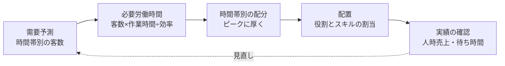

# 第7章 人と労務

**この章で扱うこと**: 飲食店の人的構造、採用、教育と標準化、シフトの組み方、離職と定着、そして労務の基本を扱います。労働法の細部は本資料では一次資料を取得できていないため、論点の整理にとどめます。

飲食店は**人で品質が決まる商売**です。同じメニュー、同じ価格でも、作る人と接する人で客の満足は変わります。人が足りない、育たない、辞めるという状態は、売上と利益に直接効いてきます。この章では、人の問題を「根性」ではなく**設計**として扱います。

> **本章の位置づけ**: 労働法の細部（割増率、変形労働時間制の要件など）は、本資料の作成時に公的一次資料を取得できなかった項目があります。法律に依存する記述は「一般知識（未検証）」と明示し、断定を避けます。実際の運用は労働基準監督署・社会保険労務士に確認してください。**本資料は法的助言ではありません。**

## 7.1 飲食店の人的構造

飲食店の働き方は、雇用形態で大きく分かれます。

| 形態 | 役割 | 長所 | 短所 |
| --- | --- | --- | --- |
| 正社員 | 店舗の責任、シフト編成、仕入れ、教育 | 責任と継続性がある | 人件費が高い（固定費） |
| 契約社員・準社員 | 特定の役割を継続的に担う | 正社員より柔軟 | 責任範囲が曖昧になりやすい |
| パート・アルバイト | 調理補助、ホール、洗い場 | 需要に応じて調整できる（変動費的） | 教育コストがかかる。流動性が高い |
| 業務委託 | 専門業務（製菓、寿司など） | 固定費を抑えられる | 指揮命令の範囲に注意が必要（偽装請負のリスク） |
| 外国人材 | 人手不足の補完 | 戦力になる | 在留資格、言語、文化の調整が必要 |

**用語の説明**: **固定費**は、売上がゼロでも発生する費用です（正社員の給与、家賃、リース料）。**変動費**は、売上に比例して発生する費用です（食材費、アルバイトの人件費）。**偽装請負**は、請負の契約形式をとりながら、実際には発注者が作業者へ指揮命令している状態を指し、労働者派遣法などの問題になります。

**飲食店の人的コストの特徴**は、正社員（固定費）とアルバイト（変動費）の混合比率で、損益分岐点が変わることです。アルバイト比率が高いほど売上に応じて人件費を調整できますが、教育の質と定着が課題になります。

| 構成 | 損益分岐点 | 起きやすい問題 |
| --- | --- | --- |
| 正社員中心 | 高い（固定費が重い） | 売上が落ちると利益が急に消える |
| アルバイト中心 | 低い（売上に連動） | 品質のばらつき、教育の属人化、急な欠勤 |
| 混成（役割で分ける） | 中間 | 役割の境界が曖昧だと責任が消える |

**どの構成が正しいかは、業態と立地で変わります。** ランチ中心の回転型と、夜の接客型では、必要な人数とスキルが違います。数字で見るのは、[第2章](02-shueki-kouzou-genka.md) の**人件費率**（人件費 ÷ 売上）と**人時売上**（売上 ÷ 総労働時間）です。

**人の配置は、単価の高い人を減らす話ではありません。** 時給の安い人だけを集めると、教育と品質のコストが別の形で発生します。**「誰が何を判断できるか」を先に決め、その役割に人を当てる**順序で考えます。

## 7.2 採用

飲食店の採用は、構造的に難しい局面があります。

| 課題 | 内容 | 打ち手 |
| --- | --- | --- |
| 応募が集まらない | 労働条件、業務の認知、競合との競争 | 募集文の改善、写真、職場見学、紹介 |
| 条件が合わない | 勤務時間、休日、時給 | 短時間勤務、曜日固定、シフトの柔軟化 |
| 早期離職 | ミスマッチ、人間関係、負荷 | 採用前の職場見学、初期研修、メンター |
| 採用コストが高い | 媒体費、面接の時間 | 紹介制度、リファラル採用、定着への投資 |

**リファラル採用**は、在籍するスタッフからの紹介で採用する方法です。相互理解があるぶんミスマッチが起きにくい一方、紹介した側とされた側の関係が職場に持ち込まれます。

**採用コストは「1人を採用するのにかかった費用」で測ります**。媒体費、面接工数、研修期間の教育コストを含めます。採用コストが高いのに離職が早いと、投資が回収できません。**定着への投資は、採用を増やすより費用対効果が高いことが多い**（一般知識・未検証）。

```
採用コスト（1人あたり）= 直接費（媒体・紹介料）+ 面接工数 × 時給 + 研修期間の教育費
```

**計算例（説明用の仮置き）**: 求人媒体費3万円、面接3回（担当者の時給2,000円 × 1時間 × 3回 = 6,000円）、研修2週間（時給1,200円 × 80時間 = 9万6,000円）とすると、

```
30,000 + 6,000 + 96,000 = 132,000円
```

1人の採用に**約13万円**かかった計算です。この人が3か月で辞めれば、この金額に再採用の費用が上乗せされます。

### 募集で伝えること

**応募が来ない原因の多くは、条件ではなく情報不足**です。何をする仕事か、どの時間帯か、誰と働くかが伝わらないと、応募者は判断できません。

| 伝える項目 | 具体例 | 効果 |
| --- | --- | --- |
| 業務の内容 | ホール、調理補助、洗い場の別 | ミスマッチを減らす |
| 時間帯と曜日 | ランチのみ、週2日から、曜日固定可 | 応募のハードルを下げる |
| 職場の様子 | 写真、動画、スタッフの紹介 | 想像できるようにする |
| 教育の仕組み | 初日の流れ、研修の期間 | 未経験者の不安を下げる |
| 評価の基準 | 時給アップの条件 | 納得感につなげる |

**条件を良くする前に、伝え方を直す**方が費用がかかりません。

## 7.3 教育と標準化

飲食店の品質は「誰が作っても同じ味」に近づけられるかで決まります。

| 標準化の対象 | 方法 | 効果 |
| --- | --- | --- |
| レシピ | 分量のグラム指定、写真、手順書 | 味のばらつきが減る。教育が速くなる |
| 調理手順 | 手順書、動画、チェックリスト | 属人化を防ぐ。引き継ぎが楽になる |
| 接客 | マニュアル、ロールプレイ | サービスの質が揃う |
| 衛生 | チェックリスト、記録（[第6章](06-eisei-haccp.md)） | 事故を防ぐ。証跡が残る |
| 締め作業 | チェックリスト、ダブルチェック | ミスと不正を防ぐ |

**標準化の目的は「人を機械にする」ことではありません。** 標準化によって、判断に迷う時間を減らし、教育を速くし、属人化を防ぎます。その上で、**標準から外れる場面（クレーム、アレルギー、体調不良）での判断基準**を別に用意します。

### 教育の順序

1. **見せる**（デモンストレーション）
2. **やらせる**（実践、隣で見る）
3. **確認する**（できているかをチェック）
4. **任せる**（一人でできるようにする）
5. **振り返る**（定期的なフィードバック）

**初日の教育が離職を左右します**（一般知識・未検証）。初日に何を教え、誰が面倒を見るかを決めておくことが、結果的に定着率を上げます。

| 時点 | 教えること | 担当 |
| --- | --- | --- |
| 初日・午前 | 店のルール、身だしなみ、手洗い、避難経路、休憩の取り方 | 店長または教育係 |
| 初日・午後 | 担当する業務の1つ目（例: 洗い場、ご案内） | 教育係と2人で |
| 1週間目 | 担当業務の追加、メニューの説明、アレルギーの扱い | 教育係 |
| 1か月目 | 一人で任せる範囲の確認、困ったときの相談先 | 店長 |
| 3か月目 | 評価のフィードバック、次の目標 | 店長 |

**「初日に全部教える」は失敗します。** 情報量が多すぎると、何も残りません。**初日は「安全」と「帰り道」だけ確実に**し、業務は1つずつ足します。

### 標準化の限界

| 標準化で解決できること | 標準化では解決できないこと |
| --- | --- |
| 手順のばらつき | 判断が必要な場面（クレーム、アレルギー、体調不良） |
| 教育の効率 | 意欲や働きがい |
| 引き継ぎのしやすさ | 人間関係 |
| 品質の下限の安定 | 品質の上限（料理人の工夫） |

**例外の判断基準を決める**のが、標準化とセットの作業です。誰が、どこまでを判断してよいかを書いておくと、現場が止まりません。

| 場面 | 判断する人 | 判断の範囲 |
| --- | --- | --- |
| アレルギーの申告 | ホール担当 | 原材料の確認と、厨房への伝達。提供可否は厨房 |
| 料理の作り直し | ホール責任者 | 1品の作り直し |
| 提供の遅れの説明 | ホール担当 | お詫びと所要時間の案内 |
| クレームの対応 | 店長 | 返金・割引の判断 |
| 体調不良の申告 | 本人と店長 | 就業の可否 |

## 7.4 シフトと労働時間

### シフトは「需要」から逆算する

シフトは、店の都合ではなく**客数の予測**から組みます。



図の説明: シフトは需要予測から始まり、必要労働時間を計算し、時間帯に配分し、役割に人を当てます。組んだ後は実績で確認し、次の予測に戻します。**「前月のシフトをそのまま使う」をやめる**のが出発点です。

```
必要労働時間 = 予測客数 × 1人あたりの作業時間 ÷ 効率
```

**計算例**: 予測客数60人、1人あたりの作業時間（調理・提供・洗い場・接客の合計）が10分、効率80%なら、

```
60人 × 10分 = 600分 = 10時間
10時間 ÷ 0.8 = 12.5時間
```

この12.5時間を、時間帯別の客数に応じて配分します。ピーク時に集中させ、アイドルタイムは減らします。

| 時間帯 | 予測客数 | 配分の考え方 | 必要な人数の例 |
| --- | --- | --- | --- |
| 11:30〜12:00 | 10人 | 仕込みの完了と開店準備 | 2人 |
| 12:00〜13:00 | 35人 | ピーク。提供と洗い場を厚く | 5人 |
| 13:00〜14:00 | 15人 | 片付けと翌日の仕込み | 2人 |

**「効率」は作業の詰まり具合で決まります**。調理場が1人しか入れないレイアウトなら、人数を増やしても効率は上がりません。**ボトルネック（律速となる工程）を先に特定**します。

### 人時売上でシフトを評価する

[第2章](02-shueki-kouzou-genka.md)で扱った人時売上（売上 ÷ 総労働時間）を、シフトの評価に使います。

| 状態 | 人時売上 | 判断 |
| --- | --- | --- |
| 高い | 作業が詰まっている可能性 | 客の満足度・従業員の負荷を確認。増員の余地 |
| 低い | 人が余っている可能性 | シフトの見直し、作業の効率化 |

**人時売上が高い＝良い、ではありません。** 高すぎる状態は、従業員が休む暇なく働いている状態で、離職とミスにつながります。

```
人時売上 = 売上 ÷ 総労働時間
```

**計算例（説明用の仮置き）**: 1日の売上12万円、総労働時間40時間なら、人時売上は3,000円です。3,000円を良いと見るか悪いと見るかは、業態と立地によります。**自店の過去の水準と比べる**のが基本で、他店の数値をそのまま目標にしません。

### 労働時間の管理

飲食店で起きやすい論点を整理します。**いずれも法律の解釈を含むため、実務では社会保険労務士に確認してください。**

| 論点 | 内容 | 注意点 |
| --- | --- | --- |
| 労働時間の把握 | 始業・終業の記録 | 記録がないと、残業代の未払いを主張されうる |
| 時間外労働の割増 | 法定時間を超えた分の割増賃金 | 割増率は法令で定まる。**具体的な率は一次資料で確認していない** |
| 深夜労働 | 深夜帯の割増 | 深夜帯の定義も法令による |
| 休日労働 | 法定休日の労働 | 休日の設定と割増の扱いを確認 |
| 変形労働時間制 | 繁忙期と閑散期で労働時間を平準化する制度 | 要件を満たさないと無効。導入は慎重に |
| 年少者の保護 | 18歳未満の労働時間・深夜業の制限 | 高校生のアルバイトで問題になりやすい |
| 有期契約の更新 | 契約期間、更新のルール | 反復更新で無期転換の対象になりうる |

**記録の重要性**: 労働時間の記録がない店は、トラブル時に立証できません。タイムカードや勤怠システムの導入は、労務リスクの低減として費用対効果が高い投資です。

**記録すべき項目**は、少なくとも始業・終業の時刻、休憩の開始と終了、その日の担当です。休憩を取ったかどうかは、後から争いになりやすい項目です。**休憩の時刻まで記録する**運用にしておくと、説明が容易になります。

| 起きやすい問題 | 原因 | 防ぎ方 |
| --- | --- | --- |
| サービス残業 | 記録を取っていない、上がり時間を自己申告にしている | 打刻の徹底、退勤の声かけ |
| 休憩が取れない | ピークと休憩時間が重なっている | 休憩を時間帯で固定し、交代要員を配置 |
| 早出・仕込みの未計上 | 「準備だから」と扱っている | 準備も労働時間として記録する |
| 年少者の深夜勤務 | シフト編成の見落とし | シフト表に年齢の制約を表示する |

**シフトを組む段階で、法令の制約を入れておく**のが有効です。組んでから直すと、現場の負担になります。

## 7.5 離職と定着

### 離職コスト

離職には見えにくいコストがかかります。

```
離職コスト = 採用コスト + 教育コスト + 戦力化までの生産性低下 + 既存スタッフの負荷増
```

**計算例**: 採用費5万円、研修2週間（時給1,200円×80時間＝9.6万円）、戦力化までの生産性低下を月5万円とすると、1人の離職で**約20万円以上**のコストが発生します。10人が年間で離職すれば200万円です。これは、時給を10円上げるより大きな金額になることがあります。

**検算**: 5万円 + 9.6万円 + 5万円 = 19.6万円。四捨五入して約20万円です。

（この数値は**説明用の仮置き**です。実在の店舗の実績ではありません。）

**離職コストは、見積もらないと見えません。** 給与明細には出てこないため、削減の対象として認識されにくい。**「辞めた人の数 × 1人あたりのコスト」を年1回計算する**だけでも、投資の判断が変わります。

### 定着の打ち手

| 打ち手 | 内容 | 効果 |
| --- | --- | --- |
| 採用前のすり合わせ | 職場見学、業務内容の説明 | ミスマッチを減らす |
| 初期研修 | 初日に何を教えるかを決める | 早期離職を防ぐ |
| シフトの希望反映 | 希望休、曜日固定 | 生活との両立 |
| 評価の透明化 | 時給アップの基準を明示 | 納得感 |
| 人間関係 | 相談できる相手、定期的な面談 | 離職の最大要因に対処 |
| キャリアパス | 役職、専門性、独立支援 | 長期就業の動機 |

**離職理由は「人間関係」と「労働条件」が多い**とされますが、本資料では統計を取得できていないため数値は示しません。自店の退職者への聞き取り（exit interview）が最も確実な情報源です。

**退職の聞き取りは、辞める直前ではなく、辞めた後に行う**方が本音が出ます（一般知識・未検証）。在籍中の聞き取りでは、角が立たない答えになります。

### 定着を数字で見る

| 指標 | 計算 | 使い方 |
| --- | --- | --- |
| 定着率（3か月） | 3か月後も在籍する人数 ÷ 入店した人数 | 採用と初期研修の効果を見る |
| 平均勤続月数 | 総勤続月数 ÷ 在籍人数 | 長期的な安定を見る |
| 欠勤率 | 欠勤日数 ÷ 予定出勤日数 | 負荷や体調の変化を察知する |
| 離職コスト（年間） | 離職者数 × 1人あたりのコスト | 投資判断の材料にする |

**指標は、比べる相手を決めてから使います。** 他店との比較より、自店の半年前との比較の方が判断しやすいです。

## 7.6 少人数・複数店舗・屋外席を持つ場合の留意点

人の配置は、店の形態で制約が変わります。**同じ人数でも、働く場所と時間の構造が違えば、必要な設計は別**です。

| 形態 | 人の面での課題 | 設計の方向 |
| --- | --- | --- |
| 少人数で運営する | 1人が複数業務を担う。休みが取りにくい | 教育と標準化の重要度が高い。業務を絞る |
| 複数店舗を運営する | 店舗間の応援、指揮命令の混乱、労働条件の不一致 | 人事の取り決めを文書化する |
| 屋外席を持つ | 天候で席の稼働が変わる。夏冬の負荷が大きい | 天候に応じたシフト調整の運用を作る |
| 少人数でシステムを使う | 操作の負荷が現場に集中する | 操作手順を短くする。1画面で完結させる |

**少人数運営では、1人の欠勤が営業に直結します。** 「誰かが休んでも回る」最低限の人数を決め、それを下回る日はメニューを絞る判断をあらかじめ用意します。

**複数店舗の相互応援**は、人材の流動性を高める一方で、次の問題を生みます。

1. **指揮命令系統の混乱**（どちらの店長の指示に従うか）
2. **労働条件の不一致**（時給、シフト、評価が店舗で違う）
3. **教育の重複**（両店舗のメニューを覚える負荷）

これらは、運営主体が別の場合に特に深刻になります。**共通のシステムを使う場合と同じように、人事面の取り決めも契約に含める**必要があります。応援に入る日の指揮命令者、時給の扱い、交通費の負担を決めておきます。

また、屋外席の運用は**天候によるシフト変動**を生みます。雨天で屋外席が使えない日は、屋内席だけで回す人員に切り替える必要があります。シフトを固定すると、雨の日に人が余り、晴れた日に足りなくなります。**天候を見て前日までに調整できる体制**が望ましい。

**屋外席のスタッフには、屋内と別の負荷**がかかります。気温、日差し、虫、移動距離です。夏場の連続配置を避ける、水分の摂取を確保する、といった労務上の配慮が必要です（一般知識・未検証）。

## 7.7 よくある誤解

| 誤解 | 実際 |
| --- | --- |
| 人件費は削るほど利益が出る | 提供が遅れ、回転と満足度が落ちる。人時売上と離職コストで見る |
| アルバイトは安い | 教育コストと離職コストを含めると、正社員より高くつくことがある |
| マニュアルを作れば誰でも同じ品質になる | マニュアルは判断の土台。例外対応の基準が別に要る |
| 残業代はサービス残業で良い | 未払い賃金のリスク。記録がないと立証できない |
| 離職は本人の問題 | 採用、教育、シフト、人間関係の設計で変えられる |
| シフトは前月を踏襲すれば足りる | 客数と人員の構成は変わる。需要から組み直す |
| 人が足りないのは時給が安いから | 情報不足・教育不足・シフトの硬さも原因。条件だけでは解決しない |
| 教育は現場で自然に身につく | 教える順序と担当を決めないと、ばらつきと早期離職が残る |
| 複数店舗の応援は人員の融通なので自由にできる | 指揮命令と労働条件の整理が要る。曖昧だとトラブルになる |

## 7.8 この章の要点

- 人件費は**固定費（正社員）と変動費（アルバイト）の混合**で考えます。比率で損益分岐点が変わります。
- 採用は**条件より情報**で改善できる部分があります。採用コストは媒体費・面接工数・研修費の合計で測ります。
- 教育は**見せる→やらせる→確認する→任せる→振り返る**の順です。初日に全部教えず、安全と帰り道を先に確実にします。
- シフトは**需要予測から逆算**します。必要労働時間を計算し、時間帯に配分し、実績で見直します。人時売上が高いことが良いとは限りません。
- 労働時間の**記録がないと立証できません**。割増率・変形労働時間制の要件は本資料では未取得です。社会保険労務士に確認します。
- 離職には**見えないコスト**があります。年1回計算して、定着への投資判断に使います。

## 7.9 自店で確認すること

- [ ] 人件費率・人時売上・採用コスト（1人あたり）を数字で把握している
- [ ] 初日に教えることを決め、担当者を指名している
- [ ] 標準から外れる場面（アレルギー、クレーム、体調不良）の判断者を決めた
- [ ] 時間帯別の予測客数から、必要労働時間を計算している
- [ ] 始業・終業・休憩の時刻を記録している（準備時間を含む）
- [ ] 年少者の労働時間・深夜業の制約と、割増率・変形労働時間制の要件を、社会保険労務士に確認してシフト編成に反映した
- [ ] 離職コストを年1回計算し、定着の打ち手と比べている
- [ ] 複数店舗・屋外席がある場合、指揮命令と労働条件の取り決めを文書化した

## 7.10 演習

### 問1

予測客数が90人、1人あたりの作業時間が8分、効率が75%の日は、必要労働時間は何時間ですか。計算の過程も示してください。

**解答**:

```
90人 × 8分 = 720分 = 12時間
12時間 ÷ 0.75 = 16時間
```

**16時間**です。この16時間を時間帯別の客数に配分します。たとえばピークの2時間に全体の6割を置くなら、9.6時間をその2時間に集中させます。ただし、実際に配置できる人数は厨房とホールの物理的な制約（コンロの口数、席数、通路の広さ）で上限が決まります。計算した時間が物理的な上限を超える場合は、**メニューを絞る、提供方法を変える、客数を制限する**といった別の判断が必要です。

### 問2

「時給を10円上げても人が集まらないので、さらに上げるしかない」という相談を受けました。この判断を検討するために、他にどんな情報を見ますか。

**解答**: まず、応募が来ないのか、応募は来るが採用に至らないのか、採用しても辞めるのかを分けます。原因によって打ち手が違います。応募が来ない場合は、募集文の情報量（業務内容、時間帯、職場の様子、教育の仕組み）を確認します。条件が合わない場合は、シフトの柔軟性（短時間、曜日固定）を見直します。早期離職がある場合は、初日の教育と人間関係を確認します。加えて、採用コストと離職コストを計算し、時給を上げる費用と定着に投資する費用を比べます。**時給は手段の1つで、原因の特定が先**です。

### 問3

従業員5人の店で、屋外席を出すことになりました。人の配置で何を決めておく必要がありますか。

**解答**: 第一に、屋外席の稼働を天候で判断する基準と、その判断をする人を決めます。前日までに、屋内のみで回す人員に切り替える手順を作ります。第二に、屋外と屋内の担当を固定するか交代するかを決めます。夏場の連続配置を避け、水分と休憩を確保します。第三に、屋外席が使えない日に余る人員の使い道（仕込み、清掃、教育）を決めておきます。第四に、屋外席の提供が営業許可の範囲かを保健所に確認し、範囲外なら配置を組みません（→ [第5章](05-kyoka-to-hourei.md) 5.7）。第五に、少人数のため1人の欠勤が直結します。屋外席を出す日は、最低限の人数を下回ったら席数を減らす判断を用意します。

## 出典と確度

- 人的構造、採用、教育、シフト、離職コストの考え方は、飲食店実務・人材マネジメントの一般論にもとづく**一般知識（未検証）**。
- 7.4 の労働法に関する記述は、制度の存在と論点を示すものであり、**具体的な割増率・要件は一次資料で確認していない**。実務では社会保険労務士・労働基準監督署に確認すること。
- 離職率、採用コスト、離職理由の統計は**取得できなかった**ため、数値を示さない。
- 7.4 の計算例（60人・10分・効率80%→12.5時間）と 7.5 の離職コストの計算例（約20万円）は**説明用の仮置き**であり、実在の店舗の実績ではない。
- 7.6 の形態別の留意点は、実務の一般論にもとづく**一般知識（未検証）**。
- 本資料は法的助言ではありません。

---

前後の章: [第6章 衛生管理とHACCP](06-eisei-haccp.md) ／ [第8章 集客とリピート](08-shukyaku-to-repeat.md)
