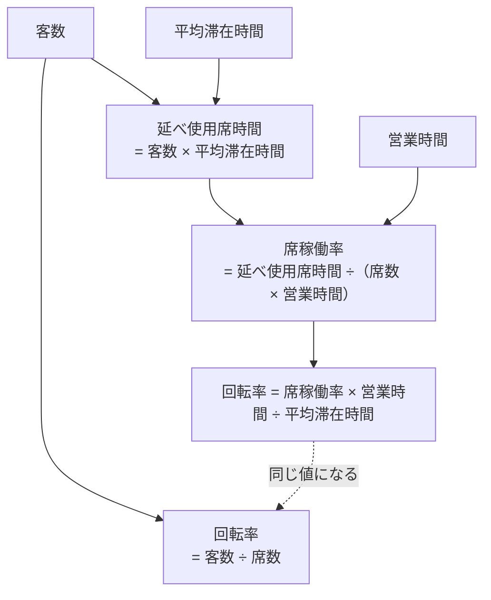

# 第8章 客数・客単価・回転率・席稼働率

## 8.1 この章で扱うこと

[第1章](01-kouzou.md)で「売上 = 席数 × 回転率 × 客単価」と分解しました。この章では、右辺の各項を**実際にどう測り、どう動かすか**を扱います。ここが飲食店経営の中心です。

数字の定義を正確に押さえないと、「回転率を上げたのに売上が増えない」「満席なのに利益が出ない」という状態から抜け出せません。測り方の定義、席時間あたり売上という比較の基準、待ち行列による機会損失、リピートと顧客生涯価値（LTV）までを順に扱います。損益分岐点は[第6章](06-soneki-bunkiten.md)、利益と現金のずれは[第7章](07-cashflow.md)で扱いました。この章は、その売上を作る側の数字を扱います。

## 8.2 学習目標

- 客数・席数・回転率・席稼働率の定義と単位を揃え、混在を防げる。
- 回転率の理論上限と実績の比（効率）を計算し、伸びしろが回転率と稼働率のどちらにあるか判断できる。
- 席時間あたり売上を計算し、席数や滞在時間の違う店・改装前後を比較できる。
- 待ち行列の離脱率から機会損失を計算し、対策の型を選べる。
- 新規客とリピート客を分け、LTVと許容獲得コストから集客の判断ができる。

## 8.3 4つの数字と単位を揃える

### 4つの数字の関係

| 数字 | 定義 | 測り方 | 上げ方の例 | 上げたときの副作用 |
| --- | --- | --- | --- | --- |
| 席数 | 座れる席の数 | 実地で数える | 増席、テラス席、カウンター化 | 1席あたり面積が減り、快適性が下がる |
| 回転率 | 1席が1日に何人使ったか | 客数 ÷ 席数 | 提供を速くする、片付けを速くする、メニューを絞る | 滞在時間が短くなり、追加注文が減る |
| 席稼働率 | 営業時間のうち席が埋まっていた割合 | 延べ使用席時間 ÷（席数 × 営業時間） | 集客、予約、時間帯の平準化 | 混雑で待ちが発生し、離脱が増える |
| 客単価 | 1人1回あたりの支払額 | 売上 ÷ 客数 | セット化、サイドメニュー、飲料 | 価格抵抗で客数が減る |

この4つは独立ではありません。たとえば回転率を上げるために提供を速くすると、客の滞在時間が短くなり、デザートや追加ドリンクの注文機会が減って客単価が下がります。**片方を上げたら、別が下がっていないかを必ず確認します。**

### 測定の単位を決める

測定の単位が揃っていないと、後の計算が合いません。次の3つを先に決めます。

| 単位 | 決めること | 例 |
| --- | --- | --- |
| 客数 | 人数で数えるか、組数で数えるか | 人数（1組2人なら2人） |
| 席数 | 椅子の数か、テーブルの収容人数か | 椅子の数（20席） |
| 時間 | 分で記録するか、時間で記録するか | 分で記録し、集計時に時間へ換算 |

**人数と組数の混在は、回転率の計算を壊します。** 同じ「回転率3.0回転」でも、人数基準と組数基準では意味が変わります。**本資料では人数基準で統一します。**

```
1組あたり平均人数 = 客数（人） ÷ 来店組数（組）
人数基準の回転率 = 客数（人） ÷ 席数
組数基準の回転率 = 組数（組） ÷ 席数
```

**計算例（説明用の仮置き）**: 20席の店に1日60組・120人が来た場合、1組あたり平均人数は2.0人です。人数基準の回転率は 120 ÷ 20 = 6.0回転、組数基準なら 60 ÷ 20 = 3.0回転になります。**どちらで測ったかを書かずに「回転率3.0」と報告すると、売上計画が倍ずれます。** 組数基準で記録している場合は、上の換算式で人数に直してから使います。

## 8.4 回転率の測り方と理論上限

### 定義

回転率は「1日の客数（人）÷ 席数」です。組数で測る場合は**組回転率**と呼び、人数基準とは別の指標として扱います。

```
回転率 = 1日の客数 ÷ 席数
```

**計算例（説明用の仮置き）**: 20席の店に1日60人が来るなら、回転率は 60 ÷ 20 = **3.0回転**です。

### 理論上の上限は滞在時間で決まる

席は常に満席ではありません。上限は滞在時間で決まります。

```
理論上の最大回転率 = 営業時間 ÷ 平均滞在時間
実績効率 = 実績の回転率 ÷ 理論上の最大回転率
```

**計算例（ランチ・説明用の仮置き）**: 営業時間 11:30〜14:00（2.5時間 = 150分）、平均滞在時間 40分の場合、

```
理論上の最大回転率 = 150分 ÷ 40分 = 3.75回転
```

実際の回転率が2.8回転なら、効率は 2.8 ÷ 3.75 = **約74.7%**です。

| 実績効率 | 課題と考えられること | 最初に打つ手 |
| --- | --- | --- |
| 90%超 | 滞在時間そのものが上限 | 滞在時間の短縮、メニューの絞り込み、提供の分業 |
| 70〜90% | ピークの詰まり、または前後の空席 | 時間帯別に分けて原因を確認する |
| 60〜70% | 空席を埋めることが課題 | 集客、予約、時間帯の平準化 |
| 60%未満 | 席数が需要に対して過大、または集客不足 | 席数・営業時間・業態の見直し |

この区分は本資料が説明のために置いた目安であり、**一般知識（未検証）**です。

> **注意**: 「回転率が高い = 良い店」ではありません。回転率が高いのに客単価が低い店より、回転率が低くても客単価が高い店のほうが儲かる場合があります。比較するときは必ず**席あたり売上**または**席時間あたり売上**で見ます（8.6）。

## 8.5 席稼働率と回転率の関係

### 定義

稼働率は、席が「使われていた時間」の割合です。

```
延べ使用席時間 = 客数 × 平均滞在時間
席稼働率 = 延べ使用席時間 ÷（席数 × 営業時間）
```

**計算例（説明用の仮置き）**: 20席、営業5時間（300分）、客数60人、平均滞在時間40分の店なら、

```
延べ使用席時間 = 60人 × 40分 = 2,400席分
最大の延べ使用席時間 = 20席 × 300分 = 6,000席分
席稼働率 = 2,400 ÷ 6,000 = 0.40 → 40%
```

回転率は 60 ÷ 20 = 3.0回転でした。稼働率（%）で表すなら、平均滞在時間を使って次のようにも書けます。

```
席稼働率 = 回転率 × 平均滞在時間 ÷ 営業時間
```

上の例なら 3.0 × 40分 ÷ 300分 = 40% で、先の計算と一致します。この式を変形すると、

```
回転率 = 席稼働率 × 営業時間 ÷ 平均滞在時間
```



上の図は、客数・平均滞在時間・営業時間から回転率と稼働率が出て、両者が同じ状態を別の角度から表していることを示しています。どちらか一方を測れば、もう一方は計算で求まります。

### 「回転率を上げる」と「稼働率を上げる」は別のこと

**ここが重要です。** 稼働率と回転率は、平均滞在時間を挟んで表裏の関係にあります。だから「回転率を上げる」と「稼働率を上げる」は別のことを指します。片方が決まれば、もう片方は自動的に決まります。

| 目的 | 意味 | 打ち手 |
| --- | --- | --- |
| 回転率を上げる | 同じ席を何度も使う | 滞在時間を短くする（提供・会計・片付けの速度） |
| 稼働率を上げる | 空いている時間を埋める | 客数を増やす、時間帯を平準化する、予約を取る |

昼のピークが満席で夜がガラガラなら、回転率はもう限界で、稼働率に伸びしろがあります。逆に終日6割しか埋まらないなら、回転率より集客が課題です。**どちらが課題かは、時間帯別に分けて測らないと分かりません**（8.11）。

稼働率を上げる打ち手を選ぶときは、次の点に注意します。

- 稼働率100%は理想ではありません。常に満席とは、**常に待ち行列があり、離脱が起きている**状態です（8.9）。
- 稼働率を上げると、ピークの負荷が上がります。厨房とホールの処理能力を超えると、提供時間が伸びて回転率が下がります。
- 適正な稼働率は、離脱率とスタッフの負荷の両方から決まります。一律の目標値を外から持ち込まないでください。

## 8.6 席あたり売上と席時間あたり売上

### 席あたり売上

店の生産性を1つの数字で見るなら、席あたり売上が便利です。

```
席あたり売上 = 売上 ÷ 席数
```

しかし、これでは「長時間居座る店」と「短時間で回す店」を公平に比べられません。そこで**席時間あたり売上**（1席が1時間使われたときに生む売上）を使います。

```
席時間あたり売上 = 売上 ÷ 延べ使用席時間
延べ使用席時間（時間）= 客数 × 平均滞在時間（時間）
```

**計算例（説明用の仮置き）**: 2つの店を比べます。

| 項目 | 店A（カフェ） | 店B（居酒屋） |
| --- | --- | --- |
| 席数 | 20席 | 20席 |
| 客単価 | 900円 | 3,600円 |
| 平均滞在時間 | 30分 | 120分 |
| 1日の客数 | 80人 | 30人 |
| 売上 | 72,000円 | 108,000円 |

店Bのほうが売上は高い。しかし席時間あたりで見ると、

```
【店A】延べ使用席時間 = 80人 × 0.5時間 = 40席時間
       72,000円 ÷ 40席時間 = 1,800円/席時間
【店B】延べ使用席時間 = 30人 × 2時間 = 60席時間
       108,000円 ÷ 60席時間 = 1,800円/席時間
```

**同じ**です。店Bは単価が高いぶん席を長く占有しているので、生産性は店Aと変わりません。

### 席時間あたり売上の使いどころ

この視点が実務で効くのは、次の判断です。

- 客単価を上げる値上げをしたとき、滞在時間も伸びていないか（伸びていれば席時間あたりでは改善していない）
- 提供を速くして回転を上げたとき、客単価が下がりすぎていないか
- テイクアウトや物販を足すとき、席を占有しないぶん本当に効くのか
- 席数の違う店舗や、改装前後を比べるとき、何を基準にするか

**席時間あたり売上は、店の形が変わっても比較できる数少ない指標**です。改装や増席の効果を測るときの基準になります。

| 指標 | 何を測るか | 使う場面 | 弱点 |
| --- | --- | --- | --- |
| 売上 | 大きさ | 全体の規模 | 席数・滞在時間の違いを無視する |
| 席あたり売上 | 席1つあたりの生産性 | 同じ営業時間の店の比較 | 滞在時間の違いを無視する |
| 席時間あたり売上 | 席1つ・1時間あたりの生産性 | 業態・改装前後の比較 | 営業時間外の稼働を扱えない |
| 人時売上 | 労働1時間あたりの生産性 | シフトの判断（[第4章](04-jinken-hi-seisansei.md)） | 時間帯で大きく振れる |

## 8.7 客単価を分解する

客単価は、さらに2つに分解できます。

```
客単価 = 1人あたり注文数 × 平均品単価
1人あたり注文数 = 総注文数 ÷ 客数
平均品単価 = 売上 ÷ 総注文数
```

**計算例（説明用の仮置き）**: 昼と夜で分けて見ます。

| 区分 | 1人あたり注文数 | 平均品単価 | 客単価 |
| --- | --- | --- | --- |
| 昼（定食中心） | 1.25品 | 720円 | 900円 |
| 夜（居酒屋） | 4.0品 | 875円 | 3,500円 |

```
昼: 1.25品 × 720円 = 900円
夜: 4.0品 × 875円 = 3,500円
```

この分解の利点は、**客単価を上げる打ち手が2種類ある**ことが見える点です。

| 打ち手 | 動かす項 | 具体策 | 副作用 |
| --- | --- | --- | --- |
| 注文点数を増やす | 1人あたり注文数 | セット、サイドメニュー、ドリンクの提案 | 提供の負荷が上がり、回転が落ちる |
| 品単価を上げる | 平均品単価 | 価格改定、上位メニューの追加、素材の格上げ | 価格抵抗で客数が減る |

**注文点数を増やすと、厨房とホールの負荷が上がります。** 席時間あたり売上で見ると、点数が増えても滞在時間が同じだけ伸びれば改善しません。客単価を上げる施策は、必ず**滞在時間と提供時間**とセットで確認します。

## 8.8 客数の分解：新規とリピート

### 分解

```
客数 = 新規客数 + リピート客数
リピート客数 = 既存客数 × 来店頻度
```

| 指標 | 意味 | 測り方 |
| --- | --- | --- |
| 新規客数 | 初回来店した人数 | 初回判定（会員登録、クーポン、聞き取り） |
| リピート率 | 来た客がもう一度来る割合 | 一定期間内の再訪者 ÷ 初回客 |
| 来店頻度 | 1人が一定期間に来る回数 | 会員データ、ポイント履歴 |
| 顧客単価（LTV） | 1人が生涯で使う金額 | 客単価 × 来店頻度 × 継続期間 |

### LTV（顧客生涯価値）

**LTV**（Life Time Value：顧客生涯価値）は、1人の客が付き合ってくれる間に使う金額の合計です。

```
LTV = 客単価 × 来店頻度（月） × 継続期間（月）
```

**計算例（説明用の仮置き）**: 客単価1,200円、月2回来店、24か月継続なら、

```
LTV = 1,200円 × 2回 × 24か月 = 57,600円
```

新規客の獲得にはコスト（広告、割引）がかかります。リピート客の獲得コストはほぼゼロです。したがって、**客数が伸びない原因が「新規が来ない」のか「リピートしない」のかで、打ち手はまったく変わります**。

```
新規獲得の許容コストの目安 = LTV × 粗利率
```

上の例で粗利率65%なら、57,600円 × 0.65 = **37,440円**が粗利ベースのLTVです。1人あたりの獲得コストがこれを上回る広告は、理論上は回収できません。

> **注意**: 継続期間は見込み値です。**短めに見積もって判断します。** 上の例で継続期間が12か月になれば、粗利ベースのLTVは 1,200円 × 2回 × 12か月 × 0.65 = 18,720円まで下がります。ここを分けずに「集客しよう」とすると、広告費だけが消えます。

### リピート率の測り方

リピート率を測るには、**客を識別する手段**が必要です。手段ごとに精度と負担が違います。

| 手段 | 精度 | 導入の負担 | 注意 |
| --- | --- | --- | --- |
| 会員登録・アプリ | 高い | 大きい | 登録率が低いと全体を代表しない |
| ポイントカード | 中程度 | 中程度 | 複数人での利用を区別できない |
| 予約名簿 | 中程度（予約客のみ） | 小さい | 予約しない客は追えない |
| レジの決済履歴（カード） | 中程度 | 小さい | 現金客は追えない |
| 聞き取り・アンケート | 低い（自己申告） | 小さい | 記憶違いがある |

**測れないリピート率を推定で埋めないでください。** 手段がない場合は「未計測」と書き、まず測る仕組みを整えます。

## 8.9 待ち行列と機会損失

満席で待ち行列が出ている状態は、一見良い状態に見えます。しかし実際には損失が発生しています。

```
機会損失 = 離脱した客数 × 客単価
離脱率 = 離脱した組数 ÷ 来店しようとした組数
```

**計算例（説明用の仮置き）**: 満席の時間帯に20組が待ち、そのうち5組が離脱しました。1組平均2人、客単価2,000円なら、

```
離脱率 = 5組 ÷ 20組 = 25%
機会損失 = 5組 × 2人 × 2,000円 = 20,000円/日
```

月25日で同じ状態が続けば、単純計算で**500,000円/月**の機会損失になります。ただし離脱した客が別の日に来ることもあるため、これは**上限の目安**です。それでも「満席なのに売上が伸びない」原因を探すとき、最初に見る数字です。

### 対策は3つの型に分かれる

| 対策の型 | 具体策 | 副作用 |
| --- | --- | --- |
| 待たせない | 提供を速くする、席を増やす、オペレーションを分ける | 投資と人件費が増える。提供を急ぐと品質が落ちる |
| 待てるようにする | 順番待ちのデジタル化、待合スペース、席で待てる導線 | 待ち時間の体感は下がるが、回転は上がらない |
| 待ちを売上に変える | 待ち時間にサイドメニュー、物販、テイクアウト | 導線と説明の設計が必要 |

**離脱率を測るには、順番待ちの記録が必要です。** 受付票、呼び出し回数、案内した組数のうち、最低2つを記録します。

```
記録すべき3つ
  1. 待った組数（来店しようとした組数）
  2. 案内できた組数
  3. 離脱した組数（＝ 1 − 2 で求まるが、明示的に数える）
```

**記録がないと、この損失は永久に見えません。** 損失が見えないまま「満席だから好調だ」と判断するのが、飲食店で最もよくある誤りの1つです。

## 8.10 席が面積で決まる店の打ち手

席数は店の面積で上限が決まります。借りている面積を変えられない場合、席数を増やすには1席あたりを狭くするしかありません。そこで、席数以外の項を動かす発想が必要になります。

| 打ち手 | 動かす項 | 前提になる確認 |
| --- | --- | --- |
| カウンター化・可動席にする | 席数（実質的な収容力） | 椅子とテーブルの配置、動線、消防の避難経路 |
| 営業時間をずらす・延ばす | 席時間の総量（席数 × 営業時間） | 人件費、近隣への配慮、深夜の需要 |
| 予約・時間帯の平準化 | 稼働率 | 予約管理の仕組み、席の回転との整合 |
| テイクアウト・物販を足す | 席を占有しない売上 | 厨房の処理能力、容器原価、提供導線 |
| 共用部の空間を活用する | 席数（共用部の活用） | 下記のとおり、法令と運用の確認が前提 |

**席時間の総量**は「席数 × 営業時間」です。席を増やせないなら、営業時間を延ばすという選択肢があります。ただし延ばした時間帯に需要がなければ、人件費だけが増えます。

```
営業時間を延ばす判断 =（延ばした時間帯の限界利益）−（追加の人件費・水道光熱費）
```

**計算例（説明用の仮置き）**: 夜の営業を1時間延ばし、追加の売上が12,000円、限界利益率68%、追加の人件費が2人×1,200円=2,400円、追加の水道光熱費が500円なら、

```
追加の限界利益 = 12,000円 × 0.68 = 8,160円
追加の費用 = 2,400円 + 500円 = 2,900円
差引 = 8,160円 − 2,900円 = 5,260円/日
```

月25日で**131,500円**の改善です。逆に追加売上が5,000円なら 5,000 × 0.68 = 3,400円 < 2,900円 で、わずかにプラスですが、深夜の負担に見合うかは別の判断が必要です。

### 屋外・共用の席空間を数えるときの注意

テラス席や共用部の席など、店内以外の空間を客席として使える場合があります。ただし、**その空間を客席として売上計画に数えてよいかは、法令と運用の両方の確認が必要**です。

- 飲食店の営業許可は、提供する場所の範囲と結びついています。屋外で提供する場合は、許可の範囲に含まれるかを保健所に確認します（[第10章](10-kyoka-hourei.md)）。
- 消防の収容人員や避難経路の算定に、屋外席がどう扱われるかを消防署に確認します。
- 天候で稼働が振れるため、**年間の稼働率**で見積もります。晴天時の席数をそのまま年間の席数として扱うと、売上計画が過大になります。

**確認が取れるまでは、その空間を「補助席」として扱い、売上計画の本体に織り込まない**のが安全です。席数が確定していない状態で回転率や客単価の計画を立てても、根拠がありません。

これは法的助言ではありません。個別の物件・業態については、保健所・消防署・顧問の専門家に確認してください（一般知識（未検証））。

### 複数の店舗が席空間を共有する場合

複数の店舗が同じ空間（共用の席、テラス、フードコートのような場所）を共有する場合、**席の取り合い**が起きます。片方の店が混んで客を溢れさせると、もう片方の客が座れなくなります。店舗ごとに最適化すると、全体では非効率になる典型例です。

| 店舗別に見ると | 空間全体で見ると |
| --- | --- |
| 自店の売上を最大化するために、空いた席を埋める | 他の店の客が座れず、空間全体の売上が伸びない |
| 自店の混雑を吸収できて良い | 客の体験が店によって分断される |

対策は、**席を店舗の持ち物ではなく、空間（ゾーン）の持ち物として管理する**ことです。どの店の客がどこに座るかを決めるルール、混雑時の案内の順序、会計の扱いを先に決めておきます。この設計は、複数の店舗を運営する場合や、共用部を持つ物件に入る場合に必要になります。

## 8.11 時間帯別に測る

### なぜ時間帯別か

1日合計の回転率と稼働率は、**昼の詰まりと夜の空きを相殺してしまいます**。昼が満席・夜が4割では、1日合計は「まあまあ」に見えます。しかし打ち手はまったく違います。

| 時間帯 | 客数 | 席稼働率 | 課題 | 打ち手 |
| --- | --- | --- | --- | --- |
| 昼（11:30〜14:30） | 64人 | 80% | 回転が上限に近い | 提供の分業、メニューの絞り込み、離脱の記録 |
| 夜（17:30〜22:00） | 18人 | 40% | 空席 | 集客、予約、時間帯の平準化 |

### 測り方

時間帯別に測るには、**15分ごとに「使用中の席数」を記録する**だけで十分です。1日分の表があれば、時間帯別の稼働率が計算できます（一般知識（未検証）。記録方法は店の規模に合わせて選んでください）。

```
時間帯別の席稼働率 =（その時間帯の延べ使用席数 × 15分）÷（席数 × その時間帯の分数）
```

**計算例（説明用の仮置き）**: 12:00〜13:00（60分・4コマ）の使用席数が 16、18、20、18 だったとします。

```
延べ使用席数 = 16 + 18 + 20 + 18 = 72席コマ
延べ使用席時間 = 72 × 15分 = 1,080席分
最大 = 20席 × 60分 = 1,200席分
席稼働率 = 1,080 ÷ 1,200 = 0.90 → 90%
```

**ピーク時間帯だけ稼働率90%**であることが分かります。1日合計では5割程度でも、この1時間はほぼ満席です。**全体の平均値だけで判断すると、ピークの離脱も、夜の空席も見えません。**

### 時間帯別の指標を作るときの注意

- 客数の時間帯別内訳は、**入店時刻**で数えます（会計時刻ではありません）。
- 平均滞在時間は時間帯で変わります。昼と夜で別々に測ります。
- 営業日数で割るのか、営業時間で割るのかを明記します。
- 曜日で大きく変わる場合は、平日・休日を分けます。

## 8.12 ケースの店では

連続ケース「食堂つきかげ」（[第22章: 総合ケース](22-case.md)）の設定は [OUTLINE.md](../OUTLINE.md) の3章にあります。以下は**ケースの設計値**にもとづく計算であり、実在の店舗の実績ではありません。11月（月商3,000,000円、客数2,050人、客単価1,463円）を使い、席数20席、営業時間は昼3時間（180分）・夜4.5時間（270分）とします。営業日数は、ケースの年間300日営業という設計値から**月25日**として計算します。

### 昼と夜の内訳

ケースには昼夜の内訳が定められていないため、**説明用の仮置き**として昼1,600人・夜450人を置きます。合計は2,050人で表と一致します。

| 区分 | 客数（月） | 客単価 | 売上（月） | 客数（日） | 売上（日） |
| --- | --- | --- | --- | --- | --- |
| 昼 | 1,600人 | 900円 | 1,440,000円 | 64人 | 57,600円 |
| 夜 | 450人 | 3,500円 | 1,575,000円 | 18人 | 63,000円 |
| 合計 | 2,050人 | 1,470.7円 | 3,015,000円 | 82人 | 120,600円 |

```
昼: 1,600人 × 900円 = 1,440,000円／1,440,000円 ÷ 25日 = 57,600円/日
夜: 450人 × 3,500円 = 1,575,000円／1,575,000円 ÷ 25日 = 63,000円/日
合計: 3,015,000円／120,600円/日、客単価 3,015,000円 ÷ 2,050人 = 1,470.7円
```

**表の月商3,000,000円・客単価1,463円とは丸めの差があります。** 表の客単価は端数処理後の値であり、昼夜の内訳を整数で置くと合計が一致しないためです。以下では内訳側の数値で計算します。差異は0.5%です。

### 回転率と席稼働率

平均滞在時間を、昼45分・夜120分と置きます（**説明用の仮置き**）。人数で加重した1日全体の平均は 5,040席分 ÷ 82人 = **61.5分**で、[第1章](01-kouzou.md)と[第22章](22-case.md)が置いている「平均滞在時間60分」という全体の前提とほぼ一致します。

| 区分 | 1日の客数 | 回転率 | 営業時間 | 平均滞在時間 | 理論上限 | 実績効率 | 席稼働率 |
| --- | --- | --- | --- | --- | --- | --- | --- |
| 昼 | 64人 | 3.2回転 | 180分 | 45分 | 4.0回転 | 80% | 80% |
| 夜 | 18人 | 0.9回転 | 270分 | 120分 | 2.25回転 | 40% | 40% |
| 1日合計 | 82人 | 4.1回転 | 450分 | 61.5分 | — | — | 56.0% |

```
【昼】
回転率 = 64人 ÷ 20席 = 3.2回転
理論上限 = 180分 ÷ 45分 = 4.0回転
実績効率 = 3.2 ÷ 4.0 = 0.80 → 80%
席稼働率 = 3.2回転 × 45分 ÷ 180分 = 0.80 → 80%

【夜】
回転率 = 18人 ÷ 20席 = 0.9回転
理論上限 = 270分 ÷ 120分 = 2.25回転
実績効率 = 0.9 ÷ 2.25 = 0.40 → 40%
席稼働率 = 0.9回転 × 120分 ÷ 270分 = 0.40 → 40%

【1日合計】
回転率 = 82人 ÷ 20席 = 4.1回転
延べ使用席時間 = 64人 × 45分 + 18人 × 120分 = 2,880 + 2,160 = 5,040席分 = 84席時間
最大 = 20席 × 450分 = 9,000席分 = 150席時間
席稼働率 = 5,040 ÷ 9,000 = 0.56 → 56.0%
加重平均滞在時間 = 5,040席分 ÷ 82人 = 61.5分
```

**昼は実績効率80%で回転率が上限に近く、夜は40%で空席が課題**です。1日合計の稼働率56.0%だけを見ると「まだ4割以上空いている」と読めますが、時間帯別に見ると意味がまったく違います。**昼に席を増やす策は効果が薄く、夜の集客か昼の滞在短縮が効く**ことが分かります。

### 席時間あたり売上

```
席時間あたり売上 = 120,600円 ÷ 84席時間 = 1,435.71... → 約1,436円/席時間
```

参考として、席あたり売上は 120,600円 ÷ 20席 = **6,030円/席**です。

この約1,436円/席時間は、ケースの店の**構造的な生産性**を示す基準値になります。改装やメニュー改定の前後を比べるとき、売上だけでなくこの値で確認します。11月は年間で最も売上が高い月の1つなので、通年平均ではこれより低くなります。

### 待ち行列と機会損失

昼のピーク（12:00〜13:00）に、1日平均5組が待ち、そのうち1組が離脱したとします（**説明用の仮置き**）。1組平均2人、昼の客単価900円なら、

```
離脱率 = 1組 ÷ 5組 = 20%
機会損失 = 1組 × 2人 × 900円 = 1,800円/日
月換算 = 1,800円 × 25日 = 45,000円
```

**月45,000円**です。これは月商3,015,000円の1.5%にあたりますが、**限界利益で見ると 45,000円 × 0.68 = 30,600円**が失われている計算です。昼の席稼働率80%という数字は、この離脱を含んだ上での値です。**離脱を減らせば、同じ席数・同じ営業時間で売上を増やせます。**

### LTVと許容獲得コスト

客単価1,470.7円（内訳ベース）、月1.2回来店、継続18か月と置きます（来店頻度と継続期間は**説明用の仮置き**）。

```
LTV = 1,470.7円 × 1.2回 × 18か月 = 31,767.1... → 約31,767円
粗利ベースのLTV = 31,767円 × 0.68 = 21,601.56... → 約21,602円
```

**1人あたりの新規獲得コストが21,602円を超える広告は、この前提では回収できません。** 継続期間を12か月に見直すと、粗利ベースのLTVは 1,470.7円 × 1.2回 × 12か月 × 0.68 = **14,401円**まで下がります。獲得コストの判断は、短めの継続期間で行います。

## 8.13 よくある誤解

| 誤解 | 実際 |
| --- | --- |
| 回転率が高い店は儲かる | 席時間あたり売上で見ないと比較できない。高回転・低単価は低生産のことがある |
| 稼働率100%が理想 | 100%は常に待ち行列＝離脱が起きている状態。適正な稼働率は離脱率との兼ね合いで決まる |
| 客数が増えれば売上が増える | 客単価が同時に下がれば売上は増えない。粗利で見る必要がある |
| 平均滞在時間は固定 | メニュー、提供速度、会計方法、席の居心地で変わる。設計で動かせる変数 |
| 回転率と稼働率は別々に上げられる | 平均滞在時間を挟んで表裏の関係。片方を上げれば、もう片方の値も動く |
| 満席なら損失はない | 待ち行列からの離脱は損失。記録がないと見えない |
| 席数を増やせば客数が増える | 1席あたりが狭くなり、快適性と提供速度が落ちる。席時間あたりで確認する |
| 1日合計の稼働率で十分 | 昼の詰まりと夜の空きが相殺される。時間帯別に測る |
| リピート率は感覚で分かる | 客を識別する手段がなければ測れない。未計測と書いて仕組みを作る |

## 8.14 この章の要点

- 売上は **席数 × 回転率 × 客単価** です。回転率は人数基準か組数基準かを統一し、資料に明記します。
- 回転率の理論上限は **営業時間 ÷ 平均滞在時間** で決まります。実績との比（効率）で伸びしろが分かります。
- 稼働率と回転率は **平均滞在時間を挟んで表裏**の関係です。両方を上げるのではなく、どちらが課題かを見極めます。
- 店舗間・改装前後の比較には **席時間あたり売上** を使います。客単価と滞在時間の違いを吸収できるためです。
- 満席時の **離脱率** を測らないと機会損失は見えません。**時間帯別**に測ることで、昼と夜の課題が分かれます。

## 8.15 自店で確認すること

- [ ] 客数を人数で数えているか、組数で数えているかを決め、全資料で統一している
- [ ] 時間帯別（最低でも昼・夜）の客数と売上を出せる
- [ ] 平均滞在時間を、時間帯別に測っている
- [ ] 理論上の最大回転率と実績の比（効率）、および延べ使用席時間を計算できる
- [ ] 席時間あたり売上を、改装前後や月次で比較している
- [ ] 新規客とリピート客を分けて集計している（測る手段があるか確認済み）
- [ ] 順番待ちの組数と、案内できた組数・離脱した組数を記録している
- [ ] 店内以外の席（テラス・共用部）を、客席として数えてよいか確認済みである

## 8.16 章末問題

### 問1 理論上限と実績効率

20席の店が、営業5時間（300分）、平均滞在時間30分で、1日に100人が来ています。次の4つを求めてください。

1. 回転率
2. 理論上の最大回転率
3. 実績効率
4. 席稼働率

**解答**

```
【1. 回転率】
100人 ÷ 20席 = 5.0回転

【2. 理論上の最大回転率】
300分 ÷ 30分 = 10.0回転

【3. 実績効率】
5.0回転 ÷ 10.0回転 = 0.50 → 50%

【4. 席稼働率】
延べ使用席時間 = 100人 × 30分 = 3,000席分
最大 = 20席 × 300分 = 6,000席分
席稼働率 = 3,000 ÷ 6,000 = 0.50 → 50%
```

実績効率は50%です。滞在時間30分に対して営業300分なので、理論上は10回転できますが、実際はその半分しか回っていません。**課題は回転率ではなく稼働率（空席を埋めること）**です。稼働率と回転率が同じ50%になっているのは、`席稼働率 = 回転率 × 平均滞在時間 ÷ 営業時間` の関係から確認できます（5.0 × 30 ÷ 300 = 0.50）。

なお、効率が90%を超えると、次は滞在時間の短縮が課題になります。効率が50%の段階で滞在時間を短くしても、空席が増えるだけです。

### 問2 席時間あたり売上の比較

2つの店を比べます。どちらも20席、営業5時間（300分）です。

| 項目 | 店X | 店Y |
| --- | --- | --- |
| 客単価 | 1,200円 | 3,000円 |
| 平均滞在時間 | 30分 | 90分 |
| 1日の客数 | 100人 | 30人 |

次の4つを求めてください。

1. それぞれの売上
2. それぞれの延べ使用席時間
3. それぞれの席時間あたり売上
4. それぞれの席稼働率

**解答**

```
【店X】
売上 = 100人 × 1,200円 = 120,000円
延べ使用席時間 = 100人 × 0.5時間 = 50席時間
席時間あたり売上 = 120,000円 ÷ 50席時間 = 2,400円/席時間
席稼働率 = 50席時間 ÷ (20席 × 5時間) = 50 ÷ 100 = 0.50 → 50%

【店Y】
売上 = 30人 × 3,000円 = 90,000円
延べ使用席時間 = 30人 × 1.5時間 = 45席時間
席時間あたり売上 = 90,000円 ÷ 45席時間 = 2,000円/席時間
席稼働率 = 45席時間 ÷ 100席時間 = 0.45 → 45%
```

売上は店Xが33%多いのに、席時間あたり売上でも店Xが2,400円で店Yの2,000円を上回ります。店Yは客単価が2.5倍ですが滞在時間も3倍なので、生産性では劣ります。**客単価の高さだけでは生産性は決まりません。** 店Yが改善するには、滞在時間を90分から75分に縮める（席時間あたり 3,000 ÷ 1.25 = 2,400円）か、客数を増やして稼働率を上げるかのどちらかです。

### 問3 LTVと許容獲得コスト

客単価1,800円、月1.5回来店、継続期間24か月、粗利率65%の店があります。次の3つを求めてください。

1. LTV
2. 粗利ベースのLTV
3. 継続期間が12か月になった場合の粗利ベースのLTV。また、1人あたりの新規獲得コストが6,000円の広告は、どちらの前提で回収できるか

**解答**

```
【1. LTV】
1,800円 × 1.5回/月 × 24か月 = 64,800円

【2. 粗利ベースのLTV】
64,800円 × 0.65 = 42,120円

【3. 継続期間12か月の場合】
1,800円 × 1.5回/月 × 12か月 × 0.65 = 21,060円
```

24か月の前提では粗利ベースのLTVは42,120円なので、獲得コスト6,000円は回収できます。12か月の前提でも21,060円なので、**どちらの前提でも回収可能**です。

ただし、この判断が成り立つのは「月1.5回」という来店頻度が実現する場合です。来店頻度が月0.5回に落ちると、12か月の粗利ベースのLTVは 1,800円 × 0.5回 × 12か月 × 0.65 = **7,020円**まで下がり、獲得コスト6,000円では回収がぎりぎりになります。**来店頻度と継続期間の両方を、短めに見積もって判断してください。**

## 参考文献・出典

- 回転率、席稼働率、席あたり売上、席時間あたり売上、客単価の分解、離脱率、LTVの定義は、経営分析の標準的な定義にもとづく**一般知識（未検証）**。
- 8.5 の稼働率と回転率の関係（`席稼働率 = 回転率 × 平均滞在時間 ÷ 営業時間`）は、上の定義式から導ける関係です。本文中に数値例を示し、両方の計算が一致することを確認しています。
- 本章の数値例は、**ケースの設計値**（連続ケース「食堂つきかげ」の月次表・席数・営業時間・客単価）または**説明用の仮置き**です。実在の店舗の実績ではありません。計算は本文中に式と途中の値を示しており、電卓で検算できます。
- ケースの計算に使った次の前提は、ケースに定めがないため**説明用の仮置き**です。昼夜の客数内訳（昼1,600人・夜450人）、平均滞在時間（昼45分・夜120分）、待ち行列の組数と離脱数、来店頻度1.2回/月、継続期間18か月。実際の測定値で置き換えてください。
- ケースの**月25日営業**という前提は、年間300日営業というケースの設計値（[第22章](22-case.md)）にもとづきます。**平均滞在時間60分**という全体の前提は[第1章](01-kouzou.md)・[第22章](22-case.md)と同じで、本章の昼夜内訳から人数で加重した値は61.5分です。
- 8.4 の実績効率の区分（90%超、70〜90%、60〜70%、60%未満）は、本資料が説明のために置いた目安であり、**一般知識（未検証）**。出典は特定していません。
- 8.9 の離脱率・機会損失の計算は、離脱した客が別の日に来店する可能性を考慮していません。したがって機会損失の値は**上限の目安**です。
- 8.10 の屋外席・共用部の扱いは**一般知識（未検証）**。営業許可の範囲、消防の収容人員の算定は、物件と業態ごとに保健所・消防署へ確認が必要です。本資料は法的助言ではありません。
- 業界平均の回転率・稼働率・LTVは提示していません。業態・規模・商圏で構造が異なり、単一の平均値に意味がないためです。**自店の測定値で計算してください。**

前後の章: [第7章: キャッシュフロー](07-cashflow.md) ／ [第9章: 開業の準備](09-kaigyo-junbi.md)
