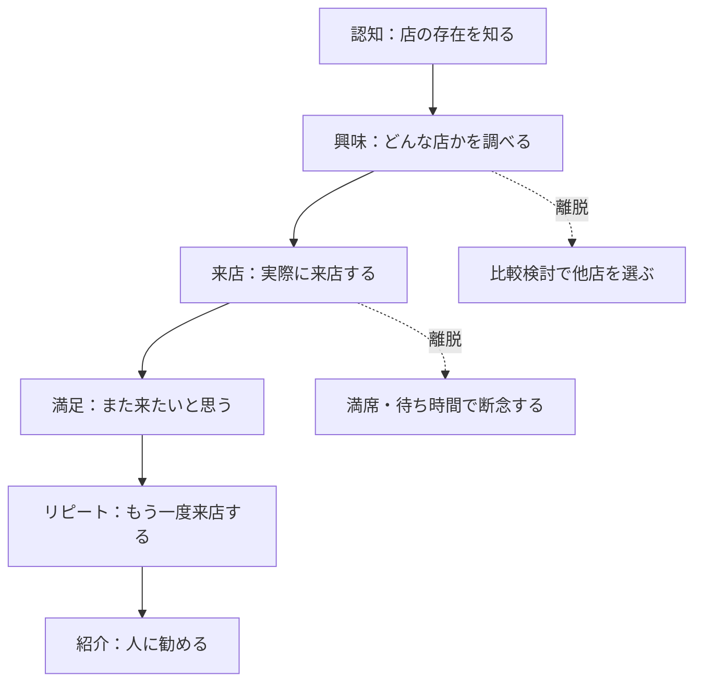

# 第8章 集客とリピート

売上の分解式でいうと、集客は**客数**に効きます。ただし「集客」と一言でいうと、新規客を呼ぶのか、リピートを増やすのか、空いている時間帯を埋めるのかで打ち手は全く違います。**この章で扱うこと**は、集客を**ファネル（段階）**として捉え、段階ごとに測る指標と打ち手を整理することです。あわせて、商圏の見方、獲得コストの計算、リピートの設計、複数店舗や共用スペースを持つ場合の論点を扱います。

## 8.1 集客のファネル

客が来店するまでには段階があります。この段階構造を**ファネル**（funnel、漏斗）と呼びます。上から入った人が下へ行くほど絞られる形になるため、この名前が付いています。



この図は、来店が「認知から紹介までの6段階」で進むことを示しています。点線は、途中で抜ける経路です。**どの段階で抜けているかによって、打つべき手が変わります。**

| 段階 | 主な指標 | 計測方法の例 | 落ちているときの打ち手 |
| --- | --- | --- | --- |
| 認知 | 商圏内の認知率、地図検索の表示回数 | アンケート、地図検索の管理画面 | MEO、SNS、看板、チラシ |
| 興味 | プロフィール閲覧、メニュー閲覧 | 地図検索の管理画面、自店サイトの解析 | 写真、メニュー訴求、口コミ |
| 来店 | 来店数、予約数 | POS、予約台帳 | 立地、営業時間、価格、導線 |
| 満足 | 満足度、提供時間、クレーム数 | アンケート、POSの時刻記録 | 料理、接客、待ち時間 |
| リピート | 再訪率、来店頻度 | POSの会員紐づけ、予約台帳 | 会員施策、限定メニュー、接点 |
| 紹介 | 紹介数、口コミ投稿数 | 予約時の「紹介」聴取、口コミの新着数 | 体験設計、特典 |

### 段階ごとの歩留まりを計算する

ファネルは、図で終わらせず**数値で測ります**。次の数値は**説明用の仮置き**です。

| 段階 | 人数（仮置き） | 前段階からの歩留まり |
| --- | --- | --- |
| 認知 | 10,000人 | — |
| 興味 | 1,500人 | 15.0%（1,500 ÷ 10,000） |
| 来店 | 300人 | 20.0%（300 ÷ 1,500） |
| リピート | 90人 | 30.0%（90 ÷ 300） |

```
認知から来店までの通し歩留まり = 15.0% × 20.0% = 3.0%
```

通しで 3.0%（300 ÷ 10,000）です。この形で測ると、**改善の効き方が段階の掛け算で決まる**ことが分かります。興味から来店の歩留まりを 20.0% から 25.0% に上げると、来店数は 1,500 × 0.25 = 375人へ増えます（+75人）。同じ「5ポイント改善」でも、分母の大きい上流で改善するほど人数は大きく動きます。

ただし、上流の改善は**費用がかさみやすい**という性質があります。認知を広げる施策は母数が大きく、届いた人全員に費用がかかります。一方、リピートの改善は相手が既存客に限られるため、費用は小さく済むことが多いです。**最初に確認すべきは「どの段階が弱いか」であり、その次に「その段階を動かす費用はいくらか」**です。認知が足りない店にリピート施策を打っても無駄ですし、リピートが弱い店に広告を増やしても、獲得した客がすぐ離れます。

## 8.2 商圏の考え方

飲食店は**商圏**（しょうけん、客が来る地理的な範囲）を持ちます。商圏は業態で変わります。

| 業態の例 | 主な商圏 | 来店動機 |
| --- | --- | --- |
| カフェ、ランチ | 徒歩5〜10分、近隣の勤務者・住民 | 日常の利便性 |
| 居酒屋、ディナー | 駅周辺、車10分程度 | 非日常、会食 |
| 専門店、人気店 | 市外・県外も | 目的来店、話題性 |

商圏の内側に**どれだけの人がいるか**（人口）、**どれだけ競合がいるか**（店舗数）で、成立するかどうかが大きく変わります。同じメニューでも、商圏内の人口と競合数が違えば、必要客数に届かないことがあります。

### 商圏から必要シェアを逆算する

「商圏に人が足りるか」は、次の順で計算できます。数値は**説明用の仮置き**です。

```
必要月間客数 = 目標月商 ÷ 客単価
商圏の延べ外食回数 = 商圏人口 × 1人あたりの月間外食回数
必要なシェア = 必要月間客数 ÷ 商圏の延べ外食回数
```

- 目標月商 3,000,000円、客単価 1,500円 → 必要月間客数 = 3,000,000 ÷ 1,500 = **2,000人**
- 商圏人口 20,000人、1人あたり月4回外食 → 延べ外食回数 = 20,000 × 4 = **80,000人回**
- 必要なシェア = 2,000 ÷ 80,000 = **2.5%**

この 2.5% が現実的かどうかを、商圏内の競合店数と比較して判断します。商圏に同業態が10店あれば、単純に割れば10%（1店あたり）が上限の目安になります。2.5% は10店平分の4分の1ですから、成立の可能性はある、と読めます。逆に必要なシェアが20%を超えるなら、その商圏では人口が足りない可能性を疑います。

> **注意**: 商圏分析のツールやデータは多数市販されていますが、本資料では特定のサービスの数値を扱いません。商圏内人口は国勢調査などの公的統計で確認できます（→ [第2章](02-shueki-kouzou-genka.md) 2.8 の統計の扱いを参照）。

## 8.3 新規客の獲得

| 手段 | 内容 | 長所 | 短所 |
| --- | --- | --- | --- |
| MEO（地図検索対策） | Google マップ等での表示を最適化する | 無料で始められる。来店意図の高い客に届く | 効果測定が難しい |
| SNS | 写真・動画での発信 | 拡散性がある。世界観を伝えられる | 継続コストが高い。売上に直結しにくい |
| 口コミサイト | レビュー、ランキング | 信頼性が高い | 評価が下がると回復が難しい |
| チラシ・ポスティング | 商圏への配布 | 商圏を絞れる | 反応率が低い |
| 紹介・常連の口コミ | 既存客からの紹介 | 獲得コストが低い。定着しやすい | 規模が限られる |
| デリバリー | 外部プラットフォーム | 席を使わず売上を増やせる | 手数料が高い。店内品質と分離が必要 |

**獲得コスト（1人を呼ぶのにいくらかかったか）を必ず計算します。**

```
新規客獲得コスト = 集客費用 ÷ 新規客数
```

数値は**説明用の仮置き**です。月の集客費用がチラシ 30,000円 + SNS広告 20,000円 = 50,000円、新規客数が40人なら、獲得コストは 50,000 ÷ 40 = **1,250円/人**です。

この値と比較するのが、その客がもたらす粗利です。客単価2,500円、原価率35%なら1回あたりの粗利は 2,500 × (1 − 0.35) = 1,625円。年4回・2年継続と仮定すると、粗利の合計は 1,625 × 8回 = **13,000円**です。

```
LTV（粗利ベース） = 1回あたり粗利 × 年間来店回数 × 継続年数
LTV ÷ 獲得コスト = 13,000 ÷ 1,250 = 10.4倍
```

LTV（顧客生涯価値、第3章 3.5）は売上ベースで語られることもありますが、**獲得コストと比べるときは粗利ベースにそろえます**。売上ベースの LTV（2,500 × 8回 = 20,000円）で比べると、実際には払えない金額を回収できるように見えてしまうためです。

獲得コストが LTV を超えたら、その集客は赤字です。広告を打つ前に、この2つの数字を比べる習慣が必要です。

## 8.4 リピートの設計

リピートは、来店頻度と継続期間で決まります。

```
リピート売上 = 既存客数 × 来店頻度 × 客単価
```

数値は**説明用の仮置き**です。既存客 300人が月2回来店し、客単価が2,500円なら、リピート売上は 300 × 2 × 2,500 = **1,500,000円/月**です。ここで来店頻度が月1.8回に落ちると 300 × 1.8 × 2,500 = 1,350,000円となり、**月15万円（10%）**が消えます。

この計算が示すのは、**頻度の小さな低下が大きな売上減になる**ということです。客数が減っていなくても、足が遠のくだけで売上は落ちます。したがって、リピートは「客数」ではなく「頻度」で見る必要があります。

リピートを増やす打ち手は、大きく3つです。

1. **来店のきっかけを増やす**（季節メニュー、限定品、イベント）
2. **来店の頻度を上げる**（会員特典、スタンプ、サブスク、近隣向けの時間帯割引）
3. **離脱を防ぐ**（予約リマインド、クレーム対応、接客の質）

**会員制度は万能ではありません。** 会員カードを作っても、使われなければ意味がありません。会員数を KPI にすると「作っただけ」の状態を見逃します。見るべきは**会員の来店頻度**と**会員売上比率**（売上に占める会員の売上の割合）です。

また、リピート率の定義は店によって揺れます。第3章 3.5 で扱ったように、「再来店した人の割合」なのか「今月の客のうち前月も来た人の割合」なのかで値が変わります。**定義を文書に固定してから比較してください。**

## 8.5 時間帯の平準化

稼働率（第3章 3.3）を上げる打ち手として、時間帯の平準化があります。

| 時間帯 | 課題 | 打ち手 |
| --- | --- | --- |
| 平日昼 | 会社員のランチ需要。回転勝負 | 提供速度、セットメニュー |
| 平日夜 | 客数が落ちる | 少人数向けメニュー、テイクアウト |
| 週末 | 混雑と待ち | 予約、整理券 |
| アイドルタイム | 席が空く | カフェ利用、打ち合わせ利用、サブスク |

**アイドルタイム**とは、客数が落ちて席が空く時間帯のことです。アイドルタイムは、**席という在庫が既にあるのに使われていない**状態です。ここを埋める施策は、新規客を獲得するよりコストが低いことが多いです。

ただし、埋める施策が採算に合うかは計算が必要です。数値は**説明用の仮置き**です。

- 追加客 12人/日、追加の客単価 1,200円 → 追加売上 = 12 × 1,200 = **14,400円/日**
- 限界利益率 65%（第4章 4.2）→ 追加限界利益 = 14,400 × 0.65 = **9,360円/日**
- 追加の人件費 3時間 × 1,300円 = **3,900円/日**
- 差引 = 9,360 − 3,900 = **5,460円/日**、月25営業日なら **136,500円/月**

**判断に使うのは売上ではなく限界利益**です。アイドルタイムの追加客は、家賃という固定費をすでに回収済みの状態で乗ってくるため、限界利益がそのまま利益に近づきます（第4章 4.2）。逆に、追加人件費が限界利益を上回るなら、その施策は売上を増やしても利益を減らします。

平準化を考える前に、**その時間帯が本当に空いているか**を確認してください。「なんとなく暇」ではなく、時間帯別の客数と稼働率を1〜2週間記録すると、埋めるべき時間帯が特定できます（→ [第10章](10-kpi-to-keiei-handan.md) 10.8）。

## 8.6 デジタル接点の現実的な使い方

| 接点 | 向いている用途 | 注意点 |
| --- | --- | --- |
| 地図検索の店舗情報 | 営業時間、メニュー、写真の最新化 | 情報が古いと来店機会を失う。更新の運用を決める |
| SNS（写真・動画） | 商品の魅力、世界観 | 投稿の継続が前提。売上への寄与を測りにくい |
| 予約システム | 予約受付、リマインド | 電話と二重管理にならないようにする |
| モバイルオーダー | 注文の効率化、待ち時間削減 | 高齢客・常連客の使いやすさを確認する |
| デリバリー | 席を使わない売上 | 手数料率と店内オペレーションへの影響を計算する |

**ツールを入れること自体は集客ではありません。** どのファネルの段階に効くのかを説明できないツールは導入しない、という基準を持ちます。

導入するなら、**効いたかを測れる形**にします。予約経路を聞く、会計時に「どこで知ったか」を1問だけ聞く、といった手作業でも構いません。測れない状態で3か月使うと、続けるかやめるかの判断ができなくなります。

## 8.7 口コミと評判の管理

口コミは、ファネルの「興味」から「来店」への歩留まりに効きます。管理の基本は3つです。

| 対象 | やること | 理由 |
| --- | --- | --- |
| 高評価 | 返信する。使われた場面を具体的に書く | 読んでいるのは見込み客。返信も情報になる |
| 低評価 | 事実を確認し、返信する。反論から入らない | 反論は読者に「改善しない店」と映る |
| 投稿の依頼 | 報酬や条件を付けて依頼する場合は表示規制に注意する | 依頼と分からない表示は、不当表示として問題になり得る |

**投稿を依頼して報酬を払う場合の表示ルールは、本資料では一次資料を確認できていません（未取得）。** 具体的な要件は、消費者庁の公表資料と [第5章](05-kyoka-to-hourei.md) を確認してください。

評価点そのものを目標にすると、指標が歪みます。「星4.5以上」を目標にすると、低い評価を書かれそうな客を避ける、といった動きが出ます。見るべきは**評価点の推移**と**低評価の内容の傾向**です。同じ指摘が繰り返されるなら、それは運用の問題です。

## 8.8 複数店舗・共用スペースを持つ場合

1つの運営主体が複数店舗を持つ場合や、複数の店舗が1つの共用スペースを共有する場合は、単独店と集客の考え方が変わります。

| 特徴 | 論点 | 確認すること |
| --- | --- | --- |
| 店舗が隣接・近接する | 片方の集客がもう片方に波及する。逆に、片方が混むともう片方の客が入れない | 相互送客を狙うのか、独立採算にするのか |
| 共用スペースがある | 「複数から選べる」ことが訴求になる。1店舗ではできない集客メッセージになる | 共用スペースの利用条件、会計の扱い |
| 席数が少ない店舗 | 満席になりやすく、離脱（機会損失）が出やすい | 予約・待ちの設計、席の回転 |
| 同じ商圏で並ぶ | 同じ需要を奪い合う**共食い**が起きる | メニュー・時間帯・価格帯で補完関係を作れているか |

**共食い**（カニバリゼーション）とは、同一の運営主体の複数店舗が同じ客層・同じ時間帯の需要を奪い合い、全体の客数が増えないことをいいます。判断は**店舗別ではなく全体の合計で**行います。

数値は**説明用の仮置き**です。一方の店舗の月商が 3,000,000円から 3,300,000円に増え、同じ月に別の店舗が 3,000,000円から 2,700,000円に減った場合、合計は 6,000,000円 → 6,000,000円で**変わっていません**。増えた分は、もう一方から客を移しただけです。この状態が続くと、減った側の店舗は固定費がそのままで売上だけが減るため、全体の利益は悪化します。

共用スペースを持つ場合は、次の3点を先に決めておきます。

1. **共用スペースの帰属**：どの店舗の売上として計上するか、または共用として別計上するか
2. **会計の扱い**：1つの会計でまとめるか、店舗ごとに分けるか。分ける場合、客が複数店舗を使うと会計が煩雑になる
3. **提供条件**：共用スペースで飲食できるかどうかは、営業許可の範囲や消防の収容人員の考え方に関わります（→ [第5章](05-kyoka-to-hourei.md) 5.3、5.6）

複数店舗の集客は、**店舗別の指標と全体の指標を両方持つ**ことが前提になります（→ [第10章](10-kpi-to-keiei-handan.md) 10.9）。

## 8.9 よくある誤解

| 誤解 | 実際 |
| --- | --- |
| 広告を増やせば客が増える | ファネルのどこが詰まっているかによります。リピートが弱い店は広告費が無駄になります |
| SNSのフォロワー数が集客力 | フォロワーと来店は別です。来店数・予約数で確認します |
| 会員を増やせばリピートする | 会員数ではなく、来店頻度と会員売上比率を見ます |
| 商圏が広いほど良い | 商圏が広いと来店頻度は下がります。日常利用は近隣、非日常は遠方と分けて考えます |
| デリバリーは売上が増える | 手数料と店内オペレーションへの影響を引いて判断します |
| 口コミの評価点を上げれば売れる | 評価点より、低評価の内容の傾向と推移を見ます。評価点を目標にすると指標が歪みます |
| アイドルタイムは埋めれば必ず得 | 追加人件費が追加限界利益を上回れば、売上が増えても利益は減ります |
| 複数店舗は数を増やすほど強い | 同じ商圏で共食いすると、合計の売上も利益も増えません |

## 8.10 この章の要点

- 集客は**ファネルの段階**に分けて捉えます。段階ごとに歩留まりを計算し、弱い段階を特定してから打ち手を決めます。
- 獲得コストは必ず計算し、**粗利ベースの LTV** と比べます。売上ベースの LTV で比べると判断を誤ります。
- リピートは客数ではなく**来店頻度**で管理します。頻度の小さな低下が大きな売上減になります。
- アイドルタイムを埋める施策は、売上ではなく**限界利益**で採算を判断します。
- 複数店舗・共用スペースを持つ場合は、**店舗別と全体の指標を両方**持ちます。合計で見ないと共食いを見逃します。

## 8.11 自店で確認すること

- [ ] ファネルの各段階を、自店では何の数字で測るかを決めている
- [ ] 直近3か月の「新規客数」と「集客費用」を把握している
- [ ] 新規客獲得コストを計算し、粗利ベースの LTV と比較したことがある
- [ ] リピート率の定義（分母・期間）を文書に固定している
- [ ] 時間帯別の客数と稼働率を、直近1〜2週間分は記録している
- [ ] アイドルタイム施策の採算を、限界利益と追加人件費で計算したことがある
- [ ] 会計時に「どこで知ったか」を1問だけ聞くなど、集客の効果を測る仕組みがある
- [ ] 複数店舗・共用スペースがある場合、全体の合計売上と利益を月次で確認している

## 8.12 演習

### 問1 ファネルの歩留まり

認知10,000人、興味1,500人、来店300人、リピート90人という記録があります。次の4つを計算してください。

1. 認知→興味、興味→来店、来店→リピートの各歩留まり
2. 認知から来店までの通し歩留まり
3. 興味→来店の歩留まりを 20.0% から 25.0% に上げた場合の来店数
4. 来店300人を変えずに、来店→リピートを 30.0% から 40.0% に上げた場合のリピート人数

**解答**

1. 認知→興味 = 1,500 ÷ 10,000 = **15.0%**。興味→来店 = 300 ÷ 1,500 = **20.0%**。来店→リピート = 90 ÷ 300 = **30.0%**。
2. 15.0% × 20.0% = **3.0%**（検算: 300 ÷ 10,000 = 3.0%）。
3. 1,500 × 0.25 = **375人**（+75人）。分母の大きい上流の改善は、人数の増加が大きくなります。
4. 300 × 0.40 = **120人**（+30人）。分母が小さいため、伸びる人数は限られます。ただし既存客への施策は費用が小さく済むことが多いため、費用あたりの効果は別に比較します。

### 問2 獲得コストと回収

月の集客費用が 80,000円、新規客数が 50人です。客単価 2,800円、原価率 35%、年5回来店・2年継続と仮定します。

1. 新規客獲得コスト
2. 1回あたりの粗利と、粗利ベースの LTV
3. 獲得コストを回収するのに必要な来店回数

**解答**

1. 80,000 ÷ 50 = **1,600円/人**。
2. 1回あたり粗利 = 2,800 × (1 − 0.35) = 2,800 × 0.65 = **1,820円**。LTV = 1,820 × 5回 × 2年 = **18,200円**。
3. 1,600 ÷ 1,820 = 0.879回。1回目の来店で回収できます（**1回**）。LTV ÷ 獲得コスト = 18,200 ÷ 1,600 = 11.4倍です。

（小数第2位を四捨五入して表示しています。）

### 問3 アイドルタイム施策の採算

15時〜17時の追加客が1日10人見込めます。追加の客単価は1,000円、限界利益率は60%、この施策のための追加人件費は2.5時間 × 1,200円 = 3,000円/日です。月24営業日で判断してください。

**解答**

- 追加売上 = 10 × 1,000 = 10,000円/日
- 追加限界利益 = 10,000 × 0.60 = 6,000円/日
- 差引 = 6,000 − 3,000 = **3,000円/日**
- 月換算 = 3,000 × 24 = **72,000円/月**

差引がプラスなので、実施する判断になります。ただし追加客数が5人/日まで落ちると、追加限界利益は 5,000 × 0.60 = 3,000円となり、人件費と同額で**利益ゼロ**です。損益が分かれる客数を先に計算しておくと、やめる判断ができます。

## 出典と確度

- 本章のファネル、商圏、獲得コスト、LTV の考え方は、マーケティングの標準的な枠組みにもとづく**一般知識（未検証）**です。
- 商圏人口の具体的な数値、MEO や SNS の効果測定値、デリバリー手数料率は本章では扱っていません。**裏付けが取れていない数値を提示しない**方針によります。
- 本章の数値例（10,000人、1,250円、1,500,000円、14,400円など）は、いずれも**説明用の仮置き**です。実在の店舗の実績ではありません。
- 口コミ投稿の依頼に関する表示ルールは、**一次資料を確認できていません（未取得）**。消費者庁の公表資料を確認してください。

---

前後の章: [第7章 人と労務](07-hito-to-roudou.md) ／ [第9章 仕入れ・在庫・食品ロス・メニュー設計](09-shiire-zaiko-loss.md)
