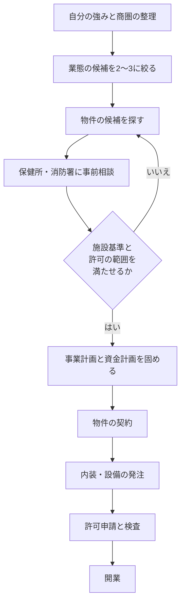
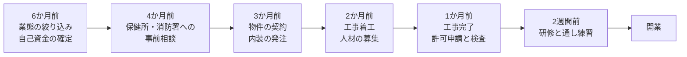

# 第9章 開業の準備

## 9.1 この章で扱うこと

開業は「店を作る」作業ではなく、**事業として成り立つかを、資金と時間の制約のなかで確かめる**作業です。この章では、事業計画の立て方、必要資金の見積もり、資金調達、物件選び、業態の選定、開業6か月前からのスケジュール、開業前に済ませる届出を扱います。数字は、あとから検算できる形で書きます。

## 9.2 学習目標

- 事業計画を「誰に・何を・いくらで・どのくらい」の4つの問いに分解し、それぞれを数値で書くことができる。
- 総所要資金を**初期投資・運転資金・予備費**に分けて見積もり、計算過程を他人に説明できる。
- 自己資金・公的融資・補助金の違いを整理し、借入額の上限を返済余力から判断できる。
- 物件の候補を、面積・設備・賃貸条件・法規の4つの観点で比較できる。
- 開業6か月前からのスケジュールを作り、遅れが資金に与える影響を説明できる。

## 9.3 開業準備の全体像

開業準備で決めることは、次の3つに集約されます。どれか1つが決まらないと、残りも決まりません。

| 決めること | 中身 | 決まらないと起きること |
| --- | --- | --- |
| 業態 | 誰に、何を、いくらで、どの提供形態で出すか | 必要な設備と許可が決まらない |
| 物件 | どこで、どの広さで、いくらの賃料で営業するか | 初期投資と固定費が決まらない |
| 資金 | いくら用意し、どこから調達するか | 物件の契約も発注もできない |

この3つに加えて、**4つ目の作業**があります。法規の確認です。業態と物件が決まった時点で、保健所・消防署・税務署への確認が必要になります（→ [第10章](10-kyoka-hourei.md)）。確認の結果、業態か物件のどちらかを変えることになる場合があります。**確認を最後に回すと、業態と物件を決め直すことになります。**



図の説明: 業態と物件は、法規の確認より先に「候補」として決まります。確認の結果によって候補に戻る余地を残しておくのが要点です。契約と発注は、確認が済んだ後に行います。

**順序を逆にすると費用が増えます。** 内装を作った後に施設基準を満たしていないと分かれば、追加工事になります。契約後に許可が下りないと分かれば、解除の交渉が必要になります。

## 9.4 事業計画の立て方

### 4つの問いに分解する

事業計画は、立派な書類を作ることではありません。次の4つの問いに、数字で答えられる状態を作ることです。

| 問い | 決めること | 数字にすると | 決めないと起きること |
| --- | --- | --- | --- |
| 誰に | 客層、来店の動機、商圏 | 想定客数、来店頻度 | メニューも価格も決まらない |
| 何を | 提供する商品、業態 | メニュー数、提供時間、オペレーション | 厨房機器と人員が決まらない |
| いくらで | 価格、客単価 | 客単価、原価率、粗利額 | 損益分岐点が出せない |
| どのくらい | 売上規模、期間 | 日商、月商、年商、営業日数 | 資金計画が作れない |

「誰に」が曖昧なまま「何を」を決めると、メニューが増えます。メニューが増えると仕入れ品目と仕込み工数が増え、人件費とロスが増えます。**4つの問いは、この順に決めます。**

### 売上計画は「席 × 時間 × 単価」から作る

飲食店の売上には上限があります。席数と営業時間という物理的な制約があるためです。売上計画は、上限から逆算して作ります。

```
1日の売上 = 席数 × 回転率 × 客単価
月の売上 = 1日の売上 × 営業日数
年間売上 = 月の売上 × 12か月
```

**回転率**（かいてんりつ）とは、1つの席が1日に何回使われたかを表す数です。20席の店で1日に30人が来店すれば、回転率は1.5です。客単価は1人の客が支払う平均金額です。

**計算例（説明用の仮置き）**: 20席、昼3時間、夜4.5時間、月25日営業の店を考えます。

| 時間帯 | 席数 | 回転率 | 客数/日 | 客単価 | 売上/日 |
| --- | --- | --- | --- | --- | --- |
| 昼 | 20 | 1.5 | 30人 | 900円 | 27,000円 |
| 夜 | 20 | 1.2 | 24人 | 3,500円 | 84,000円 |
| 合計 | — | — | 54人 | 平均2,055円 | 111,000円 |

```
日商 = 27,000円 + 84,000円 = 111,000円
月商 = 111,000円 × 25日 = 2,775,000円
年商 = 2,775,000円 × 12か月 = 33,300,000円
```

**この計算の意味**は、売上の上限が席数と時間で決まるという点です。「頑張れば売上が倍になる」のではなく、**席を増やすか、回転を上げるか、単価を上げるか、営業時間を延ばすか**のどれかをしなければ、売上は増えません。

客単価の平均は、単純平均ではなく**加重平均**で出します。

```
加重平均客単価 = 総売上 ÷ 総客数
              = 111,000円 ÷ 54人
              = 2,055.5... → 2,056円
```

### 上限を先に出す

計画を作るときは、希望の売上から逆算するのではなく、**上限を先に出す**順序にします。

```
理論上の最大客数 = 席数 × 回転率の上限 × 営業時間 ÷ 滞在時間
```

**計算例（説明用の仮置き）**: 20席、滞在時間60分、昼3時間の営業で、待ち時間と片付けを考えずに計算すると、1席あたり最大3回転、客数は最大60人です。実際には待ち・片付け・調理の詰まりがあるため、**上限の7割程度**で計画を置きます。

```
60人 × 0.70 = 42人/日（昼の実効上限）
```

計画値30人は、この実効上限の71%です。**上限に対して余裕がある計画かどうか**を、この形で確認します。上限の9割で計画を立てると、わずかな遅れで売上が届かなくなります。

### 事業計画に書く項目

| 項目 | 書く内容 | 注意点 |
| --- | --- | --- |
| コンセプト | 誰に、何を、どの場面で提供するか | 形容詞ではなく客層と利用場面で書く |
| メニュー構成 | 品数、価格帯、看板商品 | 品数はオペレーション能力で上限が決まる |
| 売上計画 | 席数・回転率・客単価・営業日から積む | 上限に対する余裕を書く |
| 費用計画 | 原価率、人件費率、固定費 | 第3章・第4章・第5章の考え方を使う |
| 損益計画 | 損益分岐点と目標利益（→ [第6章](06-soneki-bunkiten.md)） | 損益分岐点を1行で示す |
| 資金計画 | 総所要資金、調達、返済、運転資金 | 本章の9.5・9.6 |
| スケジュール | 6か月前からの逆算 | 本章の9.9 |
| リスク | 外れたときの対応 | 「客数が2割少ない場合」を必ず置く |

事業計画は、金融機関に出すためだけの書類ではありません。**自分が判断に迷ったときに戻る場所**です。「この改装は計画に入っていたか」「この人は計画の人員か」を判断する基準になります。

## 9.5 必要資金の見積もり

### 総所要資金の式

開業に必要な資金は、初期投資だけではありません。開業してから売上が安定するまでの支払いに充てる資金が別に要ります。

```
総所要資金 = 初期投資 + 運転資金 + 予備費
```

| 区分 | 中身 | 性格 |
| --- | --- | --- |
| 初期投資 | 内装、厨房機器、什器、保証金、開店準備 | 開業前に出ていく一括の支出 |
| 運転資金 | 入金の遅れ、開業初期の赤字、支払サイトのずれ | 事業を回すために手元に置く資金 |
| 予備費 | 追加工事、想定外の支出 | 見積もりの誤差を吸収する資金 |

**初期投資だけを集めて開業すると、開業後に資金が尽きます。** 開業月は売上が立ち上がらず、カード決済の入金は翌月です。この時期に支払いが重なるため、初期投資とは別に資金が必要になります。

### 初期投資の内訳

**ケースの設計値**: 連続ケース「食堂つきかげ」の初期投資は1,500万円です（[OUTLINE.md](../OUTLINE.md) の3章）。

| 項目 | 金額 | 内容 | 回収の考え方 |
| --- | --- | --- | --- |
| 内装工事 | 6,000,000円 | 客席、厨房の区画、給排水、電気、塗装 | 減価償却の対象。退去時の原状回復義務あり |
| 厨房機器 | 4,000,000円 | 冷蔵庫、冷凍庫、レンジ、フライヤー、製氷機、洗浄機 | 減価償却の対象。故障時の損失も見る |
| 什器・備品 | 1,000,000円 | テーブル、椅子、食器、カトラリー、POS | 減価償却の対象。消耗で入れ替えが要る |
| 保証金 | 3,000,000円 | 賃貸借契約の保証金（設計上は家賃6か月分） | 償却しない。退去時に返還される（全額とは限らない） |
| その他 | 1,000,000円 | 登記、許認可、宣伝、開店準備、各種手数料 | 開業費として費用に計上する |
| **合計** | **15,000,000円** | — | — |

**この表は設計値です。** 実在の店舗の実績ではありません。

**保証金3,000,000円は、家賃6か月分とされています。** 単純に6で割ると月額500,000円になりますが、30㎡程度の地方都市の店舗としては高めの水準です。実際の契約では、保証金・礼金・前家賃・更新料の内訳を分けて確認します。**本書では、契約時に必要な一時金の合計として扱います。**

**見積もりで落ちやすい項目**を、次に整理します。

| 落としやすい項目 | 内容 | 規模の目安 |
| --- | --- | --- |
| 追加工事 | 図面と現況の差、設備の位置変更 | 内装費の1〜2割（一般知識・未検証） |
| 原状回復の準備 | 退去時に戻す費用。契約時に範囲を確認する | 契約条件による |
| 開業前の人件費 | 採用・研修・試作の期間の人件費 | 1〜2か月分 |
| 開業前の家賃 | 契約から開業までの賃料（フリーレントの有無を確認） | 契約条件による |
| 広告・販促 | 開店告知、看板、印刷物、web サイト | 数十万円規模（一般知識・未検証） |
| 許認可・登記 | 申請手数料、登録免許税、専門家報酬 | 数十万円規模（一般知識・未検証） |
| 予備の食器・消耗品 | 割れ、紛失、仕込み用の容器 | 什器費の1割程度 |
| 開業後の仕入れ初回分 | 営業初日の食材は開業前に買う | 数日〜1週間分 |

「内装費の1〜2割」「数十万円規模」といった目安は、**一般知識（未検証）**です。自店の見積もりでは、業者から取った見積書の項目を1つずつ確認し、**予備費を別枠で確保**します。

### 運転資金の見積もり

運転資金は、次の3つの合計で見積もります。

```
必要運転資金 = 開業初期の現金不足 + 入金の遅れ + 予備の固定費
```

1つ目の**開業初期の現金不足**は、開業後数か月の収支がマイナスになる分です。2つ目の**入金の遅れ**は、カード決済やQR決済の入金が翌月以降になる分です。3つ目の**予備の固定費**は、売上が計画を下回ったときに固定費を払うための資金です。

**計算例（ケースの設計値）**: 食堂つきかげの数字で計算します。固定費のうち人件費以外（家賃・共益費・水道光熱費・リース・システム等）は月720,000円、減価償却費は年1,500,000円（月125,000円）、決済手数料・容器等は売上の2%と仮置きします。

| 月 | 売上 | 材料費 | 人件費 | 決済手数料等（2%） | 固定費 | 減価償却 | 営業利益 |
| --- | --- | --- | --- | --- | --- | --- | --- |
| 4月 | 1,800,000円 | 576,000円 | 684,000円 | 36,000円 | 720,000円 | 125,000円 | −341,000円 |
| 5月 | 2,200,000円 | 682,000円 | 726,000円 | 44,000円 | 720,000円 | 125,000円 | −97,000円 |
| 6月 | 2,400,000円 | 744,000円 | 768,000円 | 48,000円 | 720,000円 | 125,000円 | −5,000円 |

```
3か月の営業利益の累計 = −341,000円 − 97,000円 − 5,000円 = −443,000円
```

**ここで止めると、運転資金を443,000円と見積もってしまいます。** 正しくは、減価償却費は現金の支出ではないため、現金ベースでは足し戻します。

```
3か月の現金収支 = −443,000円 +（125,000円 × 3か月）
              = −443,000円 + 375,000円
              = −68,000円
```

損益ベースでは44万円の赤字ですが、現金ベースでは約7万円の不足です。**損益と現金は別物**という点は、[第7章](07-cashflow.md) で扱います。

ただし、これに入金の遅れが加わります。売上の60%がカード決済で入金が翌月末だと、開業月とその翌月は入金が届かないまま支払いが先行します。[第7章](07-cashflow.md) 7.11 の資金繰り表では、**累計が最もマイナスになるのは5月の−826,000円**です。この額は、上の「開業初期の現金不足」と「入金の遅れ」を合わせたものになります。

```
必要運転資金 = 826,000円（開業初期の現金不足と入金の遅れの合計）
            + 1,080,000円（固定費の1.5か月分の予備）
            = 1,906,000円 → 約2,000,000円（端数を含めて切り上げ）
```

```
総所要資金 = 15,000,000円 + 2,000,000円 = 17,000,000円
```

**この計算の要点**は、運転資金が「赤字の額」ではなく「**入金と支払いの時間差**」から出てくるという点です。黒字の計画でも、入金が遅れれば資金は足りなくなります。予備費の「固定費1〜2か月分」という水準は実務でよく言われる値で、**一次資料で確認していません**（**一般知識・未検証**）。自店の支払サイトと入金サイトの差から計算してください。

| 要素 | 何を見るか | 確認する資料 |
| --- | --- | --- |
| 開業初期の現金不足 | 月次の収支がマイナスになる月 | 月次の損益計画 |
| 入金の遅れ | カード・QR決済の比率と入金日 | 決済会社の契約条件 |
| 支払サイト | 仕入れ先への支払日 | 仕入れ先との契約 |
| 固定費の予備 | 売上が計画を下回ったときの余裕 | 固定費の一覧 |

## 9.6 資金調達の選択肢

> **本章の限界**: この節に書く制度の内容（融資条件、利率、補助金の対象と金額、申請時期）は、**一次資料を確認していません。** すべて**一般知識（未検証）**として扱い、金額や条件は書きません。実際の条件は、各機関の窓口と最新の公募要領で確認してください。

### 調達手段の比較

| 手段 | 性格 | 利点 | 注意点 | 確認先 |
| --- | --- | --- | --- | --- |
| 自己資金 | 返済不要 | 返済義務がない。審査で有利になる | 生活防衛資金を削ると事業と生活が同時に危うくなる | 自分 |
| 公的融資 | 返済義務あり | 民間より長期・低利の傾向（一般知識・未検証） | 審査に事業計画が要る。使途の制限がある | 日本政策金融公庫などの窓口 |
| 民間融資 | 返済義務あり | 迅速。金額の柔軟性 | 期間が短く金利が高い傾向（一般知識・未検証） | 銀行・信用金庫 |
| 補助金 | 返済不要 | 返済義務がない | 採択されないことがある。**後払いが一般的**（一般知識・未検証） | 自治体・公募要領 |
| リース | 月額の固定費 | 初期の現金支出を抑えられる | 中途解約が難しい。総額は購入より高くなる | リース会社 |
| 親族・知人からの借入 | 返済義務あり | 柔軟 | 条件を書面にしないと後で争いになる | 当事者 |

**補助金の「後払い」**は、資金計画で最も誤解される点です。事業を実施し、支払いを済ませた後に申請して受け取る流れが一般的です。**入金を当てにして初期投資を組むと、支払いが先に来て資金が尽きます。** 補助金は「返ってくるかもしれない資金」として扱い、当てにしない計画を基本にします。

**融資と補助金は、審査・採択に時間がかかります。** 物件の契約日から逆算して、申請の時期を決めます。審査中に契約を迫られる場面があるため、**自己資金だけで契約できる範囲**を先に把握しておきます。

### 借入額の上限は返済余力から決める

借入額は「足りない額」ではなく「**返済できる額**」から決めます。

```
年間返済額 = 借入額 × 係数（返済方式と期間で決まる）
返済余力 = 年間営業キャッシュフロー − 年間返済額
```

**元利均等返済**（毎月の返済額が一定になる方式）の月額は、次の式で求めます。

```
毎月返済額 = 借入額 × 月利 ÷（1 −（1 + 月利）^（−返済回数））
月利 = 年利 ÷ 12
```

**計算例（ケースの設計値）**: 借入11,000,000円、年利2.0%、返済期間7年（84回）とします。年利2.0%は**説明用の仮置き**です。

```
月利 = 0.02 ÷ 12 = 0.0016666...
毎月返済額 = 11,000,000円 × 0.0016666... ÷（1 −（1.0016666...）^（−84））
           ≒ 140,442円
年間返済額 = 140,442円 × 12 = 1,685,304円 → 約1,685,000円
```

年間の利息合計は約797,000円です（元利均等・7年・全期間返済済みとした場合）。

ケースの年間営業キャッシュフローは、年間の営業利益928,000円に減価償却費1,500,000円を足した2,428,000円です（計算は9.11）。

```
返済余力 = 2,428,000円 − 1,685,000円 = 743,000円
```

**返済余力がプラスであること**が、借入の最低条件です。ここに余裕がない計画は、売上が少し下がっただけで返済が詰まります。

| 見方 | 計算 | 判断 |
| --- | --- | --- |
| 返済余力 | 営業キャッシュフロー − 年間返済額 | プラスであること。少なくとも設備更新の積立を残す |
| 自己資金比率 | 自己資金 ÷ 総所要資金 | 高いほど審査で有利（明確な基準は機関による） |
| 借入依存度 | 借入額 ÷ 総所要資金 | 高いほど返済の負担が重い |
| 返済期間と償却期間 | 返済期間 ≤ 設備の償却期間か | 返済が終わる前に設備が古くなると二重の負担になる |

**自己資金比率に「何%以上が望ましい」という一律の基準は、本書では示しません。** 金融機関ごとに見方が違い、一次資料で確認していないためです。**確認できるのは「返済余力がプラスか」**という点です。

ケースの設計値では、総所要資金17,000,000円に対して自己資金6,000,000円（35.3%）、借入11,000,000円（64.7%）となります。

**借りすぎのサイン**は、次の3つです。

1. 返済余力が、設備の更新積立を引くとマイナスになる
2. 計画の客数が、実効上限の8割を超えている
3. 運転資金を借入で埋めており、返済が始まる前に手元資金が減る

## 9.7 物件選びの観点

物件は、家賃の安さだけで選べません。**家賃が安くても、設備の追加工事で初期投資が増えれば、総額では高くつきます。**

| 観点 | 確認すること | 見落とすと起きること |
| --- | --- | --- |
| 面積と形状 | 客席に使える面積、厨房の面積、柱・段差・天井高 | 席数が計画より減る。動線が交差する |
| 給排水 | 排水口の位置、勾配、口径、グリストラップの有無 | 排水が滞留する。追加工事が高額になる |
| 電気容量 | 契約アンペア、単相／三相の別、幹線の太さ | 厨房機器を同時に使えない。増設工事が必要 |
| ガス | 都市ガスかプロパンか、口径、メーター位置 | 火力が足りない。プロパンはコストが変わる |
| 換気・ダクト | ダクトの経路、排気先、近隣への影響 | 油煙が客席に流れる。苦情が出る |
| 前面道路 | 道の広さ、視認性、歩行者と車の動線、駐車場 | 通りかかっても気づかれない |
| 客層 | 時間帯別の通行量、休日の人の流れ | 想定した客層が通らない |
| 競合 | 同業態の店、価格帯、営業時間 | 価格競争になる。客数が計画に届かない |
| 賃貸条件 | 保証金、礼金、前家賃、期間、更新料、原状回復、解除条件 | 退去時に想定外の費用が発生する |
| 法規 | 用途地域、消防の区分、許可の可否（→ [第10章](10-kyoka-hourei.md)） | 許可が下りない。営業できない |

**用語の説明**: **グリストラップ**は、排水に含まれる油脂を分離して下水へ流す装置です。詰まると排水の逆流と悪臭の原因になります。**単相／三相**は電源の種類で、三相は大きな動力機器に使われます。厨房機器の仕様によっては三相が必要になります。

### 居抜きとスケルトン

| 区分 | 内容 | 利点 | 注意点 |
| --- | --- | --- | --- |
| 居抜き | 前の店の内装・設備が残っている | 初期投資を抑えられる。工期が短い | 前の業態の許可と設備が自店に合うとは限らない。衛生状態の確認が要る |
| スケルトン | 内装が撤去され、躯体だけの状態 | 自由に設計できる | 初期投資が大きい。工期が長い |
| 造作譲渡 | 前の店から内装・設備を買い取る | 必要な設備だけを残せる | 資産の評価と故障履歴が分からない |

**居抜きで注意するのは、前の店の許可がそのまま使えるわけではないという点**です。営業許可は施設ごとに出るもので、経営主体が変われば申請し直します。設備の配置が施設基準を満たすかも、改めて確認します。

**厨房機器の年式と故障履歴**も確認します。居抜きの冷蔵庫が1年で壊れれば、初期投資を抑えた意味が失われます。

### 契約前に決めること

賃貸借契約には、次の条項を確認します。

| 条項 | 確認する内容 | なぜ重要か |
| --- | --- | --- |
| 使用目的 | 飲食店として使えると明記されているか | 用途が限定されていると、業態変更ができない |
| 許可が下りない場合 | 契約の解除と保証金の扱い | 確認の結果、出店できない場合がある |
| 原状回復の範囲 | スケルトンに戻すのか、造作は残せるのか | 退去費用が初期投資に匹敵することがある |
| 改装の制限 | 工事の可否、管理者の承認 | 工事の直前に止まることがある |
| 契約期間と更新 | 期間、更新料、更新の拒否事由 | 回収期間より短いと投資が回収できない |
| 競合の制限 | 同じ建物内の業態制限 | 同じ建物に同業態が入ると共食いする |

**投資回収期間が契約期間を超える計画は、危険です。** 回収の計算は9.11で扱います。契約期間が5年で、回収に6年かかる計画なら、更新できる前提を置くか、投資額を下げます。

## 9.8 業態の選び方

業態は「流行っているから」ではなく、**自分の強みと商圏の交点**で選びます。

| 判断材料 | 具体的に見ること | 数字にすると |
| --- | --- | --- |
| 自分の強み | 調理、接客、仕入れ、原価管理、情報発信のどれが得意か | 自分が毎日続けられる作業量 |
| 商圏 | 徒歩圏の人口、通行量、昼と夜の人の差 | 想定来店者数 |
| 価格帯 | 周辺の競合の客単価 | 客単価と原価率 |
| 提供形態 | 店内、持ち帰り、配達、屋外 | 必要な厨房と人員 |
| オペレーション負荷 | 品数、仕込みの手間、提供時間 | 必要な人数と人時売上 |
| 必要な許可 | 業態の組み合わせで増える許可（→ [第10章](10-kyoka-hourei.md)） | 初期投資と工期 |

**価格帯は、商圏の客層と原価率の両方から決まります。** 客単価900円で原価率30%なら粗利は630円です。客単価3,500円で原価率30%なら粗利は2,450円です。**同じ原価率でも、1人あたりの粗利額は4倍近く違います。** 席数と回転率が同じなら、高単価の業態のほうが売上は大きくなります。ただし高単価の業態は、客数が減り、提供に時間がかかり、必要な人員が増える傾向があります。

### 二毛作という選択

1つの店で昼と夜に違う業態を営む形を**二毛作**と呼びます。ケースの店は、昼が定食、夜が居酒屋の二毛作です。

| 観点 | 二毛作の利点 | 二毛作の難点 |
| --- | --- | --- |
| 家賃 | 1つの物件で2つの売上を取れる | 家賃負担は1つ分で済む |
| 人件費 | 昼と夜で人を分けられる | 通しで働く人が少ないと、切り替えの工数が増える |
| 仕入れ | 食材を共用できる | 共用できない食材はロスが増える |
| 設備 | 厨房を共用できる | 昼の片付けと夜の仕込みが重なる時間帯が問題になる |
| 許可 | 1つの営業許可の範囲で営業できることが多い | 提供形態を変えると追加の許可が要る |
| 認知 | 昼の客が夜に来る導線を作れる | 昼と夜で客層が違いすぎると、認知が分断される |

**二毛作で最も詰まるのは、昼の営業終了から夜の営業開始までの時間**です。片付け、仕込み、休憩、スタッフの入れ替えを、限られた時間で行います。この時間の設計を誤ると、夜の提供が遅れて回転が落ちます。

## 9.9 開業スケジュール

開業日から逆算して、6か月前からの予定を置きます。**業態と物件の決定が遅れると、以降がすべて遅れます。**

| 時期 | 主な作業 | 並行して進めること | 遅れると起きること |
| --- | --- | --- | --- |
| 6か月前 | 自分の強みと商圏の整理、業態の候補を2〜3に絞る、資金の自己資金額を確定 | 家族・関係者との合意 | 物件探しの条件が決まらない |
| 5か月前 | 物件の候補を探す、内見、賃貸条件の比較 | 金融機関への事前相談 | 良い物件を逃す。資金の見通しが立たない |
| 4か月前 | 保健所・消防署への事前相談（平面図と業態を持参）、事業計画の作成 | 融資の申込準備、補助金の公募要領の確認 | 施設基準を満たせず、物件を選び直す |
| 3か月前 | 物件の契約、内装業者・厨房機器業者の選定と発注 | 融資の申込、法人設立（法人の場合） | 工期が開業日に間に合わない |
| 2か月前 | 内装工事の着工、機器の搬入計画 | 人材の募集、求人票の作成 | 開業時に人が足りない |
| 1か月前 | 工事の完了、機器の設置と試運転、営業許可の申請と検査 | メニューの試作、価格の決定、衛生管理計画の作成（→ [第12章](12-eisei-haccp.md)） | 許可が下りず開業できない |
| 2週間前 | スタッフの研修、オペレーションの通し練習、仕入れ先の確定 | 開店告知、予約の受付開始 | 初日に提供が回らない |
| 1週間前 | 食材の初回仕入れ、レジ・決済の設定、現金の準備 | 衛生管理の記録様式の運用開始 | 初日につまずく |
| 開業 | 営業開始 | 初週の数字の記録と振り返り | 初期の異常に気づけない |



図の説明: 法規の事前相談（4か月前）が、契約（3か月前）より前に来ています。ここを逆にすると、契約後に施設基準を満たせないことが分かり、手戻りが大きくなります。

### 遅れが資金に与える影響

スケジュールの遅れは、時間の損失ではなく**現金の損失**です。

```
遅れのコスト = 遅れた月数 ×（家賃 + 人件費 + 返済額）− 遅れた月数の売上
```

**計算例（説明用の仮置き）**: 家賃500,000円、開業準備の人件費200,000円、返済額140,000円で、開業が1か月遅れたとします。

```
遅れのコスト = 1か月 ×（500,000円 + 200,000円 + 140,000円）
            = 840,000円（売上は0のまま、この支出だけが増える）
```

開業が1か月遅れると、84万円の現金が追加で出ていきます。**この分は運転資金の見積もりに入れておきます。** 遅れは「たぶん大丈夫」で済ませず、日付で管理します。

## 9.10 開業前に確認する届出・手続き

> **この節の限界**: 届出の名称・提出先・期限は、**一次資料を確認していません。** すべて**一般知識（未検証）**です。実際の手続きは、税務署・都道府県・市区町村・年金事務所・労働基準監督署の窓口で確認してください。**本資料は法的・税務的助言ではありません。**

| 手続き | 提出先 | 時期の目安 | 内容 |
| --- | --- | --- | --- |
| 個人事業の開業・廃業等届出書（開業届） | 税務署 | 事業開始から1か月以内（一般知識・未検証） | 事業の開始を届け出る |
| 青色申告承認申請書 | 税務署 | 事業開始から2か月以内（一般知識・未検証） | 青色申告を選ぶ場合に提出する |
| 事業開始等申告書 | 都道府県・市区町村 | 自治体による | 事業税・地方税の関係 |
| 給与支払事務所等の開設届出書 | 税務署 | 事務所を開設したとき | 従業員に給与を払う場合 |
| 源泉所得税の納期の特例の申請 | 税務署 | 従業員が10人未満の場合など | 納付回数を年2回にする |
| 社会保険の新規適用届 | 年金事務所 | 資格取得の事実から5日以内（一般知識・未検証） | 法人、または一定規模以上の個人事業 |
| 労働保険の保険関係成立届 | 労働基準監督署 | 保険関係成立から10日以内（一般知識・未検証） | 従業員を雇う場合 |
| 食品衛生責任者の設置 | 保健所（許可申請時） | 営業許可の申請まで | 食品衛生責任者の資格を持つ人を置く |
| 営業許可の申請 | 保健所 | 施設の完成後、営業開始前 | 業態に応じた許可（→ [第10章](10-kyoka-hourei.md)） |
| 防火管理者の選任 | 消防署 | 対象となる規模の場合 | 選任と届出（→ [第10章](10-kyoka-hourei.md)） |
| 酒類の関係 | 税務署 | 提供形態による | 店内提供と小売の区別（→ [第10章](10-kyoka-hourei.md)） |

**食品衛生責任者**とは、食品衛生法にもとづいて施設ごとに置く責任者です。資格は、調理師、製菓衛生師、栄養士などの免許を持つ人か、都道府県が行う講習会を修了した人が取得できます（**一般知識（未検証）**）。**オーナー自身が取得しておくと、採用が遅れても許可申請ができます。**

**開業届を出さないと、青色申告を選べません。** 青色申告の承認申請には期限があり、過ぎると翌年まで待つことになります。税務の詳細は [第18章](18-kaikei-zeimu.md) で扱います。本章では、**開業前に手続きの一覧を作り、期限を日付で管理する**ところまでを扱います。

**手続きの順序で間違えやすいのは、社会保険と労働保険**です。従業員を雇う場合、雇用の事実が先にあり、届出が後になります。**採用の前に、届出の要否と期限を確認**します。

## 9.11 ケースの店では

ケースの店（食堂つきかげ、席数20、客単価900円〜3,500円、初期投資1,500万円）の開業準備を、この章の手順で整理します。**以下の数字は設計値であり、実在の店舗の実績ではありません。**

**事業計画**: 昼は定食（客単価900円、回転1.5）、夜は居酒屋（客単価3,500円、回転1.2）の二毛作です。9.4の計算例と同じ前提で、日商111,000円、月商2,775,000円が計画の上限側の値になります。実際の設計値は4月1,800,000円から始まり、年間31,300,000円です。**計画の上限に対して、実績の設計値は約94%**の水準です。

**資金**: 初期投資15,000,000円に運転資金2,000,000円を加えた17,000,000円が総所要資金です。調達は自己資金6,000,000円（35.3%）と借入11,000,000円（64.7%）です。借入条件を年利2.0%、7年（84回）と仮置きすると、毎月返済額は約140,442円、年間約1,685,000円です。

**年間の数字**: 設計値の12か月分を集計すると、次のようになります（集計の詳細は [第7章](07-cashflow.md) 7.11）。

| 項目 | 金額 | 率 |
| --- | --- | --- |
| 売上 | 31,300,000円 | 100% |
| 材料費 | 9,556,000円 | 30.5% |
| 人件費 | 10,050,000円 | 32.1% |
| 決済手数料・容器等 | 626,000円 | 2.0% |
| 固定費（家賃・共益費・水道光熱費・リース・システム等） | 8,640,000円 | 27.6% |
| 減価償却費 | 1,500,000円 | 4.8% |
| 営業利益 | 928,000円 | 3.0% |

```
営業キャッシュフロー = 営業利益 928,000円 + 減価償却費 1,500,000円
                   = 2,428,000円

投資回収期間（初期投資の全額）= 15,000,000円 ÷ 2,428,000円
                          = 6.17... → 約6.2年

投資回収期間（保証金3,000,000円を除く）= 12,000,000円 ÷ 2,428,000円
                                    = 4.94... → 約4.9年
```

減価償却は、内装6,000,000円を10年、厨房機器4,000,000円を8年、什器1,000,000円を5年、開業費等1,000,000円を5年で均等に償却した場合の合計です（年1,500,000円）。保証金3,000,000円は資産であり、償却しません。

**保証金を除くと回収期間は4.9年**です。内装の償却10年、厨房機器の償却8年より短いため、設備が使えなくなる前に現金を回収できる計算になります。一方、**初期投資の全額で見ると6.2年**です。保証金は退去時に戻るとは限らないため、両方の数字を並べておきます。

```
悲観ケース（営業キャッシュフローが2割減）:
2,428,000円 × 0.8 = 1,942,400円
回収期間（全額）= 15,000,000円 ÷ 1,942,400円 = 7.7年
回収期間（保証金を除く）= 12,000,000円 ÷ 1,942,400円 = 6.2年
```

**悲観ケースでは保証金を除いても6.2年**で、内装の償却期間10年の内側には収まりますが、厨房機器の8年に近づきます。返済余力は、楽観ケースで743,000円、悲観ケースで257,400円（1,942,400円 − 1,685,000円）です。**悲観ケースでもプラス**であることが、借入額の根拠になります。ただし257,400円は、設備の更新積立を考えると薄い水準です。

## 9.12 よくある誤解

| 誤解 | 実際 |
| --- | --- |
| 初期投資が集まれば開業できる | 開業後の入金遅れと初期赤字に備える運転資金が別に要る |
| 補助金が採択されれば資金は足りる | 補助金は後払いが一般的。当てにした計画は支払いで詰まる |
| 家賃が安い物件ほど有利 | 設備の追加工事で初期投資が増えれば、総額では高くつく |
| 売上は頑張れば増やせる | 席数と営業時間で上限が決まる。上限を先に出す |
| 借入は足りない額だけ借りればよい | 返済余力から上限を決める。余力がなければ売上減で詰まる |
| 事業計画は融資を受けるためだけの書類 | 自分が判断に迷ったときに戻る基準になる |
| 居抜きなら許可もそのまま使える | 許可は施設ごと。経営主体が変われば申請し直す |
| スケジュールが遅れても売上は変わらない | 遅れた月の固定費と返済は発生する。現金が減る |
| 開業届は後からでもよい | 期限を過ぎると青色申告を選べない年が出る |
| 保健所に相談すればすべて分かる | 消防・税務・労務は所管が別。それぞれに確認する |

## 9.13 この章の要点

- 事業計画は「**誰に・何を・いくらで・どのくらい**」の4つの問いに数値で答えることです。この順に決めます。
- 売上は**席数 × 回転率 × 客単価**で作ります。上限を先に出し、上限の7割程度に計画を置きます。
- 総所要資金は**初期投資 + 運転資金 + 予備費**です。運転資金は赤字額ではなく、**入金と支払いの時間差**から出ます。
- 借入額は「足りない額」ではなく**返済余力**から決めます。悲観ケースでも返済余力がプラスかを確かめます。
- 法規の事前相談（保健所・消防署）は**物件の契約より前**に行います。遅れはそのまま現金の損失になります。

## 9.14 自店で確認すること

- [ ] 「誰に・何を・いくらで・どのくらい」の4つを、それぞれ数値で書いた
- [ ] 席数・回転率・客単価・営業日から売上計画を積み、上限に対する余裕を確認した
- [ ] 初期投資の内訳を項目別に作り、追加工事・開業前人件費・広告・許認可を入れ忘れていない
- [ ] 運転資金を、開業初期の現金不足・入金の遅れ・予備の固定費に分けて計算し、総所要資金と自己資金・借入の内訳を1枚にまとめた
- [ ] 借入の毎月返済額と年間返済額を計算し、楽観と悲観の両方で返済余力を確認した
- [ ] 物件の候補を、面積・給排水・電気容量・換気・前面道路・賃貸条件・法規で比較した
- [ ] 開業6か月前からのスケジュールを作り、法規の事前相談を契約より前に置いた
- [ ] 開業前の届出（開業届、青色申告、社会保険、労働保険、食品衛生責任者）を期限つきで一覧にした

## 9.15 章末問題

### 問1 総所要資金と借入額・返済額（計算）

初期投資12,000,000円の店を開業します。開業後3か月の現金収支は累計で−600,000円、平均月商は2,000,000円、売上の50%がカード決済で入金は翌月末です。予備費として固定費1か月分500,000円を確保します。総所要資金と、自己資金4,100,000円を引いた借入額を求めてください。借入条件を年利2.5%、7年（84回）の元利均等返済としたとき、毎月返済額と年間返済額も求めてください。

**解答**

```
【運転資金】
開業初期の現金不足 = 600,000円
入金の遅れ = 2,000,000円 × 0.50 = 1,000,000円
予備費 = 500,000円
運転資金 = 600,000円 + 1,000,000円 + 500,000円 = 2,100,000円

【総所要資金】
12,000,000円 + 2,100,000円 = 14,100,000円

【借入額】
14,100,000円 − 4,100,000円 = 10,000,000円
借入比率 = 10,000,000円 ÷ 14,100,000円 = 70.9%

【毎月返済額】
月利 = 0.025 ÷ 12 = 0.0020833...
10,000,000円 × 0.0020833... ÷（1 −（1.0020833...）^（−84））
≒ 129,892円
年間返済額 = 129,892円 × 12 = 1,558,704円 → 約1,559,000円
```

**確認すべきこと**: 年間返済額1,559,000円に対して、年間営業キャッシュフローがいくら見込めるかを計算します。営業キャッシュフローが1,559,000円を下回るなら、この借入額は返済余力の点で成立しません。借入比率70.9%は自己資金が3割弱という水準で、計画の客数が実効上限に近い場合は危険です。

### 問2

居抜き物件を見つけました。家賃は周辺より2割安く、前の店が飲食店だったため内装と厨房機器が残っています。契約前に確認すべき点を5つ挙げ、それぞれ確認しない場合に起きる問題を説明してください。

**解答**: 次の5点です。

1. **営業許可の範囲と施設基準**（保健所）: 前の店の業態と自店の業態が違えば、施設基準の要件が変わります。確認しないまま契約すると、厨房の区画を作り直す追加工事が発生します。
2. **厨房機器の年式・故障履歴・保守部品**（前の店・業者）: 1年で冷蔵庫が壊れれば、初期投資を抑えた意味が失われます。修理部品が入手できない機種もあります。
3. **給排水・電気容量・換気の容量**（内装業者・管理者）: 自店の機器構成で容量が足りるかを確認します。不足すれば増設工事が必要で、大家の承認も要ります。
4. **賃貸条件（保証金・原状回復・契約期間・用途）**: 退去時にスケルトンへ戻す条件なら、退去費用が初期投資に匹敵します。契約期間が投資回収期間より短ければ、回収できない可能性があります。
5. **消防の区分と設備**（消防署）: 前の店と用途・収容人員が変わると、消防用設備の追加が必要になります。

**要点**: 居抜きの利点は初期投資の圧縮ですが、**前提が自店に合うかは別に確認が必要**です。契約前の確認は、金額の大きい手戻りを防ぐために行います。

### 問3

公的融資と補助金を組み合わせて開業資金を用意する計画を立てています。資金計画で注意すべき点を3つ挙げてください。

**解答**: 次の3点です。

1. **補助金の入金時期**: 補助金は事業を実施し支払いを済ませた後の後払いが一般的です（**一般知識（未検証）**）。入金を当てにして初期投資を組むと、支払いが先に来て資金が尽きます。補助金は「返ってくるかもしれない資金」として扱い、自己資金と融資だけで支払える計画を基本にします。
2. **審査・採択にかかる時間**: 融資の審査と補助金の採択には時間がかかります。物件の契約日から逆算して申請時期を決め、審査中に契約を迫られる場面に備えます。**自己資金だけで契約できる範囲**を先に把握しておきます。
3. **使途の制限と報告義務**: 融資には使途の制限があり、補助金には対象経費と報告義務があります。対象外の支出を充てると返還を求められることがあります。申請前に、対象経費の範囲を公募要領と融資条件で確認します。

**要点**: 調達は「いくら集まるか」ではなく「**いつ、どの順で入るか**」で計画します。

## 参考文献・出典

- 本章は**新規に執筆した章**です。初期投資と投資回収の考え方は [第7章: キャッシュフロー](07-cashflow.md) を参照してください。
- 事業計画の4つの問い、売上計画の分解（席数×回転率×客単価）、総所要資金の3区分、運転資金の見積もり方は、実務の一般論にもとづく**一般知識（未検証）**です。特定の一次資料は特定していません。
- 9.6 の資金調達（日本政策金融公庫などの公的融資、補助金、リース）の制度内容・条件・金額は、**一次資料を確認していません（未取得）**。本文では金額と条件を書かず、確認先のみを示しています。
- 9.10 の届出の名称・提出先・期限（1か月以内、2か月以内、5日以内、10日以内など）は**一般知識（未検証）**です。一次資料で確認していません。手続きは税務署・年金事務所・労働基準監督署・自治体の窓口で確認してください。
- 9.5 の「追加工事は内装費の1〜2割」「広告・許認可は数十万円規模」は**一般知識（未検証）**の目安です。出典は特定していません。
- 元利均等返済の式は金融の標準的な式です。9.6・9.11・9.15 の計算は、借入条件（年利2.0%、2.5%、期間7年）を**説明用の仮置き**として置いたものです。実際の条件は金融機関の提示によります。
- 9.4・9.5・9.11 の数値は、[OUTLINE.md](../OUTLINE.md) の3章に定めたケースの設計値、および**説明用の仮置き**（固定費 月720,000円、減価償却 年1,500,000円、決済手数料・容器等 売上の2%、カード比率60%、借入 年利2.0%・7年）です。実在の店舗の実績ではありません。
- 9.7 の物件選びの観点、9.8 の業態の比較、9.9 のスケジュールは、実務の一般論にもとづく**一般知識（未検証）**です。
- **本資料は法的・税務的・会計的な助言ではありません。** 個別の判断は、保健所・消防署・税務署・金融機関・専門家の確認によります。

---

前後の章: [第8章: 客数・客単価・回転率・席稼働率](08-kyaku-tanka-kaiten.md) ／ [第10章: 営業許可と法規](10-kyoka-hourei.md)
