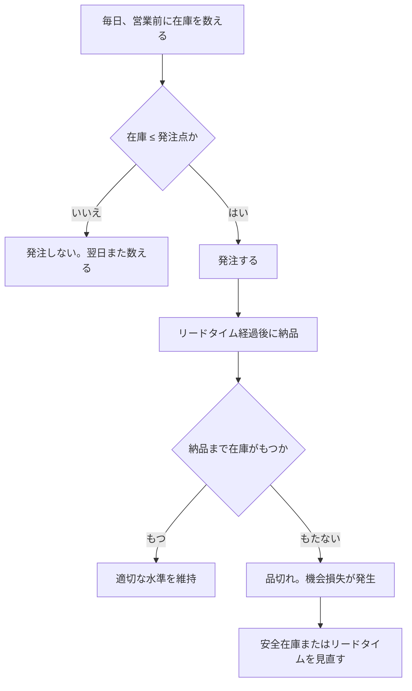
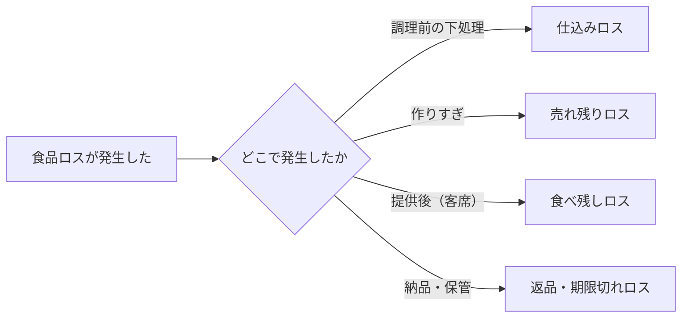

# 第9章 仕入れ・在庫・食品ロス・メニュー設計

材料費は「使った食材の金額」です。この章では、その金額を**どう作るか**を扱います。仕入れ、在庫、ロス、メニュー設計の4つは連動しています。1つだけ改善しても、他が崩れれば材料費は下がりません。**この章で扱うこと**は、仕入れの判断基準、在庫の数え方、食品ロスの分類と対策、メニューを粗利で評価する方法です。あわせて、発注と廃棄の損得を金額で比較する手順を扱います。

## 9.1 仕入れの基本

食材の仕入れには、次の性質があります。

| 性質 | 内容 | 経営への影響 |
| --- | --- | --- |
| 鮮度劣化が速い | 生ものは数日で使えなくなる | 発注量の誤りが直接ロスになる |
| 価格が変動する | 旬、天候、相場で単価が動く | 原価率が計画から外れる |
| 単位が大きい | ケース、束、kg単位でしか買えない | 使い切れない分がロスになる |
| リードタイムがある | 発注から納品まで時間がかかる | 欠品か過剰在庫のどちらかになる |
| 品質にばらつきがある | 同じ品名でも産地・等級・鮮度が違う | 味が安定しない。提供品質が振れる |

**リードタイム**とは、発注してから納品されるまでの日数のことです（9.2 の在庫計算で使います）。

### 仕入れ先の選び方

| 仕入れ先 | 長所 | 短所 |
| --- | --- | --- |
| 卸売市場・問屋 | 品揃え、目利き、相場の情報 | 営業時間が早い。少人数では足を運びにくい |
| 食品卸・業務用スーパー | 安定供給、配達、使いやすい単位 | 価格は市場より高いことがある |
| 産地直送・農家 | 品質、希少性、物語性 | 不安定。量の調整が難しい |
| ネット通販 | 比較しやすい、時間を選ばない | 品質の確認ができない。送料がかかる |

**目利き**（めきき）とは、食材の状態・鮮度・価値を見極める力のことです。市場や問屋の価値は、価格だけではなくこの情報にあります。目利きができない状態で安値だけを追うと、品質の低下がロスと評判の低下になって戻ってきます。

**単一の仕入れ先に依存しない**のが原則です。1社が値上げ・廃業・欠品になると、メニューが維持できません。主要食材は2社以上から取れる状態を作ります。

### 検収と記録

納品された食材は、受け取った時点で確認します。この作業を**検収**（けんしゅう）と呼びます。

| 確認項目 | 見るポイント | 記録すること |
| --- | --- | --- |
| 数量 | 発注数と納品数が合っているか | 違いがあれば伝票に書く |
| 品質 | 温度、鮮度、傷み、異物 | 受け取らなかった分と理由 |
| 温度 | 冷蔵・冷凍品の品温 | 温度の測定値（第6章 6.6） |
| 書類 | 納品書・請求書の金額と単価 | 単価の変更があった日 |

検収をしないと、**品質の悪い食材も材料費として計上されます**。使えなかった分はそのままロスになり、原因の追跡もできません。

### 相場と季節

食材の価格は季節で動きます。**同じメニューを年中同じ価格で出すと、原価率が季節で振れます。** 対策は3つです。

1. 季節メニューを入れ替える（旬の安い食材を中心にする）
2. 通年メニューの価格を見直す機会を決める
3. 代替食材を決めておく（品切れ・高騰時の切り替え先）

## 9.2 在庫管理

### 棚卸しの基本

正確な材料費は、在庫を数えないと出ません。在庫を数えて金額を確定する作業を**棚卸し**（たなおろし）と呼びます。式の形は [第2章](02-shueki-kouzou-genka.md) 2.2 と同じです。

```
材料費 = 期首在庫 + 当期仕入 − 期末在庫
```

| 用語 | 意味 |
| --- | --- |
| 期首在庫 | 期間の始めに残っていた食材の金額 |
| 当期仕入 | 期間中に仕入れた金額 |
| 期末在庫 | 期間の終わりに残っていた食材の金額 |

数値は**説明用の仮置き**です。期首在庫 120,000円、当期仕入 1,050,000円、期末在庫 150,000円なら、材料費は 120,000 + 1,050,000 − 150,000 = **1,020,000円**です。売上 3,000,000円なら原価率は 1,020,000 ÷ 3,000,000 = **34.0%** になります。

ここで棚卸しを省き、仕入額をそのまま材料費とすると 1,050,000 ÷ 3,000,000 = **35.0%** です。**1ポイント（30,000円）の差**が出ます。しかもこの差は月ごとに上下します。在庫が積み上がった月は原価率が高く、取り崩した月は低く出るためです。どちらも実態ではありません。

### 発注点と安全在庫

在庫は「多すぎても少なすぎても」損失になります。

| 状態 | 損失 | 具体例 |
| --- | --- | --- |
| 在庫が多すぎる | 廃棄、保管スペース、資金の固定 | 生野菜が余って捨てる |
| 在庫が少なすぎる | 品切れ、機会損失、信頼低下 | 看板メニューが売り切れ |

発注の判断基準として、**発注点**を決めます。発注点とは、在庫がこの水準を切ったら発注する、という数量のことです。

```
発注点 = 1日あたり使用量 × リードタイム（日数）+ 安全在庫
```

**計算例**（説明用の仮置き）: 1日20個使う食材、リードタイム2日、安全在庫20個なら、発注点は 20 × 2 + 20 = **60個**です。在庫が60個を切ったら発注します。



この図は、発注点が「在庫を切らさずに発注する水準」であることを示しています。品切れが起きたら、原因は発注点の設定かリードタイムの見積もりにあります。

**安全在庫**は、需要の変動や納品の遅れに備えて余分に持つ在庫です。ばらつきを考えて決めます。

```
安全在庫 = (1日の最大使用量 − 1日の平均使用量) × 納品遅れの想定日数
```

数値は**説明用の仮置き**です。平均使用量 20個、最大使用量 25個、納品が最大1日遅れると想定するなら、安全在庫は (25 − 20) × 1 = **5個**。この場合の発注点は 20 × 2 + 5 = **45個**です。ばらつきが大きい食材ほど、安全在庫は大きくなります。

### 先入れ先出し

**先入れ先出し**（FIFO、First In First Out）は、先に納品されたものから先に使う置き方・使い方のルールです。保管場所の手前側に先入品を置き、奥に新しいものを置きます。このルールがないと、古い在庫が奥に残り、**気づいたときには期限切れ**になります。この形で発生するロスを**棚卸ロス**（棚卸しのときに見つかる、使えなくなった在庫）と呼びます。

## 9.3 食品ロスの4類型

食品ロスは、原因が違えば対策も違います。4つに分けて考えます。



この図は、ロスの4類型を「発生した場所」で分ける判断の流れです。分類が違えば、対策も変わります。

| 類型 | 内容 | 主な原因 | 対策 |
| --- | --- | --- | --- |
| 仕込みロス | 下処理で出る皮・芯・端材 | 歩留まりの悪い調理 | 調理法の改善、使い切りのレシピ |
| 売れ残りロス | 作りすぎて売れなかった | 需要予測の誤り | 仕込み量の調整、売り切れ前提の設計 |
| 食べ残しロス | 客が残した | 量が多い、味が合わない | 量の調整、持ち帰り、メニュー改善 |
| 返品・期限切れロス | 納品後の不良、期限切れ | 発注精度、在庫管理 | 発注点の見直し、先入れ先出し |

**仕込み**（しこみ）とは、営業中に素早く提供できるよう、あらかじめ食材を切る・煮る・味を付けておく作業のことです。**下処理**とは、その前段の洗浄・皮むき・芯取り・下味などの作業をいいます。**盛り付け**は、調理した料理を皿に配置して提供できる状態にすることです。

**歩留まり**とは、仕入れた食材のうち実際に使える割合のことです。下処理で落ちる分が多ければ歩留まりは下がり、同じ料理でも材料費が上がります。

```
歩留まり（%）= 使える重量 ÷ 仕入れた重量 × 100
```

数値は**説明用の仮置き**です。1kg 1,200円の食材の歩留まりが75%なら、使えるのは750g、1gあたり 1,200 ÷ 750 = **1.6円**です。1皿150g使うなら、材料費は 1.6 × 150 = **240円**。販売価格800円なら原価率は 240 ÷ 800 = **30.0%** です。

### ロス率

```
ロス率（%）= 廃棄額 ÷ 仕入額 × 100
```

**計算例**（説明用の仮置き）: 月の仕入額50万円、廃棄額2万円なら、ロス率は 20,000 ÷ 500,000 = **4.0%** です。廃棄を半分にすれば、材料費が1万円下がり、その分がそのまま利益になります（材料費以外の条件が変わらない場合）。月商100万円の店なら、1万円は売上比1.0%にあたるため、**利益率が1ポイント改善するのと同じ効果**です（検算: 10,000 ÷ 1,000,000 = 1.0%）。

**ロス削減は、売上を増やさずに利益を増やせる数少ない手段**です。ただし、ロスを減らすために仕込みを減らしすぎると品切れが起き、機会損失になります。**ロス率と売り切れ率はトレードオフ**の関係にあります。**売り切れ率**とは、用意した数に対して提供できずに終わった割合のことです。

## 9.4 食品ロスの統計

農林水産省・環境省の推計（2024年度）では、食品ロス全体は461万トン、うち事業系が237万トン、**外食が70万トン**です（事業系の約29.5%）。2030年度までに2000年度比60%削減という目標が置かれています。

出典: 農林水産省「事業系食品ロス量（2024年度推計値）を公表」（令和8年6月30日）、https://www.maff.go.jp/j/press/shokuhin/recycle/260630.html 、環境省食品ロスポータルサイト https://www.env.go.jp/recycle/foodloss/index.html （取得日 2026-11-14）

**飲食店の食べ残し率（食べ残し量÷提供量）の公的統計は取得できませんでした。** 自店の食べ残しは、目視調査で測るのが確実です（例: 1週間、下膳時の残量を5段階で記録する）。

なお、上の統計は**日本全体の推計**であり、個店のロス率の目標値ではありません。全国の外食のロス量が分かっても、自店の廃棄額は分かりません。**自店の数値は、自店で測るしかありません。**

## 9.5 メニューエンジニアリング

メニューは「売れ筋」と「粗利」の2軸で評価できます。この手法を**メニューエンジニアリング**と呼びます。

```
粗利額（円）= 販売価格 − 材料費
```

| 象限 | 粗利 | 販売数 | 状態 | 打ち手 |
| --- | --- | --- | --- | --- |
| スター | 高 | 多 | 店の稼ぎ頭 | 維持。品切れを避ける。品質を落とさない |
| プラウホース（金のなる木） | 低 | 多 | よく売れるが儲からない | 材料費の見直し、価格改定、量の調整 |
| パズル | 高 | 少 | 儲かるが売れない | 売り方の改善（写真、位置、提案、名前） |
| ドッグ | 低 | 少 | 売れず儲からない | 廃止、または材料の見直し |

**重要な注意**: 「粗利額」で見ることが大事です。粗利率（%）だけで見ると、原価率の低い商品が良く見えますが、単価が低ければ粗利額は小さいことがあります。逆に、原価率が高くても単価が高ければ粗利額は大きくなります。

**計算例**（説明用の仮置き）:

| 商品 | 価格 | 材料費 | 粗利率 | 粗利額 | 販売数 | 粗利合計 |
| --- | --- | --- | --- | --- | --- | --- |
| A | 800円 | 200円 | 75% | 600円 | 20個 | 12,000円 |
| B | 1,800円 | 900円 | 50% | 900円 | 15個 | 13,500円 |

Aの粗利率は 600 ÷ 800 = 75%、Bは 900 ÷ 1,800 = 50% です。粗利率ではAが上ですが、粗利合計は 600 × 20 = 12,000円 と 900 × 15 = 13,500円 で**Bが上**です。**メニュー構成を考えるときは、粗利の合計額で判断します。**

ただし、席と時間を売る商売では、これだけでは足りません。混雑する時間帯は、粗利額ではなく**時間あたりの粗利**（1品あたり粗利 ÷ 調理・提供の手間）で比べます（[第2章](02-shueki-kouzou-genka.md) 2.3）。粗利額が大きくても提供に時間がかかる商品ばかり出すと、席と厨房が詰まって機会損失になります。**席に余裕がある時間帯は粗利額、混雑する時間帯は時間あたり粗利**で見る、という使い分けをします。

### レシピ原価の作り方

材料費を正確に知るには、料理ごとの原価を自分で計算します。この計算値を**レシピ原価**と呼びます。[第2章](02-shueki-kouzou-genka.md) 2.3 では、レシピ原価を使って時間あたりの粗利を比べる方法を扱いました。ここでは、歩留まりと調味料・容器まで含めた積み上げ方を示します。

```
レシピ原価 = Σ（使用食材の重量 ÷ 歩留まり × 単価）+ 調味料 + 容器（テイクアウトの場合）
```

数値は**説明用の仮置き**です。1皿に食材Xを120g、食材Yを40g使うとします。Xは1kg 1,200円・歩留まり75%、Yは1kg 2,000円・歩留まり90%とします。

- Xの1g単価 = 1,200 ÷ (1,000 × 0.75) = 1,200 ÷ 750 = 1.6円 → 120g = **192円**
- Yの1g単価 = 2,000 ÷ (1,000 × 0.90) = 2,000 ÷ 900 = 2.22円 → 40g = **89円**（端数は四捨五入）
- 調味料 15円、合計 = 192 + 89 + 15 = **296円**

販売価格800円なら、この料理の原価率は 296 ÷ 800 = **37.0%** です。

材料費全体を**フードコスト**と呼ぶことがあります。レシピ原価の積み上げと、9.2 の棚卸しから計算した材料費は、**一致しないことがあります**。原因は、盛り付けロス、提供時の取りこぼし、記録の漏れです。差が大きい場合は、どちらの数字が実態に近いかを確認します。

### メニュー構成の考え方

| 役割 | 目的 | 例 |
| --- | --- | --- |
| 看板メニュー | 来店動機を作る | 名物、名物の写真を大きく出す |
| 稼ぎ頭 | 粗利を稼ぐ | 原価率が低く、よく売れる |
| 客単価を上げる脇役 | 追加注文を促す | サイド、ドリンク、デザート |
| 回転を助ける | 提供が速い | 作り置きできる、仕込み済み |
| 季節・話題 | 再来店のきっかけ | 旬、限定 |

メニュー数が多すぎると、仕込みが増え、ロスが増え、提供が遅くなります。**厨房が狭いほど、メニュー数を絞ることが原価とオペレーションの両方に効きます。** ここでいう**オペレーション**とは、受注から提供・会計までの作業の流れ全体を指します。

## 9.6 発注と廃棄の意思決定

| 判断 | 基準 | 注意 |
| --- | --- | --- |
| 発注量を増やす | 売り切れが続いている、予約が多い | 在庫保管スペースと鮮度を確認 |
| 発注量を減らす | 廃棄が続いている、天候が悪い | 品切れの機会損失と比較する |
| メニューを廃止する | ドッグ象限が続く、仕込みが複雑 | 常連客の定番は慎重に |
| 値上げする | 材料費が上がった、需要が価格に鈍感 | 客数への影響を測る |

**廃棄と品切れのどちらが損か**を、金額で比較します。

```
廃棄の損失 = 廃棄数量 × 材料費単価
品切れの損失 = 販売できなかった数量 × 粗利額
```

数値は**説明用の仮置き**です。10個を廃棄する場合、材料費単価100円なら損失は 10 × 100 = **1,000円**。同じ食材で作る800円の料理（粗利600円）を10個売れなかった場合、損失は 10 × 600 = **6,000円**です。差は 6,000 ÷ 1,000 = **6倍**になります。

品切れの損失は「粗利」で計算するため、**廃棄の損失より大きく出ます**。これが「多少のロスを許容して品切れを避ける」判断の根拠です。ただし、毎日大量に廃棄が出るなら話は別で、それは発注精度の問題です。**1日単位の小さな迷いと、毎月続く構造的な過剰発注は、分けて扱います。**

## 9.7 複数店舗・共通仕入れの場合

複数店舗を運営する場合や、複数の店舗が仕入れを共通化する場合は、原価改善の選択肢が増えます。一方で、管理の手間も増えます。

| 論点 | 内容 | 決めておくこと |
| --- | --- | --- |
| 共通化の範囲 | 米・調味料・飲料など、鮮度劣化が遅い品目から始めやすい | どの品目を共通化するか |
| 数量の集約 | 発注量がまとまれば、単価交渉の材料になる | 発注を誰がまとめるか |
| 配分（按分） | 共通で仕入れた分を、どの店舗の費用にするか | 使用量・売上高などの配分基準 |
| 品質基準 | 店舗ごとに基準が違うと、味が揃わない | 等級・産地・温度の基準を文書化する |
| 発注責任 | 責任者が曖昧だと、欠品と重複発注が同時に起きる | 品目ごとの発注担当者 |
| 保管スペース | まとめ買いは保管場所を必要とする | 各店の冷蔵庫容量と納品頻度 |

**共通化は、按分の基準を決めてから始めます。** 按分の基準が曖昧なままだと、店舗別の原価率が信用できなくなり、9.5 のメニュー評価もできなくなります。

また、共用スペースや屋外で提供する場合は、温度管理と提供までの時間が品質に直結します（→ [第6章](06-eisei-haccp.md)）。テイクアウト用の容器を使う場合は、**容器の費用をレシピ原価に含めます**。含め忘れると、原価率が実際より低く出ます。

## 9.8 よくある誤解

| 誤解 | 実際 |
| --- | --- |
| ロスは少ないほど良い | ロスを減らしすぎると品切れが増えます。品切れの損失は粗利で計算するため大きくなります |
| 仕入れ値の安い業者に変えれば原価が下がる | 品質・納品精度・支払条件が悪化すれば、ロスと手間が増えて相殺されます |
| メニューは多いほど客が選べる | 仕込み・ロス・提供時間が増えます。狭い厨房では特に不利です |
| 原価率の低い商品を売れば儲かる | 粗利額で見ます。単価が低ければ粗利率が高くても稼げません |
| 棚卸しは面倒だから仕入れ額で十分 | 在庫の増減を無視すると原価率が月ごとに振れ、判断を誤ります |
| ロス率が低ければ在庫管理はできている | 棚卸ロス（期限切れ）は見えにくいため、ロス率に出る前に発生しています |
| 発注点を決めれば品切れはなくなる | 需要の変動と納品遅れを織り込んだ安全在庫がなければ、発注点は機能しません |
| 標準レシピは現場の自由度を奪う | 標準がないと原価も味も店ごとにばらつき、改善の効果を測れなくなります |

## 9.9 この章の要点

- 材料費は**期首在庫 + 当期仕入 − 期末在庫**です。棚卸しをしないと原価率が月ごとに振れます。
- 発注点は**1日使用量 × リードタイム + 安全在庫**。品切れが起きたら、この2つの設定を見直します。
- 食品ロスは**仕込み・売れ残り・食べ残し・返品期限切れ**の4類型に分けます。原因が違えば対策も違います。
- メニューは**粗利額**（単価 − 材料費）と販売数の2軸で評価します。粗利率だけで比べると判断を誤ります。
- 廃棄と品切れの損得は、**品切れを粗利で計算する**ことで金額比較できます。

## 9.10 自店で確認すること

- [ ] 直近1か月の期首在庫・期末在庫を数え、材料費を計算している
- [ ] 主要食材について、1日使用量・リードタイム・安全在庫から発注点を決めている
- [ ] 廃棄を「仕込みロス／売れ残り／食べ残し／返品・期限切れ」に分けて記録している
- [ ] 冷蔵庫・保管棚で先入れ先出しが守られているか、週1回は確認している
- [ ] 主要メニュー5品目以上のレシピ原価を、歩留まり込みで計算している
- [ ] メニューごとの粗利額と販売数を見て、象限の位置を把握している
- [ ] 検収（数量・品質・温度・単価）を記録している
- [ ] 複数店舗や共通仕入れがある場合、費用の按分基準を文書化している

## 9.11 演習

### 問1 材料費と原価率

期首在庫 80,000円、当期仕入 620,000円、期末在庫 100,000円、売上 1,800,000円でした。

1. 材料費と原価率を計算してください。
2. 棚卸しを省いて仕入額をそのまま材料費とした場合の原価率と、差を計算してください。
3. 期末在庫を数え忘れて 100,000円を計上しなかった場合、材料費と原価率はどうなるか計算してください。

**解答**

1. 材料費 = 80,000 + 620,000 − 100,000 = **600,000円**。原価率 = 600,000 ÷ 1,800,000 = **33.3%**（小数第2位を四捨五入）。
2. 620,000 ÷ 1,800,000 = **34.4%**。差は 34.4 − 33.3 = **1.1ポイント**、金額では 620,000 − 600,000 = 20,000円です。
3. 材料費 = 80,000 + 620,000 − 0 = **700,000円**。原価率 = 700,000 ÷ 1,800,000 = **38.9%**。実際より5.6ポイント高く出ます（38.9 − 33.3 = 5.6）。在庫を数え忘れると、原価率はこのように大きく振れます。

### 問2 発注点

1日平均18個使用する食材があります。リードタイムは3日、1日の最大使用量は22個、納品は最大1日遅れると想定します。安全在庫を求め、発注点を計算してください。また、発注点を安全在庫なしで設定した場合に起きる問題を述べてください。

**解答**

- 安全在庫 = (22 − 18) × 1日 = **4個**
- 発注点 = 18 × 3 + 4 = 54 + 4 = **58個**
- 安全在庫を0にすると発注点は 18 × 3 = 54個です。使用量が22個に増えた日や納品が1日遅れた日には、納品を待つ間に在庫が尽きます。18 × 1日の遅れ = 18個分が不足し、**品切れ**になります。品切れの損失は粗利で計算するため（9.6）、4個分の在庫を持つコストより大きくなります。

### 問3 レシピ原価と粗利

1皿に食材Zを180g使います。Zは1kg 1,500円、歩留まり80%です。調味料は20円、販売価格は900円です。

1. レシピ原価と原価率を計算してください。
2. 歩留まりが70%に落ちた場合のレシピ原価と原価率を計算してください。
3. 歩留まりが落ちた分を吸収するには、価格をいくらにすれば元の原価率に戻るか計算してください。

**解答**

1. 1g単価 = 1,500 ÷ (1,000 × 0.80) = 1,500 ÷ 800 = 1.875円。食材費 = 1.875 × 180 = 337.5円 → 337.5 + 20 = **357.5円**。原価率 = 357.5 ÷ 900 = **39.7%**（小数第2位を四捨五入）。
2. 1g単価 = 1,500 ÷ 700 = 2.143円。食材費 = 2.143 × 180 = 385.7円 → 385.7 + 20 = **405.7円**。原価率 = 405.7 ÷ 900 = **45.1%**。
3. 価格 = 405.7 ÷ 0.397 = 1,021.9円 → **1,022円以上**（1円未満を切り上げ）。ただし1,022円にすると客数への影響が出ます。値上げ以外の選択肢（歩留まりの改善、ロスの少ない切り方、調味料の見直し）も同時に検討します。

（計算は途中で小数第3位を四捨五入して表示しています。最終値は円未満を四捨五入しています。）

## 出典と確度

- 仕入れ、在庫、発注点、ロス率、メニューエンジニアリングの考え方は、飲食店実務・管理会計の標準的な手法にもとづく**一般知識（未検証）**です。
- 9.4 の食品ロス統計は一次資料で確認済み（**確信度 高**）。出典と取得日を付記しています。
- 飲食店の食べ残し率は公的統計を**取得できなかった**ため、本資料では数値を示していません。
- 9.2、9.5、9.6、9.11 の数値例は**説明用の仮置き**であり、実在の店舗の実績ではありません。
- 歩留まりの標準値、業態別のロス率や原価率の平均値は、本章では提示していません。**裏付けが取れていない数値を提示しない**方針によります。

---

前後の章: [第8章 集客とリピート](08-shukyaku-to-repeat.md) ／ [第10章 KPIと経営判断の回し方](10-kpi-to-keiei-handan.md)
