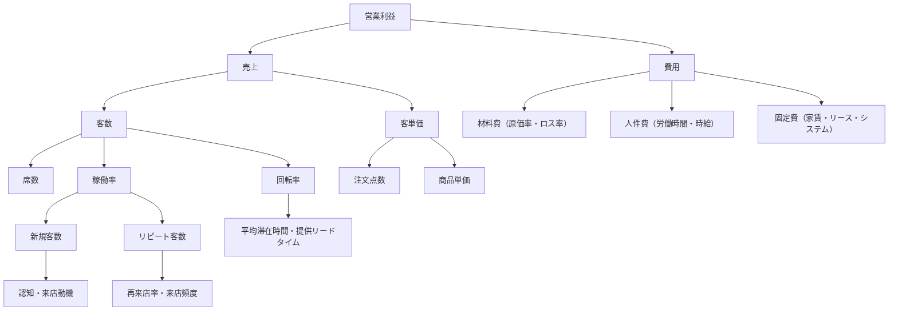

# 第10章 KPIと経営判断の回し方

ここまでの章で、売上の分解、原価、回転率、損益分岐点、キャッシュフローを扱いました。この章では、それらを**日々の判断に使える形**にする方法を扱います。**この章で扱うこと**は、KPI（重要業績評価指標）の選び方、指標の木構造による原因のたどり方、先行指標と遅行指標の使い分け、目標値の決め方、そして数字を読むときに落ちやすい罠です。KPI は、指標を作ること自体が目的ではありません。**判断を変えるために存在します。**

## 10.1 KPIを選ぶ3つの条件

指標を KPI として採用するには、3つを満たす必要があります。

| 条件 | 内容 | 反例 |
| --- | --- | --- |
| 測れる | 毎回同じ定義で計測できる | 「なんとなく賑わっている」 |
| 動かせる | 自分の施策で値が変わる | 天気、景気（動かせないので前提条件として扱う） |
| 判断につながる | 値が悪いときに具体的な行動が決まる | 「満足度」（行動に結びつかない） |

「動かせない指標」は KPI ではなく**前提条件**として扱います。天候は KPI にせず、「雨天時の稼働率」のように**条件を固定した指標**として測ります。条件で切ると、比較する相手が同じ条件になり、判断が安定します。

3つの条件のうち、最も見落とされやすいのが「判断につながる」です。指標を見て「で、何をするのか」が決まらないなら、その指標は**記録するだけの数字**です。記録は残しても構いませんが、毎日見る必要はありません。

## 10.2 指標の木構造

飲食店の指標は、上位（結果）から下位（原因）へ木構造に並べられます。**下位を動かすと上位が動く**関係です。



この図は、営業利益から下位の指標へ分解した構造です。上位が悪いときは、**下位のどこが悪いかを順に確認します**。売上が悪い → 客数か客単価か → 客数なら回転か稼働か → 稼働なら新規かリピートか。闇雲に「集客しよう」とするのではなく、木を下って原因を特定します。

> **注意**: 回転率と稼働率は、同じ「席の使われ方」を別の角度から見た値です。**掛け合わせて客数になる関係ではありません**（[第3章](03-kyaku-tanka-kaiten.md) 3.3）。図で並列に置いているのは、「どちらが課題か」を切り分けるためです。実際の客数は `席数 × 回転率`（人数ベース）で計算します。

この構造を使うと、**改善効果の大きさも計算できます**。数値は**説明用の仮置き**です。売上 3,000,000円、客数 2,000人、客単価 1,500円の店で、客数が10%増えて 2,200人になれば、客単価が同じなら売上は 2,200 × 1,500 = **3,300,000円**（+300,000円）。客単価が10%下がって 1,350円になれば、客数が同じなら 2,000 × 1,350 = **2,700,000円**（−300,000円）です。

同じ「10%」でも、掛け算の位置が違えば結果は同じ大きさで動きます。**だからこそ、木のどこを動かすかを先に決めます。** ただし実行の難しさは場所によって違います。席数を増やすには投資が必要で、客単価を上げるには価格と提案の見直しが要ります。木構造は「原因の候補を漏らさず並べる」道具であり、「動かしやすさ」は別に判断します。

## 10.3 遅行指標と先行指標

| 種類 | 意味 | 例 | 特徴 |
| --- | --- | --- | --- |
| 遅行指標 | 結果として後から分かる | 売上、営業利益、原価率 | 正確だが、対策が後手になる |
| 先行指標 | 将来の結果を予測する | 予約数、席稼働率、提供時間、リピート率 | 早く分かるが、売上との関係を検証する必要がある |

経営判断には先行指標が必要です。今月の売上（遅行）が悪いと分かった時点では、もう手遅れに近い。**予約数、稼働率、提供時間**といった先行指標を毎日見て、遅行指標の悪化を事前に防ぎます。

数値は**説明用の仮置き**です。ある日の目標売上が 150,000円、客単価が 1,500円なら、必要な客数は 150,000 ÷ 1,500 = **100人**です。昼の時点で予約が30組・60人入っていれば、残りは 100 − 60 = **40人**。この40人を当日客で埋められるかが、その日の判断になります。予約数は「まだ確定していない売上」であり、先行指標として使える形です。

先行指標は、**売上との関係を自分で確かめてから**使います。予約数が増えても売上に結びつかないなら、それは先行指標として機能していません。少なくとも数か月分、先行指標と売上の関係を並べて確認します。

## 10.4 飲食店で使う主要KPI一覧

| KPI | 定義 | 見る頻度 | 何を判断するか |
| --- | --- | --- | --- |
| 売上高 | 期間の売上 | 日次 | 全体の水準 |
| 客数 | 来店人数 | 日次 | 需要の量 |
| 客単価 | 売上 ÷ 客数 | 日次 | 1人あたりの消費 |
| 回転率 | 客数（人）÷ 席数 | 日次 | 席の使い回し効率 |
| 席稼働率 | 延べ使用席時間 ÷（席数 × 営業時間） | 日次 | 空席の多さ |
| 原価率 | 材料費 ÷ 売上 | 週次・月次 | 仕入れと価格の妥当性 |
| 人件費率 | 人件費 ÷ 売上 | 月次 | 人員配置の妥当性 |
| FL比率 |（材料費 + 人件費）÷ 売上 | 月次 | 店の体質 |
| 提供リードタイム | 注文から提供までの時間 | 日次 | オペレーションの詰まり |
| 離脱率 | 待ち列から離脱した数 ÷ 並んだ数 | 週次 | 機会損失 |
| リピート率 | 再訪客 ÷ 初回客 | 月次 | 顧客の定着 |
| ロス率 | 廃棄額 ÷ 仕入額 | 週次 | 仕込み精度 |

すべてを毎日見る必要はありません。**日次で見るのは売上・客数・客単価・稼働率の4つ**、月次で原価率・人件費率・FL比率、という分担が現実的です。

定義は [第3章](03-kyaku-tanka-kaiten.md) と [第2章](02-shueki-kouzou-genka.md) で式を示したものと同じです。**定義を章ごとに変えないこと**が、指標を比較できる条件になります。特に「客数」は、組数（何組来たか）と人数（何人来たか）のどちらを指すかで値が倍近く変わります。本資料では人数と組数を区別し、**回転率は人数ベース（客数 ÷ 席数）**で計算します。組数ベースで記録する場合は「組回転率」と呼び、人数基準と混ぜないでください。

## 10.5 FL比率を目標として使うときの注意

FL比率（Food & Labor cost ratio）は、材料費と人件費の合計を売上で割った値です。飲食店の体質を1つの数字で見られるため、業界でよく使われます。

```
FL比率 =（材料費 + 人件費）÷ 売上 × 100
```

数値は**説明用の仮置き**です。売上 3,000,000円の月に、材料費 1,020,000円（34.0%）、人件費 900,000円（30.0%）、家賃 300,000円（10.0%）、その他経費 450,000円（15.0%）だったとします。

| 項目 | 金額 | 売上比 |
| --- | --- | --- |
| 売上 | 3,000,000円 | 100.0% |
| 材料費 | 1,020,000円 | 34.0% |
| 人件費 | 900,000円 | 30.0% |
| FL比率の対象 | 1,920,000円 | 64.0% |
| 家賃 | 300,000円 | 10.0% |
| その他経費 | 450,000円 | 15.0% |
| 営業利益 | 330,000円 | 11.0% |

検算: 1,020,000 + 900,000 = 1,920,000（FL比率 64.0%）。3,000,000 −（1,920,000 + 300,000 + 450,000）= 330,000。330,000 ÷ 3,000,000 = 11.0%。

ただし、FL比率には**構造的な弱点**があります。

1. **家賃を含まない。** 家賃が高い店は FL 比率が良くても利益が出ません。上の例でも、家賃10%・その他15%を引かなければ利益は見えません。
2. **売上の水準を無視する。** 売上が小さい店は人件費率が高く出ます。同じ人員でも売上が2倍なら人件費率は半分になります。
3. **削れば下がるが、売上も下がる。** 材料費を削って品質を落とすと、翌月の売上が落ちて FL 比率は悪化します。

したがって FL 比率は「**単独の目標値**」ではなく「**構造を把握するための入口**」として使います。FL 比率が悪いと分かったら、材料費率と人件費率に分解し、さらに売上（客数・客単価）の水準と突き合わせます。

## 10.6 目標値の決め方

目標値を決める方法は3つあり、組み合わせて使います。

| 方法 | 内容 | 長所 | 短所 |
| --- | --- | --- | --- |
| 自店の過去実績 | 先月・昨年同月との比較 | 現実的。改善幅が分かる | 過去が低いと目標も低くなる |
| 損益分岐点からの逆算 | 赤字にならない最低ライン | 根拠が明確 | 最低ラインであり目標ではない |
| 外部ベンチマーク | 業界平均、同業態の値 | 相対的な位置が分かる | 条件（立地・規模）が違う |

**推奨する順序**は、①損益分岐点で下限を決める、②自店の過去実績で改善幅を決める、③外部ベンチマークで妥当性を確認する、です。

目標を置く前に必要なのが**現状値（ベースライン）**です。現状値とは、施策を始める前の、その指標の実際の値です。

**現状値を計測していない指標に目標を置くと、達成したかどうかを判定できません。** 「客単価を上げる」という目標は、現在の客単価が分からなければ達成を確認できません。順序は、①1〜2週間測る、②現状値を確定する、③目標を置く、です。

### 損益分岐点客数に置き換える

売上ではなく客数で目標を持ちたい場合は、損益分岐点を客数に換算します（[第4章](04-soneki-bunkiten-cashflow.md)）。

```
損益分岐点売上 = 固定費 ÷ 限界利益率
損益分岐点客数 = 損益分岐点売上 ÷ 客単価
```

数値は**説明用の仮置き**です。10.5 の例（売上 3,000,000円、材料費 34.0%、人件費 30.0%、家賃 10.0%、その他経費 15.0%）を、そのまま使います。このうち材料費 34.0% と、その他経費のうち売上に比例する 6.0% を変動費とすると、変動費率は 40.0%、限界利益率は 1 − 0.40 = 0.60 です。固定費は、人件費 900,000円 + 家賃 300,000円 + その他経費の固定分 270,000円 = **1,470,000円**になります。

- 損益分岐点売上 = 1,470,000 ÷ 0.60 = **2,450,000円**
- 損益分岐点客数 = 2,450,000 ÷ 1,500 = **1,634人/月**（1,633.3人を切り上げ）
- 月20営業日なら 1,634 ÷ 20 = **82人/日**（81.7人を切り上げ）

検算: 現状の売上 3,000,000円では、限界利益 3,000,000 × 0.60 = 1,800,000円、固定費 1,470,000円を引いて営業利益 **330,000円**（10.5 の表と一致）。

「1日82人を下回ると赤字」という形にすると、現場でも目標として共有できます。

## 10.7 数字の落とし穴

| 落とし穴 | 内容 | 対策 |
| --- | --- | --- |
| 分母の定義が揺れる | 「客数」が組数か人数かで値が変わる | 定義を文書に固定する。本資料では人数と組数を区別する |
| 平均値の罠 | 平均滞在時間40分でも、20分と60分に二分されているかもしれない | 分布を見る。中央値も確認する |
| 季節性の無視 | 12月と2月を単純比較する | 前年同月比で見る |
| 期間の混在 | 週次と月次を混ぜて比較する | 比較する期間を揃える |
| 部分最適 | 一部の指標だけを最適化して全体が悪化する | 上位の指標（営業利益）も併記する |
| 定義の途中変更 | 集計方法を変えた月に値が跳ねる | 変更した日と理由を記録に残す |
| 目標のための数字 | 目標達成のために記録の付け方を変える | 集計方法の変更履歴を残し、第三者と共有する |

**部分最適**とは、一部分だけを見て最適化した結果、全体としては悪くなることです。店舗が複数ある場合や、店内とテイクアウトなど複数の売上経路がある場合に起こります。

数値は**説明用の仮置き**です。ある店舗が自店の売上を伸ばすために待ち時間の長い客を優先し、結果として別の売上経路（テイクアウト、共用スペース）の客を逃したとします。片方の売上が+300,000円、他の経路が−400,000円なら、全体では **−100,000円**です。売上の合計と、営業利益の両方を見る必要があります。

## 10.8 計測の仕組みをどう作るか

指標は、測る仕組みがなければ存在しません。

| 段階 | 方法 | 精度 | コスト |
| --- | --- | --- | --- |
| 手作業 | 紙に記録、表計算に入力 | 低〜中 | 低 |
| POS・レジ | 売上・客数・商品別 | 中〜高 | 中 |
| 席管理システム | 稼働率・滞在時間 | 高 | 中〜高 |
| 統合ダッシュボード | 複数システムの統合 | 高 | 高 |

**最初から高精度を目指さない**のが原則です。手作業で1〜2週間測れば、現状値の桁は分かります。そのうえで、判断に必要な指標だけを自動化します。

順序は、①手作業で2週間記録する、②表計算で集計する、③判断に必要な指標だけをシステム化する、です。いきなりシステムを入れると、**測る前に設計が固まり**、必要な指標が抜けたまま運用が始まります。

手作業の段階で決めておくことは3つです。

1. **誰が**記録するか（役割を決める。担当者が休むと記録が止まります）
2. **いつ**記録するか（営業終了時、シフト交代時など、時刻を固定する）
3. **どこに**集約するか（1つの表に集める。複数の紙に散らばると集計できません）

## 10.9 複数店舗・共用スペースを持つ場合のKPI

店舗が複数ある場合や、複数店舗が共用スペースを共有する場合は、KPI の設計に追加の論点が出ます。

1. **店舗別KPIと全体KPIを分ける。** 各店舗の売上・客数・原価率に加えて、合算の売上・営業利益・FL比率を持ちます。片方の改善が他方の悪化で相殺される「共食い」（[第8章](08-shukyaku-to-repeat.md) 8.8）は、合算指標でしか見つかりません。
2. **共用スペースの指標は条件別に分ける。** 天候や時間帯の影響を強く受ける場所は、平均値だけを見ると判断できません。「雨天日」「平日夜」のように、条件を固定した指標を併記します。
3. **複数店舗を1つのグループが使う比率を測る。** 複数の店舗や共用スペースを持つ場合、1組の客が複数の場所を使うことがあります。この比率は、店舗の配置や導線の設計が機能しているかを示します。単独店にはない指標なので、定義を自分で決めて文書化します（例: 同一会計または同一予約で2つ以上の場所を使った組数 ÷ 総組数）。
4. **現状値の取得を先に行う。** 店舗別の数値は、開業前は存在しません。開業後1〜2週間は記録の取得を優先し、目標値の設定はその後に行います。

いずれの場合も、**上位の指標（営業利益）と下位の指標（店舗別の客数など）を1つの表にまとめます。** 店舗別だけを見る運用にすると、全体の悪化に気づけません。

## 10.10 よくある誤解

| 誤解 | 実際 |
| --- | --- |
| KPIは多いほど良い | 見る指標が増えると、どれも見なくなります。日次4つ、月次3つ程度に絞ります |
| 目標値は高いほど良い | 達成不能な目標は無視されます。損益分岐点と過去実績から逆算します |
| 業界平均と比べれば安心 | 立地・規模・業態が違えば比較になりません。方向性の確認に留めます |
| 数字が良ければ経営は健全 | キャッシュフローは別です。黒字でも資金ショートします（[第4章](04-soneki-bunkiten-cashflow.md)） |
| FL比率が低ければ利益が出る | 家賃を含まないため、FL比率が良くても利益が出ないことがあります |
| 先行指標を増やせば先手を打てる | 売上との関係を確かめていない先行指標は、判断を誤らせます |
| 目標を先に決めてから測ればよい | 現状値のない目標は達成判定ができません。測ってから決めます |
| 店舗別KPIが良ければ全体も良い | 合算で見ないと、店舗間の共食いによる全体悪化を見逃します |

## 10.11 この章の要点

- KPI の条件は**測れる・動かせる・判断につながる**の3つです。動かせないものは前提条件として扱います。
- 指標は**木構造**で並べ、上位が悪いときに下位をたどって原因を特定します。
- **先行指標**（予約数、稼働率、提供時間）を毎日見て、遅行指標（売上）の悪化を先に防ぎます。
- FL 比率は家賃を含まないため、**単独の目標にせず、分解して構造を見る入口**として使います。
- 目標は**現状値を測ってから**、損益分岐点で下限を決めて設定します。損益分岐点は客数に換算すると現場で共有しやすくなります。

## 10.12 自店で確認すること

- [ ] 日次で見る指標を4つ以内に絞り、紙または表計算で毎日記録している
- [ ] 各指標の定義（分母・分子・期間）を文書に固定している
- [ ] 「客数」が組数か人数かを、全員が同じ意味で使っている
- [ ] 先行指標を3つ以内選び、売上との関係を数か月分は確認している
- [ ] FL 比率を材料費率と人件費率に分解して見ている
- [ ] 損益分岐点売上と損益分岐点客数を計算し、現場と共有している
- [ ] 目標値を、現状値を測ったうえで設定している
- [ ] 複数店舗・複数売上経路がある場合、合算の売上と営業利益を月次で確認している

## 10.13 演習

### 問1 指標の木構造をたどる

売上 2,400,000円、客数 1,600人、客単価 1,500円、席数 30席、営業日20日、延べ使用席時間 4,200席時間という月がありました。

1. 客単価を検算してください。
2. 席稼働率を計算してください（営業時間は1日10時間とします）。
3. 客単価が 1,500円から 1,350円に下がった場合の売上を計算し、原因として木構造のどこを見るかを述べてください。
4. 客数を10%増やし、同時に客単価を10%下げた場合の売上を計算してください。

**解答**

1. 2,400,000 ÷ 1,600 = **1,500円**。
2. 席稼働率 = 4,200 ÷ (30席 × 10時間 × 20日) = 4,200 ÷ 6,000 = **70.0%**。
3. 売上 = 1,600 × 1,350 = **2,160,000円**（−240,000円）。客数が変わっていないため、原因は客単価の側です。木を下ると、注文点数（追加注文が減った）か商品単価（価格の低い商品に移った）のどちらかです。注文点数は POS の明細、商品単価は商品別の販売数で確認します。
4. 客数 = 1,600 × 1.10 = 1,760人、客単価 = 1,500 × 0.90 = 1,350円。売上 = 1,760 × 1,350 = **2,376,000円**。客数増と単価減がほぼ相殺し、元の 2,400,000円より 24,000円少なくなります。**両方を同時に動かすと、効果が打ち消し合う**ことがあります。

### 問2 FL比率と営業利益

売上 4,000,000円、材料費 1,320,000円、人件費 1,200,000円、家賃 400,000円、その他経費 600,000円でした。

1. 材料費率、人件費率、FL比率を計算してください。
2. 営業利益と営業利益率を計算してください。
3. 材料費を削って材料費率を33.0%から30.0%に下げたところ、翌月の売上が5%落ちました。材料費以外が同じ割合で推移すると仮定した場合、営業利益はどうなるか計算してください。

**解答**

1. 材料費率 = 1,320,000 ÷ 4,000,000 = **33.0%**。人件費率 = 1,200,000 ÷ 4,000,000 = **30.0%**。FL比率 = (1,320,000 + 1,200,000) ÷ 4,000,000 = 2,520,000 ÷ 4,000,000 = **63.0%**。
2. 営業利益 = 4,000,000 − (1,320,000 + 1,200,000 + 400,000 + 600,000) = 4,000,000 − 3,520,000 = **480,000円**。営業利益率 = 480,000 ÷ 4,000,000 = **12.0%**。
3. 翌月の売上 = 4,000,000 × 0.95 = 3,800,000円。材料費率30.0%なら材料費 = 1,140,000円。人件費・家賃・その他は同額とすると、営業利益 = 3,800,000 − (1,140,000 + 1,200,000 + 400,000 + 600,000) = 3,800,000 − 3,340,000 = **460,000円**。FL比率は良くなった（63.0% → (1,140,000 + 1,200,000) ÷ 3,800,000 = 61.6%）のに、営業利益は 480,000円から 460,000円へ **20,000円減りました**。これが「FL比率を単独の目標にしない」理由です。

### 問3 損益分岐点客数

固定費 1,500,000円、変動費率 45%、客単価 1,800円、月25営業日とします。

1. 損益分岐点売上を計算してください。
2. 損益分岐点客数と、1日あたりの損益分岐点客数を計算してください。
3. 現状の客数が1日70人です。黒字か赤字かを判断してください。

**解答**

1. 限界利益率 = 1 − 0.45 = 0.55。損益分岐点売上 = 1,500,000 ÷ 0.55 = **2,727,273円**（円未満を四捨五入）。
2. 損益分岐点客数 = 2,727,273 ÷ 1,800 = **1,515人/月**（1,515.15人を切り上げ）。1日あたり = 1,515 ÷ 25 = **61人/日**（60.6人を切り上げ）。
3. 現状は1日70人なので、損益分岐点の61人を上回っており**黒字**です。余裕は 70 − 61 = 9人/日、1日あたり 9 × 1,800 = 16,200円の売上余裕にあたります。安全余裕率（[第4章](04-soneki-bunkiten-cashflow.md)）で見ると、(70 − 61) ÷ 70 = **12.9%**（小数第2位を四捨五入）。客数が約13%落ちると赤字に転じる水準です。

## 出典と確度

- 本章の KPI 定義（回転率、稼働率、FL比率、リピート率など）は、業界で一般的に使われる定義にもとづく**一般知識（未検証）**です。個別の定義は [第2章](02-shueki-kouzou-genka.md)・[第3章](03-kyaku-tanka-kaiten.md) で式を示しています。
- FL 比率の業界目標値は本章では提示していません（[第2章](02-shueki-kouzou-genka.md) で出典付きの値を扱っています）。
- 「日次4つ・月次3つ」という運用の分担は実務上の目安であり、一次資料にもとづく値ではありません。
- 本章の数値例（3,000,000円、1,470,000円、2,727,273円など）は、いずれも**説明用の仮置き**です。実在の店舗の実績ではありません。

---

前後の章: [第9章 仕入れ・在庫・食品ロス・メニュー設計](09-shiire-zaiko-loss.md) ／ [第11章 用語集](11-yougo.md)
