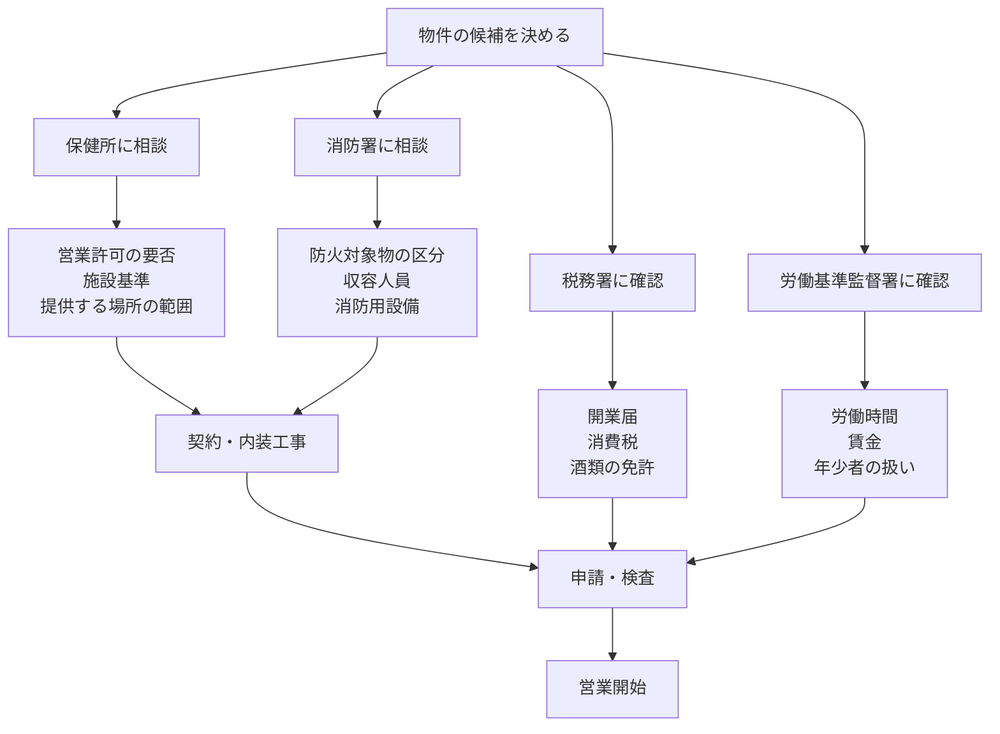
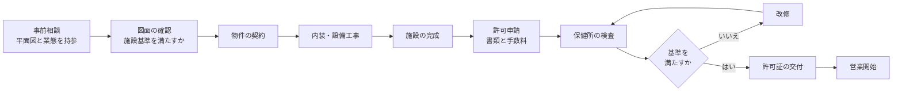

# 第10章 営業許可と法規

## 10.1 この章で扱うこと

飲食店を開くには、保健所・消防署・税務署など複数の窓口への確認と手続きが必要です。この章では、食品衛生法にもとづく営業許可と営業届出、施設基準、受動喫煙対策、消防法、屋外席の扱い、酒類の提供を扱います。あわせて、**本書で一次資料を取得できなかった項目**を明示します。食品表示とアレルギーは [第11章](11-hyouji-allergy.md)、衛生管理の運用は [第12章](12-eisei-haccp.md) で扱います。

> **本章の限界**: 本章の作成時点で、公的一次資料を十分に取得できなかった項目があります（申請書類の一覧、施設基準の具体例、消防法の用途区分、酒類の提供と免許の線引きなど）。**未取得の項目は「未取得」と明記**し、推測で埋めていません。実際の手続きは保健所・消防署・税務署に確認してください。
>
> **本資料は法的助言ではありません。** 制度の概要と確認先を示すものです。個別の判断は、所管官署と専門家の確認によります。

## 10.2 学習目標

- 営業許可と営業届出の違いを説明し、自分の業態がどちらに該当するかを確認できる。
- 業態の組み合わせによって増える許可を列挙し、保健所に相談する順序を説明できる。
- 施設基準で問われる観点を平面図の上で確認し、面積が狭い場合の代替の工夫を挙げられる。
- 受動喫煙対策の4類型を区別し、新規開業の店が選べる選択肢を説明できる。
- 消防法・酒類・屋外席について、**何が未取得で、どこに確認するか**を一覧にできる。

## 10.3 最初に確認する4つの窓口

飲食店の開業・運営で確認する窓口は、主に4つです。

| 窓口 | 確認すること | 根拠となる法規 |
| --- | --- | --- |
| 保健所 | 営業許可の要否、施設基準、HACCP、屋外での提供 | 食品衛生法 |
| 消防署 | 防火対象物の区分、消防用設備、避難経路、収容人員 | 消防法 |
| 税務署 | 開業届、消費税、酒類の免許 | 国税通則法、消費税法、酒税法 |
| 労働基準監督署 | 労働時間、賃金、年少者の扱い | 労働基準法 |

**この4つは独立しています。** 保健所の許可が下りても、消防の条件を満たさなければ営業できません。消防の確認が済んでも、食品衛生の施設基準を満たさなければ許可は出ません。1つの窓口で「大丈夫」と言われても、他の窓口の確認にはなりません。



図の説明: 4つの確認は、契約の前から並行して進めます。保健所と消防の見解は内装の設計に入る前に取ります。税務と労務は、内装の完成を待たずに準備できます。どの窓口も「開業直前」に回すと、手戻りが大きくなります。

**契約の前に確認する理由**は、金銭的な損失を避けるためです。設備の追加工事、換気の作り直し、間仕切りの追加は、いずれも高額になります。加えて、契約書に「許可が下りない場合の解除」や「原状回復の範囲」を定めておくと、後の交渉が進めやすくなります（**一般知識（未検証）**）。

相談のときは、**図面（平面図）と業態、提供方法（店内飲食・持ち帰り・屋外席の有無）**を持って行きます。口頭の説明だけでは、担当者によって回答が変わります。

## 10.4 営業許可と営業届出

### 制度の位置づけ（一次資料で確認）

食品衛生法にもとづく営業許可制度は、食中毒リスクと産業実態を踏まえて業種が再編されました。また、許可を要さない業種については**営業届出制度**が新設されています。この届出制度は「HACCPに沿った衛生管理が制度化されることに伴い、食品等事業者を把握できるよう」設けられたものです。

出典: 厚生労働省「食品衛生法関連」 https://www.mhlw.go.jp/stf/seisakunitsuite/bunya/kenkou_iryou/shokuhin/kigu/index_00010.html （取得日 2026-11-14）

経過措置があり、申請は「食品衛生申請等システム」で行えることも確認されています（同上）。

### 一般に言われること（一般知識・未検証）

以下は業界で一般的に言われますが、**本章では一次資料で確認できていません**。

- 飲食店営業の許可は**保健所**に申請する
- 施設基準（調理場の構造、給排水、手洗い設備、冷蔵設備など）を満たす必要がある
- 許可には有効期間がある
- 無許可で営業すると罰則がある

**これらは本章の確度では「一般知識（未検証）」です。** 具体的な要件は保健所の窓口で確認してください。

### 許可と届出の違い

| 制度 | 対象 | 手続き | 意味 |
| --- | --- | --- | --- |
| 営業許可 | 食中毒リスクが高い業種（飲食店営業など） | 保健所の許可を受ける | 許可なく営業すると違法 |
| 営業届出 | リスクが低い業種 | 保健所に届け出る | 届出がなくても罰則の対象にならない場合がある |

**「飲食店をやるなら許可」と覚えるのではなく、自分の業態がどちらに該当するかを確認する**のが正しい手順です。テイクアウトのみ、菓子製造、酒類の提供など、業態の組み合わせで必要な許可が変わります。

### 業態の組み合わせで増える許可

1つの店で複数の行為をする場合、許可も複数必要になります。**よくある組み合わせ**を整理します。ただし、次の表は本章で一次資料を確認したものではなく、**確認先を整理するための一般知識（未検証）**です。

| 行為 | 一般に必要とされる許可・届出 | 根拠となる法律（一般に言われるもの） |
| --- | --- | --- |
| 店内で飲食させる | 飲食店営業許可 | 食品衛生法 |
| 喫茶店として営業する | 喫茶店営業許可 | 食品衛生法 |
| 菓子を作って販売する | 菓子製造業許可 | 食品衛生法 |
| そうざい・弁当を作って販売する | そうざい製造業許可 | 食品衛生法 |
| 酒類を持ち帰り販売する | 酒類販売業免許 | 酒税法 |
| 深夜に酒類を提供する酒場 | 深夜酒類提供飲食店営業の届出 | 風俗営業等の規制及び業務の適正化等に関する法律 |

**「持ち帰りを始めたい」「菓子も売りたい」と思った時点で、保健所に相談する**のが安全です。メニューを増やす前に、許可の要否を確認します。許可の追加には施設基準の追加要件が付くことがあり、後から厨房を直すことになります。

### 許可の単位は「施設ごと」

営業許可は**施設ごと**に必要と一般に理解されています（**一般知識・未検証**）。同じ運営主体でも、離れた場所に店を構えれば、それぞれの施設で許可を取ることになります。

複数の店舗を運営する場合、**共用する設備や空間があると、その扱いが曖昧になります**。調理を1か所に集約して提供する形態、店舗間で食材を移す形態、客席だけを共用する形態では、どの施設の許可の範囲になるかを保健所に確認します。共用部分の衛生管理の責任者を決めておくことも必要です。

**許可の有効期間と更新の手続きは、本章では一次資料を確認していません（未取得）。** 期限を過ぎた状態で営業すると無許可営業になりうるため、**許可証に記載された期限を、更新の1か月前などに通知する仕組み**を作ります。

### 申請から営業開始までの流れ

営業許可は、施設が完成してから申請します。ただし、確認は契約前から始まります。



図の説明: 検査で基準を満たさない場合、改修して再検査になります。**工事の完了と営業開始の間に、検査と改修の時間を置いておきます。** 開業日を工事完了日に設定すると、検査で指摘が出たときに開業日を動かすことになります。

| 段階 | 主な作業 | 準備するもの |
| --- | --- | --- |
| 事前相談 | 業態と提供方法を伝え、施設基準の見解を取る | 平面図、メニュー案、提供形態の説明 |
| 図面の確認 | 汚染区域と清潔区域の分離、手洗い、給排水、換気を確認する | 修正した平面図、設備の仕様 |
| 契約 | 賃貸条件と、許可が下りない場合の扱いを確認する | 契約書の案 |
| 工事 | 図面どおりに施工する。変更は保健所に相談する | 施工図、設備のリスト |
| 申請 | 申請書類を提出する | 申請書、平面図、食品衛生責任者の資格を証する書類、手数料 |
| 検査 | 施設の状態を確認してもらう | 施設の完成状態、温度計、記録様式 |
| 交付 | 許可証を受け取る | — |

**工事中の変更は、必ず保健所に相談します。** 図面の確認を受けた後に設備の位置を変えると、検査で指摘が出ます。小さな変更でも、確認した図面と現況が違えば説明が必要になります。

**検査の前に、自店で同じ観点で点検します。** 手洗いの石けんとペーパータオル、冷蔵庫の温度計、食品の保管場所、排水の勾配、換気の稼働——いずれも「あるかどうか」ではなく「**使える状態かどうか**」を見ます。温度計が棚の奥にしまってあれば、管理できない状態です。

### 提供方法を変えたときの確認

許可は、申請した業態と提供方法の範囲で有効です。**メニューを増やす、提供方法を変えるときは、その都度確認します。**

| 変更 | 確認すること | 確認先 |
| --- | --- | --- |
| 持ち帰りを始める | 追加の許可の要否、容器詰めの場所、表示の義務（→ [第11章](11-hyouji-allergy.md)） | 保健所・消費者庁 |
| 屋外に席を出す | 提供場所が許可の範囲か、収容人員への算入 | 保健所・消防署 |
| 菓子を作り始める | 菓子製造業の許可、製造室の区分 | 保健所 |
| 酒類を持ち帰り販売する | 酒類販売業免許の要否 | 税務署 |
| 深夜に酒類を提供する | 深夜酒類提供飲食店営業の届出 | 保健所・警察署 |
| 調理場所を変える | 施設の範囲、衛生管理の計画 | 保健所 |

**「メニューを1品足すだけ」でも、許可が要る場合があります。** 焼き菓子を袋詰めで売る、弁当を持ち帰らせる、といった行為は、製造業の許可に関わります。**新しい提供方法を決めた時点で**相談します。売上計画を立てた後では、前提が崩れます。

## 10.5 施設基準で問われること

具体的な基準は保健所の指導によりますが、**一般に確認される観点**は次のとおりです（**一般知識・未検証**）。

| 観点 | 内容 |
| --- | --- |
| 調理場の区分 | 汚染区域（下処理）と清潔区域（盛り付け）の分離 |
| 手洗い設備 | 調理場・トイレの手洗い。石けんとペーパータオル |
| 給排水 | 水道、排水の構造。グリストラップの設置 |
| 冷蔵・冷凍設備 | 温度管理ができる容量 |
| 保管設備 | 食材の保管場所。虫・ねずみの侵入防止 |
| 換気 | 調理中の油煙・蒸気の排出 |
| トイレ | 客用と従業員用の区分、手洗い |

**用語の説明**: **グリストラップ**は、排水に含まれる油脂を分離して下水へ流す装置です。詰まると排水の逆流と悪臭の原因になります。**ドライシステム／ウェットシステム**は、厨房の床を乾いた状態に保つ設計（ドライ）と、水で流せる設計（ウェット）の違いを指します。どちらが求められるかは保健所の指導と業態によります。

**施設の面積が小さい場合、この分離が難しくなります。** 調理場と客席、下処理と盛り付けをどう分けるかは、レイアウト設計の段階で保健所に相談するのが確実です。面積が限られるほど、**時間で分ける**（下処理の時間帯をずらす）、**器具で分ける**（まな板と包丁を色分けする）といった代替の工夫が必要になります。

| 制約 | 起きやすい問題 | 相談する内容 |
| --- | --- | --- |
| 面積が狭い | 汚染区域と清潔区域が近接する | 動線の分離方法、時間分離で足りるか |
| 客席と厨房が近い | 提供中の飛沫・異物 | 提供カウンターの構造、覆いの要否 |
| 換気の経路が短い | 油煙・臭気が客席に流れる | 給気と排気の位置、ダクトの経路 |
| 排水の勾配が取れない | 排水が滞留する | 排水口の位置、ポンプの要否 |

### 施設基準の確認を、図面で行う

施設基準は、文章で確認するより**平面図の上で確認する**ほうが確実です。次の順に図面を見ます。

1. 汚染区域（下処理・生もの）と清潔区域（加熱済み・盛り付け）を色分けする。
2. 従業員の動線を書き込む。汚染区域から清潔区域へ**一方向**に流れるかを見る。
3. 手洗い設備の位置を書き込む。厨房の入口と、客席から調理場に入る場所の両方に要ります。
4. 排水の流れを書き込む。勾配が取れるか、グリストラップの位置は適切かを見る。
5. 冷蔵・冷凍設備の容量と位置を書き込む。庫内温度を測る位置も決めます。
6. 換気の給気と排気の位置を書き込む。油煙が客席に流れないかを見る。

**図面は保健所に持って行く前提で作ります。** 手書きでも構いませんが、寸法と設備の位置が入っている必要があります。

## 10.6 受動喫煙対策

**この項目は一次資料で詳細に確認できました。** 飲食店に直接影響するため、丁寧に扱います。

### 制度の概要

健康増進法の一部を改正する法律により、**2020年4月1日に全面施行**されました（一部は2019年7月施行）。要点は次の3つです。

- 多くの施設において**屋内が原則禁煙**
- 屋内で喫煙するには**喫煙室の設置**が必要
- 喫煙室には**標識の掲示**が義務

出典: 厚生労働省「受動喫煙対策」 https://jyudokitsuen.mhlw.go.jp/ （取得日 2026-11-14）

### 喫煙室の4類型

| 類型 | 飲食の可否 | 対象 |
| --- | --- | --- |
| 喫煙専用室 | **飲食不可** | 一般の事業者 |
| 加熱式たばこ専用喫煙室 | 飲食可 | 経過措置の対象 |
| 喫煙目的室 | — | 喫煙目的施設 |
| 喫煙可能室 | 飲食可 | **既存特定飲食提供施設のみ** |

出典: 同上（取得日 2026-11-14）

**飲食しながら吸える部屋を作れるのは、原則として「既存特定飲食提供施設」だけ**です。新規に出店する飲食店は、喫煙専用室（飲食不可）までしか作れません。

**「既存特定飲食提供施設」**とは、改正法の施行時に既に営業していた小規模な飲食店を指し、経過措置として喫煙可能室を認められた施設です。新しく開業する店は、この区分に入りません。

### 既存特定飲食提供施設の3条件

経過措置の対象になるには、**3つすべて**を満たす必要があります。

1. 2020年4月1日時点で現に存する飲食店（事業継続性・経営主体の同一性・店舗の同一性で総合判断）
2. 資本金5,000万円以下
3. **客席面積100㎡以下**

出典: 同上（取得日 2026-11-14）

3番目の条件は、**客席面積**である点に注意します。店舗全体の面積や厨房を含む面積ではありません。改装で客席を増やすと、条件から外れる可能性があります。

**客席面積の判定は、改装のたびに計算し直します。**

```
改装後の客席面積 = 現在の客席面積 +（増やす席数 × 1席あたりの面積）
```

**計算例（説明用の仮置き）**: 現在の客席面積が95㎡の店が、1席あたり1.5㎡で6席を増やします。

```
95㎡ +（6席 × 1.5㎡）= 95㎡ + 9㎡ = 104㎡
```

104㎡は100㎡を超えるため、**この改装で経過措置の対象から外れます**。席を1つ増やす判断が、喫煙の可否を変えることがあります。

### 技術的基準

- 出入口の気流 0.2m/秒以上
- 壁・天井等で区画
- 屋外排気

ただし、既存特定飲食提供施設で店舗全体を喫煙可能室とする場合は、「壁、天井等によって区画されていること」のみで足ります（同上）。

気流の基準は、**扉を開けたときに煙が漏れない方向と速さ**を定めたものです。施工後に測って足りなければ、改修費がかかります。設計の段階で、喫煙室を設置する業者と保健所の双方に確認します。

### 20歳未満の立入禁止

**20歳未満は、来店客・従業員とも喫煙エリアに立ち入れません。** 過料は、管理権原者が最大50万円、喫煙した人が30万円以下です（同上）。

**従業員も対象**である点は、採用とシフトに影響します。18歳や19歳のスタッフを雇用する予定がある店は、喫煙可能室を選ぶと配置できる人が限られます。

### 屋外の扱い

取得したページには、**飲食店の屋外席についての直接の記述はありません**でした。「屋外を含めた敷地内が原則禁煙となる施設」として学校・病院・児童施設等、行政機関、旅客運送事業の車両・航空機が挙げられ、それらでも「屋外には、必要な措置が取られた場所に限り喫煙場所の設置ができます」とされています（同上）。

**飲食店の屋外席での喫煙の扱いは、本章では確定できません（未取得）。** 保健所または自治体の窓口で確認してください。

### 自治体の条例による上乗せ

東京都受動喫煙防止条例では、**従業員を雇う場合に喫煙可能室を認めていません**（同上）。東京都で開業する場合は、国の基準より厳しい条件になります。所在地の自治体条例を必ず確認してください。

**国の基準を満たせば全国どこでも同じ、ではありません。** 条例で上乗せの規制をしている自治体があります。確認するときは「国（健康増進法）の基準」と「自治体の条例」の2段階で聞きます。

### 禁煙という選択

喫煙室を作らない判断も、経営上の選択肢です。

| 選択 | 利点 | 注意点 |
| --- | --- | --- |
| 全面禁煙 | 設備投資が不要。家族連れ・20歳未満も入りやすい | 喫煙する客層は来ない |
| 喫煙専用室を設置 | 喫煙する客層を取れる | 飲食はできない。面積と設備費がかさむ |
| 喫煙可能室（既存施設のみ） | 飲食しながら吸える | 条件を満たす店に限る。従業員の確保に制約 |

**喫煙室は、作るだけでなく維持する費用がかかります。** 気流の維持、清掃、フィルターの交換、標識の管理が必要です。席数の少ない店では、喫煙室に使う面積が売上機会を減らします。

**計算例（説明用の仮置き）**: 客席面積18㎡・20席の店で、4㎡を喫煙専用室にすると、残りの14㎡で16席しか取れないとします。

```
席数の減少率 = 1 −（16席 ÷ 20席）= 20%
日商への影響 = 111,000円 × 0.20 = 22,200円/日
月商への影響 = 22,200円 × 25日 = 555,000円/月
```

**喫煙室を作ると、月55万円の売上機会を失う計算**です。その分を喫煙する客層の来店で取り返せるかを、開業前に見積もります。

## 10.7 消防法

**消防法の具体的な要件は、本章では取得できませんでした（未取得）。** 用途区分（消防法施行令別表第一の号）、収容人員の算定、消防用設備の義務は、法令本文または PDF にしか情報がなく、HTML で確認できませんでした。

確認が必要な項目を整理します。

| 確認事項 | 内容 |
| --- | --- |
| 防火対象物の用途区分 | 飲食店がどの号に該当するか |
| 収容人員 | 何人収容と見なされるか。**屋外席・テラス席が算入されるか** |
| 消防用設備 | 自動火災報知設備、消火器、誘導灯などの要否 |
| 避難経路 | 避難口、通路の幅、誘導 |
| 防火管理者 | 選任が必要な規模か |

**これらは所轄の消防署に確認してください。** 特に、**屋外の席を客席として使う場合に収容人員に算入されるか**は、設備の義務量に影響します。本章ではこの点を確認できていません（→ 10.8、10.10）。

**収容人員**とは、消防法上その建物に収容できる人数として扱われる数です。消防用設備の必要量や、防火管理者の選任の要否は、この人数を基準に決まります。算定の方法は床面積に係数を掛ける等方式が一般に言われますが、**本章では一次資料を確認していません**（**一般知識・未検証**）。自店の数値は消防署に確認します。

**防火対象物**とは、消防法の規制を受ける建物などの総称です。飲食店は、用途と規模によって区分（号）が決まります。区分が変わると、必要な設備が変わります。

用途区分の確認で伝えることは、次の3点です。

1. 使う業態（飲食店、喫茶店、深夜の酒場など）
2. 建物全体の構成（他にどんな用途の店が入っているか）
3. 席の構成（屋内席、屋外席、テラス席の別と数）

建物の一部を借りる形態では、**建物全体の用途と、自分の部分の用途の両方**が関わります。単独の店舗では出てこない確認事項です。

**確認の結果は、書面か日付入りのメモで残します。** 後から「言われていない」という食い違いが起きたとき、確認した日時と担当者が分かると説明できます。

## 10.8 屋外席・テラス席を設ける場合

屋外に席を出す店は増えています。ただし、**屋外は「店の外」ではなく「規制の対象」**です。屋内の席と同じ前提では進められません。

| 論点 | 内容 | 主な確認先 |
| --- | --- | --- |
| 提供場所が許可の範囲か | 屋外で調理・提供する行為が営業許可の範囲に含まれるか | 保健所 |
| 収容人員への算入 | 屋外席を客席として数えるか | 消防署 |
| 道路・公有地の使用 | 歩道や公有地に席を出す場合の占用・使用許可 | 自治体の道路管理者 |
| 条例による規制 | 路上喫煙、営業時間、騒音、景観の規制 | 自治体 |
| 建物の使用ルール | 共用部分を使えるか、専用使用の範囲はどこか | 建物の管理者・所有者 |
| 衛生管理 | 気温、虫、ほこり、提供までの時間 | 保健所（→ [第12章](12-eisei-haccp.md)） |
| 税務上の扱い | 屋内飲食と同じ税率でよいか | 税務署・税理士（→ [第18章](18-kaikei-zeimu.md)） |

**確認の順序**は、保健所 → 消防署 → 自治体 → 建物の管理者です。衛生と許可の範囲が最初です。許可の範囲外の場所で調理・提供すれば、無許可営業とみなされる可能性があります。

**「屋外だから自由」とは言い切れません。** 路上喫煙の禁止、にぎわい創出のための占用の許可、テラス営業の届出など、自治体ごとに制度があります。

**売上計画への織り込み**は、確認が済んでから行います。

```
屋外席の月商 = 席数 × 回転率 × 客単価 × 使える日数
使える日数 = 営業日数 × 天候による稼働率
```

**計算例（説明用の仮置き）**: テラス4席、回転1.5、客単価1,200円、月25日営業、天候で使える日が60%とします。

```
使える日数 = 25日 × 0.60 = 15日
月商 = 4席 × 1.5 × 1,200円 × 15日 = 108,000円
年商 = 108,000円 × 12か月 = 1,296,000円
```

屋外席を客席として数えられない場合は、この108,000円が計画から落ちます。**先に計画へ入れてしまうと、家賃や人件費の前提が崩れます。**

**天候による変動**も計画に入れます。雨天や強風の日は使えません。年間の稼働率を保守的に見積もり、屋内席だけで採算が取れる構造にしておくのが安全です。

## 10.9 酒類の提供

**一次資料では、飲食店営業許可だけで酒類の提供が可能か、別途の免許が必要かの線引きを確認できませんでした（未取得）。**（国税庁のページが文字化けし、目次構造のみ取得）

一般には、**店内での飲食に伴う酒類の提供は飲食店営業許可の範囲**で行え、**小売（持ち帰り）は酒類販売業免許**が必要とされますが、本章では**一次資料で確認できていません**。

持ち帰り販売や通信販売を検討する場合は、税務署（酒類の免許担当）に確認してください。

### 酒類提供で押さえる論点

| 論点 | 内容 | 確認先 |
| --- | --- | --- |
| 提供と販売の区別 | 店内で飲ませるのか、持ち帰らせるのか | 税務署 |
| 20歳未満への提供 | 年齢確認の方法と記録 | 所管官署（**一般知識・未検証**） |
| 深夜の営業 | 深夜に酒類を提供する形態の届出 | 保健所・警察署 |
| 飲酒運転への配慮 | 退店時の声かけ、代行の案内 | 店の運用ルール |

**年齢確認は、見た目で判断しない運用**にします。確認した日時と方法を記録する様式を決めておくと、後から説明できます（**一般知識・未検証**）。

**深夜営業を計画している場合は、届出の要否を早めに確認します。** 深夜酒類提供飲食店営業の届出は風俗営業等の規制及び業務の適正化等に関する法律にもとづくもので、食品衛生の許可とは別の手続きです（**一般知識・未検証**）。営業時間の変更は、内装や近隣対応にも影響します。

## 10.10 未取得の項目と確認先

| 項目 | 状況 | 確認先 |
| --- | --- | --- |
| 営業許可の申請書類・施設基準の具体例 | 未取得（PDFのみ） | 保健所 |
| 営業許可の有効期間・更新手続き | 未取得 | 保健所 |
| HACCPの正確な施行日と経過措置 | 矛盾を確認、未確定（→ [第12章](12-eisei-haccp.md) 12.5） | 保健所・厚生労働省 |
| 食品表示の外食・テイクアウトでの義務範囲 | 未取得（→ [第11章](11-hyouji-allergy.md)） | 消費者庁・保健所 |
| 屋外席での喫煙の扱い | 未取得 | 保健所・自治体 |
| 消防法の用途区分・収容人員・消防用設備 | 未取得 | 消防署 |
| 酒類提供と酒類販売業免許の線引き | 未取得 | 税務署 |
| 深夜酒類提供飲食店営業の届出の要件 | 未取得 | 保健所・警察署 |
| 消費税・インボイスの実務 | 未取得（→ [第18章](18-kaikei-zeimu.md)） | 税務署・税理士 |
| 労働基準法の割増率・変形労働時間制の要件 | 一部未取得（→ [第13章](13-roudou-hou.md)） | 労働基準監督署・社会保険労務士 |

**この表は「調べれば分かること」の一覧ではありません。** 本章が確認を試みて届かなかった項目です。開業前には、すべて確認先で埋めてください。

**確認を依頼するときの形式**を決めておくと、抜けが減ります。

| 記録する項目 | 例 |
| --- | --- |
| 確認日 | 2026-11-14 |
| 確認先 | 〇〇市保健所 生活衛生課 |
| 担当者 | 窓口の担当者名 |
| 質問 | 屋外席を含めた場合の施設基準 |
| 回答 | 平面図を持参して再確認が必要 |
| 次の行動 | 平面図を修正し、12月中に再相談 |

**口頭の回答は、後から変わることがあります。** 記録を残すのは、相手を疑うためではなく、**自分の前提を固定するため**です。

## 10.11 ケースの店では

ケースの店（食堂つきかげ、席数20、客席面積は約18㎡と仮置き、4月開業）で、この章の論点を整理します。**以下の数字は設計値であり、実在の店舗の実績ではありません。**

**業態と許可**: 昼は定食、夜は居酒屋の二毛作で、店内飲食が中心です。持ち帰りと屋外席は計画していません。したがって必要となるのは飲食店営業許可で、持ち帰りを始める場合はそうざい製造業などの要否を保健所に確認することになります（**一般知識（未検証）**）。酒類は店内で提供する形態です。持ち帰り販売は行わないため、酒類販売業免許の要否は生じませんが、この線引きは本章では一次資料を確認できていません（→ 10.9）。

**受動喫煙**: 新規開業の店であるため、**飲食しながら吸える喫煙可能室は作れません**。ケースの店は全面禁煙を選びます。これは経営判断でもあります。喫煙専用室を作る場合は、10.6の計算例のとおり、客席面積の一部を削って月55万円規模の売上機会を失う計算になります。**開業初年度の営業利益が年928,000円（月平均約77,000円）**であることを踏まえると、この売上機会の損失は損益に直結します。

**消防**: 客席面積18㎡、20席の店舗です。用途区分と収容人員、必要な消防用設備は本章では確認できていません（未取得）。20席という規模は小さいものの、**建物全体の用途（他のテナント）と、1階という位置（避難経路）**が関わります。契約前に消防署へ平面図を持参して確認します。

**屋外席**: ケースの店は屋外席を計画していません。前面道路が商店街の歩道である場合、占用の許可と収容人員への算入の両方が問題になります。**確認が済むまで売上計画に入れない**方針です。

**施設基準**: 店舗全体が約30㎡、客席が約18㎡とすると、厨房・トイレ・通路は約12㎡です。この面積で汚染区域と清潔区域を分けるには、**時間で分ける**（下処理を午前中に済ませる）と**器具で分ける**（まな板と包丁の色分け）の併用が必要になります。平面図の段階で保健所に相談します。

## 10.12 よくある誤解

| 誤解 | 実際 |
| --- | --- |
| 飲食店なら必ず「飲食店営業許可」 | 業態によって許可・届出・別の許可が変わる。組み合わせで複数必要になる |
| 保健所の許可が下りれば営業できる | 消防、労務、税務など別の確認が並行して必要 |
| 保健所に行けばすべて教えてもらえる | 窓口ごとに所管が違う。消防・税務・労務は別に確認する |
| 許可は人に対して出る | 施設ごとに必要と一般に理解されている（**一般知識・未検証**） |
| 許可を取れば期限の管理は不要 | 有効期間があると一般に言われる。期限の通知を仕組みにする（本章では未取得） |
| 喫煙室を作れば飲食しながら吸える | 飲食可能な喫煙室は既存特定飲食提供施設のみ。新規店は不可 |
| 客席面積100㎡は店舗全体の面積 | **客席面積**で判定する。厨房や通路は含めない |
| 屋外なら喫煙は自由 | 飲食店の屋外席の扱いは本章では確定できない。要確認 |
| 屋外席は建物の外だから消防と無関係 | 客席として数えるかで設備の義務量が変わる。消防署に確認する |
| 条例は国の基準より緩い | 上乗せの規制がある。所在地の条例を確認する |
| 口頭で確認すれば記録は不要 | 後から回答が変わることがある。日付・担当者・回答を残す |

## 10.13 この章の要点

- 確認先は保健所・消防署・税務署・労働基準監督署の4つで、**独立して並行に**確認します。どれか1つでは足りません。
- 許可と届出は業態で決まります。**持ち帰り・菓子・酒類を足すと、許可も増えます**。提供方法が変わったら保健所に確認します。
- 施設基準は**平面図の上で**確認します。面積が狭い場合は、時間と器具で分ける代替の工夫を相談します。
- 飲食しながら吸える部屋は**既存特定飲食提供施設だけ**です。新規店は作れません。客席面積100㎡以下という条件は、改装のたびに計算し直します。
- 消防法・酒類・屋外席は**本章では未取得**です。数値を推測せず、確認先で埋めます。本章は法的助言ではありません。

## 10.14 自店で確認すること

- [ ] 業態（店内飲食・持ち帰り・菓子・酒類）を書き出し、必要な許可・届出を保健所に確認した
- [ ] 施設基準（調理場の区分、手洗い、給排水、冷蔵、換気、トイレ）を平面図の上で確認した
- [ ] 許可証の有効期間と更新の時期を、通知の仕組みに載せた
- [ ] 屋外席を出す場合、提供場所が営業許可の範囲か（保健所）と、収容人員に算入されるか（消防署）を確認した
- [ ] 喫煙室の要否を決め、客席面積100㎡の条件と所在地の条例（上乗せ規制）を確認した
- [ ] 消防の用途区分・収容人員・消防用設備を、平面図を持って消防署に確認した
- [ ] 酒類の提供形態（店内提供／持ち帰り販売）を整理し、免許の要否を税務署に確認した
- [ ] 未取得の項目を、確認先・確認日・回答・次の行動の形で一覧にした

## 10.15 章末問題

### 問1 客席面積と屋外席の売上（計算）

次の2つを計算してください。

(a) 現在の客席面積が95㎡の飲食店が、1席あたり1.5㎡で6席を増やす改装を行います。改装後の客席面積を求め、受動喫煙対策の経過措置（既存特定飲食提供施設、客席面積100㎡以下）の対象に留まれるかを判定してください。

(b) テラス席4席を出す計画があります。1席あたりの回転率1.5、客単価1,200円、月25日営業、天候で使える日が60%のとき、屋外席による月商と年商を求めてください。

**解答**

```
【(a) 客席面積】
95㎡ +（6席 × 1.5㎡）= 95㎡ + 9㎡ = 104㎡

104㎡ > 100㎡ のため、経過措置の対象から外れる。
```

席を6席増やす改装が、喫煙可能室の可否を変えます。**改装の計画時に、客席面積を計算し直す**必要があります。なお、この判定は客席面積で行うため、厨房・トイレ・通路の面積は含めません。

```
【(b) 屋外席の売上】
使える日数 = 25日 × 0.60 = 15日
月商 = 4席 × 1.5 × 1,200円 × 15日 = 108,000円
年商 = 108,000円 × 12か月 = 1,296,000円
```

108,000円は、屋外席が客席として認められ、占用の許可が下り、天候が計画どおりだった場合の値です。**3つの前提がすべて揃って初めて成立します。** 確認が済むまでは、屋内席だけで採算が取れる計画にしておきます。

### 問2

駅前の物件で、歩道にはみ出す形のテラス席を出したいと考えています。確認の順序と、確認しないまま進めた場合に起きる問題を説明してください。

**解答**: 順序は、保健所（屋外での提供が営業許可の範囲か）→ 消防署（屋外席を収容人員に算入するか）→ 自治体の道路管理者（歩道の占用・使用許可）→ 自治体の条例（路上喫煙・営業時間・騒音）→ 建物の管理者（共用部分を使えるか）です。

確認しないまま進めると、次の問題が起きます。許可の範囲外なら無許可営業とみなされる可能性があります。収容人員の算入を誤ると、消防用設備が不足します。占用の許可がなければ、撤去を求められます。いずれも、**売上計画を作った後に判明すると、席数と家賃の前提が崩れます**。屋外席は、確認が済むまで売上計画に織り込みません。

### 問3

新規に開業する店で、店内に喫煙しながら飲食できる部屋を作りたいと考えています。可能ですか。また、喫煙室を作らない判断にはどのような根拠が考えられますか。

**解答**: 新規の開業では、飲食可能な喫煙室（喫煙可能室）は作れません。経過措置の対象は「2020年4月1日時点で現に存する飲食店」で、資本金5,000万円以下、客席面積100㎡以下の3条件をすべて満たす既存特定飲食提供施設に限られます（出典: 厚生労働省「受動喫煙対策」、取得日 2026-11-14）。新規店が作れるのは喫煙専用室で、そこでは飲食できません。加えて、東京都の条例では従業員を雇う場合に喫煙可能室が認められていません。**居抜きで前の店が喫煙可能室を持っていたとしても、経営主体と店舗の同一性が問われる**ため、そのまま使えるとは限りません。保健所に確認します。

喫煙室を作らない根拠としては、次の3つが挙げられます。1つ目は**売上機会の損失**です。喫煙室に面積を使うと席数が減り、10.6の計算例では月55万円規模の売上機会を失う計算になります。2つ目は**維持費**です。気流の維持、清掃、フィルター交換、標識の管理が継続して必要になります。3つ目は**採用の制約**です。20歳未満は従業員も喫煙エリアに立ち入れないため、若いスタッフを配置できる範囲が狭まります。一方で、喫煙する客層を取れる利点はあります。**どちらが大きいかは、商圏の客層と席数から個別に判断します。**

## 参考文献・出典

- **確信度 高**: 10.6 受動喫煙対策（厚生労働省「受動喫煙対策」 https://jyudokitsuen.mhlw.go.jp/ 、取得日 2026-11-14）。10.4 の営業許可・営業届出制度の概要、食品衛生申請等システム（厚生労働省 https://www.mhlw.go.jp/stf/seisakunitsuite/bunya/kenkou_iryou/shokuhin/kigu/index_00010.html 、取得日 2026-11-14）。
- **確信度 低〜未取得**: 10.5 施設基準、10.7 消防法、10.8 屋外席の各論点、10.9 酒類、10.10 の各項目。**推測では埋めていない**。
- 10.4 の業態の組み合わせ表、10.5 の制約別の相談内容、10.7 の収容人員の算定方法、10.8 の確認順序、10.9 の年齢確認の運用、10.10 の記録様式は、確認先を整理するための**一般知識（未検証）**であり、確認結果ではありません。
- 10.6 の客席面積の計算例、10.8 の屋外席の売上計算、10.15 の計算は、**説明用の仮置き**です（1席あたり1.5㎡、回転率1.5、客単価1,200円、稼働率60%、日商111,000円）。実在の店舗の実績ではありません。
- 10.11 のケースの数値は、[OUTLINE.md](../OUTLINE.md) の3章に定めた**ケースの設計値**（席数20、客単価900円〜3,500円、初期投資1,500万円、年間営業利益928,000円）と、客席面積約18㎡という**説明用の仮置き**です。
- 食品表示とアレルギーは [第11章](11-hyouji-allergy.md)、衛生管理とHACCPは [第12章](12-eisei-haccp.md)、消費税・インボイスは [第18章](18-kaikei-zeimu.md)、労働法は [第13章](13-roudou-hou.md) で扱います。
- **本資料は法的助言ではありません。** 個別の判断は所管官署・専門家の確認によります。

---

前後の章: [第9章: 開業の準備](09-kaigyo-junbi.md) ／ [第11章: 食品表示とアレルギー](11-hyouji-allergy.md)
