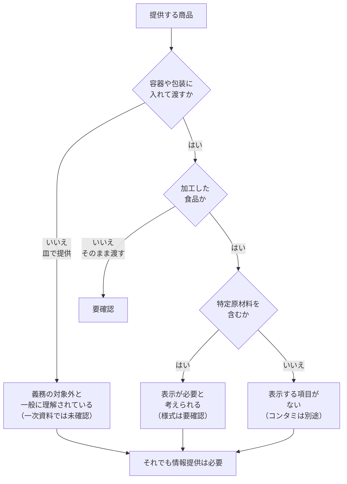

# 第11章 食品表示とアレルギー

## 11.1 この章で扱うこと

食物アレルギーは、飲食店で最も重い事故につながる論点のひとつです。この章では、食品表示の義務の対象はどこまでか、特定原材料とは何か、テイクアウトや通信販売を始めると何が変わるか、義務の外側で店が備えるべき情報提供は何かを扱います。あわせて、**誤表示が起きたときの損失**を数字で見積もります。

> **本章の限界**: 食品表示の義務の範囲は、**一次資料で確認できた部分と、できなかった部分が混在**しています。確認できたのは「義務の対象が容器包装された加工食品であること」と「特定原材料の追加が続いていること」です（消費者庁のページ、取得日 2026-11-14）。**外食・テイクアウトでの義務の具体的な範囲は未取得**です。誤表示に対する罰則の具体的な内容も、本章では一次資料を確認していません。
>
> **本資料は法的助言ではありません。** 表示の要否は、消費者庁または保健所の確認によります。

## 11.2 学習目標

- 食品表示の義務の対象が「**容器包装された加工食品**」であることを説明し、自店の商品が該当するかを判断できる。
- 特定原材料の品目が固定ではないことを理解し、最新の一覧を取り直す運用を設計できる。
- テイクアウト・配達・通信販売を始めるときに、確認すべき窓口と確認事項を挙げられる。
- 表示義務の有無にかかわらず必要になる、アレルギー情報の提供体制を設計できる。
- 誤表示が起きたときの損失を計算し、予防のコストと比較できる。

## 11.3 表示義務の全体像

食品の表示は、**食品表示法**にもとづいて定められています。飲食店が関わる場面は、大きく3つに分かれます。

| 場面 | 提供の形 | 表示義務の考え方 | 本章での確認状況 |
| --- | --- | --- | --- |
| 店内飲食 | 調理して皿で提供する | 「容器包装された加工食品」ではないため、義務の対象外と一般に理解されている | **一次資料で確認できず** |
| テイクアウト・中食 | 容器に詰めて渡す | 容器包装された加工食品に該当しうる | **一次資料で確認できず** |
| 通信販売 | 容器包装して配送する | 容器包装された加工食品に該当しうる | **一次資料で確認できず** |

**用語の説明**: **中食**（なかしょく）とは、持ち帰って家庭などで食べる形の食事を指します。弁当、総菜、テイクアウト商品がこれに当たります。**外食**は店内で食べる形、**内食**は家庭で調理する形です。

一般に、加工食品の表示には次の項目が含まれるとされます（**一般知識（未検証）**。本章では食品表示基準の原文を取得していません）。

| 項目 | 内容 |
| --- | --- |
| 名称 | 商品の一般的な名称 |
| 原材料名 | 使用した原材料を、多い順に記載する |
| 内容量 | グラム、個数など |
| 消費期限または賞味期限 | 期限と、その意味の区別 |
| 保存方法 | 冷蔵、冷凍、常温など |
| 食品関連事業者の名称・所在地 | 製造者、加工者、販売者 |
| アレルゲン | 特定原材料を含む旨 |
| 栄養成分表示 | 熱量、たんぱく質、脂質、炭水化物、食塩相当量 |

**この表は本章では一次資料を確認していません。** 実際の記載事項と様式は、食品表示基準の原文と、消費者庁が公開する手引きで確認してください。

## 11.4 義務の対象は「容器包装された加工食品」

### 確認できたこと（一次資料）

消費者庁のページには、次のように記載されています。

> 健康危害の発生を防止する観点から…特定原材料を定めています。**容器包装された加工食品**について、当該特定原材料を含む旨の表示を義務付けています。

出典: 消費者庁「食物アレルギー表示」 https://www.caa.go.jp/policies/policy/food_labeling/food_sanitation/allergy （取得日 2026-11-14）

**重要な点**: 義務の対象は「**容器包装された加工食品**」です。容器包装された加工食品とは、食品が容器や包装に入れられ、そのまま消費者に渡る形のものを指します。袋詰めの弁当、ラベルを貼った総菜、通販の真空パックなどが想定されます。

### 判定の順序

自店の商品が義務の対象かを判断するときは、次の順に確認します。



図の説明: 表示義務の判定は「皿か容器か」「加工したか」「特定原材料を含むか」の3段階です。ただし**判定の結果にかかわらず、情報提供は必要**です。義務の外側に、事故を防ぐための実務があります。

**「容器包装された加工食品」の判定は、行政の解釈によります。** 本章では、外食・テイクアウトの具体的な該当範囲を一次資料で確認できていません。**袋詰めの菓子、ラベルを貼る弁当、真空パックの総菜**を扱う場合は、消費者庁または保健所に、商品の写真と容器の現物を持って確認します。

### 表示義務と情報提供は別物

| 区分 | 根拠 | 対象 | 違反したとき |
| --- | --- | --- | --- |
| 表示義務 | 食品表示法にもとづく | 容器包装された加工食品 | 行政指導・回収命令などの対象になりうる（本章では未取得） |
| 情報提供 | 接客上の実務、事故防止 | すべての提供形態 | 義務違反ではないが、事故につながる |

**義務がないことは、何もしなくてよい理由になりません。** 事故は義務違反ではなく、**伝達の失敗**から起きます。

## 11.5 特定原材料は固定ではない

### 確認できたこと（一次資料）

消費者庁のページでは、特定原材料の追加が続いていることが確認できます。

- くるみが令和5年3月9日に追加
- **カシューナッツが令和8年4月1日に追加**
- 特定原材料に準ずるものも、アーモンドの追加、マカダミアナッツの追加、まつたけの削除など見直しが続いている

出典: 同上（取得日 2026-11-14）

**したがって「特定原材料は8品目」と暗記するのは危険です。** 本章の作成時点で、品目数は確定していません。最新の品目一覧は消費者庁のページで確認してください。品目は増減するものとして、**年1回は一覧を取り直す**運用にします。

**用語の説明**: **特定原材料**は、表示が義務づけられているアレルゲンです。**特定原材料に準ずるもの**は、表示が推奨されているアレルゲンです。両者は別の区分で、義務と推奨が混ざらないように管理します。

| 区分 | 表示の扱い | 実務での意味 |
| --- | --- | --- |
| 特定原材料 | 表示が義務づけられている | 原材料表に必ず記載する。確認を省略しない |
| 特定原材料に準ずるもの | 表示が推奨されている | 記載する方針を店として決める。記載しない場合は理由を残す |

### 品目が増えたときに起きること

品目が追加されると、**過去に作った原材料表は古くなります。** 追加された品目を使っているメニューは、原材料表の更新と、必要なら表示の追加が必要です。

| 起きること | 影響 | 対応 |
| --- | --- | --- |
| 新しい品目が追加される | 既存メニューが表示不足になる可能性 | 一覧を取り直し、原材料表を突き合わせる |
| 品目が削除される | 表示が過剰になる（義務違反ではない） | 更新の優先度は低いが、表は直す |
| 準ずるものの区分が変わる | 推奨の範囲が変わる | 店の方針を見直す |

**更新の運用**は、次の形にします。

```
年1回の点検 = 消費者庁の一覧を取得 → 取得日を記録 → 原材料表と突き合わせ → 差分を修正 → 修正日を記録
```

**「取得日を記録する」ところが抜けやすい**点です。いつ時点の一覧で確認したのかが分からないと、次に点検する人が同じ作業をやり直します。

### 行政の所管が変わっている点

食品衛生基準行政は**令和6年4月1日に消費者庁へ移管**されています（本章では移管の事実のみを扱い、**出典URLを特定していません**）。食品の表示・衛生の所管を「厚生労働省」のまま覚えていると、確認先を誤ります。最新の所管は各ページで確認してください。

## 11.6 テイクアウト・配達・通信販売を始めるとき

提供形態を増やすと、表示の論点が一気に増えます。**店内で皿に盛って出す形と、容器に詰めて渡す形では、確認することが違います。**

### 形態別の論点

| 形態 | 増える工程 | 表示・情報提供の論点 |
| --- | --- | --- |
| 店内飲食 | — | メニューでの情報提供、注文時の確認 |
| テイクアウト | 容器に詰める、フタをする、渡す | 容器包装食品としての表示、持ち帰り後の時間と温度の案内 |
| 配達 | 容器に詰める、運ぶ、手渡す | 表示、配達中の温度と時間、受取時刻の管理 |
| 通信販売 | 容器包装、梱包、発送 | 表示、保存方法、配送中の温度、問い合わせ対応 |
| 屋外席 | 屋外で提供する | 提供までの時間、異物、食器の管理（→ [第12章](12-eisei-haccp.md)） |

**テイクアウトを始めるときに確認する順序**は、次のとおりです。

1. **許可**: 持ち帰り用の商品を作る行為に、追加の許可が必要か（保健所）。→ [第10章](10-kyoka-hourei.md) 10.4
2. **表示**: 容器包装された加工食品に該当するか、該当する場合の記載事項（消費者庁・保健所）
3. **衛生**: 詰める時の温度、容器の密閉、持ち帰り後の時間の案内（→ [第12章](12-eisei-haccp.md)）
4. **税務**: 持ち帰りと店内飲食の税率の区分（→ [第18章](18-kaikei-zeimu.md)）

**1番目を飛ばして2番目から始めると、商品を作れないことが分かってから容器とラベルを作り直すことになります。**

### テイクアウトを足したときの数字

**計算例（説明用の仮置き）**: 弁当を1日30食、単価800円、月25日販売します。容器に貼るラベルは1枚3円とします。

```
テイクアウトの月商 = 30食 × 800円 × 25日 = 600,000円
ラベルの月額 = 30食 × 3円 × 25日 = 2,250円
ラベルの売上比率 = 2,250円 ÷ 600,000円 = 0.375%
ラベルの年額 = 2,250円 × 12か月 = 27,000円
```

**ラベルの費用は、売上の0.4%程度**です。金額としては小さい。しかし、**ラベルに何を書くかを決める作業**が別に発生します。原材料の確認、記載順の統一、アレルゲンの抽出、表示内容の校閲です。この作業を軽く見ると、誤表示が起きます。

### 容器とラベルの設計で決めること

テイクアウトを始めるときは、容器とラベルを「あとから足す」のではなく、**最初に設計**します。

| 決めること | 選択肢 | 判断の基準 |
| --- | --- | --- |
| ラベルの貼り方 | 容器に直接印刷、シール、帯封 | 貼り間違いが起きにくい形を選ぶ |
| 商品の識別 | 色分け、商品名の大きな表示 | 繁忙時でも一瞬で見分けられるか |
| アレルゲンの表示位置 | 原材料名の直後、枠で囲む | 見落とされない位置か |
| 交差接触の注記 | 容器の側面、別のシール | 読まずに捨てられないか |
| 持ち帰り後の案内 | フタの上、袋 | 食べる前に目に入るか |
| 保存方法と時間 | ラベル、袋 | 「早めに」ではなく時間の目安を書く |

**ラベルの貼り間違いは、最も起きやすい誤表示**です。同じ大きさの容器に複数の商品を詰める場合、色分けと商品名の位置を統一すると、見分けられます。**似た商品を隣に置かない**という配置の工夫も効きます。

**アレルゲンの表示は、原材料名の記載順と連動します。** 原材料は多い順に記載するため、レシピを変えると順序が変わります。順序が変わればラベルの作り直しが必要です。**レシピの変更を、ラベル更新のトリガー**として決めておきます。

## 11.7 表示義務の外側：アレルギー情報の提供

表示義務の外側にも、店として備えるべきものが残ります。**事故は義務違反ではなく、伝達の失敗から起きます。**

| 備えるもの | 内容 | 置き場所 |
| --- | --- | --- |
| 原材料表 | 主要メニューの原材料とアレルゲン | キッチンとホールの両方 |
| 提供時の確認手順 | 注文時に確認する言葉と、厨房への伝達方法 | 接客マニュアル |
| 代替の可否のルール | 除去できるメニュー、できないメニュー | メニュー表と厨房 |
| 事故発生時の動線 | 症状が出たときの連絡先、救急の判断 | 全スタッフが暗記する範囲 |

**「聞かれたら厨房に確認します」では間に合わない場面があります。** 注文のたびに厨房が止まると、提供が遅れます。主要メニューのアレルゲンは、あらかじめ一覧にしておきます。

### コンタミネーション（交差接触）

**コンタミネーション**とは、意図せずアレルゲンが混入することを指します。厨房では、次の経路で起きます。

| 経路 | 例 | 対策 |
| --- | --- | --- |
| 調理器具 | 同じフライヤーで小麦粉の衣の商品と米衣の商品を揚げる | 専用の器具・専用の油を使う。使えない場合は提供しない |
| まな板・包丁 | 同じ台でアレルゲンを含む具材を切る | 色分け・専用化。作業の順序を決める |
| 手・手袋 | アレルゲンを含む具材を触った手で盛り付ける | 手洗い、手袋の交換 |
| 揚げ油・焼き台 | 同じ油・同じ鉄板を共用する | 共用している事実を伝える |
| 調味料・ソース | 同じ容器の取り分け | 取り分け用の器具を分ける |
| 粉・ほこり | 小麦粉が空気中に舞う | 作業場所の分離、覆い |

**「除去できます」と言ってよい条件**を、あらかじめ決めておきます。

| 条件 | 判断 |
| --- | --- |
| その具材を使わないだけで済む | 除去できる可能性が高い |
| 同じ調理器具・同じ油を共用している | **除去できないと伝える** |
| ソースやたれにアレルゲンが入っている | 代替の有無を確認する |
| 仕込み済みで、後から除けない | 提供しない、または他の商品を案内する |

**最も危険なのは「たぶん大丈夫」と言ってしまうこと**です。共用の調理器具を使っているなら、**「完全には除けません」と伝える**のが正しい対応です。伝えた上で、客が判断します。

### 原材料表の作り方

原材料表は、レシピから機械的に作ります。勘や記憶で作ると、隠し味が抜けます。

```
1. レシピの材料を、調味料まで含めて全部書き出す
2. その材料の「原材料」を、仕入れ先の仕様書で確認する
   （例: しょうゆ → 大豆・小麦。マヨネーズ → 卵・大豆）
3. 特定原材料と準ずるものに該当するものを抽出する
4. 該当するアレルゲンを、メニューごとにまとめる
5. 調理器具・油の共用による交差接触を、別欄に書く
```

**計算例（説明用の仮置き）**: 唐揚げ定食の原材料表を作ります。

| 材料 | 仕様書で確認した原材料 | 特定原材料 | 準ずるもの |
| --- | --- | --- | --- |
| 鶏もも肉 | 鶏肉 | — | 鶏肉 |
| 薄力粉 | 小麦 | 小麦 | — |
| しょうゆ | 大豆、小麦、食塩 | 小麦、大豆 | — |
| 料理酒 | 米、米こうじ | — | — |
| にんにく（チューブ） | にんにく、食塩、大豆油 | 大豆 | — |
| 揚げ油 | 大豆油 | 大豆 | — |
| 付け合わせ野菜 | キャベツ、トマト | — | トマト |
| 味噌汁 | みそ（大豆）、だし（さば） | 大豆 | さば |
| 米飯 | 米 | — | — |

**この表から分かること**は3つあります。

1. **主材料より調味料にアレルゲンが多い**。鶏肉そのものより、しょうゆ・にんにく・揚げ油から大豆と小麦が出ます。
2. **汁物は別に確認が要る**。みそとだしで、大豆とさばが出ます。定食は複数の皿で構成されるため、**皿ごとではなく膳全体で確認**します。
3. **「米飯だけなら安全」とは言えない**。同じ厨房で、同じ器具を使っています。

**この表を作る作業自体が、リスクの発見になります。** 「このメニューは卵を使っていない」と思っていたのに、マヨネーズや衣に卵が入っていた、という発見が起きます。

### 注文時の確認手順

```
1. 客の申告を受ける（アレルゲンの種類、程度、過去の症状）
2. 原材料表で該当メニューを確認する
3. 厨房に伝える（口頭ではなく、伝票か端末に記録する）
4. 提供可否を厨房が判断する
5. 判断の結果を客に伝える（提供する場合も、共用器具の事実を伝える）
6. 提供した場合は、提供した事実と内容を記録する
```

**3番目の「記録する」が抜けやすい**点です。口頭で伝えると、伝達の途中で内容が変わります。伝票や端末に残すと、後から確認できます。

## 11.8 誤表示のリスク

誤表示は、大きく4つに分かれます。

| 類型 | 例 | 起きる原因 |
| --- | --- | --- |
| 欠落 | 特定原材料を含むのに記載がない | 原材料表の更新漏れ、品目の追加への未対応 |
| 誤り | 原材料名の記載順が違う、別の商品のラベルを貼る | 作業の混同、ラベルの使い回し |
| 誇大・優良誤認 | 「無添加」「国産」などの表示が事実と違う | 仕入れ先の変更を表示に反映していない |
| 健康強調 | 効果効能をうたう表現 | 表現の確認不足 |

**法的なリスク**として、食品表示法にもとづく指導・命令、景品表示法にもとづく措置、場合によっては刑事罰が問題になりうると一般に言われます（**一般知識（未検証）**。本章では条文と罰則を一次資料で確認していません）。

### 損失を数字で見る

誤表示が起きたときの損失は、品代だけではありません。

**計算例（説明用の仮置き）**: 200食を販売した商品で誤表示が見つかり、自主回収を行います。商品単価800円、回収作業10時間、人件費時給1,100円、返金・連絡の実費30,000円とします。

```
商品代の返金 = 200食 × 800円 = 160,000円
回収作業 = 10時間 × 1,100円 = 11,000円
連絡・返金の実費 = 30,000円
合計 = 160,000円 + 11,000円 + 30,000円 = 201,000円
```

**この201,000円は、金銭で数えられる部分だけ**です。これに加えて、次のものがあります。

| 損失 | 内容 | 数値化 |
| --- | --- | --- |
| 信用の低下 | 報道・口コミ・SNS での拡散 | 数値化できない |
| 行政対応 | 指導・調査への対応工数 | 数日〜数週間の拘束 |
| 販売機会の喪失 | 回収中の販売停止 | 停止日数 × 日商 |
| 再発防止の費用 | 表示体制の作り直し、専門家への相談 | 数十万円規模（**一般知識・未検証**） |
| 健康被害 | 事故が起きた場合の治療費・賠償 | 事故の規模による |

**予防のコストと比べます。**

```
表示確認のコスト = メニュー数 × 1品あたりの確認時間 × 時給 × 年あたりの見直し回数
```

**計算例（説明用の仮置き）**: メニュー40品、1品あたり15分、時給1,100円、年4回見直すとします。

```
1回あたり = 40品 × 15分 = 600分 = 10時間
1回あたりのコスト = 10時間 × 1,100円 = 11,000円
年間 = 11,000円 × 4回 = 44,000円
```

**年44,000円の確認コストに対して、誤表示1件の回収コストは201,000円**（金銭分のみ）です。確認コストのほうが安く済みます。加えて、回収に至らない小さな誤りも、確認の仕組みがあれば防げます。

**この比較の使い方**は、「確認は元が取れる」と示すことではありません。**確認の時間を削る判断に対して、根拠を示す**ために使います。繁忙期に確認を飛ばす判断が、いくらのリスクを取っているのかを数字で置きます。

### 誤表示が起きやすい場面

| 場面 | 何が起きるか | 備え |
| --- | --- | --- |
| 仕入れ先の変更 | 原材料が変わり、アレルゲンが増える | 仕入れ先の変更を、表示更新のトリガーにする |
| レシピの変更 | 隠し味の調味料にアレルゲンが入っている | レシピ変更時に原材料表を必ず更新する |
| 品目の追加（法令改正） | 既存メニューが表示不足になる | 年1回の一覧取り直し |
| 繁忙期 | 確認を飛ばす、ラベルを貼り間違える | ラベルの色分け、ダブルチェック |
| 新商品の追加 | 原材料の確認が間に合わない | 販売開始前に確認を終える段取り |
| 季節メニュー | 期間限定で、表の更新が漏れる | 期間限定メニューも同じ手順を通す |

## 11.9 アレルギー事故が起きたときの初動

**症状が出たときの対応は、表示の正確さと同じくらい重要**です。

| 順序 | やること | 理由 |
| --- | --- | --- |
| 1 | 提供を止め、状況を確認する | 同じ原因の被害を増やさない |
| 2 | 症状の重さを確認し、必要なら救急要請する | 判断を迷う段階で要請する |
| 3 | 食べたもの、量、時刻、症状の出た時刻を記録する | 医療機関への情報になる |
| 4 | 医療機関に、提供した料理の原材料を伝える | 治療の判断に使われる |
| 5 | 保健所に連絡する | 調査と指導の起点になる |
| 6 | 同じ商品の提供履歴をたどる | 他の客への注意喚起に使う |

**用語の説明**: **アナフィラキシー**は、アレルゲンが体内に入ってから短時間で、複数の臓器に重い症状が出る状態です。呼吸困難や血圧低下を伴うことがあります。**エピペン**は、アナフィラキシーに備えて処方される自己注射薬です（**一般知識（未検証）**）。店が持つものではなく、客が持参するものです。

**「様子を見る」が最も危険**です。症状の重さは自分では判断できません。連絡の判断に迷う段階で、救急と保健所に連絡します。

**従業員がアレルゲンを持つ場合**も、同じ配慮が要ります。調理中に触れる、揚げ油の蒸気を吸う、といった経路で症状が出ることがあります（**一般知識・未検証**）。採用時に確認し、配置を決めます。

## 11.10 表示と情報提供を維持する運用

表示は、一度作って終わりではありません。**維持する仕組み**を決めます。

| 頻度 | やること | 記録する内容 |
| --- | --- | --- |
| 年1回 | 特定原材料の一覧を消費者庁のページから取得し、原材料表と突き合わせる | 取得日、突き合わせた結果、修正内容 |
| メニュー変更時 | 原材料表を更新し、表示を直す | 変更日、変更内容、確認者 |
| 仕入れ先の変更時 | 原材料とアレルゲンを再確認する | 変更日、新しい仕様書 |
| 新商品の販売前 | 原材料の確認と表示の校閲を終える | 確認日、確認者 |
| 事故・ヒヤリハットの後 | 手順を見直す | 発生日、内容、見直した手順 |

**「誰が確認するか」を決めます。** 全員が確認する体制は、誰も確認しない体制になりがちです。**作る人と確認する人を分ける**と、誤りが見つかりやすくなります。

### 第三者が見ても分かる状態にする

表示と情報提供の体制は、**担当者が休んだ日に機能するか**で評価します。

| 確認の視点 | 問いかけ | 不十分な状態の例 |
| --- | --- | --- |
| 発見できるか | 原材料表は、どこにあるか全員が言えるか | 特定の1人しか場所を知らない |
| 読めるか | 繁忙時に、30秒で該当メニューを引けるか | 表が細かすぎて、探すのに時間がかかる |
| 伝えられるか | 除けない場合の言い方を、全員が同じように言えるか | 人によって「たぶん大丈夫」「無理です」とばらつく |
| 記録できるか | 提供した事実を、後からたどれるか | 口頭だけで、記録が残らない |
| 直せるか | 誤りを見つけたら、誰に言えば直るか | 報告の経路が決まっていない |

**「除けない場合の言い方」を統一する**のは、接客の品質を揃えるためです。断るのではなく、**事実を伝えて選択肢を出す**形にします。

```
（例）「同じ油で小麦粉の衣の商品も揚げているため、小麦を完全には除けません。
　　　ご心配であれば、小麦粉を使わない〇〇でしたらご用意できます。」
```

**この言い方を決めておくと、スタッフが迷いません。** 迷うと、確認を省略する方向に倒れます。

## 11.11 ケースの店では

ケースの店（食堂つきかげ、席数20、客単価900円〜3,500円）は、**店内飲食が中心**の店です。**以下の数字は設計値であり、実在の店舗の実績ではありません。**

**表示義務**: 皿に盛って提供する形が中心のため、容器包装された加工食品としての表示義務は生じないと一般に理解されています。ただし**本章では一次資料で確認できていません**。ケースの店は持ち帰りを計画していません。将来テイクアウトを始める場合は、まず保健所に許可の要否を確認し、次に表示の要否を確認する順序になります。

**情報提供**: 義務の有無にかかわらず、主要メニューの原材料表を作ります。昼の定食、夜の居酒屋メニューを合わせて40品程度とすると、11.8の計算例と同じ前提で、**1回の総点検に10時間、年4回で44,000円**のコストがかかります。ケースの店の年間営業利益は928,000円ですから、**この確認コストは営業利益の約4.7%**に当たります。

```
44,000円 ÷ 928,000円 = 4.74...% → 約4.7%
```

**この4.7%を高いと見るかは、事故のリスクとの比較**で決めます。誤表示1件の回収コストは201,000円（金銭分のみ）で、営業利益の21.7%に相当します。**回収が年1回起きれば、確認コストの4.6倍**です。

**コンタミネーションの制約**: ケースの店は厨房が狭く、フライヤーが1台しかないと仮置きします。この場合、小麦粉の衣の商品と米衣の商品を同じ油で揚げることになります。**「小麦を完全に除けます」とは言えません。** 提供時に「同じ油で揚げているため、完全には除けません」と伝える運用にします。**これは設備の制約から来る事実**で、接客の努力では解決しません。設備を分けるか、伝えて判断してもらうかのどちらかです。

**夜の営業との違い**: 夜は酒類を提供するため、提供時間が長く、会話の中でアレルギーの申告が埋もれやすくなります。注文の端末か伝票に記録する手順を、昼と同じように運用します。

## 11.12 よくある誤解

| 誤解 | 実際 |
| --- | --- |
| 店内メニューにアレルギー表示義務がある | 義務の対象は「容器包装された加工食品」。ただし外食での範囲は本章では未確認 |
| 店内メニューは義務の対象外だから何もしなくてよい | 義務と事故防止は別。情報提供の体制が要る |
| 特定原材料は8品目で固定 | 追加・見直しが続いている。最新の一覧を確認する |
| くるみを追加したので、もう追加は終わった | カシューナッツが令和8年4月1日に追加されている。今後も見直される |
| 特定原材料と準ずるものは同じ扱い | 義務と推奨で区分が違う。店の方針を決めて管理する |
| 容器に入れれば持ち帰り扱い | 受け渡しの場所・食べる場所・表示で扱いが変わる。税務と表示で別に確認する |
| 同じ油で揚げても「除去できます」と言える | 交差接触があるため、完全には除けない。事実を伝える |
| 「たぶん大丈夫」と伝えるのが親切 | 最も危険な対応。共用の器具があれば除けないと伝える |
| 表示は一度作れば終わり | 品目の追加、レシピ変更、仕入れ先の変更で古くなる |
| 誤表示の損失は品代の返金だけ | 信用低下、行政対応、販売機会の喪失、再発防止費用が重なる |
| アレルギー対応はホールの仕事 | 原材料を判断するのは厨房。両方の連携が要る |

## 11.13 この章の要点

- 表示義務の対象は「**容器包装された加工食品**」です。店内メニューは対象外と一般に理解されていますが、**外食・テイクアウトの範囲は本章では未確認**です。
- **特定原材料は固定ではありません**。くるみ（令和5年3月9日）、カシューナッツ（令和8年4月1日）の追加が確認されています。「8品目」と暗記せず、**年1回は一覧を取り直します**。
- 義務の外側に、**情報提供**という実務があります。原材料表、注文時の確認手順、代替可否のルール、事故発生時の動線の4つを備えます。
- **コンタミネーション**は設備の制約から起きます。共用の器具・油があるなら「完全には除けません」と伝えます。
- 誤表示の損失は金銭分だけでも大きく（例: 200食の回収で201,000円）、信用の低下は数値化できません。**予防のコストと並べて**判断します。

## 11.14 自店で確認すること

- [ ] 自店の商品を「皿で提供するもの」「容器に入れて渡すもの」に分け、義務の対象かを整理した
- [ ] 容器に入れて渡す商品について、消費者庁または保健所に表示の要否を確認した
- [ ] 特定原材料の最新の品目一覧を取得し、取得日を記録した
- [ ] 主要メニューの原材料表を作り、キッチンとホールの両方に置いた
- [ ] コンタミネーションが起きる調理器具・油・焼き台を洗い出し、提供時の伝え方を決めた
- [ ] 注文時の確認手順を、伝票か端末に記録する形で運用している
- [ ] アレルギー症状が出たときの初動（提供停止・救急・記録・保健所連絡）を全員が知っている
- [ ] 表示の更新を、品目の追加・レシピ変更・仕入れ先の変更のたびに行う担当と頻度を決めた

## 11.15 章末問題

### 問1 テイクアウトの売上・確認コスト・回収損失（計算）

テイクアウトの弁当を1日30食、単価800円、月25日販売する計画があります。容器に貼るラベルは1枚3円です。次の3つを計算してください。

(a) テイクアウトの月商、およびラベル費用の売上比率
(b) メニュー40品の原材料確認を1品15分、時給1,100円で年4回行う場合の年間コスト
(c) 200食を販売した商品で誤表示が見つかり自主回収した場合の金銭的損失（商品代の返金200食×800円、回収作業10時間×時給1,100円、連絡・返金の実費30,000円）

**解答**

```
【(a)】
月商 = 30食 × 800円 × 25日 = 600,000円
ラベル月額 = 30食 × 3円 × 25日 = 2,250円
売上比率 = 2,250円 ÷ 600,000円 = 0.375%
年額 = 2,250円 × 12か月 = 27,000円

【(b)】
1回 = 40品 × 15分 = 600分 = 10時間
1回のコスト = 10時間 × 1,100円 = 11,000円
年間 = 11,000円 × 4回 = 44,000円

【(c)】
商品代 = 200食 × 800円 = 160,000円
回収作業 = 10時間 × 1,100円 = 11,000円
実費 = 30,000円
合計 = 201,000円
```

**読み方**: ラベル代は売上の0.375%で、金額としては小さい。しかし(b)の確認コストは年44,000円で、(c)の回収1件201,000円の**4.5倍の差**があります。**確認の時間を削る判断は、この差を裏返す判断**です。なお(c)には信用の低下、行政対応、販売停止中の機会損失、再発防止費用が含まれていません。実際の損失はこれより大きくなります。

### 問2

「店内メニューは表示義務の対象外だと聞いたので、アレルギーの対応は何もしなくてよい」と考えるスタッフがいます。この考えの問題点を説明してください。

**解答**: 問題点は3つあります。1つ目は、**義務と事故防止は別の話**だという点です。表示義務の対象は容器包装された加工食品ですが（出典: 消費者庁「食物アレルギー表示」、取得日 2026-11-14）、義務がないことは事故が起きない理由になりません。事故は伝達の失敗から起きます。2つ目は、**外食での義務の範囲が本章では確認できていない**点です。テイクアウトや通信販売を始める場合は、義務の対象になりえます。3つ目は、**「義務がない」を根拠に体制を作らないと、注文のたびに厨房が止まる**点です。主要メニューの原材料表があれば、ホールがある程度答えられます。備えるべきものは、原材料表、注文時の確認手順、代替可否のルール、事故発生時の動線の4つです。

### 問3

特定原材料の品目が追加されたとき、自店の表示と情報提供をどう更新するか、手順を設計してください。

**解答**: 手順は次のとおりです。

1. **一覧を取り直す**。消費者庁のページから最新の一覧を取得し、**取得日を記録**します。
2. **差分を出す**。前回の一覧と比べ、追加された品目・削除された品目・準ずるものの区分変更を書き出します。
3. **原材料表と突き合わせる**。追加された品目を使っているメニューを特定します。仕入れ先の仕様書で確認します。
4. **表示と案内を直す**。該当メニューの原材料表、メニュー表の注記、テイクアウトのラベルを更新します。
5. **現場に周知する**。朝礼で共有し、注文時の確認手順に反映します。新入スタッフの研修資料も直します。
6. **記録する**。取得日、修正したメニュー、確認者、修正日を残します。

**要点**: 更新のきっかけを「**年1回の点検**」と「**変更があったとき**」の2つに分けて持つことです。年1回だけでは、追加から点検までの間に古い表示で販売する期間が生じます。仕入れ先から仕様変更の連絡を受けたときにも、同じ手順を回します。

## 参考文献・出典

- **確信度 中**: 11.4・11.5。消費者庁「食物アレルギー表示」 https://www.caa.go.jp/policies/policy/food_labeling/food_sanitation/allergy （取得日 2026-11-14）。義務の対象が「容器包装された加工食品」であること、特定原材料の追加（くるみ 令和5年3月9日、カシューナッツ 令和8年4月1日）と準ずるものの見直し（アーモンド、マカダミアナッツの追加、まつたけの削除）を本文で確認。**外食・中食での義務の具体的な範囲は未取得。**
- **未取得**: 食品表示法・食品表示基準の原文（記載事項の一覧と様式）、誤表示に対する罰則の具体的内容、テイクアウト・通信販売での該当範囲。「食品衛生基準行政が令和6年4月1日に消費者庁へ移管」の事実は扱っていますが、**出典URLを特定していません**。
- **一般知識（未検証）**: 11.3 の表示項目の一覧、11.8 の誤表示の類型と法的リスク、11.9 のアナフィラキシー・エピペンの説明、11.7 のコンタミネーションの経路と対策。実務の一般論にもとづくもので、法令上の基準として提示するものではありません。
- 11.6・11.8・11.11・11.15 の計算は、**説明用の仮置き**（1日30食、単価800円、月25日、ラベル1枚3円、メニュー40品、1品15分、時給1,100円、回収200食、作業10時間、実費30,000円）です。途中の値を示しているため、電卓で検算できます。
- 11.11 のケースの数値は、[OUTLINE.md](../OUTLINE.md) の3章に定めた**ケースの設計値**（席数20、客単価900円〜3,500円、年間営業利益928,000円）です。フライヤー1台という設備の前提は**説明用の仮置き**です。
- 表示義務の判定、テイクアウトの許可、衛生管理は、それぞれ [第10章](10-kyoka-hourei.md)、[第12章](12-eisei-haccp.md) で扱います。税務上の区分は [第18章](18-kaikei-zeimu.md) で扱います。
- **本資料は法的助言ではありません。** 個別の判断は消費者庁・保健所・専門家の確認によります。

---

前後の章: [第10章: 営業許可と法規](10-kyoka-hourei.md) ／ [第12章: 衛生管理とHACCP](12-eisei-haccp.md)
