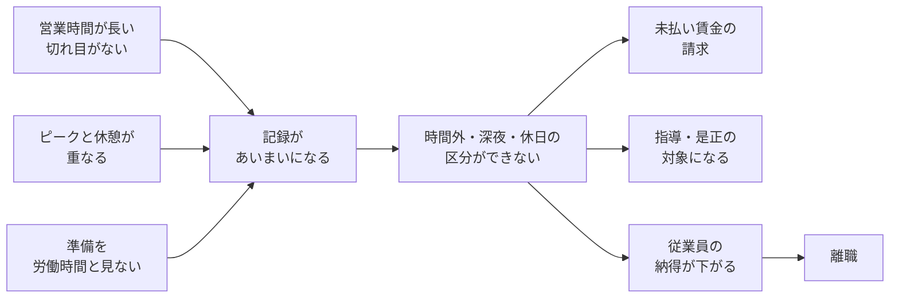
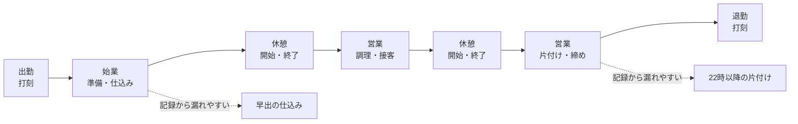
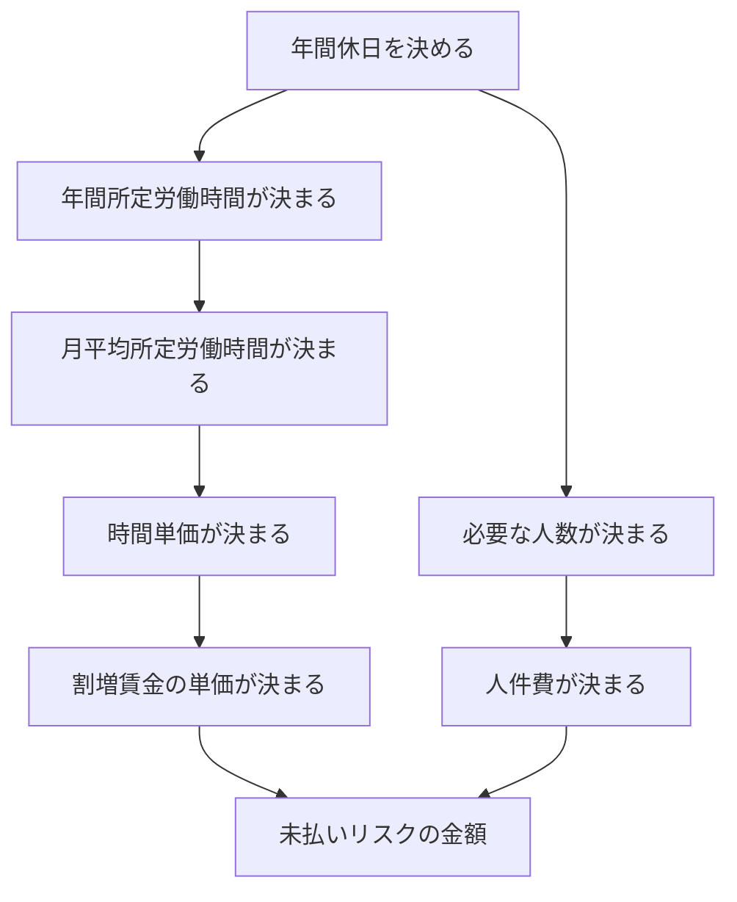
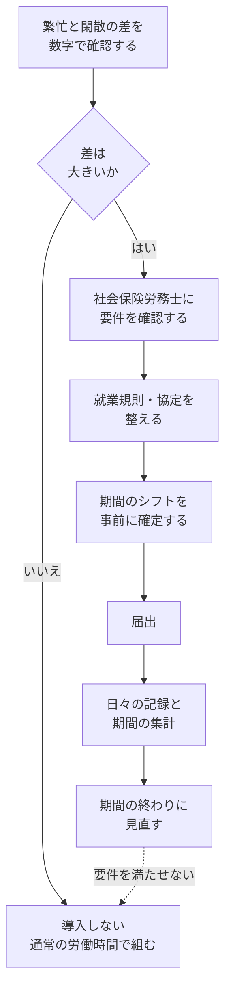
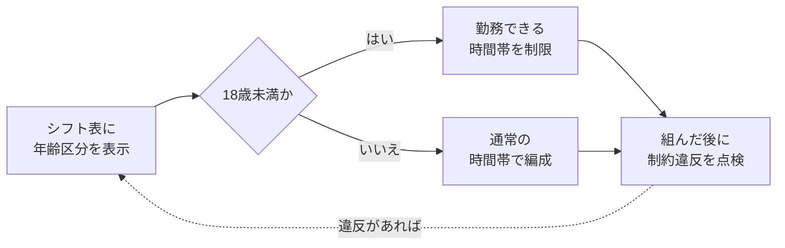
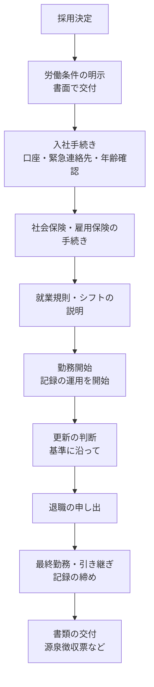
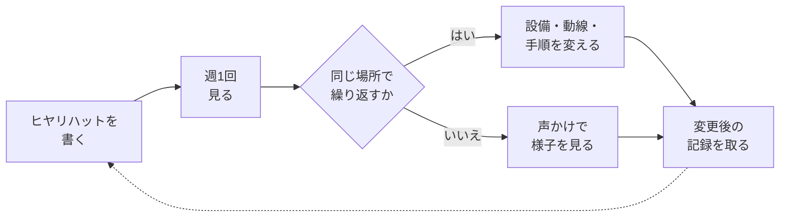

# 第13章 労働法と労務管理

## 13.1 この章で扱うこと

人を雇うと、店の運営に労務のルールが重くのしかかります。この章では、**労働時間をどこからどこまで数えるか**、時間外・深夜・休日の労働をどう区分するか、変形労働時間制・年少者の保護・有期契約といった制度の論点、そして労務リスクを金額で見る方法を扱います。シフトの組み方そのものは[第4章: 人件費と生産性](04-jinken-hi-seisansei.md)で扱いました。この章は、**同じシフトを法規の側から見直す**章です。採用・教育・定着は[第14章: 採用と教育](14-saiyo-kyoiku.md)で扱います。

> **本章の限界（必ず読んでください）**: 本章の作成時点で、労働基準法などの公的一次資料を取得できていません。**割増賃金の具体的な率、変形労働時間制の詳細な要件、年少者の深夜業の制限は、一次資料で確認していない**ため、数値を示しません。制度の存在と論点、確認の順序を示すところまでとします。**未取得の項目は「未取得」と明記**し、推測で埋めていません。実際の運用は**労働基準監督署・社会保険労務士**に確認してください。**本資料は法的助言ではありません。**

## 13.2 学習目標

- 労働時間に入る時間と入らない時間を、自店の1日の流れに当てはめて書き出せる。
- 時間外・深夜・休日の労働を区分し、記録すべき項目を一覧にできる。
- 割増賃金の未払いが積み上がる構造を、金額の式で説明できる（率は確認先で埋める）。
- 変形労働時間制・年少者の保護・有期契約について、**何が未確認で、どこに確認するか**を説明できる。
- 労務リスクを、金額・行政・信用の3つの影響で並べ、優先順位を付けられる。

## 13.3 なぜ飲食店で労務の問題が起きやすいのか

労務の問題は、悪意のある店だけで起きるわけではありません。**構造的に起きやすい**条件が、飲食店には揃っています。

| 構造 | 何が起きるか |
| --- | --- |
| 営業時間が長く、切れ目がない | 開店前の仕込みと閉店後の片付けが、記録の外に置かれる |
| ピークと休憩の時間帯が重なる | 休憩が取れず、後から「取った／取っていない」で争いになる |
| 準備作業が「段取り」と呼ばれる | 労働時間なのに、労働時間として扱われない |
| 従業員が少ない | 書類と記録の担当が決まらず、後回しになる |
| アルバイトが多く、勤務が短い | 1人あたりの時間が短く、記録漏れが積み上がりやすい |
| 若年層の採用が多い | 年少者の労働時間・深夜業の制約が関わる |
| 屋外席・テイクアウトがある | 天候と提供方法で勤務の形が変わり、配慮が増える |

**3つの典型**を先に押さえます。この3つは、どれも「記録がないこと」から始まります。

1. **サービス残業**: 上がり時間を自己申告にし、実際より早く記録する。
2. **準備の未計上**: 早出の仕込みを「準備だから」と扱い、労働時間に入れない。
3. **休憩の未取得**: ピークと休憩が重なり、取れないまま勤務が終わる。



図の説明: 労務リスクは「記録のあいまいさ」を共通の入口として、未払い・指導・離職の3方向へ広がります。**入口は1つ**なので、記録の設計から直すのが効率的です。離職の側面は[第14章](14-saiyo-kyoiku.md)で扱います。

## 13.4 労働時間はどこからどこまでか

### 13.4.1 考え方

**労働時間**とは、単に「店にいた時間」ではありません。一般には、**使用者の指揮命令下に置かれている時間**をいうとされます（**一般知識（未検証）**）。この考え方の詳細な定義は法令と解釈によります。本章では一次資料を確認していないため、**定義を断定しません**。

実務で使えるのは、次の**2つの問い**です。

1. その時間、店はその人に**仕事を命じているか**（指示・強制があるか）。
2. その時間、その人は**自由に使えるか**（断れるか、別のことをしてよいか）。

両方に「はい／いいえ」がはっきり答えられる時間は、労働時間か否かの判断が付きやすい時間です。判断が割れるのは、**どちらとも言える時間**です。次の表で、自店の1日を当てはめてみてください。

| 時間 | 労働時間に入るか | 判断の分かれ目 |
| --- | --- | --- |
| 開店前の仕込み | 入る（と考えるのが自然） | 「準備」と呼んでいても、店が命じた作業 |
| 自主的な早出の仕込み | 判断が分かれる | 命じていない場合でも、事実上必要なら争いになる |
| 棚卸し・発注・売上集計 | 入る | 店のための作業。場所が自宅でも同じ |
| 研修・試食・メニュー覚え | 入る（と考えるのが自然） | 参加が事実上必須なら労働時間 |
| 閉店後の片付け・締め | 入る | 22時を超えると深夜帯にも関わる（13.5） |
| 休憩（自由に使える休憩） | 入らない | 自由に使えないなら労働時間と扱われる可能性 |
| 待機（客が来るまで店内で待つ） | 判断が分かれる | 外出できるか、指示に備えることが求められるか |
| 通勤時間 | 入らない（原則） | 直行直帰の指示、資材の運搬があると変わる |
| SNS投稿・写真撮影の依頼 | 入る（と考えるのが自然） | 店の宣伝のために命じた作業 |
| ミーティング・朝礼 | 入る | 参加が必須なら労働時間 |

**「判断が分かれる」と書いた行が、いちばん危ない行です。** ここは店の解釈と従業員の解釈が食い違いやすく、後から金額の争いになります。迷ったら**労働時間として記録する**方が安全です。記録しておけば、払うかどうかを後から検討できます。記録がなければ、検討する材料がありません。

### 13.4.2 1日の時間を分解する

記録の設計は、1日の時間を分解するところから始まります。



図の説明: 労働時間は「始業から退勤まで」ではなく、**休憩を除いた実働**です。図の点線は、記録から漏れやすい2つの区間です。この2つを記録に入れるだけで、未払いリスクの大半は説明可能になります。

### 13.4.3 記録すべき項目

**記録がない店は、トラブル時に立証できません。** タイムカードや勤怠システムの導入は、労務リスクの低減として費用対効果が高い投資です。

| 項目 | なぜ要るか |
| --- | --- |
| 始業の時刻 | 実働時間の起点。早出の把握 |
| 休憩の開始と終了 | 後から最も争いになりやすい項目 |
| 退勤の時刻 | 実働時間の終点。深夜帯の把握 |
| その日の担当業務 | 時間の使い方と、作業量の妥当性を後から確認できる |
| 休日労働・時間外労働の別 | 区分ごとに扱いが変わるため |
| 記録の修正履歴 | 後から書き換えた形跡があると、かえって疑われる |

**休憩を「取った／取っていない」で争わないためには、時刻まで記録します。** 「休憩45分」ではなく「14:05〜14:50」と書く運用です。時刻があれば、その時間に何をしていたかを思い出せます。

**自己申告だけで運用しない**ことも重要です。上がり時間を本人の申告に任せると、遠慮や慣れで実際より早く記録されます。打刻を基本にし、申告で補う順序にします。

### 13.4.4 数値例: 早出30分の重み

**説明用の仮置き**で、記録漏れの金額を計算します。アルバイト2人が、毎日30分早く来て仕込みをしているとします。時給は1,200円、月25日営業です。

```
1日の早出時間 = 30分 × 2人 = 1時間
1か月の早出時間 = 1時間 × 25日 = 25時間
通常賃金の部分 = 25時間 × 1,200円 = 30,000円/月
年間 = 30,000円 × 12か月 = 360,000円
```

**1日30分の早出が、年間36万円です。** これは**通常賃金の1倍の部分だけ**です。時間外労働に該当すれば割増分が加わりますが、**割増率は一次資料で確認していない**ため、本章では金額を出しません（13.5）。実際の未払い額は、この36万円を上回ります。

**この金額を「人件費率」の表に足すと、人件費率は変わります。** [第4章](04-jinken-hi-seisansei.md) 4.3.2で扱ったとおり、準備と後片付けを総労働時間に入れていない店は、人件費率と人時売上が実際とずれます。労務の観点と経営指標の観点は、**同じ記録の上に乗っている**のです。

## 13.5 時間外・深夜・休日の区分と割増賃金

### 13.5.1 4つの区分

労働時間は、**いつ働いたか**で区分されます。区分が変わると、支払う金額の計算が変わります。

| 区分 | 内容 | 割増の有無（考え方。**一般知識（未検証）**） |
| --- | --- | --- |
| 法定内の労働 | 決めた労働時間の範囲内 | 割増は生じないとされる |
| 時間外労働 | 法定の労働時間を超えた分 | 割増が生じる。**具体的な率は一次資料で確認していない** |
| 深夜労働 | 深夜の時間帯の労働 | 割増が生じる。**深夜帯の定義も法令による。本章では未取得** |
| 休日労働 | 法定休日に行った労働 | 割増が生じる。**率・休日の定め方は本章では未取得** |

**この表で数値を出していないのは、意図的です。** 割増率は法令で定まるもので、本章の作成時点で一次資料を取得できていません。**記憶や伝聞で率を書くと、それが独り歩きします。** 実際の率は、労働基準監督署または社会保険労務士に確認し、確認した日付とあわせて自店の規程に書き込みます。

### 13.5.2 時間単価の求め方

割増賃金は、**時間単価 × 割増率 × 対象時間**で計算します。割増率は確認待ちですが、時間単価は自分で計算できます。月給制の場合、次の式が一般に使われます（**一般知識（未検証）**。算定方法の詳細は法令によります）。

```
月平均所定労働時間 =（365日 − 年間休日）× 1日の所定労働時間 ÷ 12
時間単価 = 月給 ÷ 月平均所定労働時間
```

**数値例（説明用の仮置き）**: 年間休日105日、1日の所定労働時間8時間、月給250,000円の正社員。

```
月平均所定労働時間 =（365 − 105）× 8 ÷ 12 = 2,080 ÷ 12 ≒ 173.33時間
時間単価 = 250,000 ÷ 173.33 ≒ 1,442円/時間
```

（小数第1位を四捨五入。2,080 ÷ 12 = 173.333…）

**年間休日を1日増やすと、分母が8時間減り、時間単価は上がります。** 時間単価が上がると、割増賃金の単価も上がります。休日を増やす判断は、労務の改善であると同時に、**単価の見直し**でもあります。

| 年間休日 | 月平均所定労働時間 | 月給250,000円の時間単価 |
| --- | --- | --- |
| 105日 | 173.33時間 | 1,442円 |
| 110日 | 170.00時間 | 1,471円 |
| 120日 | 163.33時間 | 1,531円 |

**時間単価の計算に入れる手当と入れない手当があります。** 何を算入するかは法令と通達によります。本章では一次資料を確認していないため、**算入範囲を断定しません**。手当を多く出している店ほど、この確認の影響が大きくなります。

### 13.5.3 未払いが積み上がる構造

未払い賃金は、1回の金額は小さくても、**時間と人数の掛け算**で膨らみます。

```
未払い額 = 時間単価 × 割増率 × 超過時間 × 人数 × 期間
```

**数値例（説明用の仮置き）**: 時給1,200円のアルバイト3人が、毎日20分の片付けを記録せずに帰っていたとします。月25日、6か月間。

```
1日の未計上 = 20分 × 3人 = 1時間
1か月 = 1時間 × 25日 = 25時間
6か月 = 25時間 × 6か月 = 150時間
通常賃金の部分 = 150時間 × 1,200円 = 180,000円
```

**18万円です。** これに割増分が加わります（率は未取得のため算出しません）。加えて、請求されうる期間の定めは法令によります。**「6か月分」で済むとは限りません。**

**未払いが膨らむ要因**は、金額そのものより**時間の経過**です。

| 要因 | 効き方 |
| --- | --- |
| 人数 | 比例して増える |
| 期間 | 比例して増える。気づくのが遅いほど大きい |
| 記録の不在 | 店の側が反論できない。従業員の主張が通りやすい |
| 離職 | 在職中は言い出さないが、退職後に請求されることがある |
| 割増の区分 | 深夜・休日に重なると率が変わる |

**「辞めた人から請求が来る」**のが典型的な形です。在職中は関係を壊したくないので言い出さず、退職後にまとめて請求されます。**記録は、辞めた人に対しても説明できる状態**にしておきます。

### 13.5.4 サービス残業が生まれる理由

| 原因 | 現場で起きていること | 防ぎ方 |
| --- | --- | --- |
| 記録を取っていない | 上がり時間を自己申告にしている | 打刻の徹底、退勤の声かけ |
| 「準備だから」と扱う | 早出の仕込みを労働時間に入れない | 準備も労働時間として記録する |
| 休憩が取れない | ピークと休憩時間が重なっている | 休憩を時間帯で固定し、交代要員を配置 |
| 年少者の深夜勤務 | シフト編成の見落とし | シフト表に年齢の制約を表示する |
| 閉店後の作業 | 片付けを「当番の習慣」にしている | 片付け時間をシフトに組み込む |
| 会議・研修の未計上 | 参加を「勉強会」と呼んでいる | 参加が必須なら労働時間として記録する |

**シフトを組む段階で、法令の制約を入れておく**のが有効です。組んでから直すと、現場の負担になります。シフトの組み方の詳細は[第4章](04-jinken-hi-seisansei.md) 4.8を参照してください。

### 13.5.5 時間外労働の上限に関する取り決め

一定時間を超える時間外労働については、**労使の間で取り決めて届け出る仕組み**があると一般に言われます（**一般知識（未検証）**）。**上限時間、手続き、様式は本章では一次資料を確認していません（未取得）。**

本章で押さえるのは、次の1点です。**「取り決めをしていないから上限がない」わけではない**ということです。取り決めがない状態で長時間の時間外労働が続けば、それ自体が指導の対象になりえます。必要な様式と手続きは、社会保険労務士に確認してください。

## 13.6 休憩と休日

### 13.6.1 休憩

**休憩**は、労働時間から除かれる時間です。除かれるための条件は、**労働から完全に離れて自由に使えること**とされます（**一般知識（未検証）**）。与えるべき休憩の長さは、労働時間の長さに応じて法令で定まりますが、**具体的な時間数は本章では一次資料を確認していません（未取得）**。

**飲食店で問題になるのは、長さより「取れるかどうか」です。**

| 起きやすい問題 | 原因 | 設計での防ぎ方 |
| --- | --- | --- |
| ピークと休憩が重なる | 休憩を「空いたら取る」にしている | 休憩の時間帯を固定する |
| 交代要員がいない | 少人数で回している | 休憩の時間だけ人を厚くする |
| 休憩中も厨房に呼ばれる | 休憩場所が厨房の延長にある | 休憩場所を分ける。呼ばないルールを決める |
| 休憩が記録されていない | 開始・終了を書いていない | 時刻で記録する（13.4.3） |
| 短時間勤務者に休憩がない | 勤務が短いため | 法令上の要否を確認する（未取得） |

**「休憩を取れない店は、離職率が高い」**と一般に言われます（**一般知識（未検証）**）。根拠となる統計は本章では取得できていませんが、少なくとも**休憩の記録がない店は、休憩を取ったことを説明できません**。労務では、説明できるかどうかが分かれ目になります。

### 13.6.2 休日の種類

休日には、**法定休日**と**所定休日**という区別があります。法定休日は法令が定める最低限の休日で、所定休日は店が就業規則などで決めた休日です。**週に何日、いつ与えるかという定め方は法令によります。本章では一次資料を確認していないため、日数や周期を断定しません（未取得）。**

実務では、次の3つの形を区別して考えます。

| 形 | 内容 | 注意点 |
| --- | --- | --- |
| 曜日固定 | 日曜と祝日を休みにする | 計算が簡単。ただし商圏の需要と合わないことがある |
| シフト制 | 各自の休日を月ごとに決める | 飲食店で多い。公平性の説明が必要 |
| 一斉休業 | 月に数日、店を閉める | 売上の谷を作る。固定費は残る |

**シフト制では、「休日労働」の判定が難しくなります。** どの日が法定休日で、どの日が所定休日かを決めていないと、休日に働いた分の扱いを決められません。**就業規則かシフト表の凡例に、どちらかを書き分ける**運用が必要です。

### 13.6.3 年間休日と労働時間の関係

年間休日は、そのまま**年間の労働時間**を決めます。

```
年間所定労働時間 =（365日 − 年間休日）× 1日の所定労働時間
```

**数値例（説明用の仮置き）**: 年間休日105日、1日8時間。

```
年間所定労働時間 =（365 − 105）× 8 = 260日 × 8時間 = 2,080時間
月平均 = 2,080 ÷ 12 ≒ 173.3時間
```

年間休日を10日増やすと、年間80時間・月平均6.7時間減ります。**休日を増やすことは、人件費を減らすことと裏表**です。ただし、休日を増やして人員を増やせば人件費は増えます。休日の設計は、[第4章](04-jinken-hi-seisansei.md)の人件費率とセットで判断します。



図の説明: 年間休日という1つの決定が、時間単価と必要人数の両方に効きます。**休日を増やすと時間単価は上がり、必要人数も増えます。** 片方だけを見て決めると、後で人件費が想定を超えます。

## 13.7 変形労働時間制

### 13.7.1 何を解決する制度か

飲食店は、**繁忙期と閑散期の差が大きい**商売です。12月は人が足りず、2月は余ります。この差を、**期間を通じて平準化する**ための制度が、**変形労働時間制**です。

**用語の説明**: 変形労働時間制は、一定の期間（月単位・年単位など）を平均して法定の労働時間に収めることで、**日や週によって労働時間が長くても短くてもよい**とする制度です。繁忙日に長く働き、閑散日に短く働く、という組み方ができます。

**ただし、この制度は要件を満たさないと無効です。** 無効であれば、通常の労働時間の定めに戻り、超えた分が時間外労働として扱われます。**「導入したつもりで、実は要件を満たしていなかった」**というのが、最も多い失敗の形です。

### 13.7.2 一般に言われる要件（未取得）

次の表は、**確認先で聞くべき項目を整理するための一覧**です。**要件の内容・数値は本章では一次資料を確認していない（未取得）**ため、断定しません。

| 確認項目 | 一般的に言われること（**一般知識（未検証）**） |
| --- | --- |
| 労使の取り決め | 就業規則または労使協定が必要とされる |
| 対象期間 | 月単位・年単位など、期間の種類がある |
| シフトの事前確定 | 期間の始まる前に、各日の労働時間を決めておく必要があるとされる |
| 上限の枠 | 1日・1週・期間全体の上限が定められているとされる |
| 届出 | 所轄の労働基準監督署への届出が必要とされる |
| 記録 | 日々の労働時間の記録と、期間の集計が必要 |

**この6項目は、どれか1つでも欠けると制度が成立しない可能性があります。** 具体的な要件は、**労働基準監督署または社会保険労務士に確認してください**。

### 13.7.3 導入を検討する順序



図の説明: 導入の可否は、制度の魅力ではなく**繁忙と閑散の差**から判断します。差が小さい店にとっては、要件を満たす手間の方が大きくなります。**導入しない判断も、立派な経営判断**です。

### 13.7.4 平準化の計算例

制度の考え方を、算術の例で確認します。**説明用の仮置き**です。

```
年間所定労働時間 = 2,080時間（年間休日105日・1日8時間）
月平均 = 173.3時間
```

12月を220時間、2月を130時間にした場合、残りの10か月で埋めるべき時間は、

```
2,080 − 220 − 130 = 1,730時間
1,730 ÷ 10か月 = 173時間/月
```

**12月に47時間多く働き、2月に43時間少なく働く**形です。残り10か月は平均どおりです。これが「平準化」の意味です。

| 月 | 労働時間 | 平均との差 |
| --- | --- | --- |
| 12月 | 220時間 | +46.7時間 |
| 2月 | 130時間 | −43.3時間 |
| 他の10か月 | 173時間 | ±0 |

**この計算は、制度の要件を満たしているかどうかとは別の話です。** 計算上成り立っても、事前確定・上限・届出の要件を満たさなければ制度として使えません。計算と要件を、必ず分けて確認します。

### 13.7.5 導入しない場合の組み方

変形労働時間制を導入しない場合でも、繁忙期と閑散期の差には対応できます。

| 打ち手 | 内容 | 注意点 |
| --- | --- | --- |
| 繁忙期に人を増やす | 短期のアルバイトを採用する | 採用と研修のコストがかかる（[第14章](14-saiyo-kyoiku.md)） |
| 閑散期の営業時間を短くする | 閉店を早める | 客の来店機会を失う |
| メニューを絞る | 閑散期は品数を減らす | 提供は速くなる。閑散期の売上減と比べる |
| 繁忙期に時短勤務者を厚くする | 短時間の勤務で埋める | 教育の回数が増える |
| 休日を繁忙期の後に寄せる | 連休を作る | 公平性の説明が必要 |

**制度を入れる前に、運用で対応できる部分を確認します。** 変形労働時間制は強力ですが、運用の難度も高い制度です。少人数の店では、**制度の管理コストが便益を上回る**ことがあります。

## 13.8 年少者と外国人材

### 13.8.1 18歳未満の労働者

**18歳未満の労働者には、労働時間と深夜業について特別の制限があります。** 高校生のアルバイトで問題になりやすい論点です。**制限の具体的な内容（何時から深夜か、1日に何時間までか、どの業種が対象か）は、本章では一次資料を確認していません（未取得）。**

**「18歳未満は深夜業が制限される」という制度の存在は確認できますが、時刻の範囲は断定しません。** 確認先は労働基準監督署です。

| 起きやすい論点 | 何が問題になるか | 確認すること |
| --- | --- | --- |
| 閉店後の片付け | 22時以降まで及ぶことがある | 深夜業に該当するか、該当する場合の扱い（未取得） |
| テスト期間の勤務 | 本人の負担と学業 | 店としての上限を決める |
| 連続した遅い時間の勤務 | 負担の蓄積 | シフトの組み方 |
| 保護者との関係 | 同意の有無、連絡先 | 採用時の確認事項（運用として決める） |
| 調理・機械の操作 | 危険を伴う作業 | 就業制限の有無（未取得） |
| 年齢の確認 | 見た目では判断できない | 採用時の記録 |

**年齢は、シフト表に表示する**のが有効です。



図の説明: シフトを組んでから年齢を確認すると、直す作業が発生します。**シフト表の段階で年齢区分を見えるようにする**と、違反の混入を防げます。

### 13.8.2 20歳未満と喫煙

**20歳未満は、客であっても従業員であっても喫煙エリアに立ち入れません。** 受動喫煙対策の詳細と、この制約が採用に与える影響は、[第10章: 営業許可と法規](10-kyoka-hourei.md) 10.6で扱いました。**年少者の採用を考える店は、喫煙可能室の選択とセットで考えます。**

### 13.8.3 外国人材

外国人を雇う場合、**在留資格の範囲内の仕事かどうか**を確認する必要があります。飲食店の調理・接客が、その人の在留資格で行える業務かを確認します。**在留資格ごとの可否は本章では確認していません（未取得）。** 確認先は出入国在留管理庁です。

実務で押さえる点は3つです。

1. **在留カードの写しを保管する**（期限の管理のため）。
2. **労働時間の記録をていねいに取る**（言葉の行き違いが後から争いになる）。
3. **作業手順を図と写真で示す**（教育の標準化。[第14章](14-saiyo-kyoiku.md) 14.7）。

**言葉の問題は、労務の問題として現れます。** 指示が伝わらないと、休憩の取得や退勤の記録が思うように運用できません。**記録様式を多言語にする、写真で示す**といった工夫が、結果的に労務リスクを下げます。

## 13.9 有期契約と入退社の実務

### 13.9.1 契約期間と更新

パート・アルバイトの多くは**有期契約**です。契約期間を決め、更新するかどうかをその都度判断する形です。

**反復更新で無期転換の対象になりうる**という論点があります。**更新を繰り返した場合に、労働者が無期の契約を申し込める制度があると一般に言われますが、要件と年数は本章では一次資料を確認していません（未取得）。**

| 論点 | 内容 | 確認すること |
| --- | --- | --- |
| 契約期間 | 1年・6か月・3か月など | 期間の定め方と更新の回数 |
| 更新の基準 | 更新するかどうかを何で決めるか | 基準を書面にできるか |
| 無期転換 | 更新を繰り返した場合の扱い | 通算期間の数え方（未取得） |
| 契約の終了 | 更新しない場合の伝え方 | どのくらい前に伝えるか（未取得） |
| 雇止め | 更新を期待させる運用になっていないか | 過去の更新実績の扱い |

**「毎年更新しているから、今年も更新するのが当たり前」**という運用になっていないかを確認します。更新の基準を書面にしておくと、更新しないときの説明がしやすくなります。

### 13.9.2 労働条件の明示

採用時に、労働条件を書面で示すことが求められます（**一般知識（未検証）**。様式と必須項目は法令によります）。

| 項目 | 例 | よく抜ける |
| --- | --- | --- |
| 契約期間 | 期間の定めの有無、期間 | — |
| 就業の場所 | 店舗名 | — |
| 業務の内容 | ホール、調理補助、洗い場 | 複数業務を兼ねる場合の範囲 |
| 始業・終業の時刻 | シフト制の場合の考え方 | 変形労働時間制を採る場合の定め |
| 休憩・休日 | 時間帯、曜日 | シフト制での休日の決め方 |
| 賃金 | 時給、締め日、支払日 | 割増賃金の率と算定方法 |
| 退職に関する事項 | 退職の申し出時期 | — |
| 社会保険の適用 | 加入の有無 | 加入要件の確認（未取得） |

**「割増賃金の率」の欄が空欄のまま採用していませんか。** 率は法令で定まるもので、本章では数値を示せません。**確認した率を、就業規則と労働条件通知書の両方に書く**運用にします。

### 13.9.3 入社から退社までの流れ



図の説明: 記録は入社の日から始まります。**入社手続きの時点で、記録の方法と休憩の取り方を説明しておく**と、後の運用が変わります。退職時の書類の種類と期限は法令によります（本章では未取得）。

### 13.9.4 退職の扱い

退職には、本人の申し出によるもの、契約期間の満了によるもの、店の都合によるものがあります。**どれに当たるかで、必要な手続きと説明が変わります。**

**引き継ぎの設計**は、労務と経営の両方に効きます。担当業務、仕込みの段取り、常連客への対応、鍵や金銭の扱いを、**退職の1週間前までに書面にする**運用にします。属人化している店ほど、引き継ぎの負荷が高くなります（[第14章](14-saiyo-kyoiku.md) 14.7の標準化）。

### 13.9.5 少人数・応援・屋外席がある場合の労務

人の配置は、店の形態で制約が変わります。**同じ人数でも、働く場所と時間の構造が違えば、必要な労務の設計は別**です。

| 形態 | 労務面の課題 | 設計の方向 |
| --- | --- | --- |
| 少人数で運営する | 1人が複数業務を担う。休みが取れず、休憩も後回しになる | 休憩の時間を固定し、交代要員を確保する。業務を絞る |
| 複数の店舗を運営する | 店舗間の応援、指揮命令の混乱、労働条件の不一致 | 人事の取り決めを文書化する |
| 屋外席を持つ | 天候で席の稼働が変わる。夏冬の負荷が大きい | 天候に応じたシフト調整の運用を作る |

**少人数運営では、1人の欠勤が営業に直結します。** 「誰かが休んでも回る」最低限の人数を決め、それを下回る日はメニューを絞る判断をあらかじめ用意します。**休憩が取れない原因も、多くの場合この人数の余裕のなさ**です（13.6.1）。

**店舗間の応援**は、人材の流動性を高める一方で、次の問題を生みます。

1. **指揮命令系統の混乱**（どちらの店長の指示に従うか）
2. **労働条件の不一致**（時給、シフト、評価が店舗で違う）
3. **教育の重複**（両店舗のメニューを覚える負荷）

**応援に入る日の指揮命令者、時給の扱い、交通費の負担を、事前に決めて文書にします。** 口頭の取り決めは、人が入れ替わると失われます。**労働時間の記録も、どの店舗の勤務として数えるかを決めておかないと、時間外の計算が合いません。**

**屋外席の運用は、天候によるシフト変動を生みます。** 雨天で屋外席が使えない日は、屋内席だけで回す人員に切り替える必要があります。シフトを固定すると、雨の日に人が余り、晴れた日に足りなくなります。**天候を見て前日までに調整できる体制**が望ましいです（**一般知識（未検証）**）。

屋外席のスタッフには、屋内と別の負荷がかかります。気温、日差し、虫、移動距離です。夏場の連続配置を避け、水分の摂取を確保する、といった配慮が必要です（13.11）。屋外席を客席として使えるかの確認は[第10章: 営業許可と法規](10-kyoka-hourei.md) 10.8を参照してください。

## 13.10 労務リスクを金額で見る

### 13.10.1 影響は3つに分かれる

労務リスクの影響は、金額だけではありません。

| 影響 | 内容 | 例 |
| --- | --- | --- |
| 金額 | 未払い賃金、割増賃金、遡及の支払い | 記録漏れの積み上げ（13.5.3） |
| 行政 | 指導・是正の対象になる | 時間外の上限、届出の不備 |
| 信用 | 採用・定着・取引に響く | 口コミ、紹介の減少、離職の増加 |

**金額は見積もれますが、信用は見積もれません。** 順序としては、金額で見えるものから手を付け、同時に信用を落とす運用を止めます。

### 13.10.2 リスクの一覧

| リスク | 起きる場面 | 主な影響 | 一次対応 | 確認先 |
| --- | --- | --- | --- | --- |
| 労働時間の記録漏れ | 早出・片付け・事務 | 金額 | 打刻と項目の追加（13.4.3） | 社会保険労務士 |
| 休憩の未取得 | ピークと休憩の重なり | 金額・信用 | 休憩の時間帯固定と交代要員 | 社会保険労務士 |
| 割増率の誤り | 時間外・深夜・休日 | 金額 | 率の確認と規程への反映 | 労働基準監督署 |
| 変形労働時間制の要件不足 | 制度の導入 | 金額・行政 | 要件の確認と届出 | 労働基準監督署 |
| 年少者の時間帯違反 | シフト編成 | 金額・行政・信用 | シフト表への年齢表示 | 労働基準監督署 |
| 有期契約の更新 | 反復更新 | 金額 | 更新基準の文書化 | 社会保険労務士 |
| 社会保険の未加入 | 加入要件の誤解 | 金額・行政 | 要件の確認と手続き | 年金事務所 |
| 労働条件の不備 | 採用時の書面 | 行政・信用 | 通知書の様式整備 | 社会保険労務士 |
| 安全衛生の事故 | 厨房・屋外席 | 金額・信用 | リスクの洗い出し（13.11） | 労働基準監督署 |
| 退職後の請求 | 退職から数か月後 | 金額・信用 | 記録の保存 | 社会保険労務士 |

**この表は、上から順に片付けるための表ではありません。** 自店で「起きている」と確認できた行から手を付けます。**確かめずに全部を心配すると、動けなくなります。**

### 13.10.3 保険

**労災保険と雇用保険**は、一定の要件を満たす事業場に適用されます。**加入の要件と手続きは本章では確認していません（未取得）。** 確認先は労働基準監督署（労災）とハローワーク（雇用）です。

**「アルバイトは短期だから関係ない」とは言い切れません。** 加入の要否は、労働時間と日数などの要件で決まります。要件は法改正で変わります。**年度ごとに確認する**運用にします。

## 13.11 安全衛生 — 見落とされやすい領域

労務というと賃金と時間に目が行きますが、**事故が起きると影響はもっと大きくなります。** 飲食店の作業には、特有の危険があります。

| 危険 | 起きる場面 | 対策の例 | 記録 |
| --- | --- | --- | --- |
| 火傷 | 揚げ物、グリル、スープ | 手袋、動線の分離、声かけ | ヒヤリハット |
| 切創 | 包丁、スライサー | 手袋、洗浄時の手順 | ヒヤリハット |
| 転倒 | 濡れた床、段差、運搬 | マット、こまめな拭き取り、靴 | 床の状態の点検 |
| 腰痛 | 重量物の運搬、長時間の立ち作業 | 台車、腰の高さの作業台 | 配置の見直し |
| 熱中症 | 夏の厨房、屋外席 | 水分、休憩、温度の記録 | 温度と休憩の記録 |
| 一酸化炭素 | 屋内で火を使う、換気不足 | 換気の稼働確認 | 換気の点検 |
| 騒音・粉塵 | 換気扇、粉物の扱い | 防護具、清掃 | — |

**屋外席を出す店は、屋内とは別の配慮が必要**です。気温、日差し、虫、移動距離が加わります。夏場の連続配置を避け、水分の摂取を確保する、といった配慮が必要です（**一般知識（未検証）**）。屋外席を客席として使えるかの確認は[第10章](10-kyoka-hourei.md) 10.8を参照してください。



図の説明: 事故は、事故になる前に「ヒヤリ」としている回数が必ずあります。**ヒヤリハットを書く場所を決め、週1回見る**だけで、対策の順序が変わります。**規模によっては安全衛生の委員会や管理者の選任が必要**とされますが、要件は本章では確認していません（未取得）。

## 13.12 ケースの店では

連続ケース「食堂つきかげ」（[第22章: 総合ケース](22-case.md)）を、労務の側から見ます。**ケースの数字は設計値であり、実在の店舗の実績ではありません。**

ケースの店は、昼11:30〜14:30（3時間）、夜17:30〜22:00（4.5時間）の二毛作です。スタッフはオーナー1人、正社員1人、アルバイト4人。年間のスタッフ人件費は10,050千円、総労働時間は6,700時間（[第4章](04-jinken-hi-seisansei.md) 4.13で実質時間単価1,500円/時間として逆算した値）です。月平均は558.3時間です。

**第一に、閉店後の片付けが深夜帯にかかります。** 22時に閉店し、片付けに45分かかるとします。片付けに3人が入るなら、

```
22時以降の時間 = 0.75時間 × 3人 = 2.25時間/日
1か月 = 2.25時間 × 25日 = 56.25時間
通常賃金の部分 = 56.25時間 × 1,200円 = 67,500円/月
年間 = 67,500円 × 12 = 810,000円
```

（「22時以降を深夜帯と仮に置いた場合」の計算です。**深夜帯の時刻の範囲は本章では一次資料を確認していない（未取得）**ため、これは説明用の仮置きであり、法令上の定義ではありません。割増分は率が未取得のため算出していません。）

**月67,500円は、11月のスタッフ人件費900,000円の7.5%**にあたります。この区間の**通常賃金の部分だけ**でこの金額です。片付けを22時前に終わらせる設計（仕込みの前倒し、食器の予備、洗浄機の配置）は、労務リスクの低減と人件費の両方に効きます。

**第二に、開店前の仕込みが記録から漏れやすいです。** 11:30の開店に対して、仕込みは9:30から始まっているとします。仮に2人が30分早く入る運用なら、13.4.4の計算のとおり**月25時間・年360,000円（通常賃金の部分のみ）**です。ケースの店の4月のスタッフ人件費684,000円に対して、月30,000円は約4.4%です。**「準備だから」と扱っていた時間が、年間36万円**になります。

**第三に、高校生のアルバイトを雇う場合の制約です。** ケースの設定には年齢がありません。仮にアルバイト4人のうち1人が18歳未満だとすると、**夜の営業時間帯（17:30〜22:00）と閉店後の片付けの配置に制約がかかります**。制限の具体的な内容は未取得（13.8.1）ですが、少なくとも**シフト表の段階で年齢を表示し、組んだ後に点検する**運用が必要です。4人という人数では、1人の配置制約が全体のシフトに波及します。

**第四に、変形労働時間制の検討です。** ケースの繁忙月は12月（売上3,400,000円）、閑散月は2月（2,400,000円）です。売上の差は約1.4倍あり、労働時間を平準化する動機はあります。ただし、月平均558.3時間の規模で制度を運用するには、事前確定・記録・届出の手間がかかります。**まずは13.7.5の運用での対応（繁忙期の短期採用、閑散期のメニュー絞り込み）を検討し、それでも足りない場合に制度を検討する**順序が現実的です。導入する場合は、要件を社会保険労務士に確認したうえで判断します。

| 項目 | 4月 | 11月 | 年間 |
| --- | --- | --- | --- |
| 売上 | 1,800,000円 | 3,000,000円 | 31,300,000円 |
| スタッフ人件費 | 684,000円 | 900,000円 | 10,050,000円 |
| 総労働時間（実質時間単価1,500円で逆算） | 456時間 | 600時間 | 6,700時間 |
| 22時以降の片付け（仮置き） | 56.25時間/月 | 56.25時間/月 | 675時間/年 |
| 片付けの通常賃金部分（時給1,200円） | 67,500円/月 | 67,500円/月 | 810,000円 |

**この表の下2行は、ケースの設計値ではなく、この章の説明用の仮置きです。** 片付けの時間・人数・時給は、実際には自店で測る必要があります。

## 13.13 よくある誤解

| 誤解 | 実際 |
| --- | --- |
| 残業代はサービス残業で良い | 未払い賃金のリスクです。記録がないと店は立証できません |
| 準備は労働時間に入らない | 店が命じた作業なら労働時間です。呼び方では変わりません |
| 休憩を与えたことになっていれば足りる | 自由に使えなければ労働時間と扱われる可能性があります |
| アルバイトは労働法の細かい話と無関係 | 時間・休憩・年少者の制約は同じように関わります |
| 割増率は経験で覚えている | 率は法令で定まります。本章では一次資料未確認のため数値を示しません |
| 変形労働時間制を入れれば残業代が減る | 要件を満たさないと無効です。導入は慎重に |
| 有期契約は更新しなければ自由に終われる | 更新を期待させる運用があると争いになります |
| 記録は紙のタイムカードで十分 | 項目と保存が肝心です。休憩の時刻まで記録します |
| 辞めた人の請求は時が解決する | 退職後にまとめて請求されるのが典型です |
| 事故は運が悪かっただけ | ヒヤリハットを記録すると、対策の順序が見えます |
| 社会保険は本人が決めること | 加入の要否は要件で決まります。店側の手続きです |
| 労務は専門家に丸投げすればよい | 日々の記録は店にしか作れません。専門家は記録を使って判断します |

## 13.14 この章の要点

- **労働時間の記録がないと、店は立証できません。** 始業・終業・休憩の時刻と担当を記録します。準備と片付けも労働時間です。
- 労働時間は**時間外・深夜・休日の区分**で扱いが変わります。**割増率・深夜帯の定義・休日の定め方は本章では未取得**です。労働基準監督署・社会保険労務士に確認します。
- **変形労働時間制は要件を満たさないと無効**です。繁忙と閑散の差を数字で確認し、運用での対応を先に検討します。
- **18歳未満の労働時間・深夜業には制限があります。** 制限の具体的内容は未取得です。シフト表の段階で年齢を表示し、組んだ後に点検します。
- 労務リスクは**金額・行政・信用**の3つの影響で並べます。金額が見積もれるものから手を付け、同時に信用を落とす運用を止めます。

## 13.15 自店で確認すること

- [ ] 始業・終業・休憩（開始と終了）の時刻を、準備・片付け・事務を含めて記録している
- [ ] 1日の時間を「労働時間に入る／入らない／判断が分かれる」に分けて書き出した
- [ ] 休憩の時間帯を固定し、その時間の交代要員をシフトに組み込んでいる
- [ ] 割増賃金の率、深夜帯の定義、休日の定め方を、労働基準監督署または社会保険労務士に確認した（本章では未取得）
- [ ] 時間単価の算定方法と、算入する手当の範囲を確認し、就業規則に書いた
- [ ] 変形労働時間制を使う場合、要件・届出・事前確定・記録の4点を確認した（本章では未取得）
- [ ] 18歳未満の勤務について、制限の内容を確認し、シフト表に年齢区分を表示している（本章では未取得）
- [ ] 労務リスクを一覧にし、金額・行政・信用の影響で優先順位を付けた

## 13.16 章末問題

### 問1 労働時間の区分（記述）

次の時間は、労働時間に入ると考えられるか、判断が分かれるかを答えてください。判断が分かれるものは、その理由も書いてください。

(a) 開店前の仕込み（店が「9:30に来て仕込んで」と指示している）
(b) 自主的に30分早く来て行う仕込み（指示はしていない）
(c) 休憩時間中、厨房に呼ばれて皿洗いをした15分
(d) 閉店後、自宅で翌日の発注をした30分

**解答**

(a) **労働時間に入ります。** 店が作業を命じており、自由に使えません（13.4.1）。
(b) **判断が分かれます。** 指示がなくても、業務上必要で事実上強制されていると見られれば労働時間になります。迷ったら労働時間として記録します。
(c) **労働時間に入ります。** 休憩中でも、実際に仕事を命じられれば休憩になりません。休憩の時刻を記録していれば、この15分を特定できます（13.4.3）。
(d) **労働時間に入ると考えられます。** 店のための作業で、場所が自宅でも同じです。ただし、どこまでを業務と見るかは個別の判断になります。**判断が分かれるものは、労働時間として記録する方が安全**です。

### 問2 未払い額の計算（計算）

時給1,150円のアルバイト4人が、毎日25分の片付けを記録せずに退勤していました。月24日営業、8か月間続いていたとします。

1. 未計上時間の合計を求めてください。
2. 通常賃金の部分の金額を求めてください。
3. この金額を、月の人件費と比べるために、月あたりの金額も求めてください。

**解答**

```
【1. 未計上時間】
1日 = 25分 × 4人 = 100分 = 1.6667時間
1か月 = 1.6667時間 × 24日 = 40時間
8か月 = 40時間 × 8 = 320時間

【2. 通常賃金の部分】
320時間 × 1,150円 = 368,000円

【3. 月あたり】
40時間 × 1,150円 = 46,000円/月
```

**8か月で36万8,000円**です。これは通常賃金の1倍の部分だけで、**時間外労働に該当すれば割増分が加わります**（率は本章では未取得）。月46,000円は、月商240万円の店では売上の約1.9%にあたります。**記録を取る運用に変える費用（勤怠システムの月額）と比べると、どちらが高いかは明らかです。**

なお、請求されうる期間の定めは法令によります。**8か月分で済むとは限りません。**

### 問3 変形労働時間制を導入すべきか（記述・計算）

繁忙月（12月）の労働時間が210時間、閑散月（2月）が140時間、他の10か月が172時間の店があります。年間所定労働時間を2,080時間として、次の2つを答えてください。

1. 年間の合計は2,080時間に収まっているか。
2. この店に変形労働時間制を勧めるか。勧める場合・勧めない場合の理由を書いてください。

**解答**

```
【1. 年間の合計】
210 + 140 +（172 × 10）= 210 + 140 + 1,720 = 2,070時間
2,080時間に収まっている（10時間の余裕がある）。
```

2. **計算上は制度の枠に収まりますが、勧めるかどうかは別の判断です。** 繁忙月と閑散月の差は70時間あり、平準化の動機はあります。一方で、**この規模で制度を運用するには、事前のシフト確定・日々の記録・期間の集計・届出という管理の手間がかかります**（13.7.3）。

まず13.7.5の運用（繁忙期の短期採用、閑散期のメニュー絞り込み、休日の寄せ）で対応できるかを確認します。それでも繁忙期の人員が足りない場合に、**要件を社会保険労務士に確認したうえで**導入を検討します。**要件を満たさないまま「制度を入れた」と運用すると、超えた分が時間外労働として扱われます。** 制度の導入は、節税や残業代の削減を目的に決めるものではありません。

## 参考文献・出典

- 本章の労働時間・割増賃金・変形労働時間制・年少者の保護・有期契約に関する記述は、**制度の存在と論点を示すもの**です。**具体的な割増率・要件・深夜帯の定義・休日の定め方・無期転換の要件は、一次資料で確認していない（未取得）**ため、数値を示していません（確信度: 未取得）。
- 労働時間の考え方（使用者の指揮命令下）、休憩の要件、時間単価の算定方法、労働条件の明示、保険の適用は、**一般知識（未検証）**です。確認先は労働基準監督署・社会保険労務士・年金事務所・ハローワーク・出入国在留管理庁です。
- 本章が参照する法令名（労働基準法、労働安全衛生法、労働者派遣法など）は示しますが、**改正の施行日は確認していないため「未確定」**とします。制度の内容は確認時点のものです。必ず最新の一次資料を確認してください。
- **本資料は法的助言ではありません。** 制度の概要と確認先を示すものです。個別の判断は所管官署と専門家の確認によります。
- 本章の数値例（早出30分・深夜の片付け・未払い額・月平均所定労働時間・平準化の計算）は、すべて**説明用の仮置き**です。実在の店舗の実績ではありません。
- 13.12 の売上・人件費・総労働時間は[OUTLINE.md](../OUTLINE.md) 3章の**ケースの設計値**（[第22章](22-case.md)）です。片付けの時間・人数・時給1,200円は**説明用の仮置き**です。
- 離職率、労働時間、労災の発生率などの統計は**取得できなかった**ため、数値を示していません。
- 受動喫煙対策と20歳未満の扱いは[第10章](10-kyoka-hourei.md) 10.6、シフト設計と人件費率は[第4章](04-jinken-hi-seisansei.md) 4.8・4.4、採用と教育・定着は[第14章](14-saiyo-kyoiku.md)で扱います。

---

前後の章: [第12章: 衛生管理とHACCP](12-eisei-haccp.md) ／ [第14章: 採用と教育](14-saiyo-kyoiku.md)
