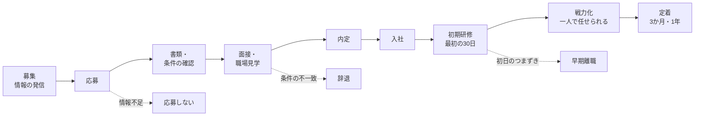
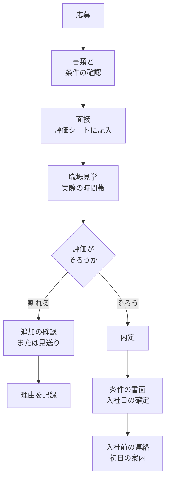
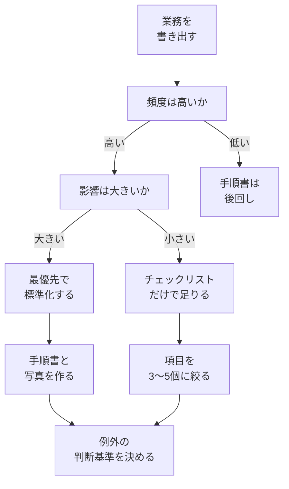
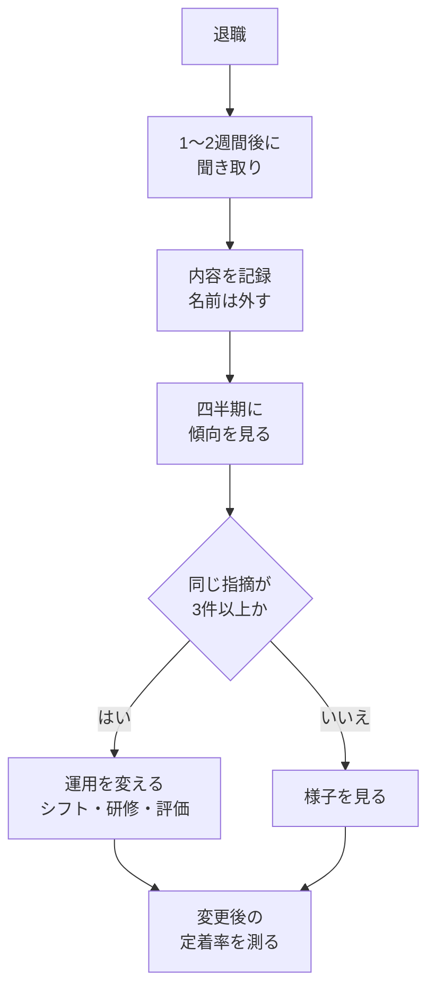

# 第14章 採用と教育

## 14.1 この章で扱うこと

飲食店の品質は、**誰が作るか**で決まります。この章では、採用を「工程」として捉え、工程ごとの歩留まりとコストを測る方法、募集文と面接の設計、初期研修の組み立て、標準化と例外判断の分け方、定着の指標と離職コストの計算を扱います。人件費率・人時売上・シフト設計は[第4章: 人件費と生産性](04-jinken-hi-seisansei.md)、労働時間や割増賃金などの法規は[第13章: 労働法と労務管理](13-roudou-hou.md)で扱いました。この章は、**人を集め、育て、残す**側の設計です。

## 14.2 学習目標

- 採用を工程に分け、工程ごとの歩留まりと1人あたりの採用コストを計算できる。
- 募集文と面接で確認すべき項目を決め、ミスマッチを減らす設計ができる。
- 初期研修の30日カリキュラムを、教える順序に沿って組み立てられる。
- 標準化する対象と、例外として人に判断させる範囲を書き分けられる。
- 離職コストを金額で見積もり、時給や研修への投資と比べて判断できる。

## 14.3 採用を「工程」として捉える

### 14.3.1 採用は1つの行為ではない

「採用」と一言でいうと、面接の場面を思い浮かべます。しかし実際には、**複数の工程**が連続しています。工程が分かれていることを意識しないと、「応募が来ない」「採っても辞める」という問題の**どこで詰まっているか**が見えません。



図の説明: 採用は「募集から定着までの9段階」です。**どの段階で抜けているかによって、打つ手が変わります。** 問い合わせも応募も来ないのに研修だけを充実させても、意味がありません。

### 14.3.2 工程ごとの歩留まり

工程は、**数値で測ります**。次の数値は**説明用の仮置き**です（1店舗、年間のアルバイト採用）。

| 段階 | 人数（仮置き） | 前段階からの歩留まり |
| --- | --- | --- |
| 募集ページの閲覧 | 1,000人 | — |
| 応募 | 20人 | 2.0%（20 ÷ 1,000） |
| 面接 | 12人 | 60.0%（12 ÷ 20） |
| 内定 | 4人 | 33.3%（4 ÷ 12） |
| 入社 | 3人 | 75.0%（3 ÷ 4） |
| 3か月後も在籍 | 2人 | 66.7%（2 ÷ 3） |

```
応募から3か月定着までの通し歩留まり = 60.0% × 33.3% × 75.0% × 66.7% ≒ 10.0%
検算: 2 ÷ 20 = 10.0%
```

**応募した人の半分以上が面接に来て、その3分の1が内定し、4分の3が入社し、3分の2が3か月残る。** 通しで10%です。この形で測ると、**改善の効き方が段階の掛け算で決まる**ことが分かります。

| 詰まっている段階 | 症状 | 打ち手 |
| --- | --- | --- |
| 募集→応募 | 閲覧はあるが応募が来ない | 募集文の情報量、写真、条件の書き方（14.4） |
| 応募→面接 | 応募は来るが面接に来ない | 連絡の速さ、日程の柔軟性、面接の場所と時間 |
| 面接→内定 | 会っても決められない | 採用基準の明確化、評価シート（14.5） |
| 内定→入社 | 内定辞退が多い | 条件のすり合わせ、職場見学、入社前の連絡 |
| 入社→3か月 | 初期離職 | 初日の設計、研修の順序、メンター（14.6） |
| 3か月→1年 | 中期的な離職 | 評価の透明化、シフトの希望反映、人間関係（14.8） |

**「応募が来ない」と「辞めてしまう」は、別の病気です。** 混ぜて議論すると、打ち手が平均化して効かなくなります。まず**どの段階かを特定**します。

### 14.3.3 採用の費用を1人あたりで測る

**採用コストは「1人を採用するのにかかった費用」で測ります。** 式は[第4章](04-jinken-hi-seisansei.md) 4.9.2で示しました。この章では、**分母の取り方**を明確にします。

```
採用コスト（1人あたり）= 総採用費 ÷ 入社した人数
総採用費 = 直接費（媒体・紹介料）+ 面接工数 × 時間コスト + 研修期間の教育費
```

**数値例（説明用の仮置き）**: 年間の媒体費180,000円、面接12回（1回1時間、時間コスト2,500円/時間）、研修3人分（1人50時間、時給1,100円）、入社3人。

```
直接費     = 180,000円
面接工数   = 12回 × 1時間 × 2,500円 = 30,000円
研修の教育費 = 3人 × 50時間 × 1,100円 = 165,000円
総採用費   = 180,000 + 30,000 + 165,000 = 375,000円
1人あたり = 375,000円 ÷ 3人 = 125,000円
```

**1人あたり12万5,000円**です。内訳を見ると、研修の教育費が165,000円で**全体の44.0%**を占めます（165,000 ÷ 375,000 = 0.44）。つまり、**採用費の半分近くは「雇った後」にかかっています**。

| 費目 | 金額 | 構成比 | 性質 |
| --- | --- | --- | --- |
| 直接費（媒体） | 180,000円 | 48.0% | 応募を増やすための費用 |
| 面接工数 | 30,000円 | 8.0% | 選ぶための費用 |
| 研修の教育費 | 165,000円 | 44.0% | 育てるための費用 |
| 合計 | 375,000円 | 100% | — |

**分母を「応募数」にするか「入社数」にするかで、意味が変わります。** 応募数を分母にすると「応募を集める効率」、入社数を分母にすると「1人戦力を増やすコスト」です。**投資判断に使うのは後者**です。

### 14.3.4 金額にしにくい費用

採用には、金額にしにくい費用もかかります。

| 費用 | 内容 | 扱い方 |
| --- | --- | --- |
| 機会費用 | 面接の時間、店長が現場を離れる時間 | 時間コストで近似する |
| 欠員の損失 | 採用できるまで、提供が遅れる・席を制限する | 売上の減少として別に試算する |
| 既存スタッフの負荷 | 穴を埋める残業、教育の二重負担 | 時間コストで近似する（14.9） |
| 教育のやり直し | 早期離職で振り出しに戻る | 離職コストとして計上する |

**欠員の損失は、見積もらないと議論に入りません。** 「人が足りない」は感覚の言葉ですが、**「1人欠員で1日2席を制限し、客単価1,400円なら1日2,800円、月25日で70,000円」**のように金額にできます。金額になれば、時給を上げる判断とも比較できます。

## 14.4 募集の設計

### 14.4.1 応募が来ない原因は、条件より情報

**応募が来ない原因の多くは、条件ではなく情報不足**です。何をする仕事か、どの時間帯か、誰と働くかが伝わらないと、応募者は判断できません。

| 伝える項目 | 具体例 | 効果 |
| --- | --- | --- |
| 業務の内容 | ホール、調理補助、洗い場の別 | ミスマッチを減らす |
| 時間帯と曜日 | ランチのみ、週2日から、曜日固定可 | 応募のハードルを下げる |
| 職場の様子 | 写真、動画、スタッフの紹介 | 想像できるようにする |
| 教育の仕組み | 初日の流れ、研修の期間 | 未経験者の不安を下げる |
| 評価の基準 | 時給アップの条件 | 納得感につなげる |

**条件を良くする前に、伝え方を直す**方が費用がかかりません。時給を上げるのは最後の手段です（14.9で費用を比較します）。

### 14.4.2 募集文の構造

募集文は、**読み手が知りたい順**に書きます。店が言いたい順ではありません。

| 順序 | 書くこと | 書き方の例 |
| --- | --- | --- |
| 1 | どんな店か | 業態、客層、席数、営業時間 |
| 2 | どんな仕事か | 業務の具体名、1日の流れ |
| 3 | いつ働くか | 時間帯、曜日、週の日数、シフトの決め方 |
| 4 | いくらか | 時給、手当、支払日、昇給の条件 |
| 5 | 未経験でも大丈夫か | 研修の期間、教える人、独り立ちまで |
| 6 | 誰と働くか | スタッフの構成、写真、雰囲気 |
| 7 | 応募の方法 | 電話かフォームか、必要なもの |

**「アットホームな職場です」は情報ではありません。** 誰でも書ける言葉は、読み手に何も伝えません。**「昼は2人、夜は3人で回しています」「洗い場は食洗機です」**のような具体が効きます。

### 14.4.3 募集の手段

| 手段 | 長所 | 短所 | 費用の性質 |
| --- | --- | --- | --- |
| 求人サイト | 応募数が見込める | 競争が激しい。媒体費がかかる | 掲載期間に比例 |
| ハローワーク | 費用を抑えられる | 応募までの時間が読めない | 手続きの手間 |
| 紹介（リファラル） | ミスマッチが起きにくい | 規模が限られる。関係が職場に持ち込まれる | 紹介料か謝礼 |
| 店内掲示・常連 | 商圏と相性が良い | 数が出ない | ほぼ無料 |
| SNS | 世界観を伝えられる | 継続の手間。応募に直結しにくい | 時間コスト |
| 学校・専門学校 | 長期の採用につながる | 時期が限られる | 手間 |

**リファラル採用**は、在籍するスタッフからの紹介で採用する方法です。相互理解があるぶんミスマッチが起きにくい一方、**紹介した側とされた側の関係が職場に持ち込まれます**。紹介した人が先に辞めると、紹介された人も辞めやすくなる、という連鎖も起こります。

**媒体費の具体的な金額は本章では扱いません。** 媒体ごとの相場は時期と地域で変わり、本章では一次資料を確認していないためです（**未取得**）。自店で「1人あたりいくらかかったか」を計算して比較します。

**写真と職場見学は、費用がかからず効果が大きい手段**です（**一般知識（未検証）**）。特に、**実際に働く時間帯の写真**が効きます。ピークの様子、休憩の場所、まかない、道具の状態。きれいに整えた写真より、**普段の状態が分かる写真**の方がミスマッチを減らします。

## 14.5 選考（面接）の設計

### 14.5.1 面接で確認すること

面接は「見極める場」ではなく、**「ずれを確認する場」**と考えます。完璧な人を選ぶのではなく、**入社後のずれが小さい人**を選びます。

| 観点 | 質問の例 | 見るポイント |
| --- | --- | --- |
| 続けられる条件 | 週に何日、どの時間帯なら働けますか | 生活と両立できるか。無理をしていないか |
| 業務の理解 | この仕事で、大変そうだと思うのはどこですか | 現実を理解しているか |
| 経験 | 前の仕事で、いちばん長く続けた業務は何ですか | 継続の手がかり |
| 学ぶ姿勢 | 分からないことがあったら、どうしますか | 質問できる人か |
| 協働 | 忙しいときに、周りにどう声をかけますか | 助けを求められるか |
| 志望の理由 | なぜ飲食で働きたいのですか | 動機の持続性 |

**「なぜ辞めたのか」を詰問しない**方が、本音が出ます（**一般知識（未検証）**）。問い詰めると、面接の場では当たり障りのない答えになります。

### 14.5.2 評価シートと複数人での確認

面接の印象は、**時間が経つと甘くも辛くも記憶されます**。評価シートに残すと、判断の理由を後から確認できます。

| 評価項目 | 3（良い） | 2（普通） | 1（懸念） |
| --- | --- | --- | --- |
| 勤務できる時間帯の一致 | 希望と合致 | 一部調整が必要 | 合致しない |
| 業務内容の理解 | 具体的に説明できる | 概ね理解 | 理解が浅い |
| 継続の見込み | 生活と両立 | 条件次第 | 無理がある |
| 質問・相談の姿勢 | 自分から聞ける | 聞かれたら答える | 聞けない |
| チームでの協働 | 具体的な経験がある | 一般的な回答 | 懸念がある |

**2人以上で面接する**と、判断の偏りが減ります。少人数の店では、オーナーともう1人（正社員やリーダー）で行います。**評価が割れた項目は、その理由を書きます。** 割れた理由が、入社後のフォローのポイントになります。



図の説明: 面接の後に職場見学を置くと、**条件のずれが入社前に見つかります**。見学は、実は面接より情報量が多い場です。見学の案内役は、入社後に教育を担当する人が務めると、その後の関係が作れます。

### 14.5.3 確認しておくべき実務

| 項目 | 内容 | 注意 |
| --- | --- | --- |
| 年齢の確認 | 18歳未満の制約の有無（[第13章](13-roudou-hou.md) 13.8） | シフト編成に直結する |
| 在留資格 | 外国人の場合の就労の可否（[第13章](13-roudou-hou.md) 13.8.3） | 本章では未取得。確認先で確認 |
| 学生の勤務可能時間 | テスト期間、長期休暇 | 年間の見通しを聞く |
| 二重雇用の有無 | 他の勤務先との調整 | 時間外労働の計算に関わる |
| 緊急連絡先 | 家族の連絡先 | 入社手続きで回収する |

**面接で聞いてはいけない事項**があります（**一般知識（未検証）**）。適法性の判断は本章では行いません。**業務の遂行に必要な範囲を超える質問をしない**、という基準を持ち、迷う場合は社会保険労務士に確認します。

## 14.6 初期研修の設計

### 14.6.1 初日の設計

**初日の教育が離職を左右します**（**一般知識（未検証）**）。初日に何を教え、誰が面倒を見るかを決めておくことが、結果的に定着率を上げます。

| 時点 | 教えること | 担当 |
| --- | --- | --- |
| 初日・午前 | 店のルール、身だしなみ、手洗い、避難経路、休憩の取り方 | 店長または教育係 |
| 初日・午後 | 担当する業務の1つ目（例: 洗い場、ご案内） | 教育係と2人で |
| 1週間目 | 担当業務の追加、メニューの説明、アレルギーの扱い | 教育係 |
| 1か月目 | 一人で任せる範囲の確認、困ったときの相談先 | 店長 |
| 3か月目 | 評価のフィードバック、次の目標 | 店長 |

**「初日に全部教える」は失敗します。** 情報量が多すぎると、何も残りません。**初日は「安全」と「帰り道」だけ確実に**し、業務は1つずつ足します。

**「帰り道」**とは、退勤の手順のことです。タイムカードの打ち方、上がりの声のかけ方、締め作業に参加するかどうか、休憩の取り方。**初日にこれを教えないと、記録の漏れと休憩の未取得が初日から始まります。** 労務の観点（[第13章](13-roudou-hou.md) 13.4.3）と教育の観点は、初日でつながっています。

### 14.6.2 30日カリキュラム

初期研修は、**日付で区切って設計**します。感覚で「慣れるまで」とすると、教える側の忙しさで後回しになります。

| 時期 | 到達目標 | 教えること | 確認の方法 | 担当 |
| --- | --- | --- | --- | --- |
| 1日目 | 安全に帰れる | 店のルール、手洗い、避難経路、打刻、休憩 | 口頭で復唱 | 教育係 |
| 3日目 | 1つの業務を隣でできる | 担当業務1（洗い場など） | 一緒にやる | 教育係 |
| 1週目 | 1つの業務を任せられる | 担当業務1の仕上げ、用語 | 1人でやらせて見る | 教育係 |
| 2週目 | 2つ目の業務 | 担当業務2、メニューの名前 | チェックリスト | 教育係 |
| 3週目 | ピークを経験する | ピークの動き、声かけ、優先順位 | 隣で見る | リーダー |
| 4週目 | 一人で任せられる範囲が分かる | 判断してよいこと・いけないこと | 口頭試問 | 店長 |
| 30日目 | 次の目標が決まる | 評価のフィードバック | 面談 | 店長 |

**1週目で「任せられる」を作るのが要点です。** ここが遅れると、本人も周りも「戦力になっていない」と感じ、早期離職につながります（**一般知識（未検証）**）。**完璧でなくてもよいので、1つの業務を最後まで1人でできる状態**を作ります。

### 14.6.3 教える順序と、つまずきやすい点

1. **見せる**（デモンストレーション）
2. **やらせる**（実践、隣で見る）
3. **確認する**（できているかをチェック）
4. **任せる**（一人でできるようにする）
5. **振り返る**（定期的なフィードバック）

**この順序を飛ばすと、どこかで必ず戻ります。** 段階ごとの失敗の形を知っておくと、戻る場所が分かります。

| 段階 | 飛ばしたときに起きること | 直し方 |
| --- | --- | --- |
| 見せる | 自己流のやり方が身につく | 最初からやり直す。1回だけ見せる |
| やらせる | 見ただけで「できる」と本人が思い込む | 隣でやらせて、手を止めずに進められるか見る |
| 確認する | できていないのに任せてしまい、ミスが客に出る | チェックリストで1項目ずつ確認する |
| 任せる | 任せきらず、毎回手を出して本人が育たない | 任せる範囲と、聞いてよい条件を決める |
| 振り返る | 評価が分からないまま不満が溜まる | 30日目と3か月目に必ず面談する |

**「見せる」は、1回では足りません**（**一般知識（未検証）**）。同じ作業を、**ゆっくり1回、普通の速さで1回**見せます。ゆっくりだけだと、実際のペースが分かりません。

### 14.6.4 研修の記録

研修は、**記録すると3つの用途**に使えます。

| 用途 | 何を記録するか |
| --- | --- |
| 本人の安心 | できるようになったことの一覧（チェックリスト） |
| 店の説明責任 | いつ、誰が、何を教えたか（労務の記録と一致させる） |
| 次の採用 | つまずいた点（募集文と研修の改善に使う） |

**「教えた／教えていない」は、後から争いになります。** 事故やミスが起きたとき、**「研修で教えた記録があるか」**が問われます。教えた日付と内容と担当者を、1行でよいので残します。

## 14.7 標準化の設計

### 14.7.1 何を標準化するか

飲食店の品質は「誰が作っても同じ味」に近づけられるかで決まります。ただし、**すべてを標準化すると、手順書が読まれなくなります**。優先順位を付けます。



図の説明: **頻度が高く、影響が大きい業務**から標準化します。飲食店では、レシピ、衛生、締め作業がここに入ります。**頻度が低く影響も小さい業務は、手順書を作っても読まれません。**

| 標準化の対象 | 方法 | 効果 |
| --- | --- | --- |
| レシピ | 分量のグラム指定、写真、手順書 | 味のばらつきが減る。教育が速くなる |
| 調理手順 | 手順書、動画、チェックリスト | 属人化を防ぐ。引き継ぎが楽になる |
| 接客 | マニュアル、ロールプレイ | サービスの質が揃う |
| 衛生 | チェックリスト、記録（[第12章: 衛生管理とHACCP](12-eisei-haccp.md)） | 事故を防ぐ。証跡が残る |
| 締め作業 | チェックリスト、ダブルチェック | ミスと不正を防ぐ |

**レシピの標準化は、材料費の管理とも直結します。** 分量が人によって変わると、レシピ原価と実際の材料費がずれます（[第3章: 材料費と原価率](03-zairyo-hi-genka.md)）。現場では「少し多めに入れた方がおいしい」という判断が働きます。**標準を決めることは、その判断を禁じることではなく、ずれた分を測れるようにすること**です。

### 14.7.2 手順書の作り方

読まれる手順書には、共通する形があります。

| 要素 | 内容 | 失敗する書き方 |
| --- | --- | --- |
| 1ページ | 1業務を1枚に収める | 何十ページもの冊子 |
| 写真 | 手元と完成形を写す | 文字だけで説明する |
| 分量と時間 | グラム、秒、分で書く | 「適量」「しばらく」 |
| 判断ポイント | ここで迷う、という箇所に印を付ける | 手順だけを並べる |
| 例外 | 標準から外れるときの行き先を書く | 例外を無視して標準だけ書く |
| 更新日 | いつ、誰が直したか | 日付がない |

**「判断ポイント」に印を付けるのが、最も効く工夫です。** 手順の全部を覚える必要はありません。**どこで止まって聞けばよいか**が分かれば、新人は動けます。

### 14.7.3 標準化の限界

| 標準化で解決できること | 標準化では解決できないこと |
| --- | --- |
| 手順のばらつき | 判断が必要な場面（クレーム、アレルギー、体調不良） |
| 教育の効率 | 意欲や働きがい |
| 引き継ぎのしやすさ | 人間関係 |
| 品質の下限の安定 | 品質の上限（料理人の工夫） |

**標準化の目的は「人を機械にする」ことではありません。** 標準化によって、判断に迷う時間を減らし、教育を速くし、属人化を防ぎます。その上で、**標準から外れる場面の判断基準を別に用意**します。

### 14.7.4 例外の判断基準を決める

**例外の判断基準を決める**のが、標準化とセットの作業です。誰が、どこまでを判断してよいかを書いておくと、現場が止まりません。

| 場面 | 判断する人 | 判断の範囲 | 超えたら誰へ |
| --- | --- | --- | --- |
| アレルギーの申告 | ホール担当 | 原材料の確認と、厨房への伝達。提供可否は厨房 | 厨房責任者 |
| 料理の作り直し | ホール責任者 | 1品の作り直し | 店長 |
| 提供の遅れの説明 | ホール担当 | お詫びと所要時間の案内 | ホール責任者 |
| クレームの対応 | 店長 | 返金・割引の判断 | オーナー |
| 体調不良の申告 | 本人と店長 | 就業の可否 | オーナー |
| 品切れの告知 | ホール担当 | メニューの案内と代替の提案 | 厨房責任者 |
| 支払い方法の例外 | ホール責任者 | 決済の分割・取り消しの操作 | 店長 |
| 常連客の要望 | ホール責任者 | 席の指定、提供の順序 | 店長 |

**「判断の範囲」に金額と個数を入れる**と、現場が迷いません。「クレーム対応は店長」ではなく、**「1品の作り直しはホール責任者まで、返金は店長」**と書きます。

**アレルギーの扱いは、事故になれば営業に直結します。** 判断の流れは[第11章: 食品表示とアレルギー](11-hyouji-allergy.md)で扱っています。本章では、**誰がどこまで判断するか**を決めるのが役割です。

## 14.8 定着の設計

### 14.8.1 定着を数字で見る

| 指標 | 計算 | 使い方 | 定義の注意 |
| --- | --- | --- | --- |
| 定着率（3か月） | 3か月後も在籍する人数 ÷ 入社した人数 | 採用と初期研修の効果を見る | 分母は入社数。採用数ではない |
| 定着率（1年） | 1年後も在籍する人数 ÷ 入社した人数 | 中期的な定着を見る | 起点の日付を固定する |
| 平均勤続月数 | 総勤続月数 ÷ 在籍人数 | 長期的な安定を見る | 退職者を含めるかを決める |
| 欠勤率 | 欠勤日数 ÷ 予定出勤日数 | 負荷や体調の変化を察知する | 有給かどうかを分ける |
| 離職コスト（年間） | 離職者数 × 1人あたりのコスト | 投資判断の材料にする | 1人あたりの定義を固定する |

**指標は、比べる相手を決めてから使います。** 他店との比較より、**自店の半年前との比較**の方が判断しやすいです。業態・立地・規模が違う店との比較は、意味のある差になりません。

**分母と起点を文書に固定します。** 「定着率50%」と言っても、分母が採用数か入社数か、起点が応募か入社かで値が変わります。**定義を書かずに比較すると、改善したのか悪化したのか分からなくなります。** この点は、リピート率の定義（[第15章: 集客とマーケティング](15-shukyaku.md) 15.9）と同じ構造です。

### 14.8.2 定着の打ち手

| 打ち手 | 内容 | 効く段階 |
| --- | --- | --- |
| 採用前のすり合わせ | 職場見学、業務内容の説明 | 内定→入社 |
| 初期研修 | 初日に何を教えるかを決める | 入社→3か月 |
| シフトの希望反映 | 希望休、曜日固定 | 3か月→1年 |
| 評価の透明化 | 時給アップの基準を明示 | 3か月→1年 |
| 人間関係 | 相談できる相手、定期的な面談 | 全期間 |
| キャリアパス | 役職、専門性、独立支援 | 1年以上 |
| 休憩と食事 | 休憩の確保、まかない | 全期間 |
| 声かけの習慣 | 退勤時の一言、感謝の言語化 | 全期間 |

**離職理由は「人間関係」と「労働条件」が多い**とされますが、**本資料では統計を取得できていないため数値は示しません**。自店の退職者への聞き取り（exit interview）が最も確実な情報源です。

**退職の聞き取りは、辞める直前ではなく、辞めた後に行う**方が本音が出ます（**一般知識（未検証）**）。在職中の聞き取りでは、角が立たない答えになります。

### 14.8.3 退職の聞き取り

| 聞くこと | 質問の例 | 使い道 |
| --- | --- | --- |
| 辞めるきっかけ | 決めたのはいつ、何がきっかけでしたか | 採用・研修の改善 |
| 仕事の負荷 | どの時間帯が、いちばん大変でしたか | シフトの見直し |
| 人間関係 | 相談できる人はいましたか | メンターの設計 |
| 条件 | 条件面で、どこが合いませんでしたか | 募集文の正確さ |
| 残れる条件 | どうなっていれば続けていましたか | 定着の打ち手の優先順位 |
| 店の良かった点 | 残してほしいことは何ですか | 強みの確認 |

**聞いた内容は、名前を外して傾向として溜めます。** 1人の感想は事情ですが、**3人に同じ指摘が出たら運用の問題**です。この見方は、口コミの低評価の扱い（[第15章](15-shukyaku.md) 15.8）と同じです。



図の説明: 聞き取りは1回で結論を出さず、**傾向として見ます**。変更した後は、定着率で確かめます。**変えた施策を測らないと、効果があったか分かりません。**

## 14.9 離職コストの計算

### 14.9.1 離職コストの内訳

離職には見えにくいコストがかかります。式は[第4章](04-jinken-hi-seisansei.md) 4.10.1で示しました。ここでは**内訳を細かく**します。

```
離職コスト = 採用コスト + 教育コスト + 戦力化までの生産性低下
           + 既存スタッフの負荷増 + 欠員の機会損失
```

| 費目 | 中身 | 給与明細に出るか | 見積もり方 |
| --- | --- | --- | --- |
| 採用コスト | 媒体費、面接工数、紹介料 | 出ない | 14.3.3の式 |
| 教育コスト | 研修の時間、指導役の時間 | 一部出る | 研修時間 × 時給 |
| 生産性低下 | 戦力化までの低い生産性 | 出ない | 期間 × 想定差額 |
| 既存スタッフの負荷増 | 穴を埋める残業、教育の二重負担 | 一部出る | 時間 × 時間コスト |
| 欠員の機会損失 | 席の制限、提供の遅れ | 出ない | 席数 × 客単価 × 日数 |

**5つのうち3つは、給与明細に出ません。** だから「辞めても何とかなる」と感じてしまうのです。

**数値例（説明用の仮置き）**: 時給1,100円のアルバイトが3か月で退職した場合。面接は1時間×3回、時間コスト2,200円/時間とします。

```
採用費（媒体の按分）    = 25,000円
面接工数                = 3回 × 1時間 × 2,200円 = 6,600円
研修の教育費            = 50時間 × 1,100円 = 55,000円
戦力化までの生産性低下  = 20,000円
既存スタッフの負荷増    = 6時間 × 2,200円 = 13,200円
合計                    = 119,800円
```

**1人あたり約12万円**です。10人が年間で離職すれば120万円になります。**これは、時給を10円上げるより大きな金額になることがあります**（14.9.3で比較します）。

（この数値は**説明用の仮置き**です。実在の店舗の実績ではありません。）

**欠員の機会損失は、別に試算します。** 上の合計に入れていないのは、店の規模で大きく変わるためです。「1人欠員で1日2席を制限し、客単価1,400円、月25日」なら月70,000円です。**欠員が長引くほど、この項目が最大になります。**

### 14.9.2 早期離職がいちばん高い

離職コストは、**辞めた時期**で変わります。

| 辞めた時期 | 回収できた費用 | 失うもの |
| --- | --- | --- |
| 1か月以内 | ほぼゼロ | 採用費・研修費の全額。店の評価も下がる |
| 3か月 | 一部 | 研修費の大半。戦力化前の投資が消える |
| 6か月 | 半分程度 | 教育の投資は回収しつつある |
| 1年以上 | 大部分 | 引き継ぎのコストが中心 |

**「3か月以内に辞めないこと」を最初の目標にする**のが合理的です。3か月を超えると、教育の投資が回収に転じ、本人も店の動きが分かってきます。**初期研修（14.6）に力を入れる理由**はここにあります。

### 14.9.3 時給を上げるか、定着に投資するか

**同じ金額でも、使い道によって効果が変わります。** 式で比べます。

```
時給アップの年間費用 = 対象の総労働時間 × 上げ幅
離職コストの年間総額 = 離職者数 × 1人あたりのコスト
```

**数値例（説明用の仮置き）**: アルバイトの総労働時間が年間3,600時間、年間離職3人、1人あたりの離職コスト152,500円（採用費20,000円＋面接7,500円＋研修60時間×1,250円＋生産性低下30,000円＋負荷増20,000円）。

```
離職コストの年間総額 = 152,500円 × 3人 = 457,500円
時給を20円上げた場合 = 3,600時間 × 20円 = 72,000円/年
```

**時給を20円上げる費用は年72,000円です。** この投資で離職が1人減れば、**152,500円 − 72,000円 = 80,500円**の改善になります。2人減ればさらに大きくなります。

**ただし、時給を上げても離職が減らない場合があります。** 原因が人間関係や教育にあるなら、時給は効きません。**先に原因を特定し、その原因に効く方に金を使います。** 「時給は手段の1つで、原因の特定が先」です。

| 原因 | 効く打ち手 | 効かない打ち手 |
| --- | --- | --- |
| 条件が合わない | 時給、シフトの柔軟化 | マニュアルの整備 |
| 教えてもらえない | 初期研修、メンター | 時給アップ |
| 人間関係 | 面談、配置の見直し | 設備投資 |
| 負荷が高い | 人員配置、メニューの絞り込み | 時給アップ |
| 評価が不透明 | 評価基準の明示 | 懇親会 |

## 14.10 ケースの店では

連続ケース「食堂つきかげ」（[第22章: 総合ケース](22-case.md)）で計算します。**ケースの数字は設計値であり、実在の店舗の実績ではありません。** スタッフはオーナー1人、正社員1人、アルバイト4人です。

**前提を揃えます。** ケースの年間スタッフ人件費は10,050千円、総労働時間は6,700時間（実質時間単価1,500円/時間、[第4章](04-jinken-hi-seisansei.md) 4.13）。この6,700時間を、**アルバイト4人で4,600時間、正社員1人で2,100時間**と仮に分けます（**説明用の仮置き**）。アルバイト1人あたり年1,150時間・月95.8時間、正社員は月175時間です。

**第一に、離職コストをケースの時給で計算します。** アルバイトの時給は1,200円（[第22章](22-case.md)）、面接と指導にあたる正社員の時間コストを2,500円/時間と仮置きします。

```
採用費（媒体の按分）    = 20,000円
面接工数                = 3回 × 1時間 × 2,500円 = 7,500円
研修の教育費            = 60時間 × 1,200円 = 72,000円
戦力化までの生産性低下  = 30,000円
既存スタッフの負荷増    = 8時間 × 2,500円 = 20,000円
合計                    = 149,500円
```

**1人の離職で約15万円**です。2人なら299,000円になります。

```
年間営業利益（オーナー報酬後）1,974,000円に対する比
= 299,000 ÷ 1,974,000 × 100 ≒ 15.1%
```

**アルバイトが2人辞めるだけで、営業利益（オーナー報酬後）の15.1%が消えます。** オーナー報酬前の5,574,000円と比べると5.4%です。**利益の薄い店ほど、離職コストの重みが大きくなります。**

| 項目 | 金額 | 備考 |
| --- | --- | --- |
| 離職コスト（1人） | 149,500円 | 時給1,200円・研修60時間で計算 |
| 離職コスト（2人） | 299,000円 | — |
| 年間営業利益（オーナー報酬後） | 1,974,000円 | ケースの設計値 |
| 離職コストの割合 | 15.1% | 299,000 ÷ 1,974,000 |

**第二に、時給を上げる案と比べます。** ケースのアルバイト4人の年間労働時間を4,600時間と置くと、時給を20円上げる費用は、

```
4,600時間 × 20円 = 92,000円/年
```

**年92,000円です。** これで離職が1人減れば、149,500円 − 92,000円 = **57,500円**の改善になります。2人減れば、299,000円 − 92,000円 = **207,000円**の改善です。**「時給を20円上げる」は、離職1人分の3分の2程度の費用**で済む計算です。

**ただし、これは「時給が離職の原因である場合」の話です。** ケースの店は開業1年目で、4月は人件費率38%、11月は30%と、売上の立ち上がりに合わせて人件費率が改善しています。**この間に離職が起きたなら、原因は時給ではなく、初期の忙しさ・教育の不足・シフトの硬さ**である可能性があります。まず退職の聞き取り（14.8.3）で原因を確かめます。

**第三に、初期研修の時間を確保する判断です。** 研修60時間は、時給1,200円で72,000円です。**この60時間を削って現場に入れれば、短期的には売上が増えます。** しかし、離職すれば149,500円が消えます。**研修を削る判断は、12万円のリスクを取る判断**だと分かります。

**第四に、標準化の効果です。** ケースの店は4月にメニューを20品から12品に絞りました（[第22章](22-case.md)）。**品数が減ると、覚えることが減り、研修が短くなります。** 逆に、10月のメニュー改定でサイドメニューとコースを追加しています。**品数を増やすときは、研修の時間も増える**ことを見込んでおきます。メニュー設計と教育は、同じ判断の裏表です（[第17章: 食品ロスとメニュー設計](17-loss-menu.md)）。

## 14.11 よくある誤解

| 誤解 | 実際 |
| --- | --- |
| 時給を上げれば人が集まる | 応募が来ない・辞めるの原因は別にあることがあります。段階を分けて確認します |
| 採用は面接の場で決まる | 募集から定着までの9段階です。どこで抜けているかで打ち手が変わります |
| 採用コストは媒体費のこと | 面接工数と研修費を含めます。研修が4割を占めることもあります |
| 離職は本人の問題 | 採用、教育、シフト、人間関係の設計で変えられます |
| 辞めた人のコストは給与明細で分かる | 5項目のうち3項目は給与明細に出ません |
| マニュアルを作れば誰でも同じ品質になる | マニュアルは判断の土台です。例外対応の基準が別に要ります |
| 手順書は詳しいほど良い | 読まれなければ意味がありません。1ページ・写真・判断ポイントが効きます |
| 教育は現場で自然に身につく | 教える順序と担当を決めないと、ばらつきと早期離職が残ります |
| 初日に全部教えた方が親切 | 情報量が多すぎると残りません。安全と帰り道を先に確実にします |
| 研修の時間は削った方が利益が出る | 離職コストと比べます。研修60時間は約7万円、離職1人は約15万円です |
| 定着率は他店と比べるもの | 定義と業態が違えば比較になりません。自店の半年前と比べます |
| 退職の聞き取りは辞める直前に行う | 本音が出にくくなります。辞めた後に聞きます |

## 14.12 この章の要点

- 採用は**募集から定着までの工程**です。段階ごとに歩留まりを測り、詰まっている段階を特定してから打ち手を決めます。
- 採用コストは**総採用費 ÷ 入社人数**で測ります。**研修費が半分近くを占める**ことがあり、採用費は「雇った後」にもかかっています。
- 初期研修は**日付で区切って**設計します。初日は安全と帰り道、1週目で1業務を任せられる状態を作ります。
- 標準化は**頻度が高く影響が大きい業務**から。**例外の判断者と範囲（金額・個数）**をセットで決めます。
- 離職コストは**採用・教育・生産性低下・負荷増・欠員**の5項目です。**3か月以内の離職がいちばん高くつく**ので、そこから手を打ちます。

## 14.13 自店で確認すること

- [ ] 募集・応募・面接・内定・入社・3か月定着の人数を、直近1年分そろえている
- [ ] 総採用費を3つ（直接費・面接工数・研修費）に分け、1人あたりのコストを計算した
- [ ] 募集文に、業務内容・時間帯・時給・研修・スタッフ構成・応募方法を書いている
- [ ] 面接の評価シートがあり、2人以上で確認している
- [ ] 初日に教えること（安全・帰り道・休憩の取り方）と担当者を決めている
- [ ] 30日カリキュラムを作り、各時点の到達目標と確認方法を決めている
- [ ] 標準化する業務の優先順位を決め、例外の判断者と範囲（金額・個数）を表にしている
- [ ] 離職コストを5項目で計算し、時給アップや研修の投資と金額で比べている

## 14.14 章末問題

### 問1 採用ファネルと採用コスト（計算）

ある店の1年間の記録があります。

- 募集ページの閲覧 2,400人、応募 24人、面接 15人、内定 4人、入社 3人、3か月後も在籍 2人
- 年間の媒体費 240,000円、面接は15回（1回1時間、時間コスト2,400円/時間）、研修は1人50時間・時給1,200円

1. 応募→面接、面接→内定、内定→入社、入社→3か月の各歩留まりを求めてください。
2. 応募から3か月定着までの通し歩留まりを求めてください。
3. 1人あたりの採用コストを求めてください。
4. この店で最初に改善すべき段階はどこですか。理由も書いてください。

**解答**

```
【1. 各歩留まり】
応募→面接   = 15 ÷ 24 = 62.5%
面接→内定   = 4 ÷ 15 = 26.7%
内定→入社   = 3 ÷ 4 = 75.0%
入社→3か月  = 2 ÷ 3 = 66.7%

【2. 通し歩留まり】
0.625 × 0.2667 × 0.75 × 0.6667 ≒ 8.3%
検算: 2 ÷ 24 = 8.3%

【3. 採用コスト】
直接費     = 240,000円
面接工数   = 15回 × 1時間 × 2,400円 = 36,000円
研修の教育費 = 3人 × 50時間 × 1,200円 = 180,000円
総採用費   = 240,000 + 36,000 + 180,000 = 456,000円
1人あたり = 456,000 ÷ 3人 = 152,000円
```

4. **最初に見るのは「面接→内定」の26.7%です。** 面接まで来た人の4分の3を落としています。落とすこと自体が悪いのではなく、**明確な基準で落としているか**が問題です。基準が曖昧なまま落としていると、採用できるはずの人を逃し、逆に基準を緩めて入社後のミスマッチが増えます。

次に「入社→3か月」の66.7%です。3人入って1人が辞めており、14.9.2のとおり**いちばん高くつく離職**です。初期研修（14.6）の確認が先です。

なお、**研修費180,000円が総採用費の39.5%**を占めています（180,000 ÷ 456,000 = 0.3947）。採用費の半分近くは「雇った後」にかかっていることが分かります。

### 問2 離職コストと時給アップの比較（計算）

アルバイトの総労働時間が年間4,000時間、時給1,200円、年間離職4人の店があります。1人あたりの離職コストの内訳は、採用費18,000円、面接工数7,200円、研修60時間×1,200円、生産性低下28,000円、既存スタッフの負荷増18,000円です。

1. 1人あたりの離職コストを求めてください。
2. 年間の離職コスト総額を求めてください。
3. 時給を15円上げた場合の年間費用を求め、離職が何人減れば元が取れるか計算してください。

**解答**

```
【1. 1人あたり】
18,000 + 7,200 +（60 × 1,200）+ 28,000 + 18,000
= 18,000 + 7,200 + 72,000 + 28,000 + 18,000 = 143,200円

【2. 年間総額】
143,200円 × 4人 = 572,800円

【3. 時給15円アップ】
4,000時間 × 15円 = 60,000円/年
元が取れる人数 = 60,000 ÷ 143,200 ≒ 0.42人
→ 離職が1人でも減れば、60,000円の投資に対して143,200円の損失を回避できる。
   差引 = 143,200 − 60,000 = 83,200円の改善
```

**離職が1人減るだけで、時給アップの費用を上回ります。** ただし、**時給が離職の原因でなければ、この投資は効きません**（14.9.3）。原因が教育や人間関係にあるなら、同じ60,000円を研修や面談に使う方が効果的です。

**判断の順序**は、①退職者への聞き取りで原因を特定する、②原因に効く打ち手を選ぶ、③金額で比較する、です。**金額の比較から始めると、原因を見ないまま「安い方」を選んでしまいます。**

### 問3 標準化と例外の切り分け（記述）

「マニュアルを作ったのに、新人が同じように動けない」という相談を受けました。原因として何が考えられ、どう直しますか。標準化の限界と例外の判断に触れて説明してください。

**解答**

原因は3つに分けて考えます。

第一に、**手順書の形の問題**です。1ページに収まっていない、写真がない、分量が「適量」になっている、**判断ポイントに印がない**——このどれかがあると、読まれず、読まれても使えません（14.7.2）。直し方は、1業務1ページに絞り、手元と完成形の写真を入れ、グラムと時間で書き、**迷う箇所に印を付ける**ことです。

第二に、**教える順序の問題**です。見せる→やらせる→確認する→任せる→振り返るのどれかを飛ばすと、必ずどこかで戻ります（14.6.3）。特に「確認する」を飛ばして任せると、ミスが客に出てから気づきます。30日カリキュラム（14.6.2）で、各時点の到達目標と確認方法を決めます。

第三に、**標準化の限界を越えた場面**です。標準化で解決できるのは、手順のばらつき、教育の効率、引き継ぎ、品質の下限です。**クレーム、アレルギー、体調不良といった判断が必要な場面は、標準化では解決できません**（14.7.3）。ここは、**誰がどこまで判断してよいか**を表にして渡します（14.7.4）。「クレーム対応は店長」ではなく「1品の作り直しはホール責任者まで、返金は店長」と、範囲を金額と個数で書きます。

**「マニュアルを作ったのに動けない」の多くは、マニュアルの内容不足ではなく、判断の範囲が決まっていないこと**が原因です。新人は、手順は分かっても「これを聞いてよいのか」が分からないと、止まってしまいます。

## 参考文献・出典

- 採用の工程、募集、面接、初期研修、標準化、定着、離職コストの考え方は、飲食店実務・人材マネジメントの一般論にもとづく**一般知識（未検証）**です。
- 初日の教育が離職を左右すること、面接で詰問しない方が本音が出ること、「見せる」は1回では足りないこと、退職の聞き取りは辞めた後に行う方が本音が出ることは、いずれも**一般知識（未検証）**です。
- 面接で聞いてはいけない事項の適法性、求人媒体の相場、研修の標準的な期間、定着率の業界平均は、本章では**一次資料を確認していない（未取得）**ため、数値を示していません。
- 離職率、採用コスト、離職理由の統計は**取得できなかった**ため、数値を示しません。離職理由については、自店の退職者への聞き取り（exit interview）が最も確実な情報源です。
- 本章の数値例（採用ファネルの1,000人・20人、採用コスト125,000円、離職コスト119,800円・143,200円・152,500円、時給アップの72,000円・92,000円など）は、すべて**説明用の仮置き**です。実在の店舗の実績ではありません。
- 14.10 の年間スタッフ人件費10,050千円、総労働時間6,700時間、年間営業利益1,974千円は[OUTLINE.md](../OUTLINE.md) 3章の**ケースの設計値**（[第22章](22-case.md)）です。アルバイト4人4,600時間・正社員1人2,100時間の内訳、時給以外の時間コスト2,500円/時間、採用費・生産性低下・負荷増の各金額は**説明用の仮置き**です。
- 人件費率・人時売上・シフト設計は[第4章](04-jinken-hi-seisansei.md)、労働時間・割増賃金・年少者の制約は[第13章](13-roudou-hou.md)、アレルギーの判断は[第11章](11-hyouji-allergy.md)、衛生のチェックリストは[第12章](12-eisei-haccp.md) で扱います。
- 労働条件の明示、社会保険の適用、有期契約の更新については[第13章](13-roudou-hou.md) 13.9を参照してください。**本章は法的助言ではありません。**

---

前後の章: [第13章: 労働法と労務管理](13-roudou-hou.md) ／ [第15章: 集客とマーケティング](15-shukyaku.md)
