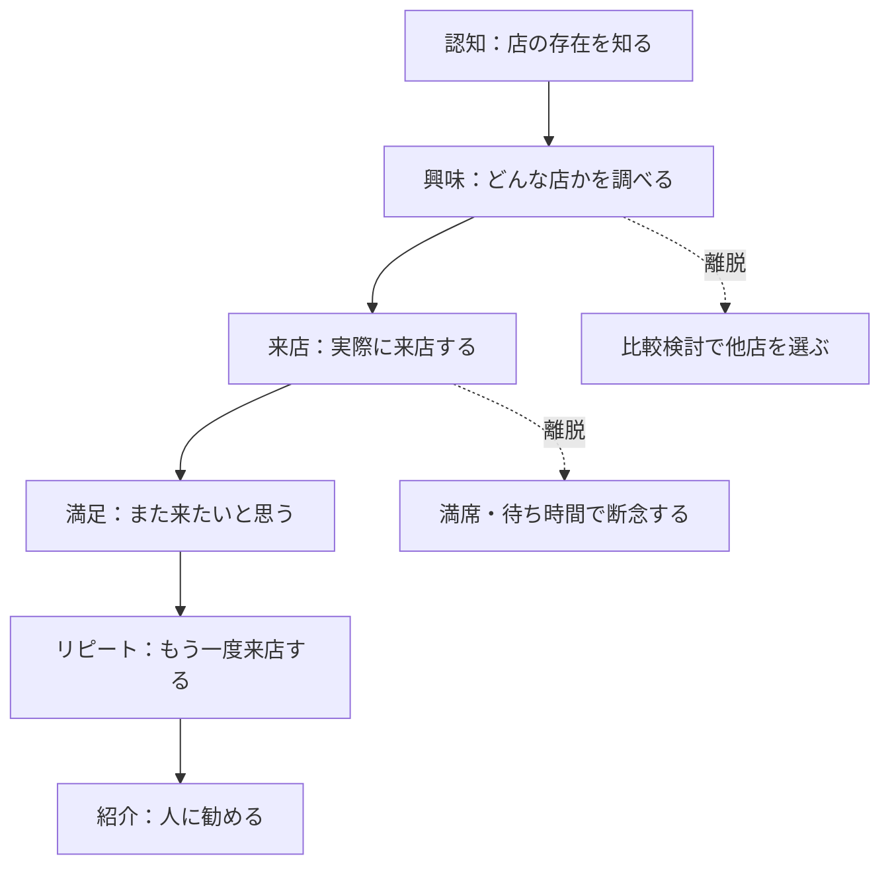
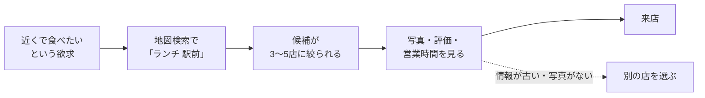
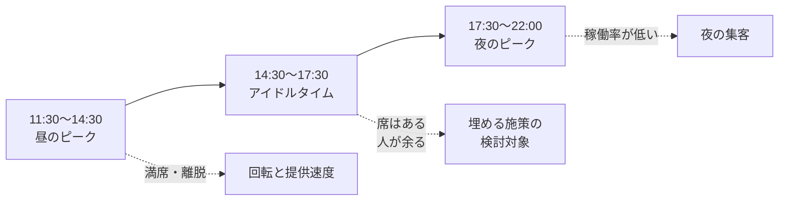

# 第15章 集客とマーケティング

## 15.1 この章で扱うこと

売上の分解式でいうと、集客は**客数**に効きます。ただし「集客」と一言でいうと、新規客を呼ぶのか、リピートを増やすのか、空いている時間帯を埋めるのかで打ち手は全く違います。この章では、集客を**ファネル（段階）**として捉え、段階ごとに測る指標と打ち手を整理します。あわせて、商圏の見方、獲得コストの計算、MEO・SNS・口コミの使い方、リピートの設計、時間帯の平準化を扱います。客数・客単価・回転率・稼働率の**測り方**は[第8章: 客数・客単価・回転率・席稼働率](08-kyaku-tanka-kaiten.md)、メニューと価格は[第17章: 食品ロスとメニュー設計](17-loss-menu.md)で扱います。

## 15.2 学習目標

- 集客をファネルの段階に分け、段階ごとの歩留まりを計算して弱い段階を特定できる。
- 商圏の人口から必要なシェアを逆算し、その商圏で成立するかを判断できる。
- 新規客の獲得コストを計算し、**粗利ベースの LTV** と比べて集客の可否を判断できる。
- リピートを客数ではなく**来店頻度**で管理し、頻度低下の影響を金額で示せる。
- アイドルタイムの施策を、売上ではなく**限界利益**で採算判断できる。

## 15.3 集客はファネルで捉える

### 15.3.1 客が来るまでの6段階

客が来店するまでには段階があります。この段階構造を**ファネル**（funnel、漏斗）と呼びます。上から入った人が下へ行くほど絞られる形になるため、この名前が付いています。



図の説明: 来店は「認知から紹介までの6段階」で進みます。点線は、途中で抜ける経路です。**どの段階で抜けているかによって、打つべき手が変わります。** 満席で断念する客がいるなら、認知を広げる施策は、かえって機会損失を増やします（[第8章](08-kyaku-tanka-kaiten.md) 8.9）。

### 15.3.2 段階ごとの指標と打ち手

| 段階 | 主な指標 | 計測方法の例 | 落ちているときの打ち手 |
| --- | --- | --- | --- |
| 認知 | 商圏内の認知率、地図検索の表示回数 | アンケート、地図検索の管理画面 | MEO、SNS、看板、チラシ |
| 興味 | プロフィール閲覧、メニュー閲覧 | 地図検索の管理画面、自店サイトの解析 | 写真、メニュー訴求、口コミ |
| 来店 | 来店数、予約数 | POS、予約台帳 | 立地、営業時間、価格、導線 |
| 満足 | 満足度、提供時間、クレーム数 | アンケート、POSの時刻記録 | 料理、接客、待ち時間 |
| リピート | 再訪率、来店頻度 | POSの会員紐づけ、予約台帳 | 会員施策、限定メニュー、接点 |
| 紹介 | 紹介数、口コミ投稿数 | 予約時の「紹介」聴取、口コミの新着数 | 体験設計、特典 |

**「満足」の段階を飛ばして「リピート」を語る店が多い**のが実情です。満足していない客に会員カードを渡しても、来店頻度は上がりません。段階は順番に積み上がります。

### 15.3.3 段階ごとの歩留まりを計算する

ファネルは、図で終わらせず**数値で測ります**。次の数値は**説明用の仮置き**です。

| 段階 | 人数（仮置き） | 前段階からの歩留まり |
| --- | --- | --- |
| 認知 | 10,000人 | — |
| 興味 | 1,500人 | 15.0%（1,500 ÷ 10,000） |
| 来店 | 300人 | 20.0%（300 ÷ 1,500） |
| リピート | 90人 | 30.0%（90 ÷ 300） |

```
認知から来店までの通し歩留まり = 15.0% × 20.0% = 3.0%
```

通しで 3.0%（300 ÷ 10,000）です。この形で測ると、**改善の効き方が段階の掛け算で決まる**ことが分かります。興味から来店の歩留まりを 20.0% から 25.0% に上げると、来店数は 1,500 × 0.25 = 375人へ増えます（+75人）。同じ「5ポイント改善」でも、分母の大きい上流で改善するほど人数は大きく動きます。

### 15.3.4 上流を直すか、下流を直すか

ただし、上流の改善は**費用がかさみやすい**という性質があります。認知を広げる施策は母数が大きく、届いた人全員に費用がかかります。一方、リピートの改善は相手が既存客に限られるため、費用は小さく済むことが多いです。**最初に確認すべきは「どの段階が弱いか」であり、その次に「その段階を動かす費用はいくらか」**です。認知が足りない店にリピート施策を打っても無駄ですし、リピートが弱い店に広告を増やしても、獲得した客がすぐ離れます。

| 判断 | 状況 | 打ち手の方向 |
| --- | --- | --- |
| 上流が弱い | 認知・興味の数字が小さい | MEO、写真、口コミ、発信 |
| 中流が弱い | 興味はあるが来店しない | 営業時間、価格、導線、予約のしやすさ |
| 下流が弱い | 来店するが再来しない | 料理、接客、会員施策、接点の設計 |
| 全部弱い | 数字が測れていない | まず計測を始める（15.4） |

**4行目の「全部弱い」は、実は「測っていない」ことがほとんどです。** 測っていない段階は、弱いのか強いのか分かりません。**測れないものは「未計測」と書く**ところから始めます。

## 15.4 どこで詰まっているかを測る

### 15.4.1 計測の仕組みを作る

ファネルを測るには、**客に1問だけ聞く**仕組みで足ります。

| 測りたい段階 | 仕組み | 手間 |
| --- | --- | --- |
| 認知・興味 | 会計時に「どこで知りましたか」を1問 | レジ横に選択肢を置く |
| 来店 | POSの日別・時間帯別の集計 | 既存のPOSで足りる |
| 満足 | 提供時間の記録、クレームの件数 | 厨房とホールで1行の記録 |
| リピート | 会員の紐づけ、予約台帳の氏名 | 会員制度か予約名簿 |
| 紹介 | 予約時の「ご紹介ですか」の聴取 | 予約フォームに1項目 |

**完璧な計測より、続く計測**です。選択肢が多すぎるアンケートは、3日でやられます。**「地図検索／通りがかり／知人に聞いた／SNS」の4つ**で十分です。

### 15.4.2 測れていないことを認める

**測っていない項目は、「未計測」と書きます。** 推測で数字を埋めると、次の判断が狂います。たとえば「リピート率は4割くらい」と感覚で置くと、その数字をもとに会員施策の予算を決めてしまいます。

| 状態 | 書くこと | 次の行動 |
| --- | --- | --- |
| 測っている | 数字と定義（分母・期間） | 前月・前年と比べる |
| 測っていない | **未計測** | 今月から測る方法を決める |
| 測れない | 理由（客を識別できない等） | 識別の手段を検討する |

**リピート率は、客を識別する手段がなければ測れません。** 会員制度も予約名簿もない店では、リピート率は「未計測」です。この場合、**時間帯別の客数と売上**（[第8章](08-kyaku-tanka-kaiten.md) 8.11）から間接的に推測するしかありません。

### 15.4.3 MEO と SNS は、どの段階に効くのか

ツールを入れる前に、**どの段階に効くのか**を説明できるようにします。

| 接点 | 主に効く段階 | 効き方 |
| --- | --- | --- |
| 地図検索の店舗情報（MEO） | 認知→興味→来店 | すでに店を探している人に届く |
| SNS | 認知→興味 | 存在を知らない人に届く |
| 口コミサイト | 興味→来店 | 比較検討の後押し |
| 予約システム | 来店 | 取りこぼしを減らす |
| 会員・LINE等 | リピート | 再来のきっかけを作る |

**「なんとなく始めたSNS」は、どの段階にも効いていません。** 効いていないものは、3か月後にやめる判断もできません（15.8）。

## 15.5 商圏の見方

### 15.5.1 業態と商圏

飲食店は**商圏**（しょうけん、客が来る地理的な範囲）を持ちます。商圏は業態で変わります。

| 業態の例 | 主な商圏 | 来店動機 |
| --- | --- | --- |
| カフェ、ランチ | 徒歩5〜10分、近隣の勤務者・住民 | 日常の利便性 |
| 居酒屋、ディナー | 駅周辺、車10分程度 | 非日常、会食 |
| 専門店、人気店 | 市外・県外も | 目的来店、話題性 |

商圏の内側に**どれだけの人がいるか**（人口）、**どれだけ競合がいるか**（店舗数）で、成立するかどうかが大きく変わります。同じメニューでも、商圏内の人口と競合数が違えば、必要客数に届かないことがあります。

### 15.5.2 商圏から必要シェアを逆算する

「商圏に人が足りるか」は、次の順で計算できます。数値は**説明用の仮置き**です。

```
必要月間客数 = 目標月商 ÷ 客単価
商圏の延べ外食回数 = 商圏人口 × 1人あたりの月間外食回数
必要なシェア = 必要月間客数 ÷ 商圏の延べ外食回数
```

- 目標月商 3,000,000円、客単価 1,500円 → 必要月間客数 = 3,000,000 ÷ 1,500 = **2,000人**
- 商圏人口 20,000人、1人あたり月4回外食 → 延べ外食回数 = 20,000 × 4 = **80,000人回**
- 必要なシェア = 2,000 ÷ 80,000 = **2.5%**

この 2.5% が現実的かどうかを、商圏内の競合店数と比較して判断します。商圏に同業態が10店あれば、単純に割れば10%（1店あたり）が上限の目安になります。2.5% は10店平分の4分の1ですから、成立の可能性はある、と読めます。逆に必要なシェアが20%を超えるなら、その商圏では人口が足りない可能性を疑います。

**この計算の分母は「延べ外食回数」であって「人口」ではありません。** 人口で割ると、外食しない人まで分母に入り、シェアが実際より低く見えます。

### 15.5.3 商圏の「時間」軸

**同じ店でも、昼と夜で商圏が変わります。** これは二毛作の店では決定的な論点です。

| 時間帯 | 商圏 | 来店動機 | 必要な情報 |
| --- | --- | --- | --- |
| 昼 | 徒歩5分圏内の勤務者 | 速さ、量、価格 | 提供時間、日替わり、行列の長さ |
| 夜 | 駅周辺、車10分 | 雰囲気、品数、酒 | メニュー、席の広さ、予約の可否 |

**昼のファネルと夜のファネルは、別に測ります。** 認知の手段も、興味を引く情報も違います。昼は「今日の日替わり」が効き、夜は「写真と雰囲気」が効きます。**1つのファネルで平均すると、どちらの弱点も見えません。**

### 15.5.4 商圏データの出所

> **注意**: 商圏分析のツールやデータは多数市販されていますが、本資料では特定のサービスの数値を扱いません。商圏内人口は国勢調査などの公的統計で確認できます。

**商圏人口は、推測せずに出所を書きます。** 統計を使うときは、**調査年**と**取得日**を添えます（[第2章: 損益計算書の読み方](02-soneki-keisansho.md) 2.10の統計の扱いを参照）。「なんとなく8万人」で計画を立てると、必要シェアの計算が全部崩れます。

## 15.6 新規客の獲得とコスト

### 15.6.1 手段の比較

| 手段 | 内容 | 長所 | 短所 |
| --- | --- | --- | --- |
| MEO（地図検索対策） | Google マップ等での表示を最適化する | 無料で始められる。来店意図の高い客に届く | 効果測定が難しい |
| SNS | 写真・動画での発信 | 拡散性がある。世界観を伝えられる | 継続コストが高い。売上に直結しにくい |
| 口コミサイト | レビュー、ランキング | 信頼性が高い | 評価が下がると回復が難しい |
| チラシ・ポスティング | 商圏への配布 | 商圏を絞れる | 反応率が低い |
| 紹介・常連の口コミ | 既存客からの紹介 | 獲得コストが低い。定着しやすい | 規模が限られる |
| デリバリー | 外部プラットフォーム | 席を使わず売上を増やせる | 手数料が高い。店内品質と分離が必要 |

**獲得コスト（1人を呼ぶのにいくらかかったか）を必ず計算します。**

```
新規客獲得コスト = 集客費用 ÷ 新規客数
```

### 15.6.2 獲得コストの数値例

数値は**説明用の仮置き**です。月の集客費用がチラシ 30,000円 + SNS広告 20,000円 = 50,000円、新規客数が40人なら、獲得コストは 50,000 ÷ 40 = **1,250円/人**です。

この値と比較するのが、その客がもたらす粗利です。客単価2,500円、原価率35%なら1回あたりの粗利は 2,500 × (1 − 0.35) = 1,625円。年4回・2年継続と仮定すると、粗利の合計は 1,625 × 8回 = **13,000円**です。

```
LTV（粗利ベース） = 1回あたり粗利 × 年間来店回数 × 継続年数
LTV ÷ 獲得コスト = 13,000 ÷ 1,250 = 10.4倍
```

**LTV**（Life Time Value、顧客生涯価値）は、1人の客が付き合ってくれる間に使う金額の合計です。定義と計算の詳細は[第8章](08-kyaku-tanka-kaiten.md) 8.8で扱いました。

### 15.6.3 売上ベースで比べない

LTV は売上ベースで語られることもありますが、**獲得コストと比べるときは粗利ベースにそろえます**。売上ベースの LTV（2,500 × 8回 = 20,000円）で比べると、実際には払えない金額を回収できるように見えてしまうためです。

| 比べ方 | LTV | 獲得コスト | 倍率 | 判断 |
| --- | --- | --- | --- | --- |
| 売上ベース | 20,000円 | 1,250円 | 16.0倍 | 回収できるように見える |
| 粗利ベース | 13,000円 | 1,250円 | 10.4倍 | これが実際の回収力 |

**獲得コストが LTV を超えたら、その集客は赤字です。** 広告を打つ前に、この2つの数字を比べる習慣が必要です。

### 15.6.4 前提が変わると結論が変わる

LTV は**見込み値**です。来店回数と継続年数を変えると、結論が変わります。

| 前提 | 粗利ベースのLTV | 獲得コスト1,250円との倍率 | 判断 |
| --- | --- | --- | --- |
| 年4回・2年（8回） | 13,000円 | 10.4倍 | 回収できる |
| 年3回・2年（6回） | 9,750円 | 7.8倍 | 回収できる |
| 年4回・1年（4回） | 6,500円 | 5.2倍 | 回収できる |
| 年2回・1年（2回） | 3,250円 | 2.6倍 | ぎりぎり |

（1回あたり粗利1,625円で計算。小数第1位を四捨五入。）

**判断は、短めの継続期間で行います。** 「2年続く」という見込みで広告を決め、「1年で切れた」となると、回収の前提が崩れます。**短い前提でも回収できる広告だけを、継続して打ちます。**

## 15.7 MEO（地図検索対策）

### 15.7.1 なぜ効くか

**MEO**（Map Engine Optimization）は、地図検索での表示を最適化する取り組みです。地図検索が他の手段と違うのは、**探している人がすでに「来店を決めかけている」**ことです。



図の説明: 地図検索では、比較の土俵に上がれるかどうかが勝負です。**土俵に上がった後は、情報の鮮度と写真で決まります。** ここで落ちるのは、認知の問題ではなく**情報整備の問題**です。

### 15.7.2 整備する項目

| 項目 | 内容 | よくある抜け |
| --- | --- | --- |
| 基本情報 | 店名、住所、電話、営業時間、定休日 | 祝日や臨時休業が反映されていない |
| 写真 | 外観、内観、料理、メニュー表 | 料理だけ。外観がなくて辿り着けない |
| メニュー・価格 | 主な商品と価格帯 | 価格が古い |
| 属性 | 席数、禁煙・喫煙、支払い方法、予約可否 | 更新されていない |
| 最新性 | 季節メニュー、改装、営業時間の変更 | 変更時に更新する運用がない |
| 返信 | 口コミへの返信（15.9） | 低評価を放置している |

**外観の写真は、料理の写真と同じくらい重要です。** 商店街の奥や2階にある店では、**「どこから入るか」が分からない**ことで来店が止まります。看板、入口、階段の写真を入れます。

### 15.7.3 計測と更新の運用

| 見る数字 | 分かること | 頻度 |
| --- | --- | --- |
| 表示回数 | 検索結果に出た回数（認知の代理指標） | 月1回 |
| ルート検索・電話・サイト遷移 | 来店意図の強さ | 月1回 |
| 写真の閲覧数 | どの写真が見られているか | 月1回 |

**更新の運用を決めないと、情報は必ず古くなります。** 「営業時間を変えたら、その日のうちに地図検索も直す」という**1つのルール**を決めます。改装やメニュー改定のときも同じです。

**MEO は無料で始められますが、無料だから続くとは限りません。** 月1回、15分見る時間を予定に入れます。

## 15.8 SNS と発信

### 15.8.1 向き・不向き

| SNS が向く場面 | SNS が向かない場面 |
| --- | --- |
| 見た目で伝わる商品がある | 味や香りが中心の商品 |
| 世界観や店主の人柄を出せる | 価格だけで選ばれる店 |
| 継続して投稿できる人がいる | 投稿の担当が決まらない |
| 商圏外からの来店も狙う | 近隣の日常利用が中心 |

**SNS は「認知」と「興味」に効きますが、来店には効きにくい**ものです。売上に直結しにくいことを前提に、**「見た人が店の存在を知る」という役割**に絞ると続けられます。

### 15.8.2 投稿の型を持つ

毎回ゼロから考えると続きません。**型を決めて回します。**

| 型 | 内容 | 頻度の目安 | 効く段階 |
| --- | --- | --- | --- |
| 商品 | 一品の写真と説明 | 週2〜3回 | 興味 |
| 仕込み・裏側 | 仕込みの様子、産地、道具 | 週1回 | 興味・信頼 |
| 人 | スタッフ、店主の言葉 | 月2回 | 興味・採用 |
| お知らせ | 営業時間、季節メニュー、休業 | 都度 | 来店の取りこぼし防止 |

**「人」の投稿は、集客と採用の両方に効きます。** 求人を見た人が SNS を見て応募する流れは珍しくありません（[第14章: 採用と教育](14-saiyo-kyoiku.md) 14.4）。

### 15.8.3 フォロワー数を目標にしない

**フォロワー数と来店は別です。** フォロワーが増えても客数が増えないことは、よくあります。見るべきは、**保存数・プロフィール閲覧・「SNSを見た」と言われた回数**です。

| 指標 | 意味 | KPI にできるか |
| --- | --- | --- |
| フォロワー数 | 発信の到達範囲の目安 | 単独では使わない |
| 保存・シェア | 行動につながった度合い | 使える |
| プロフィール閲覧 | 興味を持った人数 | 使える |
| 「SNSを見た」の申告数 | 実際の来店への寄与 | 最も使える（15.4.1） |

**SNS の効果測定値（業界平均のCVRなど）は本章では扱いません。** 裏付けが取れていない数値を提示しない方針によります。

## 15.9 口コミと評判の管理

### 15.9.1 管理の基本は3つ

口コミは、ファネルの「興味」から「来店」への歩留まりに効きます。

| 対象 | やること | 理由 |
| --- | --- | --- |
| 高評価 | 返信する。使われた場面を具体的に書く | 読んでいるのは見込み客。返信も情報になる |
| 低評価 | 事実を確認し、返信する。反論から入らない | 反論は読者に「改善しない店」と映る |
| 投稿の依頼 | 報酬や条件を付けて依頼する場合は表示規制に注意する | 依頼と分からない表示は、不当表示として問題になり得る |

### 15.9.2 表示ルールは未取得

**投稿を依頼して報酬を払う場合の表示ルールは、本資料では一次資料を確認できていません（未取得）。** 具体的な要件は、消費者庁の公表資料を確認してください。

**未取得のまま「たぶん大丈夫」で運用しない**のが原則です。報酬を払う依頼、割引と引き換えの投稿依頼は、**始める前に確認**します。

### 15.9.3 評価点を目標にしない

評価点そのものを目標にすると、指標が歪みます。「星4.5以上」を目標にすると、低い評価を書かれそうな客を避ける、といった動きが出ます。見るべきは**評価点の推移**と**低評価の内容の傾向**です。同じ指摘が繰り返されるなら、それは運用の問題です。

| 見方 | 使い方 |
| --- | --- |
| 評価点の推移 | 3か月単位で見る。単月で一喜一憂しない |
| 低評価の内容 | 分類する（待ち時間、接客、価格、清潔、味） |
| 同じ指摘の回数 | **3件以上**なら運用の問題として扱う |
| 返信の有無 | 低評価に返信しているか |

**「3件ルール」は、退職の聞き取り（[第14章](14-saiyo-kyoiku.md) 14.8.3）と同じ考え方**です。1件は事情、3件は傾向です。

## 15.10 リピートの設計

### 15.10.1 客数ではなく頻度で見る

リピートは、来店頻度と継続期間で決まります。

```
リピート売上 = 既存客数 × 来店頻度 × 客単価
```

数値は**説明用の仮置き**です。既存客 300人が月2回来店し、客単価が2,500円なら、リピート売上は 300 × 2 × 2,500 = **1,500,000円/月**です。ここで来店頻度が月1.8回に落ちると 300 × 1.8 × 2,500 = 1,350,000円となり、**月15万円（10%）**が消えます。

この計算が示すのは、**頻度の小さな低下が大きな売上減になる**ということです。客数が減っていなくても、足が遠のくだけで売上は落ちます。

| 来店頻度（月） | 既存客300人・客単価2,500円のリピート売上 | 基準（月2回）との差 |
| --- | --- | --- |
| 2.0回 | 1,500,000円 | — |
| 1.8回 | 1,350,000円 | −150,000円（−10.0%） |
| 1.5回 | 1,125,000円 | −375,000円（−25.0%） |
| 1.0回 | 750,000円 | −750,000円（−50.0%） |

**頻度が半分になると、売上も半分です。** 客数が同じでも、です。

### 15.10.2 3つの打ち手

1. **来店のきっかけを増やす**（季節メニュー、限定品、イベント）
2. **来店の頻度を上げる**（会員特典、スタンプ、サブスク、近隣向けの時間帯割引）
3. **離脱を防ぐ**（予約リマインド、クレーム対応、接客の質）

**3番目が最も費用がかからず、効果が大きい**ことが多いです（**一般知識（未検証）**）。すでに来ている客が来なくなる理由を取り除く方が、新しいきっかけを作るより確実です。

### 15.10.3 会員制度は万能ではない

**会員カードを作っても、使われなければ意味がありません。** 会員数を KPI にすると「作っただけ」の状態を見逃します。見るべきは**会員の来店頻度**と**会員売上比率**（売上に占める会員の売上の割合）です。

| 指標 | 意味 | 落とし穴 |
| --- | --- | --- |
| 会員数 | 制度の規模 | 作っただけの会員を含む |
| 会員の来店頻度 | 制度が効いているか | 識別できる客だけの値になる |
| 会員売上比率 | 売上への寄与 | 元から常連だった客が入会しただけのことがある |

**「元から来ていた常連が会員になっただけ」**という状態は、施策の効果ではありません。導入前後の**来店頻度**を比べて判断します。

### 15.10.4 定義を固定する

リピート率の定義は店によって揺れます。「再来店した人の割合」なのか「今月の客のうち前月も来た人の割合」なのかで値が変わります。**定義を文書に固定してから比較してください。**

| 定義の例 | 式 | 使える場面 |
| --- | --- | --- |
| 再来店率 | 2回以上来店した客数 ÷ 全客数 | 期間を決めずに見る |
| 月次継続率 | 今月来店した客のうち前月も来た人数 ÷ 前月の来店客数 | 月次の変化を見る |
| 30日以内再来率 | 30日以内に再来した人数 ÷ 新規客数 | 新規客の定着を見る |

**定義が違えば、数字は比べられません。** この構造は、定着率の定義（[第14章](14-saiyo-kyoiku.md) 14.8.1）と同じです。

## 15.11 時間帯の平準化

### 15.11.1 時間帯ごとの課題

稼働率（[第8章](08-kyaku-tanka-kaiten.md) 8.5）を上げる打ち手として、時間帯の平準化があります。

| 時間帯 | 課題 | 打ち手 |
| --- | --- | --- |
| 平日昼 | 会社員のランチ需要。回転勝負 | 提供速度、セットメニュー |
| 平日夜 | 客数が落ちる | 少人数向けメニュー、テイクアウト |
| 週末 | 混雑と待ち | 予約、整理券 |
| アイドルタイム | 席が空く | カフェ利用、打ち合わせ利用、サブスク |

**アイドルタイム**とは、客数が落ちて席が空く時間帯のことです。アイドルタイムは、**席という在庫が既にあるのに使われていない**状態です。ここを埋める施策は、新規客を獲得するよりコストが低いことが多いです。



図の説明: 1日の客数は山と谷を作ります。**谷を埋める検討と、山の離脱を減らす検討は、別の打ち手**です。谷の施策は、追加の売上より**追加の費用**が小さいことに意味があります。

### 15.11.2 アイドルタイムの採算

埋める施策が採算に合うかは計算が必要です。数値は**説明用の仮置き**です。

- 追加客 12人/日、追加の客単価 1,200円 → 追加売上 = 12 × 1,200 = **14,400円/日**
- 限界利益率 65% → 追加限界利益 = 14,400 × 0.65 = **9,360円/日**
- 追加の人件費 3時間 × 1,300円 = **3,900円/日**
- 差引 = 9,360 − 3,900 = **5,460円/日**、月25営業日なら **136,500円/月**

**判断に使うのは売上ではなく限界利益**です。**限界利益**とは、売上から変動費を引いた残りで、固定費の回収に充てられる金額です（[第6章: 損益分岐点](06-soneki-bunkiten.md) 6.4）。アイドルタイムの追加客は、家賃という固定費をすでに回収済みの状態で乗ってくるため、限界利益がそのまま利益に近づきます。逆に、追加人件費が限界利益を上回るなら、その施策は売上を増やしても利益を減らします。

| 追加客数（人/日） | 追加限界利益 | 追加人件費 | 差引 |
| --- | --- | --- | --- |
| 12人 | 9,360円 | 3,900円 | +5,460円 |
| 8人 | 6,240円 | 3,900円 | +2,340円 |
| 5人 | 3,900円 | 3,900円 | ±0円 |
| 3人 | 2,340円 | 3,900円 | −1,560円 |

**損益が分かれる客数を先に計算しておくと、やめる判断ができます。** 上の例では5人/日が分岐点です。

### 15.11.3 埋める前に確かめる

平準化を考える前に、**その時間帯が本当に空いているか**を確認してください。「なんとなく暇」ではなく、時間帯別の客数と稼働率を1〜2週間記録すると、埋めるべき時間帯が特定できます（[第8章](08-kyaku-tanka-kaiten.md) 8.11）。

**アイドルタイムの施策は、シフトの設計と直結します。** 追加の人件費をどこに置くかは、シフトの問題です（[第4章: 人件費と生産性](04-jinken-hi-seisansei.md) 4.8）。「埋めたい時間帯に人がいない」なら、シフトを組み替えるか、その時間帯だけ短時間の勤務を入れるかを検討します。

## 15.12 デジタル接点の現実的な使い方

| 接点 | 向いている用途 | 注意点 |
| --- | --- | --- |
| 地図検索の店舗情報 | 営業時間、メニュー、写真の最新化 | 情報が古いと来店機会を失う。更新の運用を決める |
| SNS（写真・動画） | 商品の魅力、世界観 | 投稿の継続が前提。売上への寄与を測りにくい |
| 予約システム | 予約受付、リマインド | 電話と二重管理にならないようにする |
| モバイルオーダー | 注文の効率化、待ち時間削減 | 高齢客・常連客の使いやすさを確認する |
| デリバリー | 席を使わない売上 | 手数料率と店内オペレーションへの影響を計算する |

**ツールを入れること自体は集客ではありません。** どのファネルの段階に効くのかを説明できないツールは導入しない、という基準を持ちます。

導入するなら、**効いたかを測れる形**にします。予約経路を聞く、会計時に「どこで知ったか」を1問だけ聞く、といった手作業でも構いません。測れない状態で3か月使うと、続けるかやめるかの判断ができなくなります。

## 15.13 ケースの店では

連続ケース「食堂つきかげ」（[第22章: 総合ケース](22-case.md)）で、**4月から11月の変化**をファネルの言葉で読み解きます。**ケースの数字は設計値であり、実在の店舗の実績ではありません。**

### 4月と11月の数字

| 項目 | 4月 | 11月 | 差 |
| --- | --- | --- | --- |
| 売上（設計値） | 1,800,000円 | 3,000,000円 | +1,200,000円（+66.7%） |
| 客数 | 2,000人 | 2,050人 | +50人（+2.5%） |
| 客単価 | 900円 | 1,463円 | +563円（+62.6%） |
| 材料費率 | 32% | 30% | −2ポイント |
| 限界利益率 | 68% | 70% | +2ポイント |

**客数はほとんど増えていません。売上が66.7%増えたのは、客単価が62.6%上がったからです。** この分解を、2つの視点で確かめます。

### 分解1：客数効果と客単価効果

```
客数効果   =（2,050 − 2,000）× 900円 = 45,000円
客単価効果 = 2,000人 ×（1,463円 − 900円）= 2,000 × 563円 = 1,126,000円
交差項     =（2,050 − 2,000）× 563円 = 28,150円
合計       = 45,000 + 1,126,000 + 28,150 = 1,199,150円
```

（設計値の差1,200,000円との差850円は、客単価1,463円が端数処理後の値であることによります。誤差は0.1%です。）

**売上増の93.9%は客単価効果**です（1,126,000 ÷ 1,199,150 ≒ 93.9%）。客数効果は3.8%に過ぎません。

### 分解2：昼と夜の内訳

ケースには昼夜の内訳が定められていないため、[第8章](08-kyaku-tanka-kaiten.md) 8.12と同じ**説明用の仮置き**（4月は昼のみ2,000人、11月は昼1,600人・夜450人）を使います。

| 区分 | 4月 | 11月 | 差 |
| --- | --- | --- | --- |
| 昼の客数 | 2,000人 | 1,600人 | −400人（−20.0%） |
| 昼の売上（900円） | 1,800,000円 | 1,440,000円 | −360,000円 |
| 夜の客数 | 0人 | 450人 | +450人 |
| 夜の売上（3,500円） | 0円 | 1,575,000円 | +1,575,000円 |
| 合計 | 1,800,000円 | 3,015,000円 | +1,215,000円 |

**昼は2割減り、夜がゼロから450人になりました。** 増収のすべては夜の立ち上げです。表の合計3,015,000円と設計値3,000,000円の差15,000円（0.5%）は、[第8章](08-kyaku-tanka-kaiten.md) 8.12と同じ丸めの差です。

**この2つの分解は、同じ変化を別の角度から見ています。** 分解1は「客単価が上がった」と言い、分解2は「夜という新しい時間帯のファネルが動き出した」と言います。**打ち手を決めるのは分解2の方**です。客単価を直接上げたのではなく、単価の高い時間帯の客が増えたのです。

### ファネルのどこが動いたか

| 段階 | 4月 | 11月 | 何が起きたか |
| --- | --- | --- | --- |
| 認知 | 昼の商圏（徒歩5分） | 昼の商圏＋夜の商圏（駅周辺） | 商圏が時間帯で二重になった |
| 興味 | 日替わりの情報 | 写真・雰囲気・コースの情報 | 訴求する情報が変わった |
| 来店 | 昼2,000人 | 昼1,600人・夜450人 | 夜の来店が新規に発生した |
| 満足 | — | 提供の遅れが課題（[第22章](22-case.md)） | 満足の測定が必要になった |
| リピート | 未計測 | 未計測 | **依然として未計測** |

**ケースの店のリピートは、1年目を通じて「未計測」です。** 会員制度も予約名簿もないため、リピート率は計算できません。**推測で埋めずに、未計測と書きます**（15.4.2）。2年目の課題になります。

### 獲得コストと LTV

ケースの年間の「その他経費」1,440千円には広告・システム・リース・保険・消耗品・修繕が含まれ、**広告費だけの内訳は設計値にありません**。ここでは**説明用の仮置き**として、集客費用を月20,000円、新規客数を月30人と置きます。

```
新規客獲得コスト = 20,000円 ÷ 30人 ≒ 667円/人
```

これと比べる粗利ベースの LTV は、[第8章](08-kyaku-tanka-kaiten.md) 8.12で**約21,602円**（客単価1,470.7円・月1.2回・18か月・粗利率68%の仮置き）と計算しています。

```
LTV ÷ 獲得コスト = 21,602 ÷ 667 ≒ 32.4倍
```

**獲得コスト667円に対して、粗利ベースのLTVは32.4倍**です。継続期間を12か月に短く見ても14,401円（[第8章](08-kyaku-tanka-kaiten.md) 8.12）なので、**20倍以上**あります。この前提では、**集客費用を増やす余地は大きい**と読めます。

**ただし、これは「新規客が月30人いる」という仮置きが前提です。** 新規客数を測っていなければ、この計算はできません。**まず15.4.1の計測を始めるのが先**です。

### アイドルタイムの採算

ケースの店には、昼の営業終了（14:30）から夜の開店（17:30）まで**3時間の谷**があります。ここを埋める施策を検討します。

```
追加客 10人/日 × 昼の客単価 900円 = 9,000円/日
追加限界利益 = 9,000円 × 0.70 = 6,300円/日
追加人件費   = 2時間 × 1,200円 = 2,400円/日
差引         = 6,300 − 2,400 = 3,900円/日
月換算       = 3,900円 × 25日 = 97,500円/月
年換算       = 97,500円 × 12か月 = 1,170,000円
```

（追加客10人/日は説明用の仮置き。限界利益率は11月の材料費率30%から70%。時給1,200円はケースの設定。）

**年117万円**です。ケースの年間営業利益（オーナー報酬前）5,574千円に対して**21.0%**にあたります。

```
1,170,000 ÷ 5,574,000 × 100 ≒ 21.0%
```

**谷を埋める施策は、新しい客を獲得するより費用が小さく済みます。** すでに席と設備があり、商圏の人がいるからです。ただし、**分岐点を先に計算します**。追加客が5人/日まで落ちると、追加限界利益は 5 × 900 × 0.70 = 3,150円となり、人件費2,400円との差は750円です。**4人/日を下回ると赤字**になります。

### 商圏の確認

ケースの立地は人口8万人の地方都市です。11月の必要客数2,050人を使って、必要なシェアを計算します。1人あたり月4回外食と仮置きすると、

```
延べ外食回数 = 80,000人 × 4回 = 320,000人回
必要なシェア = 2,050 ÷ 320,000 ≒ 0.64%
```

**0.64%です。** 商圏に対して必要とするシェアが小さく、**人口の面では成立しやすい**と読めます。ただし、この計算は「1人あたり月4回外食」「商圏外からの来店を含めない」という仮置きの上に立っています。**仮置きを変えれば結論は変わります。** 数字より、**何を仮置きしたか**を残すことが重要です。

## 15.14 よくある誤解

| 誤解 | 実際 |
| --- | --- |
| 広告を増やせば客が増える | ファネルのどこが詰まっているかによります。リピートが弱い店は広告費が無駄になります |
| SNSのフォロワー数が集客力 | フォロワーと来店は別です。来店数・予約数で確認します |
| 会員を増やせばリピートする | 会員数ではなく、来店頻度と会員売上比率を見ます |
| 商圏が広いほど良い | 商圏が広いと来店頻度は下がります。日常利用は近隣、非日常は遠方と分けて考えます |
| デリバリーは売上が増える | 手数料と店内オペレーションへの影響を引いて判断します |
| 口コミの評価点を上げれば売れる | 評価点より、低評価の内容の傾向と推移を見ます |
| アイドルタイムは埋めれば必ず得 | 追加人件費が追加限界利益を上回れば、売上が増えても利益は減ります |
| 客単価を上げれば売上が上がる | 客数が同時に減れば相殺されます。4月から11月の分解のように、両方を見ます |
| リピート率は感覚で分かる | 客を識別する手段がなければ測れません。未計測と書きます |
| 昼と夜は同じ集客でよい | 商圏も訴求も違います。時間帯ごとにファネルを測ります |
| ツールを入れれば集客になる | どの段階に効くか説明できないツールは、判断もできません |
| 商圏人口で割ればシェアが出る | 分母は延べ外食回数です。人口で割ると過小に出ます |

## 15.15 この章の要点

- 集客は**ファネルの段階**に分けて捉えます。段階ごとに歩留まりを計算し、弱い段階を特定してから打ち手を決めます。
- 獲得コストは必ず計算し、**粗利ベースの LTV** と比べます。売上ベースの LTV で比べると判断を誤ります。**短めの継続期間**で検算します。
- リピートは客数ではなく**来店頻度**で管理します。頻度の小さな低下が大きな売上減になります。定義は文書に固定します。
- アイドルタイムを埋める施策は、売上ではなく**限界利益**で採算を判断します。**分岐点の客数を先に**計算します。
- 昼と夜では**商圏もファネルも別**です。測っていない段階は「未計測」と書き、推測で埋めません。

## 15.16 自店で確認すること

- [ ] ファネルの各段階を、自店では何の数字で測るかを決めている
- [ ] 直近3か月の「新規客数」と「集客費用」を把握している
- [ ] 新規客獲得コストを計算し、粗利ベースの LTV と比較したことがある（短い継続期間でも検算した）
- [ ] リピート率の定義（分母・期間）を文書に固定している。測れない場合は「未計測」と記録している
- [ ] 時間帯別の客数と稼働率を、直近1〜2週間分は記録している
- [ ] アイドルタイム施策の採算を、限界利益と追加人件費で計算し、分岐点の客数を出した
- [ ] 会計時に「どこで知ったか」を1問だけ聞くなど、集客の効果を測る仕組みがある
- [ ] 地図検索の情報（営業時間・写真・メニュー）を、変更時に更新する運用を決めている

## 15.17 章末問題

### 問1 ファネルの歩留まり（計算）

認知20,000人、興味2,400人、来店480人、リピート144人という記録があります。

1. 認知→興味、興味→来店、来店→リピートの各歩留まりを求めてください。
2. 認知から来店までの通し歩留まりを求めてください。
3. 興味→来店の歩留まりを 20.0% から 24.0% に上げた場合の来店数を求めてください。
4. 来店480人を変えずに、来店→リピートを 30.0% から 40.0% に上げた場合のリピート人数を求めてください。

**解答**

```
【1. 各歩留まり】
認知→興味   = 2,400 ÷ 20,000 = 12.0%
興味→来店   = 480 ÷ 2,400 = 20.0%
来店→リピート = 144 ÷ 480 = 30.0%

【2. 通し歩留まり】
12.0% × 20.0% = 2.4%
検算: 480 ÷ 20,000 = 2.4%

【3. 興味→来店を24.0%に】
2,400 × 0.24 = 576人（+96人）

【4. 来店→リピートを40.0%に】
480 × 0.40 = 192人（+48人）
```

3と4を比べると、**同じ「4ポイント／10ポイントの改善」でも、動く人数は上流の方が大きい**ことが分かります。ただし上流の改善は母数が大きく費用がかさみます。**改善する段階は、人数の増加と費用の両方で選びます**（15.3.4）。

### 問2 獲得コストと回収（計算）

月の集客費用が90,000円、新規客数が60人です。客単価2,600円、原価率34%、年4回来店・2年継続と仮定します。

1. 新規客獲得コストを求めてください。
2. 1回あたりの粗利と、粗利ベースの LTV を求めてください。
3. 獲得コストを回収するのに必要な来店回数を求めてください。
4. 継続期間が1年になった場合の LTV と倍率を求めてください。

**解答**

```
【1. 獲得コスト】
90,000 ÷ 60 = 1,500円/人

【2. 粗利とLTV】
1回あたり粗利 = 2,600 ×（1 − 0.34）= 2,600 × 0.66 = 1,716円
LTV = 1,716 × 4回 × 2年 = 13,728円

【3. 回収に必要な来店回数】
1,500 ÷ 1,716 = 0.874回 → 1回目の来店で回収できる

【4. 継続1年の場合】
LTV = 1,716 × 4回 × 1年 = 6,864円
倍率 = 6,864 ÷ 1,500 = 4.6倍
```

**どちらの前提でも回収できます**（13,728 ÷ 1,500 = 9.2倍、6,864 ÷ 1,500 = 4.6倍。小数第2位を四捨五入）。ただし、これは**年4回来店**が実現する場合です。来店頻度が年2回に落ちると、LTVは 1,716 × 2 × 1 = 3,432円、倍率は2.3倍になります。**獲得コストの判断は、頻度の前提に最も敏感**です。

### 問3 ファネルの診断（記述）

「広告費を月10万円に増やしたのに、売上が増えない」という相談を受けました。何を確認し、どう判断しますか。

**解答**

第一に、**ファネルのどこで落ちているか**を確認します（15.3）。広告は「認知」から「興味」に効く施策です。認知と興味の数字が上がっているのに来店が増えていないなら、詰まっているのは「興味→来店」です。原因は、営業時間、価格、場所、予約のしやすさ、満席による離脱などです。**満席で断念する客がいるなら、広告を増やすと機会損失が増えるだけ**です（[第8章](08-kyaku-tanka-kaiten.md) 8.9）。

第二に、**「どこで知ったか」を測っているか**を確認します（15.4.1）。広告経由の来店を数えていなければ、「増えたかどうか」自体が分かりません。会計時の1問だけで足ります。

第三に、**獲得コストと LTV を比べます**（15.6）。広告費10万円で新規客が何人増えたかが分かれば、1人あたりの獲得コストが出ます。それが粗利ベースの LTV を上回っていれば、**広告は売上を増やしても赤字**です。この場合、広告を増やすほど損が増えます。

第四に、**リピートが弱くないか**を確認します（15.10）。新規客を集めても、頻度が落ちていれば売上は増えません。既存客の来店頻度が下がっているなら、広告より先に、満足の段階（提供時間、接客、品切れ）を直します。

**判断の順序**は、①測る、②詰まっている段階を特定する、③その段階に効く費用を計算する、④LTV と比べる、です。**「広告費を増やすか減らすか」を最初に決めると、原因を見ないまま金額だけが動きます。**

## 参考文献・出典

- 本章のファネル、商圏、獲得コスト、LTV の考え方は、マーケティングの標準的な枠組みにもとづく**一般知識（未検証）**です。
- 商圏人口の具体的な数値、MEO や SNS の効果測定値、デリバリー手数料率は本章では扱っていません。**裏付けが取れていない数値を提示しない**方針によります。商圏内人口は国勢調査などの公的統計で確認できます（調査年と取得日を添えてください）。
- 口コミ投稿の依頼に関する表示ルールは、**一次資料を確認できていません（未取得）**。消費者庁の公表資料を確認してください。
- 「離脱を防ぐ打ち手が最も費用対効果が高い」ことは**一般知識（未検証）**です。自店の数字で確かめてください。
- 本章の数値例（10,000人・1,500円・1,250円・1,500,000円・14,400円・90,000円など）は、いずれも**説明用の仮置き**です。実在の店舗の実績ではありません。
- 15.13 の売上・客数・客単価は[OUTLINE.md](../OUTLINE.md) 3章の**ケースの設計値**（[第22章](22-case.md)）です。昼夜の内訳（4月は昼のみ2,000人、11月は昼1,600人・夜450人）は[第8章](08-kyaku-tanka-kaiten.md) 8.12と同じ**説明用の仮置き**です。集客費用 月20,000円・新規客 月30人・追加客10人/日・商圏人口8万人・1人あたり月4回外食は**説明用の仮置き**です。粗利ベースの LTV 21,602円は[第8章](08-kyaku-tanka-kaiten.md) 8.12の計算値です。
- 客数・客単価・回転率・稼働率・時間帯別の測り方は[第8章](08-kyaku-tanka-kaiten.md)、限界利益と損益分岐点は[第6章](06-soneki-bunkiten.md)、シフトと人件費は[第4章](04-jinken-hi-seisansei.md)、メニューと価格は[第17章](17-loss-menu.md)、採用と教育は[第14章](14-saiyo-kyoiku.md)で扱います。

---

前後の章: [第14章: 採用と教育](14-saiyo-kyoiku.md) ／ [第16章: 仕入れと在庫管理](16-shiire-zaiko.md)
