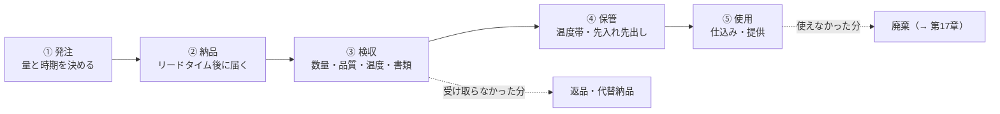
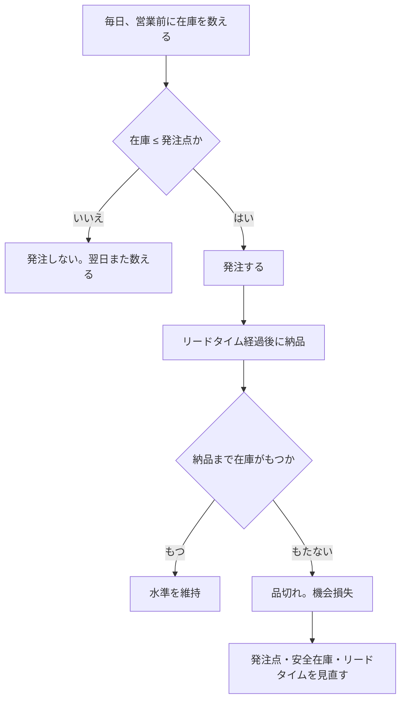

# 第16章 仕入れと在庫管理

## 16.1 この章で扱うこと

[第3章](03-zairyo-hi-genka.md)で、材料費が「期首在庫 + 当期仕入 − 期末在庫」で決まることを確認しました。この章では、その式に入る**仕入**と**在庫**を、日々どう作るかを扱います。仕入れ先の選び方、相場と季節への備え、発注点と安全在庫、検収、目利き、棚卸しと保管、先入れ先出しまでを順に説明します。材料費の計算式そのもの、歩留まりと実質単価、レシピ原価は[第3章](03-zairyo-hi-genka.md)の担当です。本章は「在庫と仕入れをどう回すか」に絞ります。

## 16.2 学習目標

- 仕入れの5つの工程を挙げ、金額がずれる場所を特定できる。
- 仕入れ先を単価以外の4つの軸でも評価し、2社以上から取れる状態を作れる。
- 発注点と安全在庫を、1日使用量・リードタイム・使用量のばらつきから計算できる。
- 検収の4項目（数量・品質・温度・書類）を記録として残せる。
- 在庫を金額で把握し、在庫回転率と在庫日数から「重い在庫」を判断できる。

## 16.3 仕入れの流れと、材料費が狂う場所

### 16.3.1 5つの工程

食材は、発注してから皿に載るまでに5つの工程を通ります。**この5つのどこかが緩むと、材料費は上がります。**



図の説明: ①〜⑤は一直線につながっています。②で遅れれば⑤で品切れになり、③で見落とせば④で傷み、④で置き場所を誤れば⑤で使えなくなります。**廃棄（G）は⑤の結果ではなく、①〜④のどこかの失敗の結果**です。

### 16.3.2 どこで金額がずれるか

| 工程 | 起きること | 金額への現れ方 |
| --- | --- | --- |
| 発注 | 過剰発注、発注漏れ | 廃棄増（材料費増）、品切れ（売上減） |
| 納品 | 数量違い、遅延、単価変更の未連絡 | 検収しないと気づかないまま支払う |
| 検収 | 不良品を受け取る | 使えない食材も材料費に入る |
| 保管 | 期限切れ、温度不良、置き場所の混在 | 棚卸ロス（気づかない廃棄） |
| 使用 | 分量のばらつき、レシピ未更新 | レシピ原価と実績がずれる |

**検収をしない店では、②と③のずれがそのまま支払額になります。** 数量が2個足りない、単価が10円上がっていた、という違いは、記録がなければ翌月も繰り返されます。

## 16.4 仕入れ先の選び方

### 16.4.1 仕入れ先の類型

| 仕入れ先 | 長所 | 短所 | 向く品目 |
| --- | --- | --- | --- |
| 卸売市場・問屋 | 品揃え、目利き、相場情報 | 営業時間が早い。少人数では通いにくい | 魚、青果、旬のもの |
| 食品卸（業務用） | 安定供給、配達、使いやすい単位 | 価格は市場より高いことがある | 定番の肉、冷凍品、調味料 |
| 業務用スーパー | 必要な分だけ買える。価格が見える | 品質の当たり外れ。欠品がある | 少量品、急な補充 |
| 産地直送・農家 | 品質、希少性、話せる材料 | 量と時期が不安定。送料がかかる | 看板メニューの素材 |
| ネット通販 | 比較しやすい。時間を選ばない | 品質を確認できない。送料と納期 | 乾物、酒、包材 |

**種類が違えば、得られる情報も違います。** 市場は「今日は何が良くて何が高いか」を教えてくれます。食品卸は「明日も同じ品質で届くか」を保証します。この2つは代替ではありません。

### 16.4.2 評価は5つの軸で行う

単価だけで仕入れ先を選ぶと、必ず失敗します。**同じ「1kgいくら」でも、届くものと届き方が違う**からです。

| 軸 | 見るもの | 悪い場合に起きること |
| --- | --- | --- |
| 単価 | 1kg・1個あたりの金額 | 原価率が計画から外れる |
| 品質 | 鮮度、等級、産地、ばらつきの小ささ | 味が安定しない。作り直しが出る |
| 納品精度 | 時間、数量の正確さ、欠品率 | 営業中の欠品、仕込みのやり直し |
| 支払条件 | 締め日、支払日、手数料、最低発注額 | 資金繰りが苦しくなる（[第7章](07-cashflow.md) 7.6） |
| 対応力 | 返品の受け入れ、急な追加、代替提案 | 不良品がそのまま損失になる |

**歩留まりを含めた比較は[第3章](03-zairyo-hi-genka.md) 3.7の実質単価で行います。** 本章の5軸は、実質単価でも表せない差（納品精度・対応力）を拾うためのものです。

### 16.4.3 選定の手順

1. **主要品目を10品書き出す**（売れ筋メニューの材料から選ぶ）
2. **各品目について2社の見積を取る**（同じ規格・同じ単位で依頼する）
3. **1か月だけ試験発注する**（価格ではなく、納品精度と品質のばらつきを見る）
4. **5軸で並べる**（単価は実質単価に直す）
5. **採用を決め、切替の条件を書く**（どの水準を割ったら見直すか）
6. **半年ごとに見直す**（相場も相手の事情も変わる）

**試験発注を省くと、判断の材料が価格表だけになります。** 価格表は「相手が言っていること」で、納品は「実際に起きたこと」です。

### 16.4.4 単一の仕入れ先に依存しない

1社だけに頼ると、その1社の値上げ・廃業・欠品・事故でメニューが維持できません。**主要食材は2社以上から取れる状態**を作ります。

| リスク | 起きること | 備え |
| --- | --- | --- |
| 値上げ | 原価率が急に上がる | 相見積を取れる状態を保つ |
| 欠品 | 看板メニューが止まる | 代替の仕入れ先と代替食材を決める |
| 廃業・倒産 | 翌週から仕入れが止まる | 主要品目は2社目を常に使っておく |
| 品質事故 | 回収・風評 | ロットと納品日を記録する |

**2社目は「使っていないと使えない」**ものです。月に1回でも発注して、納品と請求の流れを動かしておきます。緊急時にはじめて発注すると、規格・単位・支払条件の違いで混乱します。

### 16.4.5 支払条件は資金繰りの一部

仕入れの支払条件は、原価ではなく**現金の出入り**に効きます。

| 条件 | 内容 | 経営への影響 |
| --- | --- | --- |
| 締め日・支払日 | 月末締め翌月末払いなど | 支払サイトが長いほど資金が楽 |
| 支払方法 | 口座振替、現金、カード | 現金払いは資金が早く出る |
| 手数料 | 振込手数料、代引手数料 | 少額発注が多いと効いてくる |
| 最低発注額 | 1回あたりの下限 | 少量発注ができない |

支払サイトの考え方は[第7章](07-cashflow.md) 7.6で扱いました。**「安いが現金払いのみ」の業者は、実質的に運転資金を多く必要とします。** 単価差と資金負担を合わせて判断します。

複数の店舗や部門で仕入れを共通化する場合は、**按分の基準を先に決めます**。基準が曖昧なまま共通化すると、店舗別・部門別の原価率が信用できなくなり、メニュー評価もできなくなります。按分の基準は、使用量・売上高・客数のいずれかに固定し、文書に残します。

## 16.5 相場と季節を「運用」する

食材の価格が季節・天候・相場で動くことは[第3章](03-zairyo-hi-genka.md) 3.6で確認しました。ここでは、その変動に**どう備えるか**を扱います。

### 16.5.1 単価履歴を持つ

価格の変動は、記録がなければ「なんとなく高くなった」で終わります。**品目ごとに、仕入単価を日付とセットで残します。**

| 日付 | 品目 | 規格 | 単価 | 前回比 | 備考 |
| --- | --- | --- | --- | --- | --- |
| 4/1 | 鶏もも肉 | 1kg | 780円 | — | 新規取引 |
| 7/1 | 鶏もも肉 | 1kg | 820円 | +5.1% | 暑さで歩留まり低下 |
| 10/1 | 鶏もも肉 | 1kg | 860円 | +4.9% | 飼料価格の上昇と説明 |

**数値例（説明用の仮置き）**: 780円から820円への上昇は (820 − 780) ÷ 780 × 100 = **5.1%** です。月商3,000,000円、材料費率30%の店で、材料費全体が同じ率で上がると、

```
材料費の増加 = 3,000,000円 × 0.30 × 0.051 = 45,900円
新しい原価率 = 0.30 × 1.051 = 0.3153 → 31.5%
```

原価率は1.5ポイント上がります。**「5%の値上げ」は、材料費率30%の店では原価率1.5ポイントの悪化**です。率の小ささに騙されないよう、必ず円に戻して確認します。

### 16.5.2 旬カレンダーを作る

旬の食材は安く、品質も良くなります。**主要食材について、12か月の「旬・平年・端境（はざかい）」を1枚の表にします。**

| 品目 | 春 | 夏 | 秋 | 冬 | 高騰しやすい時期 |
| --- | --- | --- | --- | --- | --- |
| 例: 葉物野菜 | 旬 | 高騰 | 旬 | 旬 | 長雨・台風の直後 |
| 例: 白身魚 | 旬 | 平年 | 平年 | 旬 | 漁期の切れ目 |

**端境期**（はざかいき）とは、旬と旬の間にあたり、品薄で価格が上がる時期のことです。端境期はメニューを切り替える時期の目安になります。

### 16.5.3 高騰時の3段階の対応

価格が上がったときの対応は、影響の大きさで3段階に分けます。

| 段階 | 状況の目安 | 対応 |
| --- | --- | --- |
| 1. 吸収 | 数%の上昇。月内で戻る見込み | 何もせず利益で吸収する。記録だけ残す |
| 2. 置換 | 10%超が数週間続く | 代替食材・代替産地に切り替える。メニューの一部を止める |
| 3. 価格改定 | 数か月続く。戻る見込みが薄い | 販売価格を見直す（[第17章](17-loss-menu.md) 17.10） |

**段階を決めずに「なんとなく我慢する」と、気づいたときに数か月分の利益が消えています。** 吸収・置換・価格改定の境界を、あらかじめ金額で決めておきます。

### 16.5.4 値上げ通告の検算

仕入れ先から「来月から5%値上げ」と言われたら、次の3つを確認します。

1. **規格が変わっていないか**（同じ1kgでも、等級・産地・加工度が変われば別の商品です）
2. **実質単価でいくら上がるか**（歩留まりが下がっていれば、単価上昇より大きく効きます）
3. **どのメニューに効くか**（その食材を使うメニューの粗利額がいくら減るか）

**「5%」は仕入れ単価の話で、原価率・粗利の話ではありません。** 必ず自店の数字に翻訳してから受け入れます。

## 16.6 発注の設計

### 16.6.1 3つの発注方式

| 方式 | 決め方 | 長所 | 短所 | 向く品目 |
| --- | --- | --- | --- | --- |
| 定量発注 | 在庫が発注点を切ったら、決まった量を発注 | 欠品に強い。判断が単純 | 発注回数が増える | 使用量が安定した食材 |
| 定期発注 | 決まった曜日に、その都度の量を発注 | 発注の手間が一定。まとめやすい | 間隔の間に欠品しうる | 品目が多い。少人数の店 |
| 随時発注 | 必要になったら発注 | 在庫を最小にできる | 欠品と手間が増える。単価も上がりやすい | 高額品、日持ちしない品 |

**リードタイム**とは、発注してから納品されるまでの日数のことです。**発注間隔**とは、定期発注で発注する間隔（週1回なら7日）のことです。

### 16.6.2 発注点

```
発注点 = 1日あたり使用量 × リードタイム（日数）+ 安全在庫
```

**計算例（説明用の仮置き）**: 1日20個使う食材、リードタイム2日、安全在庫20個なら、

```
発注点 = 20個 × 2日 + 20個 = 60個
```

在庫が60個を切ったら発注します。**発注点は「切らさないための線」であり、「多く持つための線」ではありません。**

### 16.6.3 安全在庫

安全在庫は、使用量の増加と納品の遅れに備えて余分に持つ在庫です。

```
安全在庫 = (1日の最大使用量 − 1日の平均使用量) × 納品遅れの想定日数
```

**計算例（説明用の仮置き）**: 平均使用量20個、最大使用量25個、納品が最大1日遅れると想定するなら、

```
安全在庫 = (25 − 20) × 1日 = 5個
発注点   = 20 × 2 + 5 = 45個
```

ばらつきの大きい食材ほど、安全在庫は大きくなります。**「最大使用量」は推測ではなく、記録から取ります。** 1か月分の使用量を日別に並べれば、最大値は自然に決まります。



図の説明: 品切れが起きたら、原因は「発注点の設定」「安全在庫の見積もり」「リードタイムの見積もり」の3つのどれかです。**担当者を責めても原因は消えません。** 3つの数値を見直します。

### 16.6.4 定期発注の発注量

定期発注では、発注するたびに量を計算します。

```
発注量 = (発注間隔 + リードタイム) × 1日使用量 + 安全在庫 − 現在庫
```

**計算例（説明用の仮置き）**: 発注間隔7日、リードタイム2日、1日使用量8kg、安全在庫2kg、現在庫18kgなら、

```
発注量 = (7 + 2) × 8kg + 2kg − 18kg = 72 + 2 − 18 = 56kg
```

**現在庫を引くのを忘れると、在庫が積み上がります。** 発注点方式は「在庫が減ったら決まった量」、定期発注方式は「決まった日に必要な量」です。混ぜて運用すると、どちらの計算も合いません。

### 16.6.5 発注単位・締切・休日

| 制約 | 内容 | 決めておくこと |
| --- | --- | --- |
| 発注単位 | ケース、束、袋など、決まった単位でしか買えない | 1単位あたりの使用日数 |
| 最小ロット | 金額または数量の下限 | 少量発注時の割高を許容する範囲 |
| 発注締切 | 「前日15時まで」など | 締切を過ぎた場合の代替（翌々日納品） |
| 休日・連休 | 納品が止まる日数 | 連休前の増発注量と保管場所 |
| 営業時間 | 店の受取可能時間と納品時間の一致 | 不在時の置き配の可否 |

**連休前は、休業日数分の使用量を上乗せします。** 上乗せ分の保管場所（冷蔵庫の空き）を、発注の前に確認します。**「置けない量を発注する」のが、長期休暇前の典型的な失敗**です。

### 16.6.6 発注点は記録から見直す

発注点は一度決めたら終わりではありません。**品切れと廃棄の記録が、見直しの材料**です。

| 記録 | 分かること | 見直す数値 |
| --- | --- | --- |
| 品切れの日時と品目 | 欠品が起きる条件（曜日・天候） | 発注点を上げる、安全在庫を増やす |
| 廃棄の日時と品目 | 過剰発注の傾向 | 発注量を下げる、発注間隔を短くする |
| 納品の遅れ | リードタイムの実際値 | リードタイムを実測値に置き換える |

**月に1回、この3つを並べて見るだけで、発注の精度は上がります。** 特別なシステムは要りません。

## 16.7 検収

納品された食材を、受け取った時点で確認する作業を**検収**（けんしゅう）と呼びます。**検収は「受け取る作業」ではなく「受け取るかどうかを決める作業」**です。

### 16.7.1 4つの確認

| 項目 | 見るポイント | 記録すること |
| --- | --- | --- |
| 数量 | 発注数と納品数が合うか。伝票の数量と実物が合うか | 違いがあれば伝票に書き、写真を残す |
| 品質 | 鮮度、傷み、異物、規格（等級・産地・加工度） | 受け取らなかった分と理由 |
| 温度 | 冷蔵・冷凍品の品温 | 測定値（基準は[第12章](12-eisei-haccp.md)） |
| 書類 | 納品書・請求書の数量・単価・金額 | 単価が変わった日と、その連絡の有無 |

**温度は「触って冷たい」では確認になりません。** 中心部の温度を測り、数値を記録します。基準値と測定方法は[第12章: 衛生管理とHACCP](12-eisei-haccp.md)で扱います。

### 16.7.2 受け取らない判断

検収で問題が見つかったときの選択肢は3つです。

| 判断 | 使う場面 | 記録 |
| --- | --- | --- |
| 受け取る | 規格内。多少のばらつきは許容範囲 | 通常の検収記録 |
| 一部だけ受け取る | 数量不足、一部が傷んでいる | 受け取った数、拒否した数、理由 |
| すべて拒否する | 温度不良、異物、規格違い | 拒否の理由と、代替の手配 |

**「返品する」と言える関係を作っておくことが、仕入れ先選びの一部**です（16.4.2の対応力）。返品を嫌がられると思って受け取ると、その損失は材料費に残ります。

### 16.7.3 検収記録の様式

最低限、次の6項目を1行で残します。

| 項目 | 例 |
| --- | --- |
| 日付・時刻 | 4月3日 9:40 |
| 仕入れ先 | A商店 |
| 品目・数量 | 鶏もも肉 20kg |
| 単価・金額 | 780円/kg、15,600円 |
| 判定 | 合格／一部拒否（2kg）／全拒否 |
| 確認者 | 担当者名 |

**紙でも表計算でも構いません。** 大事なのは、**あとから「いつ、誰が、何を見て、受け取ったか」をたどれること**です。品質事故のときに、ロットをたどれるかどうかが調査の速度を決めます。

### 16.7.4 検収を誰がやるか

| 決めること | 理由 |
| --- | --- |
| 検収する人（1人ではなく、複数ができる状態） | 休みの日に検収が止まると、確認なしで受け取る |
| 検収する時間帯 | 納品時間と営業準備が重なると、確認が形だけになる |
| 拒否を決められる権限 | 現場が「受け取るしかない」と判断すると、記録が残らない |
| 記録の置き場所 | 請求書と検収記録が別々だと、照合できない |

**オーナーしか検収できない状態は危険です。** オーナーが不在の日の納品は、必ず「確認なし」になります。

## 16.8 目利き

**目利き**（めきき）とは、食材の状態・鮮度・価値を見極める力のことです。市場や問屋の価値は、価格だけではなくこの情報にあります。

### 16.8.1 何を見るのか

| 感覚・指標 | 見るもの | 例 |
| --- | --- | --- |
| 見る | 色つや、張り、切り口、血合い、葉の状態 | 魚の目の透明度、エラの色 |
| 触る | 弾力、べたつき、乾き具合 | 身の締まり、切り身の表面 |
| 嗅ぐ | 生臭さ、酸味、発酵臭 | 納品時のにおいの確認 |
| 持つ | 重さ、締まり、温度 | 同じ大きさで重い方が水分が多い |
| 聞く | 産地、水揚げ日、ロット、卸の評価 | 「いつ上がったか」「何日持つか」 |

**「見る」だけでは足りません。** 産地・水揚げ日・ロットを聞くことで、明日・明後日の状態を予測できます。**目利きは現在の判断であると同時に、未来の予測**です。

### 16.8.2 目利きを組織にする

目利きは属人的になりがちです。**属人化した目利きは、担当者が休むと止まります。** 次の3つで、店の基準に変えます。

| 方法 | 内容 |
| --- | --- |
| 基準書 | 品目ごとに「合格の状態」「だめな状態」を言葉にする |
| 写真 | 合格例と不合格例を撮って残す（同じ照明・同じ角度で） |
| 判定の共有 | 週1回、納品物を一緒に見て判定をそろえる |

**写真は、言葉より早く共有できます。** 「身が白く濁っている」という表現は、人によって基準が違います。写真があれば、判断がそろいます。

### 16.8.3 目利きと価格の関係

目利きができると、**「高い食材を買う判断」ができるようになります。** 逆に、目利きがないまま安値だけを追うと、品質の低下がロスと評判の低下になって戻ってきます。

| 判断 | 条件 | 見る数字 |
| --- | --- | --- |
| 高いが良いものを買う | 看板メニューで差が出る。歩留まりも良い | 実質単価と粗利額 |
| 安いものを買う | 加工して使う。味の差が出にくい | 実質単価と手間 |
| 買わない | 状態が基準に届かない | 検収の判定 |

**「高い=良い」ではありません。** 実質単価に直し、その食材を使うメニューの粗利額で判断します。

## 16.9 在庫管理

### 16.9.1 在庫の4分類と保管

在庫は、保管できる温度帯で4つに分かれます。**同じ棚に混ぜると、期限と品質の管理が崩れます。**

| 分類 | 例 | 保管の要点 |
| --- | --- | --- |
| 常温 | 米、乾物、缶詰、調味料、酒 | 直射日光・湿気を避ける。棚から離して置く |
| 冷蔵 | 肉、魚、乳製品、開封済み調味料 | 温度むらを作らない。詰め込みすぎない |
| 冷凍 | 冷凍肉、冷凍野菜、業務用冷食 | 霜・乾燥を防ぐ。再凍結させない |
| 飲料・その他 | ビール、ソフトドリンク、包材 | 重量物は下段。補充しやすい位置 |

**詰め込みすぎた冷蔵庫は、温度が上がります。** 保管量の上限を決め、超えそうなときは発注を調整します。**「置ける量」が発注量の上限**です。

### 16.9.2 在庫回転率と在庫日数

在庫が適正かどうかは、金額と回転で見ます。

```
在庫回転率（回）= 期間の材料費 ÷ 平均在庫額
在庫日数（日）  = 期間の日数 ÷ 在庫回転率
平均在庫額      =（期首在庫 + 期末在庫）÷ 2
```

**計算例（説明用の仮置き）**: 年間材料費9,556,000円、期首在庫270,000円、期末在庫290,000円なら、

```
平均在庫額 = (270,000 + 290,000) ÷ 2 = 280,000円
在庫回転率 = 9,556,000 ÷ 280,000 = 34.1回
在庫日数   = 365 ÷ 34.1 = 10.7日 → 約11日
```

**在庫日数11日**は、平均して11日分の食材を抱えているという意味です。飲食店では数日〜2週間程度が一般的とされますが、**これは一般知識（未検証）**であり、目標値ではありません。**自店の業態・納品頻度・保管容量で決まります。**

| 在庫日数 | 状態 | 起きやすい問題 |
| --- | --- | --- |
| 短い（数日） | 発注頻度が高い | 欠品、発注の手間、納品の送料 |
| 中程度 | 安定 | 特になし |
| 長い（2週間超） | まとめ買い | 期限切れ、資金の固定、保管場所の圧迫 |

**在庫日数が延びた月は、必ず理由があります。** 発注の失敗、客数減、メニュー変更の遅れ。数字が動いたら理由を探します。

### 16.9.3 ABC分析で「重い在庫」を特定する

すべての品目を同じ精度で管理すると、手間が足りません。**金額の大きい品目に管理の力を集中**させます。

| ランク | 品目数の目安 | 金額の目安 | 管理の頻度 |
| --- | --- | --- | --- |
| A | 上位2割 | 全体の7割前後 | 毎日数える。発注点で管理 |
| B | 中間3割 | 全体の2割前後 | 週1回数える |
| C | 下位5割 | 全体の1割前後 | 月1回（棚卸しのとき） |

**数値例（ケースの設計値をもとにした説明用の仮置き）**: 年間仕入9,556千円、品目60品目とします。

| ランク | 品目数 | 年間仕入額 | 構成比 |
| --- | --- | --- | --- |
| A | 12品目 | 6,700千円 | 70.1% |
| B | 18品目 | 1,900千円 | 19.9% |
| C | 30品目 | 956千円 | 10.0% |
| 合計 | 60品目 | 9,556千円 | 100.0% |

**Aランク12品目を毎日数えるだけで、金額の7割を押さえられます。** Cランクの品目は、月1回の棚卸しで足ります。ただし、**Cランクでも欠品すると止まる品（調味料、包材など）は、別枠で「欠品禁止品目」として管理**します。金額が小さいことと、欠品してよいことは別です。

### 16.9.4 先入れ先出しと期限管理

**先入れ先出し**（FIFO、First In First Out）は、先に納品されたものから先に使うルールです。**置き方で決まります。**

| 方法 | 内容 |
| --- | --- |
| 手前と奥 | 手前（取り出し口側）に古いもの、奥に新しいもの |
| ラベル | 納品日を書いたラベルを貼る。開封日も書く |
| 定位置 | 品目ごとに置き場所を決め、表示する |
| 残量の可視化 | 残りが少ないものが見て分かる状態にする |

**ラベルがないと、先入れ先出しは守れません。** 同じ白い容器が並んでいると、どちらが古いかを目で判断できません。

| 期限の言葉 | 意味 | 店での扱い |
| --- | --- | --- |
| 消費期限 | 安全に食べられる期限 | 過ぎたら提供しない |
| 賞味期限 | おいしさの目安 | 過ぎても品質が大きく落ちなければ使える場合がある |
| 店の使用期限 | 納品日から店が決めた使用期限 | 開封後の日持ちを含めて決める |

**店の使用期限を決めておくと、判断が速くなります。** 「開封後2日」のように、品目ごとに決めてラベルに書きます。**棚卸しのときに見つかる、使えなくなった在庫**を**棚卸ロス**と呼びます（[第3章](03-zairyo-hi-genka.md) 3.8）。

### 16.9.5 保管の失敗と対策

| 失敗 | 起きること | 対策 |
| --- | --- | --- |
| 詰め込みすぎ | 冷気が回らず温度が上がる | 収容量の上限を決める |
| 床に直置き | 汚染、虫・ねずみ | 台や棚に載せる |
| 生ものと加熱済みの混在 | 二次汚染 | 段を分ける（上段に加熱済み） |
| 開封済みの放置 | 品質劣化、期限不明 | 開封日をラベルに書く |
| 期限切れの放置 | 使えない在庫が増える | 週1回、期限の点検日を決める |

**保管の失敗は、廃棄として現れます。** 廃棄の記録を見ると、どの保管が失敗しているかが分かります（[第17章](17-loss-menu.md) 17.4）。ロス率の式は `廃棄額 ÷ 仕入額 × 100` で、**分母は仕入額**です（[第3章](03-zairyo-hi-genka.md) 3.8.1）。使用量を分母にすると値が変わるため、**分母を書かずにロス率を語らない**ようにします。

### 16.9.6 在庫は資金を寝かせる

在庫は現金で買った資産です。**使うまで現金に戻りません。**

```
在庫に寝ている資金 = 平均在庫額
```

平均在庫280,000円なら、常に280,000円が食材の形で寝ています。**在庫を2週間分から1週間分に減らせば、半分の現金が手元に戻ります。** ただし、発注回数が増えると送料と手間が増え、欠品リスクも上がります。**在庫の削減は、資金繰り（[第7章](07-cashflow.md)）と欠品リスクのトレードオフ**です。

## 16.10 ケースの店では

連続ケース「食堂つきかげ」（[第22章: 総合ケース](22-case.md)）で、仕入れと在庫を考えます。**ケースの数字は設計値であり、実在の店舗の実績ではありません。**

ケースの設計値では、年間売上31,300千円、年間材料費9,556千円（原価率30.5%）です。仕入れの規模を月と日に直します。

```
月平均の材料費 = 9,556千円 ÷ 12 = 796.3千円
1日あたり（月25日営業）= 796.3千円 ÷ 25日 = 31.9千円
```

**1日およそ3.2万円分の食材を、20席の店が使っている**計算です。この規模では、発注の単位が数日分の使用量になります。

主要食材の1つを鶏もも肉とし、**説明用の仮置き**で発注点を計算します。1日8kg使用、リードタイム2日、1日の最大使用量10kg、納品は最大1日遅れるとします。

```
安全在庫 = (10kg − 8kg) × 1日 = 2kg
発注点   = 8kg × 2日 + 2kg = 18kg
```

**在庫が18kgを切ったら発注**します。週1回の定期発注にするなら、発注間隔7日として、

```
発注量 = (7 + 2) × 8kg + 2kg − 18kg = 56kg
```

1回56kg、月4回で224kgです。単価780円なら月174,720円、年間約2,097千円となり、**年間材料費9,556千円の約22%を1品目で占める**計算になります。Aランクの品目です（数値はいずれも説明用の仮置き）。

在庫日数は、平均在庫を280,000円と仮置きすると、

```
在庫回転率 = 9,556千円 ÷ 280千円 = 34.1回
在庫日数   = 365日 ÷ 34.1回 = 10.7日 → 約11日
```

11日分の在庫は、週1回の発注とリードタイム2日を考えると妥当な水準です。**もし在庫日数が20日に延びたら、原因は「発注量の増えすぎ」か「客数の減少」**です。ケースの店では2月に売上が落ちるため（月240万円）、2月は在庫日数が延びやすい月になります。**売上が落ちた月こそ、発注量を先に見直す**必要があります。

## 16.11 よくある誤解

| 誤解 | 実際 |
| --- | --- |
| 仕入れ値が安い業者に変えれば原価が下がる | 品質・納品精度・支払条件が悪化すれば、ロスと手間で相殺されます。5軸で比べます |
| 発注点を決めれば品切れはなくなる | 使用量のばらつきと納品遅れを織り込んだ安全在庫がなければ機能しません |
| 安全在庫は多めに持つほど安全 | 在庫は現金を寝かせ、期限切れを増やします。ばらつきから計算します |
| 検収は受け取るだけの作業 | 受け取るかどうかを決める作業です。記録がないと品質事故を追えません |
| 目利きはセンスで、教えられない | 基準書・写真・判定の共有で、店の基準にできます |
| 在庫は多い方が安心 | 資金の固定、期限切れ、保管場所の圧迫を招きます。回転率と日数で見ます |
| 先入れ先出しは気をつければ守れる | 置き方とラベルで決まります。気をつけるだけでは守れません |
| 全部の品目を同じ精度で管理すべき | 金額の大きい品目に力を集中します。ただし欠品禁止品目は別枠で管理します |

## 16.12 この章の要点

- 仕入れは**発注・納品・検収・保管・使用**の5工程です。廃棄は⑤の結果ではなく、①〜④の失敗の結果です。
- 仕入れ先は**単価・品質・納品精度・支払条件・対応力**の5軸で評価します。主要食材は2社以上から取れる状態を作ります。
- 発注点は**1日使用量 × リードタイム + 安全在庫**です。品切れが起きたら、この2つの数値を見直します。
- 在庫は**回転率と在庫日数**で見ます。在庫日数が延びた月は、発注量か客数のどちらかに理由があります。
- **先入れ先出しは置き方とラベルで決まります。** 期限管理を仕組みにしないと、棚卸ロスは見えないまま増えます。

## 16.13 自店で確認すること

- [ ] 主要品目10品について、仕入れ先を2社以上書き出している
- [ ] 主要食材の1日使用量・リードタイム・最大使用量を、記録から把握している
- [ ] 品目ごとに発注点と安全在庫を決め、担当者が同じ判断をできる
- [ ] 検収の4項目（数量・品質・温度・書類）を記録し、請求書と照合している
- [ ] 納品物の合格・不合格の基準を、写真か言葉で共有している
- [ ] 冷蔵・冷凍・常温の保管場所と収容量の上限を決めている
- [ ] 納品日と開封日のラベルを運用し、先入れ先出しが守られているか週1回確認している
- [ ] 在庫回転率と在庫日数を月次で出し、延びた月の理由を説明できる

## 16.14 章末問題

### 問1 発注点と安全在庫（計算）

1日平均18個使用する食材があります。リードタイムは3日、1日の最大使用量は22個、納品は最大1日遅れると想定します。

1. 安全在庫を求めてください。
2. 発注点を計算してください。
3. 安全在庫を0にした場合に起きる問題を、金額の観点から説明してください。

**解答**

1. 安全在庫 = (22 − 18) × 1日 = **4個**
2. 発注点 = 18 × 3 + 4 = 54 + 4 = **58個**
3. 安全在庫を0にすると発注点は 18 × 3 = 54個です。使用量が22個に増えた日や、納品が1日遅れた日には、納品を待つ間に在庫が尽きます。18個分が不足し、**品切れ**になります。品切れの損失は材料費ではなく**粗利**で計算するため（[第3章](03-zairyo-hi-genka.md) 3.8.3）、4個分の在庫を持つ負担より大きくなります。800円の料理で粗利600円なら、品切れ1個の損失は600円です。

### 問2 在庫回転率と在庫日数（計算）

年間材料費7,200,000円、期首在庫300,000円、期末在庫260,000円でした。

1. 平均在庫額を求めてください。
2. 在庫回転率を求めてください（小数第1位を四捨五入）。
3. 在庫日数を求めてください（小数第1位を四捨五入）。
4. 在庫日数が同じままで年間材料費が8,000,000円に増えた場合、必要な平均在庫額はいくらになりますか。

**解答**

1. 平均在庫額 = (300,000 + 260,000) ÷ 2 = **280,000円**
2. 在庫回転率 = 7,200,000 ÷ 280,000 = 25.7… → **25.7回**
3. 在庫日数 = 365 ÷ 25.7 = 14.2… → **14.2日**
4. 在庫日数を14.2日で維持するなら、在庫回転率は 365 ÷ 14.2 = 25.7回のままです。必要な平均在庫額 = 8,000,000 ÷ 25.7 = **311,285円**（円未満を四捨五入）。売上が増えると、**同じ回転でも在庫に寝る現金は増えます**（[第7章](07-cashflow.md) 7.4の運転資本）。

### 問3 仕入れ先の変更（記述）

「今の仕入れ先より1割安い業者が見つかった。主要食材をすべて切り替えたい」という相談を受けました。判断の手順と、確認すべき点を述べてください。

**解答**

まず**単価を実質単価に直して比較**します（[第3章](03-zairyo-hi-genka.md) 3.7）。1割安くても歩留まりが1割落ちれば、実質単価は変わりません。次に**5軸で並べます**（16.4.2）。単価・品質・納品精度・支払条件・対応力のうち、品質と納品精度は価格表からは分からないため、**1か月の試験発注**で確認します。

さらに、**支払条件を資金繰りに翻訳**します。現金払いのみの業者に変えると、支払サイトが短くなり、必要な運転資金が増えます（[第7章](07-cashflow.md) 7.6）。1割の単価差と、増える資金負担を比べます。

**「すべて切り替える」は避けます。** 主要食材の一部を新業者に移し、2社体制を保ちます。1社に集約すると、欠品・廃業・値上げのリスクを負います。切替の条件（品質が基準を下回ったら戻す、など）を先に決めておきます。

## 参考文献・出典

- 仕入れの5工程、仕入れ先の5つの評価軸、発注方式、発注点、安全在庫、ABC分析、在庫回転率、先入れ先出し、検収の考え方は、飲食店実務・在庫管理の標準的な手法にもとづく**一般知識（未検証）**です。式は本章で計算できる形で示しましたが、**業界共通の基準値ではありません**。
- 在庫日数の「数日〜2週間程度が一般的」という記述は**一般知識（未検証）**です。目標値として提示していません。
- 温度管理の基準値と測定方法は[第12章](12-eisei-haccp.md)で扱います。本章では数値を示していません。
- 在庫の金額評価（最終仕入原価法など）は税務上の定めによります。評価方法の選択は[第3章](03-zairyo-hi-genka.md) 3.5.3で扱ったとおり、税理士に確認してください。**本章は税務的助言ではありません。**
- 16.10 の数値は連続ケース「食堂つきかげ」の**設計値**と、**説明用の仮置き**（1日8kg、最大10kg、平均在庫280,000円、品目60品目、ABC分析の内訳）を組み合わせたものです。実在の店舗の実績ではありません。
- 相場・季節変動の具体的な数値（品目別の価格指数など）は、本章では提示していません。**裏付けが取れていない数値を提示しない**方針によります。

---

前後の章: [第15章: 集客とマーケティング](15-shukyaku.md) ／ [第17章: 食品ロスとメニュー設計](17-loss-menu.md)
