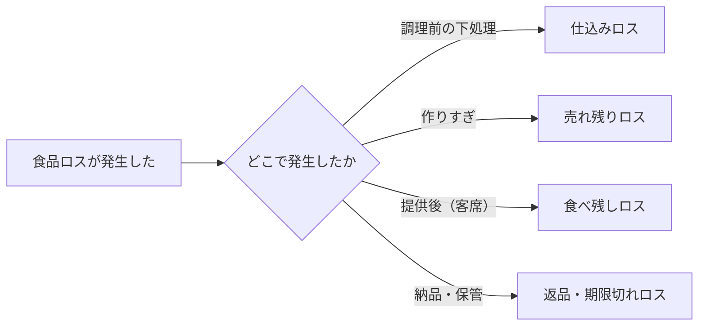

# 第17章 食品ロスとメニュー設計

## 17.1 この章で扱うこと

[第3章](03-zairyo-hi-genka.md)で、ロス率の式と「廃棄と品切れのどちらが損か」を金額で比べる方法を確認しました。この章では、その**ロスを発生場所で4つに分けて測り、減らす**方法と、**メニューを粗利で評価し、価格と品目数を決める**方法を扱います。前半がロス、後半がメニュー設計です。どちらも同じ目的、つまり「材料費を上げずに粗利を残す」ための手段です。

## 17.2 学習目標

- 食品ロスを4類型に分け、類型ごとに測り方と対策を選べる。
- ロス率を類型別に分解し、どの類型から手を付けるかを金額で判断できる。
- 廃棄と品切れを期待損失で比較し、追加で仕込むべき損益分岐の確率を計算できる。
- メニューを粗利額と販売数の2軸で評価し、象限ごとの打ち手を選べる。
- 材料費と目標原価率から価格を計算し、値上げで許容できる客数減を見積もれる。

## 17.3 ロスの4類型

### 17.3.1 分類の考え方

食品ロスは、原因が違えば対策も違います。**「ロスを減らす」という1つの指示では、現場は動けません。** 発生した場所で4つに分けます。



図の説明: 分け方は「いつ・どこで」です。下処理の途中なら仕込みロス、作り終えて売れなかったら売れ残り、客が残したら食べ残し、納品から提供までに使えなくなったら返品・期限切れです。**同じ1kgの廃棄でも、どの類型かで打ち手が変わります。**

### 17.3.2 4類型の一覧

| 類型 | 内容 | 主な原因 | 対策 | 担当する工程 |
| --- | --- | --- | --- | --- |
| 仕込みロス | 下処理で出る皮・芯・端材 | 歩留まりの悪い調理、切り方 | 調理法の改善、使い切りのレシピ | 厨房 |
| 売れ残りロス | 作りすぎて売れなかった | 需要予測の誤り、仕込みすぎ | 仕込み量の調整、売り切れ前提の設計 | 厨房・ホール |
| 食べ残しロス | 客が残した | 量が多い、味が合わない、説明不足 | 量の調整、器の変更、声かけ | ホール・メニュー |
| 返品・期限切れロス | 納品後の不良、期限切れ | 発注精度、在庫管理、保管 | 発注点の見直し、先入れ先出し | 仕入れ・保管（[第16章](16-shiire-zaiko.md)） |

**仕込み**（しこみ）とは、営業中に素早く提供できるよう、あらかじめ食材を切る・煮る・味を付けておく作業のことです。**下処理**とは、その前段の洗浄・皮むき・芯取り・下味などの作業をいいます。**盛り付け**は、調理した料理を皿に配置して提供できる状態にすることです。

**歩留まり**とは、仕入れた食材のうち実際に使える割合です。歩留まりの計算と実質単価は[第3章](03-zairyo-hi-genka.md) 3.7で扱いました。**仕込みロスは「歩留まりの悪さ」として、同じように金額へ効きます。**

### 17.3.3 類型別の測り方

ロスは「なんとなく多い」では対策できません。**類型ごとに、測る単位と記録する場所を決めます。**

| 類型 | 測る単位 | 記録する場所 | 記録する頻度 |
| --- | --- | --- | --- |
| 仕込みロス | 重量（g） | 下処理の作業台の横に計量器と記録用紙 | 日次（主要品目のみ） |
| 売れ残りロス | 個数・食数 | 閉店時の厨房 | 日次 |
| 食べ残しロス | 5段階の目視、または重量 | 下膳の場所 | 週1回の調査 |
| 返品・期限切れロス | 個数・金額 | 保管場所、棚卸しのとき | 週1回＋月次棚卸し |

**4類型を同じ精度で測る必要はありません。** 最初は**売れ残り（個数）と期限切れ（金額）**の2つだけで十分です。この2つは記録が簡単で、金額への影響が大きいからです。

**食べ残しの重量を毎日測るのは現実的ではありません。** 週1回、1週間だけ目視で5段階（0:完食、1:1割残し、…、4:半分以上残し）を記録する調査で、傾向はつかめます。

## 17.4 ロス率を類型別に分ける

### 17.4.1 式（第3章の復習）

```
ロス率（%）= 廃棄額 ÷ 仕入額 × 100
```

この式は店全体の1つの数字しか出しません。**類型別に見るには、分子を分けます。**

```
類型別ロス率（%）= その類型の廃棄額 ÷ 仕入額 × 100
合計ロス率       = 4類型のロス率の合計
```

### 17.4.2 数値例：類型別に分ける

**数値例（説明用の仮置き）**: 月の仕入額500,000円、廃棄額の合計20,000円とします。類型別の内訳は次のとおりです。

| 類型 | 廃棄額 | 類型別ロス率 | 構成比 |
| --- | --- | --- | --- |
| 仕込みロス | 8,000円 | 1.6% | 40% |
| 売れ残りロス | 7,000円 | 1.4% | 35% |
| 食べ残しロス | 3,000円 | 0.6% | 15% |
| 返品・期限切れロス | 2,000円 | 0.4% | 10% |
| 合計 | 20,000円 | 4.0% | 100% |

```
合計ロス率 = 20,000 ÷ 500,000 × 100 = 4.0%
```

**合計4.0%という数字だけを見ると「4%なら許容範囲」で終わります。** 内訳を見ると、**仕込みロスと売れ残りで全体の75%**を占めています。対策の優先順位はここから決まります。

### 17.4.3 どこから手を付けるか

類型ごとに、打ち手の**確実性**と**即効性**が違います。

| 類型 | 打ち手の例 | 確実性 | 即効性 | 副作用 |
| --- | --- | --- | --- | --- |
| 仕込みロス | 切り方の改善、端材の使い道を作る | 中（技術に依存） | 低い | 仕込みの手間が増える |
| 売れ残りロス | 仕込み量を減らす、日別の需要を見る | 高い | 高い | 品切れリスク |
| 食べ残しロス | 量を減らす、器を変える、声かけ | 中 | 中 | 満足度・客単価に影響 |
| 返品・期限切れロス | 発注点の見直し、先入れ先出し | 高い | 中 | 発注の手間 |

**最初に手を付けるのは売れ残りロスです。** 記録が簡単で、金額が大きく、改善の効果が翌日から出るからです。仕込みロスの改善（切り方・使い切り）は技術と時間がかかるため、後回しにします。

## 17.5 廃棄と品切れの比較

### 17.5.1 損失の式

[第3章](03-zairyo-hi-genka.md) 3.8.3で確認した式を再掲します。

```
廃棄の損失   = 廃棄数量 × 材料費単価
品切れの損失 = 販売できなかった数量 × 粗利額
```

**廃棄は材料費で数え、品切れは粗利で数えます。** この非対称が、判断の分かれ目になります。

### 17.5.2 期待損失で比べる

「明日、あと1個仕込むか」という判断を考えます。需要は確実には分かりません。**確率を入れて期待値で比べます。**

```
追加で1個仕込んだときの期待損失
  = 余る確率 × 材料費単価 + 売れる確率 × 0     （売れれば損失なし）
追加で1個仕込まなかったときの期待損失
  = 品切れになる確率 × 粗利額
```

**数値例（説明用の仮置き）**: 材料費単価100円、販売価格800円、粗利600円、品切れになる確率が30%とします。

```
仕込む   : 余る確率70% × 100円 = 70円
仕込まない: 品切れ確率30% × 600円 = 180円
```

**仕込んだ方が期待損失が小さい**（70円 < 180円）ため、1個多く仕込みます。

### 17.5.3 損益分岐となる品切れ確率

逆に、**品切れ確率がどのくらい低ければ、仕込まない方が得か**を計算できます。

```
損益分岐の品切れ確率 = 材料費単価 ÷ (材料費単価 + 粗利額)
```

**数値例（説明用の仮置き）**: 材料費単価100円、粗利600円なら、

```
損益分岐の品切れ確率 = 100 ÷ (100 + 600) = 0.1428... → 14.3%
```

**品切れになる確率が14.3%を超えるなら、1個多く仕込む方が得**です。検算すると、14.3%のとき

```
仕込む   : 85.7% × 100円 = 85.7円
仕込まない: 14.3% × 600円 = 85.8円
```

ほぼ等しくなります（端数は四捨五入による）。

| 材料費単価 | 粗利額 | 損益分岐の品切れ確率 |
| --- | --- | --- |
| 100円 | 600円 | 14.3% |
| 200円 | 500円 | 28.6% |
| 300円 | 300円 | 50.0% |
| 400円 | 200円 | 66.7% |

**表の読み方**: 下の段ほど「品切れの確率が高くないと、多く仕込む価値がない」ことを示します。**粗利の薄い商品（材料費が高く、価格が安い）は、品切れを許容する方が合理的**です。一方、粗利の厚い商品は、多少余らせても切らさない方が得です。

### 17.5.4 判断の使い分け

| 場面 | 判断 | 理由 |
| --- | --- | --- |
| 看板メニュー・粗利の厚い品 | 品切れを避ける（多めに仕込む） | 損益分岐の確率が低い。機会損失が大きい |
| デザート・粗利の薄い品 | 品切れを許容する（少なめに仕込む） | 損益分岐の確率が高い。余りの損失が相対的に重い |
| 毎日大量に廃棄が出る | 発注・仕込みの構造を見直す | 1日の迷いではなく、構造的な過剰（[第16章](16-shiire-zaiko.md) 16.6） |

**「多少のロスを許容して品切れを避ける」は、粗利の厚い商品についての判断**です。すべての商品に同じ方針を当てはめると、粗利の薄い商品で余りを増やします。

## 17.6 食品ロスの統計

農林水産省・環境省の推計（2024年度）では、食品ロス全体は461万トン、うち事業系が237万トン、**外食が70万トン**です（事業系の約29.5%）。2030年度までに2000年度比60%削減という目標が置かれています。

出典: 農林水産省「事業系食品ロス量（2024年度推計値）を公表」（令和8年6月30日）、https://www.maff.go.jp/j/press/shokuhin/recycle/260630.html 、環境省食品ロスポータルサイト https://www.env.go.jp/recycle/foodloss/index.html （取得日 2026-11-14）

**飲食店の食べ残し率（食べ残し量÷提供量）の公的統計は取得できませんでした。** 自店の食べ残しは、目視調査で測るのが確実です（例: 1週間、下膳時の残量を5段階で記録する）。

なお、上の統計は**日本全体の推計**であり、個店のロス率の目標値ではありません。全国の外食のロス量が分かっても、自店の廃棄額は分かりません。**自店の数値は、自店で測るしかありません。**

## 17.7 売れ残りを減らす

### 17.7.1 需要をどう見積もるか

売れ残りは「需要より多く作った」結果です。**需要の見積もりに使える手がかりは、店の中にあります。**

| 手がかり | 見方 | 使い方 |
| --- | --- | --- |
| 曜日 | 曜日別の平均販売数 | 仕込み量の基本値 |
| 天候 | 雨・雪・猛暑の日の販売数 | 悪天候日の補正 |
| 行事・給料日 | 地域の行事、月初・月末 | 増減の予測 |
| 時間帯 | 時間帯別の販売数 | 後半に足りるかの判断 |
| 予約 | 予約数と人数 | 確定分として上乗せ |
| 前日の売り切れ時刻 | 何時に売り切れたか | 不足のサイン |

**「前日の売り切れ時刻」は見落とされます。** 12時に売り切れた日は、需要が供給を上回っていた可能性があります。**売り切れは成功ではなく、機会損失の記録**です。

### 17.7.2 仕込み量の決め方

```
仕込み量 = 曜日別の平均販売数 × 天候・行事の補正係数 + 予約数
```

**数値例（説明用の仮置き）**: ある平日の平均販売数が40食、雨天の補正係数0.85、予約4食なら、

```
仕込み量 = 40食 × 0.85 + 4食 = 34 + 4 = 38食
```

**補正係数は、自店の記録から作ります。** 雨天の日の販売数を平日平均で割れば、その店の係数になります。他店の係数を借りても合いません。

| 記録 | 計算 | 係数 |
| --- | --- | --- |
| 平日平均40食、雨天平均34食 | 34 ÷ 40 | 0.85 |
| 平日平均40食、金曜平均52食 | 52 ÷ 40 | 1.30 |
| 平日平均40食、月初平均44食 | 44 ÷ 40 | 1.10 |

**係数を掛け算で重ねると過信になります。** 雨天かつ金曜なら 0.85 × 1.30 = 1.105 と計算できますが、実際にはそうならない日があります。**記録が3か月分たまるまでは、補正を1つだけにする**のが安全です。

### 17.7.3 売り切れ前提の設計

売れ残りを減らす方法は「作る量を減らす」だけではありません。**売り切れる前提でメニューと提供を設計する**方法があります。

| 設計 | 内容 | 効果 |
| --- | --- | --- |
| 数量限定の表示 | 「本日20食」と書く | 早期の売り切れが許容される |
| 時間帯別の提供 | 後半用に取り分けておく | 閉店前の欠品を防ぐ |
| 代替の提案 | 売り切れ時に別の品を勧める | 機会損失を減らす |
| 仕込みの分割 | 前半・後半で仕込む | 後半の需要を見てから作れる |
| 日替わり化 | 仕入れに合わせて内容を変える | 余った食材を翌日に回せる |

**「売り切れごめん」は、説明があれば許容されます。** 説明なく売り切れると「来たのに食べられなかった」という体験だけが残ります。**品切れの損失は粗利だけではなく、次回来店の確率も下げます**（この影響は金額で測れません。数字にできない損失として扱います）。

## 17.8 食べ残しと持ち帰り

### 17.8.1 食べ残しの測り方

食べ残しは、客席で起きるため記録しにくいロスです。**目視の5段階調査**で十分です。

| 段階 | 状態 | 記録 |
| --- | --- | --- |
| 0 | 完食 | 0 |
| 1 | 1割程度残す | 1 |
| 2 | 3割程度残す | 2 |
| 3 | 半分程度残す | 3 |
| 4 | 半分以上残す | 4 |

1週間、下膳のたびに記録し、**メニュー別・時間帯別**に平均を出します。平均が2以上のメニューは、量・味・提供方法のどれかに問題があります。

| 平均 | 判断 | 打ち手 |
| --- | --- | --- |
| 0〜1 | 適正 | 維持 |
| 1〜2 | やや多い | 量を1割減らす、器を変える |
| 2以上 | 多い | 量・味・説明の見直し。盛り付けの変更 |

### 17.8.2 提供量と器

食べ残しの原因は、味だけではありません。**量と器の設計**が効きます。

| 原因 | 起きること | 打ち手 |
| --- | --- | --- |
| 量が多い | 食べきれずに残す | 量を減らす。ただし客単価への影響を確認 |
| 器が大きい | 少なく見えるので多く盛る | 器を小さくする |
| 説明がない | 食べ方が分からない | 提供時に一言添える |
| 味が濃い・薄い | 途中で箸が止まる | 味の見直し。試食で確認 |

**量を減らすと、満足度と客単価が下がる可能性があります。** 食べ残しの削減は、ロス削減と客の満足のトレードオフです。**「残す量が減ったが、客単価も下がった」なら、改善ではありません。**

### 17.8.3 持ち帰りを選ぶ場合の確認事項

食べ残しを持ち帰ってもらう選択肢もあります。ただし、**持ち帰りは衛生・表示・税務の3つの確認が必要**です。

| 確認事項 | 内容 | 参照 |
| --- | --- | --- |
| 衛生管理 | 持ち帰り用の容器、提供までの温度と時間 | [第12章: 衛生管理とHACCP](12-eisei-haccp.md) |
| 食品表示 | 容器包装した場合の表示義務の範囲 | [第11章: 食品表示とアレルギー](11-hyouji-allergy.md) |
| 営業許可 | 持ち帰り販売が許可の範囲に含まれるか | [第10章: 営業許可と法規](10-kyoka-hourei.md) |
| 税率 | 持ち帰りと店内飲食で税率の判定が変わる | [第18章: 会計・税務・決済](18-kaikei-zeimu.md) |
| 容器の原価 | 容器は材料費に含める | [第3章](03-zairyo-hi-genka.md) 3.3.2 |

**「残った料理を容器に入れて渡す」は、調理した料理の提供です。** 衛生上のリスク（温度・時間）と、表示・税率の扱いが変わります。**始める前に、保健所と税理士に確認してください。**

## 17.9 メニューエンジニアリング

### 17.9.1 2軸と4象限

メニューは「売れ筋か」と「粗利が厚いか」の2軸で評価できます。この手法を**メニューエンジニアリング**と呼びます。

```
粗利額（円）= 販売価格 − 材料費
```

| 象限 | 粗利 | 販売数 | 状態 | 打ち手 |
| --- | --- | --- | --- | --- |
| スター | 高 | 多 | 店の稼ぎ頭 | 維持。品切れを避ける。品質を落とさない |
| プラウホース（金のなる木） | 低 | 多 | よく売れるが儲からない | 材料費の見直し、価格改定、量の調整 |
| パズル | 高 | 少 | 儲かるが売れない | 売り方の改善（写真、位置、提案、名前） |
| ドッグ | 低 | 少 | 売れず儲からない | 廃止、または材料の見直し |

**プラウホース**（plowhorse）は「よく働く馬」の意味で、客を呼ぶが利益を残さない商品です。**パズル**（puzzle）は、利益率は高いのに売れない商品です。

### 17.9.2 粗利額と粗利率

**「粗利額」で見ることが重要です。** 粗利率（%）だけで見ると、原価率の低い商品が良く見えますが、単価が低ければ粗利額は小さいことがあります。

**計算例（説明用の仮置き）**:

| 商品 | 価格 | 材料費 | 粗利率 | 粗利額 | 販売数 | 粗利合計 |
| --- | --- | --- | --- | --- | --- | --- |
| A | 800円 | 200円 | 75% | 600円 | 20個 | 12,000円 |
| B | 1,800円 | 900円 | 50% | 900円 | 15個 | 13,500円 |

```
A: 粗利率 = 600 ÷ 800 = 75%、粗利合計 = 600 × 20 = 12,000円
B: 粗利率 = 900 ÷ 1,800 = 50%、粗利合計 = 900 × 15 = 13,500円
```

粗利率ではAが上ですが、**粗利合計ではBが上**です。メニュー構成を考えるときは、粗利の合計額で判断します。

### 17.9.3 時間あたりの粗利

席と時間を売る商売では、粗利額だけでは足りません。**混雑する時間帯は、提供に使う時間も資源**だからです。

```
時間あたり粗利（円/分）= 1品あたり粗利額 ÷ 調理・提供にかかる時間（分）
```

| 商品 | 粗利額 | 提供時間 | 時間あたり粗利 |
| --- | --- | --- | --- |
| C | 600円 | 3分 | 200円/分 |
| D | 900円 | 9分 | 100円/分 |

**Dは粗利額が大きいのに、時間あたりではCの半分**です。混雑時にはCを勧め、空いている時間帯にはDを勧める、という使い分けができます。**この判断は、提供時間の記録がないとできません。**

### 17.9.4 象限ごとの打ち手

| 象限 | まず見る数字 | 打ち手の順序 |
| --- | --- | --- |
| スター | 品切れ回数 | 品切れをなくす → 品質維持 → 提供速度 |
| プラウホース | 材料費の内訳 | 材料費の見直し → 価格改定 → 量の調整 |
| パズル | 注文率（メニューを見た人のうち注文した割合） | 写真・位置・名前 → 提案 → 価格 |
| ドッグ | 販売数と材料の共用 | 廃止 → 材料の見直し → 統合 |

**パズルは「売れていない」のではなく「選ばれていない」**可能性があります。メニュー表の位置、写真の有無、接客時の一言で販売数は変わります。**廃止の前に、売り方を1回変えてみます。**

## 17.10 価格の決め方

### 17.10.1 3つの出発点

価格は、次の3つを並べて決めます。**1つだけで決めると、どれかが破綻します。**

| 出発点 | 見るもの | 破綻すると |
| --- | --- | --- |
| 原価（積み上げ） | 材料費と目標原価率 | 売れば売るほど損になる |
| 競合（相場） | 商圏の同業態の価格帯 | 高すぎて選ばれない、安すぎて疑われる |
| 価値（提供内容） | 量・品質・体験・時間 | 値上げができない。値下げ競争に巻き込まれる |

### 17.10.2 原価率からの積み上げ

```
販売価格（税抜）= レシピ原価 ÷ 目標原価率
```

**計算例（説明用の仮置き）**: レシピ原価300円、目標原価率30%なら、

```
販売価格 = 300 ÷ 0.30 = 1,000円
```

**この式は下限を出すためのものです。** 1,000円が「最低限これだけ取らないと原価率30%を維持できない」という意味であり、**1,000円が最適価格という意味ではありません。** 競合と価値を見て、上に調整します。

| 目標原価率 | レシピ原価300円の価格 | レシピ原価450円の価格 |
| --- | --- | --- |
| 25% | 1,200円 | 1,800円 |
| 30% | 1,000円 | 1,500円 |
| 35% | 857円 | 1,286円 |
| 40% | 750円 | 1,125円 |

（円未満は四捨五入。857.1→857、1,285.7→1,286）

**目標原価率は、業態と提供内容で変わります。** 単一の平均値で語れない理由は[第2章](02-soneki-keisansho.md) 2.10と[第3章](03-zairyo-hi-genka.md) 3.12で扱いました。

### 17.10.3 値上げで許容できる客数減

値上げの是非は、**「客数が何%減ると、値上げ前の粗利合計を下回るか」**で判断できます。

```
許容できる客数減（%）= 1 − (値上げ前の粗利額 ÷ 値上げ後の粗利額)
```

**数値例（説明用の仮置き）**: 1,200円・材料費450円の商品（粗利750円）を1,350円に値上げします。材料費は変わらないとします。

```
値上げ後の粗利 = 1,350 − 450 = 900円
許容できる客数減 = 1 − (750 ÷ 900) = 1 − 0.8333... = 16.7%
```

**値上げ幅は12.5%（150 ÷ 1,200）ですが、許容できる客数減は16.7%**です。値上げ幅より許容幅が大きいのは、材料費が変わらないためです。客数が16.7%以内の減少なら、この商品の粗利合計は維持されます。

| 値上げ幅 | 粗利の増加 | 許容できる客数減 |
| --- | --- | --- |
| 5% | 8.0% | 7.4% |
| 10% | 16.0% | 13.8% |
| 12.5% | 20.0% | 16.7% |
| 20% | 32.0% | 24.2% |

（1,200円・材料費450円の商品で計算。値上げ幅5%なら1,260円、粗利810円、許容減 = 1 − 750 ÷ 810 = 7.4%）

**表の注意**: 上の表は「材料費が変わらない」前提です。仕入れ値が同時に上がっていれば、許容幅は小さくなります。**値上げの検討は、仕入れ価格の見通しとセットで行います**（[第16章](16-shiire-zaiko.md) 16.5）。

### 17.10.4 伝え方と段階

値上げは、金額の判断だけでなく、伝え方の問題です。

| 方法 | 内容 | 注意 |
| --- | --- | --- |
| 一斉改定 | 全品目を同じ率で上げる | 分かりやすいが、反発も一度に来る |
| 段階改定 | 数か月かけて少しずつ上げる | 反発は小さいが、期間が長い |
| 新メニューへの置換 | 旧品をなくし、新品を新価格で出す | 比較されにくい。常連の定番は慎重に |
| 内容の変更 | 量・構成を変えて価格を維持 | 実質値上げ。説明が必要 |

**値上げの理由を説明できる状態にしておきます。** 「材料が上がったので」と言える店は、単価履歴を持っている店です（[第16章](16-shiire-zaiko.md) 16.5.1）。記録がないと、説明が「なんとなく」になります。

### 17.10.5 端数と心理

価格の末尾は、客の感じ方に影響します。**1円の差ではなく、価格帯の見え方が変わります。**

| 価格 | 見え方 | 注意 |
| --- | --- | --- |
| 980円 | 1,000円未満に見える | 会計が速い（釣り銭が少ない） |
| 950円 | 端数がある | 値引き感が出る |
| 1,000円 | 区切りが良い | 高い印象を与えることがある |
| 1,080円 | 税込で割り切れる | 税込表示の計算が楽 |

**税込表示が原則**です（[第18章](18-kaikei-zeimu.md) 18.8）。**税抜きで決めた価格が、税込でいくらになるか**を必ず確認します。980円（税抜）は税込1,078円です。

## 17.11 メニュー数の絞り方

### 17.11.1 品目数が増えると何が起きるか

| 増えるもの | 内容 | 影響 |
| --- | --- | --- |
| 仕込みの種類 | 下処理・仕込みの品目数 | 作業時間が増える。ロスが増える |
| 発注の品目 | 在庫の品目数 | 発注の手間、期限切れ、資金の固定 |
| 提供の手順 | 調理法の種類 | 提供が遅くなる。教育が長くなる |
| 判断の回数 | 迷う時間 | 新人が覚えられない |

**厨房が狭いほど、メニュー数を絞ることが原価とオペレーションの両方に効きます。** ここでいう**オペレーション**とは、受注から提供・会計までの作業の流れ全体を指します。

### 17.11.2 絞る手順

1. **全品目の粗利合計を出す**（粗利額 × 販売数）
2. **材料を共用できる品目をまとめる**（同じ食材・同じ仕込みを使う）
3. **ドッグ象限を候補にする**（売れず、粗利も薄い）
4. **常連の定番を除く**（廃止すると来店動機が消える品）
5. **1か月、候補をメニューから外して様子を見る**（客数と売上の変化を測る）
6. **戻す・統合する・廃止するを決める**

**「1か月外してみる」を省くと、廃止の判断が推測になります。** メニュー表から外すだけなら戻せます。**廃止（材料の発注をやめる）は、試した後**にします。

### 17.11.3 絞りすぎのリスク

| リスク | 内容 |
| --- | --- |
| 選ぶ楽しみが減る | 常連客の来店動機が弱まる |
| 売れ残りの分散が効かなくなる | 品目が少ないと、1品の需要変動がそのまま欠品になる |
| 客層が狭まる | グループ客・家族連れが来なくなる |
| 仕入れの単位が合わなくなる | 共用していた食材の使い切りが難しくなる |

**メニュー数は「少ないほど良い」ではありません。** 仕込みの共用と、客の選択肢のバランスで決まります。

## 17.12 ケースの店では

連続ケース「食堂つきかげ」（[第22章: 総合ケース](22-case.md)）のメニューで計算します。**ケースの数字は設計値であり、実在の店舗の実績ではありません。**

ケースの店は4月に**メニューを20品から12品に絞り**（[第22章](22-case.md) 22.5）、10月に価格を改定しました（同 22.7）。10月の主要メニューは次の6品です。

| 商品 | 価格 | 材料費 | 原価率 | 粗利額 | 販売数 | 粗利合計 |
| --- | --- | --- | --- | --- | --- | --- |
| 日替わり定食 | 950円 | 300円 | 31.6% | 650円 | 800食 | 520,000円 |
| 焼き魚定食 | 1,200円 | 450円 | 37.5% | 750円 | 300食 | 225,000円 |
| 唐揚げ定食 | 1,100円 | 380円 | 34.5% | 720円 | 400食 | 288,000円 |
| 小鉢3種 | 300円 | 90円 | 30.0% | 210円 | 500食 | 105,000円 |
| コース料理 | 3,500円 | 1,200円 | 34.3% | 2,300円 | 60食 | 138,000円 |
| デザート | 400円 | 150円 | 37.5% | 250円 | 100食 | 25,000円 |
| 合計 | — | — | — | — | 2,160食 | 1,301,000円 |

**分類**（[第22章](22-case.md) 22.7と同じ）: 日替わり定食・焼き魚定食・唐揚げ定食が**スター**、小鉢3種が**プラウホース**、コース料理が**パズル**、デザートが**ドッグ**です。

売上と材料費の合計を検算します。

```
売上合計   = 950×800 + 1,200×300 + 1,100×400 + 300×500 + 3,500×60 + 400×100
           = 760,000 + 360,000 + 440,000 + 150,000 + 210,000 + 40,000 = 1,960,000円
材料費合計 = 300×800 + 450×300 + 380×400 + 90×500 + 1,200×60 + 150×100
           = 240,000 + 135,000 + 152,000 + 45,000 + 72,000 + 15,000 = 659,000円
原価率     = 659,000 ÷ 1,960,000 × 100 = 33.6%
```

**この6品の原価率33.6%は、10月の店全体の材料費率30%を上回っています。** 矛盾ではありません。10月の売上2,800千円・材料費840千円のうち、この6品が売上1,960千円・材料費659千円です。残りは飲料などで、

```
残りの売上   = 2,800,000 − 1,960,000 = 840,000円
残りの材料費 = 840,000 − 659,000 = 181,000円
残りの原価率 = 181,000 ÷ 840,000 × 100 = 21.5%
```

**飲料は原価率が低いため、店全体の材料費率を下げています。** 料理だけを見ると33.6%です。**店全体の率だけでメニューを評価すると、料理の重さを見落とします。**

もう1つ、値上げの計算をします。ケースの店は看板メニューの価格を1,200円から1,350円に改定しました。材料費が450円のままなら、

```
粗利（改定前）= 1,200 − 450 = 750円
粗利（改定後）= 1,350 − 450 = 900円
許容できる客数減 = 1 − (750 ÷ 900) = 16.7%
```

**客数が16.7%以内の減少なら、この商品の粗利合計は維持されます。** 実際にケースの店では、10月以降も客数はほぼ横ばいで客単価が上がりました（[第22章](22-case.md) 22.7）。ただし、これは結果であって保証ではありません。

## 17.13 よくある誤解

| 誤解 | 実際 |
| --- | --- |
| ロスは少ないほど良い | 減らしすぎると品切れが増えます。品切れの損失は粗利で計算するため大きくなります |
| ロス率が低ければ問題ない | 合計が同じでも、類型の構成で打ち手が変わります。内訳を見ます |
| 売り切れは良いこと | 売り切れは機会損失の記録です。何時に売り切れたかを見ます |
| 食べ残しは客の問題 | 量・器・説明の設計で変わります。まず自店で測ります |
| 粗利率の高い商品を売れば儲かる | 粗利額と販売数で見ます。単価が低ければ粗利額は小さくなります |
| メニューは多いほど客が選べる | 仕込み・ロス・提供時間が増えます。狭い厨房では特に不利です |
| 値上げは客数を必ず減らす | 減ってよい範囲を先に計算します。許容幅は値上げ幅より大きくなることがあります |
| 価格は原価から決まる | 原価は下限です。競合と価値も並べて決めます |

## 17.14 この章の要点

- 食品ロスは**仕込み・売れ残り・食べ残し・返品期限切れ**の4類型です。原因が違えば対策も違います。
- ロス率は**類型別に分けて**測ります。合計が同じでも、内訳で優先順位が変わります。
- 廃棄は材料費、品切れは粗利で数えます。**損益分岐の品切れ確率 = 材料費 ÷（材料費 + 粗利）**で、多く仕込むべきかが決まります。
- メニューは**粗利額と販売数**の2軸で評価します。混雑時は時間あたり粗利も見ます。
- 価格は**原価（下限）・競合・価値**の3つから決めます。値上げは**許容できる客数減**を先に計算します。

## 17.15 自店で確認すること

- [ ] 廃棄を4類型に分けて記録している（少なくとも売れ残りと期限切れは日次）
- [ ] ロス率を類型別に出し、どの類型から手を付けるか決めている
- [ ] 主要メニューの材料費単価と粗利額から、損益分岐の品切れ確率を計算している
- [ ] 曜日・天候・行事別の販売数を記録し、仕込み量の補正係数を作っている
- [ ] 食べ残しを1週間、5段階で測ったことがある
- [ ] メニューごとの粗利額・販売数・提供時間を一覧にしている
- [ ] 全品目の目標原価率を決め、価格の下限を計算している
- [ ] 値上げのとき、許容できる客数減を金額で計算している

## 17.16 章末問題

### 問1 損益分岐の品切れ確率（計算）

材料費単価250円、販売価格900円の商品があります。

1. 粗利額を求めてください。
2. 損益分岐の品切れ確率を求めてください（小数第1位を四捨五入）。
3. 品切れになる確率が40%と見込まれるとき、追加で仕込むべきですか。期待損失を計算して答えてください。

**解答**

1. 粗利額 = 900 − 250 = **650円**
2. 損益分岐の品切れ確率 = 250 ÷ (250 + 650) = 250 ÷ 900 = 0.2777… → **27.8%**
3. 品切れ確率40%は27.8%を上回るため、**仕込むべき**です。期待損失で確認します。
   - 仕込む: 余る確率60% × 250円 = **150円**
   - 仕込まない: 品切れ確率40% × 650円 = **260円**
   - 150円 < 260円なので、仕込む方が期待損失が小さい。

### 問2 値上げの許容幅（計算）

1,000円・材料費350円の商品を、1,100円に値上げします。

1. 値上げ前後の粗利額を求めてください。
2. 許容できる客数減を求めてください（小数第1位を四捨五入）。
3. 値上げ後に材料費が400円に上がった場合、許容できる客数減はどう変わりますか。

**解答**

1. 値上げ前: 1,000 − 350 = **650円**。値上げ後: 1,100 − 350 = **750円**
2. 許容できる客数減 = 1 − (650 ÷ 750) = 1 − 0.8666… = 0.1333… → **13.3%**
3. 材料費400円なら、値上げ後の粗利は 1,100 − 400 = **700円**です。許容できる客数減 = 1 − (650 ÷ 700) = 1 − 0.9285… = **7.1%**。**仕入れ値の上昇は、値上げの許容幅を半分近くまで縮めます。** 値上げを検討するときは、材料費の見通しを同時に置きます。

### 問3 類型別ロスの読み方（記述）

月の仕入額600,000円に対し、廃棄が合計24,000円ありました。内訳は、仕込みロス4,000円、売れ残り14,000円、食べ残し4,000円、期限切れ2,000円です。どこから手を付けるべきか、金額と類型の性質から説明してください。

**解答**

まず合計ロス率は 24,000 ÷ 600,000 × 100 = **4.0%** です。内訳を見ると、**売れ残りが14,000円で全体の58.3%**を占め、最大です。類型別ロス率は、仕込み0.7%、売れ残り2.3%、食べ残し0.7%、期限切れ0.3%になります。

**最初に手を付けるのは売れ残り**です。理由は3つあります。第一に金額が最大であること。第二に、記録が個数で簡単で、対策（仕込み量の調整）の効果が翌日から出ること。第三に、打ち手の確実性が高いことです（17.4.3）。

進め方は、まず**曜日・天候別の販売数を1か月記録**し、仕込み量の補正係数を作ります（17.7.2）。同時に、**品切れの時刻と回数**も記録します。売れ残りを減らすために仕込みを減らした結果、品切れが増えれば、期待損失の比較（17.5）で損をしている可能性があります。

仕込みロス（4,000円）は切り方の改善が必要で、即効性が低いため後回しにします。食べ残し（4,000円）は、まず1週間の目視調査でどのメニューかを特定してから打ち手を決めます。期限切れ（2,000円）は[第16章](16-shiire-zaiko.md)の発注点と先入れ先出しの見直しで対応します。

## 参考文献・出典

- メニューエンジニアリング、ロス4類型、ロス率、期待損失による比較、仕込み量の補正、価格の決め方は、飲食店実務・管理会計・在庫管理（ニュースベンダー型の発注問題）の標準的な考え方にもとづく**一般知識（未検証）**です。式は本章で計算できる形で示しましたが、**業界共通の基準値ではありません**。
- 17.6 の食品ロス統計は一次資料で確認済み（**確信度 高**）。出典: 農林水産省「事業系食品ロス量（2024年度推計値）を公表」（令和8年6月30日）、https://www.maff.go.jp/j/press/shokuhin/recycle/260630.html 、環境省食品ロスポータルサイト https://www.env.go.jp/recycle/foodloss/index.html （取得日 2026-11-14）。原文を一字も変えずに掲載しています。
- 飲食店の食べ残し率（食べ残し量÷提供量）は公的統計を**取得できなかった**ため、本資料では数値を示していません。
- 歩留まりの標準値、業態別のロス率や原価率の平均値、値上げによる客数減少の一般的な弾力性は、本章では提示していません。**裏付けが取れていない数値を提示しない**方針によります。
- 17.12 の数値は連続ケース「食堂つきかげ」の**設計値**（価格・材料費・販売数・月次売上・材料費率）です。実在の店舗の実績ではありません。17.4、17.5、17.7、17.10、17.16 の数値は**説明用の仮置き**です。
- 持ち帰り（容器包装）の表示義務の範囲は[第11章](11-hyouji-allergy.md) 11.4で**未取得**としています。衛生基準は[第12章](12-eisei-haccp.md)、税率の判定は[第18章](18-kaikei-zeimu.md)で扱います。本章はこれらの判断を示すものではありません。

---

前後の章: [第16章: 仕入れと在庫管理](16-shiire-zaiko.md) ／ [第18章: 会計・税務・決済](18-kaikei-zeimu.md)
