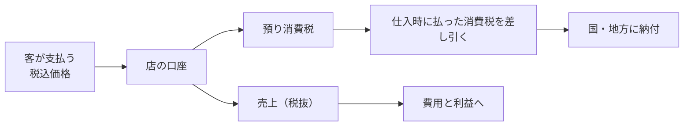
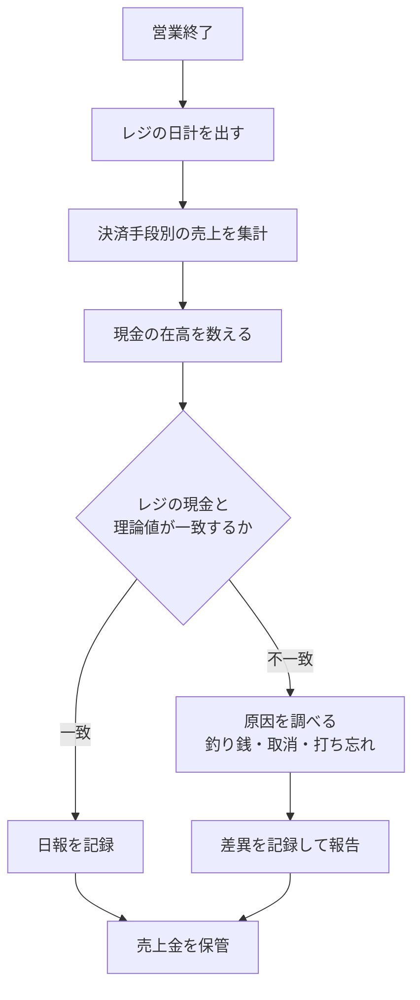

# 第18章 会計・税務・決済

## 18.1 この章で扱うこと

この章では、店のお金を「記録し、納め、受け取る」ための実務を扱います。消費税の仕組みと課税事業者の判定、軽減税率の判定、インボイス制度、端数処理とレシート、キャッシュレス決済の手数料と入金、日次締めと帳簿、確定申告の流れ、税理士に相談するタイミングです。会計は難しく見えますが、**日々の記録が正しければ、大半は決まった手順で処理できます**。

> **本章の確度について**: 本章のうち、消費税の課税標準、納税義務の免除、インボイス制度、適格請求書の記載事項は、**国税庁の公表資料で確認しました（確信度 高）**。一方、**税率の数値（標準税率・軽減税率）、軽減税率の対象品目の範囲と飲食店での線引き、申告・納付の期限、キャッシュレス決済の手数料率**は、**一次資料を取得できていません（未取得）**。本文ではその都度明記します。推測で埋めていません。
>
> **本資料は税務・法務の助言ではありません。** 個別の判断は、税務署と税理士に確認してください。

## 18.2 学習目標

- 消費税が「誰から預かり、誰が納めるか」の構造を、預り金の流れとして説明できる。
- 基準期間・特定期間の課税売上高から、課税事業者か免税事業者かを判定できる。
- 店内飲食と持ち帰りで税率の判定が変わる場面を挙げ、確認先を示せる。
- 適格請求書の記載事項を挙げ、自店のレシートが要件を満たすか確認できる。
- 日次締めの手順を書き、売上・現金・決済のずれを翌日に持ち越さない運用にできる。

## 18.3 消費税の仕組み

### 18.3.1 消費税は「預かっているお金」

消費税は、**客が支払い、店が預かり、店が国に納める**税金です。店の儲けから払う所得税とは、性質が違います。

| 税金 | 誰が負担するか | 店にとっての意味 |
| --- | --- | --- |
| 消費税 | 客（価格に上乗せされる） | 預り金。使ってはいけない |
| 所得税・法人税 | 店（利益から払う） | 費用。利益が出たら発生する |
| 住民税・事業税 | 店（所得に応じて払う） | 費用 |

**「売上金があるから払える」は誤りです。** 売上金のうち消費税分は、最初から店のものではありません。[第1章](01-kouzou.md)で「すでに他人のもの」として扱った分類のとおりです。



図の説明: 受け取った消費税（D）から、仕入れで払った消費税（E）を差し引いた残りを納めます（F）。**差し引くことを「仕入税額控除」**と呼びます。この控除が認められるための条件が、18.5と18.7の主題です。

### 18.3.2 課税標準は税抜きの金額

消費税の計算の出発点は「課税標準」です。国税庁は次のように説明しています。

> この課税標準とは、課税資産の譲渡等の対価の額によることとされています。
> なお、この課税標準となる対価の額には、消費税相当額および地方消費税相当額は含まれません。

出典: 国税庁「No.6301 課税標準」 https://www.nta.go.jp/taxes/shiraberu/taxanswer/shohi/6301.htm （令和8年4月1日現在法令等、取得日 2026-11-15）

**つまり、消費税の計算は税抜きの金額から始まります。** 本書の数値例を税抜きで統一している理由（[第2章](02-soneki-keisansho.md) 2.3）は、ここにもあります。

```
売上税額 = 税抜売上高 × 税率
```

**計算例（説明用の仮置き）**: 税抜売上1,000,000円、税率10%（数値は18.3.3参照）なら、

```
売上税額 = 1,000,000円 × 0.10 = 100,000円
税込の請求額 = 1,000,000円 + 100,000円 = 1,100,000円
```

### 18.3.3 税率の数値は未取得

**標準税率と軽減税率の数値は、本章の作成時点で一次資料を取得できていません（未取得）。** 一般には標準税率10%、飲食料品などの軽減税率8%とされていますが、**これは一般知識（未検証）**であり、本章では数値の根拠として扱いません。

本章の計算例では、読みやすさのために**10%と8%を説明用の仮置き**として使います。**実際の税率は、必ず国税庁の最新の公表資料で確認してください。**

### 18.3.4 税率の変更が予定されている（一次資料で確認）

国税庁の公表資料には、次の記述があります。

> 令和9年4月1日から令和11年3月31日までの2年間、飲食料品の譲渡について、消費税率が引き下げられます。この引下げに当たり、飲食料品の譲渡を行う事業者を対象に、課税事業者選択届出書の提出時期の特例が設けられます。

出典: 国税庁「No.6501 納税義務の免除」 https://www.nta.go.jp/taxes/shiraberu/taxanswer/shohi/6501.htm （令和8年4月1日現在法令等、取得日 2026-11-15）

国税庁は「消費税率引下げ特設サイト」を開設し、概要リーフレットと Q&A を公開しています（https://www.nta.go.jp/taxes/shiraberu/zeimokubetsu/shohi/keigenzeiritsu/zeiritsuhikisage.htm 、取得日 2026-11-15）。

| 確認できたこと | 確認できていないこと（未取得） |
| --- | --- |
| 令和9年4月1日〜令和11年3月31日の2年間、飲食料品の譲渡の税率が引き下げられる | 引き下げ後の税率の水準 |
| 対象は「飲食料品の譲渡」 | 外食（店内飲食）が対象に含まれるか |
| 飲食料品の譲渡を行う事業者に、課税事業者選択届出書の提出時期の特例がある | 特例の具体的な内容 |

**飲食店にとっては、売上の税率と仕入れの税率の両方が動く可能性があります。** 適用開始の1年前までに、税理士とリーフレットを確認し、レジの設定とメニューの表示を見直す計画を立てます。**「税率が変わってから対応する」では間に合いません。**

### 18.3.5 免税事業者と課税事業者

消費税を納める義務がある事業者を**課税事業者**、免除されている事業者を**免税事業者**と呼びます。「免税」は「消費税を客から取らなくてよい」という意味ではなく、**納める義務がない**という意味です。

| 区分 | 納税義務 | 請求書に消費税を書けるか | 仕入税額控除 |
| --- | --- | --- | --- |
| 課税事業者 | ある | 書ける（適格請求書発行事業者として） | 受けられる（要件を満たせば） |
| 免税事業者 | 原則なし | 適格請求書は交付できない | 受けられない（経過措置あり） |

**免税事業者でも、請求書に消費税相当額を上乗せして請求する慣行はあります。** しかし、それは納税義務の有無とは別の話です。

## 18.4 課税事業者か免税事業者かの判定

### 18.4.1 基準期間の課税売上高

判定の基本は、国税庁の次の記述です。

> 事業者は、国内において行った課税資産の譲渡等について消費税を納める義務がありますが、その課税期間の基準期間（個人事業者の場合はその年の前々年、事業年度が1年である法人の場合はその事業年度の前々事業年度）における課税売上高が1,000万円以下である場合には、原則として、納税義務が免除されます。

出典: 国税庁「No.6501 納税義務の免除」 https://www.nta.go.jp/taxes/shiraberu/taxanswer/shohi/6501.htm （令和8年4月1日現在法令等、取得日 2026-11-15）

| 用語 | 意味 |
| --- | --- |
| 課税期間 | 消費税を計算する期間。個人は暦年、法人は事業年度 |
| 基準期間 | 判定の基準になる過去の期間。個人は前々年、法人は前々事業年度 |
| 課税売上高 | 課税対象の売上の額（税抜） |
| 免税点 | 1,000万円（基準期間の課税売上高） |

**「1,000万円」は売上全体ではなく、課税売上高です。** 非課税売上（土地の貸付など）は含みません。飲食店の売上は、原則として課税売上です。

### 18.4.2 免除されない4つの場合

基準期間が1,000万円以下でも、次の場合は課税事業者になります（出典: 同上）。

| 場合 | 内容 |
| --- | --- |
| 適格請求書発行事業者の登録を受けている | 登録した時点で、課税売上高にかかわらず納税義務は免除されない |
| 特定期間の課税売上高が1,000万円を超える | 個人は前年1月1日〜6月30日、法人は前事業年度開始日以後6か月 |
| 課税事業者選択届出書を提出している | 自ら課税事業者を選んだ場合 |
| 高額特定資産（1取引100万円以上）の仕入れがある | 一定期間、免税事業者に戻れない等の制限がある |

**特定期間の判定**では、課税売上高に代えて**給与等支払額の合計額**で判定できます。どちらで判定するかは納税者の任意です（出典: 同上）。**従業員を多く雇う店は、給与で判定した方が早く課税事業者になる**場合があります。

### 18.4.3 開業1期目の扱い

新たに設立した法人は、設立1期目と2期目に基準期間がありません。そのため**原則として納税義務が免除**されます。ただし、事業年度開始日の資本金が1,000万円以上の場合や、特定新規設立法人に該当する場合は免除されません（出典: 同上、詳細はコード6503）。

**個人事業者の開業1年目・2年目も、基準期間の課税売上高がありません**（基準期間が前々年のため。**一般知識（未検証）**）。そのため原則として免税事業者になりますが、**インボイス登録をすると課税事業者になります**（18.4.2）。この点は開業時の大きな判断です（[第9章](09-kaigyo-junbi.md) 9.10）。

### 18.4.4 判定の数値例

**計算例（説明用の仮置き）**: 個人事業者で、前々年（令和6年）の課税売上高が900万円、前年（令和7年）の1月〜6月の課税売上高が480万円とします。

```
基準期間（前々年）の課税売上高 = 900万円 ≤ 1,000万円 → 原則免除
特定期間（前年1〜6月）の課税売上高 = 480万円 ≤ 1,000万円 → 免除のまま
```

この場合、令和8年（今年）も免税事業者です。ところが、特定期間（令和7年1〜6月）の売上が**1,050万円**だった場合は、

```
特定期間の課税売上高 = 1,050万円 > 1,000万円 → 課税事業者
```

基準期間が1,000万円以下でも、**特定期間で超えれば課税事業者**になります。**開業2年目以降に売上が伸びた店は、ここで切り替わります。**

| 判定の場面 | 見る期間 | 判定 |
| --- | --- | --- |
| 通常の判定 | 基準期間（前々年・前々事業年度） | 1,000万円超なら課税事業者 |
| 売上が急に伸びた | 特定期間（前年1〜6月など） | 1,000万円超なら課税事業者 |
| インボイス登録をした | 登録日以降 | 課税事業者 |
| 開業1期目（法人） | 基準期間なし | 原則免税（資本金等の条件による） |

## 18.5 消費税額の計算

### 18.5.1 売上税額と仕入税額

```
納付税額 = 売上税額 − 仕入税額控除額
売上税額 = 税率ごとの税抜売上高 × 税率
```

**仕入税額控除**とは、仕入れで支払った消費税を、売上で預かった消費税から差し引くことです。**控除には帳簿と請求書等の保存が必要**です（18.7.1）。

### 18.5.2 数値例

**計算例（説明用の仮置き）**: 税抜売上10,000,000円（すべて10%対象）、税抜仕入3,000,000円（すべて8%対象）とします。

```
売上税額 = 10,000,000 × 0.10 = 1,000,000円
仕入税額 = 3,000,000 × 0.08 = 240,000円
納付税額 = 1,000,000 − 240,000 = 760,000円
```

**売上と仕入れで税率が違うと、差額が大きくなります。** 上の場合、預かった税額の24%が仕入分で戻り、残り76%を納めます。**「売上の消費税をそのまま納める」のではない**点が重要です。

### 18.5.3 積上げ計算と割戻し計算

国税庁は、申告における売上税額・仕入税額の計算方法として2つを示しています。

> （1）適格請求書に記載のある消費税額等を積み上げて計算する「積上げ計算」
> （2）適用税率ごとの取引総額を割り戻して計算する「割戻し計算」
> ただし、売上税額を「積上げ計算」により計算する場合には、仕入税額も「積上げ計算」により計算しなければなりません。

出典: 国税庁「No.6498 適格請求書等保存方式（インボイス制度）」 https://www.nta.go.jp/taxes/shiraberu/taxanswer/shohi/6498.htm （令和8年4月1日現在法令等、取得日 2026-11-15）

| 方法 | 計算 | 向く場面 |
| --- | --- | --- |
| 積上げ計算 | 請求書・レシートに書いた税額を合計する | レジで税額を確定している店 |
| 割戻し計算 | 税率ごとの税込売上を税率で割り戻す | 税額を記録していない店 |

**積上げと割戻しでは、端数処理の違いで1円〜数円の差が出ます。** どちらを選ぶかは税理士と相談して決め、翌年以降も同じ方法を使います。

### 18.5.4 簡易課税と特例（一部未取得）

小規模事業者には、実際の仕入れを集計せずに納付税額を計算する**簡易課税制度**があります。また、インボイスを機に免税事業者が登録した場合の負担軽減として、**2割特例**（令和5年10月1日から令和8年9月30日までの日の属する課税期間）と**3割特例**（令和9年および令和10年の課税期間、小規模個人事業者）が設けられています（出典: 同上）。

**本章では、簡易課税のみなし仕入率（事業区分ごとの率）を確認できていません（未取得）。** 飲食店がどの事業区分になるかも含め、税理士に確認してください。**特例は適用期間が決まっているため、使える年度をカレンダーに落としておきます。**

## 18.6 軽減税率の判定

### 18.6.1 制度の骨格

複数の税率がある制度を**軽減税率制度**と呼びます。軽減税率の対象品目には、**適用税率や「軽減税率の対象品目である旨」を書類に記載する必要がある**ことが、適格請求書の記載事項として定められています（出典: 国税庁「No.6625 適格請求書等の記載事項」、取得日 2026-11-15）。**制度の存在と、品目を区別して記録する必要があることは、一次資料で確認できました。**

一方、**どの品目が軽減税率の対象か、飲食店の店内飲食と持ち帰りをどう判定するかは、一次資料を取得できていません（未取得）。** 以下は**一般知識（未検証）**として、確認すべき論点を整理します。

### 18.6.2 飲食店で問題になる理由

一般には、**飲食料品の販売は軽減税率、外食（店内飲食）は標準税率**とされます（**一般知識（未検証）**）。飲食店が持ち帰りを始めると、**同じ商品でも提供方法で税率が変わる**ため、判定が必要になります。

| 提供方法 | 一般に言われる扱い | 確認状況 |
| --- | --- | --- |
| 店内飲食 | 標準税率 | 一次資料で確認できず |
| 持ち帰り（容器包装して渡す） | 軽減税率 | 一次資料で確認できず |
| デリバリー | 提供の時点と場所で判断 | 一次資料で確認できず |
| 屋外席での飲食 | 店内飲食と同じか | 一次資料で確認できず |
| セット商品（食品＋飲料） | 一体か分割か | 一次資料で確認できず |

**この表は「答え」ではなく「確認する項目の一覧」です。** 税務署または税理士に、実際の提供方法を示して確認します。

### 18.6.3 判断が分かれる場面

| 場面 | 判断の分かれ目 | 準備しておくこと |
| --- | --- | --- |
| 店内で受け取って店の外で食べる | 店内飲食か持ち帰りか | 注文時に区分を確定する運用 |
| 屋外席で食べる | 屋外席が店内飲食の扱いか | 席の位置と提供方法を税理士に説明 |
| デリバリー | 提供の時点と場所 | 契約書と配達の実態を確認 |
| セット商品 | 一体の商品として扱うか、分けるか | 構成と価格の内訳を決めておく |
| 酒類の持ち帰り | 酒類販売業免許の要否（[第10章](10-kyoka-hourei.md) 10.9） | 免許の確認を先に行う |

**「容器に入れて渡せば持ち帰り」と単純には決められません。** 受け渡しの場所、食べる場所、店の表示によって扱いが変わります。**判断はレジの設定より先に決めます**（18.6.5）。

### 18.6.4 テイクアウトを始めるときの確認事項

持ち帰りを始める判断は、税率だけでは完結しません。**5つの確認が同時に必要**です。

| 確認事項 | 内容 | 参照 |
| --- | --- | --- |
| 営業許可 | 持ち帰り販売が許可の範囲に含まれるか | [第10章: 営業許可と法規](10-kyoka-hourei.md) 10.4 |
| 食品表示 | 容器包装した場合の表示義務の範囲 | [第11章: 食品表示とアレルギー](11-hyouji-allergy.md) 11.4 |
| 衛生管理 | 提供までの温度と時間、容器の扱い | [第12章: 衛生管理とHACCP](12-eisei-haccp.md) |
| 税率の判定 | どの提供方法がどの税率か | 税務署・税理士 |
| 容器の原価 | 容器は材料費に含める | [第3章](03-zairyo-hi-genka.md) 3.3.2 |

**容器の原価を含め忘れると、原価率が実際より低く出ます。** テイクアウト比率が高い店では、この差が無視できません。

### 18.6.5 レジとメニューの設計

税率の判定が決まったら、**レジとメニューに落とします**。

| 設計 | 内容 | 決めること |
| --- | --- | --- |
| 注文時の区分 | 店内飲食か持ち帰りかを、注文時に確定する | 確認する言葉とボタンの位置 |
| 商品マスタ | 商品ごとに税率を登録する | 区分が変わる商品の洗い出し |
| メニュー表示 | 税込価格を表示する | 区分ごとの価格表示 |
| 容器の受け渡し | 容器を渡すタイミング | 区分の取り違えを防ぐ手順 |
| 日次の集計 | 税率ごとの売上を日次で出す | 日報の項目（18.10.3） |

**「あとから分ければよい」は通用しません。** レシートの税額は会計時に確定するため、区分の取り違えはそのまま誤申告になります。**注文時に確定する運用**を作ります。

## 18.7 インボイス制度

### 18.7.1 制度の概要

国税庁の説明は次のとおりです。

> 令和5年10月1日から、複数税率に対応した消費税額の仕入税額控除の方式として、「適格請求書等保存方式（インボイス制度）」が開始しています。適格請求書等保存方式の下では、一定の事項が記載された帳簿及び「適格請求書（インボイス）」等の保存が仕入税額控除の要件となります。

出典: 国税庁「No.6498 適格請求書等保存方式（インボイス制度）」 https://www.nta.go.jp/taxes/shiraberu/taxanswer/shohi/6498.htm （令和8年4月1日現在法令等、取得日 2026-11-15）

| 用語 | 意味 |
| --- | --- |
| 適格請求書（インボイス） | 売手が買手に正確な適用税率や消費税額を伝える書類。請求書・納品書などが該当する |
| 適格請求書発行事業者 | 税務署長の登録を受けた事業者。登録がなければ適格請求書を交付できない |
| 登録番号 | 登録を受けた事業者に通知される番号。法人は「T＋法人番号」、それ以外は「T＋13桁の数字」 |
| 仕入税額控除 | 仕入れで払った消費税を差し引くこと。帳簿と適格請求書等の保存が要件 |

**登録は任意です。** ただし、登録を受けた課税事業者は、**基準期間の課税売上高にかかわらず納税義務が免除されません**（出典: 同上）。**「インボイス登録＝課税事業者になる」**という関係を押さえます。

**免税事業者でも登録できる経過措置**があります。令和5年10月1日から令和11年9月30日までの日を含む課税期間中に免税事業者が登録を受けた場合は、登録日から適格請求書発行事業者になれます（出典: 同上）。

### 18.7.2 適格請求書の記載事項

国税庁が示す記載事項は次の6つです（請求書・納品書等の場合）。

| 番号 | 記載事項 |
| --- | --- |
| ① | 書類作成者の氏名または名称、および登録番号 |
| ② | 取引年月日 |
| ③ | 取引内容（軽減税率の対象品目である旨） |
| ④ | 税率ごとに区分して合計した税込対価（または税抜対価）の額、および適用税率 |
| ⑤ | 税率ごとに区分した消費税額等 |
| ⑥ | 書類の交付を受ける事業者の氏名または名称 |

出典: 国税庁「No.6625 適格請求書等の記載事項」 https://www.nta.go.jp/taxes/shiraberu/taxanswer/shohi/6625.htm （令和8年4月1日現在法令等、取得日 2026-11-15）

**飲食店にとって重要な特例**があります。国税庁は次の注を置いています。

> 小売業、飲食店業、タクシー等を営む事業者が交付する書類については、④の適用税率又は⑤の消費税額等は、いずれかの記載で差し支えありません。また、この場合⑥の記載は不要となります。

出典: 同上（取得日 2026-11-15）

**つまり、店のレシートでは、適用税率か消費税額のどちらかを書けばよく、宛名（⑥）は不要**です。**「レシートには全部書かないといけない」は誤り**です。

また、取引内容は包括的な記載でもよく、軽減税率の対象品目は「※」などの記号や、税率ごとの区分でも示せます（出典: 同上）。

### 18.7.3 保存期間

> その保存期間については、その閉鎖または受領した日の属する課税期間の末日の翌日から2か月を経過した日から7年間、事業者の納税地またはその事業に係る事務所等に保存しなければなりません。ただし、6年目および7年目は、帳簿または請求書等のいずれか一方を保存すればよいこととされています。

出典: 同上（取得日 2026-11-15）

**7年**という長さは、店の実務では「段ボールが増え続ける」ことを意味します。**電子保存を検討する根拠**になります（ただし電子帳簿保存法の要件は未取得。18.11.2）。

**この7年は、消費税の帳簿および請求書等の保存期間**です。**所得税・法人税の帳簿書類の保存期間は別に定めがあり**、本章では確認できていません（未取得）。[第19章](19-kpi.md)でも年数を示していないため、あわせて税理士に確認してください。

### 18.7.4 買い手側の実務（仕入れ先の確認）

仕入れ先が適格請求書発行事業者でなければ、**その仕入れの消費税は控除できません**（経過措置を除く）。

| 手順 | 内容 |
| --- | --- |
| 1. 登録番号を集める | 主要な仕入れ先すべての登録番号を一覧にする |
| 2. 公表サイトで確認する | 国税庁の公表サイトで、番号と名称が一致するか確認する |
| 3. 請求書の記載を確認する | 6項目（飲食店向けは①〜⑤）が揃っているか |
| 4. 帳簿と突合する | 請求書の金額と帳簿の仕入額が合うか |
| 5. 未登録の仕入れ先を把握する | 経過措置の対象か、控除できないかを区分する |

**「取引があるから登録しているはず」と思い込むのが最も危険**です。**番号を集めて確認する**のが唯一の方法です。

### 18.7.5 免税事業者からの仕入れの経過措置

国税庁は、免税事業者等からの仕入れについて経過措置を置いています。

> 一定の要件を満たす場合には、令和5年10月1日から令和13年9月30日までの期間は、仕入税額相当額の一定割合（80パーセント、7・5・3割）を仕入税額として控除できる経過措置が設けられています。ただし、令和6年10月1日以降に開始する課税期間から、一の免税事業者等から行うその経過措置の対象となる課税仕入れの税込金額の合計額が年または事業年度で10億円を超える場合には、その超えた部分の課税仕入れについて、経過措置の適用を受けることができません。…令和8年10月1日以後に開始する課税期間については1億円

出典: 同上（取得日 2026-11-15）

**割合が段階的に下がる**経過措置です。**「80%控除」がいつまでか、次は何割か**を、年ごとにカレンダーに落としておきます。**個店の仕入れ規模では金額上限（10億円・1億円）に達しません**が、条件の存在は押さえます。

### 18.7.6 売り手側の実務（登録するか）

登録するかどうかは、**取引先が課税事業者かどうか**で変わります。

| 自店の状況 | 登録した場合 | 登録しない場合 |
| --- | --- | --- |
| 売上先が一般消費者中心 | 納税義務が発生する。価格に上乗せが必要 | 免税のまま。納税不要 |
| 売上先に法人・事業者が多い | 適格請求書を交付できる。取引が続きやすい | 相手が控除できず、取引を切られる可能性 |
| 仕入れが少ない業態 | 納税額が大きくなりやすい | 納税不要 |

**飲食店は一般消費者が中心のため、登録の必要性は業態によります。** 法人向けの弁当、ケータリング、役員会食の請求など、**事業者向けの売上がある場合は登録を検討**します。**判断は税理士と一緒に行います。**

### 18.7.7 未取得の項目

| 項目 | 状況 | 確認先 |
| --- | --- | --- |
| 標準税率・軽減税率の数値 | 未取得 | 国税庁の公表資料 |
| 軽減税率の対象品目と外食の線引き | 未取得 | 税務署・税理士 |
| 簡易課税のみなし仕入率と事業区分 | 未取得 | 税務署・税理士 |
| 少額特例・返還インボイス等の個別要件 | 未取得 | 税務署・税理士 |
| 申告・納付の期限、中間納付の要件 | 未取得 | 税務署・税理士 |
| 消費税率引下げ後の税率と対象範囲 | 未取得（実施予定は確認済み） | 国税庁特設サイト・税理士 |

**この表は「調べれば分かること」の一覧ではありません。** 本章が確認を試みて届かなかった項目です。**開業前・制度変更前に、確認先で埋めてください。**

## 18.8 端数処理とレシート

### 18.8.1 端数処理

消費税額には端数が出ます。**処理の方法と単位を決めて、店として統一します。**

```
消費税額 = 税抜価格 × 税率 → 端数処理 → 請求する税額
```

**計算例（説明用の仮置き）**: 税抜1,234円、税率8%なら、

```
1,234 × 0.08 = 98.72円
切り捨て → 98円
四捨五入 → 99円
切り上げ → 99円
```

| 方法 | 結果 | 注意 |
| --- | --- | --- |
| 切り捨て | 98円 | 客に有利。店の負担がわずかに増える |
| 四捨五入 | 99円 | 最も一般的とされる（一般知識（未検証）） |
| 切り上げ | 99円 | 店に有利。値上げと受け取られやすい |

**どの方法を選ぶかは事業者が決められるとされます（一般知識（未検証））。** 一度決めたら変更しないのが基本です（会計ソフトとレジの設定が変わるため）。

### 18.8.2 端数処理は1つの請求について1回

**明細ごとに端数処理をすると、合計と一致しなくなります。**

**計算例（説明用の仮置き）**: 税抜123円の商品を3点、税率8%で販売します。

```
【明細ごとに処理】123 × 0.08 = 9.84 → 9円（切り捨て）→ 9円 × 3点 = 27円
【合計に対して1回】369 × 0.08 = 29.52 → 29円（切り捨て）
```

**2円の差**が出ます。どちらが正しいかは「1つの請求について1回」という原則で決まります（**一般知識（未検証）**）。**レジの設定がどちらになっているかを、導入時に確認します。**

### 18.8.3 レシートの記載事項

18.7.2の6項目が基本です。飲食店には特例があり、**適用税率か消費税額のどちらか**、**宛名は不要**です。

| 記載事項 | レシートでの例 | 飲食店の特例 |
| --- | --- | --- |
| ① 名称・登録番号 | 店名、T＋13桁の番号 | 必要 |
| ② 取引年月日 | 2026年11月15日 | 必要 |
| ③ 取引内容（軽減税率の対象品目である旨） | 品目名、または「※」印 | 必要（記号でも可） |
| ④ 税率ごとに区分した合計額と適用税率 | 「10%対象 2,000円」 | 税率か税額のどちらかでよい |
| ⑤ 税率ごとに区分した消費税額 | 「消費税等 200円」 | 同上 |
| ⑥ 交付を受ける事業者の名称 | 宛名 | **不要** |

出典: 国税庁「No.6625 適格請求書等の記載事項」（取得日 2026-11-15）の記載事項と注1によります。

**「レシート＝領収書」ではありません。** 経費の証憑として使う場合は、宛名や但し書きが必要になることがあります。**社用の会計では、宛名入りの領収書を求められる場合がある**ため、発行の運用を決めておきます（**一般知識（未検証）**）。

### 18.8.4 レジ設定のチェックリスト

| 確認項目 | 内容 |
| --- | --- |
| 税率の登録 | 商品ごとに税率が登録されているか |
| 端数処理 | 切り捨て・四捨五入・切り上げのどれか。1請求1回か |
| 軽減税率の表示 | 「※」などの記号、または税率ごとの区分 |
| 登録番号の印字 | 自店の登録番号が入っているか |
| 日次の集計 | 税率ごとの売上と税額が出るか |
| 返品・取消の扱い | 返品時の税額の戻し方が決まっているか |

**レジを入れ替えるときは、この6項目を移行のチェックリストにします。** 設定の移し漏れは、申告の誤りに直結します。

## 18.9 キャッシュレス決済

### 18.9.1 決済手段の分類

| 手段 | 仕組み | 入金 | 特徴 |
| --- | --- | --- | --- |
| 現金 | その場で受け取る | 即時 | 手数料なし。釣り銭と防犯の手間 |
| クレジットカード | 後払い。カード会社経由 | 翌月〜翌々月 | 単価の高い客層に強い。手数料がかかる |
| デビットカード | 即時引き落とし | 数日 | 使いすぎを防げる |
| 電子マネー | 事前チャージ | 数日〜翌月 | 会計が速い。少額に向く |
| QRコード決済 | スマートフォンで読取 | 翌月〜翌々月 | 導入が容易。手数料は事業者による |
| 商品券・ギフト | 事前購入 | 換金時 | 換金の手間。有効期限 |

**「キャッシュレス」と一括りにしない**ことが重要です。手数料、入金日、障害時の対応がそれぞれ違います。

### 18.9.2 手数料は契約で決まる（数値は未取得）

**決済手数料の率は、契約と売上規模で決まるため、本章では数値を示しません（未取得）。** 一般に売上の数%とされますが、**これは一般知識（未検証）**です。

| 確認項目 | 内容 |
| --- | --- |
| 手数料率 | 何%か。売上規模で変わるか |
| 端末費 | 月額か、買取か。複数台で変わるか |
| 通信費 | 専用回線か、店の回線か |
| 入金サイクル | 締め日と入金日 |
| 最低利用期間 | 途中解約の違約金 |
| 障害時の補償 | 通信障害のときの扱い |

**「手数料率だけで選ぶ」と、端末費と入金サイクルで損をします。** 月商300万円の店で手数料率が1%違えば、年間36万円の差です。**端末費が月5,000円なら年6万円**ですから、率の差の方が大きくなります。

### 18.9.3 入金サイクルと資金繰り

決済の入金は、売上の計上より遅れます。[第7章](07-cashflow.md) 7.6のサイト表のとおり、クレジットカードは約30〜60日、QRコード決済は翌月〜翌々月が目安です（**一般知識（未検証）**。契約により異なります）。

```
入金待ちの売掛金 = 月商 × キャッシュレス比率 ×（入金までの月数）
```

**計算例（説明用の仮置き）**: 月商3,000,000円、キャッシュレス比率60%、入金が翌月末なら、

```
入金待ち = 3,000,000 × 0.60 × 1か月 = 1,800,000円
```

**常に180万円が「売上たが入金されていない」状態**です。この分の現金は、運転資金として別に用意します（[第7章](07-cashflow.md) 7.7）。

### 18.9.4 手数料の数値例

**計算例（説明用の仮置き）**: 年間売上31,300,000円、キャッシュレス比率60%、手数料率2%とします。

```
キャッシュレス売上 = 31,300,000 × 0.60 = 18,780,000円
決済手数料 = 18,780,000 × 0.02 = 375,600円
```

手数料率が3%なら 18,780,000 × 0.03 = 563,400円で、**差は187,800円**です。**率の1ポイントは、この規模で年約19万円**です。

**手数料は変動費**です（[第6章](06-soneki-bunkiten.md) 6.3）。売上に比例して増えるため、損益分岐点の計算では変動費率に含めます。

### 18.9.5 障害・停電時の運用

| 事態 | 起きること | 備え |
| --- | --- | --- |
| 通信障害 | カード・QRが使えない | 現金会計の手順と釣り銭の準備 |
| 停電 | レジが動かない | 手書き伝票、電卓、後日の入力 |
| 端末故障 | 決済できない | 予備の端末、または現金運用 |
| システム障害（事業者側） | 決済が成立しない | 事業者の案内に従う。二重決済を避ける |

**手書きに切り替えたときの記録様式を決めておきます。** 日付・卓番・金額・税率区分・決済方法の5項目があれば、後から入力できます。**「レジが落ちたら売上を記録しない」が最悪の対応**です。

### 18.9.6 現金管理

キャッシュレス比率が上がっても、現金は無くなりません。**むしろ現金の管理が緩みます。**

| 論点 | 内容 |
| --- | --- |
| 釣り銭の準備 | 営業前に金種別で確認する |
| 売上金の保管 | 店内に残さない。搬送の経路と時間を固定しない |
| 現金過不足 | 翌日に持ち越さず、その日のうちに原因を探す |
| 金庫の管理 | 開けられる人を限定する。記録を残す |

## 18.10 日次締め

### 18.10.1 日次締めの手順

**日次締め**（ひにちじめ）とは、1日の売上・入金・現金を確定させる作業です。**翌日に持ち越すと、原因の特定が難しくなります。**



図の説明: 一致しないときに大事なのは、**差異を消すことではなく、差異を記録すること**です。「今日は200円多かった」という記録が3日続けば、レジの設定か運用に原因があります。

### 18.10.2 現金過不足の扱い

```
理論現金 = 釣り銭の開始在高 + 現金売上 − 支払い（現金）
差異 = 実際の在高 − 理論現金
```

**計算例（説明用の仮置き）**: 開始在高30,000円、現金売上85,000円、現金の支払い5,000円、実際の在高109,500円なら、

```
理論現金 = 30,000 + 85,000 − 5,000 = 110,000円
差異 = 109,500 − 110,000 = −500円（不足）
```

| 差異の原因 | 確認すること |
| --- | --- |
| 釣り銭の誤り | 多い／少ないの方向。金種別の枚数 |
| 打ち忘れ・打ち間違い | 伝票とレジの件数 |
| 取消・返品の処理漏れ | 取消の記録 |
| 現金の持ち出し | 買い物、支払いの記録 |
| 盗難・不正 | 差異が続く場合。記録の傾向 |

**差異を「経費」で消す運用にすると、原因が永久に分かりません。** 差異は記録し、月次で傾向を見ます。

### 18.10.3 日報の項目

| 項目 | 例 | 使い道 |
| --- | --- | --- |
| 日付・天候 | 11月15日・雨 | 需要の分析（[第17章](17-loss-menu.md) 17.7.1） |
| 客数 | 68人 | 客単価の計算 |
| 売上（税抜） | 95,200円 | 日次の損益 |
| 税率ごとの売上 | 10%対象 85,000円、8%対象 10,200円 | 消費税の集計 |
| 決済手段別 | 現金40%、カード45%、QR15% | 入金の予測（18.9.3） |
| 客単価 | 1,400円 | 売上の分解（[第8章](08-kyaku-tanka-kaiten.md)） |
| 廃棄 | 3件・1,200円 | ロスの記録（[第17章](17-loss-menu.md) 17.4） |
| 特記事項 | 売り切れ2件、クレーム1件 | 翌日の判断 |

**日報は「あとで集計するため」ではなく「明日の判断のため」**に書きます。**税率ごとの売上と決済手段別の内訳は、日次で出さないと月次で復元できません。**

## 18.11 帳簿付けと確定申告

### 18.11.1 帳簿の種類と記録の頻度

| 帳簿 | 記録する内容 | 頻度 |
| --- | --- | --- |
| 売上帳 | 日次の売上、税率区分、決済手段 | 日次 |
| 仕入帳 | 仕入れの日付・品目・金額・登録番号 | 納品ごと |
| 現金出納帳 | 現金の入出金 | 日次 |
| 経費帳 | 家賃、水道光熱費、人件費など | 月次 |
| 固定資産台帳 | 設備の取得価額、償却 | 取得時・年1回 |

**「売上帳」と「仕入帳」は、消費税の計算の根拠**になります。帳簿の保存が仕入税額控除の要件だからです（18.7.1）。

### 18.11.2 証憑の整理

**証憑**（しょうひょう）とは、取引を証明する書類（領収書、請求書、レシート）のことです。

| 整理の方法 | 内容 |
| --- | --- |
| 日付順 | 月ごとにフォルダまたは封筒で分ける |
| 科目別 | 家賃・水道光熱費・仕入などで分ける |
| 突合 | 請求書と検収記録、通帳の引き落としを突き合わせる |
| 保管 | 消費税の帳簿・請求書等は7年（18.7.3） |

**電子帳簿保存法の要件は、本章では確認できていません（未取得）。** 電子で保存する場合は、税務署または税理士に要件を確認してください。**スキャンしただけでは要件を満たさない場合があります。**

### 18.11.3 月次で見るもの

| 見るもの | 内容 | 参照 |
| --- | --- | --- |
| 試算表 | 売上・材料費・人件費・固定費・利益 | [第2章](02-soneki-keisansho.md) |
| 棚卸し | 期末在庫と材料費 | [第3章](03-zairyo-hi-genka.md) 3.5 |
| 資金繰り表 | 入金と支払いの予定 | [第7章](07-cashflow.md) 7.8 |
| 消費税の積立 | 納付予定額の積み立て | [第7章](07-cashflow.md) 7.12 |
| 売掛金（決済） | 未入金の残高 | 18.9.3 |

**月次で試算表を見ないと、年間の申告で初めて数字を知ることになります。** 手遅れになる判断（値上げ、メニュー改定、人件費）は、月次で見れば打てます。

### 18.11.4 確定申告の流れ

**確定申告**とは、1年間の所得と税額を計算して申告する手続きです。個人事業主は所得税、法人は法人税の申告になります。

| 順序 | 作業 | 内容 |
| --- | --- | --- |
| 1 | 決算整理 | 棚卸し、未払い・前払いの整理、貸倒れの確認 |
| 2 | 減価償却 | 設備の償却費を計算（[第5章](05-koteihi-ricchi.md)） |
| 3 | 帳簿の締め | 売上・仕入・経費の合計を確定 |
| 4 | 所得の計算 | 収入 − 経費 − 各種控除 |
| 5 | 税額の計算 | 所得 × 税率 − 控除額 |
| 6 | 消費税の計算 | 売上税額 − 仕入税額（18.5） |
| 7 | 申告書の作成・提出 | 税務署またはe-Tax |
| 8 | 納付 | 期限までに納める |

**申告・納付の期限は本章では確認できていません（未取得）。** 一般的な期限（所得税の確定申告は翌年2月16日〜3月15日など）は**一般知識（未検証）**です。**期限は絶対なので、税理士とカレンダーを共有します。**

**消費税の申告は、所得税・法人税の申告と別**です。**2つの申告があることを忘れる**のが典型的な失敗です。

### 18.11.5 納付のスケジュールと資金繰り

税金は、利益が出た後ではなく、**決まった時期にまとまって**出ていきます。

| 税金 | 支払の時期（一般知識（未検証）） | 資金繰りへの影響 |
| --- | --- | --- |
| 消費税 | 課税期間の終了後、数か月後 | 額が大きい。毎月積み立てる |
| 所得税 | 翌年の申告時 | 利益に連動 |
| 住民税 | 翌年、分割または一括 | 前年の所得に連動 |
| 事業税 | 翌年 | 所得に連動 |
| 社会保険料 | 毎月 | 固定的に発生 |

**「消費税は預り金」**（18.3.1）なので、**売上から分けて積み立てる**のが原則です。

```
毎月の積立額 = 年間の納付見込額 ÷ 12か月
```

**計算例（説明用の仮置き）**: 年間の納付見込2,400,000円なら、毎月200,000円を別口座に移します。**12回に分ければ、納付月の資金ショックは起きません。**

## 18.12 税理士に相談すべきタイミング

| タイミング | 相談すること | 理由 |
| --- | --- | --- |
| 開業前 | 課税事業者の判定、インボイス登録の要否、記帳の方法 | 後から戻せない判断がある |
| 持ち帰りを始める前 | 軽減税率の判定、レジの設定、表示義務 | 提供方法で税率が変わる |
| 従業員を雇う前 | 源泉所得税、社会保険、年末調整 | 手続きが増える |
| 設備を買う前 | 償却年数、少額減価償却、補助金の扱い | 処理の選択肢がある |
| 売上が伸びた年 | 課税事業者への切替、簡易課税の選択 | 判定の時期が決まっている |
| 赤字の年 | 繰越、消費税の還付 | 還付の要件がある |
| 税務署から連絡があった | 内容の確認、対応の進め方 | 個人で判断しない |
| 制度が変わるとき | 税率変更、特例の期限 | 対応の準備期間が必要 |

**相談は「申告の直前」ではなく「判断の直前」**に行います。**終わった取引は、処理を選べません。**

## 18.13 ケースの店では

連続ケース「食堂つきかげ」（[第22章: 総合ケース](22-case.md)）で計算します。**ケースの数字は設計値であり、実在の店舗の実績ではありません。**

ケースの年間売上は31,300千円です。**本書の数値例は税抜きで統一している**ため（[第2章](02-soneki-keisansho.md) 2.3）、これは税抜の売上高です。ケースの店は店内飲食のみで、持ち帰りは行っていないとします。税率を10%（説明用の仮置き）とすると、

```
売上税額 = 31,300千円 × 0.10 = 3,130千円
```

仕入れ側を計算します。材料費は9,556千円です。食材が軽減税率の対象（8%と仮置き）なら、

```
仕入税額 = 9,556千円 × 0.08 = 764.5千円 → 764千円（切り捨て）
納付見込 = 3,130千円 − 764千円 = 2,366千円
```

**年間2,366千円、月あたり197千円**を納める計算です。**これは利益から出るのではなく、客から預かったお金から出ます。**

試しに、仕入れも10%だった場合と比べます。

```
仕入税額（10%）= 9,556 × 0.10 = 955.6千円 → 955千円
納付見込 = 3,130 − 955 = 2,175千円
差 = 2,366 − 2,175 = 191千円
```

**仕入れの税率が8%か10%かで、年間191千円の差**が出ます。**「税率の判定は経営の数字に効く」**ことが分かります。ただし、この計算は税率を説明用に仮置きしたもので、**実際の税率は未取得**です（18.3.3）。

決済を見ます。ケースの資金繰りでは、現金・即時決済40%、カード60%と仮置きし、決済手数料・容器等を売上の2%としていました（[第7章](07-cashflow.md) 7.13）。ここでは手数料だけを切り出します。

```
キャッシュレス売上 = 31,300千円 × 0.60 = 18,780千円
決済手数料（2%と仮置き）= 18,780 × 0.02 = 375.6千円
入金待ち（翌月末入金）= 18,780 ÷ 12 = 1,565千円
```

**常時156万円前後が未入金**です。この分は運転資金として手元に必要になります（[第7章](07-cashflow.md) 7.7の必要運転資金の計算に入っています）。

最後に、納付の備えです。消費税2,366千円を12か月で割ると、

```
毎月の積立額 = 2,366千円 ÷ 12 = 197.2千円
```

**月約20万円を別口座に移します。** ケースの年間損益では税引前利益1,774千円です（[第22章](22-case.md) 22.9）。**消費税2,366千円はこの利益とは無関係に出ていく現金**であり、混同すると資金繰りが破綻します（[第7章](07-cashflow.md) 7.12）。

## 18.14 よくある誤解

| 誤解 | 実際 |
| --- | --- |
| 消費税は利益から払う | 客から預かったお金を納めます。仕入税額控除を引いた残りです |
| 売上の消費税をそのまま納める | 仕入れで払った消費税を差し引けます（帳簿と請求書等の保存が要件） |
| 免税事業者は消費税を取ってはいけない | 納税義務がないだけで、請求書に上乗せする慣行はあります |
| インボイス登録は義務 | 任意です。ただし登録すると課税事業者になり、納税義務が発生します |
| レシートには6項目すべて必要 | 飲食店業には特例があり、適用税率か税額のどちらかでよく、宛名は不要です |
| 明細ごとに端数処理してよい | 1つの請求について1回が原則です。明細ごとだと合計が合いません |
| キャッシュレスは現金より楽 | 手数料、入金遅れ、障害時の対応というコストがあります |
| 日次締めは翌日でよい | 差異の原因は当日にしか分かりません。翌日では特定できません |

## 18.15 この章の要点

- 消費税は**預り金**です。売上税額から仕入税額を引き、残りを納めます。利益から払う税金ではありません。
- 課税事業者の判定は**基準期間（前々年）の課税売上高1,000万円**が基本です。**特定期間**と**インボイス登録**でも課税事業者になります。
- **インボイス制度は令和5年10月1日開始**。仕入税額控除には帳簿と適格請求書等の保存が必要で、**飲食店業のレシートには特例**があります。
- 端数処理は**1つの請求について1回**。レジの設定は導入時に確認し、入れ替え時に引き継ぎます。
- 税金は**毎月積み立てる**。納付月にまとめて用意すると、資金繰りが破綻します。

## 18.16 自店で確認すること

- [ ] 基準期間と特定期間の課税売上高から、課税事業者か免税事業者かを判定している
- [ ] インボイス登録の要否を、取引先の構成から判断し、税理士に確認した
- [ ] 主要な仕入れ先すべての登録番号を集め、公表サイトで確認している
- [ ] 店内飲食と持ち帰りの税率区分を、税務署または税理士に確認した
- [ ] レシートが記載事項（飲食店業の特例を含む）を満たしているか確認した
- [ ] 端数処理の方法と単位、1請求1回の設定を、レジで確認している
- [ ] 決済手数料・入金サイクル・障害時の運用を、契約書で確認している
- [ ] 消費税の納付見込額を12で割り、毎月積み立てている

## 18.17 章末問題

### 問1 消費税額の計算（計算）

年間の税抜売上20,000,000円（すべて標準税率10%と仮置き）、税抜仕入6,000,000円（すべて軽減税率8%と仮置き）とします。

1. 売上税額を求めてください。
2. 仕入税額を求めてください。
3. 納付税額を求めてください。
4. 毎月の積立額を求めてください（円未満を四捨五入）。

**解答**

1. 売上税額 = 20,000,000 × 0.10 = **2,000,000円**
2. 仕入税額 = 6,000,000 × 0.08 = **480,000円**
3. 納付税額 = 2,000,000 − 480,000 = **1,520,000円**
4. 毎月の積立額 = 1,520,000 ÷ 12 = 126,666.6… → **126,667円**

（税率は説明用の仮置きです。実際の税率は未取得のため、国税庁の公表資料で確認してください。）

### 問2 課税事業者の判定（計算）

個人事業者です。前々年の課税売上高は780万円、前年1月〜6月の課税売上高は1,020万円でした。今年の消費税の納税義務はどうなりますか。また、前年1〜6月が950万円だった場合はどうなりますか。

**解答**

基準期間（前々年）の課税売上高は780万円で1,000万円以下です。しかし**特定期間（前年1月1日〜6月30日）の課税売上高が1,020万円で1,000万円を超える**ため、**納税義務は免除されません（課税事業者）**。

前年1〜6月が950万円なら、基準期間も特定期間も1,000万円以下なので、**原則として免税事業者**です。ただし、①適格請求書発行事業者の登録を受けている、②課税事業者選択届出書を提出している、③高額特定資産の仕入れがある、のいずれかに該当すれば課税事業者です（18.4.2）。

なお、特定期間の判定は、課税売上高に代えて**給与等支払額の合計額**で行うこともできます（出典: 国税庁「No.6501 納税義務の免除」、取得日 2026-11-15）。

### 問3 日次締めの差異（記述）

日次締めで、現金が500円不足しました。翌日以降の運用をどうするか、原因の切り分けと記録の方法を含めて述べてください。

**解答**

まず**当日のうちに原因を切り分けます**。①釣り銭の誤り（金種別の枚数を確認）、②レジの打ち忘れ・打ち間違い（伝票とレジの件数を突合）、③取消・返品の処理漏れ、④現金の持ち出し（買い物・支払いの記録）、⑤盗難・不正の5つを順に確認します（18.10.2）。

**差異は消さずに記録します。** 「日付・差異額・方向・確認した内容・対応」を1行で残します。**会計上は雑損失等で処理しますが、処理の方法は税理士に確認してください**（本章は税務的助言ではありません）。

**翌日以降の運用**として、締めを行う人を固定せず複数で確認できるようにし、レジの日計と伝票の件数を毎日突合します。**同じ方向の差異が3日続いたら、運用かレジの設定に原因がある**と考え、設定（端数処理・税率区分・取消の扱い）を確認します（18.8.4）。

## 参考文献・出典

本章で**一次資料により確認した**事項（確信度 高、いずれも取得日 2026-11-15）:

- 課税標準が税抜の対価の額であること: 国税庁「No.6301 課税標準」 https://www.nta.go.jp/taxes/shiraberu/taxanswer/shohi/6301.htm （令和8年4月1日現在法令等）
- 納税義務の免除、基準期間・特定期間、免除されない場合、高額特定資産、飲食料品の税率引下げ（令和9年4月1日〜令和11年3月31日）: 国税庁「No.6501 納税義務の免除」 https://www.nta.go.jp/taxes/shiraberu/taxanswer/shohi/6501.htm （同）
- インボイス制度の開始（令和5年10月1日）、適格請求書発行事業者の登録、登録番号の構成、仕入税額控除の要件、免税事業者等からの仕入れに係る経過措置、積上げ計算・割戻し計算、2割特例・3割特例: 国税庁「No.6498 適格請求書等保存方式（インボイス制度）」 https://www.nta.go.jp/taxes/shiraberu/taxanswer/shohi/6498.htm （同）
- 適格請求書等の記載事項、飲食店業等の特例、保存期間（7年）: 国税庁「No.6625 適格請求書等の記載事項」 https://www.nta.go.jp/taxes/shiraberu/taxanswer/shohi/6625.htm （同）
- 消費税率引下げ特設サイトの存在: 国税庁 https://www.nta.go.jp/taxes/shiraberu/zeimokubetsu/shohi/keigenzeiritsu/zeiritsuhikisage.htm （取得日 2026-11-15）

**未取得のため数値を示していない事項**: 標準税率・軽減税率の数値、軽減税率の対象品目の範囲と外食の線引き、簡易課税のみなし仕入率と事業区分、少額特例等の個別要件、申告・納付の期限と中間納付の要件、所得税・住民税・事業税の税率と期限、キャッシュレス決済の手数料率と入金サイクル、電子帳簿保存法の要件、消費税率引下げ後の税率水準と対象範囲。

**一般知識（未検証）として扱った事項**: 端数処理の方法の選択と「1請求について1回」の原則、確定申告の期限（翌年2月16日〜3月15日など）、税金の支払時期、キャッシュレス決済の入金サイクルの目安、領収書の宛名・但し書きの慣行。

- 18.13 の数値は連続ケース「食堂つきかげ」の**設計値**（年間売上31,300千円、材料費9,556千円、税引前利益1,774千円、キャッシュレス比率60%）と、**説明用の仮置き**（税率10%・8%、決済手数料2%）を組み合わせたものです。実在の店舗の実績ではありません。
- **本資料は税務・法務の助言ではありません。** 個別の判断は、税務署と税理士に確認してください。制度は改正されます。確認した内容も、取得日時点のものです。

---

前後の章: [第17章: 食品ロスとメニュー設計](17-loss-menu.md) ／ [第19章: KPIとデータ分析](19-kpi.md)
