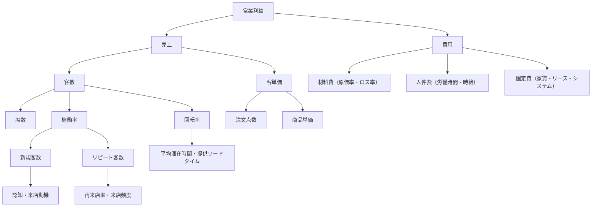
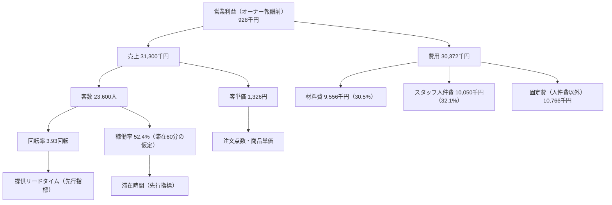

# 第19章 KPIとデータ分析

## 19.1 この章で扱うこと

ここまでの章で、売上の分解、材料費と人件費、固定費、損益分岐点、キャッシュフロー、法規と運営を個別に扱いました。この章では、それらを**日々の判断に使える数字の体系**にまとめます。扱うのは、KPIの条件、指標の木、先行指標と遅行指標、計測設計、データの持ち方、指標定義の固定、目標の決め方、そして数字を読むときに落ちやすい罠です。KPIは、指標を作ること自体が目的ではありません。**判断を変えるために存在します。**

## 19.2 学習目標

- KPIの3つの条件（測れる・動かせる・判断につながる）で、自店の指標を選別できる。
- 指標を木構造に並べ、上位の悪化から下位の原因をたどれる。
- 先行指標と遅行指標を区別し、先行指標が本当に売上を予測するかを数か月分のデータで検証できる。
- 指標定義の台帳を作り、分母の違う指標を同じ名前で混ぜない運用を設計できる。
- 計測の仕組みを「誰が・いつ・どの形式で」記録する形に落とし、POSなどのデータを自店に引き上げる方法を説明できる。

## 19.3 KPIとは何か — 選ぶ3つの条件

**KPI**（Key Performance Indicator、重要業績評価指標）とは、経営の状態を測り、判断につなげるために**選んだ少数の指標**です。「重要業績評価指標」という訳語のとおり、評価と行動につながるものだけを指します。指標は無数に作れますが、KPIは絞ります。

指標をKPIとして採用するには、次の3つを満たす必要があります。

| 条件 | 内容 | 満たさない例 |
| --- | --- | --- |
| 測れる | 毎回同じ定義で計測できる | 「なんとなく賑わっている」 |
| 動かせる | 自分の施策で値が変わる | 天気、景気（動かせないので前提条件として扱う） |
| 判断につながる | 値が悪いときに具体的な行動が決まる | 「満足度」（行動に結びつかない） |

「動かせない指標」はKPIではなく**前提条件**として扱います。天候はKPIにせず、「雨天日の稼働率」のように**条件を固定した指標**として測ります。条件で切ると、比較する相手が同じ条件になり、判断が安定します。

3つの条件のうち、最も見落とされやすいのが「判断につながる」です。指標を見て「で、何をするのか」が決まらないなら、その指標は**記録するだけの数字**です。記録は残しても構いませんが、毎日見る必要はありません。

たとえば「提供リードタイム」（注文を受けてから料理が出るまでの時間）は、悪化したときに「仕込みを前倒しする」「ピークの人員を1人増やす」「メニューを絞る」という行動が決まるのでKPIになります。「顧客満足度」は、下がったときに何をするかが決まらないため、単独ではKPIになりません。満足度を測るなら「リピート率」「クレーム件数」「食べ残しの量」のように、行動につながる形に翻訳します。

## 19.4 指標の木構造

飲食店の指標は、上位（結果）から下位（原因）へ木構造に並べられます。**下位を動かすと上位が動く**関係です。



この図は、営業利益から下位の指標へ分解した構造です。上位が悪いときは、**下位のどこが悪いかを順に確認します**。売上が悪い → 客数か客単価か → 客数なら回転か稼働か → 稼働なら新規かリピートか。闇雲に「集客しよう」とするのではなく、木を下って原因を特定します。

> **注意**: 回転率と稼働率は、同じ「席の使われ方」を別の角度から見た値です。**掛け合わせて客数になる関係ではありません**（[第8章](08-kyaku-tanka-kaiten.md) 8.5）。図で並列に置いているのは、「どちらが課題か」を切り分けるためです。実際の客数は `席数 × 回転率`（人数ベース）で計算します。回転率は「何回転したか」、稼働率は「席時間のうち何割が埋まったか」で、滞在時間が変われば両者の関係も変わります。

この構造を使うと、**改善効果の大きさも計算できます**。数値は**説明用の仮置き**です。売上 3,000,000円、客数 2,000人、客単価 1,500円の店で、客数が10%増えて 2,200人になれば、客単価が同じなら売上は 2,200 × 1,500 = **3,300,000円**（+300,000円）。客単価が10%下がって 1,350円になれば、客数が同じなら 2,000 × 1,350 = **2,700,000円**（−300,000円）です。

同じ「10%」でも、掛け算の位置が違えば結果は同じ大きさで動きます。**だからこそ、木のどこを動かすかを先に決めます。** ただし実行の難しさは場所によって違います。席数を増やすには投資が必要で（[第20章](20-toshi-risk.md)）、客単価を上げるには価格と提案の見直しが要ります。木構造は「原因の候補を漏らさず並べる」道具であり、「動かしやすさ」は別に判断します。

## 19.5 遅行指標と先行指標

| 種類 | 意味 | 例 | 特徴 |
| --- | --- | --- | --- |
| 遅行指標 | 結果として後から分かる | 売上、営業利益、原価率 | 正確だが、対策が後手になる |
| 先行指標 | 将来の結果を予測する | 予約数、席稼働率、提供時間、リピート率 | 早く分かるが、売上との関係を検証する必要がある |

経営判断には先行指標が必要です。今月の売上（遅行）が悪いと分かった時点では、もう手遅れに近い。**予約数、稼働率、提供時間**といった先行指標を毎日見て、遅行指標の悪化を事前に防ぎます。

数値は**説明用の仮置き**です。ある日の目標売上が 150,000円、客単価が 1,500円なら、必要な客数は 150,000 ÷ 1,500 = **100人**です。昼の時点で予約が30組・60人入っていれば、残りは 100 − 60 = **40人**。この40人を当日客で埋められるかが、その日の判断になります。予約数は「まだ確定していない売上」であり、先行指標として使える形です。

先行指標は、**売上との関係を自分で確かめてから**使います。予約数が増えても売上に結びつかないなら、それは先行指標として機能していません。少なくとも数か月分、先行指標と売上の関係を並べて確認します。

| 先行指標が使える形 | 使えない形 |
| --- | --- |
| 予約人数 ÷ 客数（予約比率）が数か月安定している | 予約数と売上を並べただけで「関係がある」と判断する |
| 稼働率と翌週の売上が連動している | 稼働率を測り始めた月の1週間だけで判断する |
| 提供リードタイムの悪化が2週間後の客数減に先行する | 天候・季節の影響を除かずに相関を見る |

先行指標は、**条件を切って**検証します。「平日ランチ」「雨天日」「金曜夜」のように条件を固定すると、予約比率や稼働率の振れが小さくなり、予測に使えるようになります（19.12）。

## 19.6 主要KPIの一覧と見る頻度

| KPI | 定義 | 見る頻度 | 何を判断するか |
| --- | --- | --- | --- |
| 売上高 | 期間の売上 | 日次 | 全体の水準 |
| 客数 | 来店人数 | 日次 | 需要の量 |
| 客単価 | 売上 ÷ 客数 | 日次 | 1人あたりの消費 |
| 回転率 | 客数（人）÷ 席数 | 日次 | 席の使い回し効率 |
| 席稼働率 | 延べ使用席時間 ÷（席数 × 営業時間） | 日次 | 空席の多さ |
| 原価率 | 材料費 ÷ 売上 | 週次・月次 | 仕入れと価格の妥当性 |
| 人件費率 | 人件費 ÷ 売上 | 月次 | 人員配置の妥当性 |
| FL比率 |（材料費 + 人件費）÷ 売上 | 月次 | 店の体質 |
| 人時売上 | 売上 ÷ 総労働時間 | 月次 | 労働1時間あたりの生産性 |
| 提供リードタイム | 注文から提供までの時間 | 日次 | オペレーションの詰まり |
| 離脱率 | 待ち列から離脱した数 ÷ 並んだ数 | 週次 | 機会損失 |
| リピート率 | 再訪客 ÷ 初回客 | 月次 | 顧客の定着 |
| ロス率 | 廃棄額 ÷ 仕入額 | 週次 | 仕込み精度 |

すべてを毎日見る必要はありません。**日次で見るのは売上・客数・客単価・稼働率の4つ**、月次で原価率・人件費率・FL比率、という分担が現実的です。人時売上とリピート率は月次に加えます（[第4章](04-jinken-hi-seisansei.md) 4.5、[第15章](15-shukyaku.md)）。

定義は[第3章](03-zairyo-hi-genka.md)、[第4章](04-jinken-hi-seisansei.md)、[第8章](08-kyaku-tanka-kaiten.md)で式を示したものと同じです。**定義を章ごとに変えないこと**が、指標を比較できる条件になります。特に「客数」は、組数（何組来たか）と人数（何人来たか）のどちらを指すかで値が倍近く変わります。本資料では人数と組数を区別し、**回転率は人数ベース（客数 ÷ 席数）**で計算します。組数ベースで記録する場合は「組回転率」と呼び、人数基準と混ぜないでください。

## 19.7 指標定義の固定 — 同じ名前で違う分母を使わない

指標は、**定義が固定されて初めて指標になります**。ところが現場では、同じ「客単価」という言葉で違う計算をしていることがよくあります。営業は「売上 ÷ 組数」で見ており、本部の集計は「売上 ÷ 人数」で見ている、という状態です。この状態では、会議で数字を並べても議論がかみ合いません。

### 定義台帳を作る

**定義台帳**（メトリクス辞書、指標辞書とも呼びます）とは、指標ごとに計算方法と前提を1か所に書き留めた文書です。指標を増やすたびに1行追加します。表計算ソフトの1シートでも、ノート1ページでも構いません。

| 項目 | 記入例（客単価） |
| --- | --- |
| 指標名（一意な名前） | 客単価_人数ベース |
| 何を判断するか | 1人あたりの消費。メニュー構成と価格の妥当性 |
| 分子 | 売上高（税込。テイクアウトを含む） |
| 分母 | 客数（人数。組数ではない） |
| 期間 | 会計月度（毎月1日〜末日） |
| 対象条件 | 店内飲食とテイクアウトを含む。取消は除く |
| データ源 | POSの日次集計（伝票明細） |
| 記録者・確定時刻 | 閉店後、オーナーが確定 |
| 丸め | 円未満は四捨五入。率は小数第1位まで |
| 改訂履歴 | 2026-04-01 改定（テイクアウトを含める運用に変更） |

**指標名に分母を書いてしまう**のが、最も簡単で効果的な対策です。「客単価_人数ベース」「稼働率_席時間ベース」のように名前へ条件を入れれば、分母の違う指標が同じ名前で流通しません。

### 分母が変わると値はどう変わるか

数値は**説明用の仮置き**です。年間売上 31,300,000円、客数 23,600人、1組あたりの人数を1.8人とすると、組数は 23,600 ÷ 1.8 ≒ 13,111組です。

```
客単価（人数ベース）= 31,300,000円 ÷ 23,600人 = 1,326.27... → 1,326円
組単価（組数ベース）  = 31,300,000円 ÷ 13,111組 = 2,387.30... → 2,387円
```

同じ売上と同じ来店を、**1.8倍違う数字**で語ることになります。「客単価が2,400円」と言われたら、まず分母を確認してください。

### 定義が揺れやすい指標

| 指標 | 揺れる点 | 決めておくこと |
| --- | --- | --- |
| 客単価 | 分母が人数か組数か | 人数ベースを正式とし、組数は「組単価」と呼ぶ |
| 席稼働率 | 延べ使用席時間をどう測るか（入店・退店時刻か、滞在時間の仮定か） | 実測か仮定かを明記する。仮定なら固定した分数を書く |
| 回転率 | 人数ベースか組数ベースか。1日あたりか期間合計か | 人数ベース・1日あたりを正式とする |
| 人時売上 | 総労働時間に準備・後片付け・仕込みを含むか | 含める範囲を書き、変更時は履歴に残す（[第4章](04-jinken-hi-seisansei.md) 4.3） |
| 原価率 | 容器・決済手数料・ロスを含むか | 含める費目の一覧を書く（[第3章](03-zairyo-hi-genka.md)） |
| リピート率 | 期間内の再訪か、生涯の再訪か。会員限定か全客か | 識別方法（会員・予約・レシート）を書く |
| ロス率 | 分母が仕入額か使用量か | 分母を明記する（[第16章](16-shiire-zaiko.md)） |

数値は**ケースの設計値**（席数20席、1日の営業時間7.5時間＝450分、客数23,600人）です。席稼働率を、滞在時間60分と仮定した場合と70分と仮定した場合で比べます。

```
延べ使用席時間（60分仮定） = 23,600人 × 60分 = 1,416,000席分
延べ使用席時間（70分仮定） = 23,600人 × 70分 = 1,652,000席分
席時間の総量 = 20席 × 450分 × 300日 = 2,700,000席分

稼働率（60分仮定） = 1,416,000 ÷ 2,700,000 = 52.4%
稼働率（70分仮定） = 1,652,000 ÷ 2,700,000 = 61.2%
```

**同じ店の同じ1年でも、仮定を10分変えるだけで稼働率は8.8ポイント動きます。** だから稼働率は「実測しているのか、仮定で計算しているのか」を必ず添えます。実測するには席管理（入店・退店の記録）が必要で、それが無い段階では「滞在時間60分の仮定による稼働率」と明記して運用します。

### 定義を変えたときの管理

定義を変えること自体は問題ありません。問題は、**変えたことを記録せずに過去と比較する**ことです。

| 日付 | 指標 | 変更前 | 変更後 | 理由 | 過去データの扱い |
| --- | --- | --- | --- | --- | --- |
| 2026-04-01 | 原価率 | 食材費のみ | 食材費 + 容器費 | テイクアウト開始で実態に合わせる | 4月以降のみ新定義。3月以前は旧定義と注記 |
| 2026-07-01 | 席稼働率 | 滞在60分の仮定 | 席管理システムの実測 | 実測できるようになった | 7月以降のみ実測。比較時は注記 |

数値は**説明用の仮置き**です。原価率が30.5%から32.0%に跳ねた月があり、中身を確認したら容器費を分母に含める変更が原因だった、という例を考えます。このとき「原価率が1.5ポイント悪化した」と報告すると、現場は食材の使い方を見直してしまいます。**原因は定義変更であり、実態は変わっていない**からです。

対策は3つです。

1. **変更した日と理由を記録する**（上の表）。
2. **新旧の定義で同じ月を二重に計算し、差を把握する**（1か月だけでも両方出す）。
3. **比較できない期間を明示する**（グラフに縦線を引き、「定義変更」と注記する）。

## 19.8 計測設計 — 何を、いつ、誰が、どの形式で

指標は、測る仕組みがなければ存在しません。**計測設計**とは、記録の対象・時刻・担当・形式・集約先を決めることです。

| 問い | 決めること | 記入例 |
| --- | --- | --- |
| 何を | 指標と、その元になる数値 | 売上、客数（人数）、組数、退店時刻 |
| いつ | 記録する時刻と締めの単位 | 閉店後15分以内に日次を締める。月次は翌営業日 |
| 誰が | 役割としての担当者と代行 | 閉店担当が記録。休みの日は店長が代行 |
| どこで | 記録する場所（1か所に集約） | 表計算の日次シート1枚。紙は使わない |
| どの形式で | 単位・桁・コード | 円は整数、人数は整数、時刻は24時間表記 |
| なぜ | その指標で何を判断するか | 稼働率 → シフトと席配置の判断 |

「誰が」を**役割**で決めるのが要点です。個人名で決めると、その人が休んだ日に記録が止まります。役割で決め、代行者を決め、記録の有無を週次で確認します。

### 記録の頻度と締め

| 頻度 | 記録するもの | 締めるタイミング | 使う判断 |
| --- | --- | --- | --- |
| 日次 | 売上、客数、組数、客単価、稼働率、提供リードタイム | 閉店後 | 翌日のシフト、仕込み量、売り切れ時刻 |
| 週次 | 原価率、ロス率、離脱率、予約比率 | 週の最終営業日の翌日 | 仕入れ量、メニューの入替 |
| 月次 | 人件費率、FL比率、人時売上、リピート率 | 翌月5営業日以内 | 価格、人員計画、目標の見直し |

### 手作業からシステムへ、段階を踏む

| 段階 | 方法 | 精度 | 費用 | 向いている状況 |
| --- | --- | --- | --- | --- |
| 1. 手作業 | 紙に記録し、表計算に入力 | 低〜中 | 低 | 開業直後。まず現状値を知りたい |
| 2. 表計算 | 日次シートに集約し、式で指標を計算 | 中 | 低 | 指標の定義を固める段階 |
| 3. POS・レジ | 売上・客数・商品別の明細が残る | 中〜高 | 中 | 日次で見る指標が固まった段階 |
| 4. 席管理 | 稼働率・滞在時間を実測 | 高 | 中〜高 | 回転と待ちの改善を進める段階 |
| 5. 統合 | 複数のシステムを1つの表に統合 | 高 | 高 | 判断の数が多く、手作業が追いつかない段階 |

**最初から高精度を目指さない**のが原則です。手作業で1〜2週間測れば、現状値の桁は分かります。そのうえで、判断に必要な指標だけを自動化します。順序は、①手作業で2週間記録する、②表計算で集計する、③判断に必要な指標だけをシステム化する、です。いきなりシステムを入れると、**測る前に設計が固まり**、必要な指標が抜けたまま運用が始まります。

### 自動化は人件費の削減では正当化できないことが多い

数値は**説明用の仮置き**です。日次の記録に1日15分かかっているとします。年間300日営業なら、

```
記録の手間 = 15分 × 300日 = 4,500分 = 75時間/年
人件費換算 = 75時間 × 1,500円/時間 = 112,500円/年
```

月額5,000円のシステム（年60,000円）を入れても、記録が半分になるだけなら削減は 56,250円/年で、費用60,000円を下回ります。**「人件費が浮くから導入する」は、この規模では成立しません。** 判断の根拠は、精度（実測できる）、速度（翌朝には見られる）、ミスの削減（転記間違いがなくなる）に置きます。

### 記録を途切れさせない

- **記録の有無を週次で確認する。** 空欄があれば理由を書き、埋められない日は「欠測」と明示する。
- **1週間の欠測を許容する設計にする。** 完全な連続記録を前提にすると、1日休んだ時点で全体が使えなくなる。
- **締めの時刻を固定する。** 「閉店後15分」など、行動に紐づける。
- **記録の担当を2人にする。** 役割で決め、代行者を決める。

### 検算（突合）を必ず入れる

記録した数字が正しいかを、別の数字と突き合わせます。

| 突合する組み合わせ | 一致しないときに疑うこと |
| --- | --- |
| POSの売上合計 と レジ締めの現金 + カード + QR | 取消・打ち間違い・釣銭誤差 |
| カード売上 と 決済会社の入金明細 | 入金サイトのずれ、手数料の控除（[第7章](07-cashflow.md) 7.6） |
| 材料費（月次） と 棚卸しの増減 + 仕入れ額 | 棚卸しの漏れ、私的消費、ロス（[第16章](16-shiire-zaiko.md)） |
| 人件費 と 勤怠の総労働時間 × 実質時間単価 | 残業の計上漏れ、社会保険料の範囲（[第4章](04-jinken-hi-seisansei.md)） |
| 客数 と 組数 × 1組あたり人数 | 人数の数え漏れ（大人・子どもの扱い） |

## 19.9 データの持ち方 — POSのデータをどう吸い上げるか

指標を作るには、元になるデータが必要です。POS（販売時点情報管理）レジを使うと、取引の明細が残ります。ここでは、そのデータを**自店のものとして持ち出せるか**という観点で整理します。

### データの粒度

| 粒度 | 中身 | 何に使うか |
| --- | --- | --- |
| 取引（伝票） | 1会計の合計金額 | 売上、客単価、決済手段別の構成 |
| 明細（商品） | 商品ごとの数量・単価・金額 | メニュー別の販売数、粗利、廃番判断 |
| 会計種別 | 店内飲食／テイクアウト／取消 | 売上経路の分解（部分最適の検出） |
| 人数・組数 | 1組あたりの人数 | 客単価の分母、回転率 |
| 席・時刻 | 席番号、入店・退店時刻 | 稼働率、滞在時間、時間帯別の売上 |
| 決済 | 現金／カード／QR／売掛 | 入金サイトと手数料（[第7章](07-cashflow.md)） |

**明細レベルが必要**なのは、メニュー別の判断をするときです。合計金額だけでは、どの商品が売れて、どれが利益を生んでいるかが分かりません。

### 吸い上げる方法

| 方法 | 長所 | 短所 | 向く段階 |
| --- | --- | --- | --- |
| CSVの手動出力 | 追加費用がない。項目を選べる | 手作業。出力項目が毎回同じとは限らない | まず分析を始める段階 |
| API・定期連携 | 自動で揃う。日次で同じ形になる | 初期設定が必要。仕様変更の影響を受ける | 毎日見る段階 |
| 管理画面のレポート | すぐ見られる | 集計済みで明細が取れないことがある | 単発の確認 |
| ベンダーの分析機能 | 手間がかからない | 定義を変えられない。外に持ち出せない | 補助的な利用 |

### エクスポート仕様として決めておく項目

契約や出力設定のときに、次の項目が**明細レベルで出せるか**を確認します。

1. 取引ID（伝票番号）
2. 取引日時（年月日・時刻）
3. 商品ID・商品名
4. 数量・単価・金額（税抜・税込の区別）
5. 税率区分（[第18章](18-kaikei-zeimu.md)）
6. 決済手段と決済額
7. 会計種別（店内／持ち帰り／取消）
8. 人数・組数
9. 席番号・テーブル番号
10. 入店時刻・退店時刻（席管理と連携している場合）
11. 割引・サービス・クーポンの額
12. 担当者（記録している場合）

### ベンダーロックインを避ける

**ベンダーロックイン**とは、特定の事業者の製品に依存し、他へ移れなくなる状態です。POSは、導入時に作った過去データが移行できないと、乗り換えのたびに分析が途切れます。契約前に、次を確認します。

| 確認事項 | 確認する内容 |
| --- | --- |
| 全データのエクスポート | 明細レベルのCSVまたはAPI出力が可能か |
| 過去分の範囲 | 契約期間の全期間か、直近1年のみか |
| 費用 | エクスポートに手数料がかかるか |
| 形式 | CSV等の汎用形式か、独自形式か |
| 項目 | 上の12項目が含まれるか |
| 解約後の扱い | 解約後いつまでデータを保持し、いつ削除するか |
| 定義の変更 | 集計定義を自分で変えられるか |

「便利な機能があるか」より、**データを持ち出せるか**を先に確認します。機能は乗り換えで手に入りますが、失った過去データは戻りません。

### 保存・バックアップ・名寄せ

- **生データを残す。** 集計済みの表だけを保存すると、定義を変えたときに再計算できません。
- **集計手順を記録する。** どのファイルのどの列を、どう足したかを1枚に書きます。
- **定義台帳とセットで保管する。** 数字と定義が離れると、後から意味が分からなくなります。
- **バックアップを取る。** 手元の表計算とPOSのクラウド、両方の保存先を決めます。端末故障で失う前提で設計します。
- **帳簿書類の保存期間**は税務上の定めがあります。法人と個人事業主で扱いが異なるため、具体的な年数は[第18章](18-kaikei-zeimu.md)と顧問税理士に確認してください（本節では数値を示しません）。

### 顧客データの扱い

予約・会員のデータは**個人情報**であり、個人情報保護法の規律に服します。利用目的を特定して伝え、目的外に使わない、第三者に渡さない、安全管理の措置を取る、が基本です。具体的な義務の範囲は一次資料で確認してください（本資料では条文を引用していません）。

## 19.10 FL比率を目標として使うときの注意

**FL比率**（Food & Labor cost ratio）は、材料費と人件費の合計を売上で割った値です。飲食店の体質を1つの数字で見られるため、業界でよく使われます。

```
FL比率 =（材料費 + 人件費）÷ 売上 × 100
```

数値は**説明用の仮置き**です。売上 3,000,000円の月に、材料費 1,020,000円（34.0%）、人件費 900,000円（30.0%）、家賃 300,000円（10.0%）、その他経費 450,000円（15.0%）だったとします。

| 項目 | 金額 | 売上比 |
| --- | --- | --- |
| 売上 | 3,000,000円 | 100.0% |
| 材料費 | 1,020,000円 | 34.0% |
| 人件費 | 900,000円 | 30.0% |
| FL比率の対象 | 1,920,000円 | 64.0% |
| 家賃 | 300,000円 | 10.0% |
| その他経費 | 450,000円 | 15.0% |
| 営業利益 | 330,000円 | 11.0% |

検算: 1,020,000 + 900,000 = 1,920,000（FL比率 64.0%）。3,000,000 −（1,920,000 + 300,000 + 450,000）= 330,000。330,000 ÷ 3,000,000 = 11.0%。

ただし、FL比率には**構造的な弱点**があります。

1. **家賃を含まない。** 家賃が高い店はFL比率が良くても利益が出ません。上の例でも、家賃10%・その他15%を引かなければ利益は見えません。
2. **売上の水準を無視する。** 売上が小さい店は人件費率が高く出ます。同じ人員でも売上が2倍なら人件費率は半分になります。
3. **削れば下がるが、売上も下がる。** 材料費を削って品質を落とすと、翌月の売上が落ちてFL比率は悪化します。

したがってFL比率は「**単独の目標値**」ではなく「**構造を把握するための入口**」として使います。FL比率が悪いと分かったら、材料費率と人件費率に分解し、さらに売上（客数・客単価）の水準と突き合わせます。

## 19.11 目標値の決め方

目標値を決める方法は3つあり、組み合わせて使います。

| 方法 | 内容 | 長所 | 短所 |
| --- | --- | --- | --- |
| 自店の過去実績 | 先月・昨年同月との比較 | 現実的。改善幅が分かる | 過去が低いと目標も低くなる |
| 損益分岐点からの逆算 | 赤字にならない最低ライン | 根拠が明確 | 最低ラインであり目標ではない |
| 外部ベンチマーク | 業界平均、同業態の値 | 相対的な位置が分かる | 条件（立地・規模）が違う |

**推奨する順序**は、①損益分岐点で下限を決める、②自店の過去実績で改善幅を決める、③外部ベンチマークで妥当性を確認する、です。外部ベンチマークは方向性の確認に留めます。立地・規模・業態が違えば、同じ数値でも意味が変わります。

目標を置く前に必要なのが**現状値（ベースライン）**です。現状値とは、施策を始める前の、その指標の実際の値です。

**現状値を計測していない指標に目標を置くと、達成したかどうかを判定できません。** 「客単価を上げる」という目標は、現在の客単価が分からなければ達成を確認できません。順序は、①1〜2週間測る、②現状値を確定する、③目標を置く、です。

### 目標は「水準・期限・責任・判定」で書く

| 要素 | 悪い例 | 良い例 |
| --- | --- | --- |
| 水準 | 客単価を上げる | 客単価_人数ベースを1,400円にする |
| 期限 | なるべく早く | 今年度の第3四半期（10〜12月）の平均で |
| 責任 | 全員で | メニュー改定はオーナー、提案はホール責任者 |
| 判定 | 達成したらしい | 月末のPOS集計値で判定。未達なら翌月の打ち手を決める |

### 損益分岐点客数に置き換える

売上ではなく客数で目標を持ちたい場合は、損益分岐点を客数に換算します（[第6章](06-soneki-bunkiten.md)）。

```
損益分岐点売上 = 固定費 ÷ 限界利益率
損益分岐点客数 = 損益分岐点売上 ÷ 客単価
```

数値は**説明用の仮置き**です。19.10の表をそのまま使います（売上3,000,000円、材料費34.0%、人件費30.0%、家賃10.0%、その他経費15.0%）。材料費34.0%と、その他経費のうち売上に比例する6.0%を変動費とすると、変動費率は40.0%、限界利益率は1 − 0.40 = 0.60です。固定費は、人件費900,000円 + 家賃300,000円 + その他経費の固定分270,000円 = **1,470,000円**になります。

- 損益分岐点売上 = 1,470,000 ÷ 0.60 = **2,450,000円**
- 損益分岐点客数 = 2,450,000 ÷ 1,500 = **1,634人/月**（1,633.3人を切り上げ）
- 月20営業日なら 1,634 ÷ 20 = **82人/日**（81.7人を切り上げ）

検算: 現状の売上3,000,000円では、限界利益 3,000,000 × 0.60 = 1,800,000円、固定費1,470,000円を引いて営業利益 **330,000円**（19.10の表と一致）。

「1日82人を下回ると赤字」という形にすると、現場でも目標として共有できます。

### 目標を日次・週次に分解する

月次の目標は、そのままだと現場で使えません。**日次・週次に分解**します。

```
日次目標売上 = 月次目標売上 ÷ 営業日数
日次目標客数 = 日次目標売上 ÷ 客単価（切り上げ）
```

数値は**説明用の仮置き**です。月次目標3,000,000円、営業日25日、客単価1,500円なら、日次目標は 3,000,000 ÷ 25 = **120,000円**、必要客数は 120,000 ÷ 1,500 = **80人**です。ここに「昼50人・夜30人」のように時間帯へ配分すると、シフトと仕込みの判断に使えます。

## 19.12 数字の落とし穴

| 落とし穴 | 内容 | 対策 |
| --- | --- | --- |
| 分母の定義が揺れる | 「客数」が組数か人数かで値が変わる | 定義台帳に固定する。指標名に分母を書く（19.7） |
| 平均値の罠 | 平均滞在時間40分でも、20分と60分に二分されているかもしれない | 分布を見る。中央値も確認する |
| 外れ値 | 1日の異常値で月平均が動く | 中央値と、外れ値を除いた平均を併記する |
| 季節性の無視 | 12月と2月を単純比較する | 前年同月比で見る |
| 期間の混在 | 週次と月次を混ぜて比較する | 比較する期間を揃える |
| 部分最適 | 一部の指標だけを最適化して全体が悪化する | 上位の指標（営業利益）も併記する |
| 定義の途中変更 | 集計方法を変えた月に値が跳ねる | 変更した日と理由を記録に残す |
| 目標のための数字 | 目標達成のために記録の付け方を変える | 集計方法の変更履歴を残し、第三者と共有する |
| 相関と因果の混同 | アイスコーヒーの売上と客数が動くので「アイスが客を呼ぶ」と結論づける | 気温・季節という共通の原因を疑う |
| 標本が小さい | 週1回の会計で出た比率で方針を決める | 分母が30未満の比率は判断に使わない |

**部分最適**とは、一部分だけを見て最適化した結果、全体としては悪くなることです。複数の売上経路（店内と持ち帰りなど）がある場合に起こります。

数値は**説明用の仮置き**です。ある店舗が自店の売上を伸ばすために待ち時間の長い客を優先し、結果として別の売上経路（テイクアウト、共用スペース）の客を逃したとします。片方の売上が+300,000円、他の経路が−400,000円なら、全体では **−100,000円**です。売上の合計と、営業利益の両方を見る必要があります。

**外れ値**の例も数値で確認します。**説明用の仮置き**として、6日間の稼働率が 40%、42%、45%、44%、90%、43% だったとします（90%の日は近隣のイベント日）。

```
単純平均 =（40 + 42 + 45 + 44 + 90 + 43）÷ 6 = 304 ÷ 6 = 50.7%
中央値   =（43 + 44）÷ 2 = 43.5%
イベント日を除いた平均 =（40 + 42 + 45 + 44 + 43）÷ 5 = 214 ÷ 5 = 42.8%
```

単純平均の50.7%を見て「席は半分埋まっている」と判断すると、通常日の実態（約43%）を8ポイント近く過大に見積もります。**中央値か、条件別の平均**を使います。

**相関と因果**は、施策の評価で最も間違えやすい点です。売上が伸びた月に新メニューを出していたとしても、その月が12月（繁忙期）なら、売上の増加は季節によるものかもしれません。因果を確かめるには、①同時期に他の変更がなかったか、②前年同月と比べて伸びたか、③伸びが新メニューの注文数と連動しているか、を確認します。

## 19.13 複数の売上経路・複数の拠点を持つ場合

店舗が複数ある場合や、店内と持ち帰りなど複数の売上経路がある場合は、KPIの設計に追加の論点が出ます。

1. **拠点別KPIと全体KPIを分ける。** 各拠点の売上・客数・原価率に加えて、合算の売上・営業利益・FL比率を持ちます。片方の改善が他方の悪化で相殺される「共食い」は、合算指標でしか見つかりません（[第15章](15-shukyaku.md)）。
2. **共用の席・時間帯の指標は条件別に分ける。** 天候や時間帯の影響を強く受ける場所は、平均値だけでは判断できません。「雨天日」「平日夜」のように条件を固定した指標を併記します。
3. **複数の拠点を使う客の比率を測る。** 1組の客が複数の拠点を使うことがあります。この比率は、拠点の配置や導線の設計が機能しているかを示します。定義を自分で決めて文書化します（例: 同一会計または同一予約で2つ以上の拠点を使った組数 ÷ 総組数）。
4. **現状値の取得を先に行う。** 拠点別の数値は、開業前は存在しません。開業後1〜2週間は記録の取得を優先し、目標値の設定はその後に行います。

いずれの場合も、**上位の指標（営業利益）と下位の指標（拠点別の客数など）を1つの表にまとめます。** 拠点別だけを見る運用にすると、全体の悪化に気づけません。

## 19.14 ケースの店では

連続ケース「食堂つきかげ」の設定は [OUTLINE.md](../OUTLINE.md) の3章にあります。以下は**ケースの設計値**にもとづく計算であり、実在の店舗の実績ではありません。営業日数は[第22章](22-case.md)と同じ300日（月25日）とします。

### 年間のKPIを計算する

| KPI | 計算 | 値 |
| --- | --- | --- |
| 年間売上 | 月次12か月の合計 | 31,300,000円 |
| 年間客数 | 月次12か月の合計 | 23,600人 |
| 客単価（人数ベース） | 31,300,000 ÷ 23,600 | 1,326円 |
| 1日平均客数 | 23,600 ÷ 300日 | 78.7人 |
| 回転率（人数ベース） | 78.7 ÷ 20席 | 3.93回転 |
| 席稼働率（滞在60分の仮定） | 3.93 × 60 ÷ 450分 | 52.4% |
| 材料費率 | 9,556,000 ÷ 31,300,000 | 30.5% |
| スタッフ人件費率 | 10,050,000 ÷ 31,300,000 | 32.1% |
| FL比率 |（9,556,000 + 10,050,000）÷ 31,300,000 | 62.6% |
| 総労働時間 | 10,050,000 ÷ 1,500円/時間 | 6,700時間 |
| 人時売上 | 31,300,000 ÷ 6,700 | 4,672円/時間 |

検算を3つ示します。

```
【客単価】31,300,000 ÷ 23,600 = 1,326.27... → 1,326円
【回転率】23,600 ÷ 300日 = 78.67人/日 → 78.7人/日 ÷ 20席 = 3.935 → 3.93回転
【稼働率】延べ使用席時間 = 23,600人 × 60分 = 1,416,000席分
        席時間の総量 = 20席 × 450分 × 300日 = 2,700,000席分
        1,416,000 ÷ 2,700,000 = 0.5244... → 52.4%
```

人時売上と人件費率の関係も確かめます（[第4章](04-jinken-hi-seisansei.md) 4.5.3）。

```
人件費率 = 実質時間単価 ÷ 人時売上 = 1,500円 ÷ 4,672円 = 0.3210... → 32.1%
```

表の32.1%と一致します。**人件費率の悪化が、時給の上昇によるものか、人時売上の低下によるものか**を切り分けられる形になっていることが分かります。

### 稼働率の定義が値を作る

ケースの稼働率52.4%は、**滞在時間を60分と仮定した値**です。実際の滞在時間が70分なら、

```
23,600人 × 70分 = 1,652,000席分
1,652,000 ÷ 2,700,000 = 0.6118... → 61.2%
```

と8.8ポイント変わります（19.7）。したがって、ケースの稼働率を使うときは「滞在時間60分の仮定による値」と添えます。実測するには席管理（入店・退店の記録）が必要です。**稼働率を目標にする前に、測り方を固定する**のが順序です。

### 指標の木に当てはめる



上の図は、ケースの1年目を指標の木に当てはめたものです。**売上に対して固定費が重い**構造が見えます（家賃・共益費だけで売上比20.3%）。固定費（人件費以外）10,766千円の内訳は、家賃・共益費6,360千円、水道光熱費1,080千円、その他経費（リース・システム・広告・保険・消耗品・修繕）1,200千円、決済手数料・容器等626千円（売上の2%という説明用の仮置き）、減価償却費1,500千円です（[第7章](07-cashflow.md) 7.13の積み上げ。物件系の固定費は年8,640千円＝月720,000円）。オーナー報酬3,600千円は営業利益の下に置く項目なので、この図には入れていません。この10,766千円にオーナー報酬3,600千円を加えた**14,366千円**が、損益分岐点の計算で使う固定費24,416千円からスタッフ人件費10,050千円を除いた額です（24,416 − 10,050 = 14,366）。オーナー報酬を引くと営業利益は 928 − 3,600 = **▲2,672千円**になります。稼働率52.4%は「席の半分は空いている」ことを示しますが、それは**需要の上限ではなく、時間帯の偏り**の可能性があります。時間帯別に割ると、昼のピークは満席で夜が空いている、という形がよくあります（[第8章](08-kyaku-tanka-kaiten.md) 8.11）。

### 目標と先行指標を置く

年間の損益分岐点は、固定費24,416千円 ÷ 限界利益率69.5% = **35,131千円**です（[OUTLINE.md](../OUTLINE.md) 3章、[第22章](22-case.md) 22.9と同じ定義）。固定費24,416千円は、スタッフ人件費10,050千円＋家賃・共益費6,360千円＋水道光熱費1,080千円＋その他経費1,200千円＋決済手数料・容器等626千円＋減価償却費1,500千円＋オーナー報酬3,600千円の合計です。材料費のみを変動費とし、決済手数料・容器等を固定費側に置くため、限界利益率は69.5%になります。**減価償却費とオーナー報酬を固定費に含めるかどうかで値は変わります**（[第6章](06-soneki-bunkiten.md) 6.12は両者を含めない定義で、月2,382,353円と試算しています）。**年間売上31,300千円はこれを下回る**ため、オーナー報酬を満額取る前提では安全余裕率は **▲12.2%**（マイナス）になります。1日の売上は 31,300,000 ÷ 300日 = **104,333円**、損益分岐点の1日あたりは 35,131,000 ÷ 300 = **117,103円**です。

```
【損益分岐点売上】24,416千円 ÷ 0.695 = 35,130.9... → 35,131千円（千円未満を四捨五入）
【損益分岐点客数（年間）】35,131,000円 ÷ 1,326円 = 26,494.7... → 26,494人/年（切り捨て）
【1日あたり】26,494人 ÷ 300日 = 88.31 → 88人/日（切り捨て）
【現状との差】88人 − 78.7人 = 9.3人/日（表示値どうしの差。切り捨て前の88.3人で計算すると9.6人）
```

**1日88人を下回ると赤字**という形になります。現状は78.7人なので、**1日あたり約9.3人足りません**。安全余裕率がマイナスというのは、この不足を表しています。

ただし、これはオーナー報酬3,600千円を満額取る前提の数字です。オーナー報酬を除いた固定費は 24,416 − 3,600 = 20,816千円で、損益分岐点は 20,816 ÷ 0.695 = 29,951千円、安全余裕率は4.3%、損益分岐点客数は 29,951,000 ÷ 1,326 = 22,587人/年（1日75人）です。現状はこれを上回り、営業利益（オーナー報酬前）は928千円（売上比3.0%）になります（[OUTLINE.md](../OUTLINE.md) 3章）。**損益分岐点を語るときは、オーナー報酬を固定費に含めたかどうかを必ず添えます。**含めれば赤字、除けば黒字で、同じ店の同じ年でも結論が変わります。

先行指標は、日次の4つ（売上・客数・客単価・稼働率）に加えて、**予約人数・提供リードタイム・ランチの売り切れ時刻**を置きます。12月を例にすると、月商3,400,000円 ÷ 25日 = **136,000円/日**、客単価1,545円なので必要な客数は 136,000 ÷ 1,545 = 88.03 → **89人/日**（切り上げ）です。昼の時点で予約が40人入っていれば、残りは49人。この49人を当日客で埋められるかが、その日の判断になります。

計測の設計（**説明用の仮置き**。ケースに定めがありません）は、次の形にします。

| 項目 | 設計 |
| --- | --- |
| 日次で見る指標 | 売上、客数（人数）、客単価、稼働率 |
| 記録する時刻 | 閉店後15分以内。月次は翌営業日 |
| 記録する人 | 閉店担当。休みの日はオーナーが代行 |
| 集約先 | 表計算の日次シート1枚。用紙は使わない |
| 形式 | 円は整数、人数は整数、時刻は24時間表記 |
| 突合 | POS売上とレジ現金 + カード + QR の一致を週次で確認 |
| 定義台帳 | 1枚。客単価・稼働率・人時売上の定義と改訂履歴を書く |
| 段階 | 1年目は表計算（段階2）。2年目にPOSのCSV取り込み、稼働率の実測は席管理の導入後 |

**最初からすべてを自動化しない**のが要点です。ケースの店は1年目に「日次4つ」を手作業と表計算で回し、2年目に明細レベルのCSVを取り込む、という順序を取ります。

## 19.15 よくある誤解

| 誤解 | 実際 |
| --- | --- |
| KPIは多いほど良い | 見る指標が増えると、どれも見なくなります。日次4つ、月次3つ程度に絞ります |
| 目標値は高いほど良い | 達成不能な目標は無視されます。損益分岐点と過去実績から逆算します |
| 業界平均と比べれば安心 | 立地・規模・業態が違えば比較になりません。方向性の確認に留めます |
| 数字が良ければ経営は健全 | キャッシュフローは別です。黒字でも資金ショートします（[第7章](07-cashflow.md)） |
| FL比率が低ければ利益が出る | 家賃を含まないため、FL比率が良くても利益が出ないことがあります |
| 先行指標を増やせば先手を打てる | 売上との関係を確かめていない先行指標は、判断を誤らせます |
| 目標を先に決めてから測ればよい | 現状値のない目標は達成判定ができません。測ってから決めます |
| 指標の定義は担当者が分かっていればよい | 担当者が代わると定義が変わります。台帳に書いて共有します |
| POSを入れれば数字は自動で正しくなる | 入力の運用（取消・人数・持ち帰りの区別）が決まらないと、自動化しても値は揺れます |
| 拠点別KPIが良ければ全体も良い | 合算で見ないと、拠点間の共食いによる全体悪化を見逃します |

## 19.16 この章の要点

- KPIの条件は**測れる・動かせる・判断につながる**の3つです。動かせないものは前提条件として扱い、条件を固定した指標として測ります。
- 指標は**木構造**で並べ、上位が悪いときに下位をたどって原因を特定します。木は原因の候補を漏らさず並べる道具で、動かしやすさは別に判断します。
- **先行指標**（予約数、稼働率、提供時間）を毎日見て、遅行指標（売上）の悪化を先に防ぎます。使う前に、売上との関係を数か月分で確かめます。
- 指標は**定義が固定されて初めて指標**になります。定義台帳に分子・分母・期間・条件・丸め・改訂履歴を書き、指標名に分母を入れます。
- 計測は**手作業から段階的に**作り、日次4つ・月次3つに絞ります。POSなどのデータは、明細レベルで**持ち出せるか**を契約前に確認します。

## 19.17 自店で確認すること

- [ ] 日次で見る指標を4つ以内に絞り、紙または表計算で毎日記録している（欠測した日の扱いも決めている）
- [ ] 各指標の定義（分母・分子・期間）を1枚の台帳に固定し、「客数」が組数か人数かを全員が同じ意味で使っている
- [ ] 稼働率が実測か仮定かを明記し、仮定なら滞在時間の分数を書いている
- [ ] 先行指標を3つ以内選び、売上との関係を数か月分は確認している
- [ ] FL比率を材料費率と人件費率に分解して見ている
- [ ] 損益分岐点売上と損益分岐点客数を計算し、現場と共有している
- [ ] 目標を「水準・期限・責任・判定」の4要素で書き、現状値を測ってから設定している
- [ ] POS・決済・予約のデータを、明細レベルでCSVまたはAPIで持ち出せるか確認している

## 19.18 章末問題

### 問1 指標を計算し、定義の違いを確かめる（計算）

ある月の数字が次のとおりです。**説明用の仮置き**です。

| 項目 | 値 |
| --- | --- |
| 売上 | 2,400,000円 |
| 客数（人数） | 1,800人 |
| 組数 | 1,500組 |
| 席数 | 30席 |
| 営業日数 | 20日 |
| 1日の営業時間 | 10時間 |
| 延べ使用席時間 | 4,200席時間 |
| 材料費 | 720,000円 |
| 人件費 | 660,000円 |
| 総労働時間 | 480時間 |

1. 客単価（人数ベース）と組単価を求めてください。
2. 1日あたり客数、回転率（人数ベース）、席稼働率を求めてください。
3. FL比率と人時売上を求めてください。
4. 組数ベースで回転率を計算した場合の値と、人数ベースとの差を求めてください。
5. 回転率3.0と稼働率70%から、平均滞在時間を逆算してください。

**解答**

```
【1. 客単価と組単価】
客単価 = 2,400,000 ÷ 1,800 = 1,333.33... → 1,333円
組単価 = 2,400,000 ÷ 1,500 = 1,600円
※ 同じ売上でも、分母が違うと1,333円と1,600円になる

【2. 1日あたり客数・回転率・稼働率】
1日あたり客数 = 1,800 ÷ 20日 = 90人/日
回転率 = 90 ÷ 30席 = 3.0回転
席稼働率 = 4,200 ÷（30席 × 10時間 × 20日）= 4,200 ÷ 6,000 = 70.0%

【3. FL比率と人時売上】
FL比率 =（720,000 + 660,000）÷ 2,400,000 = 1,380,000 ÷ 2,400,000 = 57.5%
人時売上 = 2,400,000 ÷ 480 = 5,000円/時間

【4. 組数ベースの回転率】
組回転率 =（1,500 ÷ 20日）÷ 30席 = 75 ÷ 30 = 2.5回転
差 = 3.0 − 2.5 = 0.5回転（人数ベースのほうが1.2倍大きい）
※ 1組あたり 1,800 ÷ 1,500 = 1.2人なので、比は1.2倍になる

【5. 平均滞在時間の逆算】
稼働率 = 回転率 × 滞在時間 ÷ 営業時間
滞在時間 = 稼働率 × 営業時間 ÷ 回転率 = 0.70 × 10時間 ÷ 3.0 = 2.333...時間 ≒ 140分
検算: 90人 × 140分 = 12,600席分/日、1日の席時間 = 30席 × 600分 = 18,000席分
      12,600 ÷ 18,000 = 70.0%（一致）
```

**4が定義の問題です。** 同じ店の同じ月でも、組数ベースと人数ベースで回転率は1.2倍違います。どちらを使うかを決め、指標名に書いてください。

### 問2 指標定義の台帳を作る（記述）

「客単価を上げる」という目標を立てる前に、客単価と回転率について定義台帳に書くべき項目を挙げ、それぞれ何を書くかを説明してください。

**解答**

定義台帳には、少なくとも次の項目を書きます。

1. **指標名** — 分母を名前に含める（例: 客単価_人数ベース、回転率_人数ベース_日次）。
2. **何を判断するか** — 客単価なら「メニュー構成と価格の妥当性」、回転率なら「席の使い回しと提供の詰まり」。
3. **分子と分母** — 分子は売上高（税込か税抜かも書く）、分母は人数か組数か。
4. **期間** — 会計月度か、直近30日か、日次か。
5. **対象条件** — 店内飲食と持ち帰りの扱い、取消の扱い、子どもや同伴者の数え方。
6. **データ源** — POSの明細か、日次集計か、手作業の記録か。
7. **丸め** — 円未満の扱い、率の小数第何位までか。
8. **改訂履歴** — 変更した日・変更前・変更後・理由。

このうち**最も効くのは1と3**です。指標名に分母を書けば、分母の違う指標が同じ名前で流通しません。分母が変わると値は1.8倍規模で変わるため（19.7）、名前の段階で防ぐのが確実です。

### 問3 先行指標として使えるか（計算と判断）

3か月の予約人数と客数が次のとおりです。**説明用の仮置き**です。

| 月 | 予約人数 | 客数 | 予約比率 |
| --- | --- | --- | --- |
| 4月 | 600人 | 2,000人 | 30.0% |
| 5月 | 750人 | 2,200人 | 34.1% |
| 6月 | 600人 | 1,950人 | 30.8% |

1. 予約比率を検算してください。
2. 3か月の平均予約比率を求めてください。
3. 7月の予約が700人のとき、客数を予測してください。
4. この予約人数を先行指標として使ってよいか、判断と条件を述べてください。

**解答**

```
【1. 予約比率】
4月: 600 ÷ 2,000 = 30.0%
5月: 750 ÷ 2,200 = 34.09... → 34.1%
6月: 600 ÷ 1,950 = 30.77... → 30.8%

【2. 平均予約比率】
（30.0 + 34.1 + 30.8）÷ 3 = 94.9 ÷ 3 = 31.63... → 31.6%

【3. 7月の客数予測】
700人 ÷ 0.316 = 2,215.19... → 約2,215人
※ 予約比率が31.6%で安定していると仮定した場合
```

**4の判断**: 予約比率が30.0〜34.1%の範囲に収まっており、**条件付きで使えます**。ただし次の3つが条件です。

- **3か月では足りません。** 季節変動（12月・1月）を含む12か月分で確認します。
- **条件を切ります。** 曜日・天候・時間帯で予約比率が変わるなら、「平日」「休日」「雨天」に分けて比率を持ちます。
- **誤差を持って使います。** 予約比率の振れ幅は約4ポイント（30.0〜34.1%）あります。700人なら予測の幅は 700 ÷ 0.341 = 2,053人 〜 700 ÷ 0.300 = 2,333人です。**点の予測ではなく幅で持ち、幅の下限で仕込みとシフトを決めます。**

## 参考文献・出典

- 本章のKPI定義（回転率、稼働率、FL比率、人時売上、リピート率など）は、業界で一般的に使われる定義にもとづく**一般知識（未検証）**です。個別の式は[第3章](03-zairyo-hi-genka.md)・[第4章](04-jinken-hi-seisansei.md)・[第8章](08-kyaku-tanka-kaiten.md)で示しています。
- FL比率の業界目標値は、本章でも[第2章](02-soneki-keisansho.md)でも提示していません。業態・規模・地域で構造が異なり、単一の平均値を目標にすると判断を誤るためです。自店の数字で計算してください。
- 「日次4つ・月次3つ」という運用の分担、および19.8の段階表は実務上の目安であり、一次資料にもとづく値ではありません（**一般知識（未検証）**）。
- 指標定義の固定（定義台帳）の考え方は、データ管理・BI運用の一般論にもとづく**一般知識（未検証）**です。様式は自店で決めてください。
- POSデータの項目一覧（19.9）は、飲食店向けPOSで一般に扱われる項目を整理したもので、特定製品の仕様ではありません。実際の出力可否は契約先に確認してください。
- ベンダーロックイン、データのエクスポート条件は契約ごとに異なります。本章は確認すべき事項を示すもので、特定事業者の評価ではありません。
- 帳簿書類の保存期間は税務上の定めがあり、法人と個人事業主で扱いが異なります。**本章では年数を示していません**（[第18章](18-kaikei-zeimu.md)および顧問税理士に確認）。
- 個人情報の取扱いについては個人情報保護法の規律に服します。本章は条文を引用しておらず、**一次資料は未取得**です。具体的な義務は最新の一次資料で確認してください。
- 本章の数値例は、**ケースの設計値**（連続ケース「食堂つきかげ」の設定。[OUTLINE.md](../OUTLINE.md) 3章と[第22章](22-case.md) 22.10）または**説明用の仮置き**です。実在の店舗の実績ではありません。計算は本文中に式と途中の値を示しており、電卓で検算できます。
- ケースの営業日数300日（月25日）、滞在時間60分という前提は、OUTLINE.md に定めがないため**説明用の仮置き**です。営業日数と滞在時間が変われば、日商・必要客数・稼働率も変わります。滞在時間60分の仮定は[第22章](22-case.md) 22.10と同じ値を使っています。

前後の章: [第18章: 会計・税務・決済](18-kaikei-zeimu.md) ／ [第20章: 投資判断とリスク管理](20-toshi-risk.md)
