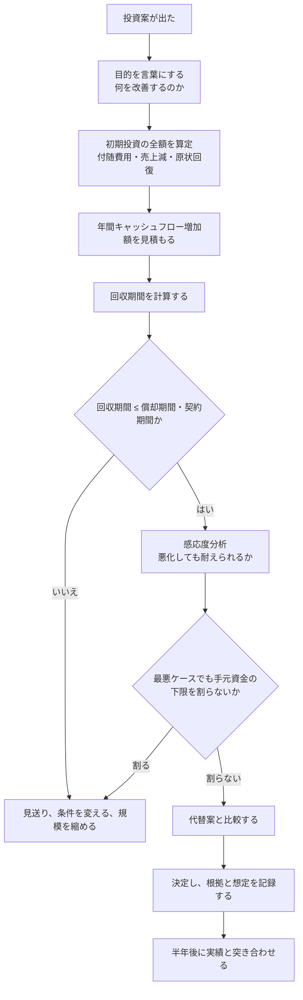

# 第20章 投資判断とリスク管理

## 20.1 この章で扱うこと

[第7章](07-cashflow.md)で投資回収期間の式を扱い、[第5章](05-koteihi-ricchi.md)で購入とリースの構造を扱いました。この章では、それらを**意思決定の手続き**にまとめます。扱うのは、投資回収期間の計算と限界、感応度分析、設備投資（購入・リース・補助金）の判断、改装・システム導入・出店の判断、リスクの一覧、事業継続計画、撤退判断、保険です。投資は「儲かりそうか」ではなく、**「悪くなったときに耐えられるか」**で判断します。

## 20.2 学習目標

- 投資回収期間を、付随費用を含めた初期投資額から計算し、償却期間・契約期間と比べて判断できる。
- 感応度分析を行い、売上・客単価・材料費率・固定費が動いたときに利益とキャッシュフローがどう変わるかを説明できる。
- 設備投資について、購入とリースを現金支出・固定費・総支払額の3点で比較し、減価償却と補助金の扱いを踏まえて判断できる。
- 自店のリスクを分類して一覧にし、兆候として見る指標と事前の打ち手を決められる。
- 事業継続計画（BCP）と撤退基準を、事が起きる前に文書として決めておける。

## 20.3 投資判断の手順 — 3点セットに4つを足す

投資判断の基本は、[第7章](07-cashflow.md) 7.10で示した3点セットです。

1. **初期投資額**（付随費用・改装中の売上減・原状回復費を含む）
2. **年間のキャッシュフロー増加額**（売上増ではなく**現金**の増加）
3. **回収期間**

この3点だけでは足りません。実際の判断では、次の4つを加えます。

4. **感応度**（前提が悪化したときに耐えられるか）
5. **資金繰りへの影響**（手元資金の下限を割らないか。[第7章](07-cashflow.md) 7.12）
6. **代替案との比較**（やらない、延期する、規模を小さくする）
7. **撤退条件**（どこまで悪化したら損切りするか。20.10）

手順として並べると、次の流れになります。



上の図は、投資案を検討してから決定し、事後に検証するまでの流れです。**「やらない」も選択肢**として並べます。投資をしない場合の損失（故障で止まる、機会を逃す）と比べて初めて、投資の意味が決まります。

### 決定を記録する

投資の判断は、記録を残すと精度が上がります。半年後に「想定と実績」を突き合わせると、見積りの癖が分かります。

| 記録する項目 | 例（説明用の仮置き） |
| --- | --- |
| 決定日 | 2026-05-10 |
| 投資の目的 | ピーク時の提供遅れを解消し、回転を上げる |
| 初期投資額 | 1,250,000円（機器900,000円、据付150,000円、研修200,000円） |
| 想定した年間キャッシュフロー増 | 520,000円 |
| 回収期間 | 1,250,000 ÷ 520,000 = 2.4年 |
| 悪化シナリオ | 効果が想定の50%なら 4.8年 |
| 撤退条件 | 6か月後の効果が想定の30%未満なら追加投資をしない |
| 実績（半年後） | 年換算 410,000円（想定の79%） |

## 20.4 投資回収期間の計算

**投資回収期間**（とうしかいしゅうきかん）とは、投資した現金を、事業のキャッシュフローで取り戻すまでの年数です（[第7章](07-cashflow.md) 7.10）。

```
投資回収期間（年）= 初期投資額 ÷ 年間の営業キャッシュフロー
営業キャッシュフロー = 営業利益（オーナー報酬前）+ 減価償却費
```

**減価償却費**は、設備の取得費用を耐用年数に分けて費用化したもので、現金は出ていきません。したがってキャッシュフローの計算では足し戻します（[第7章](07-cashflow.md) 7.9）。

**計算例（説明用の仮置き）**: 初期投資12,000,000円、営業利益（オーナー報酬前）2,100,000円、減価償却費900,000円なら、

```
営業キャッシュフロー = 2,100,000円 + 900,000円 = 3,000,000円/年
投資回収期間 = 12,000,000円 ÷ 3,000,000円 = 4.0年
```

### 初期投資額に何を入れるか

回収期間を過小に見積もる最大の原因は、**初期投資額の漏れ**です。

| 入れ忘れやすい項目 | 内容 |
| --- | --- |
| 付随費用 | 据付工事、電気・ガス・給排水の工事、運搬費、研修費 |
| 改装中の売上減 | 工事で営業を止めた期間の限界利益の減少（20.7） |
| 原状回復費の増加分 | 新しい内装を入れると、退去時の原状回復費が変わる（[第5章](05-koteihi-ricchi.md) 5.8） |
| 運転資金の増加 | 新しいメニューや在庫を持つと、寝るお金が増える（[第7章](07-cashflow.md) 7.7） |
| 保証金（該当する場合） | 退去時に戻るが、回収期間の計算では「戻る前提」と「戻らない前提」を分ける |
| 教育・習熟のコスト | 新しい機器を使えるようになるまでの、余分な時間とミス |

**保証金の扱い**は、店舗の開業で特に迷う点です。保証金は退去時に返還される資産ですが、原状回復費や未払賃料が差し引かれます。したがって「全額戻る」前提で回収期間を計算するのは危険です。実務では、**保証金を除いた額**でも回収期間を出し、両方を並べます。

### 回収の進み方を見る

回収期間は年数だけでなく、**累計**で確認します。

| 年 | 年間キャッシュフロー | 累計 | 回収の状況 |
| --- | --- | --- | --- |
| 1年目 | 3,000,000円 | 3,000,000円 | 未回収 9,000,000円 |
| 2年目 | 3,000,000円 | 6,000,000円 | 未回収 6,000,000円 |
| 3年目 | 3,000,000円 | 9,000,000円 | 未回収 3,000,000円 |
| 4年目 | 3,000,000円 | 12,000,000円 | **回収完了** |

初期投資12,000,000円、年間3,000,000円の例です。**毎年同じキャッシュフローが続く前提**であることに注意してください。1年目は工事や習熟で効果が出ないことが多く、実際の回収はもっと遅れます。

### 回収期間の3つの限界

| 限界 | 内容 | 対策 |
| --- | --- | --- |
| 回収後の利益を無視する | 4年で回収する投資Aと5年で回収する投資Bでも、Bが長く使えて利益が大きいことがある | 使用可能年数と残存価値を並べる |
| 時間価値を考慮しない | 今の100万円と5年後の100万円を同じ額として扱う | 現在価値に割り引いて確認する |
| 途中の変化を扱えない | 売上が年々伸びる／落ちる場合を平均値でしか表せない | 楽観・基準・悲観の3本で計算する |

**現在価値**とは、将来の金額を、金利（割引率）で今の価値に直したものです。

```
現在価値 = 将来のキャッシュフロー ÷（1 + 割引率）^ 年数
```

**計算例（説明用の仮置き）**: 割引率2%、5年後の100万円なら、

```
1.02^5 = 1.1040808...
現在価値 = 1,000,000円 ÷ 1.1040808... = 905,731円 ≒ 90.6万円
```

5年後の100万円は、今の約90.6万円に相当します。回収期間が長い投資ほど、この差は大きくなります。**回収期間だけで長い投資を有利と判断すると、時間価値を無視した過大評価になります。** 割引率をいくつに置くかは、借入金利や資金の使い道によって変わるため、自店の条件で決めてください（本資料では特定の水準を示しません）。

## 20.5 感応度分析

**感応度分析**（かんのうどぶんせき）とは、前提を1つ動かしたときに、結果がどれだけ変わるかを調べる方法です。「もし売上が10%落ちたら」「もし材料費率が3ポイント上がったら」を、投資の前に計算しておきます。

[第6章](06-soneki-bunkiten.md) 6.9では、損益分岐点がどう動くかを見ました。ここでは**投資判断とキャッシュフローへの影響**に焦点を当てます。

### 動かす変数は5つ

| 変数 | 動かし方の例 | 何を表すか |
| --- | --- | --- |
| 売上（客数） | −10%、−20% | 競合出店、商店街の通行量減、営業日減 |
| 客単価 | +5%、−5% | 価格改定、メニュー構成の変化 |
| 材料費率 | +1〜3ポイント | 仕入れ価格の上昇、歩留まりの悪化 |
| 固定費 | +5%、+10% | 家賃改定、人件費の上昇、リース料の追加 |
| 金利・返済条件 | +1% | 借換え、追加借入 |

### 数値例で比べる

**計算例（説明用の仮置き）**: 売上30,000,000円、限界利益率68%（変動費率32%）、固定費18,000,000円の店を考えます。基準の営業利益は 30,000,000 × 0.68 − 18,000,000 = **2,400,000円**です。

| シナリオ | 計算 | 営業利益 | 基準との差 |
| --- | --- | --- | --- |
| 基準 | 30,000,000 × 0.68 − 18,000,000 | 2,400,000円 | — |
| 売上が10%減 | 27,000,000 × 0.68 − 18,000,000 | 360,000円 | −2,040,000円 |
| 客単価が5%上昇 | 31,500,000 × 0.68 − 18,000,000 | 3,420,000円 | +1,020,000円 |
| 材料費率が3ポイント上昇 | 30,000,000 × 0.65 − 18,000,000 | 1,500,000円 | −900,000円 |
| 固定費が10%増 | 30,000,000 × 0.68 − 19,800,000 | 600,000円 | −1,800,000円 |
| 売上10%減 + 材料費率3ポイント上昇 | 27,000,000 × 0.65 − 18,000,000 | −450,000円 | −2,850,000円 |

検算します。

```
【売上10%減】30,000,000 × 0.90 = 27,000,000円
            27,000,000 × 0.68 = 18,360,000円
            18,360,000 − 18,000,000 = 360,000円

【材料費率3ポイント上昇】限界利益率 = 68% − 3% = 65%
            30,000,000 × 0.65 = 19,500,000円
            19,500,000 − 18,000,000 = 1,500,000円

【2つ同時】27,000,000 × 0.65 = 17,550,000円
            17,550,000 − 18,000,000 = −450,000円
```

**単独では耐えられる悪化でも、2つ重なると赤字になります。** 感応度分析では、①1つずつ動かす、②同時に動かす（最悪ケース）、の両方を行います。

### 感応度から何を決めるか

| 分かること | 決めること |
| --- | --- |
| どの変数が最も効くか | 管理の優先順位（例: 材料費率より固定費のほうが効く） |
| どの水準で赤字になるか | 撤退基準、値上げの時期、固定費の削減幅 |
| 最悪ケースで手元資金が足りるか | 予備費の額、借入枠の確保（[第7章](07-cashflow.md) 7.7） |
| 投資の効果が薄まったときの回収期間 | 追加投資の可否、投資の分割実行 |

感応度は、[第6章](06-soneki-bunkiten.md)の**安全余裕率**とセットで見ます。安全余裕率が10%を切っている店では、売上10%減のシナリオがそのまま赤字シナリオになります。**感応度は「起こりうるか」ではなく「起きたらどうなるか」を先に計算しておく**ための道具です。

## 20.6 設備投資の判断 — 購入かリースか、減価償却、補助金

設備投資は、目的で3つに分かれます。

| 類型 | 例 | 判断の中心 |
| --- | --- | --- |
| 更新 | 故障した冷蔵庫の入れ替え、老朽化した厨房機器 | 止まったときの損失と比べる |
| 能力増強 | 席の追加、調理機器の増設、配膳の効率化 | 増える売上と、品質・快適性の低下を比べる |
| 新規・戦略 | 新しい業態、テイクアウト用の機器、システム導入 | 立ち上がり期間と撤退コストを含める |

### 購入とリースの比較

構造は[第5章](05-koteihi-ricchi.md) 5.7で扱いました。ここでは判断の手順として整理します。

| 比較軸 | 購入 | リース |
| --- | --- | --- |
| 初期の現金支出 | 大きい（一括） | 小さい（頭金なし、または少額） |
| 毎月の負担 | 減価償却費（現金支出なし） | リース料（現金支出あり） |
| 総支払額 | 設備価格 | 設備価格 + 金利相当 + 手数料 |
| 途中解約 | 自由（売却できる） | 原則できない。違約金が発生する |
| 修繕の負担 | 自己負担 | 契約による（保守込みのことがある） |
| 資産の扱い | 資産として残る | 契約終了後に返却、または再リース |

**計算例（説明用の仮置き）**: 冷蔵庫1,800,000円（税抜）を、購入する場合とリースする場合で比べます。購入は耐用年数6年・定額法、リースは5年（60か月）・月額33,000円とします。

```
【購入】
減価償却費 = 1,800,000円 ÷ 6年 = 300,000円/年（月25,000円）
初期の現金支出 = 1,800,000円
5年間の現金支出 = 1,800,000円（6年目以降も使い続けられる）

【リース】
総支払額 = 33,000円 × 60か月 = 1,980,000円
設備価格との差 = 1,980,000 − 1,800,000 = +180,000円（+10.0%）
毎月の固定費の差 = 33,000 − 25,000 = +8,000円
```

この例では、リースのほうが5年間で**180,000円高く**、毎月の固定費も**8,000円重く**なります。その代わり、初期の現金支出が1,800,000円減ります。**判断は「手元資金がその支出に耐えるか」**で決めます。手元資金の下限（[第7章](07-cashflow.md) 7.12）を割るならリース、余裕があるなら購入が有利です。

なお、リース料の会計処理・税務処理（資産計上するか費用にするか）は契約の類型で変わります。[第5章](05-koteihi-ricchi.md)の出典欄に書いたとおり、**本資料では一次資料を取得していません（未取得）**。個別の処理は顧問税理士に確認してください。

### 減価償却の計算

**定額法**は、取得価額を耐用年数で均等に割る方法です。

```
年間の減価償却費 = 取得価額 ÷ 耐用年数
```

**計算例（説明用の仮置き）**: 厨房機器2,400,000円、耐用年数8年なら、2,400,000 ÷ 8 = **300,000円/年**（月25,000円）です。

耐用年数は税務上の定め（減価償却資産の耐用年数）にもとづきます。**本資料では個別の年数を断定しません**（一次資料未取得）。自店の設備の年数は、顧問税理士または国税庁の資料で確認してください。ここで押さえるべきは次の2点です。

1. **減価償却費は費用だが、現金は出ていない。** キャッシュフローでは足し戻す（[第7章](07-cashflow.md) 7.9）。
2. **償却が終わっても設備は使える。** 回収期間が償却期間を超えても、直ちに「元が取れない」とは言えません。

### 補助金を使うときの注意

補助金は、投資の負担を軽くしますが、判断の前提を歪めます。**一般知識（未検証）**として、次の4点に注意します。

| 注意点 | 内容 |
| --- | --- |
| 採択を前提にしない | 申請しても採択されないことがある。採択されない前提でも成立する投資にする |
| 交付決定前の発注 | 交付決定前に行った発注・契約が対象外となる制度が多い。公募要領で必ず確認する |
| 実績報告の義務 | 事業の完了後に報告と証拠書類の提出が必要。期限を過ぎると返還を求められることがある |
| 目的外使用・処分制限 | 取得した設備を期間内に処分すると返還を求められることがある |

制度ごとに要件が異なるため、**公募要領（一次資料）を必ず読み、必要なら認定支援機関や専門家に確認**してください。本章では制度名・補助率・上限額を示しません（**未取得**）。

## 20.7 改装・システム導入・出店の判断

### 改装

改装は、売上を上げる投資と、維持のための投資に分かれます。判断では**改装中の売上減**を初期投資に足します。

| 見落としやすい点 | 内容 |
| --- | --- |
| 工期中の売上減 | 営業を止めると、その期間の限界利益がまるごと消える |
| 工期の遅れ | 職人の手配、資材の納期で延びる。予備日を置く |
| 原状回復費の変化 | 内装を大きく変えると、退去時の費用も変わる（[第5章](05-koteihi-ricchi.md) 5.8） |
| 効果の減衰 | 改装の効果は永続しない。数年で薄れる前提で回収を計算する |

**計算例（ケースの設計値と説明用の仮置きを混ぜて使います）**: ケースの店（年商31,300,000円、限界利益率69.5%、年300日営業）で、内装の一部改装を考えます。改装費2,000,000円、工期3週間（15営業日）で営業を止めるとします。

```
1日の売上 = 31,300,000円 ÷ 300日 = 104,333.33... → 104,333円
工期中の売上減 = 104,333円 × 15日 = 1,565,000円（15日 × 104,333.33 ≒ 1,565,000）
工期中の限界利益の減少 = 1,565,000円 × 0.695 = 1,087,675円 → 約1,088,000円
実質の初期投資 = 2,000,000円 + 1,088,000円 = 3,088,000円

改装の効果を年間1,200,000円（限界利益の増加）と見積もると、
回収期間 = 3,088,000円 ÷ 1,200,000円 = 2.57年
```

効果が想定の60%しか出なかった場合（720,000円/年）は、3,088,000円 ÷ 720,000円 = **4.29年**です。内装の償却期間（10年）より短いものの、**効果の減衰を入れるとさらに延びます**。

### システム導入

システム導入の判断では、**月額費用だけでなく、運用の手間を人件費に換算**します（[第7章](07-cashflow.md) 7.10の表）。

**計算例（ケースの設計値と説明用の仮置き）**: 初期費用200,000円、月額15,000円のシステムを導入し、提供リードタイムの短縮で回転率が3%上がると見積もります。

```
売上の増加 = 31,300,000円 × 0.03 = 939,000円/年
粗利の増加 = 939,000円 × 0.695 = 652,605円 → 約653,000円/年

運用の手間 = 1日0.5時間 × 300日 = 150時間/年
人件費換算 = 150時間 × 1,500円/時間 = 225,000円/年
月額費用 = 15,000円 × 12か月 = 180,000円/年

年間の正味効果 = 653,000 − 225,000 − 180,000 = 248,000円
回収期間 = 200,000円 ÷ 248,000円 = 0.81年
```

手間を数えない場合（653,000 − 180,000 = 473,000円）は回収期間0.42年で、**約2倍良く見えます**。手間を人件費に換算することが、判断の分かれ目になります。

| システム導入で数える項目 | 内容 |
| --- | --- |
| 初期費用 | 端末、設定、移行作業、研修 |
| 月額費用 | 利用料、通信費、決済手数料の変化 |
| 運用の手間 | 入力、締め作業、問い合わせ対応（時間 × 実質時間単価） |
| データの持ち出し | 解約時に明細を出せるか（[第19章](19-kpi.md) 19.9） |
| 停止時の代替手段 | 障害時に手書きで回せるか（20.9） |

### 出店

出店は、初期投資・運転資金・人の3つが同時に必要になる投資です。

| 判断項目 | 内容 |
| --- | --- |
| 既存店への影響 | 客を奪い合う（共食い）と、既存店の売上が減る（[第15章](15-shukyaku.md)） |
| 立ち上がり期間 | 開業月から黒字になる店は少ない。運転資金を別枠で持つ（[第9章](09-kaigyo-junbi.md)） |
| 人の確保 | 店長を出せるか。出すと既存店の水準が落ちないか |
| 撤退コスト | 原状回復費、保証金の扱い、リースの残債、借入の残債 |

**計算例（ケースの設計値と説明用の仮置き）**: ケースの店の投資回収は6.2年（20.12）ですが、これは1年目から年間2,428,000円のキャッシュフローが出る前提です。新しい店では1年目が立ち上がりで、キャッシュフローがほぼ0だとします。

```
【1年目のキャッシュフローを0と置いた場合】
累計: 1年目 0円 → 2年目 2,428,000円 → 3年目 4,856,000円 → 4年目 7,284,000円
      → 5年目 9,712,000円 → 6年目 12,140,000円 → 7年目 14,568,000円
15,000,000円に届くのは8年目の途中
不足額 = 15,000,000 − 14,568,000 = 432,000円
8年目の回収 = 432,000 ÷ 2,428,000 = 0.178年
投資回収期間 = 7年 + 0.178年 = 7.18年 → 約7.2年
```

**1年目の遅れが、回収期間を約1年延ばします**（6.2年 → 7.2年）。 さらに、開業後の運転資金（ケースでは月800,000円 × 3か月 = 2,400,000円を別枠で用意）が必要です（[第22章](22-case.md) 22.3）。初期投資と運転資金を合計した額で、手元資金が足りるかを確認します。

## 20.8 リスクの一覧

リスクは、思いついた順に並べても対策になりません。**分類して一覧にし、兆候を測る指標を決め、事前の打ち手を書きます。**

| 分類 | リスクの例 | 兆候として見る指標 | 起きたときの影響 | 事前の打ち手 |
| --- | --- | --- | --- | --- |
| 経営 | 客数減、競合の出店、メニューの陳腐化 | 稼働率、新規客比率、予約比率、検索からの流入 | 売上減。固定費が重く利益が消える | メニュー改定の周期を決める。条件別KPIで需要の変化を早く見る |
| 財務 | 資金ショート、金利上昇、返済の集中 | 手元資金の月数、営業CFに対する返済比率、カード入金の遅れ | 支払不能。黒字でも倒れる | 運転資金の下限を決める。返済比率を営業CFの50%以下に保つ（[第7章](07-cashflow.md) 7.11） |
| 法規 | 許可の更新漏れ、表示義務違反、消防の指摘 | 保健所・消防の指摘件数、表示の更新日、研修の受講日 | 営業停止、行政処分、罰則 | 更新日を年間カレンダーに入れる。点検を定期化する（[第10章](10-kyoka-hourei.md)） |
| 衛生 | 食中毒、異物混入、従業員の感染 | 温度記録の欠測、体調報告の件数、クレーム件数 | 営業停止、賠償、信用の喪失 | HACCPに沿った記録を毎日付ける（[第12章](12-eisei-haccp.md)） |
| 労務 | 労災、長時間労働、離職、未払残業 | 残業時間、有給取得率、離職率、ヒヤリハットの件数 | 人手不足、賠償、採用コスト増 | シフトと勤怠の突合。安全衛生の点検（[第13章](13-roudou-hou.md)） |
| 災害 | 地震、水害、火災、停電、感染症 | ハザードマップ、設備の老朽度、防災点検の実施日 | 営業停止、設備の喪失、人的被害 | 保険、BCP、備蓄、避難訓練（20.9・20.11） |
| システム障害 | POS停止、決済停止、回線断、データ消失 | 障害通知の件数、バックアップの最終日、手動運用の訓練実施日 | 会計できない、売上を記録できない、復旧に時間がかかる | 手書き運用の訓練、バックアップ、契約時の可用性の確認 |

### 発生のしやすさと影響の大きさで分ける

| | 影響が小さい | 影響が大きい |
| --- | --- | --- |
| 起きやすい | 記録して改善する（例: 釣銭の誤差、入力ミス） | 最優先。仕組みで減らす（例: 衛生、労務、提供遅れ） |
| 起きにくい | 予備費で備える（例: 什器の故障） | 保険とBCPで備える（例: 火災、大規模障害） |

**起きやすく影響が大きいものから手を付けます。** 「起きにくいが影響が大きい」ものは、保険とBCPで備えます（20.9・20.11）。

### 飲食業の倒産動向

東京商工リサーチの集計（負債1,000万円以上）では、**2026年10月の飲食業倒産は98件**で10月として1997年以降最多、**2026年1〜10月の累計は870件**（前年同期比＋4.5%）、**2025年通年は1,002件**で30年間で最多でした。原因別では販売不振が77件（78.5%）を占めています。

出典: 東京商工リサーチ「10月の『飲食業』倒産 10月では最多の98件」（2026年11月10日公表、負債1,000万円以上）、https://www.tsr-net.co.jp/data/detail/1203428_1527.html （取得日 2026-11-14）

**読み方の注意**: この統計は原因別に「販売不振」「事業上の失敗」などを分類したもので、**個々の店のつまずきを示すものではありません**。負債1,000万円以上が対象で、休廃業・解散は含みません。件数の増減を「倒産確率」として読むことはできません。本章でリスクを扱うのは、統計の裏付けがあるからではなく、**兆候を測って手を打てる構造があるから**です。

## 20.9 事業継続計画（BCP）

**BCP**（Business Continuity Plan、事業継続計画）とは、災害や障害が起きたときに、**どの業務を、どの順で、いつまでに戻すか**を事前に決めた文書です。

| 用語 | 意味 | 決め方の例 |
| --- | --- | --- |
| RTO（目標復旧時間） | いつまでに業務を戻すか | 決済は当日中、POSは翌営業日まで |
| RPO（目標復旧時点） | どの時点のデータまで戻すか | 前日締めのデータは失わない |

### 3つのシナリオ

| シナリオ | 止まる業務 | 代替手段 | 目標復旧時間（例） | 事前準備 |
| --- | --- | --- | --- | --- |
| 災害（地震・水害・停電） | 調理、給排水、電気、来店 | メニューを絞る、持ち帰りに切替、近隣との相互補助 | 数日〜2週間 | 備蓄、避難経路、設備の耐震固定、保険 |
| システム障害（POS・決済・回線） | 会計、記録、予約管理 | 手書き伝票と電卓、現金のみ、紙の予約台帳 | 当日中〜翌営業日 | 手書き様式、釣銭の多めの準備、連絡網 |
| 仕入れ停止（納品遅延・品薄・取引先の倒産） | メニューの提供 | 代替の仕入れ先、メニューの入替、限定メニュー | 翌営業日〜1週間 | 代替先のリスト、定番メニューの絞り込み |

### 停止の損失を金額で見る

**計算例（ケースの設計値）**: ケースの店（年商31,300,000円、限界利益率69.5%、年300日営業）で、1日止まると失う限界利益を計算します。

```
1日の売上 = 31,300,000円 ÷ 300日 = 104,333円
1日の限界利益 = 104,333円 × 0.695 = 72,511.4円 → 72,500円（百円未満を切り捨て。売上ベースの限界利益で、固定費は含まない）
3日停止 = 72,500円 × 3日 = 217,500円
```

3日止まると、**約217,500円の限界利益が消えます**。手元資金の下限（[第7章](07-cashflow.md) 7.12）と比べて、この額を吸収できるかを確認します。復旧設備（予備電源、予備の決済端末、手書き様式の印刷）に費用をかける判断は、この損失額と比べて行います。

### BCPを作る手順

1. **止まると困る業務を洗い出す**（会計、調理、仕入れ、予約、支払い）。
2. **それぞれの業務が止まったときの損失を金額で置く**（上の計算）。
3. **代替手段と目標復旧時間を決める**（表）。
4. **必要な準備を買う・作る**（備蓄、様式、連絡網、予備端末）。
5. **訓練する**（年1回、手書き伝票と電卓で1日営業する）。

**訓練をしないBCPは、計画ではなく願望です。** 手書きで会計できるか、釣銭が足りるか、スタッフが手順を知っているかは、やってみないと分かりません。

### 優先する業務の順序

1. **支払いの確保**（給与、家賃、仕入れ代金）。止めると信用を失い、再開できなくなります。
2. **現金の確保**（決済が止まると入金が止まる。手元現金と釣銭の準備）。
3. **再開の判断**（いつ、どの範囲で再開するか。衛生と安全の確認が先）。
4. **顧客・取引先への連絡**（休業の告知、予約の扱い、仕入れの中止）。

## 20.10 撤退判断 — 埋没費用と、先に決める基準

### 埋没費用は判断に入れない

**埋没費用**（まいぼつひよう、サンクコスト）とは、すでに支払ってしまい、今後どう決めても戻らない費用のことです。初期投資の未回収分は、典型的な埋没費用です。

**「ここまで1,500万円かけたから、もう少し続けよう」は判断の理由になりません。** 1,500万円は、続けても辞めても戻りません。判断すべきは、**今後いくら出ていき、いくら入るか**です。

**計算例（説明用の仮置き）**: ある店の未回収の初期投資が6,000,000円残っており、今後1年のキャッシュフローが −1,500,000円（赤字）と見込まれ、撤退コスト（原状回復、違約金、残債の整理など）が2,400,000円だとします。

```
【継続した場合】さらに 1,500,000円/年 を失う
【撤退した場合】2,400,000円 を一度に失う
比較: 2,400,000 ÷ 1,500,000 = 1.6年
→ 1.6年より長く続ける見込みなら、早く撤退したほうが損失は小さい
```

**未回収の6,000,000円は、どちらの選択でも変わらない**ため、比較から外します。ここを混ぜると、「もったいない」という感情が判断を支配します。

### 撤退基準は先に決める

撤退の判断を、赤字が続いてから考え始めると、判断が遅れます。**好調なときに基準を決めておきます。**

| 基準の例 | 判定する時期 | 誰が判定するか |
| --- | --- | --- |
| 営業キャッシュフローが3か月連続でマイナス | 月末 | オーナー |
| 安全余裕率が5%を下回る（[第6章](06-soneki-bunkiten.md)） | 月末 | オーナー |
| 客数が計画の70%未満の状態が2四半期続く | 四半期 | オーナーとスタッフ代表 |
| オーナー報酬をゼロにしても赤字が6か月続く | 月末 | オーナー |
| 修繕費が年間で売上の3%を超え、かつ増加傾向 | 年次 | オーナー |

いずれも**説明用の仮置き**です。自店の規模・借入・体力に合わせて数値を決めます。基準を決めるときに大事なのは、**数値であること**と、**判定する日を決めておくこと**です。

### 撤退コストを先に見積もる

| 費目 | 内容 |
| --- | --- |
| 原状回復費 | 契約書の条項で決まる。スケルトン戻しか、居抜きか（[第5章](05-koteihi-ricchi.md) 5.8） |
| 違約金・解約金 | 賃貸借契約、リース契約、保守契約 |
| 借入の残債 | 一括返済を求められることがある（[第7章](07-cashflow.md) 7.11） |
| 人件費 | 解雇の予告、休業手当、未払分（[第13章](13-roudou-hou.md)） |
| 在庫・什器の処分 | 売却額と処分費用。売れない前提で置く |
| 保証金の返還 | 原状回復費や未払賃料が差し引かれる |

**撤退コストが大きいと「辞めたくても辞められない」状態になります。** 契約前に、退去時の総額を試算しておきます（[第5章](05-koteihi-ricchi.md)）。

### 撤退の前に検討する代替案

| 代替案 | 効く場面 | 注意 |
| --- | --- | --- |
| 業態の変更 | 業態と商圏の需要が合っていない | 内装・許可の追加が必要になることがある |
| 営業時間・営業日の変更 | 特定の時間帯だけが赤字 | 固定費はあまり減らない |
| メニューの絞り込み | 仕込みとロスが重い | 客単価と来店動機を同時に確認する |
| 譲渡（事業の売却） | 立地に価値がある | 借入・契約の承継を確認する |
| 休業（一時停止） | 復帰の見込みがある | 休業中も固定費は発生する |

### 撤退を進めるときの順序

1. **従業員への説明**（時期と内容を決める。噂で伝わると信頼を失う）。
2. **取引先への連絡**（仕入れ、リース、決済）。
3. **顧客への告知**（常連客、予約、SNS）。
4. **届出と精算**（保健所・税務署等への届出。詳細は[第10章](10-kyoka-hourei.md)と[第18章](18-kaikei-zeimu.md)）。
5. **原状回復と退去**（立会い、写真、精算書の確認）。

## 20.11 保険

保険は、**起きにくいが影響が大きい損失**に備える仕組みです。保険料を払って、多数の加入者で損失を分かち合います。

### 飲食店で検討する保険

| 保険 | 対象 | 加入 | 内容 |
| --- | --- | --- | --- |
| 火災保険 | 建物、家財、什器、設備 | 任意（賃貸では契約条件になることがある） | 火災・落雷・破裂・爆発など。借家人賠償の特約を付けることが多い |
| 地震保険 | 地震・噴火・津波による火災等 | 任意（火災保険に付帯） | 火災保険だけでは地震を補償しないことが多い |
| 施設賠償責任保険 | 来店客の転倒・食器等による事故 | 任意 | 法律上の損害賠償責任を補償する |
| 生産物賠償責任保険 | 提供した料理による健康被害 | 任意 | 食中毒等の賠償に備える |
| 労災保険 | 従業員の業務上の災害 | **法定**（一定の事業は加入義務） | 治療費・休業補償等。保険料は事業主が全額負担 |
| 雇用保険 | 従業員の失業等 | **法定**（一定の事業は加入義務） | 失業給付等 |
| 自動車保険 | 配達・買い出しの車両 | 任意（自賠責は法定） | 対人・対物の賠償 |

**労災保険**は、労働者災害補償保険法にもとづく制度です。対象事業の範囲・保険料率・給付内容は年度や業種で変わります。**本章では数値を示しません**（一次資料は未取得）。所轄の労働局・労働基準監督署で確認してください。なお、労災保険に上乗せして**上乗せ労災保険**（任意）に加入する選択肢もあります。

### 付保の判断は3つの原則で

1. **持ちこたえられない損失に備える。** 自己資金で吸収できる損失に保険をかけると、保険料の分だけ不利になります。
2. **頻繁で小さな損失は自己負担にする。** **免責金額**（保険金が支払われない自己負担額）を上げると保険料は下がります。
3. **回避・軽減を先にやる。** 保険は事後の備えです。什器の固定、温度管理、衛生の記録、防火の点検が先です。

### 損失の大きさを金額で見る

**計算例（ケースの設計値と説明用の仮置き）**: ケースの店（年商31,300,000円、限界利益率69.5%、固定費24,416,000円）で、火災により3か月休業したとします。保険料は年60,000円（説明用の仮置き）とします。

```
3か月の固定費 = 24,416,000円 × 3/12 = 6,104,000円

3か月の売上 = 31,300,000円 × 3/12 = 7,825,000円
3か月の限界利益の減少 = 7,825,000円 × 0.695 = 5,437,375円 → 約5,438,000円

保険料の負担 = 60,000円/年
備えのコスト比 = 60,000 ÷ 6,104,000 = 0.00982... → 約1.0%
```

3か月の休業でも、**固定費の3か月分は約6,104,000円**発生し続けます。休業中に止まるのは材料費などの変動費だけなので、固定費ベースではこの額が休業損失の見積りになります。年間60,000円の保険料は、その約1.0%で備える計算になります。

営業利益への影響を売上側から見ると、**限界利益ベースでは約5,438,000円**が失われます（3か月の売上7,825,000円 × 69.5%）。限界利益は「固定費 + 営業利益」なので、営業利益が赤字の年は限界利益ベースの額（5,438,000円）が固定費ベースの額（6,104,000円）を下回ります。どちらで見るかは、保険金が「失った利益」を払うのか「休業中も続く経費」を払うのかで変わります。ただし、これは「保険金が全額支払われる」前提であり、実際は約款の支払条件・免責・支払限度によります。

**休業損失を補償するには、休業補償の特約が必要**です。火災保険の基本補償は「建物・家財の損害」であり、休業による利益の減少は別の特約で備えます。契約前に、①何が補償されるか、②免責金額、③支払限度、④休業補償の有無、を約款で確認してください（**約款は取得していません**。加入先の保険会社・代理店に確認が必要です）。

### 保険で見落としやすい点

| 見落とし | 内容 |
| --- | --- |
| 告知義務 | 加入時に事実を正しく伝える義務がある。伝えないと保険金が支払われないことがある |
| 更新の失念 | 更新日を過ぎると無保険になる。年間カレンダーに入れる |
| 重複 | 複数の保険で同じ損害をカバーしていることがある。補償の範囲を整理する |
| 借家人の扱い | 賃貸では、建物は貸主の保険、内装・什器は借主の保険という分担になることが多い |
| 地震 | 火災保険では地震による損害を補償しないことが多い。地震保険は別契約 |

**保険は法的・税務的な判断を伴います。** 契約内容は保険会社・代理店に、税務上の扱いは顧問税理士に確認してください。本資料は助言ではありません。

## 20.12 ケースの店では

連続ケース「食堂つきかげ」の設定は [OUTLINE.md](../OUTLINE.md) の3章にあります。以下は**ケースの設計値**にもとづく計算であり、実在の店舗の実績ではありません。

### 投資回収を計算する

初期投資は1,500万円（内装600万円、厨房機器400万円、什器100万円、保証金300万円、その他100万円）です。[OUTLINE.md](../OUTLINE.md) 3章の年間損益（設計値）から、営業キャッシュフローを出します。

```
営業利益（オーナー報酬前）= 928千円
減価償却費 = 1,500千円
営業キャッシュフロー = 928 + 1,500 = 2,428千円/年（月平均 約202,333円）

投資回収期間（初期投資の全額）= 15,000 ÷ 2,428 = 6.177... → 6.2年
投資回収期間（保証金を除く）= 12,000 ÷ 2,428 = 4.942... → 4.9年
```

保証金300万円は退去時に戻る資産なので、それを除くと**4.9年**で回収できます。ただし保証金は退去時に原状回復費や未払賃料が差し引かれるため、**全額の6.2年**と並べて読むのが実務的です。どちらも内装の償却10年・厨房機器の償却8年より短いため、設備が使えなくなる前に現金を回収できる計算です（[第7章](07-cashflow.md) 7.13、[第9章](09-kaigyo-junbi.md) 9.11と同じ値）。

ただし、借入の返済を引くと手元に残る現金は減ります。

```
フリーキャッシュフロー = 2,428 − 元本返済 2,000 − 利息 200 = 228千円/年
自己資金の回収期間 = 5,000 ÷ 228 = 21.929... → 約21.9年
```

**1年目のフリーキャッシュフロー228千円だけでは、自己資金500万円は回収できません。** 会計上は赤字でも現金は減っていない（第7章 7.13）という事実と、自己資金を回収できたという判断は、別の話です。自己資金の回収は、フリーキャッシュフローではなく、**オーナー報酬3,600千円を合わせた手元現金**で考えます。合わせると 3,600 + 228 = 3,828千円/年で、5,000 ÷ 3,828 ≒ **1.31年**になります。ただしオーナー報酬はオーナーの生活費でもあり、全額を回収に充てられるわけではありません。いずれにせよ、これは1年目の設計値が続く前提であり、2年目以降の客数変動で変わります。

### 回収期間は前提で動く

売上を動かして、回収期間がどう変わるかを見ます（20.5の感応度を回収期間に反映）。基準の営業キャッシュフローは2,428千円（営業利益928千円＋減価償却費1,500千円）です。悲観側は[第9章](09-kaigyo-junbi.md) 9.11と同じく**営業キャッシュフローが2割減る**と置き、楽観側は対称に**2割増える**と置きます（**説明用の仮置き**）。

| シナリオ | 営業CF | 回収期間（全額） | 回収期間（保証金を除く） |
| --- | --- | --- | --- |
| 楽観（営業CF +20%） | 2,913.6千円 | 5.1年 | 4.1年 |
| 基準 | 2,428千円 | 6.2年 | 4.9年 |
| 悲観（営業CF −20%） | 1,942.4千円 | 7.7年 | 6.2年 |

```
【楽観】2,428 × 1.2 = 2,913.6千円
        15,000 ÷ 2,913.6 = 5.148... → 5.1年
        12,000 ÷ 2,913.6 = 4.118... → 4.1年

【基準】15,000 ÷ 2,428 = 6.177... → 6.2年
        12,000 ÷ 2,428 = 4.942... → 4.9年

【悲観】2,428 × 0.8 = 1,942.4千円
        15,000 ÷ 1,942.4 = 7.722... → 7.7年
        12,000 ÷ 1,942.4 = 6.177... → 6.2年
```

**悲観ケースでも、保証金を除けば6.2年**で、内装の償却期間10年の内側に収まります。ただし全額では7.7年で、厨房機器の償却8年に近づきます。返済（年2,200千円）を引くと、基準で 2,428 − 2,200 = 228千円、悲観では 1,942.4 − 2,200 = **▲257.6千円/年**です。**悲観ケースでは返済原資が足りません。**「悲観でも回収できる」と「悲観でも返済できる」は別の判断であり、後者は成立しません。

なお、営業利益は売上の3.0%しかないため、営業キャッシュフローの振れは売上の振れよりはるかに大きくなります。上の±20%は[第9章](09-kaigyo-junbi.md) 9.11と揃えるための控えめな仮置きであり、**実際の悪化はこれより厳しく出ます**。

### 感応度を見る

年間損益（設計値）を基準に、5つのシナリオを計算します。営業利益は**オーナー報酬を引いた後**の値です。固定費は24,416千円（スタッフ人件費10,050＋家賃・共益費6,360＋水道光熱費1,080＋その他経費1,200＋決済手数料・容器等626＋減価償却費1,500＋オーナー報酬3,600。[OUTLINE.md](../OUTLINE.md) 3章）を使います。材料費のみを変動費とし、決済手数料・容器等を固定費側に置くため、限界利益率は69.5%です。

| シナリオ | 売上 | 限界利益率 | 粗利 | 固定費 | 営業利益（オーナー報酬後） |
| --- | --- | --- | --- | --- | --- |
| 基準（年間損益表） | 31,300千円 | 69.5% | 21,744千円 | 24,416千円 | ▲2,672千円 |
| 売上10%減 | 28,170千円 | 69.5% | 19,578千円 | 24,416千円 | **▲4,838千円** |
| 客単価5%上昇 | 32,865千円 | 69.5% | 22,841千円 | 24,416千円 | ▲1,575千円 |
| 材料費率が3ポイント上昇 | 31,300千円 | 66.5% | 20,805千円 | 24,416千円 | **▲3,611千円** |
| 売上10%減 + 材料費率3ポイント上昇 | 28,170千円 | 66.5% | 18,733千円 | 24,416千円 | **▲5,683千円** |
| 固定費が5%増 | 31,300千円 | 69.5% | 21,744千円 | 25,637千円 | ▲3,893千円 |

```
【基準】年間損益表の粗利21,744 − 固定費24,416 = ▲2,672千円
        （年間損益表の営業利益（オーナー報酬後）と一致する）

【売上10%減】31,300 × 0.90 = 28,170千円
            28,170 × 0.695 = 19,578.15 → 19,578千円（小数第1位を四捨五入）
            19,578 − 24,416 = ▲4,838千円
※ 損益分岐点35,131千円を6,961千円下回り、6,961 × 0.695 = 4,837.9 ≒ 4,838千円の赤字と一致する

【客単価5%上昇】31,300 × 1.05 = 32,865千円
            32,865 × 0.695 = 22,841.17 → 22,841千円
            22,841 − 24,416 = ▲1,575千円

【材料費率3ポイント上昇】材料費の増加 = 31,300 × 0.03 = 939千円
            粗利 = 21,744 − 939 = 20,805千円
            20,805 − 24,416 = ▲3,611千円

【2つ同時】28,170 × 0.665 = 18,733.05 → 18,733千円
            18,733 − 24,416 = ▲5,683千円

【固定費5%増】24,416 × 1.05 = 25,636.8 → 25,637千円（小数第1位を四捨五入）
            21,744 − 25,637 = ▲3,893千円
```

**基準を含め、上の表はすべて赤字です。** 売上を1割落とすだけで赤字額は▲4,838千円まで拡大し、材料費率の3ポイント上昇だけで▲3,611千円になります。年間損益表の営業利益（オーナー報酬前）が928千円（売上比3.0%）しかないため、**少しの悪化でオーナー報酬3,600千円を満額取る前提が崩れます**。

ただし固定費のうちオーナー報酬3,600千円を除くと20,816千円で、この水準なら売上10%減でも 19,578 − 20,816 = **▲1,238千円**と、赤字幅は4分の1程度に収まります。**オーナー報酬をどこまで取るかが、1年目の損益を決めます。** ケースの店の投資は6.2年（保証金を除いて4.9年）で回収できますが、**利益の余裕は薄い**という構造が、感応度から読み取れます。

なお、上の表は各シナリオを「売上 × 限界利益率」で計算しています。固定費24,416千円は年間損益表と同じ積み方（決済手数料・容器等626千円を固定費側に置く）なので、基準行の営業利益（オーナー報酬後）▲2,672千円は年間損益表と一致します。残るのは丸めの差だけで、年間損益表の材料費率を30.5%（小数第1位まで）と表示しているため、基準の粗利21,744千円と 31,300 × 0.695 = 21,753.5千円の間には約10千円の差があります。**水準は年間損益表（[OUTLINE.md](../OUTLINE.md) 3章）を正とし、本表はシナリオ間の差を見るために使います。**

### 事業継続と保険を設計する

```
1日の売上 = 31,300,000 ÷ 300日 = 104,333円
1日の限界利益 = 104,333 × 0.695 = 72,511.4円 → 72,500円（百円未満を切り捨て）
```

決済端末が止まって3日間、現金のみで営業した場合、客単価が下がり売上が20%落ちるとします。損失は 72,500 × 0.2 × 3日 = **43,500円**です。一方、POSが止まって記録が取れないまま3日過ぎると、**217,500円の限界利益が「測れない」**状態になります。復旧の準備（手書き様式、釣銭の多めの準備、決済の代替手段）に費用をかける判断は、この額と比べます。

保険は、火災保険（什器・内装、借家人賠償）、施設賠償責任保険、生産物賠償責任保険、労災保険（法定）を基本の組み合わせとします。保険料は「その他経費1,440千円」に含まれる想定で、内訳は**説明用の仮置き**です（ケースに定めがありません）。

### 撤退基準を先に決める

ケースの店の撤退基準を、**説明用の仮置き**として次のように置きます。

| 基準 | 水準 | 判定 |
| --- | --- | --- |
| 営業キャッシュフロー | 3か月連続でマイナス | 月末 |
| 安全余裕率 | 5%未満 | 月末 |
| 客数 | 設計値（年間23,600人）の70%未満が2四半期 | 四半期 |
| オーナー報酬ゼロでも赤字 | 6か月連続 | 月末 |

基準に触れたときに検討する撤退コストは、原状回復費、リースの残債、借入の残債（1,000万円・5年返済で年2,000千円の元本返済）、スタッフの解雇に伴う費用です。**未回収の初期投資は、撤退の判断に含めません**（20.10）。

## 20.13 よくある誤解

| 誤解 | 実際 |
| --- | --- |
| 回収期間が短い投資ほど安全 | 回収後の利益、時間価値、悪化時の耐性を併せて見ます |
| 売上が増えれば投資は回収できる | 回収するのは**キャッシュ**です。売掛金と在庫が増えると現金は減ります（[第7章](07-cashflow.md)） |
| リースは「買わずに済む」から得 | 総支払額は購入より高く、月々の固定費も重くなります。現金支出の時期を買っています |
| 減価償却費は現金の支出 | 費用ですが現金は出ていません。キャッシュフローでは足し戻します |
| 補助金が出るから投資する | 採択されない前提でも成立する投資にします。交付決定前の発注は対象外のことがあります |
| 感応度は悲観的な話で、判断には使わない | 悪化時に耐えられるかを先に知るための道具です。撤退基準と対策の根拠になります |
| 保険に入れば損失はゼロになる | 免責金額・支払限度・約款の条件により、全額は支払われません |
| 撤退は「負け」で、検討するのは縁起が悪い | 基準を先に決めておくと、判断が感情的にならず、損失を小さくできます |
| BCPは大きな災害のためのもの | 決済停止・回線断・仕入れ停止など、日常に近い障害にも効きます |
| 手元資金が潤沢なら保険もBCPも不要 | 資金があっても、復旧の手順と代替手段がなければ営業を再開できません |

## 20.14 この章の要点

- 投資判断は**初期投資額・キャッシュフロー増加額・回収期間**の3点セットに、感応度・資金繰り・代替案・撤退条件を加えて行います。「やらない」も選択肢です。
- 回収期間は**付随費用・改装中の売上減・原状回復費**を初期投資に含めて計算します。時間価値を無視する限界があるため、楽観・基準・悲観の3本で並べます。
- **感応度分析**では、変数を1つずつ動かす計算と、同時に動かす最悪ケースの両方を行います。単独では耐えられても、重なると赤字になります。
- リスクは**分類して一覧にし、兆候として見る指標と事前の打ち手**を決めます。起きやすく影響が大きいものから手を付け、起きにくく影響が大きいものは保険とBCPで備えます。
- **撤退基準は好調なときに決めます。** 埋没費用（すでに払って戻らない費用）は判断から外し、今後のキャッシュフローと撤退コストだけを比べます。

## 20.15 自店で確認すること

- [ ] 直近の投資について、初期投資額・キャッシュフロー増加額・回収期間の3点を書いた記録がある
- [ ] 初期投資額に、付随費用・改装中の売上減・原状回復費を入れている
- [ ] 回収期間を、楽観・基準・悲観の3本で計算している
- [ ] 売上10%減・客単価5%上昇・材料費率3ポイント上昇の感応度を、自店の数字で計算したことがある
- [ ] 主要設備について、購入とリースの総支払額と月々の固定費の差を比較している
- [ ] リスクを7分類（経営・財務・法規・衛生・労務・災害・システム障害）で一覧にし、兆候として見る指標を決めている
- [ ] 1日・3日・1週間、営業が止まったときの損失額を計算している
- [ ] 撤退基準を数値で決め、判定する時期と判定する人を書いている

## 20.16 章末問題

### 問1 投資回収期間と感応度（計算）

ある店の投資案が次のとおりです。**説明用の仮置き**です。

| 項目 | 値 |
| --- | --- |
| 初期投資額 | 12,000,000円 |
| 年間売上 | 40,000,000円 |
| 限界利益率 | 65% |
| 固定費（オーナー報酬を除く） | 23,600,000円 |
| 減価償却費 | 1,500,000円 |

1. 基準の営業利益（オーナー報酬前）と営業キャッシュフローを求めてください。
2. 基準の投資回収期間を求めてください。
3. 売上が10%減った場合の回収期間を求めてください。
4. 材料費率が3ポイント上昇した場合の回収期間を求めてください。
5. 3と4の結果から、この投資について何を判断すべきか述べてください。

**解答**

```
【1. 営業利益と営業CF】
粗利 = 40,000,000 × 0.65 = 26,000,000円
営業利益（オーナー報酬前）= 26,000,000 − 23,600,000 = 2,400,000円
営業キャッシュフロー = 2,400,000 + 1,500,000 = 3,900,000円

【2. 基準の回収期間】
12,000,000 ÷ 3,900,000 = 3.076... → 3.08年

【3. 売上10%減】
売上 = 40,000,000 × 0.90 = 36,000,000円
粗利 = 36,000,000 × 0.65 = 23,400,000円
営業利益（オーナー報酬前）= 23,400,000 − 23,600,000 = ▲200,000円
営業キャッシュフロー = ▲200,000 + 1,500,000 = 1,300,000円
回収期間 = 12,000,000 ÷ 1,300,000 = 9.23年

【4. 材料費率3ポイント上昇】
限界利益率 = 65% − 3% = 62%
粗利 = 40,000,000 × 0.62 = 24,800,000円
営業利益（オーナー報酬前）= 24,800,000 − 23,600,000 = 1,200,000円
営業キャッシュフロー = 1,200,000 + 1,500,000 = 2,700,000円
回収期間 = 12,000,000 ÷ 2,700,000 = 4.44年
```

**5の判断**: 基準では3.08年で回収できますが、売上10%減で**9.23年**、材料費率3ポイント上昇で**4.44年**に延びます。減価償却期間を8年とすると、売上10%減のケースでは償却が終わっても回収できません。したがって、①売上10%減に耐えられる固定費の削減を先に行う、②投資を分割して効果を確認しながら進める、③投資を見送る、のいずれかを選ぶ必要があります。**回収期間は基準値だけで判断せず、悪化時の値で判断します。**

### 問2 購入とリースの比較（計算）

冷凍庫2,000,000円（税抜）を、購入する場合とリースする場合で比べます。購入は耐用年数5年・定額法、リースは5年（60か月）・月額38,000円です。

1. 購入の年間減価償却費と月あたりの額を求めてください。
2. リースの総支払額と、設備価格との差を求めてください。
3. 毎月の固定費の差を求めてください。
4. どちらを選ぶかの判断基準を述べてください。

**解答**

```
【1. 購入】
年間減価償却費 = 2,000,000 ÷ 5年 = 400,000円/年
月あたり = 400,000 ÷ 12 = 33,333.33... → 33,333円（現金支出なし）

【2. リース】
総支払額 = 38,000 × 60か月 = 2,280,000円
設備価格との差 = 2,280,000 − 2,000,000 = 280,000円（+14.0%）

【3. 毎月の固定費の差】
38,000 − 33,333 = 4,667円（リースのほうが重い）
```

**4の判断基準**: リースは5年間で**280,000円高く**、毎月の固定費も**4,667円重く**なります。一方で、初期の現金支出が2,000,000円減ります。判断は次の順で行います。

1. 購入した場合に、手元資金の下限（[第7章](07-cashflow.md) 7.12）を割らないか。
2. 割らないなら、総支払額が安い購入を選ぶ。
3. 割るなら、リースで現金支出を平準化する。ただし固定費が増えるため、損益分岐点が上がる（[第6章](06-soneki-bunkiten.md)）ことを受け入れる。
4. 途中解約の可能性があるなら、違約金の額を確認する。

なお、リース料の会計処理・税務処理は契約の類型で変わるため、顧問税理士に確認してください（**一次資料は未取得**）。

### 問3 撤退判断と埋没費用（記述）

ある店で、初期投資の未回収額が6,000,000円残っています。今後1年のキャッシュフローは −1,500,000円と見込まれ、撤退コスト（原状回復、違約金、残債の整理など）は2,400,000円です。

1. 継続と撤退のどちらが損失を小さくするか、計算して答えてください。
2. 未回収の6,000,000円を判断に含めてはいけない理由を説明してください。
3. この店の撤退基準を、数値で2つ例示してください。

**解答**

```
【1. 比較】
継続: 1年ごとに 1,500,000円 の損失が続く
撤退: 2,400,000円 の損失が一度で確定する
損益分岐する年数 = 2,400,000 ÷ 1,500,000 = 1.6年
```

1.6年より長く赤字が続く見込みなら、**早期に撤退したほうが損失は小さい**。逆に1年で黒字化する見込みがあるなら、継続のほうが損失は小さい。

**2の理由**: 6,000,000円は、継続しても撤退しても戻りません（埋没費用）。どちらの選択でも同じ額が発生するため、比較の差を生みません。判断すべきは「今後出ていく現金」と「今後入ってくる現金」だけです。ここに未回収額を混ぜると、「もったいない」という感情が判断を支配し、撤退が遅れて損失が拡大します。

**3の例示**（数値は**説明用の仮置き**）:

- 営業キャッシュフローが3か月連続でマイナスになった時点で、撤退を検討する。
- 安全余裕率が5%を下回る状態が2四半期続いた時点で、撤退を検討する。

いずれも、判定する時期（月末・四半期）と判定する人（オーナー）を決めておきます。

## 参考文献・出典

- 投資回収期間、現在価値、感応度分析、埋没費用の定義は、管理会計・コーポレートファイナンスの標準的な定義にもとづく**一般知識（未検証）**です。[第6章](06-soneki-bunkiten.md) 6.9（損益分岐点の感応度）と[第7章](07-cashflow.md) 7.10（投資回収）の内容を、投資判断の手続きとして整理しています。
- 減価償却の方法と耐用年数、リース取引の会計処理・税務処理は、企業会計基準および税務上の取扱いで定められています。**本資料では一次資料を取得していません（未取得）**。本章では年数を断定せず、判断の考え方のみを示します。個別の処理は顧問税理士に確認してください。
- 補助金の要件（採択、交付決定前の発注、実績報告、財産処分の制限）は制度ごとに公募要領で定められています。**本資料では制度名・補助率・上限額を示していません（未取得）**。20.6の4点は、公募要領で確認すべき事項の整理であり、特定制度の説明ではありません。
- 20.8の倒産動向は次の一次情報によります。出典: 東京商工リサーチ「10月の『飲食業』倒産 10月では最多の98件」（2026年11月10日公表、負債1,000万円以上）、https://www.tsr-net.co.jp/data/detail/1203428_1527.html （取得日 2026-11-14）。集計条件は負債1,000万円以上で、休廃業・解散は含みません。**件数を倒産確率として読むことはできません。**
- 労災保険は労働者災害補償保険法にもとづく制度です。対象事業の範囲・保険料率・給付内容は年度・業種で変わるため、**本章では数値を示していません（未取得）**。所轄の労働局・労働基準監督署で確認してください。
- 火災保険・賠償責任保険の補償範囲、免責金額、支払限度、休業補償の特約は、契約ごとの約款で定まります。**約款は取得していません（未取得）**。加入先の保険会社・代理店に確認してください。本資料は法的・税務的助言ではありません。
- BCPの考え方（RTO・RPO、優先業務の順序）は事業継続マネジメントの一般論にもとづく**一般知識（未検証）**です。様式は自店で決めてください。
- 本章のケース計算は、[OUTLINE.md](../OUTLINE.md) 3章の「ケースの年間損益」の設計値（営業利益928千円、固定費24,416千円、減価償却費1,500千円）にもとづいています。投資回収は営業キャッシュフロー2,428,000円で**6.2年（保証金を除いて4.9年）**、悲観ケースは1,942,400円で**7.7年（保証金を除いて6.2年）**と、[第7章](07-cashflow.md) 7.13・[第9章](09-kaigyo-junbi.md) 9.11と同じ数値です（物件系固定費は年8,640千円＝月720,000円のベースで統一しています）。いずれも説明用の試算であり、実在の店舗の実績ではありません。
- ケースの営業日数300日（月25日）、保険料、改装費、システムの初期費用・月額は、OUTLINE.md に定めがないため**説明用の仮置き**です。これらの前提が変われば、回収期間・感応度・損失額も変わります。

前後の章: [第19章: KPIとデータ分析](19-kpi.md) ／ [第21章: 用語集](21-yougo.md)
